# Review: danny vs Vhalarus, 14 Oct 2026

| | |
|---|---|
| **Status** | final (discussed 2026-11-01) |
| **Replay** | `01a13b88-3d5f` (`python3 tools/brief.py 01a13b88 --turn N`) · [duels.ink viewer](https://duels.ink/replay/01a13b88-3d62-73be-bd6e-fe6b96da2753?step=0) |
| **Format** | Ranked Core Constructed, best-of-one. Set 14 era: inks revealed before the coin toss |
| **Decks** | You: Amethyst/Ruby (the 14 Oct list: Luisa, Rafiki, Pepita, Jebidiah, Cheshire, Shadow, Isis, Dumbo, Wasabi, Demona). Them: Amber/Emerald ([the coach's notes on this pair](#cite-kb-meta-archetypes-amber-emerald-the-engine)) |
| **Play/draw** | They chose to go first; you were on the draw |
| **Result** | **Loss.** You conceded on turn 22 at 8–12. *Chosen because it was a loss, so the coach knew the outcome before the blind pass. Verdicts must not lean on it ([principle 1](#cite-principle-1))* |
| **Meta data** | snapshot of 2026-10-26 (fresh; 12 days after this game) |

## Summary
- **Good plays:** turns [2](#turn-2), [4](#turn-4), [8](#turn-8), [10](#turn-10), [12](#turn-12), [14](#turn-14) and [16](#turn-16). Turns [12](#turn-12)–[16](#turn-16)
  were a strong recovery: five of their characters killed, including Max Goof's 4-lore quester.
- **Close calls:** pre-game (the mulligan: changed from good play after an independent review), turn [6](#turn-6)
  (inking Martial Arts Master over the second Demona; not questing with Luisa).
- **Mistakes:** turn [18](#turn-18) (committing into a known Circle of Life; confidence lowered on revisit).
- **Unwinnable from:** turn [20](#turn-20).

**What decided it:** their Circle of Life → Prince Phillip engine wiped your board twice. On turn [9](#turn-9) it was about a
10% chance, and nothing could have stopped it. On turn [19](#turn-19) the song was a known card in their hand.

## The game, turn by turn
Verdicts judge each decision on what you could know at the time, **including archetype knowledge an experienced
player has**. Hindsight is kept to its own section. Severity scale: good play / close call /
inaccuracy / mistake / blunder. Principle IDs and hypotheses (H-n) link to copies
in the Citations section at the end, as they stood when they were cited.

### Pre-game

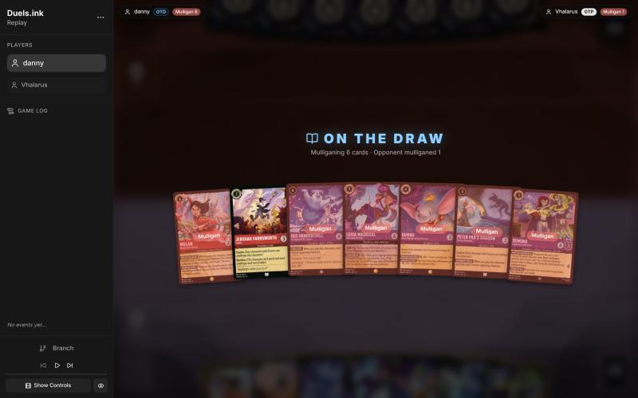
*The board before the decision: [step 0](https://duels.ink/replay/01a13b88-3d62-73be-bd6e-fe6b96da2753?step=0) in the duels.ink replay viewer.* Your opening hand; every card marked "Mulligan" went back.

**What you did:** **Mulliganed 6, kept Jebidiah** (sent back Martial Arts Master, Isis, Luisa – Confident Climber, Dumbo, Shadow, Demona – Imperious Spellcaster)

**Verdict:** **Close call** (*first verdict: good play; changed 2026-11-01 after an independent review, with your agreement*). The mulligan made beats keeping all 7 on every measure (`mulligan.py`, card data for all your cards). But sending back only Isis and Luisa – Confident Climber, an option the review missed, keeps the engines (Dumbo, Martial Arts Master) and Shadow's exert. It's close on curve (3.39 vs 3.70 play turns of 4) and ink (9.29 vs 9.53). The mulligan made leads on early lore (3.7 vs 2.3 by turn 4); the partial one leads on interaction (100% vs 90%) and card quality, which matters against a likely slow sweeper deck ([MULL-3](#cite-mull-3)). Your reason, an opening curve, is sound; neither line is clearly better. Confidence: medium

### Turn 2: your turn 1

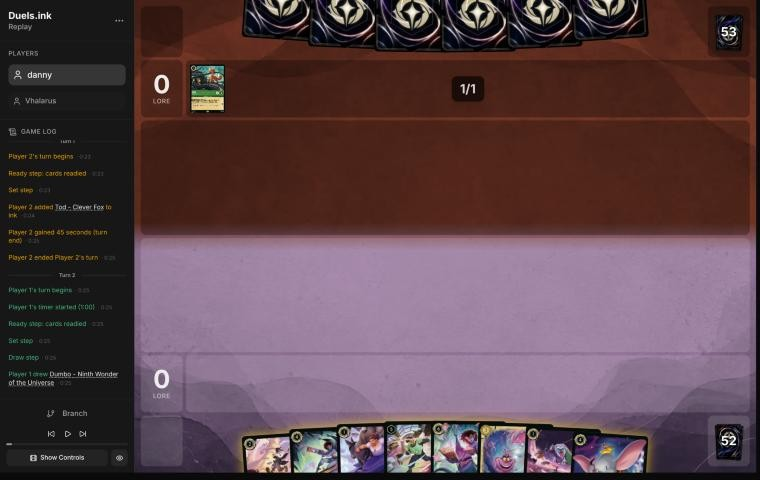
*The board before the decision: [step 5](https://duels.ink/replay/01a13b88-3d62-73be-bd6e-fe6b96da2753?step=5) in the duels.ink replay viewer.*

**What you did:** Inked Rafiki, played Luisa – Pushing Through

**Verdict:** **Good.** Inking the spare 1-drop from an 8-card hand is equivalent to inking Demona – Betrayer

### Turn 4: your turn 2

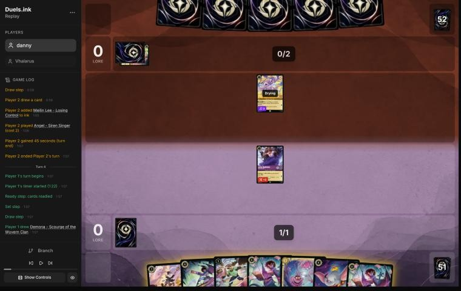
*The board before the decision: [step 11](https://duels.ink/replay/01a13b88-3d62-73be-bd6e-fe6b96da2753?step=11) in the duels.ink replay viewer.*

**What you did:** Inked Demona – Betrayer, played Jebidiah, Luisa quested

**Verdict:** **Good.** Demona – Betrayer is weak while STONE BY DAY keeps her from readying with a big hand. Luisa's quest risked only a free Angel challenge, which she survives

### Turn 6: your turn 3

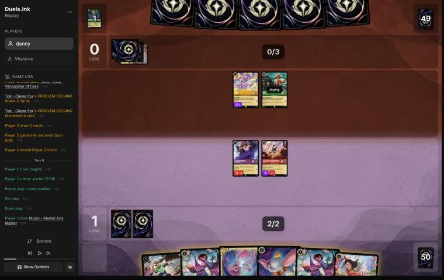
*The board before the decision: [step 19](https://duels.ink/replay/01a13b88-3d62-73be-bd6e-fe6b96da2753?step=19) in the duels.ink replay viewer.*

**What you did:** Inked Martial Arts Master (kept two Demona – Scourge), played Cheshire, Luisa didn't quest

**Verdict:** **Close call, no flag.** *Your reason: keep Demona – Scourge as a Gargoyle that Demona – Imperious Spellcaster's IMPETUS IMPROVISUS can give Rush and Evasive, so she can exert their board and then challenge the same turn.* The coach would have inked the second Demona: two 6-cost refills are clunky, and Martial Arts Master is a 2-lore 4-drop. The second Demona is insurance if the first is answered, though. Keeping Luisa ready gave up 1 lore to avoid a free 2-damage challenge from Angel, which would have set her up for a Malicious, Mean, and Scary kill. Cheshire (4 {W}) was the right play against their pings

### Turn 8: your turn 4

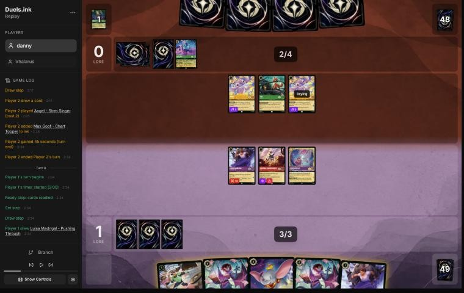
*The board before the decision: [step 25](https://duels.ink/replay/01a13b88-3d62-73be-bd6e-fe6b96da2753?step=25) in the duels.ink replay viewer.*

**What you did:** Inked the second Luisa, played Dumbo, Luisa and Cheshire quested (3–0)

**Verdict:** **Good play.** Against a slow song deck that hadn't quested yet, you're the aggressor ([ROLE-1](#cite-role-1)), and quests can't be punished much. Dumbo is Evasive, so their board can't challenge him. **The risk the coach's setup missed:** Prince Phillip – Vanquisher of Foes had been in their discard since turn 5 (Tod's discard), and Circle of Life (Sing Together 8) plays a character from the discard for free. Their three characters could sing it next turn (two Angels count as 3 each with Singer 3, plus Tod's 3). After Malicious, Mean, and Scary, a reanimated Phillip banishes every damaged character. Odds they had both: about 10% (`odds.py hold 52 4 5` twice, minus `hold 52 8 5`). Add Malicious + To Wither a Flower (about 7%) and Dumbo faced roughly a 15% wipe. Holding him would have wasted 3 ink to protect him in that case alone, and nothing could stop the wipe, since their singers were ready and you had no exert in hand. So playing him was right

### Turn 9: their turn

**What happened:** Malicious, Mean, and Scary; then Angel, Tod and Angel sang **Circle of Life** to play Prince Phillip from the discard, banishing all four of your characters; then Ursula – Vanessa

**Verdict:** - (no decisions of yours). The archetype's namesake combo, at 5 ink

### Turn 10: your turn 5

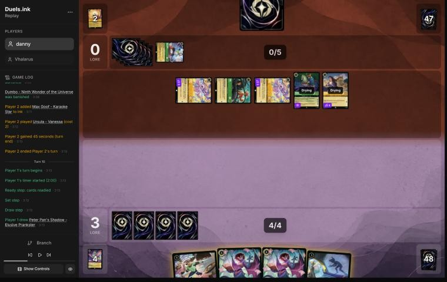
*The board before the decision: [step 36](https://duels.ink/replay/01a13b88-3d62-73be-bd6e-fe6b96da2753?step=36) in the duels.ink replay viewer.*

**What you did:** Inked a Demona – Scourge, played Wasabi

**Verdict:** **Good.** With no board against seven lore a turn, you're playing to your outs ([POS-2](#cite-pos-2)), and Wasabi is your best removal engine. Shadow's exert would have been wasted with no other character to challenge

### Turn 12: your turn 6

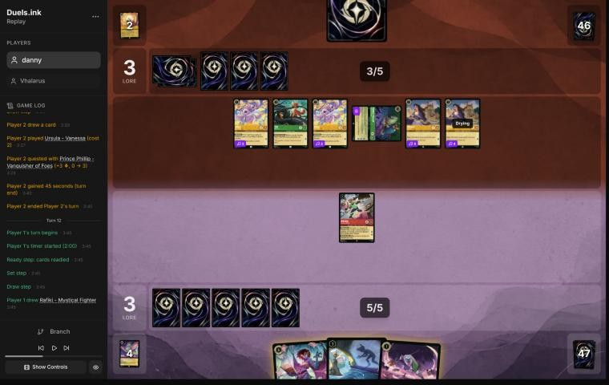
*The board before the decision: [step 42](https://duels.ink/replay/01a13b88-3d62-73be-bd6e-fe6b96da2753?step=42) in the duels.ink replay viewer.*

**What you did:** Shadow exerted an Ursula, Wasabi killed it and TWIN BLADES put 4 on the exerted Phillip; Rafiki played; no ink

**Verdict:** **Good play.** It killed one quester and left Phillip on 2 willpower, setting up Demona next turn. Skipping the ink kept Demona – Scourge and Rafiki, both needed next turn ([INK-3](#cite-ink-3): not automatic). Demona now would have wasted most of her exert, since only Wasabi could challenge, and her refill would have handed them 2 cards

### Turn 14: your turn 7

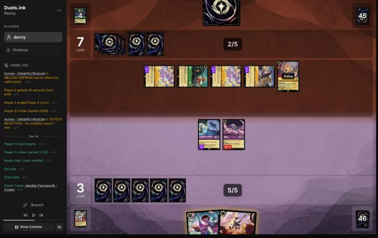
*The board before the decision: [step 56](https://duels.ink/replay/01a13b88-3d62-73be-bd6e-fe6b96da2753?step=56) in the duels.ink replay viewer.*

**What you did:** Inked Jebidiah; Demona – Scourge exerted their board (you drew 3, they drew 2); Rafiki traded with Aurora, Shadow killed Tod

**Verdict:** **Good.** From 3–7 behind, stopping their clock comes first ([QC-5](#cite-qc-5)). Demona went first, so the draws were seen before the challenges ([SEQ-1](#cite-seq-1)). The refill gave them 2 cards, but your hand was empty

### Turn 16: your turn 8

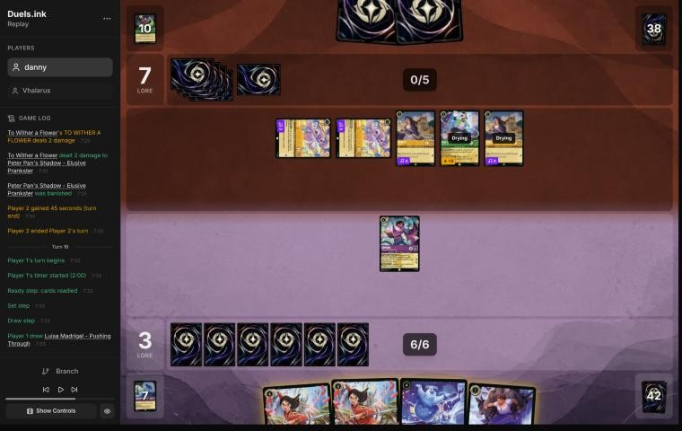
*The board before the decision: [step 69](https://duels.ink/replay/01a13b88-3d62-73be-bd6e-fe6b96da2753?step=69) in the duels.ink replay viewer.*

**What you did:** Isis exerted Max Goof – Karaoke Star (4 lore with 5+ songs in their discard), Demona killed him; Luisa played; no ink

**Verdict:** **Good.** It cut their clock from 8 lore a turn to 4. Holding 2 cards lets Demona ready (STONE BY DAY)

### Turn 18: your turn 9

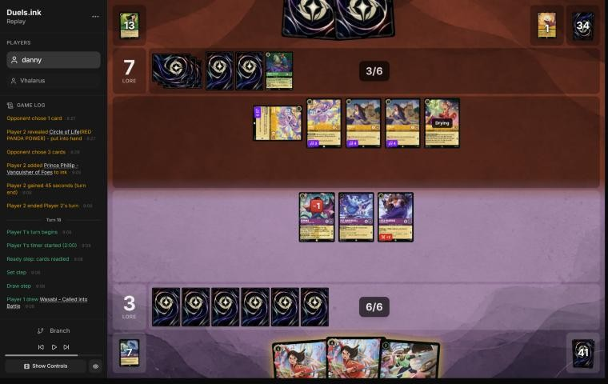
*The board before the decision: [step 81](https://duels.ink/replay/01a13b88-3d62-73be-bd6e-fe6b96da2753?step=81) in the duels.ink replay viewer.* The log shows Circle of Life revealed into their hand on their last turn; Phillip was in their discard.

**What you did:** Martial Arts Master's WAY OF THE HERO on Isis, Isis killed an Angel (drew Jebidiah), Jebidiah played; Demona and Luisa quested (6–7)

**Verdict:** **Mistake** (low-medium confidence; *revisited 2026-11-01 after your arguments: the odds corrected, your card and lore credited, confidence lowered from medium*). Playing into a known Phillip return: on turn 17 **Circle of Life was revealed into their hand**, with Phillip in their discard, so next turn every damaged character could be banished. Challenging with Isis damaged her, and questing exposed Luisa to a challenge that damages her first. **Better:** Demona, already damaged, kills the exerted Angel (the only singer you could challenge, so the same singer dies either way). Isis and Luisa stay ready and undamaged, and Wasabi comes down. **Two cases:** (1) **They can damage your whole board, about 43%:** Malicious, Mean, and Scary or Don Karnage – Debonair Pirate, in their hand and draw or found with Meilin Lee, Tod, Akood et Emuti or Strike a Good Match (a simulation of their turn 19 with 7 ink; `odds.py dig`). Every line loses its board and the game; your line keeps Wasabi in hand, the better line loses him. (2) **They can't, about 57%:** Phillip only banishes damaged characters. The better line loses Demona, then Martial Arts Master's +2 makes Wasabi 6 strength and TWIN BLADES kills Phillip on turn 20. Your line loses Isis, Demona and probably Luisa, and Phillip lives until turn 22. Your line's gains, a card (WAY OF THE HERO on Isis) and 3 lore, don't make up for case 2. Killing the Angel didn't stop Circle of Life: the two Ursulas alone sing it. [THREAT-3](#cite-threat-3), [POS-2](#cite-pos-2)

### Turn 19: their turn

**What happened:** Malicious, Mean, and Scary pinged all five; Circle of Life (two Ursulas) returned Phillip, banishing everything; they quested to 9

### Turn 20: your turn 10

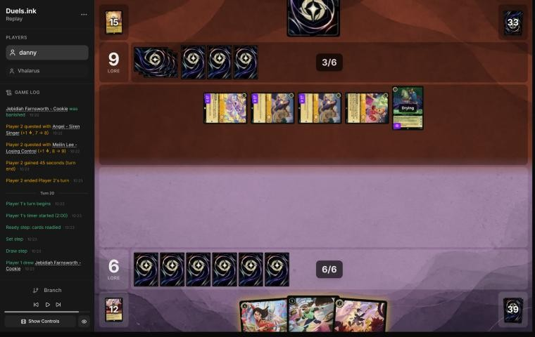
*The board before the decision: [step 94](https://duels.ink/replay/01a13b88-3d62-73be-bd6e-fe6b96da2753?step=94) in the duels.ink replay viewer.*

**What you did:** Jebidiah, inked Martial Arts Master, Wasabi

**Verdict:** **Unwinnable from here** ([principle 2](#cite-principle-2)). At 6–9 with no board, against 7 lore a turn, they reach 20 by turn 23, and nothing you play can quest before turn 22

### Turn 22: your turn 11

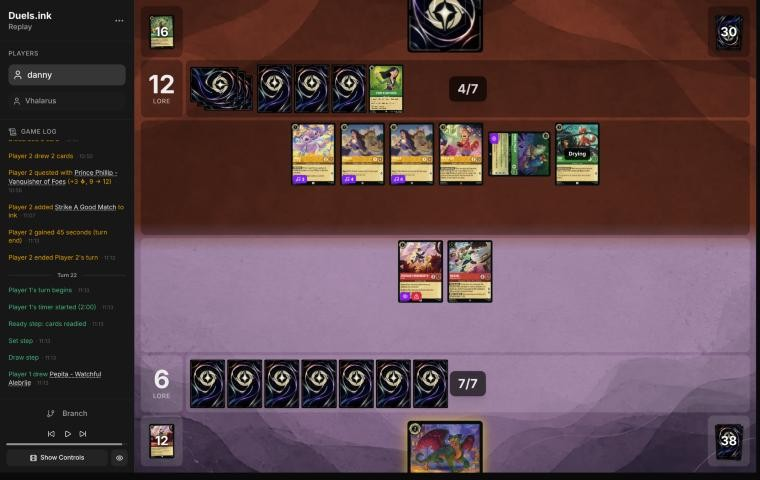
*The board before the decision: [step 103](https://duels.ink/replay/01a13b88-3d62-73be-bd6e-fe6b96da2753?step=103) in the duels.ink replay viewer.*

**What you did:** Pepita; Wasabi quested (8); Jebidiah's forced challenge into Phillip; conceded at 8–12

**Verdict:** Unwinnable; conceding was reasonable
## Lessons
1. **Circle of Life's engine is a discard-pile combo.** They discard Prince Phillip – Vanquisher of Foes (Tod, Max
   Goof – Karaoke Star, Strike a Good Match). Then Malicious, Mean, and Scary damages your board, and Circle of
   Life (Sing Together 8) replays Phillip for free, banishing every damaged character. With two Angels (Singer 3)
   and a Tod, it came on turn 9 at 5 ink. **Once Phillip is in their discard, count their singers.** Two Ursulas
   (Singer 4) are 8 by themselves.
2. **A revealed card is a known card.** Meilin Lee's search revealed Circle of Life on turn 17. From then on,
   plan for it: keep characters ready and undamaged, don't add more, and set up your answer to Phillip.
3. **WAY OF THE HERO feeds TWIN BLADES.** Martial Arts Master's +2 {S} makes Wasabi deal 6 to a second target.
   That kills Phillip (6 {W}) without challenging him, so Evasive doesn't matter.
4. **Max Goof – Karaoke Star quests for 4** once 5+ songs are in their discard. Kill him first (turn 16 did).
5. **Count every card that does the job, then add their dig** (revisit of turn 18). Phillip needs your characters
   damaged first: Malicious, Mean, and Scary and Don Karnage – Debonair Pirate both do it, and Meilin Lee, Tod,
   Akood et Emuti and Strike a Good Match let them dig for them. 17% for Malicious alone became about 43%
   ([cards that damage the whole board](#cite-kb-cards-board-damage-why-it-matters), [the decision method, section 2](#cite-docs-decision-method-2-set-up-the-turn)).
6. **Mulligan for an opening curve, again ([H-5](#cite-h-5)).** A seven with no 1-drop, two uninkables and three 4-drops
   redrew to a better curve, by the sim.

## Knowledge-base updates (applied after discussion, 2026-11-01)
- **Meta ([notes on this pair](#cite-kb-meta-archetypes-amber-emerald-the-engine), Circle of Life):** the discard-and-replay engine and its timeline; the
  singers (Angel – Siren Singer, Singer 3; Ursula – Vanessa, Singer 4; Tod); Max Goof – Karaoke Star's +3 {L};
  Meilin Lee's reveal; Akood et Emuti's cost reduction; To Wither a Flower after a ping.
- **Strategy:** [H-5](#cite-h-5), second piece of evidence (the hand had a turn-2 play, so the hypothesis may need broadening
  to "can't spend its ink on turns 1–4").
- **Rules ([a ruling](#cite-kb-rules-rulings-singer-counts-toward-sing-together)):** Singer counts toward Sing Together totals. [CR 8.11.1](#cite-cr-8-11-1): Singer pays "the alternate cost of
  a song card as though they had cost N", and Sing Together is an alternate cost. The duels.ink engine let Angel,
  Tod and Angel (ink cost 7) sing the 8-cost Circle of Life (frame 32).
- **Tools (`brief.py`), built during the discussion:**
  - lists the opponent's **known hand cards** (revealed by searches like Meilin's) and counts them as held
  - flags characters in their discard that a recursion card in their list can replay
  - shows their characters' Sing Together total for next turn
  - `meta.py` auto-tags "play/return a character from your discard" as recursion

  Checked on this game: turn 8 shows the replayable Phillip and a singing total of 9, and turn 18 shows
  Circle of Life as known in hand.

## Hindsight
Doesn't change the verdicts above.
- **Both wipes needed them to find a damage card:** about 10% on turn 9, and about 43% on turn 19 once their dig
  is counted. They had Malicious, Mean, and Scary. The coach's turn-18 line would have lost its board too, Wasabi
  included, while yours kept Wasabi in hand; the game was out of reach either way, so the mistake didn't change
  this game's result.
- **They discarded Phillip to Tod on turn 5,** four turns before replaying him.
- **After turn 19 they quested only with Phillip on turn 21** (9 → 12). The game was already out of reach.

## The coach's errors

| When | Error | How it was caught | Fix |
|---|---|---|---|
| Pre-game | Planned to keep 7 | Your mulligan, then a simulation | [H-5](#cite-h-5) evidence |
| Turn [18](#turn-18) | Gave a 17% chance they could damage your whole board: it counted only Malicious, Mean, and Scary, and only their hand and draw. Missed Don Karnage – Debonair Pirate, which does the same on play, and their dig (Meilin Lee, Tod, Akood et Emuti, Strike a Good Match): about 43%. Also said both lines lose the board in that case without noting that only yours keeps Wasabi | Your arguments, 2026-11-01 | Verdict revisited, confidence lowered; the brief counts board-damage cards together and lists their dig; `odds.py dig`; [cards that damage the whole board](#cite-kb-cards-board-damage-why-it-matters); [method doc section 2](#cite-docs-decision-method-2-set-up-the-turn) and recurring errors |
| Turn [8](#turn-8) | The setup named Malicious + To Wither a Flower, but not Circle of Life → Phillip from the discard. Phillip had been in their discard since turn 5, and the coach never read the namesake card's text | The turn-9 wipe; checked from turn-8 information afterwards | Lesson 1; the brief flags replayable characters in the discard; the skill reads the archetype's key cards before the game |

## Discussion (2026-11-01)
- **Mulligan:** the same reason as against Shinobana, an opening curve. A second piece of evidence for [H-5](#cite-h-5).
- **Turns 8 and 18:** you missed the information both times, Phillip going to their discard and Circle of Life
  being revealed into their hand. The turn-18 verdict stands. In your words, the key point was to play Wasabi:
  challenge into a non-Evasive character and use TWIN BLADES to finish off Prince Phillip.
- **Turn 6:** you kept the second Demona – Scourge for the Rush and Evasive option. Recorded; still a close call.
- **Follow-up:** both missed facts now appear in the decision brief (known hand cards, replayable characters in
  the discard), so a reviewer, or a future live coach, sees them at the turn they became knowable.

**Turn 18, revisited (2026-11-01).** You argued three things:
- **Wasabi would have been wiped too,** because the deck damages every character before Circle of Life. Partly
  accepted. The review counted only Malicious (17%); with Don Karnage and their dig it was about 43%. In those games
  every line loses its board and the game. In the other 57%, an undamaged Wasabi survives Phillip and kills him the
  next turn, so playing him is still right.
- **Wasabi needs an ink drop for 6 strength:** withdrawn. Martial Arts Master's WAY OF THE HERO gives the +2.
- **The Isis challenge cut their singers and drew a card.** The card and the 3 lore from questing are now credited.
  The singer cut was the same in either line (only the exerted Angel could be challenged), and the two Ursulas alone
  sing Circle of Life.

The verdict stays a mistake, with confidence lowered from medium to low-medium.

**Pre-game, revisited (2026-11-01).** A fresh coach session, reviewing this game blind from the repository alone,
argued for keeping the engines and sending back only Isis and Luisa – Confident Climber. You agreed to grade the
mulligan a **close call**. The mulligan should be judged on curve, early lore pressure and setting the opponent back,
not ink alone (your guidance), and the simulator now reports all of these.

## Citations
Copies of the coach's knowledge base cited above, as they stood when they were cited (the private repository's commit and date are given with each). They don't change when the knowledge base does.

**MULL-3**: strategy principle, `kb/strategy/principles.md` at `1597d35` (2026-11-01)

> - **MULL-3. The right keep depends on the matchup.** Early interaction against aggro; pressure, draw and engines against slow decks. The mulligan is the first expression of your role. In the Set 14 era the opponent's inks are known before the mulligan (RULE-8), so this applies from game 1 of a match. `[MCL ch.12]` · baseline

**ROLE-1**: strategy principle, `kb/strategy/principles.md` at `1597d35` (2026-11-01)

> - **ROLE-1. The matchup decides your role, not your deck.** In nearly every game one player wants it short (aggressor) and one wants it long (defender). The same list can play either role. *Ask: "Which deck benefits if this game goes long?"* `[MCL ch.8]` · baseline

**POS-2**: strategy principle, `kb/strategy/principles.md` at `1597d35` (2026-11-01)

> - **POS-2. From behind, play to your outs and accept calculated risk.** Safe efficient play from a losing position loses slowly. A line with a 30% chance beats a line with 0%. *Ask: "What has to happen for me to win, and which play makes it most likely?"* `[MCL ch.10]` · baseline

**INK-3**: strategy principle, `kb/strategy/principles.md` at `1597d35` (2026-11-01)

> - **INK-3. Usually ink every turn, but not automatically.** Keeping one more playable card can beat one more ink. Missing ink with an expensive hand can leave you permanently behind. `[MCL ch.4]` · baseline

**QC-5**: strategy principle, `kb/strategy/principles.md` at `1597d35` (2026-11-01)

> - **QC-5. The race changes everything.** At 18–12 up, take the last 2 lore. At 8–16 down, stopping their close-out matters more than your quests. `[MCL ch.6]` · baseline

**SEQ-1**: strategy principle, `kb/strategy/principles.md` at `1597d35` (2026-11-01)

> - **SEQ-1. Gather information before irreversible decisions.** Draw, look and scry before choosing what to ink. Quest with draw triggers before committing other plays when the order doesn't otherwise matter. `[MCL ch.5]` · baseline

**THREAT-3**: strategy principle, `kb/strategy/principles.md` at `1597d35` (2026-11-01)

> - **THREAT-3. The biggest threat may not be on the board yet.** Consider:
>   - the opponent's ink next turn
>   - shift targets already in play
>   - support pieces that enable their next turn
>
>   `[MCL ch.9]` · baseline

**H-5**: hypothesis, `kb/strategy/hypotheses.md` at `1597d35` (2026-11-01)

> ### H-5. A hand that can't make an opening curve can be worth a deep mulligan, even with a decent core
> - **Claim:** if the opening seven can't spend its ink on turns 1–4 (no early character, or no 1-drop with
>   uninkables and clumped 4-drops), a deep or full mulligan for an opening curve can beat keeping a reasonable core
>   (e.g. two 3-drops and card draw).
> - **Why:** mulligan replacements come from the cards *not* in your hand (CR 2.2.2, draw before shuffling). A seven
>   holding none of your cheap characters leaves all of them in the redraw pool, so the new cards are richer in
>   exactly what the hand lacks. Keeping part of the hand also keeps its cards' share of the next draws away from
>   the cheap ones.
> - **Evidence for:** 01a14574 (vs Shinobana, game 2), pre-game. Seven of Demona – Scourge, Cheshire ×2, Ursula,
>   Mulan – Elite Archer ×2 and Guidebook, on the play against Ducktectives. Simulated over 20,000 deals:
>   - same ink spent on turns 1–4: 9.31 (full mulligan) vs 9.25 (keep Demona, Cheshire ×2, Guidebook)
>   - character by turn 2: 97% vs 79%
>   - characters in play by turn 3: 2.9 vs 2.0
>
>   The user's reasoning: "no characters until turn 3, so I'm doing the full mulligan to try to have an opening curve."
> - **Evidence for:** 01a13b88 (vs Vhalarus, Amber/Emerald Circle of Life), pre-game, on the draw. Seven of Martial
>   Arts Master, Jebidiah, Isis, Luisa – Confident Climber, Dumbo, Shadow and Demona – Imperious Spellcaster: no 1-drop,
>   two uninkables, three 4-drops. The user kept only Jebidiah. Simulated (the five unknown Set 14 cards modelled as
>   1-cost or 3-cost characters):
>   - ink spent on turns 1–4: 9.63 / 9.55 vs 9.24 / 9.15 for keeping 7
>   - characters by turn 4: 4.9 / 4.4 vs 3.8 / 3.6
>
>   The user confirmed the same reasoning (an opening curve), 2026-11-01.
> - **Caveat: the goal isn't maximum ink spend** (user, 2026-11-01). Compare options on curve (a play each turn),
>   early lore pressure, interaction that sets the opponent back, and ink use, then weigh card quality and the
>   matchup. `python3 tools/mulligan.py <replay> --plan --keep "…"` reports the first four for any replay (the original
>   sims were ad hoc scripts, since lost; the tool reproduces their numbers). It can't judge card quality or engines.
>   With the replay card cache (2026-11-01), the user's Set 14 cards have data, so no costs are guessed for these two
>   games:
>   - **01a14574:** the full mulligan led on every measure. Against keeping Demona, Cheshire ×2 and Guidebook: ink
>     9.27 vs 9.18, play turns 3.65 vs 3.37 of 4, lore by turn 4 3.9 vs 2.4, interaction 60% vs 45%.
>   - **01a13b88:** the mulligan made (keep Jebidiah) led on curve and early lore against keeping the engines (Martial
>     Arts Master, Jebidiah, Dumbo, Shadow, Demona – Imperious Spellcaster): play turns 3.70 vs 3.39, lore by turn 4 3.7
>     vs 2.3. The engines option led on interaction (100% vs 90%) and kept Dumbo.
> - **Evidence against:** an independent blind review of 01a13b88 by a fresh coach session (2026-11-01) argued that
>   this hand had a turn-2 play and engines (Dumbo, Martial Arts Master).
>   - **Sending back only Isis and Luisa – Confident Climber** spends 9.29 ink on turns 1–4 (vs 9.51 for the full
>     mulligan, `mulligan.py`) and keeps the engines.
>   - **Against a likely slow sweeper deck** (Circle of Life, 60%), card quality matters more than early bodies
>     (MULL-3), and most of the extra bodies are 0-strength 1-drops.
>   - **So the broadened claim may be too broad.** It fits hands with no early play (01a14574) better than hands with
>     a turn-2 play and engines. The user agreed to grade 01a13b88's mulligan a close call (2026-11-01).
> - **Status:** open. Supported for hands with no early character (01a14574). For hands with an early play and
>   engines, test the partial mulligans first; there it's a close call (01a13b88).

**principle 1**: coaching principle, `CLAUDE.md` at `1597d35` (2026-11-01)

> 1. **Judge decisions, not outcomes.** A decision is good if it maximised the probability of winning from
>    the information available at the time. A play that lost can be correct; a play that won can be a
>    mistake. Never use the result of a game, or of a later turn, as evidence that a decision was good or bad.

**principle 2**: coaching principle, `CLAUDE.md` at `1597d35` (2026-11-01)

> 2. **Some games are unwinnable.** Draws and matchups can make a game lost whatever the player does. Say so
>    when it's true, rather than inventing mistakes to explain a loss.

**CR 8.11.1**: Comprehensive Rules, `kb/rules/cr/08-keywords.md` at `1597d35` (2026-11-01)

> **8.11.1.** The Singer keyword represents a static ability that allows a player to pay an alternate cost to sing a song. Singer N means “This character can {E} to pay the alternate cost of a song card as though they had cost N instead of their normal ink cost.”

**amber-emerald.md, The engine**: knowledge base, `kb/meta/archetypes/amber-emerald.md` at `1597d35` (2026-11-01)

> ### The engine: discard Phillip, then replay him `[coach + user, one game]`
> 1. **Put Prince Phillip – Vanquisher of Foes (9) in the discard.** Tod – Clever Fox (draw 2, discard 1), Max Goof –
>    Karaoke Star (discard a song, draw 2) and Strike a Good Match (draw 2, discard 1) all do it. In 01a13b88 Tod
>    discarded him on turn 5.
> 2. **Damage your board:** Malicious, Mean, and Scary puts 1 damage on each of your characters; so does Don Karnage
>    – Debonair Pirate when played (6, or 4 by Shift onto Don Karnage – Khan's Courier). A character already damaged,
>    or exerted (so it can be challenged), doesn't need this step.
> 3. **Circle of Life** (song 8, Sing Together 8): "Play a character from your discard for free." Phillip's SWIFT AND
>    SURE then banishes every damaged character you have.
>
> - **When it can come:** as soon as Phillip is in the discard, their characters total 8 for Sing Together, and they
>   can pay 3 for Malicious or sing it.
>   - Singer counts toward Sing Together (`kb/rules/rulings.md`). Angel – Siren Singer (Singer 3) ×2 plus Tod made 9
>     on turn 9, at 5 ink. Two Ursula – Vanessa (Singer 4) make 8 alone.
>   - It happened twice in 01a13b88: turn 9 (four characters) and turn 19 (five).
> - **How likely the wipe is next turn** `[coach + user, 01a13b88 turn 18, revisited 2026-11-01]`: count the damage
>   cards together (Malicious and Don Karnage, plus Max Goof – Rebellious Teen, which takes Malicious back from their
>   discard), then add their dig. Meilin Lee (top 4, takes a song, so finds Malicious and Circle of Life), Tod, Strike
>   a Good Match, Max Goof – Karaoke Star and Akood et Emuti all let them see more cards first, and Akood also makes Don
>   Karnage cost 4. On 01a13b88 turn 18 that was about 43%, against 17% for Malicious in their hand and draw alone
>   (`kb/cards/board-damage.md`).
> - **What to do:**
>   - **Watch their discard for Phillip and count their singing total.** The decision brief shows both.
>   - The turn before, keep characters ready and undamaged where possible, and don't add more than you need.
>   - Hold the answer to the returning Phillip (6/6/3, Evasive). Wasabi's TWIN BLADES, boosted by Mulan – Martial Arts
>     Master's +2 {S}, deals 6 to him without challenging him.
> - **Known cards:** Meilin Lee – Losing Control's RED PANDA POWER reveals a song or Red Panda into their hand. On turn
>   17 it revealed Circle of Life, so it was a known card from then on.

**board-damage.md, Why it matters**: knowledge base, `kb/cards/board-damage.md` at `1597d35` (2026-11-01)

> ## Why it matters `[coach + user, Vhalarus review, 2026-11-01]`
> **"Banish damaged" sweepers need damage first.** Prince Phillip – Vanquisher of Foes and To Wither a Flower only hit
> characters that are already damaged. A ready, undamaged character is safe from them, and so is a character in hand,
> unless the opponent also finds a card from the first table. So:
> - **Count every card in the first table that their inks and archetype run, together** (the brief's "Damage to EVERY
>   opposing character" line). On Vhalarus turn 18 the review counted only Malicious, Mean, and Scary (17%), and
>   missed Don Karnage – Debonair Pirate.
> - **Then add their dig** (docs/decision-method.md): with Meilin Lee, Tod, Akood et Emuti and Strike a Good Match,
>   the chance they could damage the whole board was about 43%, not the 27% from their hand and draw alone.
> - **Characters that do it on play can be Shifted in cheaply:** Don Karnage – Debonair Pirate and Tinker Bell – Giant
>   Fairy both have Shift 4. Don Karnage – Khan's Courier (1 cost) is in the Circle of Life list as a Shift base.
> - **Songs can be sung for free,** so they need no ink: a ready character of cost 3+ (or Singer 3+) sings Malicious,
>   Mean, and Scary.

**decision-method.md, 2. Set up the turn**: knowledge base, `docs/decision-method.md` at `1597d35` (2026-11-01)

> ## 2. Set up the turn: constraints and resources
> Write this down before looking at what was played (`--plan`).
> 1. **The race.** Lore for both sides and what each board quests for (`tools/odds.py clock`). Who is the aggressor:
>    which deck wants the game long (ROLE-1)? Has that changed (ROLE-2)?
> 2. **The opponent's next turn.** They will have one more ink (if they have a card to ink) and every character ready.
>    List what they can do with that:
>    - removal and sweepers at that ink, with the chance they hold each (`held` in the brief). **Count every card that
>      does the same job together,** not just the first one you think of. For a "banish damaged" wipe (Prince
>      Phillip), that's every card that damages all your characters: the brief's "Damage to EVERY opposing character"
>      line, and `kb/cards/board-damage.md` for the full list, including characters that do it on play (Don Karnage
>      – Debonair Pirate, Tinker Bell – Giant Fairy).
>    - **their dig.** `held` covers their hand plus one draw. Draw and search cards (Tod – Clever Fox draws 2, Meilin
>      Lee looks at 4 and takes a song, Akood et Emuti draws 1) let them see more before they choose their play. The
>      brief lists them and prints an `odds.py dig` command for the damage cards. It ignores ink, so it runs high:
>      check what their ink allows, lower `--plays` when it's tight, leave out dig cards that can't find the target, and
>      count a card that takes the target back from their discard as a copy.
>      *Example:* 01a13b88 turn 18. Malicious alone was 17%; with Don Karnage 27%; with their dig about 43%.
>    - their free singers: any character of cost ≥ the song's cost, Singer N, and Sing Together totals
>    - cards known in their hand
>    - characters in their discard that their list can replay
>    - expensive cards that become castable now. A card that costs exactly their next ink, held through a turn with ink
>      to spare, is a candidate.
>    - what can challenge your characters. Only exerted characters can be challenged, unless card text says otherwise
>      (Shere Khan – Khan Industries CEO); Evasive stops all but Evasive and Alert attackers.
> 3. **Your resources.** Ink this turn, what's inkable, what's castable, who is dry and ready, the legal challenges with
>    damage (the brief's options section). **Read the full text of every card in hand and every card a line uses.**
> 4. **What must happen.** Must-kill characters, lore that must be stopped, a wipe to play around, a lethal to set up.

**rulings.md, Singer counts toward Sing Together**: knowledge base, `kb/rules/rulings.md` at `1597d35` (2026-11-01)

> ### Singer counts toward Sing Together totals
> - **Situation:** Circle of Life (song 8, Sing Together 8) sung by Angel – Siren Singer ×2 (ink cost 2, Singer 3) and
>   Tod – Clever Fox (ink cost 3). By ink cost that's 7; counting Singer it's 9.
> - **Ruling:** the song was sung. Singer N counts as cost N when paying a song's alternate cost, and Sing Together
>   is an alternate cost, so a Singer contributes N to the Sing Together total.
> - **Basis:** CR 8.11.1 (Singer: "pay the alternate cost of a song card as though they had cost N"), 8.12.1–8.12.2
>   (Sing Together's alternate cost), 8.11.3 (modifiers to Singer combine).
> - **Confidence:** derived from CR and confirmed by duels.ink's engine (replay 01a13b88, frame 32). Not an official
>   ruling.
> - **Added:** 2026-11-01, from the review of 01a13b88 (vs Vhalarus), turn 9.
