# Review: danny vs Shinobana (game 2 of 3), 16 Oct 2026

| | |
|---|---|
| **Status** | final (discussed 2026-10-26) |
| **Replay** | `01a14574-b9de` (`python3 tools/brief.py 01a14574 --turn N`) · [duels.ink viewer](https://duels.ink/replay/01a14574-b9df-7dd3-8aa9-26a2d2c05d1e?step=0) |
| **Format** | Ranked Core Constructed, best-of-three, game 2. Set 14 era: inks revealed before the coin toss |
| **Decks** | You: Amethyst/Ruby. Them: Sapphire/Steel ([the coach's notes on this pair](#cite-kb-meta-archetypes-sapphire-steel-how-it-plays)), **Ducktectives**, known from game 1 |
| **Play/draw** | You went first (your choice, after losing game 1) |
| **Result** | **Win.** They conceded on turn 20 at 8–18, with an empty hand, facing four questers |
| **Meta data** | snapshot of 2026-10-26 (fresh; 10 days after this game) |
| **Reviewed** | 2026-10-26: blind pass by the coach (`analyse-replay`, first run), then discussed with you |

Verdicts judge each decision on what you could know at the time, **including archetype knowledge an experienced
player has**. Hindsight is kept to its own section. Severity scale: good play / close call /
inaccuracy / mistake / blunder. Principle IDs and hypotheses (H-n) link to copies
in the Citations section at the end, as they stood when they were cited.

**What you knew from game 1** (a loss by concession after 23 turns; they went first): their list is Sapphire/Steel
Ducktectives. Cards seen: Darkwing Duck – Crime Fighter and – Drake Mallard (Ward), Nick Wilde – Sly Fox Sleuth,
Daisy Duck – Ghost Finder (Support), Inspector Tezuka (Bodyguard), Launchpad, Francine (Resist 1), Judy Hopps – On
the Case, – Uncovering Clues and – Lead Detective (Detectives gain Alert and Resist +2 on their turn), Woolter &
Jesse (Bodyguard, Challenger +2), Shere Khan – Khan Industries CEO (a chosen character can challenge **ready**
characters that turn), Goliath (hand to 2 at each end of turn), and removal: The Terror That Flaps in the Night
(2 or 3 damage), Strength of a Raging Fire (damage equal to their character count) and Let It Go.

## Your decisions, turn by turn

| Game turn (yours) | Decision | Verdict | Board |
|---|---|---|---|
| Pre-game | Chose to go first (you lost game 1, so it was your choice) | **Good.** Going first wins 56.6% in this queue, and both decks want early board ([RULE-7](#cite-rule-7)) | [screenshot](screenshots/01a14574/turn0-step0-opening-hand.jpg) · [step 0](https://duels.ink/replay/01a14574-b9df-7dd3-8aa9-26a2d2c05d1e?step=0) |
| Pre-game | **Mulliganed all 7** (Demona – Scourge, Cheshire ×2, Ursula, Mulan – Elite Archer ×2, Guidebook) | **Good play, and it beat the coach's plan** (mulligan 3: keep Demona, Cheshire ×2, Guidebook). Simulated over 20,000 deals: ink spent on turns 1–4 is the same (9.31 vs 9.25 of 10), but a character by turn 2 rises from 79% to 97%, and characters in play by turn 3 from 2.0 to 2.9. The original seven held none of your 1- and 2-cost characters, so the other 53 were rich in them. Against an aggressive Detective deck the early board matters most ([MULL-2](#cite-mull-2), [MULL-3](#cite-mull-3)). It gave up Demona's refill ([H-1](#cite-h-1)) and Cheshire's 3/4 body. Confidence: medium-high (the sim plays greedily and ignores card quality). *Your reason: no character until turn 3, so redraw for an opening curve* | [screenshot](screenshots/01a14574/turn0-step0-opening-hand.jpg) · [step 0](https://duels.ink/replay/01a14574-b9df-7dd3-8aa9-26a2d2c05d1e?step=0) |
| 1 (1) | Inked Demona – Imperious Spellcaster, played Mulan – Injured Soldier | **Good.** Demona is the weakest early card: STONE BY DAY keeps her from readying with a full hand. Shadow and Isis can't be inked, so the inkable cards had to supply the curve | [screenshot](screenshots/01a14574/turn1-step2-before-mulan.jpg) · [step 2](https://duels.ink/replay/01a14574-b9df-7dd3-8aa9-26a2d2c05d1e?step=2) |
| 3 (2) | Inked the second Mulan – Injured Soldier, played Jebidiah, Mulan quested | **Good.** The 1-cost character was the spare card. Questing risked only an even 1-cost-for-1-cost trade with Darkwing | [screenshot](screenshots/01a14574/turn3-step8-before-jebidiah.jpg) · [step 8](https://duels.ink/replay/01a14574-b9df-7dd3-8aa9-26a2d2c05d1e?step=8) |
| 5 (3) | Inked Mulan – Martial Arts Master; Shadow exerted Darkwing – Crime Fighter and Mulan – Injured Soldier traded with it | **Good play** (*upgraded from close call after your explanation*). Darkwing was worth more to them than your Mulan was to you. While a Darkwing is in play, Launchpad's draw needs no discard ("…unless you have a character named Darkwing Duck in play"), and Terror deals 3 instead of 2. Your Mulan had no Elite Archer in hand to Shift onto her. Shadow's Evasive body also set up lore and Dumbo's draw ability next turn. The coach's alternative (quest for +1 and let them choose the trade) missed the Launchpad link. Inking Martial Arts Master over Hades: close. Hades fits the 5-ink turn exactly, but Martial Arts Master was one of the Mulans that Elite Archer (strong against a wide Detective board) can Shift onto | [screenshot](screenshots/01a14574/turn5-step16-before-darkwing-trade.jpg) · [step 16](https://duels.ink/replay/01a14574-b9df-7dd3-8aa9-26a2d2c05d1e?step=16) |
| 7 (4) | Inked Hades, played Dumbo, Shadow quested | **Good.** Isis would have landed with nothing to do: CHILL OUT can't choose Drake Mallard (Ward), and exerting Judy needs a good challenger. Dumbo and Shadow are both Evasive, and nothing of theirs had Evasive or Alert, so only removal threatened them. Next turn both activate. Shadow's quest was safe for the same reason | [screenshot](screenshots/01a14574/turn7-step25-before-dumbo.jpg) · [step 25](https://duels.ink/replay/01a14574-b9df-7dd3-8aa9-26a2d2c05d1e?step=25) |
| 9 (5) | Inked Rafiki, Hades on Judy – Uncovering Clues (they let you draw 2), then quested with Shadow and Dumbo | **Good.** Hades took Judy's search engine and Lead Detective's Shift target, or drew 2. Hades went first so their choice was known before the quests ([SEQ-1](#cite-seq-1)). Questing risked a Lead Detective turn: she Shifts onto Judy for 4 of their 5 ink, and her Alert lets Drake challenge Evasives, about 28% (`tools/odds.py hold 52 4 4`). Dumbo has to exert whenever he's used, so that exposure comes with the engine, and this turn wasn't riskier than the next | [screenshot](screenshots/01a14574/turn9-step33-before-hades.jpg) · [step 33](https://duels.ink/replay/01a14574-b9df-7dd3-8aa9-26a2d2c05d1e?step=33) |
| 11 (6) | Hades challenged and killed Judy – Uncovering Clues (Hades survives on 1 {W}); Shadow quested; inked Mulan – Elite Archer; Ursula + Boost 1 | **Good, and slightly better than the coach's plan.** The coach would have traded Shadow for the exerted Drake Mallard. Questing is right: Shadow is Evasive, and nothing of theirs can challenge her. Their only Alert source, Lead Detective, now has no Judy to Shift onto and costs 6 against their 5 ink, so questing can't be punished by a challenge ([QC-3](#cite-qc-3)). With Ursula Evasive too, you have 4 lore a turn they can only answer with removal. Killing Judy took their search engine and Lead Detective's Shift target. Inking the Archer: no Mulan to Shift onto, and Ward makes Drakes immune to TRIPLE SHOT | [screenshot](screenshots/01a14574/turn11-step46-before-judy-challenge.jpg) · [step 46](https://duels.ink/replay/01a14574-b9df-7dd3-8aa9-26a2d2c05d1e?step=46) |
| 13 (7) | Guidebook played and used first (drew Wasabi, Dumbo), then inked Demona – Scourge, played Dumbo; Ursula and Shadow quested (9–4) | **Good play.** The right order: draw before choosing the ink ([SEQ-1](#cite-seq-1)). Inking Demona was right: her refill would have handed an empty-handed opponent 3 cards. Dumbo over Isis: Dumbo is Evasive, so their board can't touch him, and he gives Ursula and Shadow his draw ability. Isis had no target worth exerting. Not trading Ursula into the damaged St. Canard's Finest kept the race: your Evasives quest 4 a turn and they can only answer with removal from an empty hand | [screenshot](screenshots/01a14574/turn13-step59-before-guidebook.jpg) · [step 59](https://duels.ink/replay/01a14574-b9df-7dd3-8aa9-26a2d2c05d1e?step=59) |
| 15 (8) | Shadow's and Dumbo's draw abilities first (+2 lore, +2 cards), Ursula quested (14), then Wasabi, inked Cheshire, Mulan – Injured Soldier | **Good play** (*first verdict good; revisited to close call after turn 16; back to good after your argument, all from turn-15 information*). Drawing came before inking ([SEQ-1](#cite-seq-1)), and the deployment set up lethal next turn with room to spare: 8 lore against the 6 needed. **The real risk:** they would reach 6 ink with two cards, enough to hard-cast Judy – Lead Detective (about 16%, `odds.py hold 47 4 2`), whose Alert lets every Detective challenge exerted Evasives. The first verdict missed this. **Why exerting anyway was right:** the cautious alternative (only Ursula quests, Dumbo and Shadow stay ready) still loses Ursula to a Lead Detective turn. With nothing exerted to attack, Drake and Nick quest for 2 instead of trading. That leaves roughly 12–10 with Drake alive, against the 14–8 the line played leaves against an empty hand. Without Lead Detective, the line played is lethal next turn even through a removal spell. As you put it, you don't give up that much lore when you're about to close out the game. The setup should still have named the 6-ink Lead Detective ([THREAT-3](#cite-threat-3)) | [screenshot](screenshots/01a14574/turn15-step68-before-exerting.jpg) · [step 68](https://duels.ink/replay/01a14574-b9df-7dd3-8aa9-26a2d2c05d1e?step=68) |
| 17 (9) | Wasabi challenged Nick (TWIN BLADES 4 to Lead Detective), Mulan – Injured Soldier traded with the damaged St. Canard's Finest; Isis and Rafiki played, second Isis held | **Good play, the best of the game.** It wiped their whole board against an empty hand: Lead Detective's Resist only works on their turn, so 4 kills her, and your 1-cost Mulan traded for their 7-cost VICTORY POSE engine ([TRADE-1](#cite-trade-1)). The order made no difference. Questing Wasabi instead would have left Lead Detective to kill him. Holding the second Isis keeps CHILL OUT for a real target and avoids overextending from far ahead ([POS-1](#cite-pos-1)) | [screenshot](screenshots/01a14574/turn17-step81-before-wasabi.jpg) · [step 81](https://duels.ink/replay/01a14574-b9df-7dd3-8aa9-26a2d2c05d1e?step=81) |
| 19 (10) | Isis exerted the freshly played Shere Khan; Tramp took Rush (GIVE CHASE) and traded with him; Wasabi, Isis and Rafiki quested (18) | **Good play, and better than both of the coach's options.** The coach would either quest to 18 or trade Rafiki with Shere Khan and quest to 17. Tramp's Rush did both: their board went back to empty and you still reached 18, so turn 21 was lethal against a topdecking opponent. The coach missed it by not reading Tramp's text | [screenshot](screenshots/01a14574/turn19-step90-before-isis-tramp.jpg) · [step 90](https://duels.ink/replay/01a14574-b9df-7dd3-8aa9-26a2d2c05d1e?step=90) |
| 20 (their turn) | They played Goliath, then conceded | - | - |

**Summary:**
- **Good plays:** every decision: the play/draw choice, the full mulligan, and turns 1–19. Turns 17 (the board
  wipe) and 19 were the best of the game.
- **Close calls:** only the turn-5 ink choice (Martial Arts Master or Hades).
- **Inaccuracies / mistakes / blunders:** none.
- **Your lines beat the coach's plan** on the mulligan and on turns 11 and 19.
- **Verdicts changed in discussion:** turn 5 (close call → good) and turn 15 (close call → good), both on your
  arguments.

The decisive stretch was turns 13–17. Your Evasives raced while their removal ran out, and the turn-17 wipe left
them with nothing.

## Screenshots
The board when each decision was made, before the action the verdict is about (added 2026-11-01). Click a step to open it in the duels.ink viewer.

**Pre-game: you chose to go first and mulliganed all 7** ([step 0](https://duels.ink/replay/01a14574-b9df-7dd3-8aa9-26a2d2c05d1e?step=0)). Your opening hand; every card marked "Mulligan" went back.

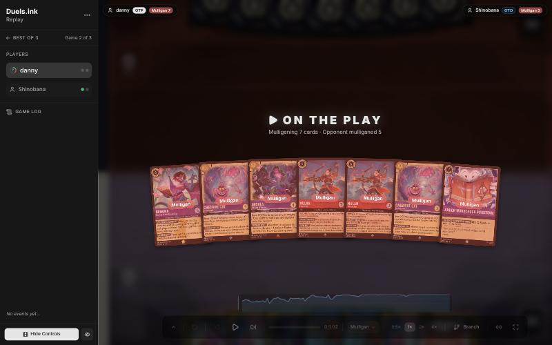

**Turn 1: inked Demona – Imperious Spellcaster, played Mulan – Injured Soldier** ([step 2](https://duels.ink/replay/01a14574-b9df-7dd3-8aa9-26a2d2c05d1e?step=2))

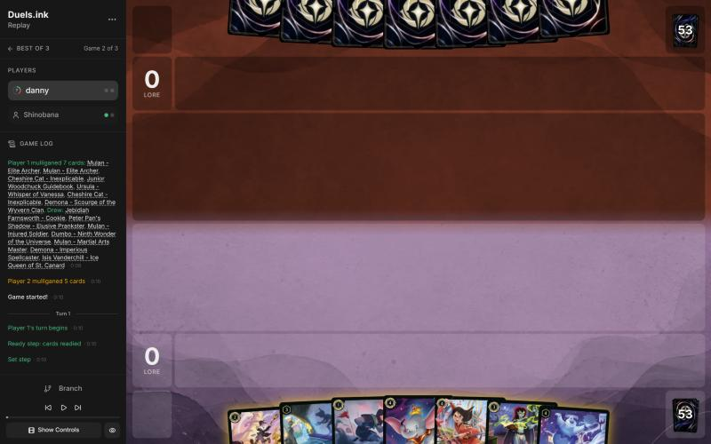

**Turn 3: inked the second Mulan – Injured Soldier, played Jebidiah, Mulan quested** ([step 8](https://duels.ink/replay/01a14574-b9df-7dd3-8aa9-26a2d2c05d1e?step=8))

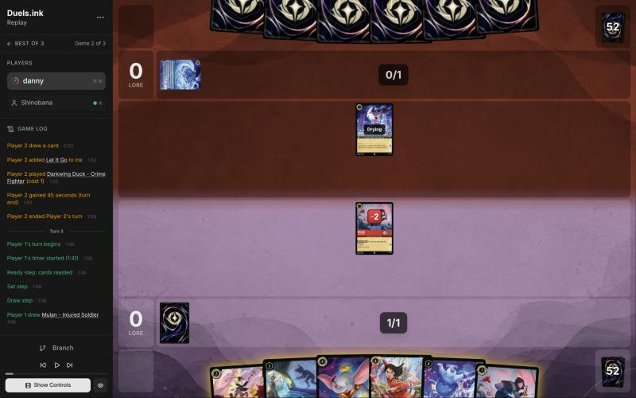

**Turn 5: Shadow exerted Darkwing and Mulan traded with it** ([step 16](https://duels.ink/replay/01a14574-b9df-7dd3-8aa9-26a2d2c05d1e?step=16))

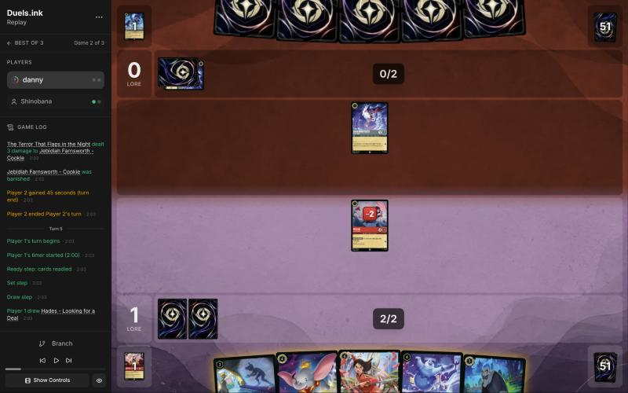

**Turn 7: Dumbo rather than Isis; Shadow quested** ([step 25](https://duels.ink/replay/01a14574-b9df-7dd3-8aa9-26a2d2c05d1e?step=25))

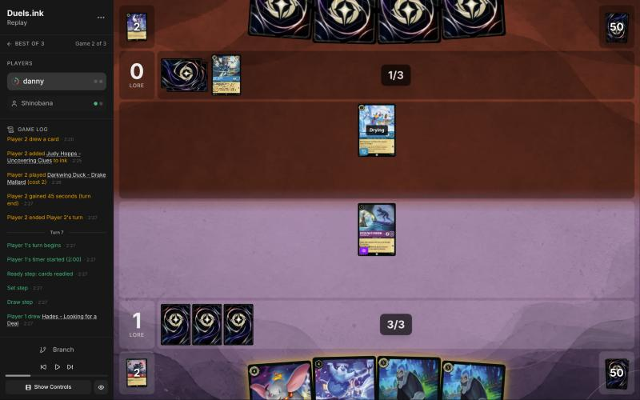

**Turn 9: Hades on Judy – Uncovering Clues, then Shadow and Dumbo quested** ([step 33](https://duels.ink/replay/01a14574-b9df-7dd3-8aa9-26a2d2c05d1e?step=33))

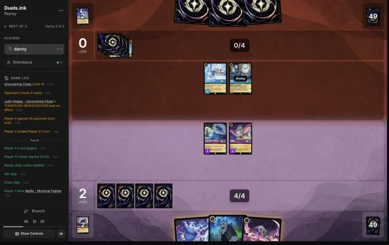

**Turn 11: Hades challenged Judy; Shadow quested; Ursula** ([step 46](https://duels.ink/replay/01a14574-b9df-7dd3-8aa9-26a2d2c05d1e?step=46))

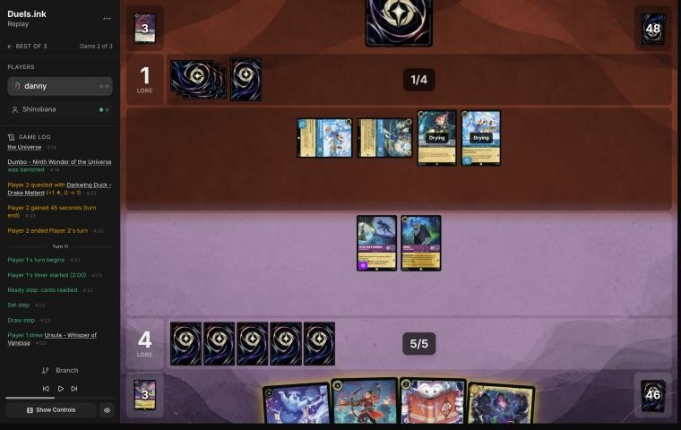

**Turn 13: Guidebook first, inked Demona – Scourge, played Dumbo** ([step 59](https://duels.ink/replay/01a14574-b9df-7dd3-8aa9-26a2d2c05d1e?step=59))

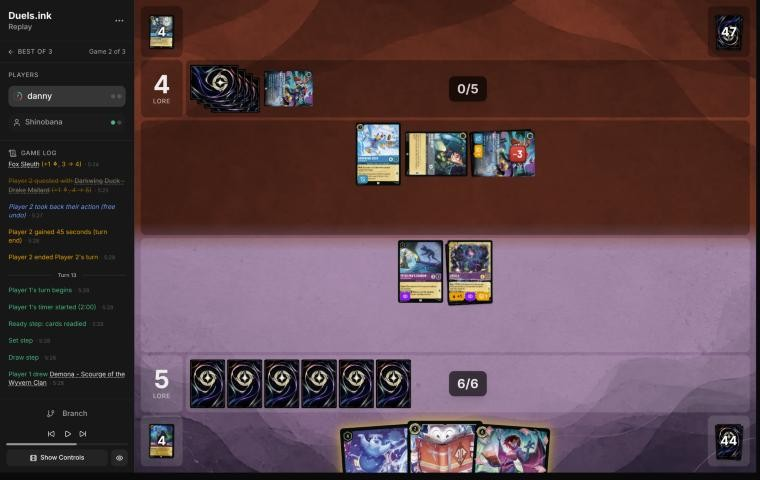

**Turn 15: Shadow and Dumbo drew and quested, then Wasabi** ([step 68](https://duels.ink/replay/01a14574-b9df-7dd3-8aa9-26a2d2c05d1e?step=68))

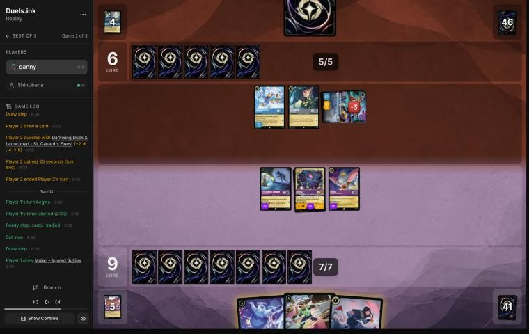

**Turn 17: Wasabi challenged Nick, wiping their board** ([step 81](https://duels.ink/replay/01a14574-b9df-7dd3-8aa9-26a2d2c05d1e?step=81))

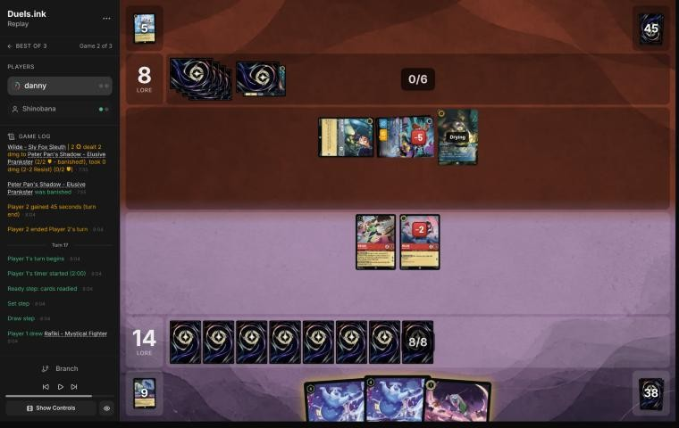

**Turn 19: Isis exerted Shere Khan, Tramp traded with him** ([step 90](https://duels.ink/replay/01a14574-b9df-7dd3-8aa9-26a2d2c05d1e?step=90))

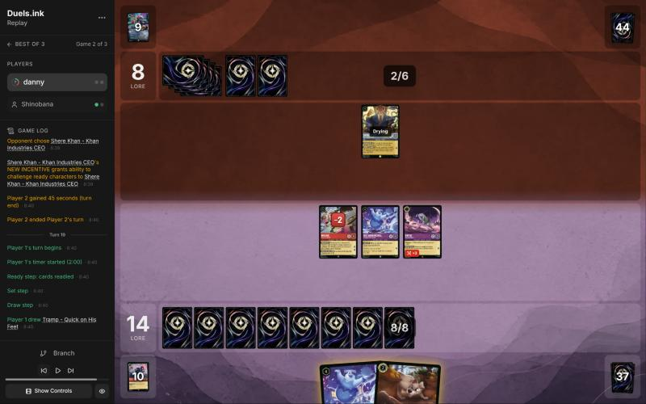

## Lessons
1. **When the opening seven holds none of your cheap characters, the redraw is rich in them.** Mulligan cards come
   from the other 53, so a full mulligan of a top-heavy seven beat keeping a reasonable core (simulated: characters
   by turn 3, 2.9 vs 2.0).
2. **Against Ducktectives, Judy – Lead Detective is what removes Evasive's protection.** Her Alert lets every Detective
   challenge your exerted Evasives. She comes from 6 ink with a spare card to ink, or by Shift 4 onto a Judy in play.
   Name that turn in every setup, like a sweeper. **Naming the risk doesn't mean avoiding it:** with a big lead and
   lethal next turn, exerting into it was still right (turn 15).
3. **Value their pieces by what they enable.** A Darkwing in play makes Launchpad's draw discard-free and Terror deal 3,
   so trading a damaged 1-cost Mulan for their early Darkwing was worth it (turn 5, your reasoning).
4. **Ward stops "chosen", not challenges.** Isis, Shadow, TRIPLE SHOT and TWIN BLADES couldn't touch Drake Mallard or
   St. Canard's Finest, but a 1-cost Mulan could still challenge the damaged, exerted Finest and trade with it.
5. **"During your turn" buffs are off on yours.** Lead Detective's Resist +2 didn't protect her on turn 17, so TWIN
   BLADES' 4 damage killed her.
6. **Rush plus an exert removes a fresh character the turn it lands:** Isis's CHILL OUT and Tramp's GIVE CHASE on
   turn 19.

## Knowledge-base updates (applied after discussion, 2026-10-26)
- **Strategy:**
  - **[H-5](#cite-h-5) (new):** with no character before turn 3, a full mulligan for a curve can beat keeping a decent core.
    Mulligan replacements come from the cards not in your hand ([CR 2.2.2](#cite-cr-2-2-2)), so the redraw is rich in exactly what
    the hand lacks. Evidence: this game, pre-game (your reasoning plus the simulation).
  - **Not added: a "held-card tell" hypothesis.** The coach proposed that a card held through a turn with ink to
    spare is probably costlier than their ink. You pointed out that good players hold cards for many reasons, and on
    turn 15 the read wouldn't have changed the right play.
  - **[RULE-1](#cite-rule-1) caveat:** "ready characters can't be challenged" has exceptions in this matchup. Shere Khan's NEW INCENTIVE
    lifts it for one character, and Alert (Lead Detective) lifts Evasive.
- **Meta ([notes on this pair](#cite-kb-meta-archetypes-sapphire-steel-how-it-plays), Ducktectives):**
  - cards seen across games 1 and 2
  - Lead Detective as the Alert source (hard-cast 6, or Shift 4 onto a Judy)
  - the Ward pieces and what Ward blanks
  - St. Canard's Finest's VICTORY POSE (+2 lore per challenge banish on their turn)
  - Judy – Uncovering Clues singing Strength of a Raging Fire for free (4 damage with four characters)
  - Terror dealing 3, and Launchpad drawing without a discard, while a Darkwing is in play
  - they keep Drake and Nick ready to dodge challenges
- **Rules:** nothing new; the Ward and Resist points are already in the coach's rules summary.
- **Process:**
  - the `analyse-replay` skill should say to read the card-text section in full and never cut it (turn 19 miss)
  - `brief.py` now uses earlier games of the same match as archetype evidence (built during this review)

## Hindsight
Doesn't change the verdicts above.
- **The held card on turn 14 was Lead Detective.** They inked Nick to reach 6 and cast her on turn 16. Keeping Dumbo
  and Shadow ready on turn 15 would have saved both, but Drake and Nick would then have quested rather than traded.
  The race held either way, and their hand was empty afterwards.
- **The full mulligan drew a 1-2-3-3-4-4-4 curve:** Mulan, Jebidiah, Shadow, Demona – Imperious Spellcaster,
  Dumbo, Martial Arts Master and Isis.
- **From turn 17 the game was effectively won:** they were at 8 with an empty board and hand, against your 14.
- **They didn't quest until turn 10,** spending their early turns on removal and on development that kept
  characters ready.

## The coach's errors

| When | Error | How it was caught | Fix |
|---|---|---|---|
| Tooling, before turn 1 | The brief ignored game 1 and rated Ducktectives at 18% before any cards were shown | Noticed at the pre-game brief | `brief.py` uses earlier games of the match |
| Pre-game | Planned a partial mulligan (keep Demona, Cheshire ×2, Guidebook) | Your full mulligan, then a simulation | [H-5](#cite-h-5) proposed |
| Turn 11 | Planned to trade Shadow for the exerted Drake. Questing was better, since nothing could challenge her | Comparing with your line | [QC-3](#cite-qc-3) |
| Turn 5 | Missed that Darkwing in play makes Launchpad's draw discard-free, and so undervalued killing it | You, in discussion | Lesson 3; Ducktectives notes |
| Turn 15 | First verdict said nothing of theirs could challenge the Evasives, missing a 6-ink Lead Detective | Re-checked after reading turn 16, redone from turn-15 information only | Lesson 2; Ducktectives notes |
| Turn 15 | The revisit then overstated the risk. The cautious line still lost Ursula, and it let Drake and Nick quest | Your argument (lead and lethal next turn) | Verdict back to good play |
| Turn 19 | Missed Tramp's GIVE CHASE (Rush): the plan view cut off the card text | Your line | Skill: read the card-text section in full |

## Discussion (2026-10-26)
- **Mulligan:** "no characters until turn 3, so I'm doing the full mulligan to try to have an opening curve." Agreed;
  it's the basis of [H-5](#cite-h-5).
- **Turn 15:** you'd have quested even knowing it was Lead Detective, because you can't give up that much lore when
  close to closing out the game. The coach re-checked from turn-15 information and agreed (verdict back to good play).
- **Turn 5:** Darkwing feeds one of their draw engines, and without an Elite Archer your Mulan was worth less than
  their Darkwing. Shadow's Evasive body set up lore and Dumbo's draw ability. Agreed (verdict upgraded).
- **Held-card tell:** good players hold cards for many reasons. Agreed; the hypothesis was dropped.

No open questions remain.

## Citations
Copies of the coach's knowledge base cited above, as they stood when they were cited (the private repository's commit and date are given with each). They don't change when the knowledge base does.

**QC-3**: strategy principle, `kb/strategy/principles.md` at `bcd52d4` (2026-10-26)

> - **QC-3. Questing is favoured when:**
>   - you control the board
>   - your exerted characters can't be punished
>   - the race favours you
>   - removing their characters gains little
>
>   **Challenging is favoured when:**
>   - they have an engine or repeated-value piece
>   - the trade is efficient
>   - you need to slow the game
>   - your deck is stronger late
>
>   `[MCL ch.6]` · baseline

**RULE-7**: strategy principle, `kb/strategy/principles.md` at `bcd52d4` (2026-10-26)

> - **RULE-7. Play vs draw.** The starting player skips the first draw `[CR 3.2.3.1]`, so on the draw you start a card up. The previous game's loser chooses `[CR 2.1.3.2]`. · baseline

**MULL-2**: strategy principle, `kb/strategy/principles.md` at `bcd52d4` (2026-10-26)

> - **MULL-2. A smooth curve beats a few powerful cards.** Check that you can spend ink well on turns 1–4, have enough inkable cards, and know what turn 4 looks like. `[MCL ch.12]` · baseline

**MULL-3**: strategy principle, `kb/strategy/principles.md` at `bcd52d4` (2026-10-26)

> - **MULL-3. The right keep depends on the matchup.** Early interaction against aggro; pressure, draw and engines against slow decks. The mulligan is the first expression of your role. In the Set 14 era the opponent's inks are known before the mulligan (RULE-8), so this applies from game 1 of a match. `[MCL ch.12]` · baseline

**SEQ-1**: strategy principle, `kb/strategy/principles.md` at `bcd52d4` (2026-10-26)

> - **SEQ-1. Gather information before irreversible decisions.** Draw, look and scry before choosing what to ink. Quest with draw triggers before committing other plays when the order doesn't otherwise matter. `[MCL ch.5]` · baseline

**THREAT-3**: strategy principle, `kb/strategy/principles.md` at `bcd52d4` (2026-10-26)

> - **THREAT-3. The biggest threat may not be on the board yet.** Consider:
>   - the opponent's ink next turn
>   - shift targets already in play
>   - support pieces that enable their next turn
>
>   `[MCL ch.9]` · baseline

**TRADE-1**: strategy principle, `kb/strategy/principles.md` at `bcd52d4` (2026-10-26)

> - **TRADE-1. Judge a trade by ink invested, tempo, value already generated, and the board afterwards**, not by card count. A 2-cost for a 5-cost is a big win even if it's one-for-one. *Ask: "What does the board look like after this challenge?"* `[MCL ch.7]` · baseline

**POS-1**: strategy principle, `kb/strategy/principles.md` at `bcd52d4` (2026-10-26)

> - **POS-1. From ahead, take the safest path to victory.** Don't overextend into sweepers, don't make unnecessary trades, and make the opponent take the risks. Winning by 1 lore counts the same as winning by 10. `[MCL ch.10]` · baseline

**RULE-1**: strategy principle, `kb/strategy/principles.md` at `bcd52d4` (2026-10-26)

> - **RULE-1. Only exerted characters can be challenged** `[CR 4.6.4.2]`. Questing, singing, or {E} for an ability exposes the character. Staying ready protects it. Every quest is also a decision about what the opponent can challenge next turn. · baseline
>   - *Card text overrides this* (CR 1.2.1). Shere Khan – Khan Industries CEO's NEW INCENTIVE lets one character
>     challenge ready characters that turn. Alert (e.g. from Judy Hopps – Lead Detective, to every Detective on their
>     turn) ignores Evasive. Against Ducktectives, name both in the setup. 01a14574, turns 16 and 18. `[coach, 2026-10-26]`

**H-1**: hypothesis, `kb/strategy/hypotheses.md` at `bcd52d4` (2026-10-26)

> ### H-1. Time hand-refill effects for when your hand naturally runs out
> - **Claim:** "Draw until you have N" effects (e.g. Demona – Scourge of the Wyvern Clan, refill to 3) are worth
>   most on the turn your hand empties. Playing one card per turn on the play, a 7-card hand empties around
>   turn 6, which is exactly when a 6-cost refill lands. So an inkable refill card is cheap to keep through a
>   mulligan: if the game goes differently, ink it.
> - **Why:**
>   - **Hand count when playing on curve, going first:** 7 cards; ink 1 and play 1 each turn, drawing from turn 2,
>     leaves 1 card after inking on turn 6.
>   - **Cost of keeping it, by simulation:** keeping Demona costs about 0.1 ink spent over turns 1–4, compared with
>     also mulliganing her.
> - **Caveats:**
>   - "Each player" refills, so the opponent also draws if below N. On the draw they hold one more card.
>   - Demona's STONE BY DAY means she can't ready while you hold 3+ cards. After refilling to 3, you must be at ≤2
>     by your next Ready step, or she stays exerted (and challengeable) once she has quested or challenged.
>   - She's drying on the turn she's played, so her own exert-all opens the opponent's board to your *other* dry
>     characters only.
>   - Ink drops (Hyperia City) don't expire, so saved drops can bring the refill earlier than the bare count suggests.
>   - **The cap absorbs earlier card draw.** "Draw until 3" always ends at 3, so cards drawn beforehand (e.g. Junior
>     Woodchuck Guidebook) are borrowed from the refill rather than added to it. Pre-drawing buys timing, not
>     cards:
>     - earlier information
>     - a better ink choice
>     - being sure of an inkable card for the refill turn
>
>     Weigh that against what the same ink would otherwise buy, e.g. an earlier body. (User's correction,
>     2026-10-24: the coach had called this a cost of the draw without counting those gains.)
>   - The opponent's refill depends on *their* hand size when you cast it, not on your earlier choices. Check it
>     when deciding whether to cast now.
>   - **It needs your ink to reach 6 on time.** Hands with uninkable cards are short of ink, not cards, so a held
>     6-drop is rarely castable on turn 6.
>     - **01a139ad, pre-game:** an opening seven with two uninkables. Keeping Demona left her castable on turn 6
>       only ~16% of the time in simulation. Mulliganing her for a random card raised "turn 4 uses all ink" from
>       80% to 91%. In ink-short hands, the refill card is the one to send back.
>     - *This caveat is the coach's, from simulation; not yet discussed with the user.*
>   - **Against Amber/Sapphire**, Demona's 5 {S} makes her a target for Gaston – Superior Archer, Judy Hopps –
>     Always Vigilant and World's Greatest Criminal Mind (`kb/meta/archetypes/amber-sapphire.md`).
> - **Evidence for:**
>   - replay 01a14bf9 (vs Goop), 2026-10-24, pre-game: the user's mulligan reasoning.
>   - same game, turn 5: the user kept Cheshire as the bridge play on the way to Demona instead of playing an
>     extra 1-drop.
>   - same game, turn 9: Guidebook played and used before inking, which locked in an inkable card for Demona
>     on turn 11. The alternative, Cheshire plus Boost, had about a 16% chance (8 uninkables in 49 cards) of an
>     uninkable turn-11 draw blocking her.
>   - same game, turn 11 (agreed with the user): a second Cheshire instead of Boost would have developed the
>     board, used the ink better, and **emptied the hand to just Demona**. Her next-turn refill would then draw 3
>     instead of 1. The user's own summary of the lesson: develop the board and spend resources so the
>     refill draws as many cards as possible.
>   - same game, turn 13: with Demona due next turn, the user inked their spare Cheshire though that ink wasn't
>     needed. **Corollary:** when a refill is imminent, spare cards in hand are effectively free ink. The cap
>     replaces them, so inking them costs no cards and leaves Demona as the only card in hand.
>   - **Limit on that corollary** (same game, turn 15, agreed with the user): it's free in card *count* only. The cap
>     replaces the inked card with a *random* card. So it holds for cards no better than a random draw, but not
>     for engines or must-answer threats. Inking Dumbo – Ninth Wonder of the Universe (a draw-and-lore engine the
>     opponent has to answer, TEMPO-1) to top up Demona's refill from 2 to 3 was probably wrong. Better was to
>     cast Demona without inking, keep Dumbo for next turn, and accept 1 ink and 1 refill card less.
> - **Evidence against:** none yet.
> - **Status:** open.

**H-5**: hypothesis, `kb/strategy/hypotheses.md` at `bcd52d4` (2026-10-26)

> ### H-5. A hand with no early character can be worth a full mulligan, even with a decent core
> - **Claim:** if the opening seven has no character to play before turn 3, a full mulligan for an opening curve can
>   beat keeping a reasonable core (e.g. two 3-drops and card draw), above all against a deck that develops early.
> - **Why:** mulligan replacements come from the cards *not* in your hand (CR 2.2.2, draw before shuffling). A seven
>   holding none of your cheap characters leaves all of them in the redraw pool, so the new cards are richer in
>   exactly what the hand lacks. Keeping part of the hand also keeps its cards' share of the next draws away from
>   the cheap ones.
> - **Evidence for:** 01a14574 (vs Shinobana, game 2), pre-game. Seven of Demona – Scourge, Cheshire ×2, Ursula,
>   Mulan – Elite Archer ×2 and Guidebook, on the play against Ducktectives. Simulated over 20,000 deals:
>   - same ink spent on turns 1–4: 9.31 (full mulligan) vs 9.25 (keep Demona, Cheshire ×2, Guidebook)
>   - character by turn 2: 97% vs 79%
>   - characters in play by turn 3: 2.9 vs 2.0
>
>   The user's reasoning: "no characters until turn 3, so I'm doing the full mulligan to try to have an opening curve."
>   The sim script is ad hoc. Rerun it for the actual deck and hand when this comes up again.
> - **Evidence against:** none yet. Untested against slow decks, where the core's quality may matter more.
> - **Status:** open (agreed with the user for this matchup, 2026-10-26; one game).

**CR 2.2.2**: Comprehensive Rules, `kb/rules/cr/02-gameplay.md` at `bcd52d4` (2026-10-26)

> **2.2.2.** Once each player has drawn their opening hands, they each may alter their hands, beginning with the starting player and then proceeding in turn order. Each player can alter their hand only once in each game, following the steps listed here.

**sapphire-steel.md, How it plays**: knowledge base, `kb/meta/archetypes/sapphire-steel.md` at `bcd52d4` (2026-10-26)

> ### How it plays `[coach + user, two games]`
> - **Darkwing in play powers their engine.** It makes Launchpad's draw discard-free and Terror deal 3. Killing their
>   early Darkwing is worth a cheap character (user, 01a14574 turn 5).
> - **Ward pieces:** Drake Mallard and St. Canard's Finest can't be chosen. That blanks Isis's CHILL OUT, Shadow's
>   FAVORITE TRICK, Elite Archer's TRIPLE SHOT and Wasabi's TWIN BLADES on them. They can still be challenged once
>   exerted: a 1-cost Mulan traded with a damaged, exerted Finest (turn 17).
> - **Judy – Lead Detective is the answer to Evasive.** On their turn their Detectives gain Alert and Resist +2.
>   - **01a14574, turn 16:** she was hard-cast at 6, and three Detectives killed three exerted Evasives.
>   - **Track when she's possible:** 6 ink with a spare card to ink, or Shift 4 onto a Judy in play. Name that turn in
>     setups like a sweeper.
>   - **Her buff is off on your turn:** 4 damage killed her on turn 17.
> - **St. Canard's Finest – VICTORY POSE:** +2 lore whenever it banishes a character in a challenge on their turn.
>   Exerted non-Evasive characters feed it.
> - **Shere Khan – Khan Industries CEO, NEW INCENTIVE:** a chosen character can challenge **ready** characters that turn.
>   Staying ready isn't fully safe. Evasive still applies.
> - **Free singers:** Judy – Uncovering Clues (cost 4) sang Strength of a Raging Fire for 4 damage with four
>   characters in play (turn 10).
> - **Habits seen:**
>   - In game 2 they didn't quest until turn 10.
>   - They kept Drake and Nick ready to dodge challenges, then used them to challenge once Lead Detective landed.
