# Review: stonks 📈 vs MFork, game 3, 21 Oct 2026

| | |
|---|---|
| **Status** | **final** (2026-11-02; the pre-game revisited in discussion, on stonks 📈's feedback relayed by danny) |
| **Replay** | `01a15f93-7740` (`python3 tools/brief.py 01a15f93 --turn N`) · [duels.ink viewer](https://duels.ink/replay/01a15f93-7741-71c2-ba4b-ad543c61d157?step=0) |
| **Format** | Core Constructed (ranked; not stated in the replay), best-of-three, the deciding game. Set 14 era: inks revealed before the coin toss |
| **Decks** | stonks 📈: Sapphire/Steel Big Ramp with the Darkwing package ([the coach's notes on it](#cite-kb-meta-archetypes-sapphire-steel-big-ramp-with-the-darkwing-package-how-to-play-it)). MFork: Amethyst/Steel, **PS Inkbonk**, known from game 2 |
| **Play/draw** | MFork went first (they lost game 2, so it was their choice) |
| **Result** | Loss: stonks 📈 conceded at 4–16 on game turn 20, so MFork took the match 2–1 |
| **Meta data** | snapshot of 26 Oct 2026, five days after this game (fresh) |
| **Chosen how** | Sent by danny, the coach's user, with stonks 📈's other games of the day; the coach picked five to review and studied the rest. **The coach knew this game's result in advance**: it had seen a one-line summary of it while sorting the games. Game 2 of this match was studied in full, which is fair: it's an earlier game. Verdicts are guarded against outcome bias |

## Summary
- **Good plays:** the [pre-game](#turn-0), keeping only Terror on the draw (a close call until discussion);
  [turn 8](#turn-8), where Three Arrows and a Darkwing trade cleared their board of three;
  [turn 14](#turn-14), Tiana – Party Hostess discarding Khan Industries to play it free, with a free kill and a card
  from Cinderella; and [turn 18](#turn-18), the only line that killed two questers, plus Goliath to hold their hand
  down.
- **Good, with nothing better:** turns [2](#turn-2), [4](#turn-4), [6](#turn-6), [10](#turn-10), [12](#turn-12) and
  [16](#turn-16). The coach's plan matched yours on all of them except the order of plays on turn 4. The concession
  on [turn 20](#turn-20) was right too: by then the game couldn't be won.
- **Inaccuracies or worse:** none.

**What decided it:** the matchup and MFork's draws, not your decisions. PS Inkbonk had an answer each time Big Ramp
built something:
- Two Shere Khans made your ready characters challengeable, on [turn 7](#turn-7) and [turn 13](#turn-13).
- Demona – Scourge of the Wyvern Clan's exert and refill found the Strength of a Raging Fire that killed Merida on
  [turn 11](#turn-11), before her Three Arrows could fire.
- Shere Khan hit Khan Industries twice and destroyed it after one payment.
- Five cheap characters made Strength of a Raging Fire big enough for Goliath on [turn 19](#turn-19).

Merlin, the Shop and Madam Mim kept refilling their hand the whole time. You traded well throughout and reached
turn 20 behind only on lore.

## The game, turn by turn
Verdicts judge each decision on what stonks 📈 could know at the time, **including archetype knowledge an
experienced player has**. Hindsight is kept to its own section. Severity scale: good play / close call /
inaccuracy / mistake / blunder. Principle IDs and hypotheses (H-n) link to copies in the Citations section at the
end, as they stood when they were cited.

**What stonks 📈 knew before the game:** MFork's deck from game 2: Amethyst/Steel PS Inkbonk. Demona – Scourge of
the Wyvern Clan (6: exerts all your characters, then both players draw up to 3), Broadway – Sturdy and Strong (5,
Bodyguard, 4/6/2), Lexington (3, Alert), Pepita and Rafiki (Challenger), Marie, Merlin – Profoundly Curious, Merlin's
Shop and Smithy, Cheshire Cat, Shere Khan – Khan Industries CEO (a character challenges ready ones), Strength of a
Raging Fire (damage equal to their character count), Toulouse, Tiana – Restauranteur. Game 2 was a slow grind,
won 6–4.

### Pre-game

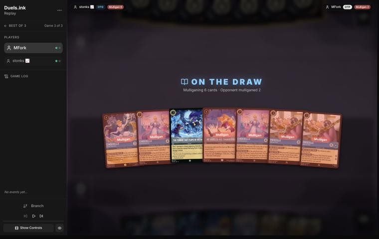
*The board before the decision: [step 0](https://duels.ink/replay/01a15f93-7741-71c2-ba4b-ad543c61d157?step=0) in the duels.ink replay viewer.*

**What you did:** On the draw. Kept only The Terror That Flaps in the Night; sent back Cinderella – Dream Come
True, both Cinderella – Unintentional Icons, He Hurled His Thunderbolt and both Priscilla – Efficient Clerks

**Verdict:** **Good play** *(revisited in discussion; the blind pass called it a close call, leaning to a smaller
mulligan)*. On the draw the hand has to interact with their early board, and keeping only Terror gave the best chance
of finding more: Terror, Three Arrows and the Darkwings. stonks 📈's reasons, relayed by danny:
- **Priscilla on the draw** lands after their 1-, 2- and 3-drops. With 0 strength and entering play exerted, she's
  almost always killed for free before she quests. Game 2 had shown Lexington (4 strength) and Pepita (Challenger).
- **Unintentional Icon** is a keep only with the whole Marie > Terror > Dream Come True > Icon curve, and **Dream Come
  True** on the draw needs Marie to bring her a turn early.
- **He Hurled His Thunderbolt** is slow and uninkable: a keep only with that same curve, to sing it the next turn.

The blind pass leaned on the plan these cards make (ramp, card selection, Thunderbolt for the Gargoyles), but that
plan needed Priscilla to live and quest. The sim (`mulligan.py`, 1,500 deals) already favoured your mulligan on early
board and lore at the same ink: 3.67 play turns of 4 against 3.36, and 4.8 lore by turn 4 against 3.8, with the
keep-5 figures counting Priscilla's quests. With the plan's key piece unlikely to survive, nothing is left to weigh
against the sim ([MULL-3](#cite-mull-3), [H-5](#cite-h-5)).

### Turn 1: their turn

**What happened:** MFork inked Broadway – Sturdy and Strong and played Marie – Caught in the Act (2/1; an ink drop
when she quests after one of your characters took damage that turn).

### Turn 2: your turn 1

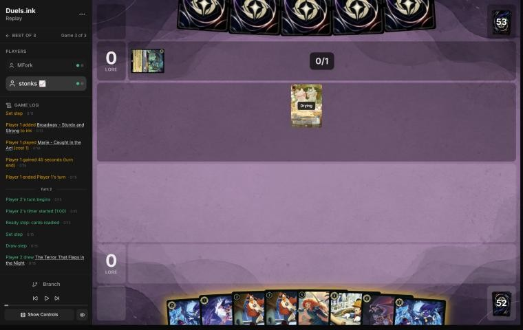
*The board before the decision: [step 5](https://duels.ink/replay/01a15f93-7741-71c2-ba4b-ad543c61d157?step=5) in the duels.ink replay viewer.*

**What you did:** Drew The Terror That Flaps in the Night, inked Minnie Mouse – Urban Visionary, played Darkwing
Duck – Crime Fighter

**Verdict:** **Good.** Darkwing in play is what makes Terror deal 3 and Launchpad's draw free of its discard, and the
hand had a Terror. Minnie (8) is the right card to ink from this hand: she's the furthest off.

### Turn 3: their turn

**What happened:** They inked Rafiki – Mystical Fighter and played Black Heron – Real Bad Egg (3/3, no abilities);
Marie quested (0–1).

### Turn 4: your turn 2

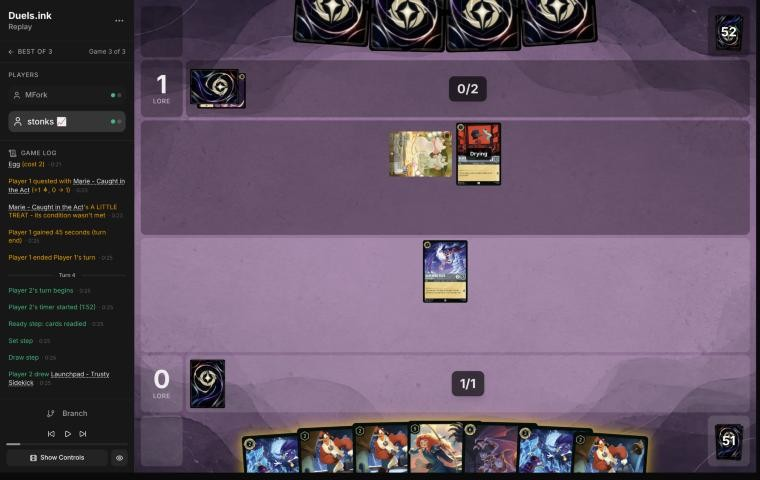
*The board before the decision: [step 12](https://duels.ink/replay/01a15f93-7741-71c2-ba4b-ad543c61d157?step=12) in the duels.ink replay viewer.*

**What you did:** Drew a Launchpad – Trusty Sidekick, inked Goliath – Clan Leader, and The Terror That Flaps in the
Night dealt 3 to Black Heron (Darkwing in play), banishing it. Darkwing stayed back.

**Verdict:** **Good.** Three separate choices, all sound:
- **Ink Goliath:** only three of the seven cards in hand could be inked (both Terrors and Goliath; the three
  Launchpads and Merida can't). Goliath at 6 ink is several turns off and is the card you keep for pressing a lead;
  the Terrors are the early removal the plan runs on.
- **Terror on Black Heron now:** it's their only 3-strength body, and Terror reaches its 3 willpower only while
  Darkwing is in play. Darkwing is a 2/2, so cashing the bonus in now is the safe use of it. It also takes a body off
  their board, which shrinks Strength of a Raging Fire (damage equal to their character count): with Marie alone
  it deals 1, so Darkwing survives it. The alternative was a Launchpad first, drawing a card a turn sooner (from turn
  6) while the Heron quests once; that bets Darkwing survives their turn for both Terror's 3 and the free draw. The
  line played is better *(revisited in discussion; the blind pass called the two close)*: on the draw the job is to
  interact and limit theirs, and a Launchpad (2/3) does too little against a 2-cost 3/3.
- **Darkwing not questing:** a quest for 1 would let Marie (2 strength) trade with it, and it's the enabler for three
  Launchpads and a Terror.

What it exposes: nothing of theirs can challenge a ready character, and their 3 ink can't reach Shere Khan (4).

### Turn 5: their turn

**What happened:** They inked Hades – Looking for a Deal and played Lexington – Small in Stature (4/4, Alert:
challenges as if it had Evasive). Marie stayed back.

### Turn 6: your turn 3

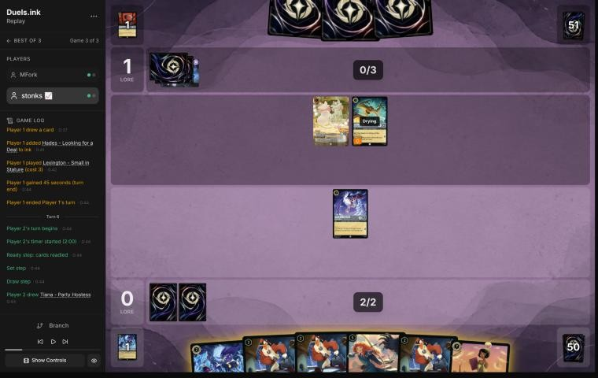
*The board before the decision: [step 19](https://duels.ink/replay/01a15f93-7741-71c2-ba4b-ad543c61d157?step=19) in the duels.ink replay viewer.*

**What you did:** Drew Tiana – Party Hostess, inked her, played a Launchpad. No quests.

**Verdict:** **Good.** The hand's only inkable cards were Tiana and the last Terror, and Tiana (7) is at least four
turns off, so she's the one to ink. Launchpad is the way out of a hand of uninkable cards: from next turn it draws a
card each turn, free of the discard while Darkwing lives. Terror doesn't reach Lexington's 4 willpower, and spending
it on Marie (1 willpower) would trade the engine's turn for a 1-drop. Not questing keeps Darkwing out of Lexington's
and Marie's reach.

What it exposes: at 4 ink next turn, Shere Khan – Khan Industries CEO (held about 21% now, 27% after their draw) lets
Lexington challenge a ready character and kill Darkwing or Launchpad; Strength of a Raging Fire (same odds) deals 2
with their two characters, enough for Darkwing. Nothing this turn prevents either.

### Turn 7: their turn

**What happened:** They inked Strength of a Raging Fire and played Shere Khan – Khan Industries CEO (4/2), whose NEW
INCENTIVE let Lexington challenge the ready Launchpad and banish it (Lexington took 2). CORNER THE MARKET gave them an
ink drop, and Marie quested with A LITTLE TREAT for a second (lore 2–0, two ink drops banked).

### Turn 8: your turn 4

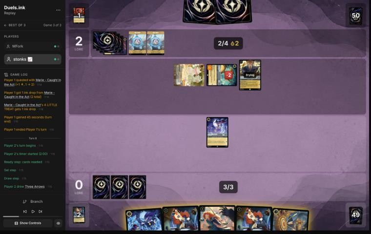
*The board before the decision: [step 28](https://duels.ink/replay/01a15f93-7741-71c2-ba4b-ad543c61d157?step=28) in the duels.ink replay viewer.*

**What you did:** Drew Three Arrows and played it: 2 to Shere Khan and 1 to Marie, banishing both. Inked the last
Terror, then Darkwing challenged the exerted, damaged Lexington: both were banished. Their board was empty.

**Verdict:** **Good play.** The coach's own plan was Arrows on Lexington and Marie, keeping Darkwing for the
Launchpads' free draw and leaving Shere Khan (4/2). Your line is better:
- **Darkwing for Shere Khan is a 1-drop for a 4-drop** that ramps them (CORNER THE MARKET), and it ends their lore
  and ink drops for the turn. The Launchpads still draw without Darkwing, with a discard; seven more Darkwings
  (Crime Fighter and Drake Mallard) are in the deck.
- **Arrows into the discard and Terror into the inkwell** is the right way round: Merida's FULL QUIVER returns Three
  Arrows from the discard, then deals 4 and 3 with STEADY AIM.
- Playing Arrows before inking cost nothing: 3 ink was already up. The fourth ink had no use (Launchpad is 2).
- The alternative, inking Arrows for Terror on Shere Khan, Darkwing on Lexington and a Launchpad, uses all 4 ink but
  leaves Marie and loses Arrows to the inkwell.

What it exposes: nothing on the board. The cost is the hand: two Launchpads and Merida, none inkable, so Merida on
turn 10 needs an inkable draw. Their 7 ink next turn (4, one more inked, two drops) can rebuild with Broadway (5) or
Demona – Scourge of the Wyvern Clan (6); her exert-all does nothing to an empty board, and her refill gives you
nothing while you hold 3 cards.

### Turn 9: their turn

**What happened:** They didn't ink. Merlin – Profoundly Curious (4, 2/3/2; an ink drop on play, draws when it
quests) and Luisa Madrigal – Pushing Through (1, 0/3, Challenger +2), paid with a drop. Two drops left.

### Turn 10: your turn 5

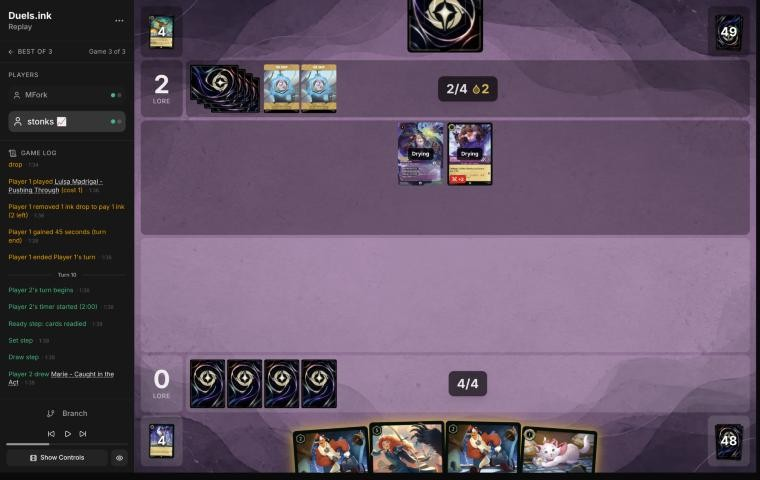
*The board before the decision: [step 37](https://duels.ink/replay/01a15f93-7741-71c2-ba4b-ad543c61d157?step=37) in the duels.ink replay viewer.*

**What you did:** Drew Marie – Caught in the Act, inked her, played Merida – Formidable Archer, and FULL QUIVER
returned Three Arrows to hand.

**Verdict:** **Good.** Marie was the only inkable card, and inking her is exactly 5 for Merida, the centre of the
plan. Arrows back in hand with STEADY AIM is 4 damage and 3 next turn: enough for both Merlin (3 willpower) and
Luisa (3). The Launchpads can wait; without a Darkwing their draws cost a discard anyway.

What it exposes: Merida (5 willpower) is ready, so only a Shere Khan's NEW INCENTIVE lets one of theirs challenge her,
for 2 (Merlin, or Luisa with Challenger). Killing her needs about two cards together (for example Shere Khan, then
Merlin singing Strength of a Raging Fire for 3), each held around 6% now and 12% after their draw. Demona – Scourge
of the Wyvern Clan (8% / 16%) exerts her, but Merlin and Luisa then deal only 4 of her 5.

### Turn 11: their turn

**What happened:** Demona – Scourge of the Wyvern Clan (6, using both ink drops) exerted Merida, and her refill drew
MFork two cards (1 in hand → 3). They inked a Rafiki and played another, then Merlin sang Strength of a Raging Fire:
four characters, 4 damage to Merida, and Luisa's challenge (2 with Challenger) finished her. Luisa died too.

### Turn 12: your turn 6

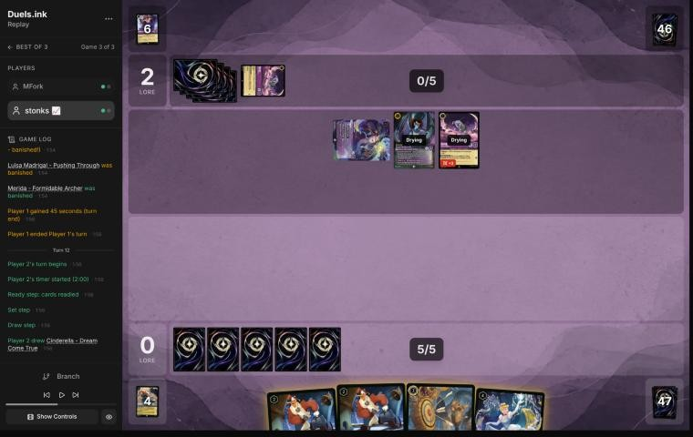
*The board before the decision: [step 49](https://duels.ink/replay/01a15f93-7741-71c2-ba4b-ad543c61d157?step=49) in the duels.ink replay viewer.*

**What you did:** Drew Cinderella – Dream Come True, inked Three Arrows, played Cinderella and a Launchpad. At the end
of the turn WHATEVER YOU WISH FOR put the other Launchpad into the inkwell and drew Khan Industries – Greenway
Landmark.

**Verdict:** **Good.** MFork had no cards in hand, so their next turn is one draw, and this was the turn to build.
Cinderella is a Princess, so playing her triggers her own end-of-turn ink-and-draw, and an effect that puts a card
into the inkwell doesn't need the inkwell symbol ([CR 4.2.3.2](#cite-cr-4-2-3-2)): the uninkable Launchpad becomes ink. That's 7 ink
next turn's start, 8 with a normal ink, in reach of the deck's 7s and 8s. Three Arrows without Merida only kills
Rafiki, so it was the right card to ink. The alternative, keeping Arrows for a later Merida and leaving 1 ink unused,
gives up the Launchpad body for a card that needs a second piece.

What it exposes: Cinderella and Launchpad are ready, so only a drawn Shere Khan (about 7%) lets Demona challenge one;
Strength of a Raging Fire (about 4%) would deal 3 with their three characters. The lore race is the real problem:
their board quests for 5 a turn (2–0 now), so they reach 20 around game turn 19 if nothing is removed.

### Turn 13: their turn

**What happened:** Merlin quested (4–0) and drew; a second Shere Khan let Demona challenge the ready Launchpad and
banish it (Demona took 2). With the ink drop they added Merlin's Shop and Smithy – Magical Market, and Rafiki
quested (5–0).

### Turn 14: your turn 7

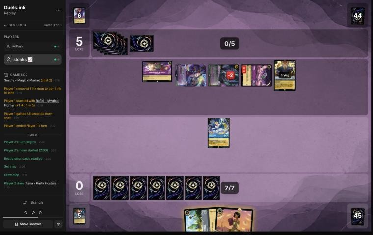
*The board before the decision: [step 61](https://duels.ink/replay/01a15f93-7741-71c2-ba4b-ad543c61d157?step=61) in the duels.ink replay viewer.*

**What you did:** Drew Tiana – Party Hostess and played her with all 7 ink. IDEAL VENUE drew Windstorm and Darkwing
Duck & Launchpad – St. Canard's Finest, discarded Khan Industries and played it free. Cinderella challenged the
exerted Rafiki and banished it, taking nothing. No turn ink; at the end of the turn Cinderella's WHATEVER YOU WISH FOR
(Tiana is a Princess) put Windstorm into the inkwell and drew Marie.

**Verdict:** **Good play.** This is the deck's best turn: a 7-drop, a free 5-cost location worth 2 lore a turn, and a
card. The details were right too:
- **Rafiki for free.** Cinderella (2 strength) kills the 2-willpower Rafiki, whose 0 strength hits back for nothing.
  It takes 1 lore a turn off a board racing at 6 a turn, and a Challenger 3 that kills any exerted 3-willpower
  character.
- **The ink.** After Tiana the hand was Windstorm and Finest, both inkable. Inking Windstorm through Cinderella rather
  than the turn action drew a card for it. Inking both would have thrown Finest away for a random card. Windstorm is
  the right one to give up: without a Merida it deals 1 to each of theirs, and it kills nothing on their board.

What it exposes: Cinderella is exerted, so Demona (5) or Shere Khan (4) can challenge and kill her, each giving up
its quest. Khan Industries (8 willpower) can be challenged at any time: Demona and Shere Khan together deal 9, at the
cost of 3 lore. Their next turn sees their draw plus Merlin's quest draw, and Merlin's Shop gives another if a
character moves there.

### Turn 15: their turn

**What happened:** Merlin quested (7) and drew; Demona moved to Merlin's Shop and Smithy for a card and a lore (8).
They inked Tiana – Restauranteur and played a second Merlin (an ink drop). Demona challenged and banished Cinderella
(Demona now has 4 damage, 2 willpower left; another drop from CORNER THE MARKET), and Shere Khan challenged Khan
Industries for 4 (4 willpower left). Lore 8–0, two drops banked.

### Turn 16: your turn 8

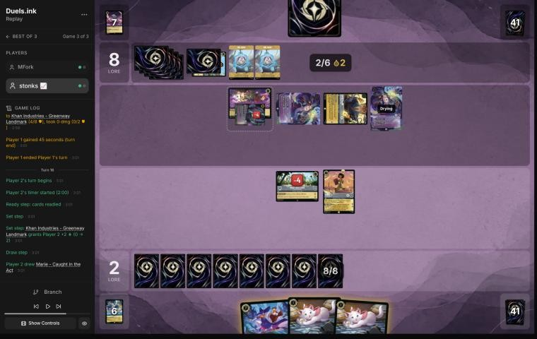
*The board before the decision: [step 75](https://duels.ink/replay/01a15f93-7741-71c2-ba4b-ad543c61d157?step=75) in the duels.ink replay viewer.*

**What you did:** Khan Industries gave 2 lore (2–8). Drew a Marie. Tiana challenged the exerted Merlin and banished
it (Tiana took 2). Played St. Canard's Finest and a Marie, inked the other Marie.

**Verdict:** **Good.** The setup: MFork at 8 with a board questing for 7 a turn plus a lore from Merlin's Shop, so 20
on game turn 19 if nothing changes. You can't race that (2 now, about 4 to 5 a turn), so the turn is about cutting
their questers and making questing costly.
- **Which challenge:** Tiana kills any of the three exerted characters. Merlin is the best: 2 lore and their card
  engine, and Tiana survives on 3 willpower. Demona (2 left) would cost Tiana; Shere Khan is 1 lore and would leave
  Tiana on 1, for the second Merlin to finish.
- **Finest and Marie:** Finest (5/7, Ward) can't challenge this turn, but from next turn it banishes any exerted
  character for 2 lore (VICTORY POSE), so every quest of theirs becomes a target. 8 ink was exactly Finest and a Marie.

What it exposes: the exerted Tiana (3 left) dies to Demona or Shere Khan, but either dies to her 4 strength, and each
gives up a quest. Finest is ready and has Ward; a second Demona – Scourge of the Wyvern Clan (about 14% after their
draw, more with Merlin's draw) would exert her for Demona and Shere Khan together (9 against 7). Khan Industries
(4 left) falls to one challenge from Shere Khan or Demona, again for a quest.

### Turn 17: their turn

**What happened:** Madam Mim – Resourceful Trickster (8, 7/5/3), paid partly with ink drops, so UPPER HAND drew 2.
Merlin quested (10) and drew. Demona challenged Tiana and both were banished; Shere Khan challenged Khan Industries
and destroyed it. Then Rafiki and Marie, the second paid with a drop for BAUBLE GAME's card. Lore 2–10.

### Turn 18: your turn 9

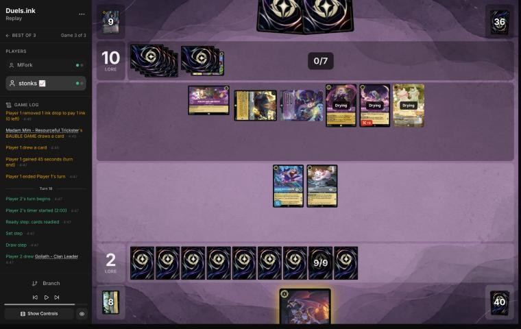
*The board before the decision: [step 88](https://duels.ink/replay/01a15f93-7741-71c2-ba4b-ad543c61d157?step=88) in the duels.ink replay viewer.*

**What you did:** Drew a Goliath – Clan Leader. Finest challenged the exerted Merlin and banished it (VICTORY POSE,
4–10); Marie challenged Shere Khan and both were banished. Played Goliath; at the end of the turn DUSK TO DAWN drew you
two cards (Goliath and Tiana – Party Hostess).

**Verdict:** **Good play.** MFork at 10 with five questers worth 8 a turn plus the Shop's 1: 19 next turn if all of
them survive. Finest kills either exerted character and Marie only Shere Khan, so this was the only way to kill two,
and VICTORY POSE paid 2. Goliath is the use the player describes for him, holding a hand down: Merlin and Madam Mim
are draw engines, and Goliath cuts MFork to 2 cards at the end of each turn. With your own hand empty, he also refills
you to 2 at the end of each of your turns. That leaves their quests at Mim 3, Rafiki 1, Marie 1 and the Shop's 1: 16
next turn.

What it exposes: Finest is exerted with 5 willpower left, so Mim (7 strength) can kill it, dying to Finest's 5 in
return, instead of questing for 3. Goliath is ready and drying. A Demona – Scourge of the Wyvern Clan (about 22% after
their draw, more with any draw engine) would exert him for Mim. Strength of a Raging Fire can't target Finest (Ward)
and needs 5 characters to kill Goliath.

*In discussion:* stonks 📈's reason was simpler. Goliath was the only card in hand, and without another body they'd
close the game out. His DUSK TO DAWN refill gave you three cards before your next play (two at the end of this turn,
then your draw) to find what had to come: Merida, Windstorm or Three Arrows. Holding their hand down was a bonus, not
the point. The verdict stands.

### Turn 19: their turn

**What happened:** Mim moved to Merlin's Shop (a card, 11). Pepita – Watchful Alebrije and Luisa made five
characters, and Strength of a Raging Fire dealt 5 to Goliath, banishing him. Mim, Rafiki and Marie quested: 16,
with an ink drop from Marie.

### Turn 20: your turn 10

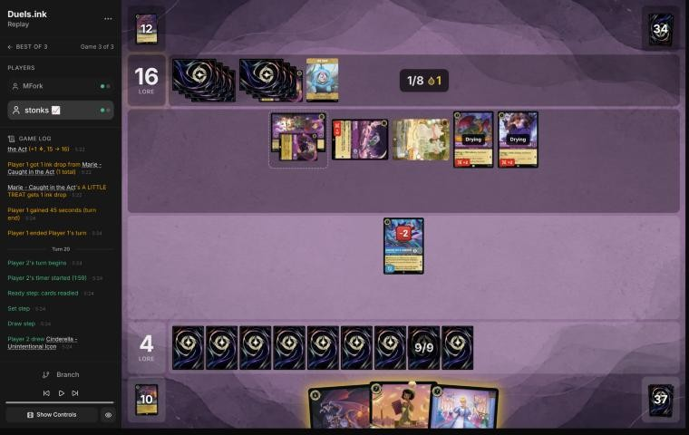
*The board before the decision: [step 102](https://duels.ink/replay/01a15f93-7741-71c2-ba4b-ad543c61d157?step=102) in the duels.ink replay viewer.*

**What you did:** Drew Cinderella – Unintentional Icon and conceded at 4–16.

**Verdict:** **Good: the game was lost** ([principle 2](#cite-principle-2)). MFork need 4 lore, and their board quests for 7 (Mim 3, then
Rafiki, Marie, Pepita and Luisa 1 each) plus 1 for moving a character to Merlin's Shop. To hold them under 20 you'd
have to remove Mim and two of the 1-lore characters this turn, and only Mim, Rafiki and Marie are exerted:
- Finest can challenge one of them. Taking Mim costs Finest (7 strength against 5 willpower left).
- The rest would need removal you don't hold. Tiana's draw of 2, with the 3 ink left after her (10 with an ink), finds
  Three Arrows for Rafiki and Marie 15.8% of the time (`tools/odds.py`: 3 copies, 37 cards, 2 draws). Windstorm and He
  Hurled His Thunderbolt cost 4, one too many.
- Even then they'd be on 19 with Pepita, Luisa and whatever they play next, needing a single lore.

Resigning a game this far gone costs nothing.

## Lessons
1. **Against PS Inkbonk, staying ready isn't safe.** Shere Khan – Khan Industries CEO's NEW INCENTIVE lets one of
   theirs challenge a ready character, and Demona – Scourge of the Wyvern Clan exerts all of yours. Count one challenge
   into any character you have, every turn they have 4 ink, and against the exert-all their whole board's strength
   ([RULE-1](#cite-rule-1), whose note already names Shere Khan).
2. **Strength of a Raging Fire grows with their board, and any 3-cost singer casts it free.** Merlin – Profoundly
   Curious sang it twice. PS Inkbonk's cheap characters are its fuel: Rafiki (four copies this game), Luisa, Marie,
   Pepita. At five characters it kills a Merida or Goliath outright, and at four with one challenge. Each small
   character you kill also shrinks the song (turns [4](#turn-4) and [14](#turn-14)).
3. **Count their draws, not just their draw.** Merlin's quest, the Shop's move, Madam Mim's ink drops and Demona's
   refill gave them two to four cards a turn. The chance they hold an answer by their next turn is much higher than
   one draw suggests.
4. **Khan Industries is a location**, and locations can be challenged at any time ([RULE-3](#cite-rule-3)). Against 4-strength
   challengers it pays 2 once and falls in two hits. It protects the characters there, not itself.
5. **Two quiet rules helped your mana:**
   - Darkwing Duck & Launchpad – St. Canard's Finest is also named Darkwing Duck ([CR 5.2.6.1](#cite-cr-5-2-6-1)), so Terror deals 3 and
     Launchpad draws without discarding while it's in play.
   - Cinderella – Dream Come True's ink-and-draw puts any card into the inkwell, uninkable ones included (CR
     4.2.3.2). On [turn 12](#turn-12) a Launchpad became ink.

6. **On the draw, interact first.** Keep and mulligan for Terror, Three Arrows and the Darkwings. Priscilla, Dream
   Come True and Unintentional Icon need a curve that gets them there safely ([pre-game](#turn-0), [turn 4](#turn-4)).
7. **Goliath also digs.** With an empty hand, DUSK TO DAWN's refill finds the answer you need ([turn 18](#turn-18)).

## Knowledge-base updates (applied 2026-11-02, after discussion)
- **Meta, the Amethyst/Steel notes (PS Inkbonk against Big Ramp), game 3 of the match:**
  - **More of the list:** Shere Khan ×2, Madam Mim – Resourceful Trickster, Merlin ×2, Strength of a Raging Fire ×3
    (two cast, one inked), Rafiki ×4, Luisa Madrigal – Pushing Through, Pepita, Black Heron, Lexington, Hades,
    Demona – Imperious Spellcaster and Tiana – Restauranteur.
  - **How it beat Big Ramp:** Shere Khan on ready characters (turns 7 and 13), Demona's refill finding the song that
    killed Merida (turn 11), Shere Khan challenging Khan Industries twice, and the song for 5 on Goliath (turn 19).
- **Meta, the Sapphire/Steel notes (Big Ramp's coaching points):**
  - Finest counts as a Darkwing Duck for Terror and Launchpad ([CR 5.2.6.1](#cite-cr-5-2-6-1)).
  - Cinderella – Dream Come True inks uninkable cards ([CR 4.2.3.2](#cite-cr-4-2-3-2)).
  - Against Strength of a Raging Fire decks, count their characters before landing Merida or Goliath.
- **Rules, the coach's rulings:** both rulings above, with this game's turns (12 for Cinderella; Finest's is from the CR
  text only, not seen in play).
- **From discussion (stonks 📈, relayed by danny):** the Big Ramp notes gained the player's rules for the draw
  (interact early; Priscilla, Dream Come True, the Icons and Thunderbolt only with the right curve; Khan Industries and
  Goliath later), the Launchpad point from turn 4 and Goliath's dig from turn 18. [H-5](#cite-h-5) gained this mulligan as
  evidence for.
- **Method:** the decision method's mulligan section now checks, on the draw, that a hand's plan survives the
  opponent's first turns.

## Hindsight
Doesn't change the verdicts above.
- **Demona's refill was the swing.** On turn 11 MFork held one card. Casting Demona drew them two, Rafiki and Strength
  of a Raging Fire. That made four characters for the song, and Merida died before her returned Three Arrows could
  deal 4 and 3.
- **They drew both Shere Khans and kept a 4-drop for each of your developing turns.** Each Shere Khan killed a
  Launchpad before it drew a card. Of three Launchpads, none ever drew.
- **Your mulligan drew four uninkable cards** (three Launchpads and Merida) among the first eight you saw. That made
  turn 6 ink Tiana, and turn 8 ink the last Terror. A smaller mulligan would have reshuffled differently, so what it
  would have drawn can't be known.

## The coach's errors
Errors the coach caught in its own work, and the one found in discussion, which changed the pre-game verdict.

| When | Error | How it was caught | How it won't happen again |
|---|---|---|---|
| Turn 4 | Read turn 5's log in the same command as turn 4's, before writing turn 4's section. Turn 5 (Lexington) didn't bear on turn 4's verdict | The coach, rereading its commands | `tools/brief.py` now warns when the review draft has no section for any of your earlier turns, so reading ahead shows up at the top of the next brief |
| Turn 10 | What Merida exposed: "Demona exerts her, but Merlin and Luisa then deal only 4." It left out that Demona refills the caster too (from 1 card to 3), and that those cards can be removal | The coach, on reading turn 11 | The brief's Demona line now gives the refill for both players and says to count the caster's draws as removal they may find |
| Turns 12–20 | Cut each brief's "Knowledge base notes on the cards in view" with `sed` ranges, against the rule to read briefs whole (the same error as in the VH INK reviews, whose fix was `--compact` and a rule). An audit of the notes cut found none that changes a verdict here | The coach, while reviewing the next game | A rule wasn't enough. Done (2026-11-02): a hook (`.claude/hooks/guard_brief.py`) refuses any command that pipes or redirects `tools/brief.py` |
| [Pre-game](#turn-0) | Leaned against the deep mulligan for the plan Priscilla, Dream Come True and the Icons make, without asking whether Priscilla survives on the draw: she lands after their early drops, exerted and with 0 strength | stonks 📈, in discussion (relayed by danny) | Done (2026-11-02): the decision method's mulligan section checks that a hand's plan survives the opponent's first turns on the draw, and the Big Ramp notes carry the player's keep rules |
| Turn 12 | Quoted Shere Khan at about 7% from their one draw. Merlin in play quests and draws a second card, so it was about 13% | The coach, on reading turn 13 | The brief now lists the draw engines in their play (quest and move-here draws) and counts them in every "after their draw" figure, `--compact` included |

## Open questions
Closed when the review was finalised (2026-11-02), with stonks 📈's answers relayed by danny.
- **The mulligan:** on the draw you need to interact with their board early. Priscilla on the draw is killed by their
  early drops, the Icons need the whole Marie > Terror > Dream Come True > Icon curve, Dream Come True needs Marie, and
  Thunderbolt is too slow. The verdict moved to good play.
- **Turn 4:** Terror straight away. On the draw you interact and limit theirs; a Launchpad isn't impactful enough into
  a 3/3.
- **Turn 18:** Goliath was the only card in hand and had to be played, and his refill dug for Merida, Windstorm or
  Three Arrows. Their hand size didn't decide it.

## Citations
Copies of the coach's knowledge base cited above, as they stood when they were cited (the private repository's commit and date are given with each). They don't change when the knowledge base does.

**RULE-1**: strategy principle, `kb/strategy/principles.md` at `2ccc937` (2026-11-02), working tree

> - **RULE-1. Only exerted characters can be challenged** `[CR 4.6.4.2]`. Questing, singing, or {E} for an ability exposes the character. Staying ready protects it. Every quest is also a decision about what the opponent can challenge next turn. · baseline
>   - *Card text overrides this* (CR 1.2.1). Shere Khan – Khan Industries CEO's NEW INCENTIVE lets one character
>     challenge ready characters that turn. Alert (e.g. from Judy Hopps – Lead Detective, to every Detective on their
>     turn) ignores Evasive. Against Ducktectives, name both in the setup. 01a14574, turns 16 and 18. `[coach, 2026-10-26]`

**RULE-3**: strategy principle, `kb/strategy/principles.md` at `2ccc937` (2026-11-02), working tree

> - **RULE-3. Locations can be challenged at any time and don't hit back** `[CR 4.6.8]`. They pay lore at your Set step `[CR 3.2.2.2]`, so a location that survives one opponent turn has usually already paid something. · baseline

**H-5**: hypothesis, `kb/strategy/hypotheses.md` at `2ccc937` (2026-11-02), working tree

> ### H-5. A hand that can't make an opening curve can be worth a deep mulligan, even with a decent core
> - **Claim:** if the opening seven can't spend its ink on turns 1–4 (no early character, or no 1-drop with
>   uninkables and clumped 4-drops), a deep or full mulligan for an opening curve can beat keeping a reasonable core
>   (e.g. two 3-drops and card draw).
> - **Why:** mulligan replacements come from the cards *not* in your hand (CR 2.2.2, draw before shuffling). A seven
>   holding none of your cheap characters leaves all of them in the redraw pool, so the new cards are richer in
>   exactly what the hand lacks. Keeping part of the hand also keeps its cards' share of the next draws away from
>   the cheap ones.
> - **Evidence for:** 01a14574 (vs Shinobana, game 2), pre-game. Seven of Demona – Scourge, Cheshire ×2, Ursula,
>   Mulan – Elite Archer ×2 and Guidebook, on the play against Ducktectives. Simulated over 20,000 deals:
>   - same ink spent on turns 1–4: 9.31 (full mulligan) vs 9.25 (keep Demona, Cheshire ×2, Guidebook)
>   - character by turn 2: 97% vs 79%
>   - characters in play by turn 3: 2.9 vs 2.0
>
>   The user's reasoning: "no characters until turn 3, so I'm doing the full mulligan to try to have an opening curve."
> - **Evidence for:** 01a13b88 (vs Vhalarus, Amber/Emerald Circle of Life), pre-game, on the draw. Seven of Martial
>   Arts Master, Jebidiah, Isis, Luisa – Confident Climber, Dumbo, Shadow and Demona – Imperious Spellcaster: no 1-drop,
>   two uninkables, three 4-drops. The user kept only Jebidiah. Simulated (the five unknown Set 14 cards modelled as
>   1-cost or 3-cost characters):
>   - ink spent on turns 1–4: 9.63 / 9.55 vs 9.24 / 9.15 for keeping 7
>   - characters by turn 4: 4.9 / 4.4 vs 3.8 / 3.6
>
>   The user confirmed the same reasoning (an opening curve), 2026-11-01.
> - **Caveat: the goal isn't maximum ink spend** (user, 2026-11-01). Compare options on curve (a play each turn),
>   early lore pressure, interaction that sets the opponent back, and ink use, then weigh card quality and the
>   matchup. `python3 tools/mulligan.py <replay> --plan --keep "…"` reports the first four for any replay (the original
>   sims were ad hoc scripts, since lost; the tool reproduces their numbers). It can't judge card quality or engines.
>   With the replay card cache (2026-11-01), the user's Set 14 cards have data, so no costs are guessed for these two
>   games:
>   - **01a14574:** the full mulligan led on every measure. Against keeping Demona, Cheshire ×2 and Guidebook: ink
>     9.27 vs 9.18, play turns 3.65 vs 3.37 of 4, lore by turn 4 3.9 vs 2.4, interaction 60% vs 45%.
>   - **01a13b88:** the mulligan made (keep Jebidiah) led on curve and early lore against keeping the engines (Martial
>     Arts Master, Jebidiah, Dumbo, Shadow, Demona – Imperious Spellcaster): play turns 3.70 vs 3.39, lore by turn 4 3.7
>     vs 2.3. The engines option led on interaction (100% vs 90%) and kept Dumbo.
> - **Evidence against:** an independent blind review of 01a13b88 by a fresh coach session (2026-11-01) argued that
>   this hand had a turn-2 play and engines (Dumbo, Martial Arts Master).
>   - **Sending back only Isis and Luisa – Confident Climber** spends 9.29 ink on turns 1–4 (vs 9.51 for the full
>     mulligan, `mulligan.py`) and keeps the engines.
>   - **Against a likely slow sweeper deck** (Circle of Life, 60%), card quality matters more than early bodies
>     (MULL-3), and most of the extra bodies are 0-strength 1-drops.
>   - **So the broadened claim may be too broad.** It fits hands with no early play (01a14574) better than hands with
>     a turn-2 play and engines. The user agreed to grade 01a13b88's mulligan a close call (2026-11-01).
> - **Evidence, a close call:** 01a19bbd (MK_ifoughtthelore vs xBWx, game 2, a match the user sent; 2026-11-02),
>   pre-game, on the draw against Princess Aggro. A seven with no 1-drop and three uninkables: Day Camp Instructor,
>   Fangmeyer, Nick Wilde – Toy Drive Officer, Always Vigilant ×2, The Horseman Strikes! ×2. They kept only Day Camp
>   Instructor. `mulligan.py` (1,500 deals) against also keeping Always Vigilant and one Horseman: ink on turns 1–4
>   9.48 vs 9.58, play turns 3.78 vs 3.66 of 4, lore by turn 4 6.0 vs 5.2, characters 4.9 vs 4.3, interaction 80% vs
>   100%. The deep mulligan led on early board and lore, the partial one on interaction: graded a close call.
> - **Evidence, a close call:** 01a19c0c (MK_ifoughtthelore vs VH INK, game 3, a match the user sent; 2026-11-02),
>   pre-game, on the draw against Amethyst/Ruby tempo-midrange. Kept Eilonwy, Helpful Officer and The Horseman
>   Strikes!; sent back Fangmeyer, Elisa Maza, Judy Hopps – Lead Detective and Gaston – Superior Archer.
>   `mulligan.py` (1,500 deals) against also keeping Lead Detective and Gaston (keep 5): lore by turn 4 7.5 vs 6.9,
>   characters 5.2 vs 4.6, ink on turns 1–4 9.67 vs 9.79. The deep mulligan led on early board but sent back the
>   matchup's best answers, which the sim can't weigh: graded a close call.
> - **Status:** open. Supported for hands with no early character (01a14574). For hands with an early play and
>   engines, test the partial mulligans first; there it's a close call (01a13b88).

**principle 2**: coaching principle, `CLAUDE.md` at `2ccc937` (2026-11-02), working tree

> 2. **Some games are unwinnable.** Draws and matchups can make a game lost whatever the player does. Say so
>    when it's true, rather than inventing mistakes to explain a loss.

**CR 4.2.3.2**: Comprehensive Rules, `kb/rules/cr/04-turn-actions.md` at `2ccc937` (2026-11-02), working tree

> **4.2.3.2.** Some effects allow a player to put a card directly into their inkwell. These effects aren’t counted toward the once-per-turn limit of the turn action, and the card isn’t revealed as it’s put into the player’s inkwell.

**CR 5.2.6.1**: Comprehensive Rules, `kb/rules/cr/05-cards-and-card-types.md` at `2ccc937` (2026-11-02), working tree

> **5.2.6.1.** Some characters have two singular names in addition to their printed name. These characters have an ampersand (&) or something else that’s treated as an ampersand (see 5.2.6.3) between the two names listed on the name line. If an effect looks for a card or character with a specified name, the specified name must exactly match one of the names on the card.

**sapphire-steel.md, Big Ramp with the Darkwing package: how to play it**: knowledge base, `kb/meta/archetypes/sapphire-steel.md` at `2ccc937` (2026-11-02), working tree

> ### Big Ramp with the Darkwing package: how to play it `[coach, study of stonks 📈's 22 games of 21 Oct 2026 (sent by the user), full games, not blind]`
> The user calls this list Sapphire/Steel Detectives, or Big Ramp. It matches duels.ink's "Big Ramp #1" (Windstorm,
> Minnie) with the Darkwing Detectives added. Games: `01a15f98` to `01a1602c` (22; see `kb/meta/index.md`). Card text
> verified with `tools/cards.py`. Also `01a15f8e` (vs MFork, game 2) and `01a16978` (vs AkatsukiCap, game 1).
> - **The list (60):**
>   - **1-drops:** Darkwing Duck – Crime Fighter ×4, Marie – Caught in the Act ×4
>   - **2-drops:** Darkwing Duck – Drake Mallard ×4 (Ward), Launchpad – Trusty Sidekick ×4, The Terror That Flaps in
>     the Night ×4
>   - **3–4:** Three Arrows ×4, Priscilla – Efficient Clerk ×3, Cinderella – Dream Come True ×4, He Hurled His
>     Thunderbolt ×2, Windstorm ×3
>   - **5–6:** Merida – Formidable Archer ×4, Khan Industries – Greenway Landmark ×4, Goliath – Clan Leader ×3
>   - **7–8:** Darkwing Duck & Launchpad – St. Canard's Finest ×4, Cinderella – Unintentional Icon ×2, Tiana – Party
>     Hostess ×4, Minnie Mouse – Urban Visionary ×3
> - **The plan:**
>   1. **Early removal** keeps their board small: Terror (3 damage while a Darkwing is in play), Three Arrows (2, then 1).
>      A Darkwing in play also makes Launchpad's draw free of the discard.
>   2. **Ramp:** Priscilla (enters exerted; each quest puts one of the top 2 into hand and the other into the inkwell,
>      2 lore), Cinderella – Dream Come True (at the end of a turn you played a Princess, ink a card from hand to draw),
>      Cinderella – Unintentional Icon (Shift 5 onto her; ramps one a turn, 3 lore), Marie (an ink drop when she quests
>      after an opposing character took damage). Ink at the start of its 5th turn was usually 5–6, and 8–9 by its 6th in the fastest games.
>   3. **The sweep: Merida, then Windstorm.** STEADY AIM adds 2 damage to every instance of action damage to an
>      opposing character, so Windstorm deals 3 to each (5 to an Evasive one): a 4- to 6-character wipe (01a1601c
>      turn 11: six Princess Aggro characters). Merida's FULL QUIVER also returns Three Arrows (then 4 and 3).
>   4. **Lore:** Khan Industries (2 a turn at their Set step; characters there can't be challenged, so Merida and
>      Priscilla move in), Merida 2, Priscilla 2, Cinderella – Unintentional Icon 3, Minnie 3, St. Canard's Finest 2
>      plus VICTORY POSE (+2 per banish in a challenge on its turn).
>   5. **Tiana – Party Hostess** (7): draw 2 and discard one; a discarded Khan Industries is played free (01a15fee,
>      01a15ff6, 01a1602c). **Minnie** (8, Ward) returns a card from the inkwell to hand when she ends a turn exerted.
>      **Goliath – Clan Leader** puts both hands to 2 at the end of each turn: strictly for pressing an advantage when
>      ahead, or for keeping a control deck's hand small; otherwise rarely played (user, 2026-11-02).
> - **Results by matchup** (13–9): Emerald/Steel Midrange 8–4, all four game 1s lost and every game 2 and 3 won;
>   Amber/Emerald Circle of Life 2–4; Princess Aggro 2–1; Amethyst/Steel Midrange 1–0.
> - **What won:** the Merida and Windstorm sweep, Finest's VICTORY POSE, Khan Industries with protected questers. Early
>   Priscilla matters: in the Emerald/Steel wins she was down by its 4th turn in five of eight, and in the four losses never
>   (a correlation from few games).
> - **It can race from behind once the questers are gone:** in 01a16978, at 5–17 against Emerald/Steel, Three Arrows
>   with STEADY AIM killed Vixey and The Queen, a second Merida returned the Arrows, and wide quests (two Meridas at 2
>   each, Darkwings, Cinderella) won 20–19.
> - **What beat it:**
>   - **Resist:** Flash – Efficient Clerk (2, 3/2/2, Resist 1) takes nothing from Windstorm's 1 and less from every
>     ping; it quested for 8 to 10 in two lost game 1s.
>   - **Ward plus recursion:** Circle of Life replayed Milo Thatch – Getting His Hands Dirty (7, Ward, bounces a
>     character on play), which bounced Merida; conceded at 3–0 (01a15f9d turn 14). Only Windstorm reaches a Ward
>     character.
>   - **Fast wide quests:** Princess Aggro's +5 and +6 turns came before the sweep (01a16020, lost 14–21); a song-and-
>     Evasive Amber/Emerald list quested +7 and +8 (01a15fdb).
> - **Coaching points:**
>   - Merida before any damage action; with their board at 2–3 willpower, hold Windstorm for her.
>   - Keep a Darkwing in play for Terror's 3 and Launchpad's free draw. Quest Marie after removal for the ink drop.
>   - Move questers to Khan Industries; plan Tiana for the turn a Khan is in hand. Whether to ink a Khan is too
>     situational for a rule (user, 2026-11-02): judge it from the hand.
>   - Name the answer to Resist and Ward early (Thunderbolt's 4, challenges, Finest): the pings don't do it.
>   - **Mulligan from the hand you have, not to a fixed plan** (user, 2026-11-02). The play pattern varies widely with
>     the opening seven, and no one line suits a given matchup: see what the hand already does, keep what bridges
>     turn 1 to the late game, and send back the rest, avoiding a full mulligan where possible. The deep mulligans
>     (3 to 7 cards) in these games came partly from the player's first games on the deck, so they aren't a guide.
>   - **Judge the plan from the hand, then the matchup:** a coached line should say how this hand gets from its early
>     turns to Merida, the sweep and the 3-lore finishers, rather than follow a stock sequence.

**MULL-3**: strategy principle, `kb/strategy/principles.md` at `4be2094` (2026-11-02), working tree

> - **MULL-3. The right keep depends on the matchup.** Early interaction against aggro; pressure, draw and engines against slow decks. The mulligan is the first expression of your role. In the Set 14 era the opponent's inks are known before the mulligan (RULE-8), so this applies from game 1 of a match. `[MCL ch.12]` · baseline
