# Review: stonks 📈 vs roycelikerolls, game 3, 21 Oct 2026

| | |
|---|---|
| **Status** | **final** (2026-11-02; turns 1, 9, 11, 15 and 17 revisited in discussion, on stonks 📈's feedback relayed by danny) |
| **Replay** | `01a16039-37be` (`python3 tools/brief.py 01a16039 --turn N`) · [duels.ink viewer](https://duels.ink/replay/01a16039-37c0-71bd-ae60-72732b9a7c03?step=0) |
| **Format** | Core Constructed (from game 1 of the match), best-of-three, the deciding game. Set 14 era: inks revealed before the coin toss |
| **Decks** | stonks 📈: Sapphire/Steel Big Ramp with the Darkwing package ([the coach's notes on it](#cite-kb-meta-archetypes-sapphire-steel-big-ramp-with-the-darkwing-package-how-to-play-it)). roycelikerolls: Amethyst/Steel **Midrange**, known from games 1 and 2 |
| **Play/draw** | stonks 📈 went first (they lost game 2, so it was their choice) |
| **Result** | Win: roycelikerolls conceded at 4–13 on game turn 22, so stonks 📈 took the match 2–1 |
| **Meta data** | snapshot of 26 Oct 2026, five days after this game (fresh) |
| **Chosen how** | Sent by danny, the coach's user, with stonks 📈's other games of the day; the coach picked five to review and studied the rest. The coach didn't know this game's result. It studied game 1 and reviewed game 2 first, both earlier games of the match |

## Summary
- **Mistakes and inaccuracies:** none. The blind pass had four (turns 9 and 17 mistakes, 11 and 15 inaccuracies);
  discussion moved them to close calls and a good play.
- **Good plays:**
  - [Turn 3](#turn-3): Terror on Maleficent, then Marie's quest for an ink drop.
  - [Turn 19](#turn-19): Tiana's free Khan Industries, Terror on Demona, and Icon moved to safety while both
    questers scored 5.
- **Good:** the [pre-game](#turn-0), turns [1](#turn-1), [5](#turn-5), [7](#turn-7), [13](#turn-13), [15](#turn-15)
  and [21](#turn-21), and the Hades choices on [10](#turn-10) and [20](#turn-20).
- **Close calls:** [turns 9](#turn-9), [11](#turn-11) and [17](#turn-17), keeping Unintentional Icon and Merida
  ready rather than questing or challenging. Lore now against another turn of Icon's BESPOKE DESIGN.

**What decided it:** the coach's blind pass put it on the big turns from 19: Tiana's free Khan Industries, Terror on
Demona, and two Shere Khans killed on turn 21. stonks 📈 sees it as settled much earlier, by turn 11: a board as good as
theirs or better, their hand empty, and two big characters still to come. The ready board forced them to spend Peter
Pan's Shadow and Shere Khan to reach it, and kept their own board from questing.

## The game, turn by turn
Verdicts judge each decision on what stonks 📈 could know at the time, **including archetype knowledge an
experienced player has**. Hindsight is kept to its own section. Severity scale: good play / close call /
inaccuracy / mistake / blunder. Principle IDs and hypotheses (H-n) link to copies in the Citations section at the
end, as they stood when they were cited.

**What you knew before the game:** roycelikerolls's Amethyst/Steel Midrange, from two games. In game 2 three Shere
Khans picked off Drake Mallard, Merida and Cinderella – Unintentional Icon one a turn, Pepita killed Priscilla as she
landed, and Angela – Night Warrior's Challenger +2 put Demona over a 6 willpower. They're on the draw, so a card
costing N can come on game turn 2N (sooner with Shere Khan's ink drops). The cards that matter:
- **Shere Khan – Khan Industries CEO** (4, at least three copies): one of theirs may challenge your ready characters
  that turn. From turn 8.
- **Their challengers:** Pepita (2, Challenger +2: 4), Woolter & Jesse (3, 4/4, Bodyguard, Challenger +2: 6),
  Demona – Scourge of the Wyvern Clan (6, 5/6; she also exerts all your characters). Angela – Night Warrior (3) adds
  Challenger +2 and Resist +2 to one of them. From turns 4, 6, 12 and 6.
- **Flash – Efficient Clerk** (2, Resist 1): takes nothing from Windstorm. **Toulouse** (2): no actions from you for
  a turn. From turn 4.
- **Peter Pan's Shadow** (3, Evasive): exerts one of yours (not a Ward character). **David Xanatos** (3) and **Angel**
  (4): 2 damage, not to Ward characters. **Strength of a Raging Fire** (3): damage equal to their character count.
- **Hades** (5): bottom your character or they draw 2. **Tinker Bell – Giant Fairy** (Shift 4 onto a Curious Fairy):
  1 damage to each of yours. **Maleficent & Diablo – Evil Incarnate** (Shift 5 onto Maleficent or Diablo).

### Pre-game

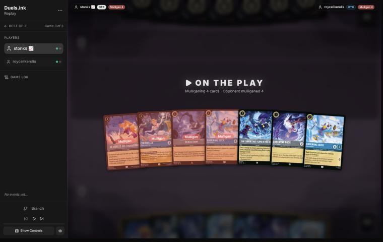
*The board before the decision: [step 0](https://duels.ink/replay/01a16039-37c0-71bd-ae60-72732b9a7c03?step=0) in the duels.ink replay viewer.*

**What you did:** On the play. Kept a Darkwing Duck – Crime Fighter, a Drake Mallard and The Terror That Flaps in the
Night; sent back the other Drake Mallard, Windstorm, Cinderella – Dream Come True and He Hurled His Thunderbolt.

**Verdict:** **Good.** The sim (`mulligan.py`, 1,500 deals) agrees. Your keep of three gave 9.18 ink by turn 4, 3.94
play turns, 6.4 lore and 3.9 characters. Keeping all seven gave 8.86, 3.90, 5.9 and 3.8; the coach's candidate of
keeping five (sending Windstorm and Thunderbolt) gave 9.28, 3.95, 6.1 and 3.9. The seven had two uninkable 4s and a
Windstorm that does little without Merida, and Flash's Resist blanks it. The kept three are the Darkwing start that
makes Terror deal 3. Sending Thunderbolt costs the one answer in hand to a 4-willpower Woolter & Jesse, which is the
only real price. Confidence: medium.

### Turn 1: your turn 1

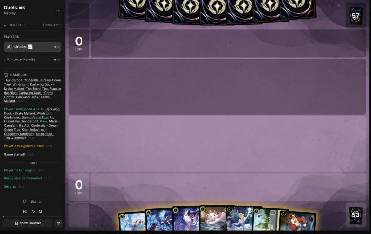
*The board before the decision: [step 2](https://duels.ink/replay/01a16039-37c0-71bd-ae60-72732b9a7c03?step=2) in the duels.ink replay viewer.*

**What you did:** Inked Khan Industries – Greenway Landmark, played Marie – Caught in the Act.

**Verdict:** **Good** *(revisited in discussion; the blind pass called the ink a close call)*. A 1-drop on turn 1 is
right, and Marie or the Crime Fighter are much the same (Marie's ink drop wants a Terror first, the Crime Fighter makes
Terror deal 3). The blind pass wanted Khan Industries kept as the answer to Shere Khan. stonks 📈's view, relayed by
danny: Khan Industries isn't a proactive play in this deck; it's a closer in a game you already lead, or a free play
from Tiana. The hand had five inkable cards for five turns of ink, and Khan is the dearest and the latest of them.

### Turn 2: their turn

**What happened:** They inked Tinker Bell – Giant Fairy and played Maleficent – Exultant Spellcaster (2/2, a
Villain).

### Turn 3: your turn 2

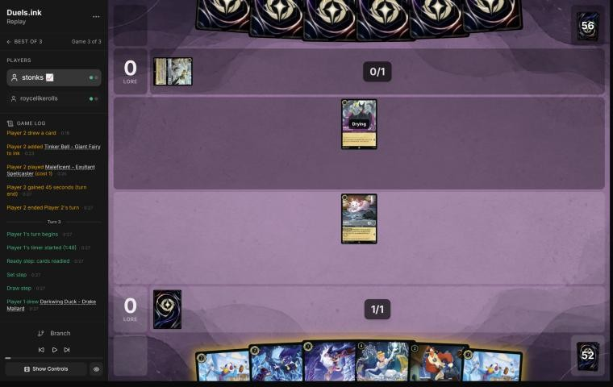
*The board before the decision: [step 8](https://duels.ink/replay/01a16039-37c0-71bd-ae60-72732b9a7c03?step=8) in the duels.ink replay viewer.*

**What you did:** Drew the second Drake Mallard and inked one. Terror dealt 2 to Maleficent and banished her, then
Marie quested (1–0) and A LITTLE TREAT gave you an ink drop.

**Verdict:** **Good play**, the coach's line. In one turn it:
- **Removed their Villain:** Maleficent is the base for Maleficent & Diablo's Shift and the Villain that turns on
  Diablo.
- **Ramped:** Terror's damage then Marie's quest is the ink drop that makes 4 next turn, enough for Cinderella –
  Dream Come True.
- **Scored a lore.**

What it exposes: Marie (1 willpower) is exerted, but their board is empty, and nothing they play on 2 ink can
challenge this turn.

### Turn 4: their turn

**What happened:** They inked Pepita and played Flash – Efficient Clerk (3/2/2, Resist 1).

### Turn 5: your turn 3

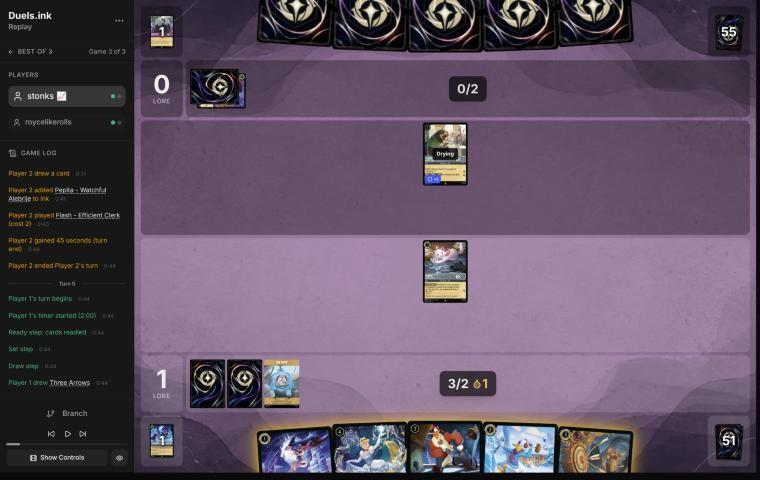
*The board before the decision: [step 16](https://duels.ink/replay/01a16039-37c0-71bd-ae60-72732b9a7c03?step=16) in the duels.ink replay viewer.*

**What you did:** Drew Three Arrows. Inked the other Drake Mallard and played Cinderella – Dream Come True with the
ink drop. At the end of the turn WHATEVER YOU WISH FOR inked Three Arrows and drew Merida – Formidable Archer.

**Verdict:** **Good**, with a close call on the last ink.
- **Cinderella now beats the coach's plan.** The coach would have played Drake Mallard and Launchpad (4 ink) to
  answer Flash and start the draw engine. Your line puts you a turn ahead on ink: 5 next turn, in time for a 5-drop.
- **Which card Cinderella inked was close.** The hand was the Crime Fighter, Launchpad and Three Arrows. Launchpad
  can only reach the inkwell through an effect like this ([CR 4.2.3.2](#cite-cr-4-2-3-2)). Three Arrows is the removal that pairs with
  Merida: her FULL QUIVER returns it from the discard, never from the inkwell. Against Flash's Resist and a board of
  2- and 3-willpower characters, Arrows was worth keeping.
- **Marie stayed back,** out of Flash's reach (3 strength against 1 willpower). Nothing had taken damage, so a quest
  wouldn't have made an ink drop anyway.

What it exposes: Cinderella (3 willpower) is ready. Only a Peter Pan's Shadow (about 35% by their turn) exerts her for
a challenge, and Flash can't challenge this turn (drying).

### Turn 6: their turn

**What happened:** They inked Toulouse and played David Xanatos – Steel Clan Leader (3/2), discarding Angel to deal 2
to Marie, who was banished. Flash quested (1–2).

### Turn 7: your turn 4

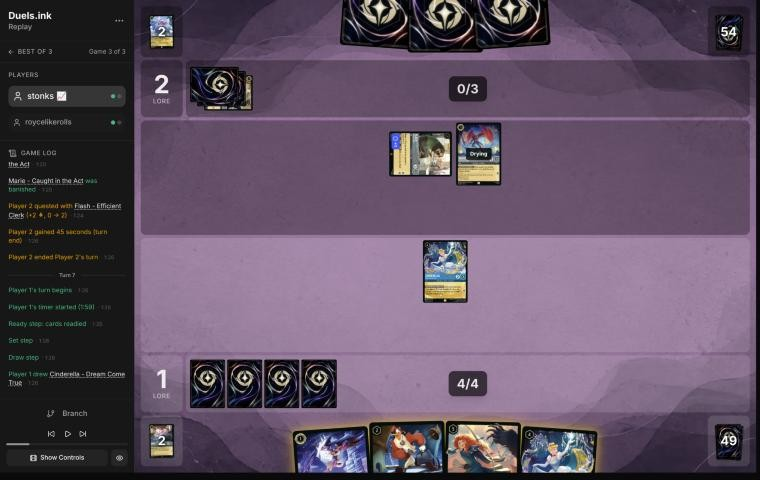
*The board before the decision: [step 27](https://duels.ink/replay/01a16039-37c0-71bd-ae60-72732b9a7c03?step=27) in the duels.ink replay viewer.*

**What you did:** Drew a second Dream Come True. Inked the Crime Fighter and played Merida (a Princess, so Cinderella's
trigger fired). At the end of the turn it inked Launchpad and drew Cinderella – Unintentional Icon.

**Verdict:** **Good.** The coach compared two lines:
- **Yours:** Merida on curve. She's ready for any action you draw next turn, and quests for 2.
- **The second Dream Come True (4):** both Cinderellas trigger at the end of the turn, for two inks and two cards. That
  makes 8 ink next turn instead of 7, and one more card, with Merida a turn later.

Close, and yours gets a 2-lore body down against a board questing for 3 a turn. Inking Launchpad through the trigger
was the right card: it can't be inked any other way.

What it exposes: Merida (5 willpower) is ready. Their best single challenge next turn is 3 (Flash or Xanatos), so it
takes a Shere Khan (about 26% by their turn) plus Angela or Strength of a Raging Fire to kill her. That's two cards.

### Turn 8: their turn

**What happened:** They inked Angel and played Angela – Night Warrior, giving Flash Challenger +2 and Resist +2 until
their next turn (Resist 3 in all). Flash quested (1–4). Xanatos stayed back.

### Turn 9: your turn 5

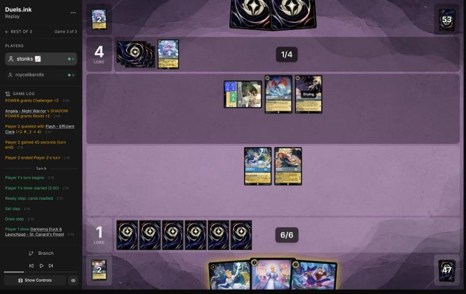
*The board before the decision: [step 38](https://duels.ink/replay/01a16039-37c0-71bd-ae60-72732b9a7c03?step=38) in the duels.ink replay viewer.*

**What you did:** Drew a Finest. Shifted Cinderella – Unintentional Icon onto Dream Come True for 5, didn't ink, and
didn't quest. At the end of the turn BESPOKE DESIGN inked the Finest and put He Hurled His Thunderbolt on top.

**Verdict:** **Close call** *(revisited in discussion; the blind pass called leaving Icon and Merida ready a
mistake)*. Icon shifted onto a Dream Come True that had been in play since turn 5, so she could act at once ([RULE-2](#cite-rule-2)).
- **The blind pass's case for questing:** both could quest for 5 lore at 1–4 against a board questing for 4 a turn.
  Their challengers next turn (Flash 3, Xanatos 3, Angela 2; Angela's buff ends as their turn starts) each die to
  Icon's 4 or Merida's 3, even through Flash's Resist 1, and killing either of yours takes two of them.
- **stonks 📈's case for staying ready**, relayed by danny: at 1–4 neither side is near 20, so the lore matters less
  than it looks. Icon's BESPOKE DESIGN is worth more every turn she lives, digging for removal, and two cheap
  characters for her is a trade they'd happily make. Merida held back keeps the chance of a Windstorm or Three Arrows
  sweep, and Finest in hand can start challenging later.
- **The coach's view now:** the blind pass treated "the challenger dies" as a deterrent. But Flash and Xanatos (5 ink)
  for Icon (a 7-drop and the deck's ramp) is a trade in their favour, and that cost wasn't weighed against 5 lore.
  Questing makes 5 and leaves them one character; staying ready keeps the engine. Neither is clearly better ([H-6](#cite-h-6),
  [TEMPO-1](#cite-tempo-1)).

Not inking was right: Finest was the only inkable card, and BESPOKE DESIGN inked the other one anyway. Confidence: low.

### Turn 10: their turn

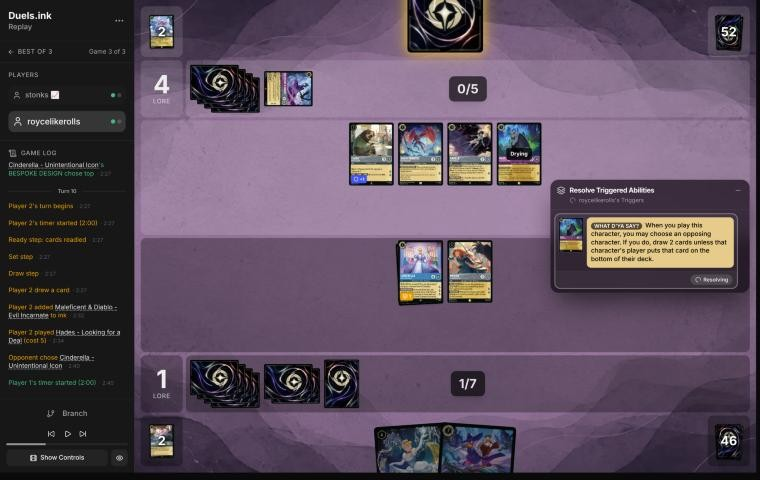
*The board before your choice: [step 46](https://duels.ink/replay/01a16039-37c0-71bd-ae60-72732b9a7c03?step=46) in the duels.ink replay viewer.*

**What happened:** They inked Maleficent & Diablo and played Hades – Looking for a Deal, choosing Icon. Nobody
quested (1–4).

**Your choice:** let them draw 2 rather than put Icon on the bottom of your deck.

**Verdict:** **Good.** Icon is a 3-lore quester that ramps every turn and cost you a 7-drop's worth. Two random cards
for them are worth less than that, and bottoming her would undo the whole shift.

### Turn 11: your turn 6

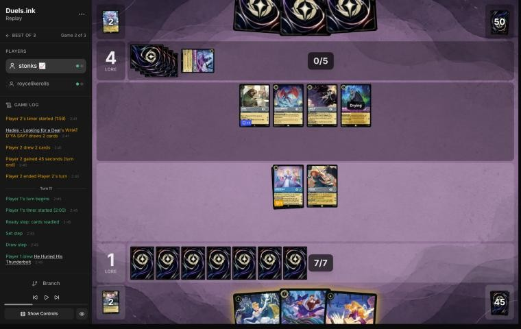
*The board before the decision: [step 48](https://duels.ink/replay/01a16039-37c0-71bd-ae60-72732b9a7c03?step=48) in the duels.ink replay viewer.*

**What you did:** Drew He Hurled His Thunderbolt. Played Finest for 7, and Icon sang Thunderbolt to banish Flash.
No quests. BESPOKE DESIGN inked a Tiana – Party Hostess and put another Tiana on top.

**Verdict:** **Good targets; close call on the quests** *(revisited in discussion; the blind pass called the
quests an inaccuracy)*.
- **The good part:** Flash was the right target: 2 lore a turn, and Resist that blanks Windstorm. Singing
  Thunderbolt free and hard-casting Finest used the whole turn's ink.
- **The blind pass's case for questing:** Merida could have sung (any character costing 4 or more can) while Icon
  quested for 3, or Icon sings, as you did, and Merida quests for 2. Their challengers next turn (Xanatos 3, Angela 2,
  Hades 3: 8 in all) kill one of Icon (6) or Merida (5), never both.
- **stonks 📈's case for holding:** Hades changes it. A questing Merida lets Angela trade into her and Hades finish
  her, and Hades survives on 3 damage, needing another challenge. Holding sets up Finest to challenge next turn, and a
  tall board keeps them from questing (still 1–4).
- **The coach's view now:** an exerted Merida is their cheapest kill (Angela only; Hades survives), so her 2 lore
  probably costs Merida for Angela. That's close. Confidence: low.

### Turn 12: their turn

**What happened:** Peter Pan's Shadow exerted Merida. Angela challenged her (2) and died to Merida's 3, then Hades
challenged (3) and banished her, taking 3 (1 willpower left). Woolter & Jesse came in ready. Nobody quested (1–4).

### Turn 13: your turn 7

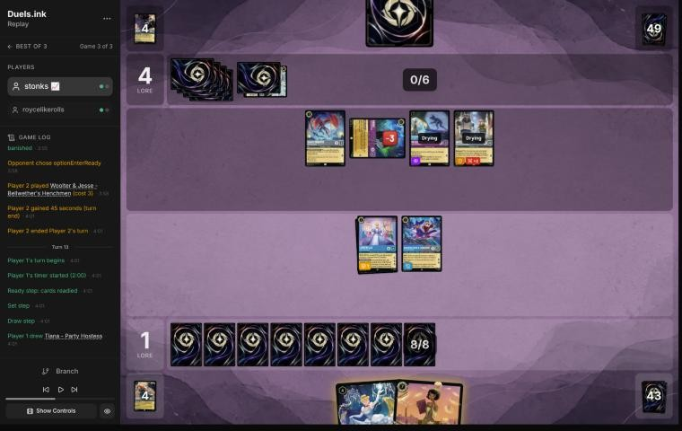
*The board before the decision: [step 64](https://duels.ink/replay/01a16039-37c0-71bd-ae60-72732b9a7c03?step=64) in the duels.ink replay viewer.*

**What you did:** Drew a Tiana – Party Hostess and played her: IDEAL VENUE drew Merida and a second Unintentional Icon,
and you discarded Dream Come True. Finest challenged the exerted Hades (1 willpower left) and banished it, and VICTORY
POSE made it 3–4. Icon stayed back, and you didn't ink. BESPOKE DESIGN inked a Marie and put a Finest on top.

**Verdict:** **Good**, with two close calls.
- **Finest on Hades** was the right challenger: VICTORY POSE pays 2, Icon wouldn't. Tiana's two cards for one turned 7
  ink into a body and card advantage.
- **Icon not questing was reasonable this time.** Unlike turns 9 and 11, a single challenger now kills her: Woolter &
  Jesse, 6 with Challenger against her 6 willpower. That trades their 3-drop for your 7-drop, even though Icon's 4
  kills Woolter & Jesse too. Keeping her ready and safe is defensible, and questing for 3 to offer that trade is too.
- **The ink:** with Merida (uninkable) and the second Icon left in hand, inking Icon would have given 10 ink next turn
  instead of 9. A second Icon is the hand's least useful card, since shifting her onto the first gains nothing.
  *(Revisited in discussion:)* holding was the better side of it. From 7 ink with Icon in play, inking is optional, and
  BESPOKE DESIGN inked a card anyway.

What it exposes: Finest is exerted with 4 willpower left. Woolter & Jesse (6), or Xanatos and Shadow together (5), can
kill it, and either way Finest's 5 kills what challenges it.

### Turn 14: their turn

**What happened:** Demona – Scourge of the Wyvern Clan exerted your characters and refilled both hands (you drew a
Finest). Woolter & Jesse challenged Icon and both were banished. Xanatos and then Peter Pan's Shadow challenged
Finest: both died to its 5, and their 3 and 2 finished it. They added Tinker Bell – Curious Fairy (0/4, the base for
Giant Fairy). 3–4.

### Turn 15: your turn 8

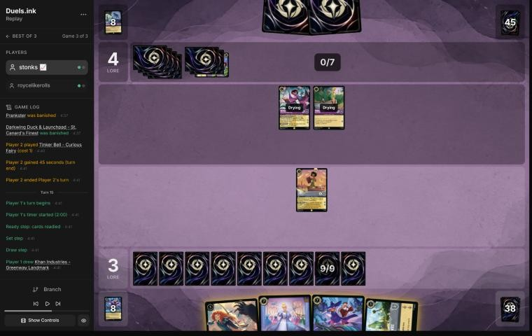
*The board before the decision: [step 79](https://duels.ink/replay/01a16039-37c0-71bd-ae60-72732b9a7c03?step=79) in the duels.ink replay viewer.*

**What you did:** Drew Khan Industries – Greenway Landmark. Played the second Unintentional Icon for 7 of your 9 ink,
didn't ink, and Tiana stayed back. BESPOKE DESIGN inked a Drake Mallard.

**Verdict:** **Good** *(revisited in discussion; the blind pass called the missed ink an inaccuracy)*. From 7 ink
with Icon in play, inking is optional: BESPOKE DESIGN inks a card every turn, 9 ink already casts anything in the deck,
and each card held is a threat for later ([INK-3](#cite-ink-3)). The blind pass's line inked Finest or Icon to play Khan Industries and
Merida (10 ink). That spends a threat to land Khan, and in this deck Khan Industries is a closer, or a free play from
Tiana, not a turn-8 play. The second Icon is a 3-lore quester that digs.

Keeping Tiana ready was right: Demona (5 strength, dry next turn) kills an exerted Tiana (5 willpower).

What it exposes: Icon and Tiana are ready. A Shere Khan (about 24% by their turn) lets Demona challenge one, and Tinker
Bell – Giant Fairy (Shift 4 onto the Curious Fairy) would deal 1 to each. Confidence: medium.

### Turn 16: their turn

**What happened:** Shere Khan's NEW INCENTIVE let Demona challenge the ready Tiana: Tiana was banished, and Demona took
4 (2 willpower left). They played Dumbo – Ninth Wonder of the Universe (Evasive). No quests (3–4).

### Turn 17: your turn 9

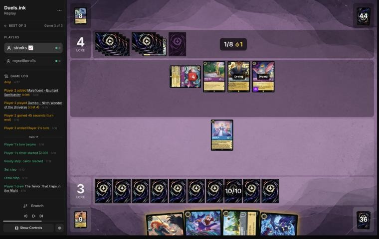
*The board before the decision: [step 90](https://duels.ink/replay/01a16039-37c0-71bd-ae60-72732b9a7c03?step=90) in the duels.ink replay viewer.*

**What you did:** Drew a Terror. Played Finest for 7, then Terror (3, with Finest counting as a Darkwing Duck)
banished Dumbo. Icon stayed back, and you didn't ink. BESPOKE DESIGN inked a Goliath.

**Verdict:** **Close call** *(revisited in discussion; the blind pass called not challenging Demona a mistake)*.
- **The blind pass's case:** Icon kills the exerted Demona (her last 2 willpower against Icon's 4) and survives on 1.
  With Demona gone their questers make 2 a turn, and if Shere Khan then kills Icon, Icon's 4 kills him too: Demona and
  Shere Khan for Icon.
- **stonks 📈's case for holding:** a ready Icon keeps her triggers coming, and card velocity is what finds the
  deck's biggest threats; letting them trade into her gives that up. They had no draw engine on board, no hand and 4
  lore, so sitting back to maximise value was safe.
- **The coach's view now:** the kill was free this turn, but it left the engine on 1 willpower, and Demona on 2
  willpower stays easy prey for Finest or a Terror. Both lines are reasonable. Confidence: low.

The rest was right. Terror on Dumbo removed the Evasive card engine nothing of yours could challenge. Finest counting
as a Darkwing ([CR 5.2.6.1](#cite-cr-5-2-6-1)) made Terror deal 3. Holding Khan Industries uninked was fine.

### Turn 18: their turn

**What happened:** A second Shere Khan gave Demona NEW INCENTIVE, but no challenge or quest followed (3–4).

### Turn 19: your turn 10

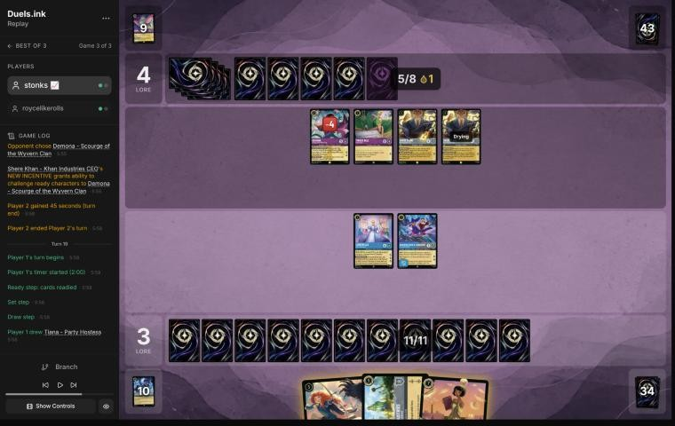
*The board before the decision: [step 100](https://duels.ink/replay/01a16039-37c0-71bd-ae60-72732b9a7c03?step=100) in the duels.ink replay viewer.*

**What you did:** Drew a Tiana and played her. IDEAL VENUE drew Launchpad and a Terror, discarded Khan Industries and
played it free. Terror (3) banished Demona. Icon moved to Khan Industries, and Icon and Finest quested (8–4).
BESPOKE DESIGN inked a Marie and put Minnie Mouse – Urban Visionary on top.

**Verdict:** **Good play.** The coach's plan was Tiana discarding Khan Industries, then 4 ink to move Icon and Finest
there and quest both safely. Your line is better: Tiana's draw found a Terror, and 2 ink on it killed Demona, their
2-lore, 5-strength card. Then you protected the more valuable quester (Icon, 3 lore and the ramp) and still quested
with both, for all 11 ink.

What it exposes: Finest is exerted with 7 willpower. Their two Shere Khans (8) can kill it, and Finest's 5 kills each.
Khan Industries (8 willpower) can be challenged too: both Shere Khans together destroy it, but then they don't quest.
Tinker Bell – Giant Fairy (Shift 4 onto the Curious Fairy) would deal 1 to each of yours.

### Turn 20: their turn

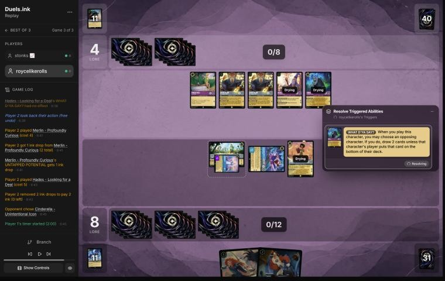
*The board before your choice: [step 120](https://duels.ink/replay/01a16039-37c0-71bd-ae60-72732b9a7c03?step=120) in the duels.ink replay viewer.*

**What happened:** You Broke My Smolder (two cards), Merlin – Profoundly Curious, and a second Hades choosing Icon.
Both Shere Khans then challenged Khan Industries and destroyed it (8–4).

**Your choice:** let them draw 2 again, keeping Icon.

**Verdict:** **Good**, for the same reason as on turn 10: Icon makes 3 lore and an ink a turn, and you led 8–4.

### Turn 21: your turn 11

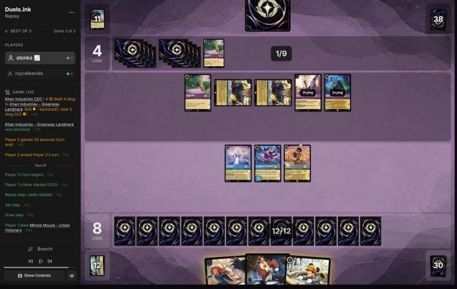
*The board before the decision: [step 125](https://duels.ink/replay/01a16039-37c0-71bd-ae60-72732b9a7c03?step=125) in the duels.ink replay viewer.*

**What you did:** Drew Minnie Mouse – Urban Visionary. Finest challenged one exerted Shere Khan (VICTORY POSE, 10)
and Tiana the other, banishing both. Played Minnie (8) and Launchpad (2), and Icon quested (13–4).

**Verdict:** **Good.** At 8–4 with Icon, Finest and Tiana questing for 7, the race was yours if your questers
survived, so the turn was about their challengers.
- **The coach compared two lines.** Finest's kill plus Icon and Tiana questing reaches 15 and leaves one Shere Khan.
  Your two kills plus Icon reaches 13 and leaves them only Hades (3) and Merlin (2) to challenge with.
- **Both win next turn** if nothing new arrives. After their best two kills (Tiana and the damaged Finest), Icon,
  Minnie and Launchpad still quest for 7, exactly what 13 needs. Yours has fewer challengers to beat, the other one
  more lore in hand.
- **Minnie (Ward, 3 lore) and Launchpad** used 10 of the 12 ink and add 4 lore of questers for next turn.

What it exposes: Tiana is on 1 willpower and Finest on 3, both exerted, and Icon is exerted. Merlin (2) and Hades (3)
can kill Tiana and Finest. A Demona – Scourge of the Wyvern Clan (about 22% with their draw and Merlin's) would exert
Minnie and Launchpad for them too. Strength of a Raging Fire (about 28%) deals 4 with their four characters.

### Turn 22: their turn

**What happened:** Woolter & Jesse and a second Demona – Scourge of the Wyvern Clan, whose refill drew you Tiana and
Merida. Then roycelikerolls conceded at 4–13.

## Lessons
Revisited in discussion with stonks 📈 (relayed by danny); the blind pass's versions said the opposite of 1 and 3.
1. **Weigh an engine's next triggers against the lore a quest makes.** Two cheap challengers for Unintentional Icon is
   a trade they want, even if both die. Early, at 1–4, Icon's card velocity matters more than the race
   ([turns 9](#turn-9), [11](#turn-11) and [17](#turn-17)).
2. **A tall, ready board stops them questing.** It forces them to spend Peter Pan's Shadow or Shere Khan to reach it,
   and if they don't find those, it keeps working.
3. **From 7 ink with Icon in play, inking is optional.** Hold threats; BESPOKE DESIGN inks anyway ([turns 13](#turn-13)
   and [15](#turn-15)).
4. **Khan Industries is a closer.** Free from Tiana on [turn 19](#turn-19), it kept Icon safe while both questers
   scored; as an early play it's slow ([turn 1](#turn-1)).

## Knowledge-base updates (applied 2026-11-02, after discussion)
- **Strategy, [H-6](#cite-h-6) (a ready board against an exert-and-challenge deck): evidence for,** from the player's reasoning on
  turns 9, 11 and 17. The blind pass had proposed this game as evidence against; discussion reversed it.
- **Meta, the Sapphire/Steel notes:** the player's rules (Icon's card velocity, inking optional from 7 with Icon, a tall
  ready board, Khan Industries as a closer), and the one-turn Tiana-and-Khan setup at 9 ink from turn 19. The blind
  pass's proposal to keep Khan out of the inkwell against Shere Khan lists was dropped.
- **Meta, the Amethyst/Steel notes (Midrange against Big Ramp), roycelikerolls game 3:** more of the list (Hades ×2,
  Woolter & Jesse ×2, Demona – Scourge ×2, Tinker Bell – Curious Fairy ×2 and Giant Fairy ×2, Shere Khan, Dumbo,
  Merlin, Flash, Angela, Xanatos, Toulouse); Shadow and Shere Khan spent to reach the ready board; both Shere Khans
  challenging Khan Industries down (turn 20).
- **Method:** the decision method now values an engine's future turns when a line exposes it, and notes that inking
  is optional past about 7 ink with a ramp engine in play.

## Hindsight
Doesn't change the verdicts above.
- **Staying ready didn't keep Merida or Tiana safe.** Peter Pan's Shadow exerted Merida for two challenges (turn 12),
  and Shere Khan let Demona hit the ready Tiana (turn 16). But staying ready forced them to spend those cards to do
  it (stonks 📈): without them, the board keeps working, and if you don't force them out, they're saved for a later
  turn.
- **The coach saw turn 19 as the turn:** Tiana found the Terror that killed Demona, Khan Industries came free, and 5
  lore took you from 3 to 8. On turn 21 the two Shere Khans died, and they had no way to stop 7 lore a turn.
  stonks 📈 puts it at turn 11, 95% or better already: a board as good as theirs or better, no cards in their hand,
  and two significant characters to come.
- **Their turn 18:** Shere Khan's NEW INCENTIVE went on Demona, but no challenge followed. The blind pass called that
  odd; it isn't (stonks 📈). Demona on 2 willpower would die challenging anything of yours without banishing it, so
  CORNER THE MARKET's ink drop wouldn't fire either. They needed to build a board that answers your threats.

## The coach's errors
Errors the coach caught in its own work, and three found in discussion, which changed five verdicts.

| When | Error | How it was caught | How it won't happen again |
|---|---|---|---|
| Turns 17 and 21 | Cut the brief's card-text section (cards already read, the new ones read from single-card sources), against the rule to read briefs whole | The coach, writing up this review | Done (2026-11-02): a hook (`.claude/hooks/guard_brief.py`) refuses any command that pipes or redirects `tools/brief.py` |
| [Turns 9](#turn-9), [11](#turn-11), [17](#turn-17) | Judged a ready Icon and Merida as giving away lore, since every challenger into them would die. Didn't weigh Icon's future triggers, or that two cheap characters for her is a trade they want, and overweighted an early race at 1–4 | stonks 📈, in discussion (relayed by danny) | Done (2026-11-02): the decision method's evaluation section values an engine's future turns when a line exposes it; the Big Ramp notes record Icon's card velocity |
| [Turns 13](#turn-13), [15](#turn-15) | Called skipping the ink a mistake ("ink every turn"), against [INK-3](#cite-ink-3)'s own caveat: from 7 ink with Icon inking every turn, a threat in hand is worth more | stonks 📈, in discussion | Done (2026-11-02): the decision method's ink axis says inking is optional past about 7 ink with a ramp engine; the Big Ramp notes have the player's rule |
| [Turns 1](#turn-1), [15](#turn-15) | Valued Khan Industries as an early play and an answer to Shere Khan; in this deck it's a closer or a free play from Tiana | stonks 📈, in discussion | Done (2026-11-02): the Big Ramp notes record Khan Industries' role, and the decision method's recurring errors list it |

## Open questions
Closed when the review was finalised (2026-11-02), with stonks 📈's answers relayed by danny.
- **Turns 9 and 11:** staying ready kept Icon's triggers coming and denied them trades; at 1–4 the race didn't matter
  yet, and Hades on board on turn 11 made a questing Merida a cheap kill. Both moved to close calls.
- **Turn 17:** keeping Icon ready for more triggers beat letting them trade into her, with their hand empty and 4
  lore. Moved to a close call.
- **Turns 13 and 15:** deliberate. From 7 ink with Icon, inking is optional, and holding the cards keeps their value.
  Turn 15 moved to good.

## Citations
Copies of the coach's knowledge base cited above, as they stood when they were cited (the private repository's commit and date are given with each). They don't change when the knowledge base does.

**RULE-2**: strategy principle, `kb/strategy/principles.md` at `ab9d53a` (2026-11-02), working tree

> - **RULE-2. Drying** `[CR 1.7.5]`. A newly played character can't quest, challenge or sing until next turn, so it's exposed to nothing (it's ready) but contributes nothing. **Shifting onto a dry character gives an immediate actor** `[CR 8.10.4]`. Rush allows challenges only `[CR 8.9]`. · baseline

**H-6**: hypothesis, `kb/strategy/hypotheses.md` at `ab9d53a` (2026-11-02), working tree

> ### H-6. Against an exert-and-challenge deck, a ready board that keeps drawing can outlast it
> - **Claim:** against decks whose removal is challenges set up by exert effects (Amethyst/Ruby tempo-midrange: Peter
>   Pan's Shadow, Isis, Wasabi's TWIN BLADES), keeping a wide board ready and drawing cards can beat questing into
>   their challengers, until a turn with a decisive attack (Judy Hopps – Lead Detective's Alert and Resist) or removal.
>   The risk is an exert-all (Demona – Scourge of the Wyvern Clan), which turns the waiting board into free kills.
> - **Why:** with nothing exerted, their challengers have no targets, so they must quest into your ready challengers or
>   wait too. Each waiting turn is a card for you (Nick Wilde – Toy Drive Officer's COMMUNITY OUTREACH) rather than
>   lore for them.
> - **Evidence for:** 01a19c0c (MK_ifoughtthelore vs VH INK, game 3; 2026-11-02). From turn 14 to turn 20 they mostly
>   didn't quest, and the waiting board found eight extra cards (six from COMMUNITY OUTREACH, one from Uncovering
>   Clues, one returned by Fangmeyer). On turn 22, Lead Detective's
>   Alert removed both Evasive questers and the board scored 8 (1 to 9 against 10). Won.
> - **Evidence against:** 01a19c00 (game 1). A ready board of five small characters waited, correctly at about 15% for
>   Demona that turn, and Demona – Scourge exerted it all on turn 11; every character died. A waiting board of 1- and
>   2-willpower characters loses everything to an exert-all.
> - **Status:** open (one game each way). Applied at the user's request, 2026-11-02.

**CR 4.2.3.2**: Comprehensive Rules, `kb/rules/cr/04-turn-actions.md` at `ab9d53a` (2026-11-02), working tree

> **4.2.3.2.** Some effects allow a player to put a card directly into their inkwell. These effects aren’t counted toward the once-per-turn limit of the turn action, and the card isn’t revealed as it’s put into the player’s inkwell.

**CR 5.2.6.1**: Comprehensive Rules, `kb/rules/cr/05-cards-and-card-types.md` at `ab9d53a` (2026-11-02), working tree

> **5.2.6.1.** Some characters have two singular names in addition to their printed name. These characters have an ampersand (&) or something else that’s treated as an ampersand (see 5.2.6.3) between the two names listed on the name line. If an effect looks for a card or character with a specified name, the specified name must exactly match one of the names on the card.

**sapphire-steel.md, Big Ramp with the Darkwing package: how to play it**: knowledge base, `kb/meta/archetypes/sapphire-steel.md` at `ab9d53a` (2026-11-02), working tree

> ### Big Ramp with the Darkwing package: how to play it `[coach, study of stonks 📈's 22 games of 21 Oct 2026 (sent by the user), full games, not blind]`
> The user calls this list Sapphire/Steel Detectives, or Big Ramp. It matches duels.ink's "Big Ramp #1" (Windstorm,
> Minnie) with the Darkwing Detectives added. Games: `01a15f98` to `01a1602c` (22; see `kb/meta/index.md`). Card text
> verified with `tools/cards.py`. Also `01a15f8e` (vs MFork, game 2) and `01a16978` (vs AkatsukiCap, game 1).
> - **The list (60):**
>   - **1-drops:** Darkwing Duck – Crime Fighter ×4, Marie – Caught in the Act ×4
>   - **2-drops:** Darkwing Duck – Drake Mallard ×4 (Ward), Launchpad – Trusty Sidekick ×4, The Terror That Flaps in
>     the Night ×4
>   - **3–4:** Three Arrows ×4, Priscilla – Efficient Clerk ×3, Cinderella – Dream Come True ×4, He Hurled His
>     Thunderbolt ×2, Windstorm ×3
>   - **5–6:** Merida – Formidable Archer ×4, Khan Industries – Greenway Landmark ×4, Goliath – Clan Leader ×3
>   - **7–8:** Darkwing Duck & Launchpad – St. Canard's Finest ×4, Cinderella – Unintentional Icon ×2, Tiana – Party
>     Hostess ×4, Minnie Mouse – Urban Visionary ×3
> - **The plan:**
>   1. **Early removal** keeps their board small: Terror (3 damage while a Darkwing is in play), Three Arrows (2, then 1).
>      A Darkwing in play also makes Launchpad's draw free of the discard.
>   2. **Ramp:** Priscilla (enters exerted; each quest puts one of the top 2 into hand and the other into the inkwell,
>      2 lore), Cinderella – Dream Come True (at the end of a turn you played a Princess, ink a card from hand to draw),
>      Cinderella – Unintentional Icon (Shift 5 onto her; ramps one a turn, 3 lore), Marie (an ink drop when she quests
>      after an opposing character took damage). Ink at the start of its 5th turn was usually 5–6, and 8–9 by its 6th in the fastest games.
>   3. **The sweep: Merida, then Windstorm.** STEADY AIM adds 2 damage to every instance of action damage to an
>      opposing character, so Windstorm deals 3 to each (5 to an Evasive one): a 4- to 6-character wipe (01a1601c
>      turn 11: six Princess Aggro characters). Merida's FULL QUIVER also returns Three Arrows (then 4 and 3).
>   4. **Lore:** Khan Industries (2 a turn at their Set step; characters there can't be challenged, so Merida and
>      Priscilla move in), Merida 2, Priscilla 2, Cinderella – Unintentional Icon 3, Minnie 3, St. Canard's Finest 2
>      plus VICTORY POSE (+2 per banish in a challenge on its turn).
>   5. **Tiana – Party Hostess** (7): draw 2 and discard one; a discarded Khan Industries is played free (01a15fee,
>      01a15ff6, 01a1602c). **Minnie** (8, Ward) returns a card from the inkwell to hand when she ends a turn exerted.
>      **Goliath – Clan Leader** puts both hands to 2 at the end of each turn: strictly for pressing an advantage when
>      ahead, or for keeping a control deck's hand small; otherwise rarely played (user, 2026-11-02).
> - **Results by matchup** (13–9): Emerald/Steel Midrange 8–4, all four game 1s lost and every game 2 and 3 won;
>   Amber/Emerald Circle of Life 2–4; Princess Aggro 2–1; Amethyst/Steel Midrange 1–0.
> - **What won:** the Merida and Windstorm sweep, Finest's VICTORY POSE, Khan Industries with protected questers. Early
>   Priscilla matters: in the Emerald/Steel wins she was down by its 4th turn in five of eight, and in the four losses never
>   (a correlation from few games).
> - **It can race from behind once the questers are gone:** in 01a16978, at 5–17 against Emerald/Steel, Three Arrows
>   with STEADY AIM killed Vixey and The Queen, a second Merida returned the Arrows, and wide quests (two Meridas at 2
>   each, Darkwings, Cinderella) won 20–19.
> - **What beat it:**
>   - **Resist:** Flash – Efficient Clerk (2, 3/2/2, Resist 1) takes nothing from Windstorm's 1 and less from every
>     ping; it quested for 8 to 10 in two lost game 1s.
>   - **Ward plus recursion:** Circle of Life replayed Milo Thatch – Getting His Hands Dirty (7, Ward, bounces a
>     character on play), which bounced Merida; conceded at 3–0 (01a15f9d turn 14). Only Windstorm reaches a Ward
>     character.
>   - **Fast wide quests:** Princess Aggro's +5 and +6 turns came before the sweep (01a16020, lost 14–21); a song-and-
>     Evasive Amber/Emerald list quested +7 and +8 (01a15fdb).
> - **Coaching points:**
>   - Merida before any damage action; with their board at 2–3 willpower, hold Windstorm for her.
>   - Keep a Darkwing in play for Terror's 3 and Launchpad's free draw. Quest Marie after removal for the ink drop.
>   - Move questers to Khan Industries; plan Tiana for the turn a Khan is in hand. Whether to ink a Khan is too
>     situational for a rule (user, 2026-11-02): judge it from the hand.
>   - Name the answer to Resist and Ward early (Thunderbolt's 4, challenges, Finest): the pings don't do it.
>   - **Mulligan from the hand you have, not to a fixed plan** (user, 2026-11-02). The play pattern varies widely with
>     the opening seven, and no one line suits a given matchup: see what the hand already does, keep what bridges
>     turn 1 to the late game, and send back the rest, avoiding a full mulligan where possible. The deep mulligans
>     (3 to 7 cards) in these games came partly from the player's first games on the deck, so they aren't a guide.
>   - **Judge the plan from the hand, then the matchup:** a coached line should say how this hand gets from its early
>     turns to Merida, the sweep and the 3-lore finishers, rather than follow a stock sequence.

**TEMPO-1**: strategy principle, `kb/strategy/principles.md` at `4be2094` (2026-11-02), working tree

> - **TEMPO-1. Tempo is how much freedom you leave the opponent, not how fast you play.** A play that forces the opponent to spend their turn answering it has stolen part of their turn. *Ask: "If I play this, what does my opponent have to do next?"* `[MCL ch.1]` · baseline

**INK-3**: strategy principle, `kb/strategy/principles.md` at `4be2094` (2026-11-02), working tree

> - **INK-3. Usually ink every turn, but not automatically.** Keeping one more playable card can beat one more ink. Missing ink with an expensive hand can leave you permanently behind. `[MCL ch.4]` · baseline
