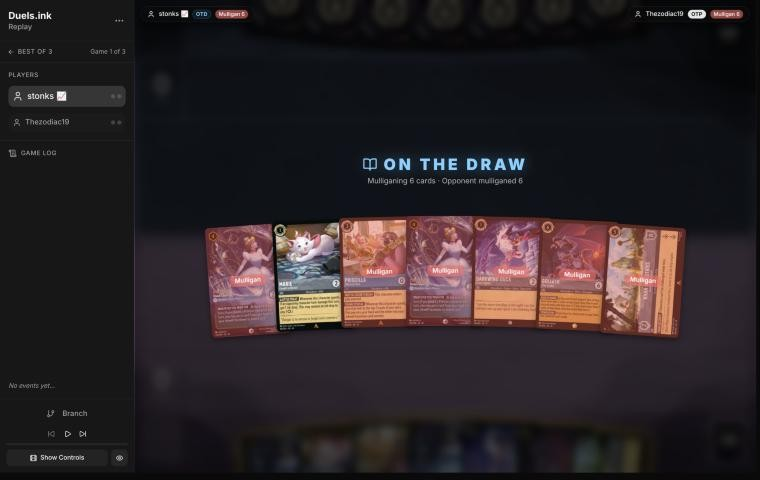
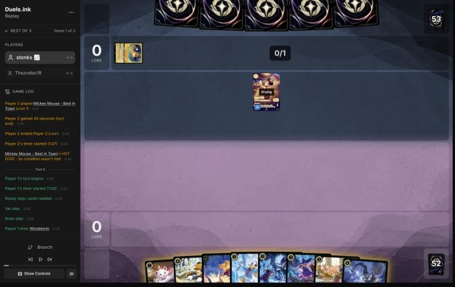
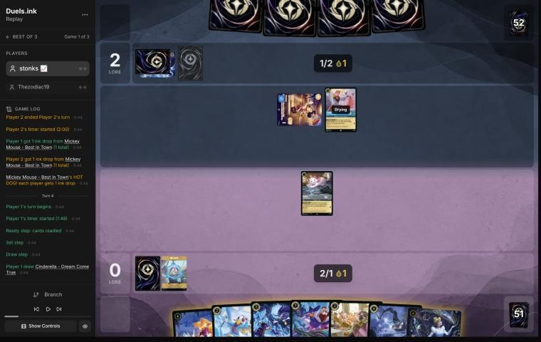
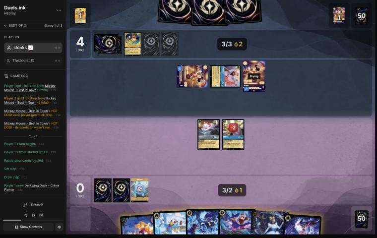
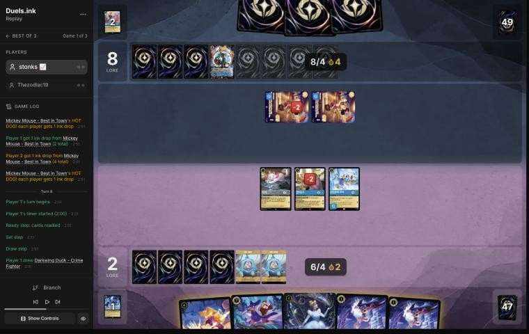
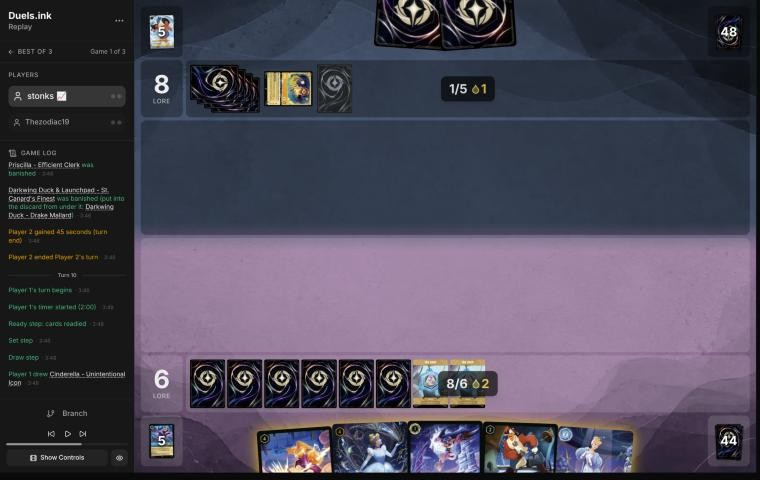
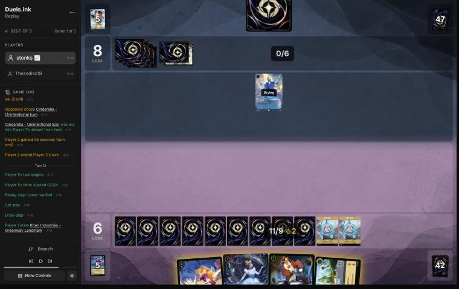
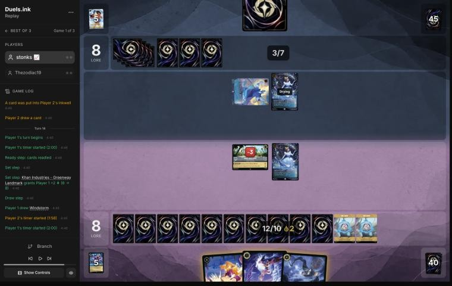
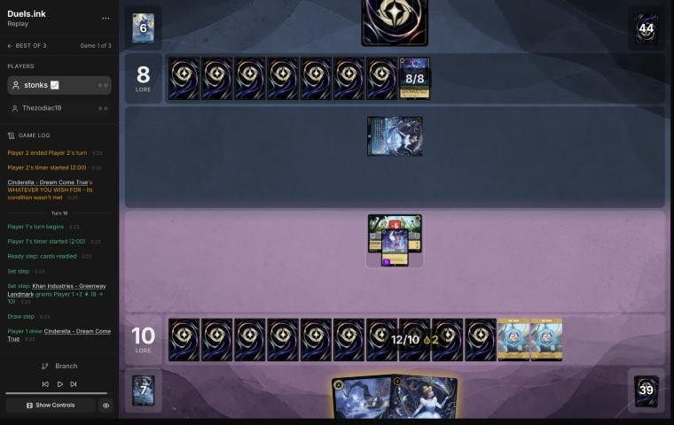

# Review: stonks 📈 vs Thezodiac19, game 1, 23 Oct 2026

| | |
|---|---|
| **Status** | **final** (2026-11-02; the pre-game revisited in discussion, from stonks 📈's rules for the draw relayed by danny; he didn't comment on this game) |
| **Replay** | `01a16972-4252` (`python3 tools/brief.py 01a16972 --turn N`) · [duels.ink viewer](https://duels.ink/replay/01a16972-425d-7a2b-8577-1b9ec3298c50?step=0) |
| **Format** | Core Constructed (stated in the replay), best-of-three, game 1. Set 14 era: inks revealed before the coin toss |
| **Decks** | stonks 📈: Sapphire/Steel Big Ramp with the Darkwing package ([the coach's notes on it](#cite-kb-meta-archetypes-sapphire-steel-big-ramp-with-the-darkwing-package-how-to-play-it)). Thezodiac19: Amber/Sapphire, archetype unknown before the game (Control 51%, Detectives 39%) |
| **Play/draw** | Thezodiac19 went first |
| **Result** | Win: Thezodiac19 conceded at 8–11 on game turn 16 |
| **Meta data** | snapshot of 26 Oct 2026, three days after this game (fresh) |
| **Chosen how** | Sent by danny, the coach's user, with stonks 📈's other games; the coach picked five to review and studied the rest. The coach didn't know this game's result |

## Summary
- **Inaccuracy:** [turn 2](#turn-2), inking Minnie, the Ward threat their removal can't choose.
- **Close call:** the [pre-game](#turn-0), a mulligan of six on the draw (an inaccuracy until discussion).
- **Good plays:**
  - [Turn 6](#turn-6): Drake Mallard, then Terror on their only challenger.
  - [Turn 8](#turn-8): Finest shifted onto Drake to kill one Mickey, Marie the other.
- **Good:** turns [4](#turn-4), [10](#turn-10), [12](#turn-12), [14](#turn-14) and [16](#turn-16), with close calls on
  10 and 12 (Launchpad held or inked) and 14 (Windstorm uninked).

**What decided it:**
- Killing both Mickeys (their lore engine) on turn 8 and Hades on turn 14.
- After Raging Storm, Khan Industries paid 2 a turn while their "choose a character" removal had nothing that
  mattered to choose. They conceded at 8–11 with one character and one card.

## The game, turn by turn
Verdicts judge each decision on what stonks 📈 could know at the time, **including archetype knowledge an
experienced player has**. Hindsight is kept to its own section. Severity scale: good play / close call /
inaccuracy / mistake / blunder. Principle IDs and hypotheses (H-n) link to copies in the Citations section at the
end, as they stood when they were cited.

**What you knew before the game:** Amber/Sapphire, game 1, so only the meta: **Control** (51%) or **Detectives**
(39%). They're on the play, so a card costing N can come on game turn 2N−1. Their removal mostly hits characters with
5 or more strength. On your side that's Finest (5), Goliath and Minnie (6), and anything their Support pumps there.
- **Gaston – Superior Archer** (5): banish a character with 5+ strength. From turn 9.
- **Judy Hopps – Always Vigilant** (4, or Shift 2 onto any Judy): the same banish, if they played another character
  that turn. From turn 7, or sooner by Shift. **World's Greatest Criminal Mind** (song 3, 5+ strength): from turn 5.
- **Support** (Detectives: Judy – Day Camp Instructor, Nick Wilde, Daisy Duck): adds their strength to *your*
  character for the turn, putting anything in range of those banishes. Count their Support against your strengths.
- **Let It Go** (5): puts a character into your inkwell. **Hades – Infernal Schemer** (7): the same on play. From
  turns 9 and 13.
- **Raging Storm** (8): banish all characters. From turn 15. The Control notes say they bank lore first, then wipe.
- **Elisa Maza** (Detectives, 4): reveals your hand and discards a non-character card. Play actions before she
  lands.
- **Belle – Snowfield Strategist** (4): their banished characters become ink. **Cinderella – Dream Come True and
  Unintentional Icon:** the same ramp as yours.

### Pre-game

*The board before the decision: [step 0](https://duels.ink/replay/01a16972-425d-7a2b-8577-1b9ec3298c50?step=0) in the duels.ink replay viewer.*

**What you did:** On the draw. Kept Marie – Caught in the Act and sent back six: both Cinderella – Dream Come Trues,
Priscilla, the Crime Fighter, Goliath and Khan Industries.

**Verdict:** **Close call** *(revisited in discussion; the blind pass called it an inaccuracy)*. The blind pass saw
the deck's slow-matchup plan in the seven: two 1-drops, Priscilla on turn 3, Dream Come True at 4 and Khan Industries at
5, with Goliath for a control deck's hand. The sim (`mulligan.py`, 1,500 deals) favoured keeping five (sending a Dream
Come True and Goliath): 9.67 ink by turn 4, 3.98 play turns, 7.3 lore and 4.4 characters, against 9.31, 3.92, 6.3 and
3.8 for your keep of one.

stonks 📈 didn't comment on this game, but his rules for the draw from the other reviews (relayed by danny) answer the
open question. On the draw a hand needs early interaction; Priscilla lands after their early drops and is usually
killed for free before she quests; Dream Come True needs Marie to come a turn early, and Marie's ink drop needs damage
first, which this hand could only deal by challenging; Khan Industries and Goliath come later. Your mulligan was looking for
interaction: 95% by turn 4, against 62–78% for the keeps.

What keeps it close rather than good: Control (51%) puts few early challengers on the board (Mickey can't challenge),
so Priscilla is likelier to live against it than against Midrange, and part of the sim's lead for the keeps is her
quests. Against Detectives (39%) the player's rule holds fully. [MULL-3](#cite-mull-3), [H-5](#cite-h-5). Confidence: low.

### Turn 1: their turn

**What happened:** Thezodiac19 inked Simba – King in the Making and played Mickey Mouse – Best in Town, a Control tell.

### Turn 2: your turn 1

*The board before the decision: [step 6](https://duels.ink/replay/01a16972-425d-7a2b-8577-1b9ec3298c50?step=6) in the duels.ink replay viewer.*

**What you did:** Drew Windstorm, inked Minnie Mouse – Urban Visionary, played Marie.

**Verdict:** **Inaccuracy, on the ink.** Inking Minnie is suboptimal because she's your best threat against this
opponent. Amber/Sapphire's removal all *chooses* its target: Gaston, Judy – Always Vigilant, World's Greatest Criminal
Mind, Let It Go and Hades – Infernal Schemer. Minnie's Ward means none of them can touch her, though her 6 strength
puts her in the range of every "5 strength or more" banish. Only Raging Storm or challenges can remove her.

Inking Windstorm is better. It's the weakest card in this hand against Control: without Merida it deals 1 to each
character, and Mickey has 4 willpower. Finest has Ward too, so the hand would keep two removal-proof 5+ strength
threats. Marie on turn 1 was right, and Mickey's HOT DOG gives you an ink drop too whenever he ends their turn
exerted. Confidence: medium.

### Turn 3: their turn

**What happened:** They inked Let It Go and played Cinderella – Homespun Dressmaker. Mickey quested (0–2), and HOT
DOG gave each player an ink drop.

### Turn 4: your turn 2

*The board before the decision: [step 14](https://duels.ink/replay/01a16972-425d-7a2b-8577-1b9ec3298c50?step=14) in the duels.ink replay viewer.*

**What you did:** Drew Dream Come True, inked Windstorm, played Priscilla with Mickey's ink drop. Marie stayed back.

**Verdict:** **Good**, the coach's line. Priscilla on turn 2 thanks to the drop: she enters exerted, but their only
possible challenger, Cinderella – Homespun Dressmaker, has 2 strength against her 4 willpower, and Mickey can't
challenge at all (Adventurous). From next turn her quests ramp and filter. Windstorm was the right ink. Marie staying
back keeps her out of Dressmaker's reach (2 strength against 1 willpower).

### Turn 5: their turn

**What happened:** Besties, Assemble! found a second Mickey, which they played. They inked another Simba – King in
the Making. Dressmaker challenged Priscilla for 2 (2 willpower left), and the first Mickey quested (0–4). HOT DOG gave
each player a drop; the new Mickey hadn't quested.

### Turn 6: your turn 3

*The board before the decision: [step 26](https://duels.ink/replay/01a16972-425d-7a2b-8577-1b9ec3298c50?step=26) in the duels.ink replay viewer.*

**What you did:** Drew a Crime Fighter. Priscilla quested (2–4); FILING SYSTEM took the other Crime Fighter and inked
the second card. You inked a Crime Fighter and played Drake Mallard. Then Terror (3, with a Darkwing in play)
banished Cinderella – Homespun Dressmaker, and Marie challenged the exerted Mickey for 2. A first Terror, cast before
Drake for only 2, was undone.

**Verdict:** **Good play.** Dressmaker was their only character that can challenge (both Mickeys are Adventurous with
0 strength), so killing her made every quest of yours free: Priscilla's, and Marie's from now on. Drake first for
Terror's 3 was the right order. Drake is also the answer to the Mickeys from next turn: his 4 kills a 0-strength,
4-willpower Mickey and he takes nothing back. The coach would have quested Marie for 1 and an ink drop rather than
challenge. Marie's 2 damage on Mickey sets up a kill instead. About even.

What it exposes: nothing of theirs can challenge now. Gaston – Superior Archer (about 21% by their turn) would have no
target with 5 strength. Belle – Snowfield Strategist ramps them when their characters are banished, so killing Mickeys
may feed their ink.

### Turn 7: their turn

**What happened:** Both Mickeys quested (2–8) and they inked Kida – Crystal Scion, playing nothing. Two HOT DOGs gave
each player two ink drops; they now hold 4.

### Turn 8: your turn 4

*The board before the decision: [step 43](https://duels.ink/replay/01a16972-425d-7a2b-8577-1b9ec3298c50?step=43) in the duels.ink replay viewer.*

**What you did:** Drew a Crime Fighter. Priscilla quested (4) and FILING SYSTEM took Launchpad. You inked a Crime
Fighter, shifted Finest onto Drake Mallard, and Finest challenged the healthy Mickey (VICTORY POSE, 6–8). Marie
finished the damaged one. Their board was empty.

**Verdict:** **Good play**, the coach's line exactly. The Mickeys were their whole lore engine (4 a turn) and hit back
for nothing. Shifting onto the dry Drake let Finest act at once and earn 2 for the kill. Holding both Crime Fighters,
Dream Come True and Thunderbolt kept a rebuild in hand against a wipe.

What it exposes: their 9 ink next turn (4 drops banked) reaches Raging Storm (about 28%), which would take Finest,
Priscilla and Marie. Their targeted removal can't choose Finest (Ward), and Priscilla and Marie are below 5 strength.
Hades – Infernal Schemer (about 28%) could put Priscilla into your inkwell.

### Turn 9: their turn

**What happened:** Raging Storm (three of its 8 paid with ink drops) banished Marie, Priscilla and Finest. Both boards
were empty, at 6–8.

### Turn 10: your turn 5

*The board before the decision: [step 54](https://duels.ink/replay/01a16972-425d-7a2b-8577-1b9ec3298c50?step=54) in the duels.ink replay viewer.*

**What you did:** Drew a second Unintentional Icon, inked the Crime Fighter, and played Icon for 7 of your 9 ink.
BESPOKE DESIGN inked a Drake Mallard and put Khan Industries on top.

**Verdict:** **Good**, with a close call. Icon onto an empty board is the strongest play: 3 lore a turn and an ink a
turn, and her 4 strength is out of reach of their "5 strength or more" removal. The coach would also have played
Launchpad with the last 2 ink, for a second body and a card a turn. Holding it keeps a body in hand against a second
Raging Storm (about 17% by their turn), which is a fair reason.

What it exposes: Icon can be chosen. Hades – Infernal Schemer (about 23%; their 7 ink reaches it next turn) puts her
into your inkwell, and Let It Go (5) does the same.

### Turn 11: their turn

**What happened:** They inked a Minnie Mouse – Urban Visionary and played Hades – Infernal Schemer (3/6/2), putting
Icon into your inkwell.

### Turn 12: your turn 6

*The board before the decision: [step 65](https://duels.ink/replay/01a16972-425d-7a2b-8577-1b9ec3298c50?step=65) in the duels.ink replay viewer.*

**What you did:** Drew Khan Industries. Played Dream Come True and Khan Industries (9 of 11 ink). At the end of the turn
WHATEVER YOU WISH FOR inked Launchpad and drew a Crime Fighter.

**Verdict:** **Good.** Rebuilding after the wipe with a location is right against a deck whose answers are a wipe and
"choose a character": Khan Industries pays 2 lore a turn whatever happens to your characters, and characters at it
can't be challenged by Hades. The coach would have played Launchpad too (all 11 ink) and let Cinderella ink
Thunderbolt. Your line keeps Thunderbolt, which kills a Gaston or anything they play with 4 willpower, for 2 unused ink
and one body fewer. Close.

What it exposes: Dream Come True (3 willpower) is drying and ready, so Hades can't challenge it. Khan Industries (8)
can be challenged by Hades for 3.

### Turn 13: their turn

**What happened:** They played their own Dream Come True (ink and draw at the end of the turn), and Hades challenged
Khan Industries for 3 (5 willpower left). No quests (6–8).

### Turn 14: your turn 7

*The board before the decision: [step 73](https://duels.ink/replay/01a16972-425d-7a2b-8577-1b9ec3298c50?step=73) in the duels.ink replay viewer.*

**What you did:** Khan Industries gave 2 (8–8). Drew Windstorm. Paid 4 for Thunderbolt on Hades (4 damage), then Dream
Come True challenged and finished it (Cinderella died too). Played the Crime Fighter and moved it to Khan Industries.

**Verdict:** **Good.** The setup: Hades (3 strength) and their Dream Come True (2) together could destroy Khan
Industries next turn (5 willpower left). One of them had to go.
- **The coach's plan:** Cinderella sings Thunderbolt free on their Dream Come True, then your Cinderella and the Crime
  Fighter move to Khan Industries and Cinderella quests for 1.
- **Your line kills the bigger threat:** Hades makes 2 lore a turn and hits Khan for 3. It costs your Dream Come True,
  a 4-drop traded for their 7-drop. Both lines leave you 2 lore a turn ahead. Yours protects Khan Industries better
  (their Dream Come True needs three turns to take it down).
- **Windstorm stayed in hand uninked.** At 12 ink the 13th matters less than earlier, but without Merida Windstorm is
  your weakest card here.

What it exposes: the Crime Fighter at Khan Industries can't be challenged. Their Dream Come True can hit Khan for 2.
Raging Storm (about 13%) would take only the Crime Fighter.

### Turn 15: their turn

**What happened:** They inked Fairy Godmother's Wand, and their Dream Come True challenged Khan Industries for 2 (3
willpower left). Nothing else (8–8).

### Turn 16: your turn 8

*The board before the decision: [step 82](https://duels.ink/replay/01a16972-425d-7a2b-8577-1b9ec3298c50?step=82) in the duels.ink replay viewer.*

**What you did:** Khan Industries made it 10–8. Drew Dream Come True and played her, quested with the Crime Fighter
(11), and moved Cinderella to Khan Industries. Thezodiac19 conceded.

**Verdict:** **Good.** Both questers at Khan Industries can't be challenged, and Khan pays 2 a turn: 3 a turn against
their 1, with their board down to one Dream Come True and one card in hand.

## Lessons
1. **Against Amber/Sapphire, Ward characters are your safest threats.** Their removal chooses (Gaston, Judy – Always
   Vigilant, World's Greatest Criminal Mind, Let It Go, Hades – Infernal Schemer), so Minnie, Finest and Drake Mallard
   dodge all of it. Only Raging Storm and challenges reach them. Ink something else ([turn 2](#turn-2)).
2. **Mickey – Best in Town is free food for Drake Mallard.** He must quest (Adventurous), so he's always exerted, and
   his 0 strength means a 4-strength challenger kills him for nothing. His HOT DOG gives you ink drops too.
3. **Count their drops toward Raging Storm.** Mickey's drops made Storm castable on turn 9, not turn 15. The turn-8
   brief counted them (about 28%), and keeping a rebuild hand (two Crime Fighters, Dream Come True, Thunderbolt) was the
   answer.
4. **A location keeps scoring through wipes and "choose a character" removal.** Their only answer to Khan Industries
   was to challenge it, which took their characters off questing.

## Knowledge-base updates (applied 2026-11-02, after discussion)
- **Meta, the Amber/Sapphire notes (Control), Thezodiac19's list from game 1:**
  - **The list:** Mickey – Best in Town ×2, Simba – King in the Making ×3 (all inked), Cinderella – Homespun
    Dressmaker, Cinderella – Dream Come True, Besties, Assemble!, Raging Storm, Hades – Infernal Schemer, Let It Go,
    Kida – Crystal Scion, Minnie Mouse – Urban Visionary and Fairy Godmother's Wand.
  - **What happened:** Mickey's ink drops brought Raging Storm on turn 9 (8 ink), and Hades put a fresh Icon into
    the inkwell.
- **Meta, the Sapphire/Steel notes (Big Ramp's coaching points):**
  - Against Amber/Sapphire, keep the Ward threats: Minnie, Finest, Drake Mallard.
  - Drake Mallard kills a Mickey – Best in Town each turn for free.
- **From discussion:** [H-5](#cite-h-5) gained this mulligan as evidence for, with the player's rules for the draw.
- **Method (the decision method's §2 and the review skill's step 1.6, done earlier):** count ramp (ink drops from Mickey, Merlin,
  Shere Khan, Marie) when writing each key card's earliest turn, as cost reducers already are.

## Hindsight
Doesn't change the verdicts above.
- **Raging Storm came on turn 9,** paid partly with Mickey's drops, and took Finest, Priscilla and Marie. The cards you
  held back rebuilt the board in two turns.
- **Their hand ran dry:** after Hades on turn 11 they held one card for the rest of the game, and the Wand and three
  Simbas went into the inkwell.
- **The inked Minnie** never mattered: the game ended before 8 ink was needed for her.

## The coach's errors
Errors the coach caught in its own work, and one found in discussion, which changed the pre-game verdict.

| When | Error | How it was caught | How it won't happen again |
|---|---|---|---|
| Pre-game | "Raging Storm from turn 15" ignored the ramp Mickey's HOT DOG gives them. Storm came on turn 9. The turn briefs counted the drops (turn 8 flagged Storm as castable) | The coach, on reading turn 9 | Done: the skill's step 1.6 and the method's §2 count ink-drop sources with cost reducers when writing earliest turns |
| [Pre-game](#turn-0) | Called the mulligan an inaccuracy for giving up Priscilla, Dream Come True and Khan Industries, without asking whether that plan survives on the draw | stonks 📈's rules for the draw, from discussion of his other games (relayed by danny) | Done (2026-11-02): the decision method's mulligan section checks that a hand's plan survives the opponent's first turns on the draw, and the Big Ramp notes carry the player's keep rules |
| Turns 4, 6, 10 and 16 | Cut the brief's card-text section with `awk`, against the rule to read briefs whole. The new cards were read from single-card sources. On turn 16 the filter scrambled the old cards' text | The coach, writing up this review | Done (2026-11-02): a hook (`.claude/hooks/guard_brief.py`) refuses any command that pipes or redirects `tools/brief.py` |

## Open questions
Closed when the review was finalised (2026-11-02). stonks 📈 didn't comment on this game.
- **The mulligan:** answered by his rules for the draw (interaction first; Priscilla, Dream Come True without an early
  ramp step, Khan Industries and Goliath go back). The verdict moved to a close call.
- **Turn 2:** why Minnie over Windstorm as the first ink? Unanswered; the inaccuracy stands.

## Citations
Copies of the coach's knowledge base cited above, as they stood when they were cited (the private repository's commit and date are given with each). They don't change when the knowledge base does.

**MULL-1**: strategy principle, `kb/strategy/principles.md` at `d3c2610` (2026-11-02), working tree

> - **MULL-1. Keep a plan, not the strongest cards.** *Ask: "Which hand gives me the best chance to execute my game plan in this matchup?"* `[MCL ch.12]` · baseline

**MULL-3**: strategy principle, `kb/strategy/principles.md` at `d3c2610` (2026-11-02), working tree

> - **MULL-3. The right keep depends on the matchup.** Early interaction against aggro; pressure, draw and engines against slow decks. The mulligan is the first expression of your role. In the Set 14 era the opponent's inks are known before the mulligan (RULE-8), so this applies from game 1 of a match. `[MCL ch.12]` · baseline

**sapphire-steel.md, Big Ramp with the Darkwing package: how to play it**: knowledge base, `kb/meta/archetypes/sapphire-steel.md` at `d3c2610` (2026-11-02), working tree

> ### Big Ramp with the Darkwing package: how to play it `[coach, study of stonks 📈's 22 games of 21 Oct 2026 (sent by the user), full games, not blind]`
> The user calls this list Sapphire/Steel Detectives, or Big Ramp. It matches duels.ink's "Big Ramp #1" (Windstorm,
> Minnie) with the Darkwing Detectives added. Games: `01a15f98` to `01a1602c` (22; see `kb/meta/index.md`). Card text
> verified with `tools/cards.py`. Also `01a15f8e` (vs MFork, game 2) and `01a16978` (vs AkatsukiCap, game 1).
> - **The list (60):**
>   - **1-drops:** Darkwing Duck – Crime Fighter ×4, Marie – Caught in the Act ×4
>   - **2-drops:** Darkwing Duck – Drake Mallard ×4 (Ward), Launchpad – Trusty Sidekick ×4, The Terror That Flaps in
>     the Night ×4
>   - **3–4:** Three Arrows ×4, Priscilla – Efficient Clerk ×3, Cinderella – Dream Come True ×4, He Hurled His
>     Thunderbolt ×2, Windstorm ×3
>   - **5–6:** Merida – Formidable Archer ×4, Khan Industries – Greenway Landmark ×4, Goliath – Clan Leader ×3
>   - **7–8:** Darkwing Duck & Launchpad – St. Canard's Finest ×4, Cinderella – Unintentional Icon ×2, Tiana – Party
>     Hostess ×4, Minnie Mouse – Urban Visionary ×3
> - **The plan:**
>   1. **Early removal** keeps their board small: Terror (3 damage while a Darkwing is in play), Three Arrows (2, then 1).
>      A Darkwing in play also makes Launchpad's draw free of the discard.
>   2. **Ramp:** Priscilla (enters exerted; each quest puts one of the top 2 into hand and the other into the inkwell,
>      2 lore), Cinderella – Dream Come True (at the end of a turn you played a Princess, ink a card from hand to draw),
>      Cinderella – Unintentional Icon (Shift 5 onto her; ramps one a turn, 3 lore), Marie (an ink drop when she quests
>      after an opposing character took damage). Ink at the start of its 5th turn was usually 5–6, and 8–9 by its 6th in the fastest games.
>   3. **The sweep: Merida, then Windstorm.** STEADY AIM adds 2 damage to every instance of action damage to an
>      opposing character, so Windstorm deals 3 to each (5 to an Evasive one): a 4- to 6-character wipe (01a1601c
>      turn 11: six Princess Aggro characters). Merida's FULL QUIVER also returns Three Arrows (then 4 and 3).
>   4. **Lore:** Khan Industries (2 a turn at their Set step; characters there can't be challenged, so Merida and
>      Priscilla move in), Merida 2, Priscilla 2, Cinderella – Unintentional Icon 3, Minnie 3, St. Canard's Finest 2
>      plus VICTORY POSE (+2 per banish in a challenge on its turn).
>   5. **Tiana – Party Hostess** (7): draw 2 and discard one; a discarded Khan Industries is played free (01a15fee,
>      01a15ff6, 01a1602c). **Minnie** (8, Ward) returns a card from the inkwell to hand when she ends a turn exerted.
>      **Goliath – Clan Leader** puts both hands to 2 at the end of each turn: strictly for pressing an advantage when
>      ahead, or for keeping a control deck's hand small; otherwise rarely played (user, 2026-11-02).
> - **Results by matchup** (13–9): Emerald/Steel Midrange 8–4, all four game 1s lost and every game 2 and 3 won;
>   Amber/Emerald Circle of Life 2–4; Princess Aggro 2–1; Amethyst/Steel Midrange 1–0.
> - **What won:** the Merida and Windstorm sweep, Finest's VICTORY POSE, Khan Industries with protected questers. Early
>   Priscilla matters: in the Emerald/Steel wins she was down by its 4th turn in five of eight, and in the four losses never
>   (a correlation from few games).
> - **It can race from behind once the questers are gone:** in 01a16978, at 5–17 against Emerald/Steel, Three Arrows
>   with STEADY AIM killed Vixey and The Queen, a second Merida returned the Arrows, and wide quests (two Meridas at 2
>   each, Darkwings, Cinderella) won 20–19.
> - **What beat it:**
>   - **Resist:** Flash – Efficient Clerk (2, 3/2/2, Resist 1) takes nothing from Windstorm's 1 and less from every
>     ping; it quested for 8 to 10 in two lost game 1s.
>   - **Ward plus recursion:** Circle of Life replayed Milo Thatch – Getting His Hands Dirty (7, Ward, bounces a
>     character on play), which bounced Merida; conceded at 3–0 (01a15f9d turn 14). Only Windstorm reaches a Ward
>     character.
>   - **Fast wide quests:** Princess Aggro's +5 and +6 turns came before the sweep (01a16020, lost 14–21); a song-and-
>     Evasive Amber/Emerald list quested +7 and +8 (01a15fdb).
> - **Coaching points:**
>   - Merida before any damage action; with their board at 2–3 willpower, hold Windstorm for her.
>   - Keep a Darkwing in play for Terror's 3 and Launchpad's free draw. Quest Marie after removal for the ink drop.
>   - Move questers to Khan Industries; plan Tiana for the turn a Khan is in hand. Whether to ink a Khan is too
>     situational for a rule (user, 2026-11-02): judge it from the hand.
>   - Name the answer to Resist and Ward early (Thunderbolt's 4, challenges, Finest): the pings don't do it.
>   - **Mulligan from the hand you have, not to a fixed plan** (user, 2026-11-02). The play pattern varies widely with
>     the opening seven, and no one line suits a given matchup: see what the hand already does, keep what bridges
>     turn 1 to the late game, and send back the rest, avoiding a full mulligan where possible. The deep mulligans
>     (3 to 7 cards) in these games came partly from the player's first games on the deck, so they aren't a guide.
>   - **Judge the plan from the hand, then the matchup:** a coached line should say how this hand gets from its early
>     turns to Merida, the sweep and the 3-lore finishers, rather than follow a stock sequence.

**H-5**: hypothesis, `kb/strategy/hypotheses.md` at `4be2094` (2026-11-02), working tree

> ### H-5. A hand that can't make an opening curve can be worth a deep mulligan, even with a decent core
> - **Claim:** if the opening seven can't spend its ink on turns 1–4 (no early character, or no 1-drop with
>   uninkables and clumped 4-drops), a deep or full mulligan for an opening curve can beat keeping a reasonable core
>   (e.g. two 3-drops and card draw).
> - **Why:** mulligan replacements come from the cards *not* in your hand (CR 2.2.2, draw before shuffling). A seven
>   holding none of your cheap characters leaves all of them in the redraw pool, so the new cards are richer in
>   exactly what the hand lacks. Keeping part of the hand also keeps its cards' share of the next draws away from
>   the cheap ones.
> - **Evidence for:** 01a14574 (vs Shinobana, game 2), pre-game. Seven of Demona – Scourge, Cheshire ×2, Ursula,
>   Mulan – Elite Archer ×2 and Guidebook, on the play against Ducktectives. Simulated over 20,000 deals:
>   - same ink spent on turns 1–4: 9.31 (full mulligan) vs 9.25 (keep Demona, Cheshire ×2, Guidebook)
>   - character by turn 2: 97% vs 79%
>   - characters in play by turn 3: 2.9 vs 2.0
>
>   The user's reasoning: "no characters until turn 3, so I'm doing the full mulligan to try to have an opening curve."
> - **Evidence for:** 01a13b88 (vs Vhalarus, Amber/Emerald Circle of Life), pre-game, on the draw. Seven of Martial
>   Arts Master, Jebidiah, Isis, Luisa – Confident Climber, Dumbo, Shadow and Demona – Imperious Spellcaster: no 1-drop,
>   two uninkables, three 4-drops. The user kept only Jebidiah. Simulated (the five unknown Set 14 cards modelled as
>   1-cost or 3-cost characters):
>   - ink spent on turns 1–4: 9.63 / 9.55 vs 9.24 / 9.15 for keeping 7
>   - characters by turn 4: 4.9 / 4.4 vs 3.8 / 3.6
>
>   The user confirmed the same reasoning (an opening curve), 2026-11-01.
> - **Caveat: the goal isn't maximum ink spend** (user, 2026-11-01). Compare options on curve (a play each turn),
>   early lore pressure, interaction that sets the opponent back, and ink use, then weigh card quality and the
>   matchup. `python3 tools/mulligan.py <replay> --plan --keep "…"` reports the first four for any replay (the original
>   sims were ad hoc scripts, since lost; the tool reproduces their numbers). It can't judge card quality or engines.
>   With the replay card cache (2026-11-01), the user's Set 14 cards have data, so no costs are guessed for these two
>   games:
>   - **01a14574:** the full mulligan led on every measure. Against keeping Demona, Cheshire ×2 and Guidebook: ink
>     9.27 vs 9.18, play turns 3.65 vs 3.37 of 4, lore by turn 4 3.9 vs 2.4, interaction 60% vs 45%.
>   - **01a13b88:** the mulligan made (keep Jebidiah) led on curve and early lore against keeping the engines (Martial
>     Arts Master, Jebidiah, Dumbo, Shadow, Demona – Imperious Spellcaster): play turns 3.70 vs 3.39, lore by turn 4 3.7
>     vs 2.3. The engines option led on interaction (100% vs 90%) and kept Dumbo.
> - **Evidence against:** an independent blind review of 01a13b88 by a fresh coach session (2026-11-01) argued that
>   this hand had a turn-2 play and engines (Dumbo, Martial Arts Master).
>   - **Sending back only Isis and Luisa – Confident Climber** spends 9.29 ink on turns 1–4 (vs 9.51 for the full
>     mulligan, `mulligan.py`) and keeps the engines.
>   - **Against a likely slow sweeper deck** (Circle of Life, 60%), card quality matters more than early bodies
>     (MULL-3), and most of the extra bodies are 0-strength 1-drops.
>   - **So the broadened claim may be too broad.** It fits hands with no early play (01a14574) better than hands with
>     a turn-2 play and engines. The user agreed to grade 01a13b88's mulligan a close call (2026-11-01).
> - **Evidence, a close call:** 01a19bbd (MK_ifoughtthelore vs xBWx, game 2, a match the user sent; 2026-11-02),
>   pre-game, on the draw against Princess Aggro. A seven with no 1-drop and three uninkables: Day Camp Instructor,
>   Fangmeyer, Nick Wilde – Toy Drive Officer, Always Vigilant ×2, The Horseman Strikes! ×2. They kept only Day Camp
>   Instructor. `mulligan.py` (1,500 deals) against also keeping Always Vigilant and one Horseman: ink on turns 1–4
>   9.48 vs 9.58, play turns 3.78 vs 3.66 of 4, lore by turn 4 6.0 vs 5.2, characters 4.9 vs 4.3, interaction 80% vs
>   100%. The deep mulligan led on early board and lore, the partial one on interaction: graded a close call.
> - **Evidence, a close call:** 01a19c0c (MK_ifoughtthelore vs VH INK, game 3, a match the user sent; 2026-11-02),
>   pre-game, on the draw against Amethyst/Ruby tempo-midrange. Kept Eilonwy, Helpful Officer and The Horseman
>   Strikes!; sent back Fangmeyer, Elisa Maza, Judy Hopps – Lead Detective and Gaston – Superior Archer.
>   `mulligan.py` (1,500 deals) against also keeping Lead Detective and Gaston (keep 5): lore by turn 4 7.5 vs 6.9,
>   characters 5.2 vs 4.6, ink on turns 1–4 9.67 vs 9.79. The deep mulligan led on early board but sent back the
>   matchup's best answers, which the sim can't weigh: graded a close call.
> - **Evidence for, from the player (stonks 📈, relayed by danny, 2026-11-02):** three deep mulligans on the draw with
>   Big Ramp, which the blind reviews had graded down for sending back a ramp plan (Priscilla, Dream Come True, Khan
>   Industries): 01a15f93 (kept only Terror), 01a16035 (kept one Crime Fighter), 01a16972 (kept Marie). The player's
>   reason: on the draw the hand must interact early, Priscilla dies for free to their 1- to 3-drops before she quests,
>   and Khan Industries and Goliath come later. The sim already favoured the deep mulligan in 01a15f93; in 01a16035 its
>   edge for the keep rested on Priscilla surviving. Revisited to good, close call and close call
>   (`kb/meta/archetypes/sapphire-steel.md`, the player's rules).
> - **Status:** open. Supported for hands with no early character (01a14574), and on the draw when the hand's plan
>   can't survive the opponent's early board (01a15f93, 01a16035). For hands with an early play and engines, test the
>   partial mulligans first; there it's a close call (01a13b88).
