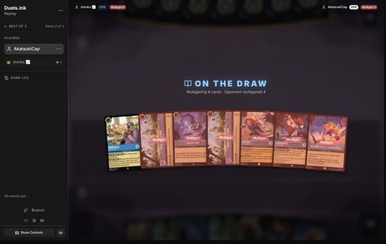
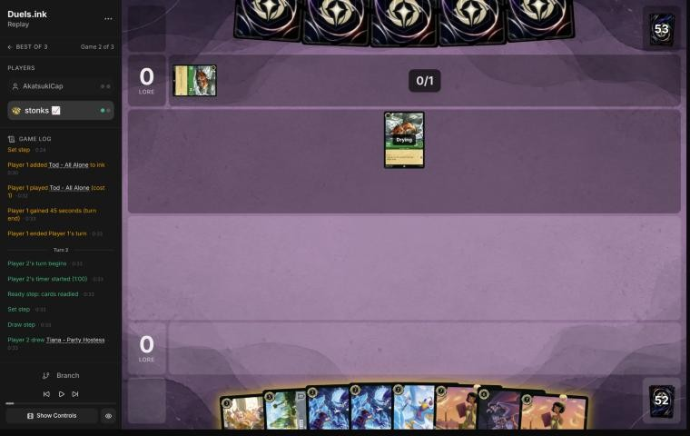
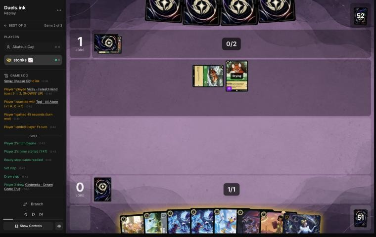
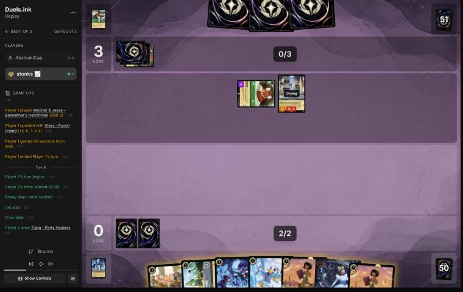
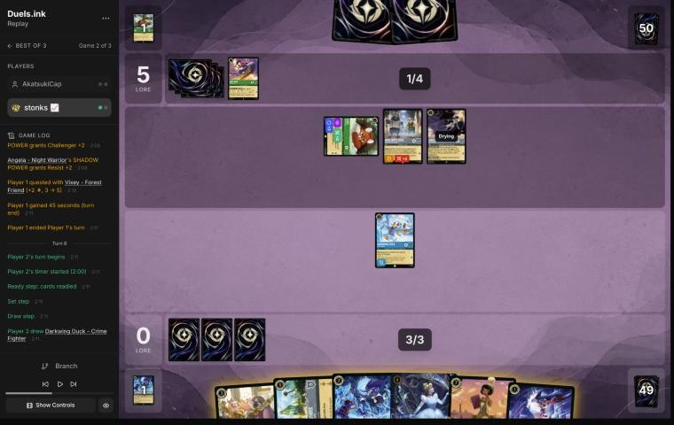
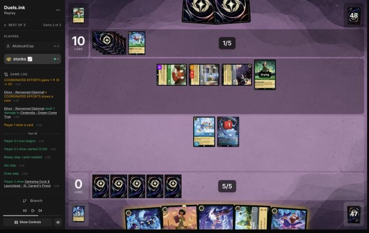
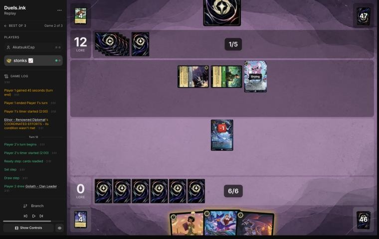
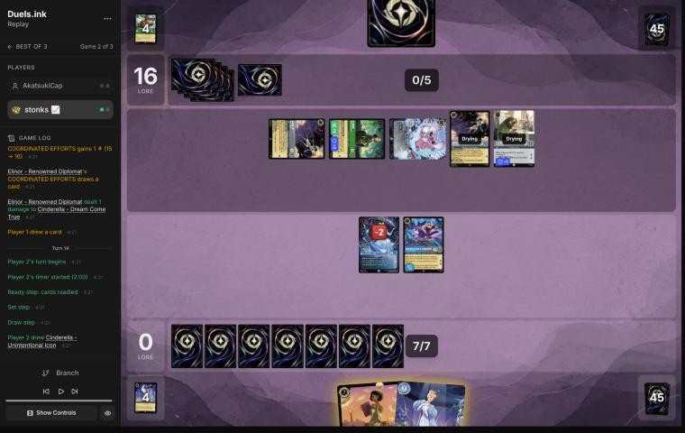

# Review: stonks 📈 vs AkatsukiCap, game 2, 23 Oct 2026

| | |
|---|---|
| **Status** | **final** (2026-11-02; no verdict changed. stonks 📈's rules for the draw, relayed by danny, answer the open questions; he didn't comment on this game) |
| **Replay** | `01a1697e-e338` (`python3 tools/brief.py 01a1697e --turn N`) · [duels.ink viewer](https://duels.ink/replay/01a1697e-e339-7703-a3c7-77e6c906c4af?step=0) |
| **Format** | Core Constructed (from game 1 of the match), best-of-three, game 2. Set 14 era: inks revealed before the coin toss |
| **Decks** | stonks 📈: Sapphire/Steel Big Ramp with the Darkwing package ([the coach's notes on it](#cite-kb-meta-archetypes-sapphire-steel-big-ramp-with-the-darkwing-package-how-to-play-it)). AkatsukiCap: Emerald/Steel **Midrange #1**, known from game 1 |
| **Play/draw** | AkatsukiCap went first (they lost game 1, so it was their choice) |
| **Result** | Loss: stonks 📈 conceded at 0–16 on game turn 14 |
| **Meta data** | snapshot of 26 Oct 2026, three days after this game (fresh) |
| **Chosen how** | Sent by danny, the coach's user, with stonks 📈's other games; the coach picked five to review and studied the rest, including game 1 of this match (an earlier game). **The coach knew this game's result in advance**: it had seen a one-line summary of it while sorting the games. Verdicts are guarded against outcome bias |

## Summary
- **Good play:** [turn 10](#turn-10). Terror killed Vixey and Drake traded for Woolter & Jesse, taking two questers
  off a board that was 10 lore up.
- **Good:** turns [2](#turn-2), [6](#turn-6), [8](#turn-8) and [12](#turn-12), all the coach's lines or close to them.
- **Close calls:**
  - The [pre-game](#turn-0): a big mulligan the sim supports, but it gave up Merida and Windstorm.
  - [Turn 4](#turn-4): Terror on Tod rather than Drake first, leaning to your line after discussion.
- **Inaccuracies or worse:** none.
- **Unwinnable from:** [turn 14](#turn-14). They needed 4 with 6 lore of questers, and at most two could be removed.

**What decided it:**
- Their fast, evasive start: Vixey questing for 2 from turn 3, out of every challenger's reach.
- Angela's Resist +2 delaying Terror a turn, and Elinor's extra lore.
- Your hand, which had removal for one quester a turn but no sweep. They were at 10 before your fifth turn.

## The game, turn by turn
Verdicts judge each decision on what stonks 📈 could know at the time, **including archetype knowledge an
experienced player has**. Hindsight is kept to its own section. Severity scale: good play / close call /
inaccuracy / mistake / blunder. Principle IDs and hypotheses (H-n) link to copies in the Citations section at the
end, as they stood when they were cited.

**What you knew before the game:** AkatsukiCap's Emerald/Steel Midrange, from game 1, which you came back to win
20–19 from 5–17. They're on the play, so a card costing N can come on game turn 2N−1. Most of their questers are cheap
and **Evasive**, so none of your characters can challenge them. Windstorm (3 damage to each Evasive one, 5 with Merida)
and actions are your answers.
- **Evasive questers:** Pegasus (1), White Rabbit (2), Vixey – Forest Friend (3, or 2 with Tod – All Alone in play;
  2 lore), Mushu – Stealthy Dragon (3; draws when you hold more cards). From turn 1.
- **Flash – Efficient Clerk** (2, Resist 1, 2 lore): takes nothing from Windstorm alone. From turn 3.
- **Locks:** Ursula – Deceiver (2) makes you reveal and discard a song (Thunderbolt). Toulouse (2) stops your actions
  for a turn. From turn 3.
- **Removal and tricks:** Strength of a Raging Fire and Angela – Night Warrior (3), Angel (4), and Elinor – Renowned
  Diplomat (4, uninkable: 1 damage, a lore and a card at the end of each of their turns with 3+ exerted characters).
  From turns 5 and 7.
- **The Queen – Devious Disguise** (4): draws (you gain 2), and gets +2 lore while behind. **Broadway** (5, 4/6/2,
  Bodyguard). From turns 7 and 9.

### Pre-game

*The board before the decision: [step 0](https://duels.ink/replay/01a1697e-e339-7703-a3c7-77e6c906c4af?step=0) in the duels.ink replay viewer.*

**What you did:** On the draw. Kept Priscilla – Efficient Clerk and sent back six: both Khan Industries, Windstorm,
Merida, Launchpad and He Hurled His Thunderbolt.

**Verdict:** **Close call.** This time the sim (`mulligan.py`, 1,500 deals) backs the big mulligan:
- **Keeping all seven** made only 3.17 play turns of 4 and 4.5 lore by turn 4.
- **Your keep of one** made 3.62 and 5.6 at the same ink (9.36).
- **Keeping five** (sending Thunderbolt and a Khan) made 3.39 and 5.1.

*In discussion:* stonks 📈's rules for the draw (from his other games) back the big mulligan: interaction first, and
Windstorm is a keep only with a Terror or Three Arrows already in hand, which this seven didn't have. By the same rules,
Priscilla is usually a send-back on the draw too, so the one card kept is the one they'd question. The verdict stays a
close call.

The seven had no play before Launchpad on turn 4 and three uninkable cards. Against a deck of cheap Evasive questers,
that's slow. The price is Merida and Windstorm, the deck's sweep, which is exactly what this matchup's 1- to
3-willpower Evasives fear: Windstorm deals 3 to each Evasive, 5 with Merida. Keeping those two and Priscilla and
redrawing four is the middle way. Confidence: medium-low.

### Turn 1: their turn

**What happened:** AkatsukiCap inked a Tod – All Alone and played another (2/2).

### Turn 2: your turn 1

*The board before the decision: [step 5](https://duels.ink/replay/01a1697e-e339-7703-a3c7-77e6c906c4af?step=5) in the duels.ink replay viewer.*

**What you did:** Drew the second Tiana – Party Hostess and inked it. No 1-drop to play.

**Verdict:** **Good.** With two Tianas and one Khan Industries, the second Tiana is spare; one Tiana and Khan make the
free-location combo at 7. The coach would have inked Goliath, which the deck keeps for pressing a lead or squeezing a
control deck's hand, neither of which this matchup asks for early. Either is fine.

### Turn 3: their turn

**What happened:** Vixey – Forest Friend for 2 (Tod in play; Evasive, 2 lore), and Tod quested (0–1).

### Turn 4: your turn 2

*The board before the decision: [step 11](https://duels.ink/replay/01a1697e-e339-7703-a3c7-77e6c906c4af?step=11) in the duels.ink replay viewer.*

**What you did:** Drew a Dream Come True, inked Goliath, and Terror (2) banished Tod.

**Verdict:** **Close call.** The coach would have played Drake Mallard first. Then next turn Terror deals 3 and kills
Vixey: 2 lore a turn and Evasive, so out of reach of every challenge. Your Terror on Tod kills the cheaper quester
now, and also the card that makes more Vixeys cost 1 less. It leaves Vixey for your second Terror once a Darkwing is
in play. Over the next two turns both lines let through about the same lore. Inking Goliath was right here.

*In discussion:* stonks 📈's rule for the draw, from another game, leans it your way: on the draw, interact and limit
theirs by killing their characters now, rather than developing first. The verdict stays a close call, leaning to Terror
on Tod.

### Turn 5: their turn

**What happened:** Woolter & Jesse (4/4, Bodyguard, Challenger +2), ready, and Vixey quested (0–3).

### Turn 6: your turn 3

*The board before the decision: [step 20](https://duels.ink/replay/01a1697e-e339-7703-a3c7-77e6c906c4af?step=20) in the duels.ink replay viewer.*

**What you did:** Drew a third Tiana, inked one, and played Drake Mallard.

**Verdict:** **Good**, the coach's line. Drake is the Darkwing that makes the second Terror deal 3, enough for Vixey
next turn. Ward keeps it safe from Strength of a Raging Fire, Angel and Elinor's ping. Priscilla would enter exerted
in front of Woolter & Jesse (6 when challenging against her 4 willpower), so waiting with her was right.

### Turn 7: their turn

**What happened:** Angela – Night Warrior gave Vixey Challenger +2 and Resist +2 until their next turn, so Terror would
deal only 1 to her now. Vixey quested (0–5); Woolter & Jesse stayed back.

### Turn 8: your turn 4

*The board before the decision: [step 29](https://duels.ink/replay/01a1697e-e339-7703-a3c7-77e6c906c4af?step=29) in the duels.ink replay viewer.*

**What you did:** Drew a Crime Fighter. Inked Priscilla and played Dream Come True. At the end of the turn WHATEVER
YOU WISH FOR inked a Khan Industries and drew another.

**Verdict:** **Good**, the coach's line. Angela's Resist +2 on Vixey meant Terror would deal 1 this turn, so it waits a
turn for Vixey's Resist to end. Dream Come True ramps meanwhile. Inking Priscilla is fair: with Woolter & Jesse's 6
when challenging on their board, there's no safe turn to land her. Drake stayed ready, so it's still the Darkwing
for next turn's Terror. If Drake had quested, Woolter & Jesse or Angela would trade with it.

### Turn 9: their turn

**What happened:** Elinor – Renowned Diplomat came down. Vixey, Woolter & Jesse and Angela quested (0–9), and at the
end of the turn Elinor's COORDINATED EFFORTS (three exerted characters) dealt 1 to your Dream Come True, gained a lore
(10) and drew a card.

### Turn 10: your turn 5

*The board before the decision: [step 40](https://duels.ink/replay/01a1697e-e339-7703-a3c7-77e6c906c4af?step=40) in the duels.ink replay viewer.*

**What you did:** Drew Finest. Terror (3, Drake in play) banished Vixey. Drake challenged Woolter & Jesse and both were
banished. Inked a Khan Industries and played the Crime Fighter.

**Verdict:** **Good play**, the coach's line. At 0–10 against a board questing for 5 plus Elinor's 1, the turn had to
take questers off.
- **Shifting Finest onto Drake** was the tempting line: it kills Woolter & Jesse for 2 lore. But it leaves Vixey, and
  Finest would sit on 3 willpower in front of Elinor's 3 strength.
- **Your line kills both** Vixey (the Evasive 2-lore) and Woolter & Jesse. It drops their next turn to Angela and
  Elinor, 2 lore with no Elinor trigger (she needs three exerted characters).
- **Finest stays in hand** for a Shift onto the Crime Fighter next turn.

### Turn 11: their turn

**What happened:** Angel – Experiment 624, discarding Tod for GOOD AIM, dealt 2 to the Crime Fighter and banished it,
taking Finest's Shift base. Angela and Elinor quested (0–12).

### Turn 12: your turn 6

*The board before the decision: [step 53](https://duels.ink/replay/01a1697e-e339-7703-a3c7-77e6c906c4af?step=53) in the duels.ink replay viewer.*

**What you did:** Drew a Goliath, inked it, and played Finest for 7. Dream Come True stayed back.

**Verdict:** **Good**, the coach's line. At 0–12, you need their questers dead, and Finest (Ward, 5/7) kills an exerted
one each turn for 2 lore. Goliath was the right ink: against a deck holding 1 card, DUSK TO DAWN would refill their
hand to 2 every turn. Tiana (draw 2) was the alternative, digging for Merida and Windstorm, but it puts nothing on the
board that answers their questers. Dream Come True (2 willpower left) would die to Angel if exerted.

What it exposes: Finest is ready and has Ward. Elinor's ping and Angel's GOOD AIM can't choose her. They need 8 more
lore, at 3 a turn plus Elinor's.

### Turn 13: their turn

**What happened:** A second Angela gave Elinor Challenger +2 and Resist +2, and Flash – Efficient Clerk came down.
Angela, Elinor and Angel quested (15), and Elinor's trigger dealt 1 to your Dream Come True, gained a lore (16) and
drew a card.

### Turn 14: your turn 7

*The board before the decision: [step 65](https://duels.ink/replay/01a1697e-e339-7703-a3c7-77e6c906c4af?step=65) in the duels.ink replay viewer.*

**What you did:** Drew Cinderella – Unintentional Icon and conceded at 0–16.

**Verdict:** **Good: the game was lost** ([principle 2](#cite-principle-2)). They needed 4. Their five characters quest for 6 (Flash 2,
the rest 1 each), plus Elinor's lore at the end of the turn. You could remove two at most, and not the ones that
mattered:
- **Finest** kills Angel or the exerted Angela.
- **Icon, shifted onto the dry Dream Come True,** can challenge at once and kill the other.
- **The rest can't be reached:** Elinor's Resist +2 holds Finest to 3 of her 4 willpower, and Flash and the second
  Angela are ready.

Elinor, Flash and Angela still quest for exactly 4.

## Lessons
1. **Against Emerald/Steel's Evasive questers, your answers are actions.** Terror, Three Arrows, Windstorm (3 to each
   Evasive, 5 with Merida) and Thunderbolt, since no challenger of yours can reach Vixey, Mushu, White Rabbit or
   Pegasus. In the mulligan, the player keeps Windstorm only with a Terror or Three Arrows ([pre-game](#turn-0)).
2. **Angela's Resist +2 lasts only until their next turn.** Waiting a turn to Terror the shielded Vixey ([turn
   8](#turn-8)) was right.
3. **An exerted Bodyguard takes every challenge.** Use your cheapest challenger on it, as Drake did on Woolter & Jesse
   ([turn 10](#turn-10)).
4. **Elinor – Renowned Diplomat adds a lore, a card and a ping each turn with three exerted characters.** Count her
   in the race, and kill a quester to turn her off.

## Knowledge-base updates (applied 2026-11-02, after discussion)
- **Meta, the Emerald/Steel notes (Midrange against Big Ramp), AkatsukiCap game 2:**
  - **The list:** Tod ×2, Vixey, Woolter & Jesse, Angela ×2, Elinor, Angel, Flash, Bobby Zimuruski ×2, Max Goof and
    White Rabbit (inked).
  - **How it played:** Angela's Resist +2 kept Vixey safe from Terror for a turn. Angel's GOOD AIM took the Crime
    Fighter that Finest would have shifted onto. Elinor's trigger made 2 of their 16 lore.
- **Not applied:** the proposal to keep the Merida-and-Windstorm sweep in a slow mulligan against Emerald/Steel. The
  player's rules for the draw, now in the Big Ramp notes, keep Windstorm only with a Terror or Three Arrows.

## Hindsight
Doesn't change the verdicts above.
- **Their start was fast:** Vixey on turn 3 for 2 a turn, then Woolter & Jesse, Angela, and Elinor on turn 9, 10
  lore by then. You couldn't remove Vixey until turn 10, because of Angela's Resist.
- **Your mulligan's new six** were Khan Industries, two Terrors, Drake Mallard, Tiana and Goliath: the Terrors and
  Drake did the work, and the 7-drops arrived when the race was nearly over.

## The coach's errors
Errors the coach caught in its own work. None changed a verdict.

| When | Error | How it was caught | How it won't happen again |
|---|---|---|---|
| Turns 4, 6, 10 and 12 | Cut parts of the brief with `awk`, against the rule to read briefs whole | The coach, writing up this review | Done (2026-11-02): a hook (`.claude/hooks/guard_brief.py`) refuses any command that pipes or redirects `tools/brief.py` |
| Turn 14 | Read the turn's plan brief and its log in one command, so the line played was in view while planning. The verdict rests only on board arithmetic | The coach, writing up this review | Done (2026-11-02): the same hook refuses a brief run next to `tools/replay.py` or a second brief in one command |

## Open questions
Closed when the review was finalised (2026-11-02). stonks 📈 didn't comment on this game; his rules for the draw from
the other reviews (relayed by danny) answer both.
- **The mulligan:** Windstorm goes back without a Terror or Three Arrows, so the big mulligan fits his rules.
- **Turn 4:** on the draw, kill their characters now: Terror on Tod.

## Citations
Copies of the coach's knowledge base cited above, as they stood when they were cited (the private repository's commit and date are given with each). They don't change when the knowledge base does.

**principle 2**: coaching principle, `CLAUDE.md` at `c2dbf58` (2026-11-02), working tree

> 2. **Some games are unwinnable.** Draws and matchups can make a game lost whatever the player does. Say so
>    when it's true, rather than inventing mistakes to explain a loss.

**sapphire-steel.md, Big Ramp with the Darkwing package: how to play it**: knowledge base, `kb/meta/archetypes/sapphire-steel.md` at `c2dbf58` (2026-11-02), working tree

> ### Big Ramp with the Darkwing package: how to play it `[coach, study of stonks 📈's 22 games of 21 Oct 2026 (sent by the user), full games, not blind]`
> The user calls this list Sapphire/Steel Detectives, or Big Ramp. It matches duels.ink's "Big Ramp #1" (Windstorm,
> Minnie) with the Darkwing Detectives added. Games: `01a15f98` to `01a1602c` (22; see `kb/meta/index.md`). Card text
> verified with `tools/cards.py`. Also `01a15f8e` (vs MFork, game 2) and `01a16978` (vs AkatsukiCap, game 1).
> - **The list (60):**
>   - **1-drops:** Darkwing Duck – Crime Fighter ×4, Marie – Caught in the Act ×4
>   - **2-drops:** Darkwing Duck – Drake Mallard ×4 (Ward), Launchpad – Trusty Sidekick ×4, The Terror That Flaps in
>     the Night ×4
>   - **3–4:** Three Arrows ×4, Priscilla – Efficient Clerk ×3, Cinderella – Dream Come True ×4, He Hurled His
>     Thunderbolt ×2, Windstorm ×3
>   - **5–6:** Merida – Formidable Archer ×4, Khan Industries – Greenway Landmark ×4, Goliath – Clan Leader ×3
>   - **7–8:** Darkwing Duck & Launchpad – St. Canard's Finest ×4, Cinderella – Unintentional Icon ×2, Tiana – Party
>     Hostess ×4, Minnie Mouse – Urban Visionary ×3
> - **The plan:**
>   1. **Early removal** keeps their board small: Terror (3 damage while a Darkwing is in play), Three Arrows (2, then 1).
>      A Darkwing in play also makes Launchpad's draw free of the discard.
>   2. **Ramp:** Priscilla (enters exerted; each quest puts one of the top 2 into hand and the other into the inkwell,
>      2 lore), Cinderella – Dream Come True (at the end of a turn you played a Princess, ink a card from hand to draw),
>      Cinderella – Unintentional Icon (Shift 5 onto her; ramps one a turn, 3 lore), Marie (an ink drop when she quests
>      after an opposing character took damage). Ink at the start of its 5th turn was usually 5–6, and 8–9 by its 6th in the fastest games.
>   3. **The sweep: Merida, then Windstorm.** STEADY AIM adds 2 damage to every instance of action damage to an
>      opposing character, so Windstorm deals 3 to each (5 to an Evasive one): a 4- to 6-character wipe (01a1601c
>      turn 11: six Princess Aggro characters). Merida's FULL QUIVER also returns Three Arrows (then 4 and 3).
>   4. **Lore:** Khan Industries (2 a turn at their Set step; characters there can't be challenged, so Merida and
>      Priscilla move in), Merida 2, Priscilla 2, Cinderella – Unintentional Icon 3, Minnie 3, St. Canard's Finest 2
>      plus VICTORY POSE (+2 per banish in a challenge on its turn).
>   5. **Tiana – Party Hostess** (7): draw 2 and discard one; a discarded Khan Industries is played free (01a15fee,
>      01a15ff6, 01a1602c). **Minnie** (8, Ward) returns a card from the inkwell to hand when she ends a turn exerted.
>      **Goliath – Clan Leader** puts both hands to 2 at the end of each turn: strictly for pressing an advantage when
>      ahead, or for keeping a control deck's hand small; otherwise rarely played (user, 2026-11-02).
> - **Results by matchup** (13–9): Emerald/Steel Midrange 8–4, all four game 1s lost and every game 2 and 3 won;
>   Amber/Emerald Circle of Life 2–4; Princess Aggro 2–1; Amethyst/Steel Midrange 1–0.
> - **What won:** the Merida and Windstorm sweep, Finest's VICTORY POSE, Khan Industries with protected questers. Early
>   Priscilla matters: in the Emerald/Steel wins she was down by its 4th turn in five of eight, and in the four losses never
>   (a correlation from few games).
> - **It can race from behind once the questers are gone:** in 01a16978, at 5–17 against Emerald/Steel, Three Arrows
>   with STEADY AIM killed Vixey and The Queen, a second Merida returned the Arrows, and wide quests (two Meridas at 2
>   each, Darkwings, Cinderella) won 20–19.
> - **What beat it:**
>   - **Resist:** Flash – Efficient Clerk (2, 3/2/2, Resist 1) takes nothing from Windstorm's 1 and less from every
>     ping; it quested for 8 to 10 in two lost game 1s.
>   - **Ward plus recursion:** Circle of Life replayed Milo Thatch – Getting His Hands Dirty (7, Ward, bounces a
>     character on play), which bounced Merida; conceded at 3–0 (01a15f9d turn 14). Only Windstorm reaches a Ward
>     character.
>   - **Fast wide quests:** Princess Aggro's +5 and +6 turns came before the sweep (01a16020, lost 14–21); a song-and-
>     Evasive Amber/Emerald list quested +7 and +8 (01a15fdb).
> - **Coaching points:**
>   - Merida before any damage action; with their board at 2–3 willpower, hold Windstorm for her.
>   - Keep a Darkwing in play for Terror's 3 and Launchpad's free draw. Quest Marie after removal for the ink drop.
>   - Move questers to Khan Industries; plan Tiana for the turn a Khan is in hand. Whether to ink a Khan is too
>     situational for a rule (user, 2026-11-02): judge it from the hand.
>   - Name the answer to Resist and Ward early (Thunderbolt's 4, challenges, Finest): the pings don't do it.
>   - **Mulligan from the hand you have, not to a fixed plan** (user, 2026-11-02). The play pattern varies widely with
>     the opening seven, and no one line suits a given matchup: see what the hand already does, keep what bridges
>     turn 1 to the late game, and send back the rest, avoiding a full mulligan where possible. The deep mulligans
>     (3 to 7 cards) in these games came partly from the player's first games on the deck, so they aren't a guide.
>   - **Judge the plan from the hand, then the matchup:** a coached line should say how this hand gets from its early
>     turns to Merida, the sweep and the 3-lore finishers, rather than follow a stock sequence.
