# Review: danny vs InkModeOn, game 2, 28 Oct 2026

| | |
|---|---|
| **Status** | **final** (discussed 2026-11-02) |
| **Replay** | `01a18275-7c33` (`python3 tools/brief.py 01a18275 --turn N`) · [duels.ink viewer](https://duels.ink/replay/01a18275-7c34-71d2-b5b8-6ac403e88843?step=0) |
| **Format** | not stated in the replay; ranked queue, so Core Constructed assumed. Set 14 era: inks revealed before the coin toss |
| **Decks** | You: Amber/Amethyst (Mickey – Best in Town, Merlin – Profoundly Curious, Demona, Hades, Raging Storm, Remember Me). Them: Amethyst/Steel ([pair file](https://github.com/5uperdan/lorcana-coach/blob/main/kb/meta/archetypes/amethyst-steel.md)); archetype as it became clear: a Midrange variant duels.ink doesn't list, built around Merlin – Profoundly Curious (three seen), Merlin's Shop and Smithy with Arthur – Merlin's Assistant, and the Violet Parr Heroes (from turn 12) |
| **Play/draw** | You went first |
| **Result** | Loss on lore, 17–20 after 20 game turns (game 2 of a best-of-three) |
| **Meta data** | snapshot of 26 Oct 2026 (fresh until 9 Nov) |
| **Chosen how** | By you, not by result. Downloaded from the replay link you gave |

Verdicts judge each decision on what you could know at the time, **including archetype knowledge an experienced
player has** (`CLAUDE.md`). Hindsight is kept to its own section. Severity scale: good play / close call /
inaccuracy / mistake / blunder. Principle IDs refer to `kb/strategy/principles.md`, H-n to
`kb/strategy/hypotheses.md`.

**What you knew before the game:** their inks, Amethyst/Steel: Midrange 54%, an unlisted list 43%, PS Inkbonk 4%.
Midrange's interaction: Strength of a Raging Fire (damage equal to their character count, sung free by a cost-3+
character), Angel – Experiment 624 (discard a card: 2 damage), Hades – Looking for a Deal, Peter Pan's Shadow (exerts
one of yours) and Cheshire Cat (moves damage), Shere Khan (challenges ready characters), Demona – Scourge (exerts your
board), Tinker Bell – Giant Fairy (1 damage to each). Their engines are Evasive: Dumbo – Ninth Wonder and Peter Pan's
Shadow, 4 each. **This was game 2: you had seen their game-1 cards, but the coach has no replay of game 1,** so the
read here uses the average lists only.

## Your decisions, turn by turn

| Game turn (yours) | Decision | Verdict | Board |
|---|---|---|---|
| Pre-game | **Kept Mickey – Best in Town, Merlin – Profoundly Curious and Luisa – Pushing Through; sent back Remember Me, Raging Storm, The Horseman Strikes! and Dumbo – The Flying Elephant** | **Close call.** Sending back the two 6+ cards was clearly right: neither does anything before turn 6. The coach would also have kept The Horseman Strikes! and Dumbo (keep 5). By the sim (`mulligan.py`, 1,500 deals), keep 5 spends more ink on turns 1–4 (9.26 vs 8.64 of 10) and plays more often (3.88 vs 3.70 turns of 4); yours gets slightly more lore by turn 4 (9.9 vs 9.4) and characters (4.0 vs 3.9). Horseman matters in this matchup beyond the sim: it draws a card and banishes an Evasive character, and Midrange's engines, Dumbo – Ninth Wonder and Peter Pan's Shadow, are both Evasive (MULL-3). Confidence: low. You saw game 1's cards, which may have changed the value of Horseman | [screenshot](screenshots/01a18275/turn0-step0-opening-hand.jpg) · [step 0](https://duels.ink/replay/01a18275-7c34-71d2-b5b8-6ac403e88843?step=0) |
| 1 (1) | Inked Luisa – Pushing Through, played Mickey – Best in Town | **Good.** Mickey quests for 2 from next turn and his ink drops ramp you to the 4-drops (Merlin, Merida) a turn early. Of the inkable 1-drops, Luisa and Rafiki are near-interchangeable spares; Pepita and the Shop are better kept | [screenshot](screenshots/01a18275/turn1-step2-before-mickey.jpg) · [step 2](https://duels.ink/replay/01a18275-7c34-71d2-b5b8-6ac403e88843?step=2) |
| 3 (2) | Mickey quested (2–0), inked Rafiki, played Pepita | **Good.** The coach's line. Pepita (2/3, Challenger 2) answers Violet Parr (2/1, Alert) whenever Violet exerts, and Mickey's ink drop puts a 4-drop in reach next turn | [screenshot](screenshots/01a18275/turn3-step8-before-pepita.jpg) · [step 8](https://duels.ink/replay/01a18275-7c34-71d2-b5b8-6ac403e88843?step=8) |
| 5 (3) | Mickey quested (4–0); inked the second Mickey; Guidebook played and used (drew Dumbo – The Flying Elephant, Cheshire Cat); Pepita stayed ready; 1 ink drop saved | **Close call.** The coach would have played Merlin now (4 with the drop), inking the Shop. Next turn both lines have 6 ink and end with Merlin, Guidebook's two cards and a 3-drop; Merlin a turn early only adds the option of a quest next turn (2 lore and a card), and that quest exposes him to a challenge from Cheshire (3 {S} into 3 {W}). Inking the second Mickey rather than playing him halves the ink drops you hand a Steel deck (`kb/cards/mickey-mouse-best-in-town.md`). Keeping Pepita ready is right: she threatens Cheshire (4 {S} challenging into 4 {W}) if it quests. *Your reason: keep the ink drop. Merlin's own drop refunds it and Mickey adds one at the end of the turn, so that doesn't separate the lines. What does favour waiting: Merlin played now is the natural target for Strength of a Raging Fire (32% held, 37% after their draw), so a turn later he may face it after it's spent (discussion)* | [screenshot](screenshots/01a18275/turn5-step15-before-guidebook.jpg) · [step 15](https://duels.ink/replay/01a18275-7c34-71d2-b5b8-6ac403e88843?step=15) |
| 7 (4) | Cheshire Cat, inked a Shop, Boost: moved Mickey's 2 damage onto Violet Parr (banished); Mickey quested (6–0); 1 ink drop saved | **Good play, the coach's line.** Nothing of yours could challenge, but Cheshire's Boost works the turn he's played: it killed Violet (2/1, Alert), who would otherwise have finished the damaged Mickey next turn, and healed Mickey. With Violet gone, Strength of a Raging Fire deals 3, not 4, so it no longer kills Cheshire or Mickey (4 {W}) unless they add a character first. Merlin + Cheshire instead would have left Mickey to die to Violet | [screenshot](screenshots/01a18275/turn7-step27-before-cheshire.jpg) · [step 27](https://duels.ink/replay/01a18275-7c34-71d2-b5b8-6ac403e88843?step=27) |
| 9 (5) | Merlin (ink drop); inked Mowgli; Boost: moved Cheshire's 2 damage onto Tinker Bell – Giant Fairy, then Cheshire challenged and traded with her; Shop played with ink drops (6–2) | **Good play.** Merlin first, so his ink drop paid for the rest. Of the two trades on offer, Tinker Bell (6 cost, 4/5, 2 lore, kills a character each challenge) was the right target over their Merlin: your Cheshire, stuck on 3 damage, would most likely have died next turn anyway. Close call on the last 2 ink: Mowgli instead of the Shop would have shown their 2-card hand and stripped a non-character (perhaps a second Strength of a Raging Fire), but the Shop draws and gains 1 lore every turn something moves there | [screenshot](screenshots/01a18275/turn9-step43-before-merlin.jpg) · [step 43](https://duels.ink/replay/01a18275-7c34-71d2-b5b8-6ac403e88843?step=43) |
| 11 (6) | Moved Merlin to the Shop (drew Merlin, +1 lore), Merlin quested (drew Cheshire, 9–5); inked Remember Me; Dumbo – The Flying Elephant gave Merlin Evasive | **Good play, with a close call on the ink.** Moving before questing got both draws, and Dumbo's AERIAL DUO protected the exerted Merlin: nothing of theirs has Evasive or Alert now that Violet is gone, so only removal can touch him. Drawing before inking was right (SEQ-1). **The ink:** Cheshire was the other inkable card. Keeping Remember Me would have allowed a free Sing Together 6 next turn with Merlin (4) and Dumbo (3), replaying Hades and Mickey from your discard. Inking Cheshire keeps that late-game card advantage, at the cost of a 3-drop body (INK-2). Neither is clearly better | [screenshot](screenshots/01a18275/turn11-step59-before-shop-move.jpg) · [step 59](https://duels.ink/replay/01a18275-7c34-71d2-b5b8-6ac403e88843?step=59) |
| 13 (7) | Merlin quested first (drew Hades, 11–8); inked Hades; second Merlin (ink drop); Demona – Imperious Spellcaster, discarding Cheshire to give herself Rush and Evasive; Demona killed their exerted Merlin; Dumbo quested (12–8) | **Good play, with one inaccuracy in the ink and discard.** The race demanded a kill: their board quested for 6 a turn, so 20 in two turns. Demona's self-granted Rush took out their engine Merlin (2 lore and a card a turn), and questing Merlin first drew a card before you chose what to ink (SEQ-1). **Inaccuracy:** you inked Hades and discarded Cheshire, keeping Merida. Inking Cheshire and discarding Merida (uninkable) uses the same ink and the same discard, but keeps Hades, a much stronger card for next turn. On their turn they either bottom a character or you draw 2, against Merida's 3/3 and one card. Confidence: medium | [screenshot](screenshots/01a18275/turn13-step76-before-inking-hades.jpg) · [step 76](https://duels.ink/replay/01a18275-7c34-71d2-b5b8-6ac403e88843?step=76) |
| 15 (8) | Dumbo and Merlin quested first (drew Demona – Scourge, 15–12), then Raging Storm with all 8 ink; no ink played (Demona kept) | **Good play, the coach's line.** At 12–12 their board quested for 5 a turn plus up to 2 from the Shops, so they'd reach about 19 next turn and win the turn after; your 3 a turn couldn't race that. Questing first banked 3 lore and a card before the Storm took your two characters with their four (Merlin, Arthur, both Cheshires). Keeping Demona – Scourge rather than inking her is right: next turn's 7 ink casts her | [screenshot](screenshots/01a18275/turn15-step97-before-raging-storm.jpg) · [step 97](https://duels.ink/replay/01a18275-7c34-71d2-b5b8-6ac403e88843?step=97) |
| 17 (9) | Demona – Scourge (exerted their two; refill drew Hades), inked Hades, played the Shop (15–12) | **Good play; close call on the ink.** With an empty board at 15–12, Demona is the right play: a 5/6 that Strength of a Raging Fire (2–3 damage) can't kill, ready next turn to challenge whichever quester they exert, and her refill drew you a card. Inking Hades to fit the Shop vs inking the Shop and keeping Hades for next turn: Hades's effect is their choice, and in a race they'd keep their quester and let you draw 2, so it rarely slows their clock; the Shop starts +1 lore and a card a turn. Neither is clearly better | [screenshot](screenshots/01a18275/turn17-step104-before-demona.jpg) · [step 104](https://duels.ink/replay/01a18275-7c34-71d2-b5b8-6ac403e88843?step=104) |
| 19 (10) | Moved Demona – Scourge to the Shop (drew Merida, 16–17); Merida entered exerted (drew Horseman), inked Horseman; Demona – Imperious Spellcaster, discarding Merida, gave herself Rush and killed their Merlin; Demona – Scourge killed Dr. Hamsterviel | **Unwinnable from here** (principle 2). At 15–17 you could reach 18 at most this turn, and they needed 3: Merlin 2, Hamsterviel 1, Pepita 1, Cheshire 1, plus 1 for each move to their two Shops. Killing both exerted questers was the most resistance available, and it still left Pepita, Cheshire and a Shop move for exactly 3 | [screenshot](screenshots/01a18275/turn19-step116-unwinnable.jpg) · [step 116](https://duels.ink/replay/01a18275-7c34-71d2-b5b8-6ac403e88843?step=116) |
| 20 (their turn) | Pepita and Cheshire quested, Pepita moved to a Shop: 20 | - | - |

**Summary:**
- **Good plays:** turns 1, 3, 7, 9, 15 and 17. Turns 7 and 9 used Cheshire Cat's Boost the turn he was played, to
  move damage onto their characters: it killed Violet Parr and set up the trade for Tinker Bell – Giant Fairy.
  Turn 15's Raging Storm, after questing, reset a race you were losing.
- **Close calls:** pre-game (sending back The Horseman Strikes!), turn 5 (Guidebook before Merlin), and the ink on
  turns 9, 11 and 17.
- **Inaccuracies:** turn 13 (inking Hades and keeping Merida, when inking Cheshire and discarding Merida kept Hades).
- **Unwinnable from:** turn 19. From turn 17 it was very likely lost: after the Storm they had Merlin, Hamsterviel
  and two Shops, worth 5 lore a turn, against your empty board.

**What decided it:** their card and lore engines. Three Merlins drew a card a quest, and their two Shops added a
card and 1 lore every time a character moved there. After the Storm on turn 15 they rebuilt faster than you could,
and the Shop moves gave them the last points.

## Screenshots
The board when each decision was made, before the action the verdict is about
([docs/replay-viewer.md](https://github.com/5uperdan/lorcana-coach/blob/main/docs/replay-viewer.md)). Click a step to open it in the duels.ink viewer.

**Pre-game: kept Mickey, Merlin and Luisa** ([step 0](https://duels.ink/replay/01a18275-7c34-71d2-b5b8-6ac403e88843?step=0)). Your opening hand; every card marked "Mulligan" went back.

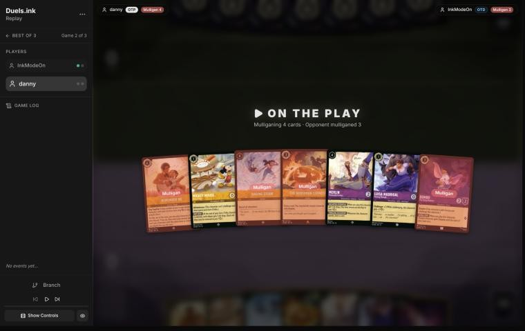

**Turn 1: Luisa inked, Mickey played** ([step 2](https://duels.ink/replay/01a18275-7c34-71d2-b5b8-6ac403e88843?step=2))

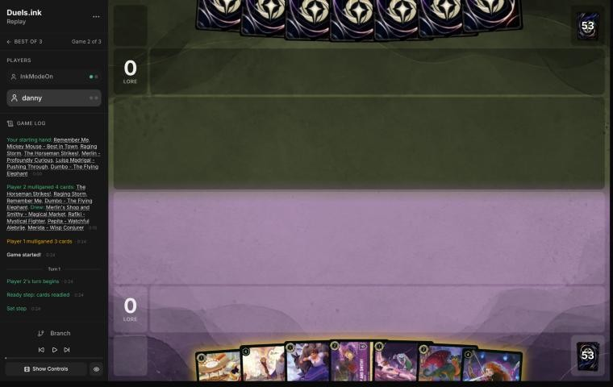

**Turn 3: Mickey quested, Rafiki inked, Pepita played** ([step 8](https://duels.ink/replay/01a18275-7c34-71d2-b5b8-6ac403e88843?step=8))

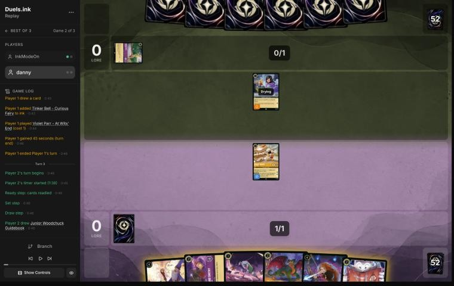

**Turn 5 (close call): Guidebook rather than Merlin** ([step 15](https://duels.ink/replay/01a18275-7c34-71d2-b5b8-6ac403e88843?step=15))

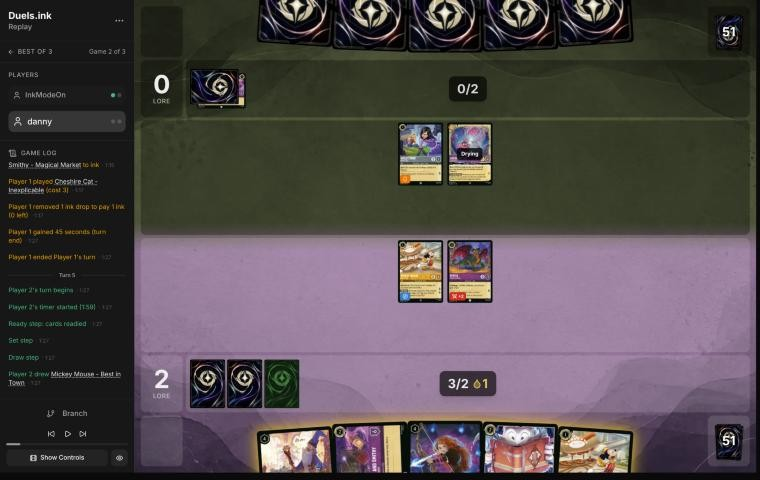

**Turn 7: Cheshire's Boost moved Mickey's damage onto Violet** ([step 27](https://duels.ink/replay/01a18275-7c34-71d2-b5b8-6ac403e88843?step=27))

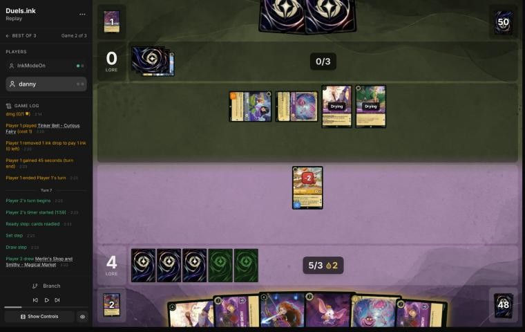

**Turn 9: Merlin, then Cheshire traded with Tinker Bell** ([step 43](https://duels.ink/replay/01a18275-7c34-71d2-b5b8-6ac403e88843?step=43))

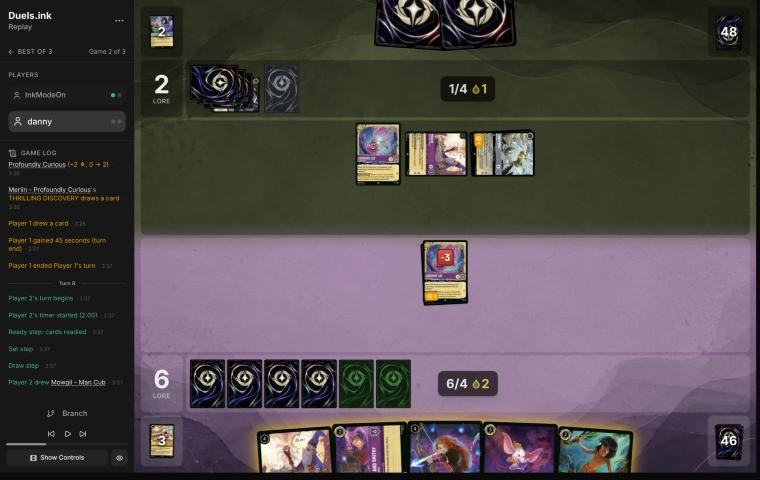

**Turn 11: Merlin to the Shop, Dumbo's Evasive; Remember Me inked** ([step 59](https://duels.ink/replay/01a18275-7c34-71d2-b5b8-6ac403e88843?step=59))

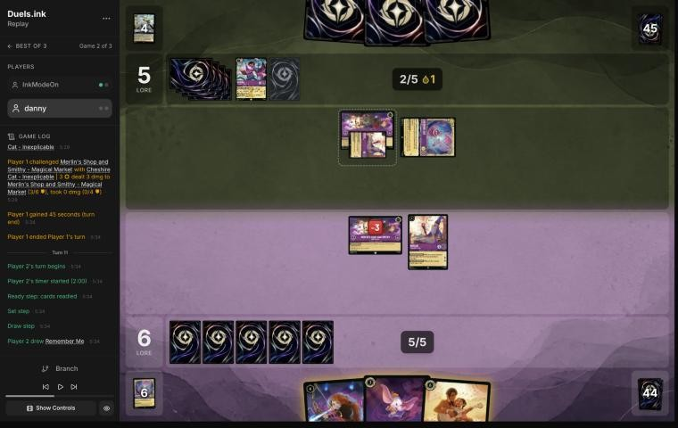

**Turn 13 (inaccuracy): inking Hades and keeping Merida** ([step 76](https://duels.ink/replay/01a18275-7c34-71d2-b5b8-6ac403e88843?step=76)). After Merlin's quest drew Hades, before the ink: Cheshire, Demona, Hades and Merida in hand.

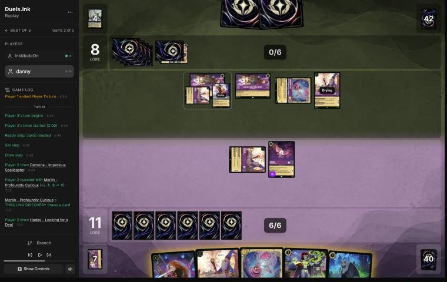

**Turn 15: quest, then Raging Storm** ([step 97](https://duels.ink/replay/01a18275-7c34-71d2-b5b8-6ac403e88843?step=97))

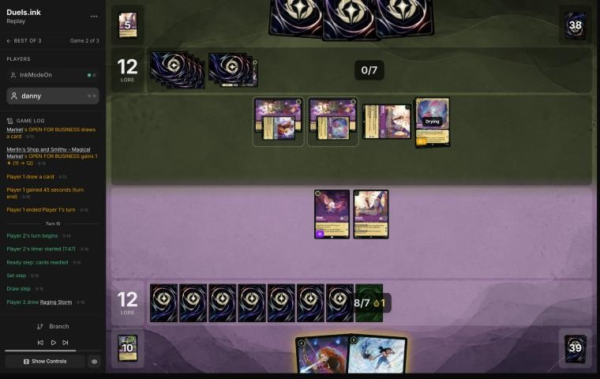

**Turn 17: Demona – Scourge, Hades inked for the Shop** ([step 104](https://duels.ink/replay/01a18275-7c34-71d2-b5b8-6ac403e88843?step=104))

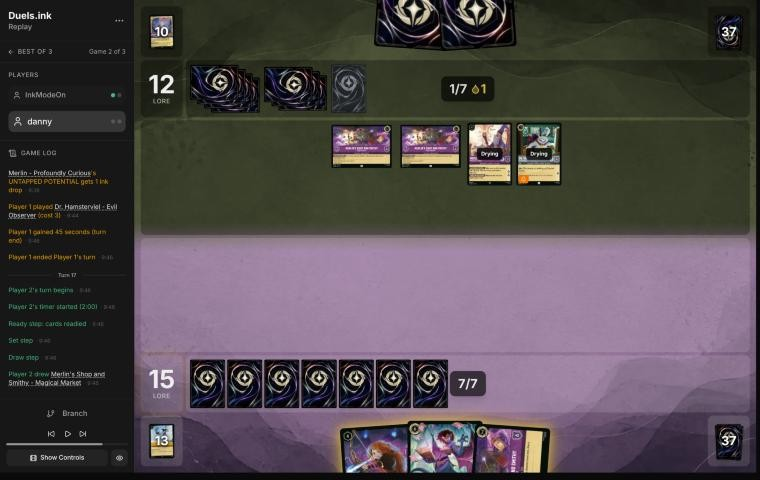

**Turn 19: unwinnable at 15–17** ([step 116](https://duels.ink/replay/01a18275-7c34-71d2-b5b8-6ac403e88843?step=116))

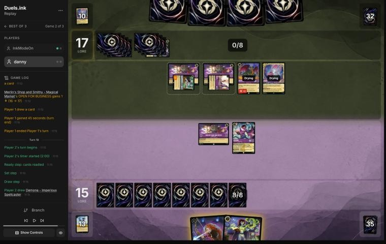

## Lessons
1. **Cheshire Cat's Boost works the turn he's played.** It costs ink, not an exert, so a freshly played Cheshire can
   move up to 2 damage counters at once: off your own character and onto one of theirs. On turn 7 that turned
   Mickey's 2 damage into a kill on Violet Parr; on turn 9 it moved Cheshire's own damage onto Tinker Bell before he
   challenged her.
2. **Merlin's Shop and Smithy is a lore engine, so count it in the race.** Each Shop gives 1 lore and a card the
   first time a character moves there each turn, so two Shops are up to 2 lore a turn on top of questing. They
   scored 6 of their 20 lore this way, including the winning point. The brief's lore clock counts only the Shops'
   printed lore (0), so it understated their clock from turn 10.
3. **Locations can be challenged at any time and don't hit back** (RULE-3). Their Cheshire took your Shop down in
   two challenges (turns 10 and 12).
4. **When an ink choice and a discard both have to come from your hand, keep the strongest card** (INK-2). On
   turn 13, inking the inkable Cheshire and discarding the uninkable Merida would have kept Hades.
5. **Demona – Imperious Spellcaster is a Gargoyle,** so she can give herself Rush and Evasive and challenge the turn
   she's played (turns 13 and 19).

## Knowledge-base updates (applied after discussion, 2026-11-02)
- **Meta (`amethyst-steel.md` notes):** an unlisted Midrange variant: Merlin – Profoundly Curious (three copies seen),
  Merlin's Shop and Smithy ×2 with Arthur – Merlin's Assistant (moves to a location for free on play, ink drop),
  the Violet Parr Heroes (At Wits' End, Alert 1-drop; Force Field Practice; Super Resilient, Shift 3), Dr. Hamsterviel
  (Alert), Tinker Bell – Curious Fairy → Giant Fairy (Shift 4), Cheshire Cat, Pepita, Strength of a Raging Fire.
  Plan: grind with card draw and Shop moves, remove with Cheshire's damage moves and challenges.
- **Tools (`brief.py`):** the lore clock adds "plus up to N a turn from moving characters to" each location that
  pays lore on a move (OPEN FOR BUSINESS), with the turns to 20 including it.
- **Cards (`kb/cards/`):** `cheshire-cat-inexplicable.md` (Boost timing, lesson 1) and
  `merlins-shop-and-smithy-magical-market.md` (its lore, lesson 2).
- **Meta index (`kb/meta/index.md`):** a row for this opponent.
- **Strategy:** nothing new; lesson 4 is INK-2.

## Hindsight
Doesn't change the verdicts above.
- **Shop moves were the margin:** 6 of their 20 lore (turns 10, 12, 14, 18 twice, 20). Your two Shops scored 1
  each.
- **The two-Demona turn 19 killed both exerted questers,** and Pepita, Cheshire and one Shop move were still
  exactly 3.

## The coach's errors
Filled in during discussion.

| When | Error | How it was caught | Fix |
|---|---|---|---|

## Discussion (2026-11-02)
- **Turn 13:** you agreed: discard Merida and ink Cheshire, keeping Hades. The inaccuracy stands.
- **Turn 5:** you'd kept the Guidebook line to save the ink drop, and now prefer Merlin, since he gives the drop
  back and Mickey makes another. The coach agrees that reason doesn't separate the lines, but the verdict stays a
  close call: the extra Merlin quest is an option, not a gain (it exposes him to Cheshire), and Merlin played a turn
  early is the natural target for Strength of a Raging Fire, which they were about a third likely to hold. Agreement
  alone doesn't move a verdict (principle 6).

## Open questions
- **Game 1:** what you saw of their deck is unknown to the coach (left open when finalising). It may change the
  pre-game verdict (The Horseman Strikes! against their Evasive engines) and the archetype read.
