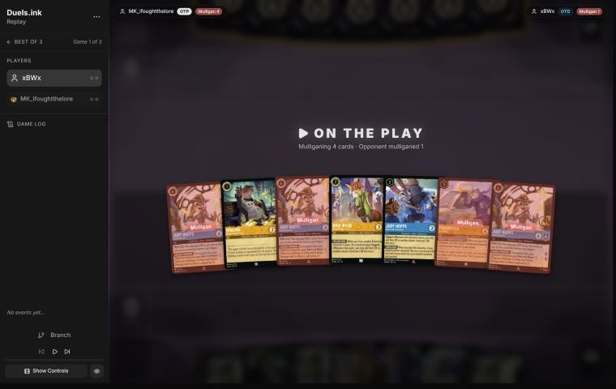
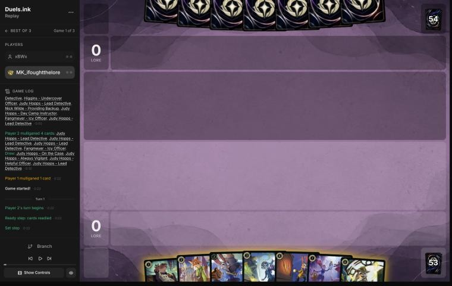
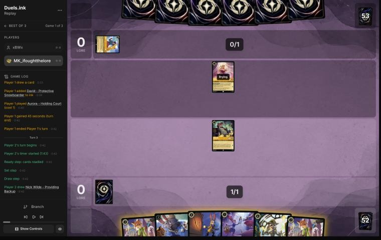
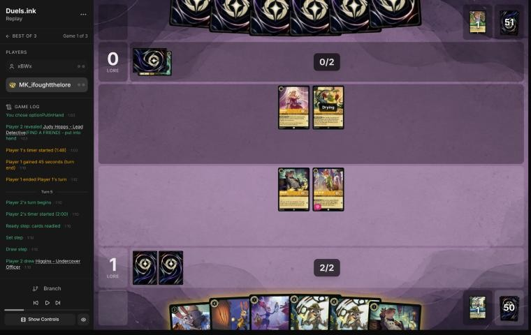
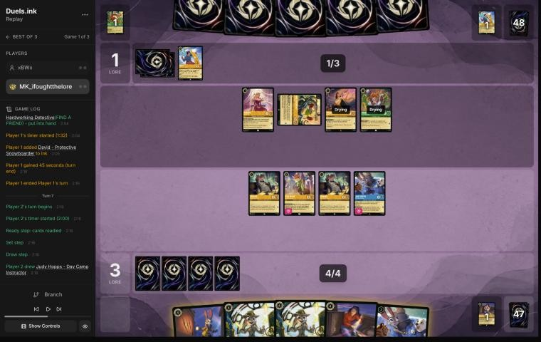
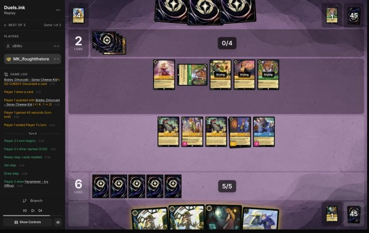
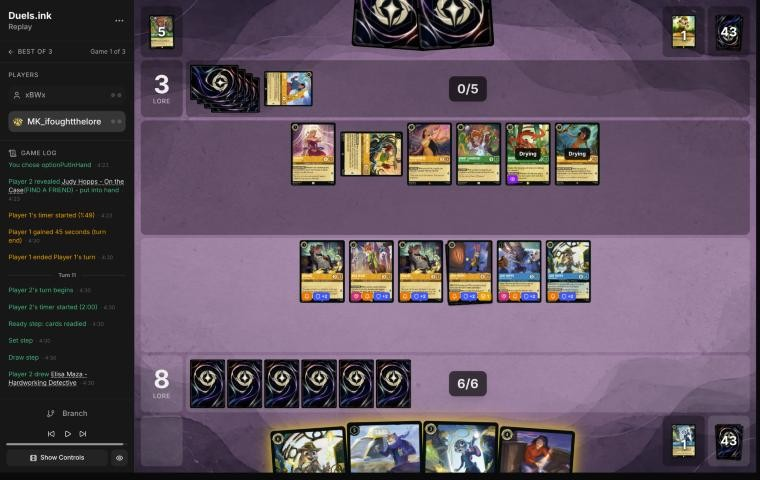

# Review: MK_ifoughtthelore vs xBWx, game 1, 2 Nov 2026

| | |
|---|---|
| **Status** | draft (blind pass done, not yet discussed) |
| **Replay** | `01a19bb9-1359` (`python3 tools/brief.py 01a19bb9 --turn N`) · [duels.ink viewer](https://duels.ink/replay/01a19bb9-1366-7255-b9d3-252f20f432b1?step=0) |
| **Format** | Core Constructed (stated in the replay), best-of-three. Set 14 era: inks revealed before the coin toss |
| **Decks** | You: Amber/Sapphire Detectives (Judy Hopps – Lead Detective, Fangmeyer, Gaston, Elisa Maza, cheap Detectives). Them: Amber/Emerald; archetype as it became clear: **Princess Aggro**, from their first card (Aurora – Holding Court, turn 2); 94% by turn 3 |
| **Play/draw** | You went first |
| **Result** | **Win.** They conceded on turn 11 at 3–8 (game 1 of a best-of-three) |
| **Meta data** | snapshot of 26 Oct 2026 (fresh until 9 Nov) |
| **Chosen how** | Sent by danny, the coach's user: a match of MK_ifoughtthelore's, reviewed for them. **The coach saw both games' winners** in the match file before the blind pass, so it knew this game's result; verdicts are guarded against outcome bias |

## Summary
- **Good plays:** the mulligan and every turn. [Turn 7](#turn-7) was the best play of the game, and better than the
  coach's plan: Nick Wilde's Support pointed at **their** Pocahontas made her a target for Always Vigilant's GOT YOU
  NOW, removing the Shift base for Pocahontas – Peacekeeper's challenge lock.
- **Close calls:** [turn 9](#turn-9) (hard-casting Lead Detective rather than Shifting her; holding Nick and Day Camp
  Instructor back from questing).
- **No inaccuracies or worse.**

**What decided it:** early, free removal. Your Detectives traded up through Lead Detective's Resist +2 while
Princess Aggro never got its Peacekeeper turn, and by turn 11 you led 8–3 with seven questers.

## The game, turn by turn
Verdicts judge each decision on what you could know at the time, **including archetype knowledge an experienced
player has**. Hindsight is kept to its own section. Severity scale: good play / close call /
inaccuracy / mistake / blunder. Principle IDs and hypotheses (H-n) link to copies
in the Citations section at the end, as they stood when they were cited.

**What you knew before the game:** their inks, Amber/Emerald: Circle of Life 60%, Princess Aggro 24%, an unlisted
list 16%. Circle of Life damages your board (Malicious, Mean, and Scary; Don Karnage – Debonair Pirate) and then
replays Prince Phillip – Vanquisher of Foes from their discard, banishing every damaged character; it quests little
before that. Princess Aggro plays cheap Princesses with discounts and quests wide early; Pocahontas – Peacekeeper's
Shift turn stops challenges.

### Pre-game

*The board before the decision: [step 0](https://duels.ink/replay/01a19bb9-1366-7255-b9d3-252f20f432b1?step=0) in the duels.ink replay viewer.* Your opening hand; every card marked "Mulligan" went back.

**What you did:** **Kept Higgins, Nick Wilde – Providing Backup and Judy Hopps – Day Camp Instructor; sent back all
three Judy Hopps – Lead Detective and Fangmeyer**

**Verdict:** **Good play.** Three copies of the 6-drop and an uninkable 5-drop were too top-heavy, and the curve of
1-, 2- and 2-drops is what Detectives want on the play. The coach would have kept one Lead Detective (keep 4: she
Shifts onto Day Camp Instructor for 4). By the sim (`mulligan.py`, 1,500 deals) the two are level: keep 4 spends a
little more ink on turns 1–4 (9.34 vs 9.22 of 10); yours gets slightly more lore by turn 4 (6.8 vs 6.6) and
interaction (68% vs 61%), with the same 4.9 characters.

### Turn 1: your turn 1

*The board before the decision: [step 3](https://duels.ink/replay/01a19bb9-1366-7255-b9d3-252f20f432b1?step=3) in the duels.ink replay viewer.*

**What you did:** Inked Judy Hopps – On the Case, played Higgins

**Verdict:** **Good.** The coach's line. On the Case is the least needed card (her ability wants an item to target),
and Higgins (2/2) is the sturdier 1-drop; Helpful Officer's heal is worth more later, alongside Day Camp Instructor's
LEND A PAW.

### Turn 3: your turn 2

*The board before the decision: [step 9](https://duels.ink/replay/01a19bb9-1366-7255-b9d3-252f20f432b1?step=9) in the duels.ink replay viewer.*

**What you did:** Inked the second Nick Wilde, played the first; Higgins quested (1–0)

**Verdict:** **Good.** The coach's line. Day Camp Instructor waits for a turn with ink for her and a 1-drop together,
when LEND A PAW ramps. Nick has Support with Higgins in play. Questing Higgins risked nothing: Aurora (1/2) can't hurt
him and would die challenging.

### Turn 5: your turn 3

*The board before the decision: [step 18](https://duels.ink/replay/01a19bb9-1366-7255-b9d3-252f20f432b1?step=18) in the duels.ink replay viewer.*

**What you did:** Inked Judy Hopps – Helpful Officer; played Higgins, then Day Camp Instructor (LEND A PAW ramped an
ink); Higgins and Nick quested (3–0)

**Verdict:** **Good.** Playing the 1-drop first met LEND A PAW's condition, so the turn ramped to 5 ink next turn. The
coach would have inked the second Lead Detective and kept Helpful Officer, a Judy (another Shift target) whose heal
is worth more once there's damage; against an early-board deck the cheap body matters more than a second copy of the
6-drop. A small difference either way. Questing both was safe: their only ready character was Aurora (1 {S}).

### Turn 7: your turn 4

*The board before the decision: [step 39](https://duels.ink/replay/01a19bb9-1366-7255-b9d3-252f20f432b1?step=39) in the duels.ink replay viewer.*

**What you did:** Inked Elisa Maza; Nick quested (4–1) and gave his Support (+3 {S}) to **their** Pocahontas – Guiding
the Tribe, making her 5 {S}; played the second Day Camp Instructor, then Shifted Judy Hopps – Always Vigilant onto the
first, whose GOT YOU NOW banished Pocahontas; Always Vigilant challenged and killed the exerted Mike Wazowski; both
Higgins quested (6–1)

**Verdict:** **Good play, the best of the game, and better than the coach's plan.** Support can choose any character,
so Nick's +3 turned their 2-strength Pocahontas into a legal target for "banish chosen character with 5 {S} or more".
That was the right Pocahontas to remove: Pocahontas – Peacekeeper Shifts onto her for 3, and its CALMING WORDS stops
all challenges until their next turn, the lock this deck wins with. Always Vigilant, Shifted onto a dry Judy, could
challenge at once and removed Mike's 1 lore a turn. Playing Day Camp Instructor first gave up her LEND A PAW ramp, but
the two conditions couldn't both be met with no 1-drop in hand, and the removal was worth more. The coach would have
Shifted Lead Detective onto Day Camp Instructor and quested with everything (8–1), leaving Pocahontas for a
Peacekeeper turn.

### Turn 9: your turn 5

*The board before the decision: [step 62](https://duels.ink/replay/01a19bb9-1366-7255-b9d3-252f20f432b1?step=62) in the duels.ink replay viewer.*

**What you did:** Inked Eilonwy; hard-cast Judy Hopps – Lead Detective for 6; Higgins challenged the exerted Bobby
(killed it, took no damage thanks to her Resist +2); Always Vigilant and the other Higgins quested (8–2); Nick and Day
Camp Instructor stayed ready

**Verdict:** **Good, with two close calls.**
- **Hard-casting Lead Detective** rather than Shifting her onto Day Camp Instructor for 4: the Shift lets her quest
  for 2 at once and leaves ink for Eilonwy; the hard-cast keeps Day Camp Instructor as a separate quester and the
  third Lead Detective in hand for a later Shift. More board and cards against 2 lore now.
- **Holding Nick and Day Camp Instructor back** gave up 2 lore to keep two 2-willpower characters away from
  Pocahontas (2 {S}). At 8–2, protecting the board is reasonable ([POS-1](#cite-pos-1)), and a Peacekeeper turn would stop their
  challenges anyway.

LATERAL THINKING made the Bobby kill free: Higgins took 1 − 2 = 0 damage.

### Turn 11: your turn 6

*The board before the decision: [step 75](https://duels.ink/replay/01a19bb9-1366-7255-b9d3-252f20f432b1?step=75) in the duels.ink replay viewer.*

**What you did:** Elisa Maza first (FOLLOW THE TRAIL: looked at their hand); they conceded at 8–3

**Verdict:** **Good.** At 8–3 with a board questing for 7 a turn, the game was won: questing everything plus
Shifting the last Lead Detective onto Day Camp Instructor reached 16, with 20 next turn against their 3. Playing Elisa
first was the right order ([SEQ-1](#cite-seq-1)): her look at their hand comes before you commit the rest of the turn.

## Lessons
1. **Support can choose an opposing character** ([CR 8.13.1](#cite-cr-8-13-1): "another chosen character"). Adding
   strength to their character turns "banish a character with 5 {S} or more" (Judy Hopps – Always Vigilant's GOT
   YOU NOW) into removal for a small one. On turn 7, Nick's +3 made their 2-strength Pocahontas a 5.
2. **Against Princess Aggro, remove the Pocahontas – Guiding the Tribe Shift base early.** Pocahontas – Peacekeeper
   Shifts onto her for 3, and its CALMING WORDS stops all challenges until their next turn.
3. **Day Camp Instructor and Always Vigilant both need another character played first.** With no third character,
   only one of LEND A PAW (ramp) and GOT YOU NOW (removal) can trigger; take the removal when it hits something that
   matters.
4. **Mike Wazowski – Heroic Climber's FIND A FRIEND is symmetrical,** and a Detectives deck is almost all characters,
   so it gave you a card nearly every time it gave them one (Lead Detective, Elisa Maza, Eilonwy, On the Case).

## Proposed knowledge-base updates (applied after discussion)
- **Rules (a new ruling):** Support may target an opposing character ([CR 8.13.1](#cite-cr-8-13-1)); the duels.ink engine allows it
  (turn 7).
- **Meta (Amber/Emerald notes, Princess Aggro):** this list: Aurora – Holding Court, Pocahontas – Guiding the Tribe
  playing 1-drops for free (Bobby Zimuruski), Mike Wazowski – Heroic Climber, David – Protective Snowboarder
  (Bodyguard), Mushu – Stealthy Dragon, Mowgli, Nani – Stage Manager, Dale – Ready for His Shot.
- **Cards:** a note on Support aimed at the opponent, with GOT YOU NOW and other strength-threshold effects.

## Hindsight
Doesn't change the verdicts above.
- They conceded at 3–8, on seeing Elisa Maza look at their hand, with six characters in play against your seven
  questers. They never played a 5-cost card, so no Peacekeeper.

## The coach's errors
Filled in during discussion.

| When | Error | How it was caught | Fix |
|---|---|---|---|
| [Turn 7](#turn-7) | Planned to Shift Lead Detective and quest with everything, missing that Support can target an opposing character to set up GOT YOU NOW | Your line, seen after the plan | Lesson 1; the proposed ruling and card note |

## Open questions
- **Turn 9:** why hard-cast Lead Detective instead of Shifting her, and why hold Nick and Day Camp Instructor back?

## Citations
Copies of the coach's knowledge base cited above, as they stood when they were cited (the private repository's commit and date are given with each). They don't change when the knowledge base does.

<!-- Filled in by `python3 tools/cite.py <this file>`: every principle ID, H-n, "principle N" and CR rule above
becomes a link to an entry here. Add a file or one of its sections with `--file PATH --section TEXT`, and link to
the anchor it prints. Never link into the private repository. -->

**POS-1**: strategy principle, `kb/strategy/principles.md` at `ed39186` (2026-11-02), working tree

> - **POS-1. From ahead, take the safest path to victory.** Don't overextend into sweepers, don't make unnecessary trades, and make the opponent take the risks. Winning by 1 lore counts the same as winning by 10. `[MCL ch.10]` · baseline

**SEQ-1**: strategy principle, `kb/strategy/principles.md` at `ed39186` (2026-11-02), working tree

> - **SEQ-1. Gather information before irreversible decisions.** Draw, look and scry before choosing what to ink. Quest with draw triggers before committing other plays when the order doesn't otherwise matter. `[MCL ch.5]` · baseline

**CR 8.13.1**: Comprehensive Rules, `kb/rules/cr/08-keywords.md` at `ed39186` (2026-11-02), working tree

> **8.13.1.** The Support keyword represents a triggered ability. Support means “Whenever this character quests, you may add this character’s {S} to another chosen character’s {S} this turn.”
