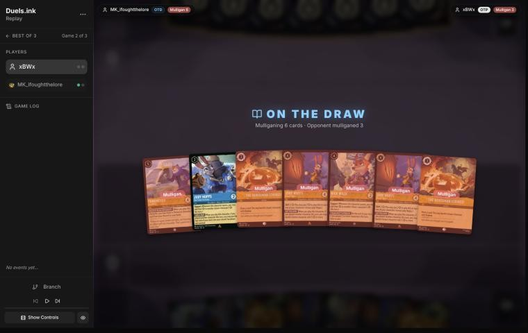
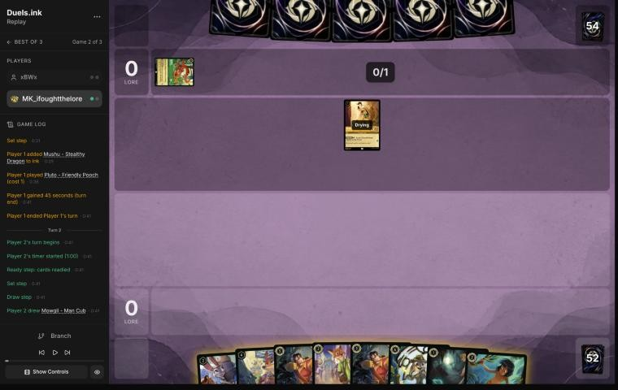
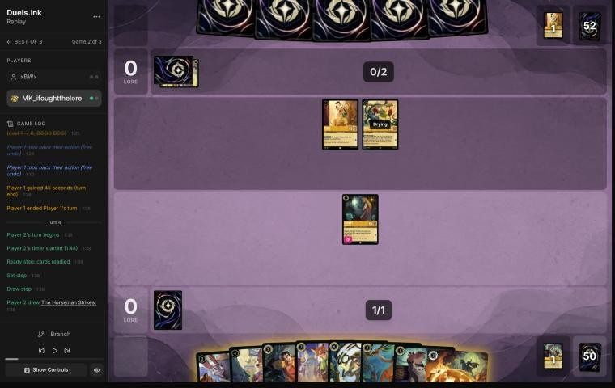
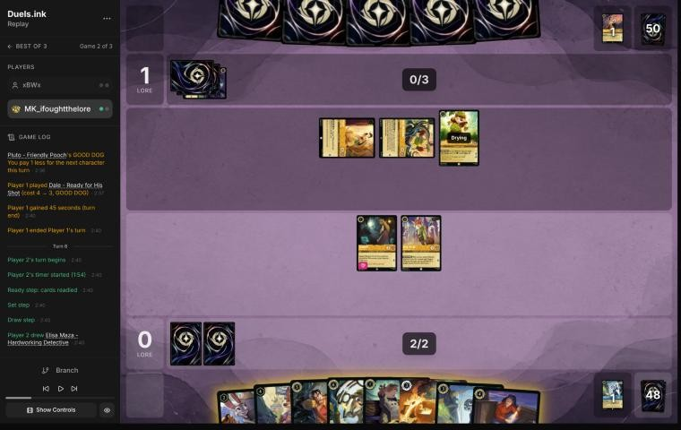
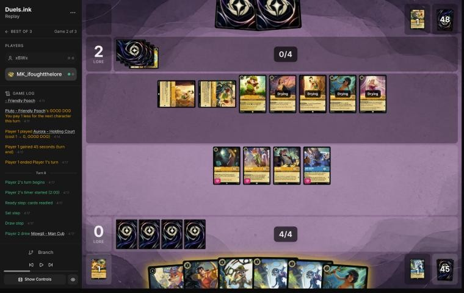
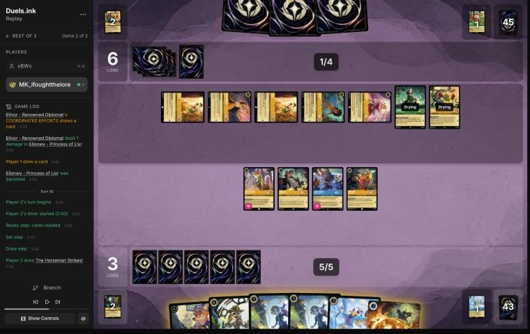
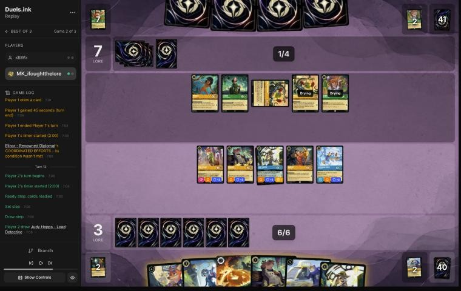
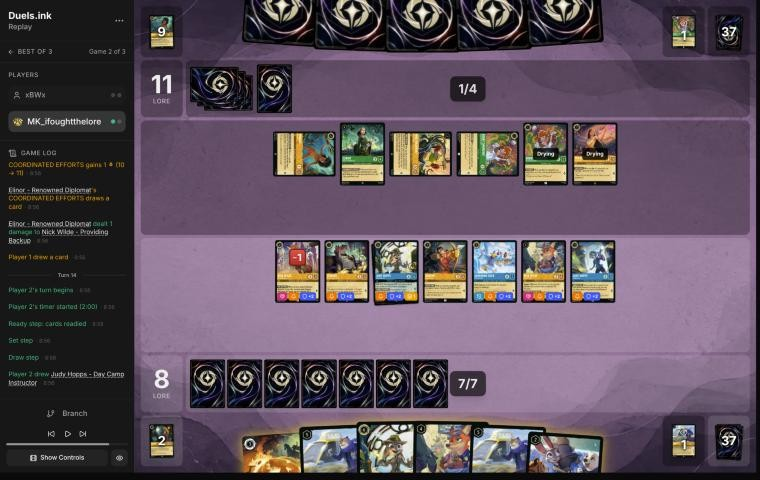

# Review: MK_ifoughtthelore vs xBWx, game 2, 2 Nov 2026

| | |
|---|---|
| **Status** | **final** (2026-11-02; turn 4 revisited in discussion) |
| **Replay** | `01a19bbd-79c2` (`python3 tools/brief.py 01a19bbd-79c2 --turn N`) · [duels.ink viewer](https://duels.ink/replay/01a19bbd-79c2-7997-9537-f0e71bed2282?step=0) |
| **Format** | Core Constructed (from game 1), best-of-three. Set 14 era: inks revealed before the coin toss |
| **Decks** | You: Amber/Sapphire Detectives (Judy Hopps – Lead Detective, Always Vigilant, Fangmeyer, Gaston, cheap Detectives). Them: Amber/Emerald, **Princess Aggro**, known from game 1 |
| **Play/draw** | They went first (they lost game 1, so it was their choice) |
| **Result** | **Win.** They conceded on turn 15 at 15–13, winning you the match 2–0 |
| **Meta data** | snapshot of 26 Oct 2026 (fresh until 9 Nov) |
| **Chosen how** | Sent by danny, the coach's user: a match of MK_ifoughtthelore's, reviewed for them. **The coach saw both games' winners** in the match file before the blind pass, so it knew this game's result; verdicts are guarded against outcome bias |

## Summary
- **Good plays:** turns [2](#turn-2), [6](#turn-6), [8](#turn-8), [10](#turn-10), [12](#turn-12) and [14](#turn-14).
  [Turn 8](#turn-8) used game 1's trick again: two Supports on **their** Dale made him a target for Gaston's WATCH
  THIS, removing the SPIKE SUIT that made their 0-strength characters dangerous. [Turn 10](#turn-10) then killed four
  exerted characters for free under Lead Detective's Resist +2, and [turn 14](#turn-14) chose safety over a faster
  race.
- **Close calls:** the pre-game (mulligan 6, or keep Always Vigilant and a Horseman too) and [turn 4](#turn-4)
  (keeping Eilonwy ready: Pluto's GOOD DOG made Dale castable next turn, and with Dale, Mike could have banished
  her).
- **Inaccuracies:** none. Turn 4 was one until discussion: the coach had missed the Dale risk.

**What decided it:** removing their key pieces at no cost. Dale went on turn 8 and four exerted characters on turn
10, and from there your board out-quested theirs.

## The game, turn by turn
Verdicts judge each decision on what you could know at the time, **including archetype knowledge an experienced
player has**. Hindsight is kept to its own section. Severity scale: good play / close call /
inaccuracy / mistake / blunder. Principle IDs and hypotheses (H-n) link to copies
in the Citations section at the end, as they stood when they were cited.

**What you knew before the game:** they're on Princess Aggro, from game 1's cards: Aurora – Holding Court,
Pocahontas – Guiding the Tribe (plays a 1-drop for free; the Shift base for Pocahontas – Peacekeeper's challenge
lock), Bobby Zimuruski, Mike Wazowski – Heroic Climber, David – Protective Snowboarder (Bodyguard), Mushu – Stealthy
Dragon (Evasive), Mowgli, Nani – Stage Manager and Dale – Ready for His Shot. A cheap, wide board that quests early;
removal is light (Elinor – Renowned Diplomat, Rapunzel – Tower Defender).

### Pre-game

*The board before the decision: [step 0](https://duels.ink/replay/01a19bbd-79c2-7997-9537-f0e71bed2282?step=0) in the duels.ink replay viewer.* Your opening hand; every card marked "Mulligan" went back.

**What you did:** **Kept only Judy Hopps – Day Camp Instructor; sent back Fangmeyer, Nick Wilde – Toy Drive Officer,
both Always Vigilant and both The Horseman Strikes!**

**Verdict:** **Close call.** The seven had no 1-drop and three uninkable cards, so a deep mulligan was right; the
question is how deep. The coach would have kept Always Vigilant and one Horseman as well (keep 3): Always Vigilant
Shifts onto Day Camp Instructor for 2, and Horseman answers Mushu, their Evasive card-drawer. By the sim
(`mulligan.py`, 1,500 deals), keep 3 spends a little more ink on turns 1–4 (9.58 vs 9.48) and always has
interaction (100% vs 80%); yours plays more often (3.78 vs 3.66 turns of 4), with more lore by turn 4 (6.0 vs 5.2)
and characters (4.9 vs 4.3). Against a fast, wide deck, the early board you chose is a fair priority. A further piece
of evidence for [H-5](#cite-h-5).

### Turn 2: your turn 1

*The board before the decision: [step 5](https://duels.ink/replay/01a19bbd-79c2-7997-9537-f0e71bed2282?step=5) in the duels.ink replay viewer.*

**What you did:** Inked one Gaston – Superior Archer, played Eilonwy

**Verdict:** **Good.** The coach's line. The second copy of the 5-drop was the spare card, and Eilonwy is the only
1-drop.

### Turn 4: your turn 2

*The board before the decision: [step 19](https://duels.ink/replay/01a19bbd-79c2-7997-9537-f0e71bed2282?step=19) in the duels.ink replay viewer.*

**What you did:** Inked Mowgli; played Nick Wilde – Providing Backup (after undoing Higgins and an Eilonwy quest);
Eilonwy didn't quest

**Verdict:** **Close call, leaning to the hold** *(revisited in discussion; the blind pass called it an inaccuracy)*.
Nick, the biggest 2-drop, was the right play. Keeping Eilonwy ready gave up 1 lore to protect her:
- **The risk:** Pluto – Friendly Pooch's GOOD DOG makes their next character cost 1 less, so Dale – Ready for His
  Shot (4, one of Princess Aggro's tells, seen in game 1) was castable with their 3 ink next turn. With Dale's SPIKE
  SUIT their characters deal damage with their {W} in challenges, so Mike Wazowski (0 {S}, 4 {W}, dry next turn)
  could challenge an exerted Eilonwy (1 {W}) and banish her, taking only 2.
- **How likely:** about 32% that they'd have Dale by then: 4 copies among their 4 unknown cards in hand and next draw,
  out of 56 (`odds.py hold`); 25% if they run 3.
- **The branches:** questing gains 1 lore. If Dale comes, Mike challenges instead of questing, and you lose Eilonwy:
  a 1-lore quester, and one of the Supports your deck needs to push their Dale to 5 {S} for Gaston's WATCH THIS
  (game 1's trick). Holding comes out ahead if Eilonwy is worth more than about 4 lore over the rest of the game.
  That's close in a race this fast, but her Support is worth most in exactly the branch where she'd die.

The blind pass said their 0-strength board "couldn't have hurt her". That judged the exposure from their board as it
stood, not from what their next turn could add (see [the coach's errors](#coachs-errors)). Confidence: medium.

### Turn 6: your turn 3

*The board before the decision: [step 34](https://duels.ink/replay/01a19bbd-79c2-7997-9537-f0e71bed2282?step=34) in the duels.ink replay viewer.*

**What you did:** Inked Elisa Maza; played Higgins, then Day Camp Instructor (LEND A PAW ramped an ink); nobody quested

**Verdict:** **Good play.** The ramp gives 5 ink next turn, enough for Gaston – Superior Archer. Not questing was
right because of Dale – Ready for His Shot: with SPIKE SUIT their characters deal damage equal to their willpower in
challenges, so their 0-strength Mike (4 {W}) and Pluto (2 {W}) would have killed an exerted Nick or Eilonwy. Kept
ready, both can quest next turn and give their Support to Dale, making him 5 {S} for Gaston's WATCH THIS (the trick
from game 1's turn 7).

### Turn 7: their turn

**What happened:** Mike quested (2–0); Pocahontas – Guiding the Tribe played Pluto for free; Mowgli made you discard
your only non-character card, The Horseman Strikes! (no choice); Aurora played with Pluto's GOOD DOG. They now have
seven characters.

### Turn 8: your turn 4

*The board before the decision: [step 51](https://duels.ink/replay/01a19bbd-79c2-7997-9537-f0e71bed2282?step=51) in the duels.ink replay viewer.*

**What you did:** Inked Mowgli; Eilonwy and Nick quested and gave their Support (+2, +3) to **their** Dale, making him
5 {S}; Gaston – Superior Archer's WATCH THIS banished Dale; Day Camp Instructor quested and gave +2 to Higgins, who
challenged and killed the exerted Mike Wazowski, taking no damage (3–2)

**Verdict:** **Good play, the coach's plan and one better.** Dale was the card to remove: his SPIKE SUIT was what made
their seven 0- and 1-strength characters dangerous in challenges, and he quested for 2. With him gone first, Higgins
could challenge Mike for free. The coach would have used Higgins on the 2-willpower Pluto; Day Camp Instructor's
Support let him kill Mike (4 {W}), the better target: 1 lore a turn and FIND A FRIEND. The order mattered: Supports
before Gaston, and Dale banished before any challenge.

### Turn 9: their turn

**What happened:** Elinor – Renowned Diplomat for 1 (Aurora's ROYAL WELCOME and two GOOD DOGs), a second Mike, then
Aurora, Pocahontas and Mowgli quested (5–3); Elinor's end-of-turn COORDINATED EFFORTS killed Eilonwy (6–3). Five of
their characters ended the turn exerted.

### Turn 10: your turn 5

*The board before the decision: [step 76](https://duels.ink/replay/01a19bbd-79c2-7997-9537-f0e71bed2282?step=76) in the duels.ink replay viewer.*

**What you did:** Inked On the Case; Shifted Judy Hopps – Lead Detective onto Day Camp Instructor; Darkwing Duck;
Lead Detective killed Pocahontas, Higgins and Gaston the two Plutos, Nick killed Aurora, all without damage

**Verdict:** **Good play, the coach's line.** Their five exerted characters were free targets once Dale was gone, and
Lead Detective's Resist +2 covered the Detectives against the 1- and 2-strength ones. Pocahontas first was right
(the Peacekeeper base, and the only one that could hurt a challenger). Four kills took their board from 7 lore a turn
to 3. The coach would have killed Mowgli rather than the second Pluto; Pluto's GOOD DOG discount is the better one
to remove, so yours is at least as good.

### Turn 12: your turn 6

*The board before the decision: [step 96](https://duels.ink/replay/01a19bbd-79c2-7997-9537-f0e71bed2282?step=96) in the duels.ink replay viewer.*

**What you did:** Nick Wilde – Toy Drive Officer; inked Higgins; Judy Hopps – On the Case; Darkwing Duck killed the
exerted Mike Wazowski; Gaston, Higgins, Lead Detective and Nick quested (8–7); COMMUNITY OUTREACH drew a card

**Verdict:** **Good play.** Two characters played triggered Toy Drive Officer's draw, Darkwing's free kill removed
another quester, and questing everything took the lead in the race. The coach would have played Fangmeyer and
Higgins (more lore next turn); two bodies plus a card is at least as good.

### Turn 13: their turn

**What happened:** Mike, Bobby and Mowgli quested (10–8); a second Bobby; **Pocahontas – Guiding the Tribe** played
again, with Pocahontas – Peacekeeper known in their hand since FIND A FRIEND revealed it on turn 11; Elinor's
COORDINATED EFFORTS put 1 damage on Nick (11–8).

### Turn 14: your turn 7

*The board before the decision: [step 122](https://duels.ink/replay/01a19bbd-79c2-7997-9537-f0e71bed2282?step=122) in the duels.ink replay viewer.*

**What you did:** Second Nick Wilde – Toy Drive Officer, then Day Camp Instructor (ramped); On the Case, Nick and
Higgins killed the exerted Mike, Bobby and Mowgli; Lead Detective, Gaston, Darkwing and Toy Drive Officer quested
(13–11); inked Horseman; COMMUNITY OUTREACH drew two cards

**Verdict:** **Good play, safer than the coach's plan.** With Pocahontas – Peacekeeper known in their hand and her
Shift base in play, their next turn could stop your challenges, so this was the turn to fight. The coach would have
quested with everything (16–11) and played Fangmeyer: also winning next turn, but leaving them up to 19 lore with six
characters. Your three free kills held them to 16 at most, kept 11 lore of questers for next turn against a race
they could no longer win, and two Toy Drive Officers drew two cards ([POS-1](#cite-pos-1)).

### Turn 15: their turn

**What happened:** They Shifted Pocahontas – Peacekeeper onto Pocahontas (no challenges until their next turn),
quested to 15, and conceded.

## Lessons
1. **Know the effects that change challenge maths before they're in play.** Dale – Ready for His Shot's SPIKE SUIT
   makes their characters deal damage equal to their willpower in challenges, so 0-strength characters with 4
   willpower (Mike Wazowski, Thomas) become strong challengers and blockers. The brief's challenge figures don't
   include it. Count their cost reducers too: Pluto's GOOD DOG made Dale castable with 3 ink, so from turn 4 every
   quest risked a free challenge from Mike ([turn 4](#turn-4)).
2. **Support on an opposing character sets up strength-threshold removal,** the Detectives' signature trick
   ([the coach's Detectives notes](#cite-kb-meta-archetypes-amber-sapphire-detectives-how-it-plays)): Gaston – Superior Archer's WATCH
   THIS and Judy Hopps – Always Vigilant's GOT YOU NOW both banish a character with 5 {S} or more (game 1, turn 7;
   this game, turn 8).
3. **Under Lead Detective, exerted 1- and 2-strength characters are free kills** for your Detectives (Resist +2 on your
   turn, in [the coach's Detectives notes](#cite-kb-meta-archetypes-amber-sapphire-detectives-how-it-plays)). Against a wide, low-strength deck, a turn of challenges can outscore a turn of questing.
4. **When a known card can lock challenges next turn** (Pocahontas – Peacekeeper on its Shift base; the lock is in
   [the coach's Princess Aggro notes](#cite-kb-meta-archetypes-amber-emerald-princess-aggro-how-it-plays)), fight this turn
   (turn 14).

## Knowledge-base updates (applied 2026-11-02)
- **Meta (Amber/Emerald notes, Princess Aggro):** Dale – Ready for His Shot (SPIKE SUIT), Pluto – Friendly Pooch (GOOD
  DOG: next character 1 cheaper), Elinor – Renowned Diplomat for 1 with Aurora and two GOOD DOGs, Thomas – Wide-Eyed
  Recruit, Ursula – Deceiver, The Queen – Regal Monarch, Rapunzel – Tower Defender; Pocahontas – Peacekeeper played
  on turn 15.
- **Cards:** a note on Dale's SPIKE SUIT and how it changes challenges for both sides.
- **Tools:** the decision brief's challenge figures now count SPIKE SUIT, and its threat list tags combat tricks.
- **Strategy:** [H-5](#cite-h-5), another deep mulligan for an opening curve (pre-game).
- **Process** (from the turn 4 discussion): when judging exposure, count what their next turn can add, including cost
  reducers on their board and cards that change challenge maths; read the archetype's tells in full before the game,
  as the review skill already asks.

## Hindsight
Doesn't change the verdicts above.
- They conceded at 15–13 after the Peacekeeper turn, facing a board that quested for 11.
- **Turn 5:** they did use GOOD DOG to play Dale for 3, after questing with Mike. With Eilonwy ready, Mike had nothing
  to challenge, so questing cost them nothing.

## The coach's errors
Filled in during discussion.

| When | Error | How it was caught | Fix |
|---|---|---|---|
| [Turn 4](#turn-4) | Called keeping Eilonwy ready an inaccuracy because their 0-strength board couldn't hurt her. Missed that Pluto's GOOD DOG made Dale castable at 3 ink, and that with SPIKE SUIT Mike could banish an exerted Eilonwy. Dale is a Princess Aggro tell, seen in game 1, but the coach never read his text before he was in play | danny, in discussion | Verdict revisited to a close call; lesson 1. Done (2026-11-02): the brief prints the text of their key cards (tells, removal, combat tricks, cards known in hand), lists what cost reducers on their board make castable a turn early, tags combat tricks, and counts SPIKE SUIT in challenge damage; the review skill makes the pre-game read write one line per key card; the decision method checks exposure against their next turn; Dale has a card note |
| [Turn 14](#turn-14) | Planned to quest with everything, leaving them up to 19 lore; the user's three free kills were safer for the same win | Your line, seen after the plan | Lesson 4. The lock was known (the pre-game summary names it) and in the knowledge base; the plan didn't apply it |
| Lessons 3 and 4 | Built on facts the knowledge base already had (Lead Detective's Resist +2; Peacekeeper's lock) without citing them | The search before finalising | Cited. The draft predates the search step |

## Open questions
Closed when the review was finalised (2026-11-02). The pre-game question stays unanswered: these were
MK_ifoughtthelore's decisions.
- **Turn 4:** answered on the merits in discussion (the Dale risk). Whether that was MK_ifoughtthelore's reason
  isn't known.
- **Pre-game:** why send back Always Vigilant and both Horsemen as well?

## Citations
Copies of the coach's knowledge base cited above, as they stood when they were cited (the private repository's commit and date are given with each). They don't change when the knowledge base does.

<!-- Filled in by `python3 tools/cite.py <this file>`: every principle ID, H-n, "principle N" and CR rule above
becomes a link to an entry here. Add a file or one of its sections with `--file PATH --section TEXT`, and link to
the anchor it prints. Never link into the private repository. -->

**POS-1**: strategy principle, `kb/strategy/principles.md` at `c50bcbf` (2026-11-02), working tree

> - **POS-1. From ahead, take the safest path to victory.** Don't overextend into sweepers, don't make unnecessary trades, and make the opponent take the risks. Winning by 1 lore counts the same as winning by 10. `[MCL ch.10]` · baseline

**H-5**: hypothesis, `kb/strategy/hypotheses.md` at `c50bcbf` (2026-11-02), working tree

> ### H-5. A hand that can't make an opening curve can be worth a deep mulligan, even with a decent core
> - **Claim:** if the opening seven can't spend its ink on turns 1–4 (no early character, or no 1-drop with
>   uninkables and clumped 4-drops), a deep or full mulligan for an opening curve can beat keeping a reasonable core
>   (e.g. two 3-drops and card draw).
> - **Why:** mulligan replacements come from the cards *not* in your hand (CR 2.2.2, draw before shuffling). A seven
>   holding none of your cheap characters leaves all of them in the redraw pool, so the new cards are richer in
>   exactly what the hand lacks. Keeping part of the hand also keeps its cards' share of the next draws away from
>   the cheap ones.
> - **Evidence for:** 01a14574 (vs Shinobana, game 2), pre-game. Seven of Demona – Scourge, Cheshire ×2, Ursula,
>   Mulan – Elite Archer ×2 and Guidebook, on the play against Ducktectives. Simulated over 20,000 deals:
>   - same ink spent on turns 1–4: 9.31 (full mulligan) vs 9.25 (keep Demona, Cheshire ×2, Guidebook)
>   - character by turn 2: 97% vs 79%
>   - characters in play by turn 3: 2.9 vs 2.0
>
>   The user's reasoning: "no characters until turn 3, so I'm doing the full mulligan to try to have an opening curve."
> - **Evidence for:** 01a13b88 (vs Vhalarus, Amber/Emerald Circle of Life), pre-game, on the draw. Seven of Martial
>   Arts Master, Jebidiah, Isis, Luisa – Confident Climber, Dumbo, Shadow and Demona – Imperious Spellcaster: no 1-drop,
>   two uninkables, three 4-drops. The user kept only Jebidiah. Simulated (the five unknown Set 14 cards modelled as
>   1-cost or 3-cost characters):
>   - ink spent on turns 1–4: 9.63 / 9.55 vs 9.24 / 9.15 for keeping 7
>   - characters by turn 4: 4.9 / 4.4 vs 3.8 / 3.6
>
>   The user confirmed the same reasoning (an opening curve), 2026-11-01.
> - **Caveat: the goal isn't maximum ink spend** (user, 2026-11-01). Compare options on curve (a play each turn),
>   early lore pressure, interaction that sets the opponent back, and ink use, then weigh card quality and the
>   matchup. `python3 tools/mulligan.py <replay> --plan --keep "…"` reports the first four for any replay (the original
>   sims were ad hoc scripts, since lost; the tool reproduces their numbers). It can't judge card quality or engines.
>   With the replay card cache (2026-11-01), the user's Set 14 cards have data, so no costs are guessed for these two
>   games:
>   - **01a14574:** the full mulligan led on every measure. Against keeping Demona, Cheshire ×2 and Guidebook: ink
>     9.27 vs 9.18, play turns 3.65 vs 3.37 of 4, lore by turn 4 3.9 vs 2.4, interaction 60% vs 45%.
>   - **01a13b88:** the mulligan made (keep Jebidiah) led on curve and early lore against keeping the engines (Martial
>     Arts Master, Jebidiah, Dumbo, Shadow, Demona – Imperious Spellcaster): play turns 3.70 vs 3.39, lore by turn 4 3.7
>     vs 2.3. The engines option led on interaction (100% vs 90%) and kept Dumbo.
> - **Evidence against:** an independent blind review of 01a13b88 by a fresh coach session (2026-11-01) argued that
>   this hand had a turn-2 play and engines (Dumbo, Martial Arts Master).
>   - **Sending back only Isis and Luisa – Confident Climber** spends 9.29 ink on turns 1–4 (vs 9.51 for the full
>     mulligan, `mulligan.py`) and keeps the engines.
>   - **Against a likely slow sweeper deck** (Circle of Life, 60%), card quality matters more than early bodies
>     (MULL-3), and most of the extra bodies are 0-strength 1-drops.
>   - **So the broadened claim may be too broad.** It fits hands with no early play (01a14574) better than hands with
>     a turn-2 play and engines. The user agreed to grade 01a13b88's mulligan a close call (2026-11-01).
> - **Status:** open. Supported for hands with no early character (01a14574). For hands with an early play and
>   engines, test the partial mulligans first; there it's a close call (01a13b88).

**amber-sapphire.md, Detectives: how it plays**: knowledge base, `kb/meta/archetypes/amber-sapphire.md` at `c0e53c5` (2026-11-02), working tree

> ### Detectives: how it plays `[coach, meta study of the user's 27 Oct 2026 games (tools/scan.py), full games, not blind, 8 games]`
> Games: 01a17e45, 01a17e54, 01a17e5d (Sallinhos, best-of-three); 01a17e64, 01a17e75, 01a17e80 (DuckyRv, best-of-three);
> 01a17e9c; 01a17ef8. Card text verified with `tools/cards.py`.
>
> **The plan:** go wide with cheap Detectives, quest wide, and remove your best characters with "banish chosen character
> with 5 {S} or more", **after pumping them with Support**.
>
> - **The key trick: Support onto your characters.** Support adds "their {S} to another chosen character's {S} this turn",
>   and they choose yours. Then Gaston – Superior Archer or a Judy Hopps – Always Vigilant banishes it.
>   - *Examples:* 01a17e54 turn 21 (+2 on Hades, then Gaston); 01a17e5d turn 12 (+2 on Cheshire, then Judy – Always
>     Vigilant); 01a17e45 turn 23 (two Judy – Always Vigilant Shifts in one turn, banishing Cheshire and Merida, both
>     pumped first).
>   - **Support stacks:** a supported character supports with its new {S}. In 01a17e45 turn 15, Judy – Day Camp gave
>     Nick Wilde +2, then Nick gave +4. Treat **any** character of yours as in range once they have Support questers and
>     their removal available.
> - **Pieces:**
>   - **Cheap Detectives:**
>     - Higgins (1)
>     - Judy – Helpful Officer (1; removes 2 damage)
>     - Nick Wilde – Providing Backup (2; Support while they have another Detective)
>     - Judy – Day Camp Instructor (2, uninkable; Support; tops a card into ink if they played another character this turn)
>     - Daisy Duck – Ghost Finder (2, Support)
>     - Eilonwy (1, Support; not a Detective)
>   - **Nick Wilde – Toy Drive Officer** (4, uninkable; Support; draws at the end of a turn they played 2+ characters).
>   - **Removal:**
>     - **Judy Hopps – Always Vigilant** (4, Shift 2 onto any Judy; GOT YOU NOW needs another character played that turn)
>     - **Gaston – Superior Archer** (5)
>     - The Horseman Strikes!
>   - **Fangmeyer – Icy Officer** (5, uninkable, 2 lore): returns a Detective from their discard, usually Judy – Always
>     Vigilant, so the removal repeats.
>   - **Hand disruption:** Elisa Maza (4; with another Detective in play, you reveal your hand and they pick a non-character
>     card to discard) and Mowgli – Man Cub (2; you discard a non-character card). They took Raging Storm and Remember Me.
>   - **Card flow:** Judy – Uncovering Clues (4; searches the top 3 for a Detective on play and on quest).
>   - **Late game:** Judy – Lead Detective (6, Shift 4; Alert and Resist +2 for Detectives on their turn).
> - **Big turns,** from about their 6th turn: wide quests for +5 to +7 (01a17e45 turn 15: five questers; 01a17e9c turn
>   18: +7 after Lead Detective). Removal turns took 3 or 4 characters by mixing banishes with pumped challengers
>   (01a17e45 turn 23, 01a17e5d turn 12, 01a17e80 turn 26). Your locations were challenged down by two Detectives at once.
> - **What to watch for:**
>   - **Count their Support total against your characters' {S}.** Judys in play are Shift 2 targets for Always Vigilant,
>     and Gaston arrives at 5 ink.
>   - **Expect the removal to repeat** while Fangmeyer can return it.
>   - **Play your actions and songs (sweepers especially) early, before Elisa Maza lands.** She needs another Detective in
>     play first. A wide board of small characters is exactly what sweepers punish.

**amber-emerald.md, Princess Aggro: how it plays**: knowledge base, `kb/meta/archetypes/amber-emerald.md` at `801105c` (2026-11-02)

> ### Princess Aggro: how it plays `[coach, meta study of the user's 27 Oct 2026 games (tools/scan.py), full games, not blind, 1 game]`
> Game: 01a17f26. They reached 17 lore by their 5th turn.
> - **A cheap Princess and Queen curve with discounts:** Aurora – Holding Court (1; each quest makes the next Princess or
>   Queen 1 cheaper) and Grandmother Willow (2; next character 1 cheaper). Elinor cost 1 on turn 7.
> - **Pocahontas – Peacekeeper** (5, Shift 3): when Shifted, if none of theirs challenged, **characters can't challenge
>   until their next turn.** Your board can't attack their questers.
> - **Elinor – Renowned Diplomat** (4): at the end of their turn with 3+ exerted characters, 1 damage to your character,
>   +1 lore and a draw. Every wide quest turn triggers it.
> - **Eilonwy's Support (+2)** let Pocahontas kill a 4-willpower character.
> - **Big turns:** +5, +5 and +6 lore on their 3rd to 5th turns.
> - **What to watch for:** interaction has to come early, and challenges are locked on Peacekeeper turns.
