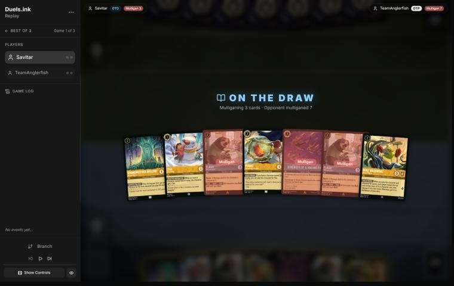
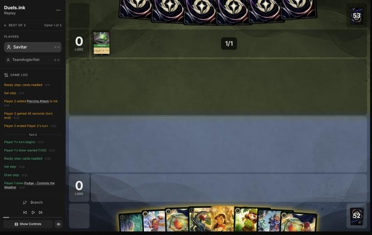
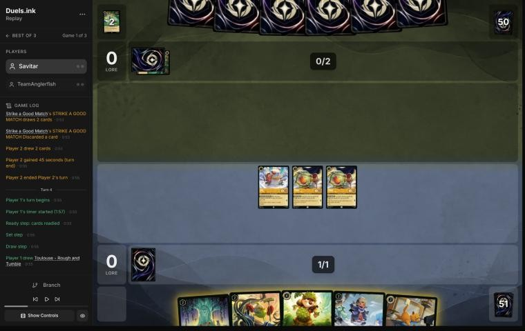
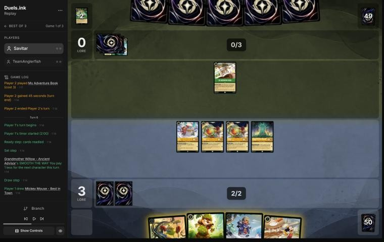
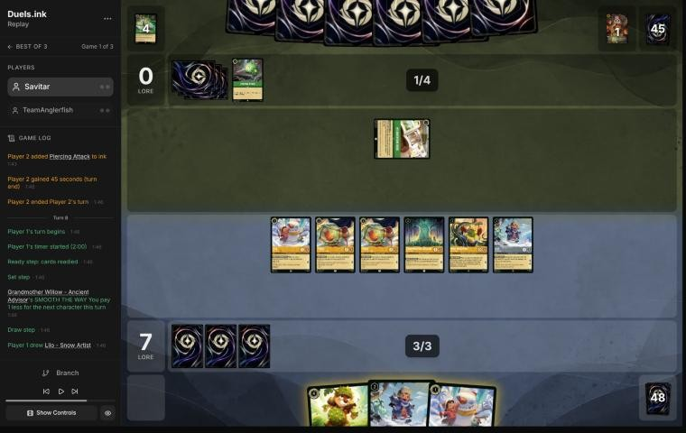

# Review: Savitar vs TeamAnglerfish, game 1, 2 Nov 2026

| | |
|---|---|
| **Status** | draft (blind pass done; not discussed, by request) |
| **Replay** | `01a19bc8-bf4c` (`python3 tools/brief.py 01a19bc8-bf4c --turn N`) · [duels.ink viewer](https://duels.ink/replay/01a19bc8-bf5f-76d2-8a18-c711460a4ce8?step=0) |
| **Format** | Core Constructed (stated in the replay), best-of-three. Set 14 era: inks revealed before the coin toss |
| **Decks** | You: Amber/Steel Rockstar Aggro, the Lilo list (Pudge, Mr. Big, Flash, Lilo – Rock Star). Them: Emerald/Amber; archetype as it became clear: a Kevin – Flightless Bird list duels.ink doesn't group (My Adventure Book, Piercing Attack, Strike a Good Match), from turn 5 |
| **Play/draw** | TeamAnglerfish went first; you were on the draw |
| **Result** | **Win:** TeamAnglerfish conceded on their 5th turn (game turn 9) at 14–0 |
| **Meta data** | snapshot of 26 Oct 2026 (fresh until 9 Nov) |
| **Chosen how** | danny sent 27 of Savitar's games (12 matches) and asked the coach to study 7 matches and review the other 5. The split used only pre-game facts: complete matches, ink pairs, dates. The coach studied the 7 other matches in full first (`tools/scan.py`); none was against TeamAnglerfish. This match has two games in the zip, which says nothing of the result: a player can leave or concede |

## Summary
- **Good plays:** [2](#turn-2) (three characters for 1 ink), [4](#turn-4), [6](#turn-6), [8](#turn-8).
- **Close calls:** the [mulligan](#turn-0) (keeping Strength of a Raging Fire instead of Mike was at least as good);
  the ink on [2](#turn-2).
- **Inaccuracies / mistakes / blunders:** none.
- **Unwinnable from:** never.

**What decided it:** they played no character in four turns, so your board quested unopposed from turn 4: 14–0 when
they conceded with the Malicious they'd found still in hand.

## The game, turn by turn
Verdicts judge each decision on what you could know at the time, **including archetype knowledge an experienced
player has**. Hindsight is kept to its own section. Severity scale: good play / close call /
inaccuracy / mistake / blunder. Principle IDs and hypotheses (H-n) link to copies
in the Citations section at the end, as they stood when they were cited.

**What you knew before the game:** their inks, Emerald/Amber. By duels.ink's Core meta that's Circle of Life (60%),
Princess Aggro (24%) or a list duels.ink doesn't group (16%). Their key cards and when each can come (they're on the
play, so their turn k is game turn 2k−1):
- **Malicious, Mean, and Scary** (3): 1 damage counter on each of your characters. Sung free by any cost-3+ character
  (Angel – Siren Singer counts as 3) from their 2nd turn, cast from their 3rd.
- **To Wither a Flower** (4, uninkable): 2 damage to each damaged character of yours. Sung free by Ursula – Vanessa
  (Singer 4, cost 2) from her second turn in play. After Malicious it kills everything with 3 willpower or less: most
  of your deck. Only Mike, David, Mickey, Dale and Lilo & Stitch survive both.
- **Don Karnage – Debonair Pirate** (6, or Shift 4 onto Khan's Courier): 1 damage to each of yours, through Resist.
- **Akood et Emuti** (3, sung): the next character costs 2 less. It brought Chernabog (5: shuffles one of yours away)
  on game turn 5 and Milo Thatch (7, Ward: bounces one) on turn 10 in the study games.
- **Circle of Life** (Sing Together 8) replaying **Prince Phillip** (banish all your damaged characters), once Phillip
  is in their discard.
- **Max Goof:** Karaoke Star quests for 4 with five songs in their discard; Chart Topper replays a song (Malicious)
  each quest.
- **Princess Aggro instead:** Aurora's discounts, Dale, Elinor (1 damage, 1 lore and a card at the end of their turn
  with 3+ exerted characters), Pocahontas – Peacekeeper's challenge lock.

**From the study** ([the coach's Circle of Life notes against your deck](#cite-kb-meta-archetypes-amber-emerald-circle-of-life-against-rockstar-aggro-kariminal)): Kariminal's
Circle of Life beat this list in four games with Malicious plus To Wither a Flower, Don Karnage and early Chernabogs.
Your deck's answers: bodies with 4 willpower, Toulouse (no songs for a turn), Mr. Big's ICE OUT, Strength of a Raging
Fire on a singer.

### Pre-game

*The board before the decision: [step 0](https://duels.ink/replay/01a19bc8-bf5f-76d2-8a18-c711460a4ce8?step=0) in the duels.ink replay viewer.*

**What you did:** on the draw, sent back both Flash – Efficient Clerks and Strength of a Raging Fire, keeping
Grandmother Willow, Lilo – Snow Artist, Pudge and Mike Wazowski.

**Verdict:** close call. The seven had four uninkable cards (Willow, two Flashes, Mike) and three inkable ones (Lilo,
Pudge, Strength), and no character of cost 3 or more to sing Strength. `tools/mulligan.py` (800 deals each):

| Option | Ink on turns 1–4 | Play turns (of 4) | Lore by turn 4 | Characters by turn 4 | Interaction by turn 4 |
|---|---|---|---|---|---|
| Keep all 7 | 9.37 | 4.00 | 7.5 | 5.3 | 100% |
| **As played** (send back both Flashes and Strength) | 9.60 | 4.00 | 7.5 | 5.7 | 25% |
| Send back both Flashes and Mike, keep Strength | 9.81 | 4.00 | 7.5 | 5.6 | 100% |
| Keep only Lilo, Pudge and Strength | 9.80 | 4.00 | 8.0 | 5.7 | 100% |
| Full mulligan | 9.59 | 3.85 | 8.5 | 5.5 | 48% |

- **Sending back the Flashes** fixes the ink: four uninkables in seven cards would have left Lilo and Pudge to be
  inked instead of played.
- **Mike or Strength as the fourth card** is the real choice, and the sim can't separate them. Strength is inkable
  (the natural first ink, so Lilo and a free Pudge both go down on turn 1) and is the deck's only removal: against
  Circle of Life its targets are the singers that make Malicious and To Wither a Flower free, and Max Goof. Mike is a
  4-willpower body that survives both songs, but uninkable, and his FIND A FRIEND feeds their hand as well.
- Against a 60% Circle of Life, keeping Strength was at least as good; not worth flagging ([MULL-1](#cite-mull-1),
  [MULL-3](#cite-mull-3)). Confidence: low.

### Turn 1: their turn

**What happened:** they inked Piercing Attack (2, Emerald action: 2 damage to a chosen character, through Resist). It
isn't in any of duels.ink's Amber/Emerald lists, so an unlisted list became the likeliest guess (50%), with Circle of
Life at 36%.

### Turn 2: your turn 1

*The board before the decision: [step 5](https://duels.ink/replay/01a19bc8-bf5f-76d2-8a18-c711460a4ce8?step=5) in the duels.ink replay viewer.*

**What you did:** drew a second Pudge; inked Lilo & Stitch – Fun-Loving Friends; played Lilo – Snow Artist and both
Pudges free (GOOD FRIEND).

**Verdict:** good play, with a close call on the ink.
- **Three characters for 1 ink** is the deck's best opening. They have 1 ink and no characters, so nothing threatens
  the board until their singers arrive.
- **The ink was Lilo & Stitch or Dale** (inking a Pudge would have cost a free body). Ink check: either way the
  hand is left with three uninkables (Willow, Mike, Lilo – Bundled Up) and one inkable, so turn 2's ink comes from the
  draw (about 4 in 5 of the deck is inkable) or that last card. Both were castable on turn 3 with Willow's discount:
  Lilo & Stitch by Shift onto Lilo for 2, Dale for 3.
- **Lilo & Stitch was the slightly better card to keep:** 3 lore on 5 willpower with Resist 1 survives Malicious plus
  To Wither a Flower (1 put, which Resist doesn't reduce, [CR 8.8.3](#cite-cr-8-8-3), plus 2 dealt, reduced to 1) and Piercing Attack.
  Dale's SPIKE SUIT only pays when you challenge. Not worth flagging ([INK-2](#cite-ink-2)). Confidence: low.

### Turn 3: their turn

**What happened:** they inked one Strike a Good Match and cast another (draw 2, discard 1), discarding Kevin –
Flightless Bird. Circle of Life became the likely list (86%).

### Turn 4: your turn 2

*The board before the decision: [step 14](https://duels.ink/replay/01a19bc8-bf5f-76d2-8a18-c711460a4ce8?step=14) in the duels.ink replay viewer.*

**What you did:** drew Toulouse; inked him; played Grandmother Willow; quested Lilo and both Pudges (3–0).

**Verdict:** good play.
- **Questing all three was free:** they have no characters, so nothing can challenge. Their 3 ink next turn allows
  Malicious, Mean, and Scary (1 counter each, which kills nothing here: Lilo has 2 willpower, the Pudges 3) or
  Piercing Attack on one character. To Wither a Flower needs 4 ink or a cost-4 singer, and they have neither.
- **Willow over Lilo – Bundled Up (2 lore now):** three of your four other cards are uninkable 2-drops, so ink will be
  short. Willow's discount is an extra ink every turn from next turn, when Dale costs 3 or Bundled Up 1.
- **Ink check:** the inkables were Dale and Toulouse. Inking Toulouse leaves Dale as next turn's play (3 with Willow)
  or as next turn's ink if no inkable card is drawn. Inking Dale instead would have kept Toulouse to deny one turn of
  songs, and against Circle of Life the turn to use him is the one before their singers can sing Malicious and To
  Wither a Flower together: they have no singers yet. Either is fine; Dale survives both songs (4 willpower) and
  quests for 2 ([INK-2](#cite-ink-2)).

### Turn 5: their turn

**What happened:** they inked a second Kevin – Flightless Bird (2, 1/3/3: each quest puts him on top of their deck)
and played My Adventure Book (3, item: {E} and 1 ink to take the top card if it's a non-character or a Kevin). A
Kevin loop duels.ink doesn't list; Circle of Life fell to 56%.

### Turn 6: your turn 3

*The board before the decision: [step 23](https://duels.ink/replay/01a19bc8-bf5f-76d2-8a18-c711460a4ce8?step=23) in the duels.ink replay viewer.*

**What you did:** drew Mickey; inked him; played Mike Wazowski for 1 with Willow's discount (FIND A FRIEND found you a
Lilo – Bundled Up; theirs showed Battering Ram, bottomed), then Lilo – Bundled Up for 2; quested the other four (7–0).

**Verdict:** good play.
- **The candidates,** all spending 3 ink: Dale for 3 (ink Mickey); Mike and Bundled Up (ink Mickey); Mickey free with
  Willow plus Bundled Up (ink Dale). Against no interaction all three reach 20 on game turn 10.
- **Your line keeps Dale for next turn** (3 with Willow, castable whatever you draw) and doesn't give them Mickey's ink
  drops: a drop on their 5-ink turn would make Don Karnage or Malicious plus Piercing Attack castable
  ([the coach's Mickey notes](#cite-kb-cards-mickey-mouse-best-in-town-what-it-means-in-play)).
- **Mike first, then Bundled Up,** let FIND A FRIEND's card arrive before the second play ([SEQ-1](#cite-seq-1)).
- **Questing four was safe:** they have no characters. Next turn's worst case is Malicious (kills nothing: your
  smallest have 2 willpower) or Piercing Attack on one character.

### Turn 7: their turn

**What happened:** My Adventure Book revealed **Malicious, Mean, and Scary** into their hand (known from here); a
third Strike a Good Match discarded Enigmatic Inkcaster; they inked a second Piercing Attack. Still no characters.

### Turn 8: your turn 4

*The board before the decision: [step 37](https://duels.ink/replay/01a19bc8-bf5f-76d2-8a18-c711460a4ce8?step=37) in the duels.ink replay viewer.*

**What you did:** drew a Lilo – Snow Artist; quested all six, Mike first (FIND A FRIEND gave you Mickey); played the
second Lilo – Bundled Up for 1, Lilo – Snow Artist and Mickey; didn't ink. 14–0.

**Verdict:** good play.
- **Their best next turn,** with 5 ink and no characters to sing or challenge: the known Malicious (1 counter on each
  of yours) plus one 2-cost card such as Piercing Attack, which kills one character with 3 willpower or less. To
  Wither a Flower after Malicious needs 7 ink or a singer. Chernabog (5) shuffles one character away. None of these
  stops 6 lore from a board that quests for 12 next turn.
- **Mike first** showed you Mickey before you spent the ink ([SEQ-1](#cite-seq-1)).
- **Not inking** cost nothing: at 14 the game should end next turn, and Dale stayed in hand as a spare threat if it
  didn't.

## Lessons
1. **With an uninkable-heavy hand, Grandmother Willow is an extra ink each turn** ([4](#turn-4)): two plays a turn
   from 3 ink kept the curve going with three uninkable 2-drops in hand.
2. **Play the card-finding effect before spending the ink** ([6](#turn-6), [8](#turn-8)): Mike's FIND A FRIEND
   found Lilo – Bundled Up and Mickey, which the rest of the ink then paid for.
3. **Count what their ink allows, not just what they hold:** Malicious was known from turn 7, but with no singers
   it and To Wither a Flower together cost 7, two turns away, so questing everything was safe ([8](#turn-8)).

## Knowledge-base updates (applied 2026-11-02, without discussion at danny's request)
- **Meta, Amber/Emerald notes:** TeamAnglerfish's Kevin list (see the next game of the match).

## Hindsight
Doesn't change the verdicts above.
- TeamAnglerfish had mulliganed all seven cards and never found a character in four turns.

## The coach's errors
None found in the blind pass.

| When | Error | How it was caught | How it won't happen again |
|---|---|---|---|

## Open questions
- [Pre-game](#turn-0): why Mike over Strength of a Raging Fire? Against a likely Circle of Life, Strength was the
  natural first ink and the deck's only removal for their singers.

## Citations
Copies of the coach's knowledge base cited above, as they stood when they were cited (the private repository's commit and date are given with each). They don't change when the knowledge base does.

<!-- Filled in by `python3 tools/cite.py <this file>`: every principle ID, H-n, "principle N" and CR rule above
becomes a link to an entry here. Add a file or one of its sections with `--file PATH --section TEXT`, and link to
the anchor it prints. Never link into the private repository. -->

**amber-emerald.md, Circle of Life against Rockstar Aggro: Kariminal**: knowledge base, `kb/meta/archetypes/amber-emerald.md` at `09004b8` (2026-11-02), working tree

> ### Circle of Life against Rockstar Aggro: Kariminal `[coach, meta study of Savitar's 2 Nov 2026 games (tools/scan.py), full games, not blind, 4 games]`
> 01a19c02-ae0e and 01a19c06-3be1 (one match), 01a19cc1-7b0e and 01a19cc5-5243 (a later match; its game 2 wasn't sent).
> Savitar (Amber/Steel Rockstar Aggro, `kb/meta/archetypes/amber-steel.md`) lost all four.
> - **Seen:** Angel – Siren Singer ×3, Ursula – Vanessa ×2, Tod, Meilin Lee – Losing Control ×2, Lenny – Toy Binoculars,
>   Max Goof – Rebellious Teen ×2, Max Goof – Karaoke Star ×2, Max Goof – Chart Topper, Chernabog, Milo Thatch ×2, Don
>   Karnage – Debonair Pirate, Akood et Emuti ×2, Malicious, Mean, and Scary, To Wither a Flower, Strike a Good Match,
>   Circle of Life. No Prince Phillip was needed against this deck.
> - **Malicious alone is a sweeper against 2-willpower boards.** Don Karnage's 1 damage plus Malicious killed both Mr.
>   Bigs on turn 6 of 01a19c02-ae0e; Malicious then To Wither a Flower killed five characters on turn 7 of 01a19cc5-5243.
>   Max Goof – Rebellious Teen (Malicious back from the discard) and Chart Topper (replays it on each quest) repeat it.
> - **Akood et Emuti makes their 5s and 7s early:** Chernabog for 3 on game turn 5 (01a19cc1-7b0e) and 6 (01a19c06-3be1),
>   Milo Thatch for 5 on turn 10. Chernabog's 5 {S} also kills Lilo & Stitch through Resist 1.

**mickey-mouse-best-in-town.md, What it means in play**: knowledge base, `kb/cards/mickey-mouse-best-in-town.md` at `09004b8` (2026-11-02), working tree

> ## What it means in play `[coach, from the 27 Oct 2026 meta study]`
> - **The ramp is symmetric:** every turn he quests, the opponent also gets an ink drop. That's worth more to decks with
>   ink-drop payoffs:
>   - **Jousting Match** (Steel action, 3): 2 damage, or **5 if paid with an ink drop**. Mickey supplied an Amethyst/Steel
>     opponent's drops (01a17e37).
>   - Ink-drop decks also run Ink Explosion, Merlin – Profoundly Curious and Marie – Caught in the Act; Shere Khan –
>     Khan Industries CEO makes drops of his own.
>   - An Emerald/Steel opponent spent four of these drops on turn 6 of 01a17ddb.
> - **Adventurous forces him to quest,** so he ends every turn exerted and can be challenged. 0 strength means he trades
>   for nothing; he's often the first challenge target (01a17e9c turn 14, 01a17ddb turn 6).
> - **Against a Steel opponent,** count the drops you're giving them, and what they could pay for with them, before
>   questing with him.
> - **Drops bring Raging Storm early** `[coach, meta study of Savitar's games, 2 Nov 2026]`: Candle Control (Amber/Ruby)
>   cast it on game turn 9, their 5th turn, with 5 ink and 3 drops from both sides' Mickeys (01a19bdb-d8e4). Against an
>   Amber deck, add your Mickey's drops to their ink when you count down to Storm (8).

**CR 8.8.3**: Comprehensive Rules, `kb/rules/cr/08-keywords.md` at `09004b8` (2026-11-02), working tree

> **8.8.3.** Damage put or moved onto a character with Resist isn’t affected by the ability.

**MULL-1**: strategy principle, `kb/strategy/principles.md` at `09004b8` (2026-11-02), working tree

> - **MULL-1. Keep a plan, not the strongest cards.** *Ask: "Which hand gives me the best chance to execute my game plan in this matchup?"* `[MCL ch.12]` · baseline

**MULL-3**: strategy principle, `kb/strategy/principles.md` at `09004b8` (2026-11-02), working tree

> - **MULL-3. The right keep depends on the matchup.** Early interaction against aggro; pressure, draw and engines against slow decks. The mulligan is the first expression of your role. In the Set 14 era the opponent's inks are known before the mulligan (RULE-8), so this applies from game 1 of a match. `[MCL ch.12]` · baseline

**INK-2**: strategy principle, `kb/strategy/principles.md` at `09004b8` (2026-11-02), working tree

> - **INK-2. Don't automatically ink the most expensive card.** It may be the late-game win condition or the key answer for this matchup. The answer depends on matchup, hand and board. `[MCL ch.4]` · baseline

**SEQ-1**: strategy principle, `kb/strategy/principles.md` at `09004b8` (2026-11-02), working tree

> - **SEQ-1. Gather information before irreversible decisions.** Draw, look and scry before choosing what to ink. Quest with draw triggers before committing other plays when the order doesn't otherwise matter. `[MCL ch.5]` · baseline
