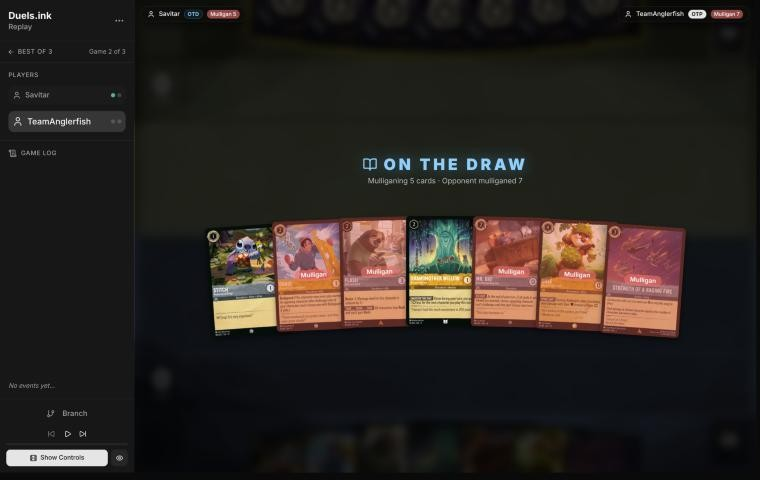
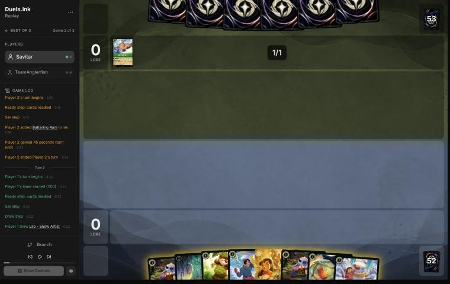
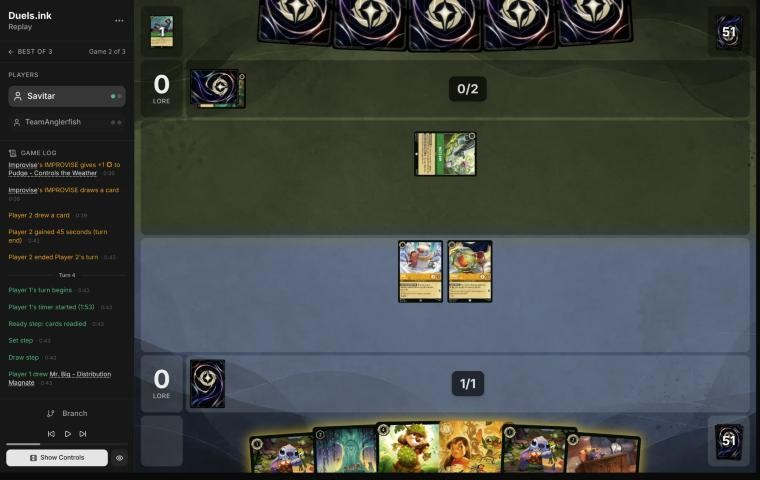
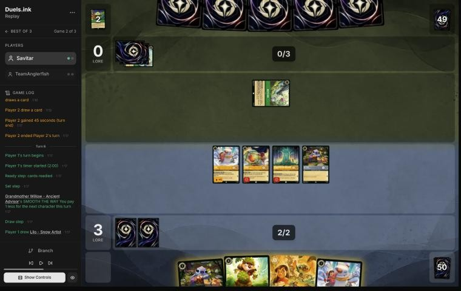
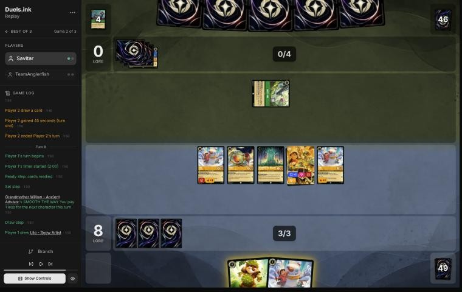

# Review: Savitar vs TeamAnglerfish, game 2, 2 Nov 2026

| | |
|---|---|
| **Status** | draft (blind pass done; not discussed, by request) |
| **Replay** | `01a19bca-cf89` (`python3 tools/brief.py 01a19bca-cf89 --turn N`) · [duels.ink viewer](https://duels.ink/replay/01a19bca-cf8a-7fb0-b628-10d53f61cb9a?step=0) |
| **Format** | Core Constructed (from game 1), best-of-three. Set 14 era: inks revealed before the coin toss |
| **Decks** | You: Amber/Steel Rockstar Aggro, the Lilo list. Them: Emerald/Amber, the Kevin – Flightless Bird list from game 1 |
| **Play/draw** | TeamAnglerfish went first (they lost game 1, so the choice was theirs); you were on the draw |
| **Result** | **Win:** TeamAnglerfish conceded on their 5th turn (game turn 9) at 12–0, so you won the match 2–0 |
| **Meta data** | snapshot of 26 Oct 2026 (fresh until 9 Nov) |
| **Chosen how** | One of the 5 of Savitar's 12 matches the coach reviewed after studying the other 7 (see game 1). The zip held two games of this match; the coach reviewed game 1 (a win) first, and two games doesn't say how the match ended |

## Summary
- **Good plays:** the [mulligan](#turn-0) (a deep one, down to Stitch and Willow), [2](#turn-2), and three lines
  better than the coach's plan: [4](#turn-4) (Willow and a free Stitch on the same turn), [6](#turn-6) (inking the
  Stitch so Lilo & Stitch powered both Lilos), [8](#turn-8) (a free Lilo, Dale kept for next turn).
- **Close calls / inaccuracies / mistakes / blunders:** none.
- **Unwinnable from:** never.

**What decided it:** their Emerald/Amber actions list again played no character, and two Strange Things only slowed
a board that quested for 11 a turn by turn 4.

## The game, turn by turn
Verdicts judge each decision on what you could know at the time, **including archetype knowledge an experienced
player has**. Hindsight is kept to its own section. Severity scale: good play / close call /
inaccuracy / mistake / blunder. Principle IDs and hypotheses (H-n) link to copies
in the Citations section at the end, as they stood when they were cited.

**What you knew before the game:** game 1. TeamAnglerfish's Emerald/Amber list isn't one duels.ink groups: Kevin
– Flightless Bird (each quest puts him back on top of their deck), My Adventure Book (redraws Kevin or a
non-character), Piercing Attack ×2 (2 damage through Resist), Strike a Good Match ×3, Enigmatic Inkcaster, Battering
Ram, Improvise and Malicious, Mean, and Scary. They played no character in game 1. Circle of Life's staples (Angel,
To Wither a Flower, Chernabog, Milo Thatch, Circle of Life itself) were still possible: the brief gave it 24%.

### Pre-game

*The board before the decision: [step 0](https://duels.ink/replay/01a19bca-cf8a-7fb0-b628-10d53f61cb9a?step=0) in the duels.ink replay viewer.*

**What you did:** on the draw again, kept Stitch – Protector of Frogs and Grandmother Willow and sent back five:
David, Flash, Mr. Big, Dale and Strength of a Raging Fire.

**Verdict:** good play: a deep mulligan the simulation backs. `tools/mulligan.py` (800 deals each):

| Option | Ink on turns 1–4 | Play turns (of 4) | Lore by turn 4 | Characters by turn 4 | Interaction by turn 4 |
|---|---|---|---|---|---|
| Keep all 7 | 9.75 | 4.00 | 7.3 | 5.3 | 100% |
| **As played** (keep Stitch and Willow) | 9.57 | 4.00 | 8.4 | 5.9 | 37% |
| Send back Strength | 9.64 | 4.00 | 8.2 | 5.6 | 20% |
| Send back Dale | 9.66 | 4.00 | 8.1 | 5.5 | 100% |
| Full mulligan | 9.61 | 3.85 | 8.7 | 5.5 | 47% |

- The seven was playable, but most of it was defensive: David (Bodyguard), Mr. Big (stops a challenger), Dale's SPIKE
  SUIT and Strength all answer characters, and game 1's opponent played none.
- Against a slow list the hand's job is lore early. The deep mulligan led every measure the sim has except interaction,
  and keeping Willow kept the engine that makes two plays a turn ([MULL-1](#cite-mull-1),
  [MULL-3](#cite-mull-3)). Confidence: medium.

### Turn 1: their turn

**What happened:** they inked Battering Ram (4, item: {E} for 1 damage to a damaged character; can banish a location).

### Turn 2: your turn 1

*The board before the decision: [step 4](https://duels.ink/replay/01a19bca-cf8a-7fb0-b628-10d53f61cb9a?step=4) in the duels.ink replay viewer.*

**What you did:** drew a Lilo – Snow Artist (the mulligan had brought the other Lilo, a second Stitch, Pudge, Dale,
David and Lilo & Stitch); inked David; played Lilo and Pudge free.

**Verdict:** good play, the coach's line. Two characters for 1 ink, and David (a Bodyguard against a list that
played no character in game 1) is the card this matchup needs least ([INK-2](#cite-ink-2)). Ink check: the hand keeps
both Stitches, Willow, Dale, Lilo & Stitch and a Lilo, so turn 2 can ink a Stitch or Lilo and play Willow or two
Stitches, and turn 3 can Shift Lilo & Stitch onto Lilo.

### Turn 3: their turn

**What happened:** Buzz's Arm (2, item: {E} for 1 less on the next action or item) made Improvise free (+1 {S} to
a character, draw a card); they inked a Strike a Good Match. Still no characters.

### Turn 4: your turn 2

*The board before the decision: [step 14](https://duels.ink/replay/01a19bca-cf8a-7fb0-b628-10d53f61cb9a?step=14) in the duels.ink replay viewer.*

**What you did:** drew Mr. Big; inked him (after undoing a Stitch ink); played Grandmother Willow, then a Stitch free
with her discount; quested Lilo (2, with Stitch in play) and Pudge (3–0).

**Verdict:** good play, better than the coach's plan.
- **The coach compared** Willow alone (2 lore this turn, the discount from next turn) with both Stitches (3 lore, Willow
  kept for later). Both missed that SMOOTH THE WAY works on the turn Willow lands: Willow then a Stitch for 0 gives
  the engine **and** Lilo's Stitch bonus for the same 2 ink, and keeps the second Stitch.
- **Inking Mr. Big over a Stitch:** his ICE OUT stops a challenger, and they've shown no characters in a game and a
  half; a Stitch is a 1-drop that turns on Lilo and is a Shift base for Lilo & Stitch ([INK-2](#cite-ink-2)).
- Ink check: next turn's 3 ink plus Willow pays for Lilo & Stitch by Shift (2) and the other Stitch (1), or Dale (3).

### Turn 5: their turn

**What happened:** they inked Education or Elimination (4, song: draw and a lore buff, or **banish a chosen damaged
character**) and played Strange Things for 3 with Buzz's Arm (4, song: up to two characters can't quest until their
next turn; draw), on Willow and Pudge. Still no characters.

### Turn 6: your turn 3

*The board before the decision: [step 27](https://duels.ink/replay/01a19bca-cf8a-7fb0-b628-10d53f61cb9a?step=27) in the duels.ink replay viewer.*

**What you did:** drew a Lilo – Snow Artist; Shifted Lilo & Stitch onto Stitch for 2 (Willow); inked the other Stitch;
played Lilo; quested Lilo (2) and Lilo & Stitch (3): 8–0.

**Verdict:** good play, better than the coach's two candidates.
- **The coach compared** inking Dale to play Lilo, or inking Lilo to play Stitch, each with the Shift. Your line
  inked the Stitch instead: Lilo & Stitch is named Stitch, so both Lilos get CREATIVE INSPIRATION's +1 from it, and
  Dale stays in hand. The board now quests for 9 (Lilo & Stitch 3, two Lilos 2 each, Pudge, Willow) with a 4-drop in
  reserve.
- **Shifted onto a dry Stitch,** Lilo & Stitch could quest at once ([CR 8.10.5](#cite-cr-8-10-5)), so the Shift bought 3 lore this turn.
- **Exposure:** they have no characters to challenge with. Their removal so far needs damage first (Education or
  Elimination banishes a damaged character; Battering Ram pings one): Piercing Attack or Malicious (game 1) supplies
  it, and Lilo & Stitch's 5 willpower and Resist survive both.

### Turn 7: their turn

**What happened:** a second Strange Things (3 with Buzz's Arm) stopped Lilo & Stitch and a Lilo questing; Improvise
drew a card; they inked Zootopia – Tundratown. Still no characters.

### Turn 8: your turn 4

*The board before the decision: [step 42](https://duels.ink/replay/01a19bca-cf8a-7fb0-b628-10d53f61cb9a?step=42) in the duels.ink replay viewer.*

**What you did:** drew a third Lilo – Snow Artist; played her free with Willow; quested the three characters Strange
Things left free (12–0); didn't ink, keeping Dale.

**Verdict:** good play.
- **The coach's candidates** were inking the Lilo to play Dale for 3, or inking Dale to play the Lilo. Each leaves the
  same board lore next turn (11) as your line, but yours keeps Dale in hand: castable next turn for 3 with Willow, so
  the fourth ink wasn't needed ([INK-3](#cite-ink-3)).
- **Their Strange Things** is the only thing slowing you: each copy stops two questers for a turn (they've cast two).
  At 12 with 11 a turn, one more copy on Lilo & Stitch and a Lilo still leaves 6 next turn (18), and the game ends the
  turn after unless they find characters or damage.

## Lessons
1. **Grandmother Willow's discount works on the turn she lands** ([4](#turn-4)): Willow then a 1-drop costs 2 in all.
2. **Lilo & Stitch counts as a Stitch** ([6](#turn-6)): every Lilo – Snow Artist quests for 2 while it's in play, so
   spare Stitches are ink.
3. **Against a deck that plays no characters, the defensive cards are the mulligan and the ink** ([0](#turn-0),
   [2](#turn-2), [4](#turn-4)): David, Mr. Big, Strength and Dale's SPIKE SUIT answer characters that never came.

## Knowledge-base updates (applied 2026-11-02, without discussion at danny's request)
- **Meta, Amber/Emerald notes:** game 2's cards added to TeamAnglerfish's list (Buzz's Arm, Strange Things ×2,
  Education or Elimination, Improvise ×2, Zootopia – Tundratown, The Horseman Strikes!).
- **Meta, Amber/Steel notes on your deck:** Willow's discount on the turn she lands, and Lilo & Stitch counting as a
  Stitch for Lilo – Snow Artist (the coach's misses on turns 4 and 6).

## Hindsight
Doesn't change the verdicts above.
- TeamAnglerfish mulliganed all seven cards again, and conceded the match after two games with no character played.

## The coach's errors

| When | Error | How it was caught | How it won't happen again |
|---|---|---|---|
| [Turn 4](#turn-4) | Planned Willow alone, as if SMOOTH THE WAY started next turn; it works on the turn she lands, so Willow plus a free Stitch was available | Your line, seen after the plan | Done (2026-11-02): the Amber/Steel notes on your list say so, and the brief shows them whenever Willow is in view |
| [Turn 6](#turn-6) | Didn't consider inking the spare Stitch: Lilo & Stitch already gives both Lilos their +1 | Your line, seen after the plan | Done (2026-11-02): the same notes say Lilo & Stitch counts as a Stitch for CREATIVE INSPIRATION |

## Open questions
- None: every decision was the coach's line or better.

## Citations
Copies of the coach's knowledge base cited above, as they stood when they were cited (the private repository's commit and date are given with each). They don't change when the knowledge base does.

<!-- Filled in by `python3 tools/cite.py <this file>`: every principle ID, H-n, "principle N" and CR rule above
becomes a link to an entry here. Add a file or one of its sections with `--file PATH --section TEXT`, and link to
the anchor it prints. Never link into the private repository. -->

**MULL-1**: strategy principle, `kb/strategy/principles.md` at `5fc459d` (2026-11-02), working tree

> - **MULL-1. Keep a plan, not the strongest cards.** *Ask: "Which hand gives me the best chance to execute my game plan in this matchup?"* `[MCL ch.12]` · baseline

**MULL-3**: strategy principle, `kb/strategy/principles.md` at `5fc459d` (2026-11-02), working tree

> - **MULL-3. The right keep depends on the matchup.** Early interaction against aggro; pressure, draw and engines against slow decks. The mulligan is the first expression of your role. In the Set 14 era the opponent's inks are known before the mulligan (RULE-8), so this applies from game 1 of a match. `[MCL ch.12]` · baseline

**INK-2**: strategy principle, `kb/strategy/principles.md` at `5fc459d` (2026-11-02), working tree

> - **INK-2. Don't automatically ink the most expensive card.** It may be the late-game win condition or the key answer for this matchup. The answer depends on matchup, hand and board. `[MCL ch.4]` · baseline

**INK-3**: strategy principle, `kb/strategy/principles.md` at `5fc459d` (2026-11-02), working tree

> - **INK-3. Usually ink every turn, but not automatically.** Keeping one more playable card can beat one more ink. Missing ink with an expensive hand can leave you permanently behind. `[MCL ch.4]` · baseline

**CR 8.10.5**: Comprehensive Rules, `kb/rules/cr/08-keywords.md` at `5fc459d` (2026-11-02), working tree

> **8.10.5.** A player can use a shifted character to perform all turn actions of the character it was put on top of. The shifted character doesn’t gain the text of the character it’s put on top of (e.g., an activated ability), but it does keep any effects that apply to that character when the shifted character enters play. A player can exert a shifted character to sing a song if the character it was put on top of was dry when the shifted character entered play.
