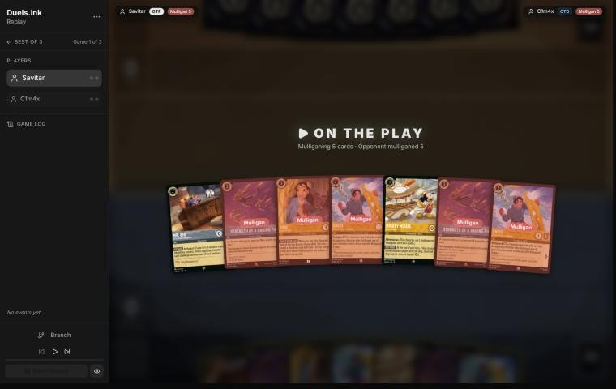
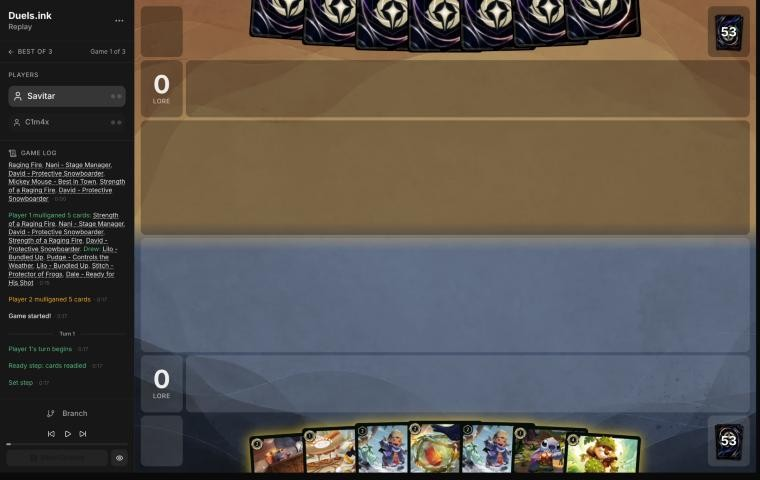
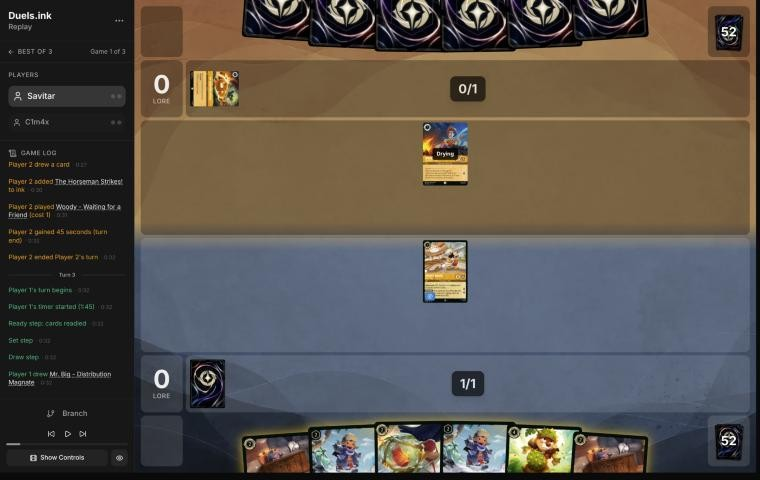
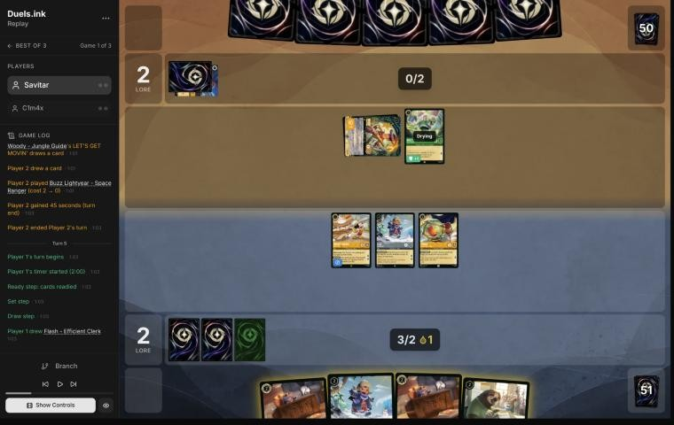
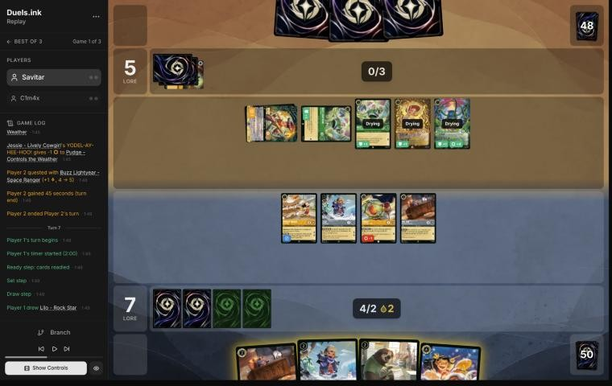
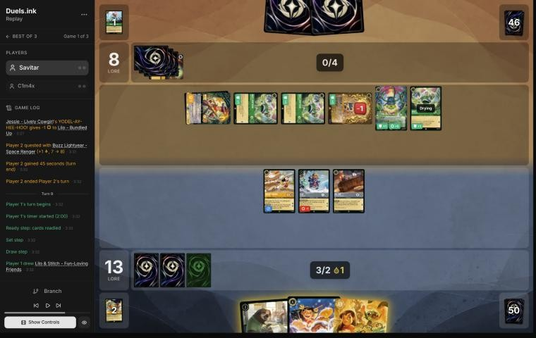

# Review: Savitar vs C1m4x, game 1, 2 Nov 2026

| | |
|---|---|
| **Status** | draft (blind pass done; not discussed, by request) |
| **Replay** | `01a19bf9-b9ff` (`python3 tools/brief.py 01a19bf9-b9ff --turn N`) · [duels.ink viewer](https://duels.ink/replay/01a19bf9-ba0a-71c8-b385-8d4a83e132de?step=0) |
| **Format** | Core Constructed (stated in the replay), best-of-three. Set 14 era: inks revealed before the coin toss |
| **Decks** | You: Amber/Steel Rockstar Aggro, the Lilo list. Them: Emerald/Amber; archetype as it became clear: a Toy Story list duels.ink doesn't group (Woody – Jungle Guide, Buzz, Jessie, Alien), from turn 4 |
| **Play/draw** | You went first |
| **Result** | **Win:** C1m4x conceded on their 5th turn (game turn 10) at 18–11 |
| **Meta data** | snapshot of 26 Oct 2026 (fresh until 9 Nov) |
| **Chosen how** | One of the 5 of Savitar's 12 matches the coach reviewed after studying the other 7 (the split used only pre-game facts; see the TeamAnglerfish game 1 review). The zip held two games of this match, which says nothing of the result |

## Summary
- **Good plays:** the [mulligan](#turn-0) (a deep one the sim backs), [1](#turn-1), [7](#turn-7) (two ICE OUTs on
  their hardest hitters), and [9](#turn-9), the best of the game: Lilo – Rock Star replayed a ready Mr. Big their
  challengers couldn't reach, so they needed two answers to stop the last 2 lore.
- **Close calls:** the ink on [3](#turn-3) (Dale rather than the second Mr. Big).
- **Inaccuracies:** [5](#turn-5): not inking and not adding Flash, who would have been ready to help kill Woody –
  Jungle Guide.
- **Unwinnable from:** never.

**What decided it:** your early lead (7–2 by turn 5) and the Mr. Big locks held their Toy board to one or two
challenges a turn; at 18 with a body they couldn't challenge, they conceded.

## The game, turn by turn
Verdicts judge each decision on what you could know at the time, **including archetype knowledge an experienced
player has**. Hindsight is kept to its own section. Severity scale: good play / close call /
inaccuracy / mistake / blunder. Principle IDs and hypotheses (H-n) link to copies
in the Citations section at the end, as they stood when they were cited.

**What you knew before the game:** their inks, Emerald/Amber: Circle of Life (60%), Princess Aggro (24%) or a list
duels.ink doesn't group (16%). The key cards, as in the TeamAnglerfish reviews: Malicious, Mean, and Scary (3, sung
free from their 2nd turn) and To Wither a Flower (4, sung by Ursula – Vanessa) kill most of your deck between them;
Don Karnage – Debonair Pirate (1 damage to each); Chernabog and Milo Thatch, early with Akood et Emuti; Circle of
Life with Prince Phillip; Max Goof. Princess Aggro: Aurora's discounts, Dale, Elinor, Pocahontas – Peacekeeper.

### Pre-game

*The board before the decision: [step 0](https://duels.ink/replay/01a19bf9-ba0a-71c8-b385-8d4a83e132de?step=0) in the duels.ink replay viewer.*

**What you did:** on the play, kept Mr. Big and Mickey and sent back five: both Strengths of a Raging Fire, Nani and
both Davids.

**Verdict:** good play. `tools/mulligan.py` (800 deals each):

| Option | Ink on turns 1–4 | Play turns (of 4) | Lore by turn 4 | Characters by turn 4 | Interaction by turn 4 |
|---|---|---|---|---|---|
| Keep all 7 | 9.96 | 4.00 | 9.0 | 4.8 | 100% |
| **As played** (keep Mr. Big and Mickey) | 9.27 | 4.00 | 11.1 | 5.6 | 26% |
| Send back one Strength | 9.74 | 4.00 | 9.6 | 5.4 | 100% |
| Send back one Strength and one David | 9.69 | 4.00 | 9.8 | 5.3 | 100% |
| Keep Mr. Big, Nani and Mickey | 9.44 | 4.00 | 10.7 | 5.5 | 24% |
| Full mulligan | 9.24 | 3.82 | 8.0 | 5.3 | 47% |

- **The seven was slow for this deck:** two Strengths, which need a cost-3 singer or 3 ink, and two Bodyguards that
  quest for 1.
- **The deep mulligan led lore by turn 4 by two** over keeping, the measure that matters most on the play for an aggro
  deck. What it gave up is removal for their singers if they're Circle of Life. A Strength kept as an ink-or-answer was
  a reasonable middle option, but the sim shows it costing lore ([MULL-1](#cite-mull-1), [MULL-2](#cite-mull-2)).
  Confidence: medium.

### Turn 1: your turn 1

*The board before the decision: [step 3](https://duels.ink/replay/01a19bf9-ba0a-71c8-b385-8d4a83e132de?step=3) in the duels.ink replay viewer.*

**What you did:** after the mulligan (Lilo – Bundled Up ×2, Pudge, Stitch and Dale arrived), inked Stitch and played
Mickey.

**Verdict:** good play.
- **Mickey quests for 2 from next turn,** twice Stitch's lore, and his ink drops help a hand with two uninkable
  Bundled Ups. They give the opponent a drop too ([the coach's Mickey notes](#cite-kb-cards-mickey-mouse-best-in-town-what-it-means-in-play)), the price of the
  fastest start.
- **Ink check:** Stitch over Mr. Big, Dale or Pudge. Pudge is free once a Bundled Up (a Lilo) is in play, Dale is the
  4-drop, and Mr. Big's ICE OUT needs all your ink exerted; Stitch was the 1-drop worth least here (no Lilo – Snow
  Artist to boost). Next turn: Bundled Up (2) then Pudge free ([INK-2](#cite-ink-2)).

### Turn 2: their turn

**What happened:** Woody – Waiting for a Friend (1, 2/2/1, no abilities); The Horseman Strikes! inked. Neither is in
duels.ink's Amber/Emerald lists: an unlisted list (83%).

### Turn 3: your turn 2

*The board before the decision: [step 9](https://duels.ink/replay/01a19bf9-ba0a-71c8-b385-8d4a83e132de?step=9) in the duels.ink replay viewer.*

**What you did:** drew a second Mr. Big; quested Mickey (2–0); inked Dale; played Lilo – Bundled Up and Pudge free.

**Verdict:** good play on the board, a close call on the ink.
- **Bundled Up then a free Pudge** puts 3 lore of characters down for 2 ink, and Mickey's quest is safe: Woody (2 {S})
  can't kill his 4 willpower.
- **The ink, Dale or a Mr. Big:** with two Mr. Bigs in hand the second is the more expendable card. Dale quests for 2
  on 4 willpower (he survives Malicious plus To Wither a Flower) and his SPIKE SUIT turns Pudge and Mickey into
  challengers; a second ICE OUT locks one more challenger, which matters only once they have several. Ink check:
  either way next turn has 2 ink, Mickey's drop and a new ink for Bundled Up plus Mr. Big; keeping Dale would have
  added a 4-drop for the turn after ([INK-2](#cite-ink-2)). Not worth more than a note.

### Turn 4: their turn

**What happened:** they inked the second Woody – Waiting for a Friend and, with Mickey's ink drop, Shifted **Woody –
Jungle Guide** onto the first (3): each quest draws a card and plays a character costing 2 or less free; their other
Toys get +1 {W}. His quest put Buzz Lightyear – Space Ranger (3/3, 3/4 with Woody) into play free. 2–2.

### Turn 5: your turn 3

*The board before the decision: [step 19](https://duels.ink/replay/01a19bf9-ba0a-71c8-b385-8d4a83e132de?step=19) in the duels.ink replay viewer.*

**What you did:** drew Flash; played Mr. Big; quested Mickey, Lilo – Bundled Up and Pudge (7–2); didn't ink; ICE
OUT kept Buzz from challenging. Two ink drops banked.

**Verdict:** an **inaccuracy**. Playing **only Mr. Big** is suboptimal because it left Flash in hand and an ink unused,
and **inking the second Mr. Big to play Mr. Big and Flash** (3 ink plus Mickey's drop) is better because Flash would
be ready next turn.
- **The engine:** Woody – Jungle Guide draws and plays a free 2-drop each time he quests, so he's the must-kill
  ([QC-2](#cite-qc-2), [THREAT-2](#cite-threat-2)). He has 5 willpower and is exerted after each quest.
- **Next turn's challengers:** with Flash in play, Flash (3), Pudge (1) and Bundled Up (1) deal exactly 5 to an
  exerted Woody. Without her, the most is 2, so the engine survives another turn whatever you draw (Strength of a
  Raging Fire aside).
- **Same lore, same safety:** both lines quest for 5 this turn. All three ink are exerted either way, so ICE OUT still
  stops Buzz. Flash enters ready and can't be challenged; Malicious (about 1 in 4 with their draws) doesn't kill her
  2 willpower alone.
- **Ink:** the second Mr. Big is the spare (two ICE OUTs only matter once they have two real challengers), and
  inking keeps you on curve ([INK-3](#cite-ink-3)).
- Confidence: medium. It turns on Woody questing next turn, which his engine makes likely.

### Turn 6: their turn

**What happened:** Woody quested (5–7) and played a second Buzz free; Jessie – Lively Cowgirl (each card they pay 2
or less for gives one of yours −1 {S}) and Alien – True Believer (+1 {S} for each other Toy: 5 now). A Toy Story
list: five characters with 15 strength between them.

### Turn 7: your turn 4

*The board before the decision: [step 34](https://duels.ink/replay/01a19bf9-ba0a-71c8-b385-8d4a83e132de?step=34) in the duels.ink replay viewer.*

**What you did:** drew Lilo – Rock Star; played the second Mr. Big and the second Lilo – Bundled Up (2 ink and both
drops); quested Mickey, Bundled Up, Pudge and Mr. Big (13–5); didn't ink; ICE OUT on Alien (5 {S}) and a Buzz.

**Verdict:** good play.
- **No kill was available:** only Woody and one Buzz were exerted, and your challengers had 1 strength or less
  (Jessie's −1 on Pudge). So the turn was lore plus protection.
- **Two Mr. Bigs now earn their place:** with five challengers on their side, two ICE OUTs remove their two
  hardest hitters (Alien 5, a Buzz 3). That leaves Woody (1), a Buzz and Jessie (3 each).
- **The race:** at 13, with Mr. Big and Bundled Up arriving ready (safe from challenges), their best defence kills
  Mickey (Buzz plus Woody) and one 1-lore character (Jessie), leaving about 6 lore next turn: 19. The coach's
  alternative (ink Mr. Big, play Flash and Bundled Up, one ICE OUT) comes to the same 19 against their best
  challenges, so neither is better.
- **Not inking** kept Lilo – Rock Star, your only inkable card left, as next turn's Shift (4: two ink and two drops)
  ([INK-3](#cite-ink-3)).

### Turn 8: their turn

**What happened:** Buzz killed a Mr. Big and Jessie killed Pudge; Above the Crowd (5, song: put a character with
3 {S} or less on the bottom of its owner's deck) took the quested Lilo – Bundled Up; Woody quested (8–13) and played a
third Buzz free.

### Turn 9: your turn 5

*The board before the decision: [step 56](https://duels.ink/replay/01a19bf9-ba0a-71c8-b385-8d4a83e132de?step=56) in the duels.ink replay viewer.*

**What you did:** drew Lilo & Stitch; inked it; Shifted Lilo – Rock Star onto the other Bundled Up (3 ink and a
drop); quested Rock Star, whose I'LL COUNT YOU IN replayed Mr. Big from your discard free; quested Mickey and the
other Mr. Big (18–8); ICE OUT on Alien and a Buzz.

**Verdict:** **good play**, better than the coach's plan.
- **The coach's line:** Shift Lilo & Stitch onto Bundled Up instead and quest everything, reaching 19 so that any one
  quest next turn wins. But all three questers would be exerted, and one ICE OUT leaves them five challengers: they
  kill Mickey (Buzz and Woody) and Mr. Big, and a single Above the Crowd (Woody can sing it) takes Lilo & Stitch, whose
  5 willpower and Resist otherwise survive their challenges.
- **Your line stops at 18 but needs 2 from a board they can't clear:**
  - The replayed Mr. Big is ready, so no challenge can reach him: 1 lore next turn unless an action removes him.
  - The second ICE OUT leaves them four challengers.
  - Stopping the other lore means killing Rock Star (two challenges), Mickey (two) and the other Mr. Big (one):
    five challenges with four challengers.

  So they need two answers from hand, not one ([POS-1](#cite-pos-1), [SEQ-4](#cite-seq-4)).
- **Their race:** at 8, questing for about 7, they can't reach 20 next turn, so they have to stop you.

## Lessons
1. **Lilo – Rock Star's replay is a body their challengers can't reach** ([9](#turn-9)): a character played on your
   turn is ready through theirs, so the 1 lore it brings next turn can only be stopped by an action.
2. **Mr. Big's ICE OUT scales with their challengers** ([3](#turn-3), [7](#turn-7)): one lock is enough against one
   threat; against a wide board, two locks on the biggest strengths decide how many of your questers survive.
3. **Get the challenger down a turn early when their engine is on board** ([5](#turn-5)): Woody – Jungle Guide is
   exerted after every quest, and only characters already in play can punish it.

## Knowledge-base updates (applied 2026-11-02, without discussion at danny's request)
- **Meta, Amber/Emerald notes:** C1m4x's Toy Story list.
- **Meta, Amber/Steel notes on your deck:** Lilo – Rock Star's replay brings a ready character, safe from challenges
  (the coach's plan missed it on turn 9).

## Hindsight
Doesn't change the verdicts above.
- They dug with Woody, Jessie and Tod on their last turn and conceded without finding the two answers turn 9 required.

## The coach's errors

| When | Error | How it was caught | How it won't happen again |
|---|---|---|---|
| [Turn 9](#turn-9) | Planned the line that reached 19 with every quester exerted, missing that Rock Star's replay puts a ready, unchallengeable body into play | Your line, seen after the plan | Done (2026-11-02): the Amber/Steel notes on your list say so, and the brief shows them whenever Lilo – Rock Star is in view |

## Open questions
- [Turn 5](#turn-5): was holding the second Mr. Big and Flash deliberate (two ICE OUTs later), or was the ink and the
  drop simply left unused?

## Citations
Copies of the coach's knowledge base cited above, as they stood when they were cited (the private repository's commit and date are given with each). They don't change when the knowledge base does.

<!-- Filled in by `python3 tools/cite.py <this file>`: every principle ID, H-n, "principle N" and CR rule above
becomes a link to an entry here. Add a file or one of its sections with `--file PATH --section TEXT`, and link to
the anchor it prints. Never link into the private repository. -->

**mickey-mouse-best-in-town.md, What it means in play**: knowledge base, `kb/cards/mickey-mouse-best-in-town.md` at `913634d` (2026-11-02), working tree

> ## What it means in play `[coach, from the 27 Oct 2026 meta study]`
> - **The ramp is symmetric:** every turn he quests, the opponent also gets an ink drop. That's worth more to decks with
>   ink-drop payoffs:
>   - **Jousting Match** (Steel action, 3): 2 damage, or **5 if paid with an ink drop**. Mickey supplied an Amethyst/Steel
>     opponent's drops (01a17e37).
>   - Ink-drop decks also run Ink Explosion, Merlin – Profoundly Curious and Marie – Caught in the Act; Shere Khan –
>     Khan Industries CEO makes drops of his own.
>   - An Emerald/Steel opponent spent four of these drops on turn 6 of 01a17ddb.
> - **Adventurous forces him to quest,** so he ends every turn exerted and can be challenged. 0 strength means he trades
>   for nothing; he's often the first challenge target (01a17e9c turn 14, 01a17ddb turn 6).
> - **Against a Steel opponent,** count the drops you're giving them, and what they could pay for with them, before
>   questing with him.
> - **Drops bring Raging Storm early** `[coach, meta study of Savitar's games, 2 Nov 2026]`: Candle Control (Amber/Ruby)
>   cast it on game turn 9, their 5th turn, with 5 ink and 3 drops from both sides' Mickeys (01a19bdb-d8e4). Against an
>   Amber deck, add your Mickey's drops to their ink when you count down to Storm (8).

**MULL-1**: strategy principle, `kb/strategy/principles.md` at `913634d` (2026-11-02), working tree

> - **MULL-1. Keep a plan, not the strongest cards.** *Ask: "Which hand gives me the best chance to execute my game plan in this matchup?"* `[MCL ch.12]` · baseline

**MULL-2**: strategy principle, `kb/strategy/principles.md` at `913634d` (2026-11-02), working tree

> - **MULL-2. A smooth curve beats a few powerful cards.** Check that you can spend ink well on turns 1–4, have enough inkable cards, and know what turn 4 looks like. `[MCL ch.12]` · baseline
>   - **Ink spent isn't the goal by itself.** Judge a keep by a nice curve (a play each turn), early lore pressure, and
>     interaction that sets the opponent back, as well as by ink, then weigh card quality and the matchup
>     (user, 2026-11-01). `tools/mulligan.py` reports all of these.

**INK-2**: strategy principle, `kb/strategy/principles.md` at `913634d` (2026-11-02), working tree

> - **INK-2. Don't automatically ink the most expensive card.** It may be the late-game win condition or the key answer for this matchup. The answer depends on matchup, hand and board. `[MCL ch.4]` · baseline

**QC-2**: strategy principle, `kb/strategy/principles.md` at `913634d` (2026-11-02), working tree

> - **QC-2. Challenge the threat, not the character.** Engines, synergy pieces and big questers are worth fighting over. A 1-lore character doing nothing usually isn't. *Ask: "Does this character actually need to be removed?"* `[MCL ch.6, ch.9]` · baseline

**THREAT-2**: strategy principle, `kb/strategy/principles.md` at `913634d` (2026-11-02), working tree

> - **THREAT-2. Distinguish immediate threats (big lore next turn) from slow engines (card advantage over turns).** Role decides which matters more: the aggressor can often ignore engines, but the defender usually can't. `[MCL ch.9]` · baseline

**INK-3**: strategy principle, `kb/strategy/principles.md` at `913634d` (2026-11-02), working tree

> - **INK-3. Usually ink every turn, but not automatically.** Keeping one more playable card can beat one more ink. Missing ink with an expensive hand can leave you permanently behind. `[MCL ch.4]` · baseline

**POS-1**: strategy principle, `kb/strategy/principles.md` at `913634d` (2026-11-02), working tree

> - **POS-1. From ahead, take the safest path to victory.** Don't overextend into sweepers, don't make unnecessary trades, and make the opponent take the risks. Winning by 1 lore counts the same as winning by 10. `[MCL ch.10]` · baseline

**SEQ-4**: strategy principle, `kb/strategy/principles.md` at `913634d` (2026-11-02), working tree

> - **SEQ-4. Sequence across turns.** A slightly weaker play now can set up a much stronger next turn: keep a shift target alive, keep a singer ready, hold removal for a bigger threat. `[MCL ch.5]` · baseline
