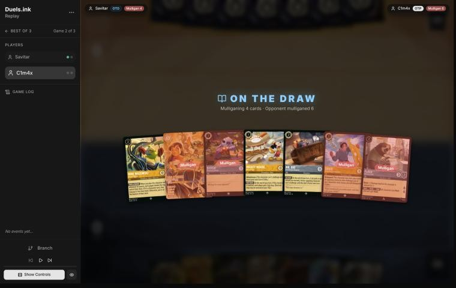
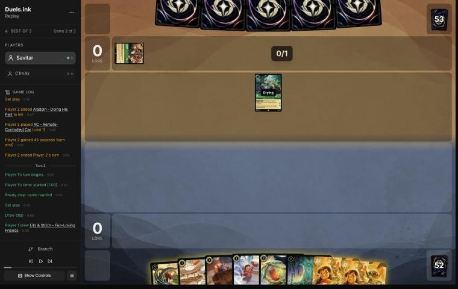
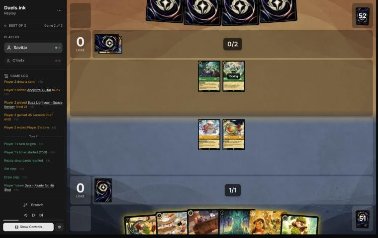
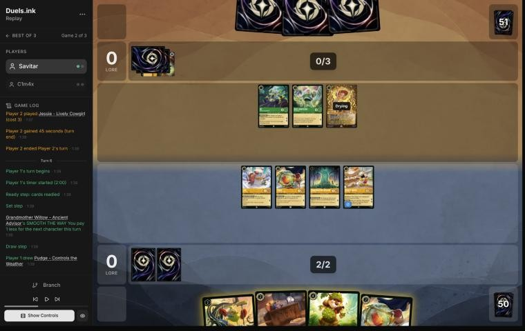
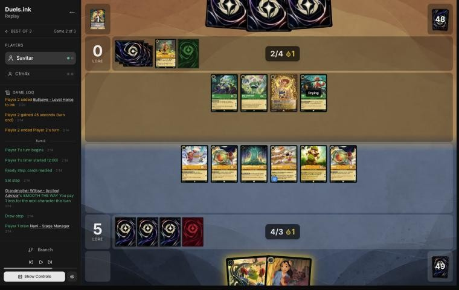

# Review: Savitar vs C1m4x, game 2, 2 Nov 2026

| | |
|---|---|
| **Status** | draft (blind pass done; not discussed, by request) |
| **Replay** | `01a19bfe-7db6` (`python3 tools/brief.py 01a19bfe-7db6 --turn N`) · [duels.ink viewer](https://duels.ink/replay/01a19bfe-7db6-7a79-b1a8-41a2009a471b?step=0) |
| **Format** | Core Constructed (from game 1), best-of-three. Set 14 era: inks revealed before the coin toss |
| **Decks** | You: Amber/Steel Rockstar Aggro, the Lilo list. Them: Emerald/Amber, the Toy Story list from game 1 |
| **Play/draw** | C1m4x went first (they lost game 1, so the choice was theirs); you were on the draw |
| **Result** | **Win:** C1m4x conceded on their 5th turn (game turn 9) at 13–1, so you won the match 2–0 |
| **Meta data** | snapshot of 26 Oct 2026 (fresh until 9 Nov) |
| **Chosen how** | One of the 5 of Savitar's 12 matches the coach reviewed after studying the other 7 (see the TeamAnglerfish game 1 review). The coach reviewed game 1 (a win) first; two games in the zip says nothing of the result |

## Summary
- **Good plays:** [2](#turn-2), [6](#turn-6) (Dale, after which they stopped challenging), and [8](#turn-8): David
  entered exerted as a Bodyguard so that, under SPIKE SUIT, their challengers had to trade into him first.
- **Close calls:** the [mulligan](#turn-0) (a deep one; the seven had a curve too) and the ink on [4](#turn-4)
  (your last Lilo & Stitch rather than Mr. Big).
- **Inaccuracies / mistakes / blunders:** none.
- **Unwinnable from:** never.

**What decided it:** Dale's SPIKE SUIT turned their three 3-strength challengers into losing trades, so they stopped
challenging; your board quested 5 and then 8 unopposed.

## The game, turn by turn
Verdicts judge each decision on what you could know at the time, **including archetype knowledge an experienced
player has**. Hindsight is kept to its own section. Severity scale: good play / close call /
inaccuracy / mistake / blunder. Principle IDs and hypotheses (H-n) link to copies
in the Citations section at the end, as they stood when they were cited.

**What you knew before the game:** game 1. C1m4x's Emerald/Amber Toy Story list: Woody – Waiting for a Friend into
**Woody – Jungle Guide** (Shift 3; each quest draws and plays a 2-or-less character free; other Toys +1 {W}), Buzz
Lightyear – Space Ranger ×3 (3/3), Jessie – Lively Cowgirl (−1 {S} on one of yours for each cheap card they play),
Alien – True Believer (+1 {S} per other Toy), **Above the Crowd** (5, song: a character with 3 {S} or less to the
bottom of its deck; Woody can sing it), The Horseman Strikes!, Aladdin – Doing His Part, Tod, Lenny – Toy Binoculars.
Game 1's lessons: kill Woody – Jungle Guide when he's exerted; Mr. Big's ICE OUT on their biggest challengers; bodies
played on your turn are safe from their challenges.

### Pre-game

*The board before the decision: [step 0](https://duels.ink/replay/01a19bfe-7db6-7a79-b1a8-41a2009a471b?step=0) in the duels.ink replay viewer.*

**What you did:** on the draw, kept Mike Wazowski, Mickey and Mr. Big and sent back four: Lilo & Stitch, Stitch, David
and Flash.

**Verdict:** close call. `tools/mulligan.py` (800 deals each; the coach ran it with your mulligan included rather
than first without it, but the sim's numbers don't depend on that):

| Option | Ink on turns 1–4 | Play turns (of 4) | Lore by turn 4 | Characters by turn 4 | Interaction by turn 4 |
|---|---|---|---|---|---|
| Keep all 7 | 9.73 | 4.00 | 9.2 | 6.1 | 12% |
| **As played** (keep Mike, Mickey, Mr. Big) | 9.68 | 4.00 | 10.8 | 5.8 | 38% |
| Send back Mike | 9.75 | 4.00 | 9.4 | 6.1 | 22% |
| Send back Mike and David | 9.66 | 4.00 | 10.5 | 6.1 | 28% |
| Full mulligan | 9.60 | 3.83 | 8.1 | 5.4 | 54% |

- **The seven had a curve** (Stitch or Mickey, three 2-drops, Lilo & Stitch by Shift onto Stitch on turn 3), and
  the sim's lore by turn 4 only edges ahead with your deep mulligan (10.8 against 9.2–10.5).
- **Against the Toy board,** willpower matters more than in the sim: their 3-strength challengers kill Flash and
  Stitch, while Mike, Mickey and David (Bodyguard) take a hit, and Mr. Big's lock was what held game 1. You kept
  the 4-willpower bodies and the lock; Lilo & Stitch was the strongest card sent back. Both choices are reasonable
  ([MULL-1](#cite-mull-1), [MULL-3](#cite-mull-3)). Confidence: low.

### Turn 1: their turn

**What happened:** RC – Remote-Controlled Car (1, 3/2/2, a Toy; it pays 1 ink to quest or challenge); Aladdin inked.

### Turn 2: your turn 1

*The board before the decision: [step 5](https://duels.ink/replay/01a19bfe-7db6-7a79-b1a8-41a2009a471b?step=5) in the duels.ink replay viewer.*

**What you did:** the mulligan brought Lilo – Snow Artist, Pudge, Willow and two Lilo & Stitch, and you drew a third;
inked one Lilo & Stitch; played Lilo and Pudge free.

**Verdict:** good play. Two characters for 1 ink, both ready (so RC can't reach them), and the ink was one of three
Lilo & Stitches. Ink check: turn 2 has Willow then Mickey for 0, turn 3 a Lilo & Stitch Shifted onto Lilo for 2 with
Willow ([INK-2](#cite-ink-2)).

### Turn 3: their turn

**What happened:** Buzz Lightyear – Space Ranger (3/3); Ancestral Guitar inked.

### Turn 4: your turn 2

*The board before the decision: [step 12](https://duels.ink/replay/01a19bfe-7db6-7a79-b1a8-41a2009a471b?step=12) in the duels.ink replay viewer.*

**What you did:** drew Dale; inked your last Lilo & Stitch; played Willow, then Mickey free; quested nothing.

**Verdict:** good on the plays, a close call on the ink.
- **Not questing** kept Lilo and Pudge ready: next turn RC (paying 1) and Buzz, 3 strength each, would kill either
  one if it were exerted. You gave up 2 lore to keep two bodies and Lilo as a Shift base (Lilo – Rock Star). Against a
  challenger deck that only develops, that's reasonable ([RULE-1](#cite-rule-1)).
- **The ink:** Lilo & Stitch, Mr. Big or Dale. Lilo & Stitch Shifted onto Lilo next turn costs 2 with Willow and is the
  best threat against 3-strength challengers: 5 willpower and Resist take two challenges to kill. Mr. Big is the most
  expendable card here, though his ICE OUT also helps against challengers; Dale's SPIKE SUIT lets Pudge and Mike kill
  Buzz in a challenge. Ink check: inking Mr. Big leaves next turn Lilo & Stitch (2) plus Mike (2) with 3 ink and
  Willow, against your line's Dale (3) or Mr. Big plus Mike. Keeping the best threat was slightly better
  ([INK-2](#cite-ink-2)). Confidence: low.

### Turn 5: their turn

**What happened:** Jessie – Lively Cowgirl; The Horseman Strikes! inked. RC, Buzz and Jessie: three 3-strength
challengers, no lore yet.

### Turn 6: your turn 3

*The board before the decision: [step 19](https://duels.ink/replay/01a19bfe-7db6-7a79-b1a8-41a2009a471b?step=19) in the duels.ink replay viewer.*

**What you did:** drew a Pudge; inked Mr. Big; played Dale for 3 with Willow and the second Pudge free; quested Lilo,
Pudge, Willow and Mickey (5–0).

**Verdict:** **good play**, the coach's line.
- **Dale makes their challenges bad for them.** SPIKE SUIT works in every challenge your characters are in, defending
  too ([the coach's Dale notes](#cite-kb-cards-dale-ready-for-his-shot-what-it-means-in-play)).
  - A 3/3 that challenges Pudge dies with him.
  - One that challenges Mickey takes 4 and dies, while Mickey (4 willpower) survives.
  - Only Willow dies alone (2 willpower against 3).
- **Dale and the new Pudge enter ready,** so neither can be challenged, and SPIKE SUIT stays on next turn.
- **Questing all four** (Mickey had to) turned their three challengers from a threat into trades they lose. 5–0.

### Turn 7: their turn

**What happened:** no challenges and no quests: Tod drew two and discarded Woody – Jungle Guide; Bullseye – Loyal
Horse (4/3) inked. Dale's SPIKE SUIT had turned each of their challenges into a losing trade. 5–0.

### Turn 8: your turn 4

*The board before the decision: [step 31](https://duels.ink/replay/01a19bfe-7db6-7a79-b1a8-41a2009a471b?step=31) in the duels.ink replay viewer.*

**What you did:** played Nani for 2 with Willow (she found David); played David exerted as a Bodyguard; quested all
six (13–0). Mike stayed in hand.

**Verdict:** **good play**, better than the coach's plan.
- **Questing everything was right:** at 13 you need 7 next turn. With Dale alive, each of their 3-strength
  challengers dies to the character it hits.
- **David entering exerted** is what a Bodyguard is for ([RULE-5](#cite-rule-5)). Their challengers must hit him
  first, and with SPIKE SUIT he deals 4 back. Two of them die to kill one 2-drop, and Dale is shielded behind him.
  - The coach had planned Mike instead (also 4 willpower), who would have left Dale as their first target: two
    challenges kill Dale and end SPIKE SUIT for the rest of the turn.
- **What survives:** with RC, Buzz, Jessie and Tod (1) as their challengers, the board left for next turn still quests
  for 7 or more.

## Lessons
1. **Dale shuts down a board of 3-strength challengers** ([6](#turn-6)): with SPIKE SUIT your 3- and 4-willpower
   characters kill whatever challenges them, so they stop challenging and you quest freely.
2. **A Bodyguard that enters exerted shields your key piece** ([8](#turn-8)): it must be challenged first, and under
   SPIKE SUIT it takes challengers with it.
3. **Hold back what you'll need as a Shift base** ([4](#turn-4)): Lilo stayed ready while their challengers were
   live; with that done, keep the Shift card too.

## Knowledge-base updates (applied 2026-11-02, without discussion at danny's request)
- **Meta, Amber/Emerald notes:** game 2's Toy Story cards (RC – Remote-Controlled Car, Ancestral Guitar, Bullseye)
  and how Dale stopped their challenges.

## Hindsight
Doesn't change the verdicts above.
- They never challenged after Dale landed and conceded on their 5th turn.

## The coach's errors

| When | Error | How it was caught | How it won't happen again |
|---|---|---|---|
| [Pre-game](#turn-0) | Ran `tools/mulligan.py` with your mulligan included first, instead of planning with `--plan` | The coach, while writing the verdict | No effect on the numbers; the review skill already orders it, so this is noted rather than fixed |
| [Turn 8](#turn-8) | Planned Mike over David, leaving Dale as their first challenge target | Your line, seen after the plan | Done (2026-11-02): the Amber/Steel notes on your list say to play David exerted in front of Dale |

## Open questions
- [Turn 4](#turn-4): why ink the last Lilo & Stitch over Mr. Big, when Lilo was being kept ready as its Shift base?

## Citations
Copies of the coach's knowledge base cited above, as they stood when they were cited (the private repository's commit and date are given with each). They don't change when the knowledge base does.

<!-- Filled in by `python3 tools/cite.py <this file>`: every principle ID, H-n, "principle N" and CR rule above
becomes a link to an entry here. Add a file or one of its sections with `--file PATH --section TEXT`, and link to
the anchor it prints. Never link into the private repository. -->

**dale-ready-for-his-shot.md, What it means in play**: knowledge base, `kb/cards/dale-ready-for-his-shot.md` at `d570b1e` (2026-11-02), working tree

> ## What it means in play `[coach + user, one match: 01a19bb9 and 01a19bbd-79c2]`
> - **It turns their weakest-looking characters into killers.** These aggro lists run 0- and 1-strength characters with
>   high willpower: Mike Wazowski – Heroic Climber (0/4), Thomas – Wide-Eyed Recruit (0/4), David – Protective
>   Snowboarder (1/4). With Dale in play, each deals 4 in a challenge, enough to kill most cheap characters.
> - **It works both ways.** "During challenges" covers your challenges too, so challenging their Mike costs your
>   attacker 4 damage. The brief's challenge figures include SPIKE SUIT whenever it's in play.
> - **Their Challenger and strength pumps stop mattering while it's in play,** since damage comes from {W}.
> - **He can come a turn early.** Cost reducers make him castable with 3 ink: Pluto – Friendly Pooch's GOOD DOG ({E}: next
>   character 1 cheaper) in 01a19bbd-79c2 turn 5. The brief's "COST REDUCERS" line shows this.
> - **Judge exposure before he's in play.** From the turn they could cast him, every character you exert with 4 or
>   less willpower is exposed to their 0-strength characters. In 01a19bbd-79c2 turn 4 the coach called a 0-strength board
>   harmless; the user caught it.
> - **Removing him:** he has 0 {S} and 4 {W}, and deals 4 back if challenged. A Detectives deck can push his strength to
>   5 with Support (Support may target an opposing character, `kb/rules/rulings.md`) and banish him with Gaston –
>   Superior Archer's WATCH THIS or Judy Hopps – Always Vigilant's GOT YOU NOW (01a19bbd-79c2 turn 8). Remove him before
>   making other challenges.

**MULL-1**: strategy principle, `kb/strategy/principles.md` at `d570b1e` (2026-11-02), working tree

> - **MULL-1. Keep a plan, not the strongest cards.** *Ask: "Which hand gives me the best chance to execute my game plan in this matchup?"* `[MCL ch.12]` · baseline

**MULL-3**: strategy principle, `kb/strategy/principles.md` at `d570b1e` (2026-11-02), working tree

> - **MULL-3. The right keep depends on the matchup.** Early interaction against aggro; pressure, draw and engines against slow decks. The mulligan is the first expression of your role. In the Set 14 era the opponent's inks are known before the mulligan (RULE-8), so this applies from game 1 of a match. `[MCL ch.12]` · baseline

**INK-2**: strategy principle, `kb/strategy/principles.md` at `d570b1e` (2026-11-02), working tree

> - **INK-2. Don't automatically ink the most expensive card.** It may be the late-game win condition or the key answer for this matchup. The answer depends on matchup, hand and board. `[MCL ch.4]` · baseline

**RULE-1**: strategy principle, `kb/strategy/principles.md` at `d570b1e` (2026-11-02), working tree

> - **RULE-1. Only exerted characters can be challenged** `[CR 4.6.4.2]`. Questing, singing, or {E} for an ability exposes the character. Staying ready protects it. Every quest is also a decision about what the opponent can challenge next turn. · baseline
>   - *Card text overrides this* (CR 1.2.1). Shere Khan – Khan Industries CEO's NEW INCENTIVE lets one character
>     challenge ready characters that turn. Alert (e.g. from Judy Hopps – Lead Detective, to every Detective on their
>     turn) ignores Evasive. Against Ducktectives, name both in the setup. 01a14574, turns 16 and 18. `[coach, 2026-10-26]`

**RULE-5**: strategy principle, `kb/strategy/principles.md` at `d570b1e` (2026-11-02), working tree

> - **RULE-5. A ready Bodyguard protects nothing** `[CR 8.3]`. Its value is entering play exerted to force challenges onto itself. · baseline
