# Review: MK_ifoughtthelore vs VH INK, game 1, 2 Nov 2026

| | |
|---|---|
| **Status** | draft (blind pass done, not yet discussed) |
| **Replay** | `01a19c00-6914` (`python3 tools/brief.py 01a19c00 --turn N`) · [duels.ink viewer](https://duels.ink/replay/01a19c00-6923-77d6-97be-6094a163184d?step=0) |
| **Format** | Core Constructed (stated in the replay), best-of-three. Set 14 era: inks revealed before the coin toss |
| **Decks** | You: Amber/Sapphire Detectives (the list from your match against xBWx). Them: Amethyst/Ruby; archetype as it became clear: the tempo-midrange list duels.ink calls **Unnamed #1** (66% from turn 4, 98% by turn 10), with Red Alert and Ursula – Whisper of Vanessa from other lists |
| **Play/draw** | They went first |
| **Result** | **Loss.** You conceded on turn 24 at 1–17 (game 1 of a best-of-three) |
| **Meta data** | snapshot of 26 Oct 2026 (fresh until 9 Nov) |
| **Chosen how** | Sent by danny, the coach's user: a match of MK_ifoughtthelore's, reviewed for them, game by game. The match file shows three games, so the coach knew games 1 and 2 were split, but not which way; the results weren't read before the blind pass |

## Summary
- **Good plays:** turns [4](#turn-4), [6](#turn-6), [8](#turn-8), [10](#turn-10) and [12](#turn-12), and
  [turn 16](#turn-16), the best of the game: the Horseman's draw found Always Vigilant, which banished Demona.
- **Close calls:** the [pre-game](#turn-0) (sending back Lead Detective, who could Shift onto On the Case on turn 4).
- **Inaccuracies:** [turn 14](#turn-14) (a second 3-willpower body into Wasabi's double kill; The Horseman Strikes! on
  Peter Pan's Shadow first was better).
- **Unwinnable from:** [turn 16](#turn-16): 0–9 with no board, against characters questing for 5 a turn.

**What decided it:** Demona – Scourge of the Wyvern Clan on [turn 11](#turn-11). It exerted all five of your
characters, and their challengers plus Wasabi's TWIN BLADES killed all of them. You had held back correctly; Demona
was about a 15% chance that turn. On [turn 15](#turn-15) a Shadow exert and TWIN BLADES took the rebuilt board too.

## The game, turn by turn
Verdicts judge each decision on what you could know at the time, **including archetype knowledge an experienced
player has**. Hindsight is kept to its own section. Severity scale: good play / close call /
inaccuracy / mistake / blunder. Principle IDs and hypotheses (H-n) link to copies
in the Citations section at the end, as they stood when they were cited.

**What you knew before the game:** their inks, Amethyst/Ruby. duels.ink groups only half of that pair's games: an
unlisted list 48%, "Unnamed #1" 25%, "Unnamed #2" 11%, Incredibles Tempo 8%. The listed ones share a tempo-midrange
core (close to danny's own Amethyst/Ruby deck). Its key cards, read in full:
- **Exerting your characters, so they can be challenged without questing:** Isis Vanderchill – Ice Queen of St.
  Canard (4, uninkable: exerts one on play), Peter Pan's Shadow – Elusive Prankster (3, Evasive: may exert one on play),
  and Demona – Scourge of the Wyvern Clan (6: exerts **all** of yours on play, then each player with fewer than 3 cards
  draws to 3). Staying ready doesn't protect your board once they have 4 ink.
- **Challengers:** Rafiki – Mystical Fighter (1, 0/2, Challenger +3), Luisa Madrigal – Pushing Through (1, 0/3,
  Challenger +2), Pepita – Watchful Alebrije (2, Challenger +2), Jebidiah Farnsworth – Cookie (2, 3/3, Evasive,
  Reckless).
- **Combat tricks:** Mulan – Martial Arts Master (4: +2 {S} and a draw per challenge for a chosen character on play;
  Rush for a chosen character whenever she quests), Medallion Weights (2-cost item: {E}, 2 {I}: +2 {S}).
- **Removal:** Hades – Looking for a Deal (5: you bottom a chosen character or they draw 2); Mulan – Elite Archer
  (Shift 5: TRIPLE SHOT spreads challenge damage to two more characters); Wasabi – Called into Battle (5: TWIN BLADES);
  Cheshire Cat – Inexplicable (3: Boost 2 moves 2 damage counters onto your character). No sweeper in the listed
  lists.
- **Card flow:** Dumbo – Ninth Wonder of the Universe (4, Evasive: {E}, 1 {I}: draw and 1 lore, for each Evasive).
- **Evasive threats** (Dumbo, Jebidiah, Shadow) can be challenged by your Detectives once Judy Hopps – Lead
  Detective gives them Alert.

Your deck's own notes (the receiving side of [the coach's Detectives notes](#cite-kb-meta-archetypes-amber-sapphire-detectives-how-it-plays)):
go wide with cheap Detectives, push opposing characters to 5 {S} with Support, then banish them with Gaston –
Superior Archer or Judy Hopps – Always Vigilant.

### Pre-game

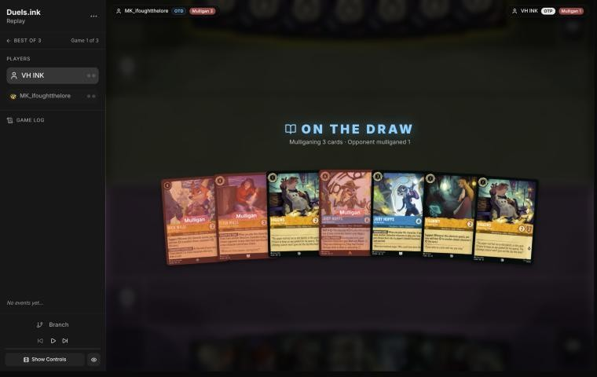
*The board before the decision: [step 0](https://duels.ink/replay/01a19c00-6923-77d6-97be-6094a163184d?step=0) in the duels.ink replay viewer.* Your opening hand; the cards marked "Mulligan" went back.

**What you did:** On the draw. Kept Higgins ×2, Eilonwy and Judy Hopps – On the Case; sent back Nick Wilde – Toy
Drive Officer, Elisa Maza and Judy Hopps – Lead Detective.

**Verdict:** **Close call.** The seven already had a curve: three 1-drops, On the Case at 3 and Lead Detective as a
Shift 4 onto her on turn 4. By the sim (`mulligan.py`, 1,500 deals), your keep of 4 matched keeping all 7 on curve
(3.97 vs 3.99 play turns of 4) and slightly beat it on lore and characters by turn 4 (8.4 vs 8.2; 5.7 vs 5.3), but
spent less ink (9.50 vs 9.92). The coach would have kept Lead Detective, and probably sent back only the uninkable
Nick (keep 6: 9.81 ink, 8.3 lore): against a deck of Evasive threats and Challenger 1-drops, her Alert and Resist +2
are the card that turns the board, and the On the Case Shift line had her ready on turn 4. Sending back Elisa Maza
costs little: their lists run few non-character cards for her to take. Confidence: medium; the sim can't weigh Lead
Detective's quality.

### Turn 2: your turn 1

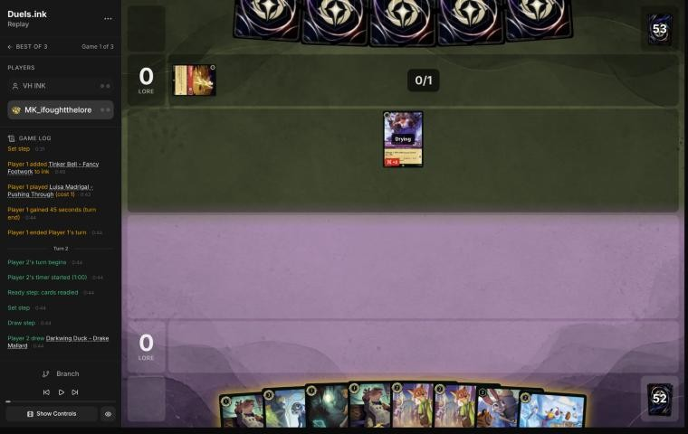
*The board before the decision: [step 6](https://duels.ink/replay/01a19c00-6923-77d6-97be-6094a163184d?step=6) in the duels.ink replay viewer.*

**What you did:** Inked Higgins, played Eilonwy

**Verdict:** **Good.** A 1-drop on turn 1 with an inkable spare. Playing Higgins first would have made Nick Wilde –
Providing Backup's Support live a turn sooner (it needs another Detective), but the hand had enough Detectives
either way.

### Turn 4: your turn 2

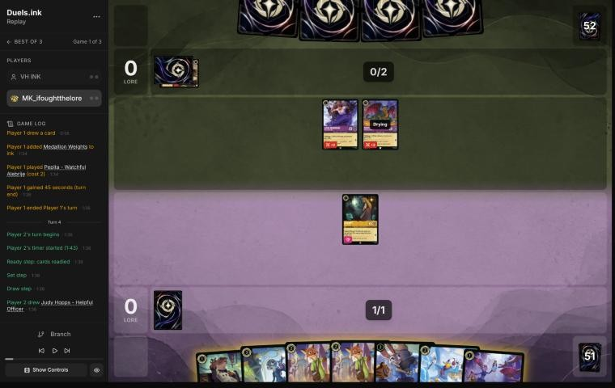
*The board before the decision: [step 12](https://duels.ink/replay/01a19c00-6923-77d6-97be-6094a163184d?step=12) in the duels.ink replay viewer.*

**What you did:** Inked Judy Hopps – Helpful Officer; played Nick Wilde – Providing Backup (after undoing Darkwing
Duck); Eilonwy stayed ready

**Verdict:** **Good play.** The coach would have played Higgins and Helpful Officer for two bodies, but your line was
better: keeping Higgins in hand set up next turn's Higgins plus Judy Hopps – Day Camp Instructor, whose LEND A PAW
ramp needs another character played the same turn. Keeping Eilonwy ready was right: Luisa Madrigal – Pushing Through
(Challenger +2) and Pepita – Watchful Alebrije (Challenger +2, dry next turn) would kill an exerted 1-willpower
Eilonwy for free ([RULE-1](#cite-rule-1)).

### Turn 6: your turn 3

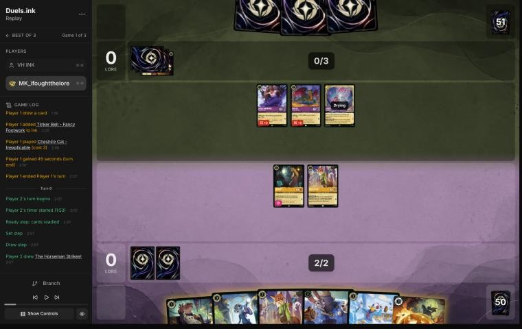
*The board before the decision: [step 20](https://duels.ink/replay/01a19c00-6923-77d6-97be-6094a163184d?step=20) in the duels.ink replay viewer.*

**What you did:** Inked Judy Hopps – On the Case; played Higgins, then Day Camp Instructor (LEND A PAW ramped an
ink); nobody quested

**Verdict:** **Good play,** the coach's line. The ramp gives 5 ink on your next turn, and not questing kept Eilonwy
and Nick away from three challengers (Luisa and Pepita with Challenger +2, Cheshire Cat – Inexplicable next turn).
The coach would have inked the second Nick rather than On the Case, to keep a Judy as a Shift base for Always
Vigilant or Lead Detective; with no item of theirs in play, On the Case's HIDDEN CLUES had nothing to hit, so it's
close. **Ahead of you:** at 6 ink, Demona – Scourge of the Wyvern Clan exerts your whole board for their challengers
(their 6th turn), and at 4 Isis exerts one; sitting back doesn't protect the board for long.

### Turn 7: their turn

**What happened:** They inked Hades – Looking for a Deal and cast Red Alert (banish a character with 3 {S} or less)
on Day Camp Instructor. Still no quests on either side (0–0).

### Turn 8: your turn 4

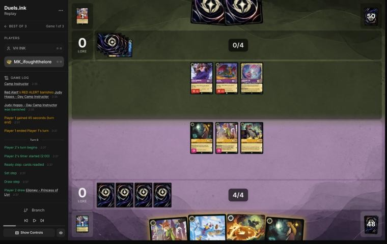
*The board before the decision: [step 29](https://duels.ink/replay/01a19c00-6923-77d6-97be-6094a163184d?step=29) in the duels.ink replay viewer.*

**What you did:** Inked the second Eilonwy; played Darkwing Duck – Drake Mallard and the second Nick Wilde –
Providing Backup; nobody quested

**Verdict:** **Good play,** the coach's line. Keeping The Horseman Strikes! for their Evasive characters (their likely
list runs a dozen: Dumbo, Jebidiah, Peter Pan's Shadow) and inking the 1-willpower Eilonwy was the right spare.
Questing would have handed their three ready challengers free kills: every one of your characters had 2 or less
willpower except Darkwing, who has 1.

### Turn 9: their turn

**What happened:** They inked a second Hades and played Wasabi – Called into Battle (4/5/2). TWIN BLADES: on their
turn, whenever Wasabi deals damage in a challenge, he deals 4 more to another chosen character, exerted or not.

### Turn 10: your turn 5

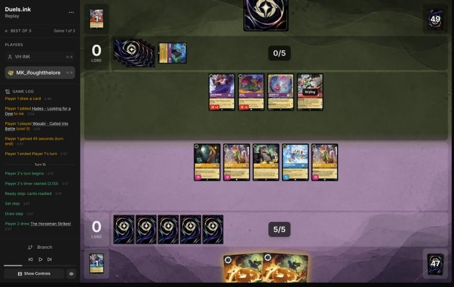
*The board before the decision: [step 36](https://duels.ink/replay/01a19c00-6923-77d6-97be-6094a163184d?step=36) in the duels.ink replay viewer.*

**What you did:** Cast The Horseman Strikes! for its draw (no Evasive target), then inked the card it drew (Eilonwy);
kept the second Horseman; nobody quested

**Verdict:** **Good play,** and the coach's line, including the order: drawing before choosing the ink ([SEQ-1](#cite-seq-1)).
Not questing was right. Any exerted character let Wasabi challenge, and TWIN BLADES then kills a second character, so
one quest could cost two; with Luisa, Pepita and Cheshire also ready, questing all five for 5 lore would have lost the
board. Holding still lost it to Demona – Scourge of the Wyvern Clan (exerts all your characters), but that needed
Demona in their hand of 1 plus their draw: about 15% (`odds.py hold`, 4 copies in 2 cards from 50). Counting Isis
and Peter Pan's Shadow, which exert one character each (enough for Wasabi's double), about 43%. In the other branches,
holding kept everything. Nothing else in hand could change the board: no challenge targets (all their characters were
ready) and only Horsemen in hand.

### Turn 11: their turn

**What happened:** Demona – Scourge of the Wyvern Clan (6) exerted your whole board, and both players drew up to 3
(you drew two Judy Hopps – Uncovering Clues). Then Wasabi killed one Nick and TWIN BLADES the other, Luisa traded
with Darkwing, Pepita killed Higgins and Cheshire killed Eilonwy. Your board is empty; theirs is Pepita (2 damage),
Cheshire (2 damage), Wasabi (3 damage) and Demona. Still 0–0.

### Turn 12: your turn 6

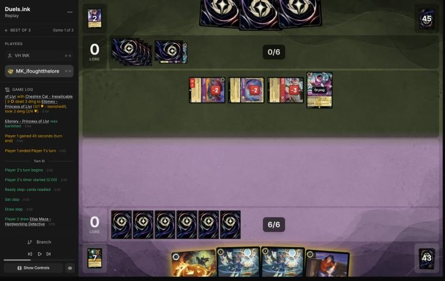
*The board before the decision: [step 54](https://duels.ink/replay/01a19c00-6923-77d6-97be-6094a163184d?step=54) in the duels.ink replay viewer.*

**What you did:** Judy Hopps – Uncovering Clues (THOROUGH INVESTIGATION found Nick Wilde – Providing Backup); inked
Elisa Maza; played Nick, then undid it; kept Nick and The Horseman Strikes! in hand, leaving 3 ink unused

**Verdict:** **Good play.** With an empty board and 7 ink, Uncovering Clues first was right: a body and a look at three
cards before choosing the ink ([SEQ-1](#cite-seq-1)). Holding Nick back was the non-obvious part. All three of their
non-Demona characters carried damage, so Cheshire Cat's Boost (2 ink) could move 2 counters onto a 2-willpower Nick and
kill him while healing one of theirs ([the coach's Cheshire note](#cite-kb-cards-cheshire-cat-inexplicable)); in hand,
he's ready to come down when the damage is gone. Keeping the Horseman for their Evasive characters (none seen yet,
a dozen in the list, Dumbo – Ninth Wonder the engine) over a 3-ink draw is a close call.

### Turn 13: their turn

**What happened:** Peter Pan's Shadow exerted Uncovering Clues, Cheshire's Boost moved Pepita's 2 damage onto her, and
Pepita traded with her. They inked Dumbo – Ninth Wonder of the Universe and quested with Cheshire, Wasabi and Demona
(0–5).

### Turn 14: your turn 7

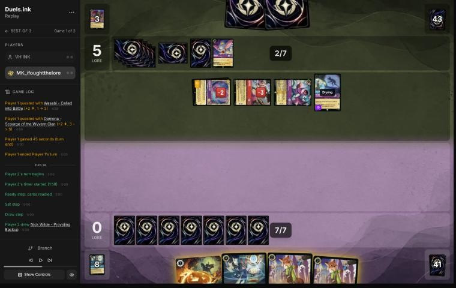
*The board before the decision: [step 75](https://duels.ink/replay/01a19c00-6923-77d6-97be-6094a163184d?step=75) in the duels.ink replay viewer.*

**What you did:** Uncovering Clues (found Judy Hopps – On the Case); inked a Nick; played On the Case (declined
HIDDEN CLUES: no item to hit); kept The Horseman Strikes! and a Nick

**Verdict:** **Inaccuracy (small).** Playing **On the Case as a second body** is suboptimal because Wasabi turns one
exert into two kills. Their exerters (Peter Pan's Shadow, Isis, Demona) were about 50% to be in their 2 cards plus
their draw (`odds.py hold`, 9 copies in 3 cards from 45); then one exert lets Wasabi challenge one 3-willpower Judy and
TWIN BLADES kills the other. Casting **The Horseman Strikes! on Peter Pan's Shadow** first, then Uncovering Clues, is
better because it removes a quester (their clock drops from 6 a turn to 5) and a future partner for their Dumbo,
draws a card, and leaves a single body, so TWIN BLADES has no second target. The cost is the Horseman you were saving
for Dumbo, whose copies are still to come. With them at 5 lore and questing for 6, tempo now mattered more
([TEMPO-5](#cite-tempo-5)). Confidence: low to medium; a second body also threatens their damaged questers if no
exerter comes.

### Turn 15: their turn

**What happened:** A second Shadow exerted Uncovering Clues; Wasabi traded with her, and TWIN BLADES killed On the
Case. Cheshire, Demona and the first Shadow quested (0–9).

**Turns 16 to 24 below were written after the coach had read the rest of the game's log** (see
[the coach's errors](#coachs-errors)). Each is argued from that turn's brief only. From turn 16 the game is
unwinnable: at 0–9 with no board, against characters questing for 5 a turn (20 by turn 21 if they keep questing),
no line gets you to 20 first ([principle 2](#cite-principle-2)). So these turns get comments, not severities.

### Turn 16: your turn 8

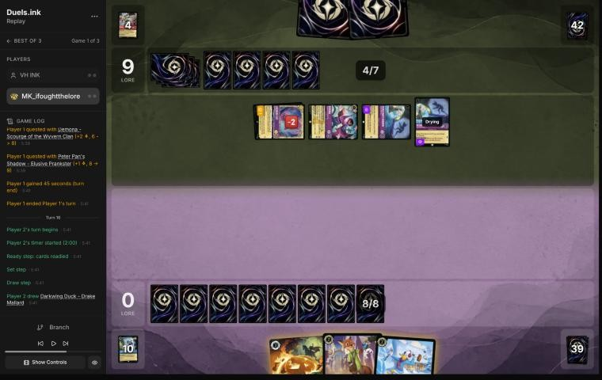
*The board before the decision: [step 91](https://duels.ink/replay/01a19c00-6923-77d6-97be-6094a163184d?step=91) in the duels.ink replay viewer.*

**What you did:** The Horseman Strikes! banished the exerted Peter Pan's Shadow and drew Judy Hopps – Always
Vigilant; inked Nick; played Darkwing, then Always Vigilant, whose GOT YOU NOW banished Demona

**Verdict:** **Unwinnable, but the best turn of the game.** The order was exact: the Horseman's draw first, then
Darkwing so that GOT YOU NOW had "another character played this turn", then Always Vigilant on Demona's 5 {S}
([the coach's removal profile](#cite-kb-meta-archetypes-amber-sapphire-removal-profile) lists Demona as exposed to
it). Inking the 2-willpower Nick and keeping Darkwing was also right: Ward stops both Cheshire's damage move and
Wasabi's TWIN BLADES from choosing him. Their questers went from 5 lore a turn to 2.

### Turn 17: their turn

**What happened:** A second Wasabi; they inked Dumbo – The Flying Elephant and didn't quest.

### Turn 18: your turn 9

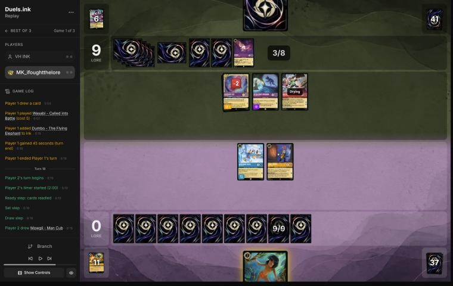
*The board before the decision: [step 102](https://duels.ink/replay/01a19c00-6923-77d6-97be-6094a163184d?step=102) in the duels.ink replay viewer.*

**What you did:** Mowgli – Man Cub (their one card was a character, so nothing was discarded); nobody quested

**Verdict:** **Unwinnable.** Not questing was right: the second Wasabi would be dry next turn, and an exerted Always
Vigilant would die to him, with TWIN BLADES on Mowgli. Mowgli himself (2 willpower) was a target for Cheshire's
damage move while Cheshire carried 2 damage, but with nothing else in hand, the look at their hand was worth the card.

### Turn 19: their turn

**What happened:** Cheshire's Boost moved its own 2 damage onto Mowgli, banishing him; Tinker Bell – Fancy Footwork.
No quests.

### Turn 20: your turn 10

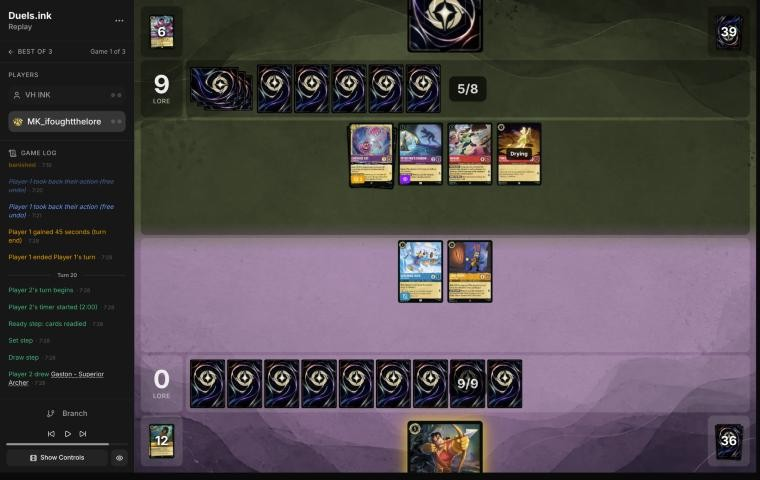
*The board before the decision: [step 120](https://duels.ink/replay/01a19c00-6923-77d6-97be-6094a163184d?step=120) in the duels.ink replay viewer.*

**What you did:** Quested with Always Vigilant (1–9); kept Gaston – Superior Archer in hand

**Verdict:** **Unwinnable; a fair try.** From 0–9, questing is the only way to the 20 ([POS-2](#cite-pos-2)). The
quest exposed Always Vigilant (4 willpower) to Wasabi (4 {S}), but holding Gaston meant your only other character was
Darkwing, whom Ward protects: TWIN BLADES isn't optional ("deal damage … to another chosen character"), so after a
Wasabi challenge its 4 damage had to land on one of their own characters. Wasabi would also be exerted and damaged
for Darkwing to finish.

### Turn 21: their turn

**What happened:** Tinker Bell and Shadow quested (1–11). Wasabi challenged Always Vigilant (both took 4: she was
banished, he has 1 willpower left), and TWIN BLADES had to hit their own Tinker Bell. A third Wasabi came down.

### Turn 22: your turn 11

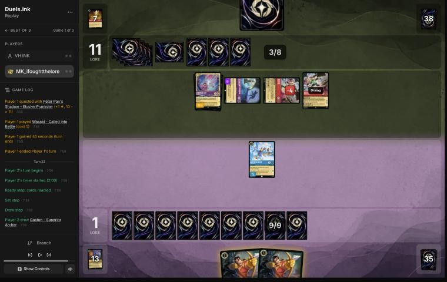
*The board before the decision: [step 128](https://duels.ink/replay/01a19c00-6923-77d6-97be-6094a163184d?step=128) in the duels.ink replay viewer.*

**What you did:** Played Gaston – Superior Archer (WATCH THIS had no 5-strength target); Darkwing stayed home

**Verdict:** **Unwinnable.** Darkwing challenging the exerted Wasabi (1 willpower left) would have traded your 2-drop
for their 2-lore TWIN BLADES engine, the follow-up the turn-20 quest had set up. It wouldn't have changed the result:
their board still quested for 4 a turn from 11 lore.

### Turn 23: their turn

**What happened:** Ursula – Whisper of Vanessa (Boost), and four quests to 17.

### Turn 24: your turn 12

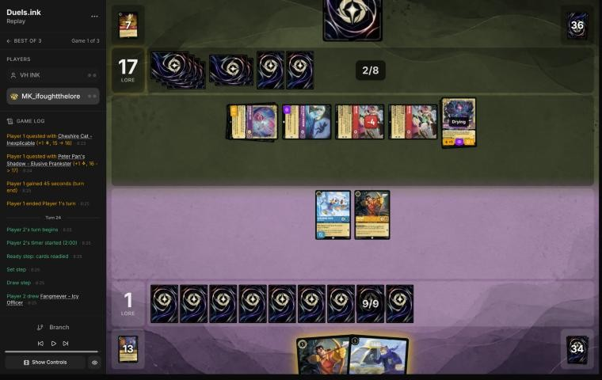
*The board before the decision: [step 137](https://duels.ink/replay/01a19c00-6923-77d6-97be-6094a163184d?step=137) in the duels.ink replay viewer.*

**What you did:** Fangmeyer – Icy Officer returned Uncovering Clues to hand; then you conceded at 1–17

**Verdict:** **Unwinnable.** Conceding was reasonable: their board quested for 6 against 3 lore needed.

## Lessons
1. **Wasabi – Called into Battle turns one exert into two kills.** An exert effect (Peter Pan's Shadow, Isis, Demona –
   Scourge) gives him a challenge, and TWIN BLADES then deals 4 to another chosen character, ready or not; the same
   pattern is in [the coach's Incredibles notes](#cite-kb-meta-archetypes-ruby-steel-incredibles-how-it-plays). While
   he's in play, add bodies with 3 or less willpower one at a time ([turn 14](#turn-14)), and lean on Ward: Darkwing
   can't be chosen by TWIN BLADES, Shadow or Isis ([the coach's Ducktectives notes](#cite-kb-meta-archetypes-sapphire-steel-how-it-plays)).
2. **TWIN BLADES isn't optional.** With no "may", its damage must go somewhere: if your only other characters have
   Ward, it has to hit one of theirs ([turns 20 and 21](#turn-20); a ruling is proposed below).
3. **Their removal is tricks, not sweepers:** Shadow exerts one of yours, Cheshire's Boost moves 2 damage onto it, and
   a challenge finishes it (turn 13, as in [the coach's Amethyst/Steel notes](#cite-kb-meta-archetypes-amethyst-steel-midrange-how-it-plays)).
   Cheshire also kills any 2-willpower character while damage sits on the board
   ([the coach's Cheshire note](#cite-kb-cards-cheshire-cat-inexplicable); [turn 12](#turn-12)).
4. **Demona – Scourge's 5 {S} puts her in range of Always Vigilant and Gaston**
   ([the coach's removal profile](#cite-kb-meta-archetypes-amber-sapphire-removal-profile); [turn 16](#turn-16)). Her
   exert-all doesn't choose, so Ward doesn't stop it.

## Proposed knowledge-base updates (applied after discussion)
- **Meta (Amethyst/Ruby notes, Unnamed #1):** this list and its swing turn. Seen: Luisa Madrigal – Pushing Through,
  Pepita – Watchful Alebrije, Cheshire Cat – Inexplicable, Peter Pan's Shadow ×2, Wasabi ×3, Demona – Scourge ×2,
  Hades ×2 (both inked), Dumbo – Ninth Wonder and Dumbo – The Flying Elephant (inked), Tinker Bell – Fancy Footwork ×3,
  Medallion Weights, Red Alert, Ursula – Whisper of Vanessa. **Swing turn:** Demona at 6 ink exerts your whole board,
  then their Challenger characters and Wasabi's TWIN BLADES clear it (turn 11: five characters). They held back their
  questers for most of the game and quested only when your board couldn't punish it.
- **Rules (a new ruling):** Wasabi – Called into Battle's TWIN BLADES is mandatory ([CR 6.1.4](#cite-cr-6-1-4): only
  "may" makes an effect optional) and may choose any other character; Ward ([CR 8.15.1](#cite-cr-8-15-1)) stops it
  choosing yours, so with only Ward characters on your side it must hit one of theirs (turn 21: their Tinker Bell).

## Hindsight
Doesn't change the verdicts above.
- They had two Demona – Scourge by turn 11 (one inked, one played), so the 15% branch on turn 10 is the one that
  happened.
- After turn 16 they held their questers back for three turns (9 lore from turn 15 to turn 19), but with an empty
  hand you couldn't use the time.

## The coach's errors
Filled in during discussion.

| When | Error | How it was caught | Fix |
|---|---|---|---|
| [Turns 16–24](#turn-16) | While checking whether the game was still winnable at turn 16, read the rest of the game's log before writing the turn-16 verdict, which broke the blind pass | The coach, at once | Those sections are marked and argued from each turn's brief; the game was unwinnable from turn 16 on that turn's lore clock, so no severities were at stake. Winnability is judged from the turn's own lore clock, never from later logs |
| [Turns 8 and 10](#turn-8) | Trimmed the brief's output and so skipped "Knowledge base notes on the cards in view" (Wasabi and Demona point to the removal profile) | The coach, on turn 12 | Read in full from turn 12; it didn't change those verdicts. The section is never cut |

## Open questions
- **Pre-game:** why send back Judy Hopps – Lead Detective, with On the Case in hand as her Shift base?
- **Turn 14:** was On the Case played to threaten their damaged questers, accepting the Wasabi risk?
- **Turn 22:** why not trade Darkwing for the exerted Wasabi with 1 willpower left?

## Citations
Copies of the coach's knowledge base cited above, as they stood when they were cited (the private repository's commit and date are given with each). They don't change when the knowledge base does.

**amber-sapphire.md, Removal profile**: knowledge base, `kb/meta/archetypes/amber-sapphire.md` at `fa84aa9` (2026-11-02), working tree

> ### Removal profile
> Per the user, 2026-10-24. Card text verified from replay data.
>
> | Card | Ink, cost | Effect |
> |---|---|---|
> | Gaston – Superior Archer | Amber character, 5 | When played, may banish chosen character with **5+ {S}** |
> | Judy Hopps – Always Vigilant | Amber character, 4 (Shift 2) | When played, if they played another character this turn, may banish chosen character with **5+ {S}** |
> | World's Greatest Criminal Mind | Amber song, 3 | Banish chosen character with **5+ {S}** |
> | Let It Go | Sapphire song, 5 | Put chosen character into **its owner's** inkwell, facedown and exerted. This removes it but ramps the victim, so it's rarely aimed at cheap characters |
>
> **Implications.**
> - **Characters with 4 or less {S} on the opponent's turn are safe from their main removal.** Temporary
>   "+{S} this turn" boosts end before the opponent's turn (CR 6.1.13.4). Elite Archer's shifted +3 doesn't
>   expose her.
> - **For the user's Amethyst/Ruby list** `[coach]`:
>   - Exposed: Demona – Scourge of the Wyvern Clan (5 {S}), and Wasabi – Called into Battle while you hold
>     an ink drop (4+2 {S}).
>   - Safe from that removal: most of the rest.

**sapphire-steel.md, How it plays**: knowledge base, `kb/meta/archetypes/sapphire-steel.md` at `fa84aa9` (2026-11-02), working tree

> ### How it plays `[coach + user, two games]`
> - **Darkwing in play powers their engine.** It makes Launchpad's draw discard-free and Terror deal 3. Killing their
>   early Darkwing is worth a cheap character (user, 01a14574 turn 5).
> - **Ward pieces:** Drake Mallard and St. Canard's Finest can't be chosen. That blanks Isis's CHILL OUT, Shadow's
>   FAVORITE TRICK, Elite Archer's TRIPLE SHOT and Wasabi's TWIN BLADES on them. They can still be challenged once
>   exerted: a 1-cost Mulan traded with a damaged, exerted Finest (turn 17).
> - **Judy – Lead Detective is the answer to Evasive.** On their turn their Detectives gain Alert and Resist +2.
>   - **01a14574, turn 16:** she was hard-cast at 6, and three Detectives killed three exerted Evasives.
>   - **Track when she's possible:** 6 ink with a spare card to ink, or Shift 4 onto a Judy in play. Name that turn in
>     setups like a sweeper.
>   - **Her buff is off on your turn:** 4 damage killed her on turn 17.
> - **St. Canard's Finest – VICTORY POSE:** +2 lore whenever it banishes a character in a challenge on their turn.
>   Exerted non-Evasive characters feed it.
> - **Shere Khan – Khan Industries CEO, NEW INCENTIVE:** a chosen character can challenge **ready** characters that turn.
>   Staying ready isn't fully safe. Evasive still applies.
> - **Free singers:** Judy – Uncovering Clues (cost 4) sang Strength of a Raging Fire for 4 damage with four
>   characters in play (turn 10).
> - **Habits seen:**
>   - In game 2 they didn't quest until turn 10.
>   - They kept Drake and Nick ready to dodge challenges, then used them to challenge once Lead Detective landed.

**cheshire-cat-inexplicable.md**: knowledge base, `kb/cards/cheshire-cat-inexplicable.md` at `fa84aa9` (2026-11-02), working tree

> # Cheshire Cat – Inexplicable
>
> Amethyst, 3-cost, 3/4/1 (text verified from replay data, 01a18275):
> - **Boost 2 {I}:** once during your turn, pay 2 to put the top card of your deck facedown under him.
> - **IT'S LOADS OF FUN:** whenever you put a card under him, you may move up to 2 damage counters from chosen
>   character to chosen opposing character.
>
> ## Timing `[coach + user, 01a18275, 2026-11-02]`
> - **Boost costs ink, not an exert,** so it works the turn he's played, while he's drying. Cheshire for 3 plus Boost
>   for 2 is a 5-ink play that moves damage at once.
> - **The source can be your own character:** moving damage off yours heals it and puts it on theirs.
>   - 01a18275 turn 7: Mickey's 2 damage moved onto Violet Parr (2/1), killing her and healing Mickey.
>   - Turn 9: Cheshire moved his own 2 damage onto Tinker Bell – Giant Fairy, then challenged and traded with her.
> - **Against it:** any damage on your board is a resource for their Cheshire too. On turn 14 their Cheshire moved
>   Arthur's 2 damage (from challenging your Merlin) onto your Demona – Imperious Spellcaster and killed her. Evasive
>   doesn't help: moving damage isn't a challenge.
> - **Midrange Amethyst runs 4** (Amethyst/Steel and Amber/Amethyst lists), so count damaged characters on both sides
>   as a threat while one is in play or likely in hand.

**RULE-1**: strategy principle, `kb/strategy/principles.md` at `fa84aa9` (2026-11-02), working tree

> - **RULE-1. Only exerted characters can be challenged** `[CR 4.6.4.2]`. Questing, singing, or {E} for an ability exposes the character. Staying ready protects it. Every quest is also a decision about what the opponent can challenge next turn. · baseline
>   - *Card text overrides this* (CR 1.2.1). Shere Khan – Khan Industries CEO's NEW INCENTIVE lets one character
>     challenge ready characters that turn. Alert (e.g. from Judy Hopps – Lead Detective, to every Detective on their
>     turn) ignores Evasive. Against Ducktectives, name both in the setup. 01a14574, turns 16 and 18. `[coach, 2026-10-26]`

**SEQ-1**: strategy principle, `kb/strategy/principles.md` at `fa84aa9` (2026-11-02), working tree

> - **SEQ-1. Gather information before irreversible decisions.** Draw, look and scry before choosing what to ink. Quest with draw triggers before committing other plays when the order doesn't otherwise matter. `[MCL ch.5]` · baseline

**TEMPO-5**: strategy principle, `kb/strategy/principles.md` at `fa84aa9` (2026-11-02), working tree

> - **TEMPO-5. Tempo decides when card advantage matters.** Two extra cards are worthless if the opponent gains 6 lore while you draw them. `[MCL ch.1, ch.2]` · baseline

**POS-2**: strategy principle, `kb/strategy/principles.md` at `fa84aa9` (2026-11-02), working tree

> - **POS-2. From behind, play to your outs and accept calculated risk.** Safe efficient play from a losing position loses slowly. A line with a 30% chance beats a line with 0%. *Ask: "What has to happen for me to win, and which play makes it most likely?"* `[MCL ch.10]` · baseline

**principle 2**: coaching principle, `CLAUDE.md` at `fa84aa9` (2026-11-02), working tree

> 2. **Some games are unwinnable.** Draws and matchups can make a game lost whatever the player does. Say so
>    when it's true, rather than inventing mistakes to explain a loss.

**CR 6.1.4**: Comprehensive Rules, `kb/rules/cr/06-abilities-effects-resolving.md` at `fa84aa9` (2026-11-02), working tree

> **6.1.4.** If an effect contains the word “may,” the player whose ability generated the effect can choose whether they want it to happen as the effect resolves. If the player chooses not to have it happen, that effect resolves with no effect, and no part of the “you may” sentence is performed. If an ability or action has multiple effects separated by periods, and one of them contains the word “may,” the choice applies only to that specific effect; the others resolve as normal.

**CR 8.15.1**: Comprehensive Rules, `kb/rules/cr/08-keywords.md` at `fa84aa9` (2026-11-02), working tree

> **8.15.1.** The Ward keyword represents a static ability. Ward means “Your opponents can’t choose this card when resolving an effect.”

**amber-sapphire.md, Detectives: how it plays**: knowledge base, `kb/meta/archetypes/amber-sapphire.md` at `fa84aa9` (2026-11-02), working tree

> ### Detectives: how it plays `[coach, meta study of the user's 27 Oct 2026 games (tools/scan.py), full games, not blind, 8 games]`
> Games: 01a17e45, 01a17e54, 01a17e5d (Sallinhos, best-of-three); 01a17e64, 01a17e75, 01a17e80 (DuckyRv, best-of-three);
> 01a17e9c; 01a17ef8. Card text verified with `tools/cards.py`.
>
> **The plan:** go wide with cheap Detectives, quest wide, and remove your best characters with "banish chosen character
> with 5 {S} or more", **after pumping them with Support**.
>
> - **The key trick: Support onto your characters.** Support adds "their {S} to another chosen character's {S} this turn",
>   and they choose yours. Then Gaston – Superior Archer or a Judy Hopps – Always Vigilant banishes it.
>   - *Examples:* 01a17e54 turn 21 (+2 on Hades, then Gaston); 01a17e5d turn 12 (+2 on Cheshire, then Judy – Always
>     Vigilant); 01a17e45 turn 23 (two Judy – Always Vigilant Shifts in one turn, banishing Cheshire and Merida, both
>     pumped first).
>   - **Support stacks:** a supported character supports with its new {S}. In 01a17e45 turn 15, Judy – Day Camp gave
>     Nick Wilde +2, then Nick gave +4. Treat **any** character of yours as in range once they have Support questers and
>     their removal available.
> - **Pieces:**
>   - **Cheap Detectives:**
>     - Higgins (1)
>     - Judy – Helpful Officer (1; removes 2 damage)
>     - Nick Wilde – Providing Backup (2; Support while they have another Detective)
>     - Judy – Day Camp Instructor (2, uninkable; Support; tops a card into ink if they played another character this turn)
>     - Daisy Duck – Ghost Finder (2, Support)
>     - Eilonwy (1, Support; not a Detective)
>   - **Nick Wilde – Toy Drive Officer** (4, uninkable; Support; draws at the end of a turn they played 2+ characters).
>   - **Removal:**
>     - **Judy Hopps – Always Vigilant** (4, Shift 2 onto any Judy; GOT YOU NOW needs another character played that turn)
>     - **Gaston – Superior Archer** (5)
>     - The Horseman Strikes!
>   - **Fangmeyer – Icy Officer** (5, uninkable, 2 lore): returns a Detective from their discard, usually Judy – Always
>     Vigilant, so the removal repeats.
>   - **Hand disruption:** Elisa Maza (4; with another Detective in play, you reveal your hand and they pick a non-character
>     card to discard) and Mowgli – Man Cub (2; you discard a non-character card). They took Raging Storm and Remember Me.
>   - **Card flow:** Judy – Uncovering Clues (4; searches the top 3 for a Detective on play and on quest).
>   - **Late game:** Judy – Lead Detective (6, Shift 4; Alert and Resist +2 for Detectives on their turn).
> - **Big turns,** from about their 6th turn: wide quests for +5 to +7 (01a17e45 turn 15: five questers; 01a17e9c turn
>   18: +7 after Lead Detective). Removal turns took 3 or 4 characters by mixing banishes with pumped challengers
>   (01a17e45 turn 23, 01a17e5d turn 12, 01a17e80 turn 26). Your locations were challenged down by two Detectives at once.
> - **What to watch for:**
>   - **Count their Support total against your characters' {S}.** Judys in play are Shift 2 targets for Always Vigilant,
>     and Gaston arrives at 5 ink.
>   - **Expect the removal to repeat** while Fangmeyer can return it.
>   - **Play your actions and songs (sweepers especially) early, before Elisa Maza lands.** She needs another Detective in
>     play first. A wide board of small characters is exactly what sweepers punish.

**ruby-steel.md, Incredibles: how it plays**: knowledge base, `kb/meta/archetypes/ruby-steel.md` at `fa84aa9` (2026-11-02), working tree

> ### Incredibles: how it plays `[coach, meta study of the user's 27 Oct 2026 games (tools/scan.py), full games, not blind, 1 game]`
> 01a17df5.
> - **Pieces:**
>   - Wasabi ×3 (TWIN BLADES: a second target takes damage equal to his {S})
>   - **Shere Khan – Khan Industries CEO** (NEW INCENTIVE: a chosen character can challenge **ready** characters this turn;
>     an ink drop when another of theirs banishes in a challenge)
>   - Mulan – Martial Arts Master, Arthur – Jousting Knight, Scrooge (Boost), Lexington, Medallion Weights
> - **Big turns:**
>   - **Turn 19:** Shere Khan let Wasabi challenge a ready character, and TWIN BLADES killed a second. Then a location.
>   - **Turn 23:** Wasabi and TWIN BLADES plus challenges took four characters.
> - **Watch for:** staying ready doesn't protect your characters on a Shere Khan turn.

**amethyst-steel.md, Midrange: how it plays**: knowledge base, `kb/meta/archetypes/amethyst-steel.md` at `fa84aa9` (2026-11-02), working tree

> ### Midrange: how it plays `[coach, meta study of the user's 27 Oct 2026 games (tools/scan.py), full games, not blind, 1 game]`
> 01a17dc3.
> - **Merlin – Profoundly Curious:** an ink drop on play, a draw on each quest, 2 lore.
> - **Questers:**
>   - Diablo – Stone Servant (+2 {S} and +1 {L} with a Villain in play; their Villains can't be challenged while he's
>     exerted)
>   - Tinker Bell – Giant Fairy (Shift 4; 1 damage to each opposing character on play; 2 lore)
>   - Maleficent – Exultant Spellcaster
> - **Removal through tricks** (turn 14): Peter Pan's Shadow exerts your character, Cheshire Cat's Boost moves 2 damage onto
>   it, then a challenge finishes it.
