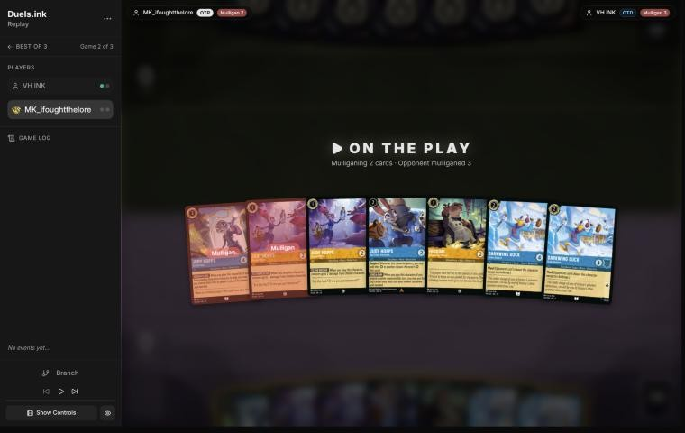
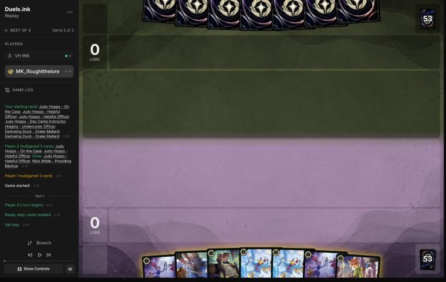
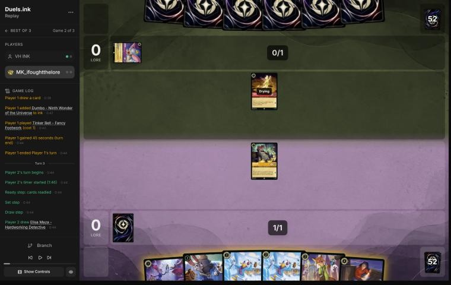
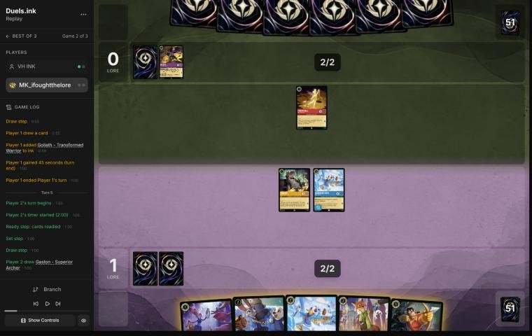
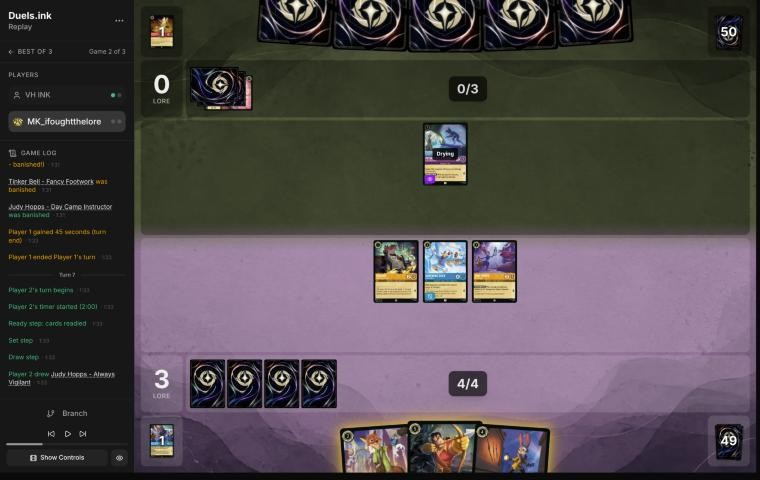
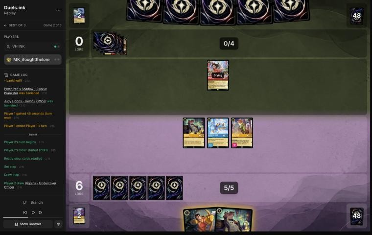
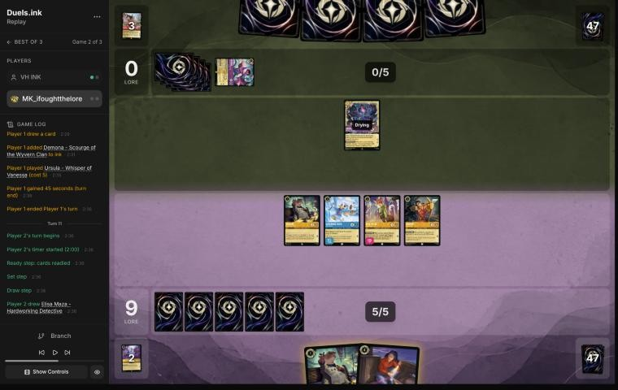
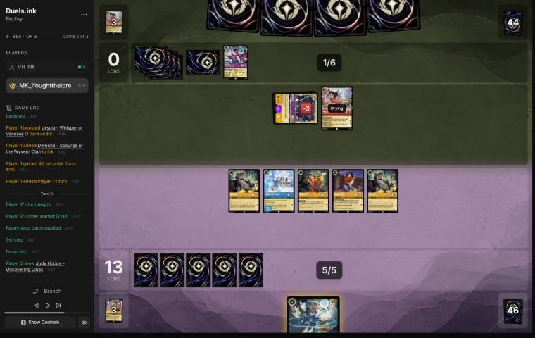
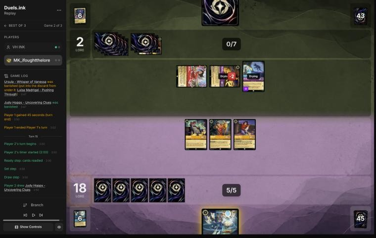

# Review: MK_ifoughtthelore vs VH INK, game 2, 2 Nov 2026

| | |
|---|---|
| **Status** | draft (blind pass done, not yet discussed; turn 13 re-checked on 2026-11-02 against the hand Elisa revealed, verdict unchanged) |
| **Replay** | `01a19c08-7f38` (`python3 tools/brief.py 01a19c08-7f38 --turn N`) · [duels.ink viewer](https://duels.ink/replay/01a19c08-7f38-7f08-8ddf-1626e1ee94c0?step=0) |
| **Format** | Core Constructed (from game 1), best-of-three. Set 14 era: inks revealed before the coin toss |
| **Decks** | You: Amber/Sapphire Detectives (as in game 1). Them: Amethyst/Ruby, the tempo-midrange list duels.ink calls **Unnamed #1**, known from game 1 |
| **Play/draw** | You went first (you lost game 1, so it was your choice) |
| **Result** | **Win** at 20–2 on turn 15, levelling the match at 1–1 |
| **Meta data** | snapshot of 26 Oct 2026 (fresh until 9 Nov) |
| **Chosen how** | Sent by danny, the coach's user: a match of MK_ifoughtthelore's, reviewed for them, game by game. **The coach knew this game's result in advance:** game 1 was a loss and the match went to three games, so this one was a win. Verdicts are guarded against outcome bias |

## Summary
- **Good plays:** turns [1](#turn-1), [3](#turn-3), [5](#turn-5), [11](#turn-11), [13](#turn-13) and [15](#turn-15),
  and [turn 9](#turn-9), the best of the game: Nick's Support made their Mulan a 5-strength target for Gaston.
- **Close calls:** the [pre-game](#turn-0) (sending back On the Case).
- **Inaccuracies:** [turn 7](#turn-7) (inking Always Vigilant, one of your two answers to their 5-strength cards).

**What decided it:** an early lead from cheap questers (6–0 by turn 7) and turn 9's Support-plus-Gaston, which removed
their only character. Their removal came one challenge at a time, and you reached 18 before their big turn could
stop you.

## The game, turn by turn
Verdicts judge each decision on what you could know at the time, **including archetype knowledge an experienced
player has**. Hindsight is kept to its own section. Severity scale: good play / close call /
inaccuracy / mistake / blunder. Principle IDs and hypotheses (H-n) link to copies
in the Citations section at the end, as they stood when they were cited.

**What you knew before the game:** their deck, from game 1: Amethyst/Ruby tempo-midrange ("Unnamed #1", 98%).
Seen: Luisa Madrigal – Pushing Through and Pepita – Watchful Alebrije (Challenger +2), Cheshire Cat – Inexplicable
(Boost 2 moves 2 damage onto your character), Peter Pan's Shadow – Elusive Prankster (Evasive; exerts one of yours on
play), Isis Vanderchill (exerts one of yours on play), Wasabi – Called into Battle (TWIN BLADES: a challenge kills a
second character too), Demona – Scourge of the Wyvern Clan (6: exerts all your characters), Hades – Looking for a
Deal, Red Alert (banish a character with 3 {S} or less), Dumbo, Tinker Bell – Fancy Footwork, Medallion Weights and
Ursula – Whisper of Vanessa. Still to come by their average list: Mulan – Martial Arts Master (+2 {S}, Rush),
Rafiki – Mystical Fighter (Challenger +3), Jebidiah Farnsworth – Cookie. Game 1's lessons: one exert plus Wasabi is
two kills; Darkwing's Ward blanks their exerts, TWIN BLADES and Cheshire's move; Demona's 5 {S} is in range of
Always Vigilant and Gaston ([the coach's removal profile](#cite-kb-meta-archetypes-amber-sapphire-removal-profile)).

### Pre-game

*The board before the decision: [step 0](https://duels.ink/replay/01a19c08-7f38-7f08-8ddf-1626e1ee94c0?step=0) in the duels.ink replay viewer.* Your opening hand; the cards marked "Mulligan" went back.

**What you did:** Chose to go first. Kept Helpful Officer, Day Camp Instructor, Higgins and both Darkwing Duck – Drake
Mallard; sent back Judy Hopps – On the Case and the second Helpful Officer

**Verdict:** **Close call.** Shipping the second Helpful Officer (1 willpower, dead to any of their challengers) was
right. The coach would have kept On the Case, the hand's only 3-drop and a Judy to Shift onto, but by the sim
(`mulligan.py`, 1,500 deals) your keep matched keeping her on curve and lore by turn 4 (3.95 vs 3.97 play turns,
7.4 vs 7.3 lore), with slightly less ink spent (9.14 vs 9.29). Keeping both Darkwings was the important part: Ward
blanks Shadow, Isis, Cheshire's move and TWIN BLADES.

### Turn 1: your turn 1

*The board before the decision: [step 2](https://duels.ink/replay/01a19c08-7f38-7f08-8ddf-1626e1ee94c0?step=2) in the duels.ink replay viewer.*

**What you did:** Inked Helpful Officer, played Higgins

**Verdict:** **Good,** the coach's line: the 2-willpower 1-drop over the 1-willpower one, and the spare Helpful
Officer as ink.

### Turn 2: their turn

**What happened:** They inked Dumbo – Ninth Wonder of the Universe and played Tinker Bell – Fancy Footwork (3/1).

### Turn 3: your turn 2

*The board before the decision: [step 8](https://duels.ink/replay/01a19c08-7f38-7f08-8ddf-1626e1ee94c0?step=8) in the duels.ink replay viewer.*

**What you did:** Quested with Higgins (1–0); inked Elisa Maza; played Darkwing

**Verdict:** **Good.** Questing Higgins offered their Tinker Bell an even trade at best (3 {S} kills him, his 2 {S}
kills her), for a lore. Darkwing was the right 2-drop: Ward blanks their exert effects. The coach would have inked
Nick and kept Elisa, but their list runs few non-character cards for her FOLLOW THE TRAIL, so it's close.

### Turn 4: their turn

**What happened:** They inked Goliath – Transformed Warrior (4, 5/5: discards a card to move 2 damage onto your
character) and played nothing.

### Turn 5: your turn 3

*The board before the decision: [step 14](https://duels.ink/replay/01a19c08-7f38-7f08-8ddf-1626e1ee94c0?step=14) in the duels.ink replay viewer.*

**What you did:** Inked the second Darkwing; Helpful Officer, then Day Camp Instructor (LEND A PAW ramped); quested
with Higgins and Darkwing (3–0)

**Verdict:** **Good play.** The ramp sets up Gaston – Superior Archer on turn 5, and the quests offered Tinker Bell
one trade at most. Their only other threat at 3 ink was an exert (Peter Pan's Shadow), which can't choose Darkwing.
Inking the second Darkwing rather than Nick is a close call; Ward is the best thing your deck has against this one.

### Turn 6: their turn

**What happened:** They inked Peter Pan & Tinker Bell – Fast Friends (6, Shift 4: "Your characters gain Evasive");
Peter Pan's Shadow exerted Day Camp Instructor, and Tinker Bell traded with her.

### Turn 7: your turn 4

*The board before the decision: [step 28](https://duels.ink/replay/01a19c08-7f38-7f08-8ddf-1626e1ee94c0?step=28) in the duels.ink replay viewer.*

**What you did:** Played Nick Wilde – Providing Backup; inked Judy Hopps – Always Vigilant; quested with Higgins,
Darkwing and Helpful Officer (6–0)

**Verdict:** **Inaccuracy.** Inking **Always Vigilant** is suboptimal because she's one of your two answers to their
5-strength threats (GOT YOU NOW banishes a character with 5 {S} or more): Goliath (5/5) and Peter Pan & Tinker Bell
(5/4) are already in their inkwell, so more copies are in their deck, and Demona – Scourge is 5 too
([the coach's removal profile](#cite-kb-meta-archetypes-amber-sapphire-removal-profile)). Playing Nick and **not
inking** is better: the extra ink went unused this turn (2 of 5 spent), and next turn's ink still reaches 5 for
Gaston ([INK-1](#cite-ink-1), [INK-2](#cite-ink-2)). The quests were fine: Shadow (2 {S}) could take one of your small
characters, at the cost of trading itself. Confidence: low to medium (lowered in discussion, below).

**In discussion** (danny, 2026-11-02): you wanted to keep inking every turn, and between the two, Always Vigilant was
the card to ink: Gaston is sure to be playable next turn, while GOT YOU NOW needs another character played first.
- **Agreed on the choice between them.** If one of the two goes into the inkwell, it should be Always Vigilant.
- **Verdict kept on inking at all**, at lower confidence:
  - The extra ink went unspent this turn (2 of 5).
  - Gaston still came online next turn either way, through next turn's ink. About 80% of your deck is inkable (48 of
    60), so you'd usually have drawn a spare to ink and kept both answers, and could have inked Always Vigilant then
    if not.
  - Cards were the scarcer resource: 3 in hand, ahead 3–0 on board ([H-2](#cite-h-2)).
  - Her condition was easy to meet here. Helpful Officer was in play for a Shift 2, and the deck runs about twenty
    1- and 2-drops.
- **The cost of not inking is real:** one ink fewer on every later turn ([INK-3](#cite-ink-3): usually ink every
  turn, though not automatically). That's why this is only a small edge, close to a close call. **Unresolved** if you
  weigh the steady ink higher.

### Turn 8: their turn

**What happened:** They inked Medallion Weights and played Mulan – Martial Arts Master, whose +2 {S} let Shadow kill
Helpful Officer (Shadow died too, after drawing a card). Still 6–0.

### Turn 9: your turn 5

*The board before the decision: [step 39](https://duels.ink/replay/01a19c08-7f38-7f08-8ddf-1626e1ee94c0?step=39) in the duels.ink replay viewer.*

**What you did:** Nick quested and gave his Support (+3) to **their** Mulan – Martial Arts Master, making her 5 {S};
Gaston – Superior Archer's WATCH THIS banished her; Higgins and Darkwing quested (9–0)

**Verdict:** **Good play, the best of the game, and better than the coach's plan.** The coach would have held Gaston
for a natural 5-strength target and played the second Higgins. Support may choose an opposing character
([the coach's ruling](#cite-kb-rules-rulings-support-can-add-strength-to-an-opposing-character)), and with Nick's +3
their 2-strength Mulan became a WATCH THIS target: their only character, the one that gives Rush, gone before it
could quest. It's [the Detectives' signature trick](#cite-kb-meta-archetypes-amber-sapphire-detectives-how-it-plays).
The order was exact: Nick's quest first, then Gaston, then the other quests.

### Turn 10: their turn

**What happened:** They inked Demona – Scourge of the Wyvern Clan and played Ursula – Whisper of Vanessa (4/5/2;
Boost 1: with a card under her, +1 {L} and Evasive). Still 9–0.

### Turn 11: your turn 6

*The board before the decision: [step 50](https://duels.ink/replay/01a19c08-7f38-7f08-8ddf-1626e1ee94c0?step=50) in the duels.ink replay viewer.*

**What you did:** Elisa Maza (FOLLOW THE TRAIL showed their hand; nothing to discard); Higgins; quested with
Higgins, Darkwing, Nick and Gaston (13–0)

**Verdict:** **Good play,** the coach's line. At 9–0 with four questers, every quest brings the win closer than their
one-at-a-time challenges can stop it ([POS-1](#cite-pos-1)); Elisa's look at their hand was free information.

### Turn 12: their turn

**What happened:** A second Mulan – Martial Arts Master gave Ursula +2 {S}, and Ursula killed Nick; Boost put a card
under Ursula (Evasive, +1 {L}); they inked a second Demona – Scourge.

### Turn 13: your turn 7

*The board before the decision: [step 65](https://duels.ink/replay/01a19c08-7f38-7f08-8ddf-1626e1ee94c0?step=65) in the duels.ink replay viewer.*

**What you did:** Judy Hopps – Uncovering Clues (no Detective in the top 3); quested with all five (18–0)

**Verdict:** **Good play.** At 18 you needed two questers to survive their turn. Their kill count was limited: Ursula,
Mulan (whose quest gives a new character Rush) and one exert. Questing everything was the fastest path.

**Re-checked with the hand Elisa revealed on turn 11** *(revisited 2026-11-02, from this turn's brief only)*: the
brief now lists two Goliath – Transformed Warriors and Peter Pan's Shadow as known in their hand, plus one unknown
card. That makes the count exact.
- **With 7 ink they can cast a Goliath (4) and Shadow (3),** and Mulan's quest gives one of them Rush.
- **The most they kill is three:**
  - Goliath's challenge (5 {S}).
  - His WHEN NIGHT FALLS moving 2 damage onto a Higgins. Ward keeps it off Darkwing.
  - Ursula's challenge. On 2 willpower, she dies to any of your characters.

  Shadow's exert only lets one of these reach the ready Uncovering Clues instead.
- **To stop your last 2 lore they'd need five kills** of your six characters. Their unknown card doesn't stretch
  7 ink that far.
- **Holding characters back** would only have raised the lore you needed next turn.

Verdict unchanged: good play. The brief's "Challenges the turn it lands" line didn't list the Goliaths, though: it
counted a Shift or a card's own Rush keyword, not Rush that Mulan gives (fixed the same day; see the tool updates
below).

### Turn 14: their turn

**What happened:** Goliath – Transformed Warrior, given Rush by Mulan's quest, killed Darkwing on arrival; Goliath's
WHEN NIGHT FALLS moved his damage onto Higgins; Peter Pan's Shadow exerted Uncovering Clues and Ursula traded with
her. 18–2, with Higgins, Gaston and Elisa left.

### Turn 15: your turn 8

*The board before the decision: [step 87](https://duels.ink/replay/01a19c08-7f38-7f08-8ddf-1626e1ee94c0?step=87) in the duels.ink replay viewer.*

**What you did:** Uncovering Clues (found Judy Hopps – Lead Detective); Higgins and Gaston quested to 20

**Verdict:** **Good.** The win.

## Lessons
1. **Support makes any of their characters a target for your 5-strength removal** ([turn 9](#turn-9)): Nick's +3 on a
   2-strength Mulan was enough for Gaston. The trick is in
   [the coach's Detectives notes](#cite-kb-meta-archetypes-amber-sapphire-detectives-how-it-plays) and its
   [Support ruling](#cite-kb-rules-rulings-support-can-add-strength-to-an-opposing-character); game 1 of your match
   against xBWx used it too.
2. **Keep Always Vigilant and Gaston in hand against this deck** ([turn 7](#turn-7)): Goliath, Peter Pan & Tinker
   Bell and Demona – Scourge all have 5 {S}, and Support brings anything else into range
   ([the coach's removal profile](#cite-kb-meta-archetypes-amber-sapphire-removal-profile)).
3. **Mulan – Martial Arts Master's quest gives Rush** to a character played that turn: on turn 14 a fresh Goliath
   (5/5) challenged at once. With Mulan in play, an exerted character is exposed to whatever they cast next.

## Knowledge-base updates (applied 2026-11-02, at danny's request)
- **Meta (Amethyst/Ruby notes), applied:** this opponent's list also runs Goliath – Transformed Warrior (4, 5/5; ×2 seen),
  Peter Pan & Tinker Bell – Fast Friends (Shift 4; "your characters gain Evasive") and Mulan – Martial Arts Master ×2,
  none of them in "Unnamed #1"'s average list except Mulan: a Gargoyle and Fairy variant. Across games 1 and 2 they
  inked four 5-strength cards (Demona ×3, Goliath).
- **Tools:**
  - **Done:** the brief now lists, on every turn you hold strength-threshold removal, the opposing characters in
    range now and once your Supporters quest and add their {S}. The coach missed the turn-9 line though the brief
    listed the ruling under Gaston, the second time after 01a19bb9.
  - **Done (2026-11-02):** a hand revealed by Elisa Maza or Mowgli now shows under "KNOWN IN THEIR HAND" until its
    cards are played, inked or discarded. With it, the brief shows two Goliaths and Peter Pan's Shadow known on turns
    13 and 14; turn 13 was re-checked with them, and its verdict didn't change.
  - **Done (2026-11-02, from that re-check):** the brief's "Challenges the turn it lands" now also lists the
    characters they can cast after a Rush-giver in play (Mulan – Martial Arts Master's WARRIOR SPIRIT) quests, and
    those that give themselves Rush (Roller Bob – Sid's Toy). On turn 13 it had listed only a Mulan Shift, not the two
    known Goliaths. `tests/test_brief_sections.py` checks both.

## Hindsight
Doesn't change the verdicts above.
- They inked both Demonas they drew rather than casting one, and their turn-14 attack left you exactly the two
  questers you needed.

## The coach's errors
Filled in during discussion.

| When | Error | How it was caught | How it won't happen again |
|---|---|---|---|
| [Turn 9](#turn-9) | Planned to hold Gaston for a natural 5-strength target, missing Support on their Mulan, though the brief listed the Support ruling under Gaston | Your line, seen after the plan | Done (2026-11-02): the brief lists the characters within reach of your strength-threshold removal, Support included, and the method and review skill say to read it. The second miss of this trick after 01a19bb9 turn 7 |
| [Turn 13](#turn-13) | Filtered the brief's "Knowledge base notes on the cards in view" section out of its output | The coach, while writing up game 3 | It didn't change the verdict. Prevention (2026-11-02): `brief.py --compact` drops only the slow-changing lists, so there's no reason to filter the brief, and the review skill now says to read every brief whole |

## Open questions
- **Turn 7:** answered in discussion: to keep inking every turn, and Always Vigilant over Gaston (see turn 7).

## Citations
Copies of the coach's knowledge base cited above, as they stood when they were cited (the private repository's commit and date are given with each). They don't change when the knowledge base does.

**INK-1**: strategy principle, `kb/strategy/principles.md` at `1537f2d` (2026-11-02), working tree

> - **INK-1. Inking is permanent.** Every inked card is one line of play removed for the rest of the game. *Ask: "Will I regret losing access to this card?"* `[MCL ch.4]` · baseline

**INK-2**: strategy principle, `kb/strategy/principles.md` at `1537f2d` (2026-11-02), working tree

> - **INK-2. Don't automatically ink the most expensive card.** It may be the late-game win condition or the key answer for this matchup. The answer depends on matchup, hand and board. `[MCL ch.4]` · baseline

**POS-1**: strategy principle, `kb/strategy/principles.md` at `1537f2d` (2026-11-02), working tree

> - **POS-1. From ahead, take the safest path to victory.** Don't overextend into sweepers, don't make unnecessary trades, and make the opponent take the risks. Winning by 1 lore counts the same as winning by 10. `[MCL ch.10]` · baseline

**amber-sapphire.md, Removal profile**: knowledge base, `kb/meta/archetypes/amber-sapphire.md` at `1537f2d` (2026-11-02), working tree

> ### Removal profile
> Per the user, 2026-10-24. Card text verified from replay data.
>
> | Card | Ink, cost | Effect |
> |---|---|---|
> | Gaston – Superior Archer | Amber character, 5 | When played, may banish chosen character with **5+ {S}** |
> | Judy Hopps – Always Vigilant | Amber character, 4 (Shift 2) | When played, if they played another character this turn, may banish chosen character with **5+ {S}** |
> | World's Greatest Criminal Mind | Amber song, 3 | Banish chosen character with **5+ {S}** |
> | Let It Go | Sapphire song, 5 | Put chosen character into **its owner's** inkwell, facedown and exerted. This removes it but ramps the victim, so it's rarely aimed at cheap characters |
>
> **Implications.**
> - **Characters with 4 or less {S} on the opponent's turn are safe from their main removal.** Temporary
>   "+{S} this turn" boosts end before the opponent's turn (CR 6.1.13.4). Elite Archer's shifted +3 doesn't
>   expose her.
> - **For the user's Amethyst/Ruby list** `[coach]`:
>   - Exposed: Demona – Scourge of the Wyvern Clan (5 {S}), and Wasabi – Called into Battle while you hold
>     an ink drop (4+2 {S}).
>   - Safe from that removal: most of the rest.

**amber-sapphire.md, Detectives: how it plays**: knowledge base, `kb/meta/archetypes/amber-sapphire.md` at `1537f2d` (2026-11-02), working tree

> ### Detectives: how it plays `[coach, meta study of the user's 27 Oct 2026 games (tools/scan.py), full games, not blind, 8 games]`
> Games: 01a17e45, 01a17e54, 01a17e5d (Sallinhos, best-of-three); 01a17e64, 01a17e75, 01a17e80 (DuckyRv, best-of-three);
> 01a17e9c; 01a17ef8. Card text verified with `tools/cards.py`.
>
> **The plan:** go wide with cheap Detectives, quest wide, and remove your best characters with "banish chosen character
> with 5 {S} or more", **after pumping them with Support**.
>
> - **The key trick: Support onto your characters.** Support adds "their {S} to another chosen character's {S} this turn",
>   and they choose yours. Then Gaston – Superior Archer or a Judy Hopps – Always Vigilant banishes it.
>   - *Examples:* 01a17e54 turn 21 (+2 on Hades, then Gaston); 01a17e5d turn 12 (+2 on Cheshire, then Judy – Always
>     Vigilant); 01a17e45 turn 23 (two Judy – Always Vigilant Shifts in one turn, banishing Cheshire and Merida, both
>     pumped first).
>   - **Support stacks:** a supported character supports with its new {S}. In 01a17e45 turn 15, Judy – Day Camp gave
>     Nick Wilde +2, then Nick gave +4. Treat **any** character of yours as in range once they have Support questers and
>     their removal available.
> - **Pieces:**
>   - **Cheap Detectives:**
>     - Higgins (1)
>     - Judy – Helpful Officer (1; removes 2 damage)
>     - Nick Wilde – Providing Backup (2; Support while they have another Detective)
>     - Judy – Day Camp Instructor (2, uninkable; Support; tops a card into ink if they played another character this turn)
>     - Daisy Duck – Ghost Finder (2, Support)
>     - Eilonwy (1, Support; not a Detective)
>   - **Nick Wilde – Toy Drive Officer** (4, uninkable; Support; draws at the end of a turn they played 2+ characters).
>   - **Removal:**
>     - **Judy Hopps – Always Vigilant** (4, Shift 2 onto any Judy; GOT YOU NOW needs another character played that turn)
>     - **Gaston – Superior Archer** (5)
>     - The Horseman Strikes!
>   - **Fangmeyer – Icy Officer** (5, uninkable, 2 lore): returns a Detective from their discard, usually Judy – Always
>     Vigilant, so the removal repeats.
>   - **Hand disruption:** Elisa Maza (4; with another Detective in play, you reveal your hand and they pick a non-character
>     card to discard) and Mowgli – Man Cub (2; you discard a non-character card). They took Raging Storm and Remember Me.
>   - **Card flow:** Judy – Uncovering Clues (4; searches the top 3 for a Detective on play and on quest).
>   - **Late game:** Judy – Lead Detective (6, Shift 4; Alert and Resist +2 for Detectives on their turn).
> - **Big turns,** from about their 6th turn: wide quests for +5 to +7 (01a17e45 turn 15: five questers; 01a17e9c turn
>   18: +7 after Lead Detective). Removal turns took 3 or 4 characters by mixing banishes with pumped challengers
>   (01a17e45 turn 23, 01a17e5d turn 12, 01a17e80 turn 26). Your locations were challenged down by two Detectives at once.
> - **What to watch for:**
>   - **Count their Support total against your characters' {S}.** Judys in play are Shift 2 targets for Always Vigilant,
>     and Gaston arrives at 5 ink.
>   - **Expect the removal to repeat** while Fangmeyer can return it.
>   - **Play your actions and songs (sweepers especially) early, before Elisa Maza lands.** She needs another Detective in
>     play first. A wide board of small characters is exactly what sweepers punish.

**rulings.md, Support can add strength to an opposing character**: knowledge base, `kb/rules/rulings.md` at `1537f2d` (2026-11-02), working tree

> ### Support can add strength to an opposing character
> - **Situation:** a Support character quests while the opponent has a character you want to remove with a "5 {S} or
>   more" banish: Judy Hopps – Always Vigilant's GOT YOU NOW, Gaston – Superior Archer's WATCH THIS.
> - **Ruling:** Support may choose any other character, including an opposing one. Adding the Support character's {S}
>   to theirs can lift a small character to 5 {S} for the banish. Supports stack, and a supported character supports
>   with its new {S}.
> - **Basis:** CR 8.13.1 (Support: "add this character's {S} to another chosen character's {S} this turn"; "another
>   chosen character" isn't limited to your own).
> - **Confidence:** derived from CR and confirmed by duels.ink's engine: Detectives opponents did it to the user's
>   characters (01a17e54 turn 21, 01a17e5d turn 12, 01a17e45 turn 23; `kb/meta/archetypes/amber-sapphire.md`), and
>   MK_ifoughtthelore did it to their opponent's (01a19bb9 turn 7, 01a19bbd turn 8). Not an official ruling.
> - **Added:** 2026-11-02, from the review of 01a19bb9 (vs xBWx); the trick was first recorded in the meta study of
>   1 Nov 2026.

**INK-3**: strategy principle, `kb/strategy/principles.md` at `2a9a9c8` (2026-11-02), working tree

> - **INK-3. Usually ink every turn, but not automatically.** Keeping one more playable card can beat one more ink. Missing ink with an expensive hand can leave you permanently behind. `[MCL ch.4]` · baseline

**H-2**: hypothesis, `kb/strategy/hypotheses.md` at `2a9a9c8` (2026-11-02), working tree

> ### H-2. Spare ink isn't automatically wasted when later turns will be short of cards
> - **Claim:** Ink grows by one every turn, but cards don't. Once later turns are likely to have more ink than
>   good cards to spend it on, cards are the scarcer resource. Then playing a low-impact card just to use spare
>   ink (giving up a better card to the inkwell instead) is usually worse than leaving the ink unspent.
> - **Applies when:** you're ahead on board (POS-1) and the extra play has little impact (WIN-2). Also when the
>   backup value of the extra card is low, e.g. a second Shift target when the opponent's removal can't hit the first.
> - **Doesn't apply when:** you're behind and need board presence now, or the cheap card has real impact.
> - **The converse, for the opponent:** extra cards are worth less to an opponent who already has a full hand and is
>   short of ink. When an effect offers "they draw 2 or you lose a body" (Hades – Looking for a Deal), keeping
>   the body is more attractive the more cards they already hold. Discard-payoff decks still get some fuel from
>   extra cards. Evidence: 01a139ad, turn 14. The opponent had 5 cards and 7 ink, and the user kept Isis
>   rather than bottoming her. Discussed 2026-10-26 and judged a close call.
> - **Evidence for:** replay 01a14bf9 (vs Goop), turn 5. The user left 1 ink unspent rather than ink Cheshire to
>   play a second Mulan – Injured Soldier. Coach first called it a close call, then agreed after the user's argument.
> - **Evidence against:** none yet.
> - **Status:** open.
