# Review: MK_ifoughtthelore vs VH INK, game 3, 2 Nov 2026

| | |
|---|---|
| **Status** | draft (blind pass done, not yet discussed) |
| **Replay** | `01a19c0c-2b4c` (`python3 tools/brief.py 01a19c0c --turn N`) · [duels.ink viewer](https://duels.ink/replay/01a19c0c-2b4c-7acf-b635-34b5611f66c6?step=0) |
| **Format** | Core Constructed (from game 1), best-of-three, the deciding game. Set 14 era: inks revealed before the coin toss |
| **Decks** | You: Amber/Sapphire Detectives (as in games 1 and 2). Them: Amethyst/Ruby, the tempo-midrange list duels.ink calls **Unnamed #1**, known from games 1 and 2 |
| **Play/draw** | They went first (they lost game 2, so it was their choice) |
| **Result** | **Win.** They conceded on turn 26 at 12–10, giving you the match 2–1 |
| **Meta data** | snapshot of 26 Oct 2026 (fresh until 9 Nov) |
| **Chosen how** | Sent by danny, the coach's user: a match of MK_ifoughtthelore's, reviewed for them, game by game. The match was 1–1, so this game decided it; the coach didn't know its result before the blind pass |

## Summary
- **Good plays:** turns [4](#turn-4), [8](#turn-8), [10](#turn-10), [12](#turn-12), [14](#turn-14), [16](#turn-16),
  [18](#turn-18), [24](#turn-24) and [26](#turn-26), and [turn 22](#turn-22), the best of the game: Lead Detective's
  Alert reached both their Evasive questers, and eight quests took you from 1 to 9.
- **Close calls:** the [pre-game](#turn-0) (a deep mulligan that sent back Gaston and Lead Detective) and
  [turn 6](#turn-6) (On the Case rather than The Horseman Strikes! on Jebidiah).
- **Inaccuracies:** [turn 20](#turn-20) (two Darkwings, where Lead Detective Shifted onto Uncovering Clues would have
  killed the exerted Shadow for free).

**What decided it:** patience, then one big turn. From turn 14 you kept a wide board ready, which gave Wasabi nothing to
challenge, and drew cards with two Nick Wilde – Toy Drive Officers while they built up to 10 lore. On
[turn 22](#turn-22) Lead Detective's Alert and Resist removed their two Evasive questers and you scored 8; on
[turn 24](#turn-24) you traded off both Wasabis, and their board never recovered.

## The game, turn by turn
Verdicts judge each decision on what you could know at the time, **including archetype knowledge an experienced
player has**. Hindsight is kept to its own section. Severity scale: good play / close call /
inaccuracy / mistake / blunder. Principle IDs and hypotheses (H-n) link to copies
in the Citations section at the end, as they stood when they were cited.

**What you knew before the game:** their deck, from games 1 and 2: Amethyst/Ruby tempo-midrange ("Unnamed #1", 98%)
with Gargoyle and Fairy extras.
- **Exerting your characters:** Peter Pan's Shadow (3, exerts one on play), Isis Vanderchill (4, exerts one), Demona –
  Scourge of the Wyvern Clan (6, exerts all of yours). Darkwing's Ward blanks the single-target ones.
- **Challengers and tricks:** Luisa Madrigal and Pepita (Challenger +2), Tinker Bell – Fancy Footwork (3/1), Mulan –
  Martial Arts Master (+2 {S} on play; her quest gives a new character Rush), Medallion Weights.
- **Big bodies with 5 {S}, in range of Gaston and Always Vigilant:** Goliath – Transformed Warrior (4, 5/5; moves 2 of
  his damage onto your character), Peter Pan & Tinker Bell – Fast Friends (Shift 4; their characters gain Evasive),
  Demona – Scourge. Wasabi – Called into Battle (5, 4/5: TWIN BLADES) and Ursula – Whisper of Vanessa (5, 4/5) need
  Support to reach 5.
- **Card movers:** Cheshire Cat – Inexplicable (Boost 2 moves 2 damage onto your character), Hades – Looking for a Deal.
- **The match so far:** in game 1 their Demona exerted your wide board and their challengers and Wasabi cleared it; in
  game 2 you raced to 20 while Gaston, helped by Nick's Support, removed their only character.

### Pre-game

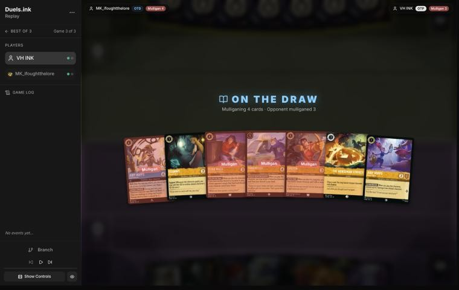
*The board before the decision: [step 0](https://duels.ink/replay/01a19c0c-2b4c-7acf-b635-34b5611f66c6?step=0) in the duels.ink replay viewer.* Your opening hand; the cards marked "Mulligan" went back.

**What you did:** On the draw. Kept Eilonwy, Judy Hopps – Helpful Officer and The Horseman Strikes!; sent back
Fangmeyer, Elisa Maza, Judy Hopps – Lead Detective and Gaston – Superior Archer

**Verdict:** **Close call.** By the sim (`mulligan.py`, 1,500 deals) your deep mulligan made the best early board:
lore by turn 4 7.5, against 6.5 for sending back only the uninkable Fangmeyer and 6.1 for keeping all 7, with ink
use within 0.1 of either. But it sent back the two cards that answer this deck's late game: Gaston (5-strength
removal, the card that won game 2's key turn) and Lead Detective (a Shift 4 onto Helpful Officer on turn 4, with
Alert against their Evasive cards). The coach would have kept both and sent back Fangmeyer and Elisa (keep 5: 6.9
lore, 9.79 ink) ([MULL-3](#cite-mull-3)). Another data point for [H-5](#cite-h-5). Confidence: medium-low; the sim
can't weigh Gaston's value in this matchup.

### Turn 1: their turn

**What happened:** Luisa Madrigal – Pushing Through (Challenger +2).

### Turn 2: your turn 1

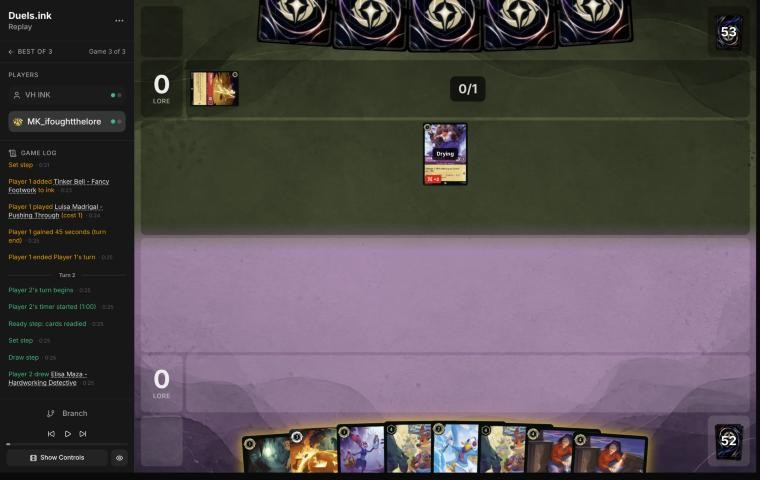
*The board before the decision: [step 5](https://duels.ink/replay/01a19c0c-2b4c-7acf-b635-34b5611f66c6?step=5) in the duels.ink replay viewer.*

**What you did:** Inked an Elisa Maza, played Eilonwy

**Verdict:** **Good.** A 1-drop with a spare Elisa as ink. Helpful Officer first would have been slightly better (a
Detective, for Elisa's FOLLOW THE TRAIL later), but it's minor.

### Turn 3: their turn

**What happened:** They inked Peter Pan & Tinker Bell – Fast Friends and played Jebidiah Farnsworth – Cookie (3/3,
Evasive, Reckless: must challenge each turn if able).

### Turn 4: your turn 2

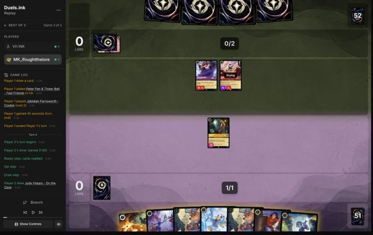
*The board before the decision: [step 11](https://duels.ink/replay/01a19c0c-2b4c-7acf-b635-34b5611f66c6?step=11) in the duels.ink replay viewer.*

**What you did:** Inked the second Elisa, played Darkwing; Eilonwy stayed ready

**Verdict:** **Good,** the coach's line. Darkwing's Ward keeps him safe from their exert effects, and an exerted
Eilonwy would have been Jebidiah's or Luisa's free kill ([RULE-1](#cite-rule-1)).

### Turn 5: their turn

**What happened:** They inked Cheshire Cat; Peter Pan's Shadow exerted Eilonwy and Jebidiah killed her, taking 2.

### Turn 6: your turn 3

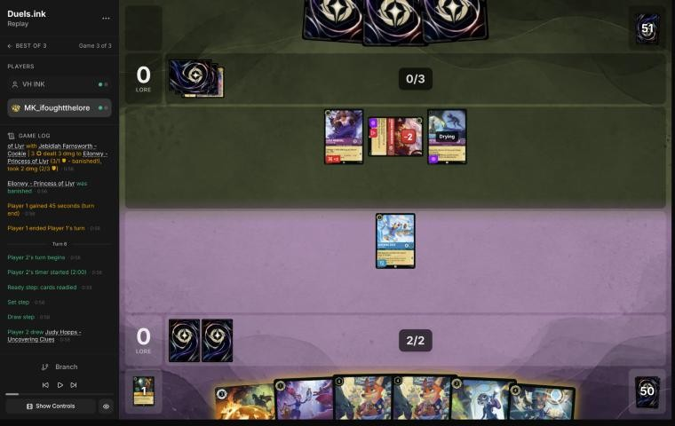
*The board before the decision: [step 20](https://duels.ink/replay/01a19c0c-2b4c-7acf-b635-34b5611f66c6?step=20) in the duels.ink replay viewer.*

**What you did:** Inked Helpful Officer; played Judy Hopps – On the Case (no item for HIDDEN CLUES); kept The Horseman
Strikes!

**Verdict:** **Close call, and instructive.** The coach would have cast **The Horseman Strikes! on Jebidiah** (3/3,
Evasive, damaged), the only way to touch him, drawing a card and leaving Darkwing as your only character. Ward means
their exert effects (Shadow, Isis) then have no legal target, so a Reckless Jebidiah would have nothing to hit
either. Your line kept the Horseman for a later Evasive (Shadow, Dumbo) and offered On the Case as a body, which
their exert-plus-challenge could trade off. The two lines come out about even on cards: On the Case plus a draw
against a Horseman in hand.

### Turn 7: their turn

**What happened:** They inked Hades; Isis Vanderchill exerted On the Case, and Jebidiah traded with her. Shadow
quested (0–1).

### Turn 8: your turn 4

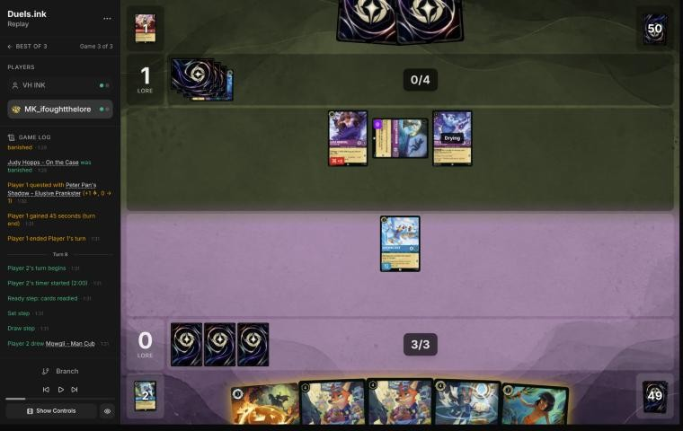
*The board before the decision: [step 30](https://duels.ink/replay/01a19c0c-2b4c-7acf-b635-34b5611f66c6?step=30) in the duels.ink replay viewer.*

**What you did:** Inked Mowgli; Judy Hopps – Uncovering Clues (found a second Uncovering Clues); Darkwing stayed ready

**Verdict:** **Good,** the coach's line: a body and a dig, keeping the Horseman for their Dumbo, which hadn't shown up
yet. Darkwing can't touch their Evasive Shadow, and an exerted Darkwing would die to Luisa.

### Turn 9: their turn

**What happened:** Dumbo – Ninth Wonder of the Universe (a second inked); Shadow used Dumbo's granted ability to draw
and gain a lore (0–2).

### Turn 10: your turn 5

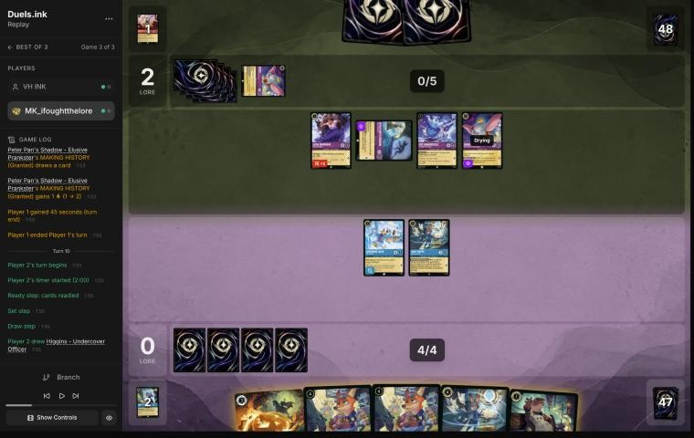
*The board before the decision: [step 39](https://duels.ink/replay/01a19c0c-2b4c-7acf-b635-34b5611f66c6?step=39) in the duels.ink replay viewer.*

**What you did:** The Horseman Strikes! banished Dumbo and drew Nick Wilde – Toy Drive Officer; Uncovering Clues quested
(THOROUGH INVESTIGATION found Nick Wilde – Providing Backup); inked Higgins; played Nick

**Verdict:** **Good play.** The Horseman on Dumbo was the turn's point: he's their card engine, and the Horseman was
your only answer to an Evasive. The coach would have kept Uncovering Clues home, since Isis (4 {S}) kills her when
she's exerted. Your quest bought a lore and a card, and left Isis with 3 damage, exerted and easy to finish. That's
about even, so it's a close call.

### Turn 11: their turn

**What happened:** Isis challenged Uncovering Clues (killed her, took 3); Tinker Bell – Fancy Footwork; Shadow quested
(1–3).

### Turn 12: your turn 6

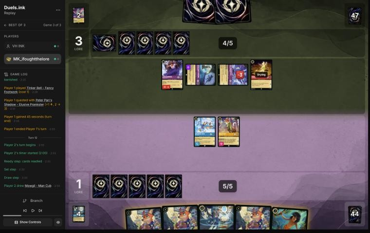
*The board before the decision: [step 51](https://duels.ink/replay/01a19c0c-2b4c-7acf-b635-34b5611f66c6?step=51) in the duels.ink replay viewer.*

**What you did:** Nick Wilde – Toy Drive Officer; inked the second Uncovering Clues; Mowgli (their hand had no
non-character card); Darkwing challenged the exerted, damaged Isis (both died); COMMUNITY OUTREACH drew Darkwing

**Verdict:** **Good.** Two characters played for the end-of-turn draw, and Isis (4/4, with 3 damage) removed. The coach
would have sent Nick Wilde – Providing Backup into Isis instead and kept Darkwing, whose Ward blanks their exert
effects, but Nick's Support is worth as much to this deck. A close call.

### Turn 13: their turn

**What happened:** Goliath – Transformed Warrior (5/5); Shadow quested (1–4).

### Turn 14: your turn 7

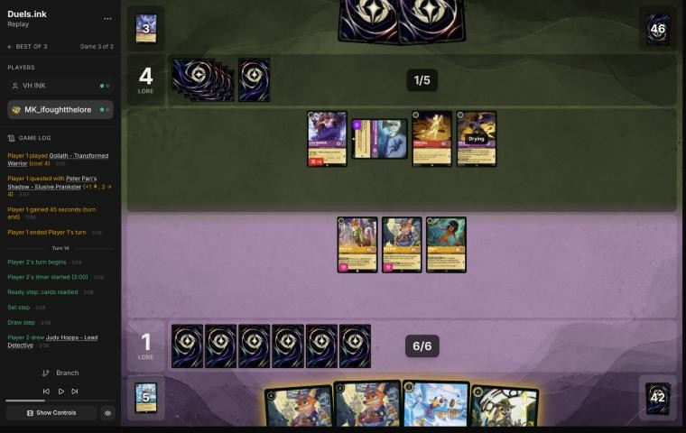
*The board before the decision: [step 59](https://duels.ink/replay/01a19c0c-2b4c-7acf-b635-34b5611f66c6?step=59) in the duels.ink replay viewer.*

**What you did:** A second Nick Wilde – Toy Drive Officer and Darkwing; no ink, no quests; the two Nicks' COMMUNITY
OUTREACH drew Gaston and a second Lead Detective

**Verdict:** **Good play.** The coach would have cast Judy Hopps – Lead Detective, so that a Nick with Alert and
Resist +2 could kill the exerted, Evasive Shadow and take nothing back. Your line drew two cards instead, including
Gaston for their 5-strength Goliath, and kept everyone ready against Goliath, Tinker Bell and Luisa ([CARD-1](#cite-card-1)).
Both are good. Yours trades a lore a turn (Shadow) for two cards, and keeps Lead Detective for a turn when she can
attack.

### Turn 15: their turn

**What happened:** Wasabi – Called into Battle; Shadow quested (1–5).

### Turn 16: your turn 8

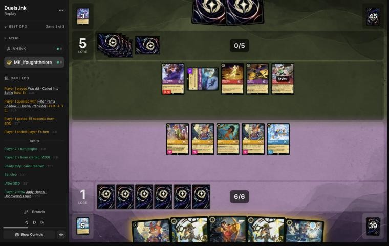
*The board before the decision: [step 66](https://duels.ink/replay/01a19c0c-2b4c-7acf-b635-34b5611f66c6?step=66) in the duels.ink replay viewer.*

**What you did:** Gaston – Superior Archer's WATCH THIS banished Goliath (5 {S}); inked the second Lead Detective; no
quests

**Verdict:** **Good play,** the coach's line. Goliath was in range without Support, so no Supporter had to quest and be
exposed ([the coach's removal profile](#cite-kb-meta-archetypes-amber-sapphire-removal-profile)). Staying ready
denied Wasabi a challenge, and with it TWIN BLADES. Inking the duplicate Lead Detective was the right spare.

### Turn 17: their turn

**What happened:** Red Alert banished a Nick Wilde – Toy Drive Officer. No quests (1–5).

### Turn 18: your turn 9

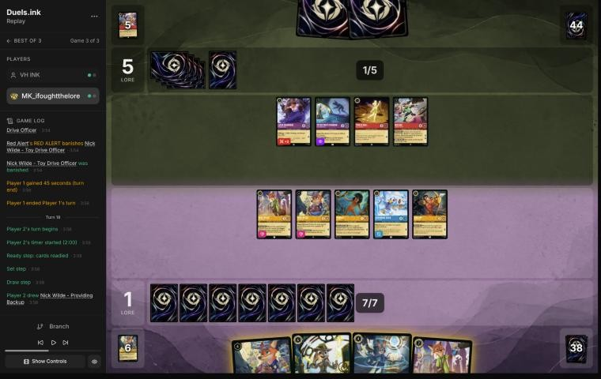
*The board before the decision: [step 75](https://duels.ink/replay/01a19c0c-2b4c-7acf-b635-34b5611f66c6?step=75) in the duels.ink replay viewer.*

**What you did:** Nick Wilde – Toy Drive Officer; inked Nick Wilde – Providing Backup; Uncovering Clues (found
Darkwing); both Nicks' COMMUNITY OUTREACH drew Darkwing and Fangmeyer; no quests

**Verdict:** **Good play,** the coach's line. With both sides holding back, three extra cards in one turn (two draws
and a dig) is how the Detectives win a long game ([CARD-1](#cite-card-1)). Questing into Wasabi (4 {S} plus TWIN
BLADES) and three other attackers would have lost several characters for a few lore. The risk in waiting was
Demona – Scourge at their 6 ink: about 24% in their 2 cards and next draw (`odds.py hold`, 4 copies in 3 cards from
46).

### Turn 19: their turn

**What happened:** Ursula – Whisper of Vanessa; Shadow quested (1–6).

### Turn 20: your turn 10

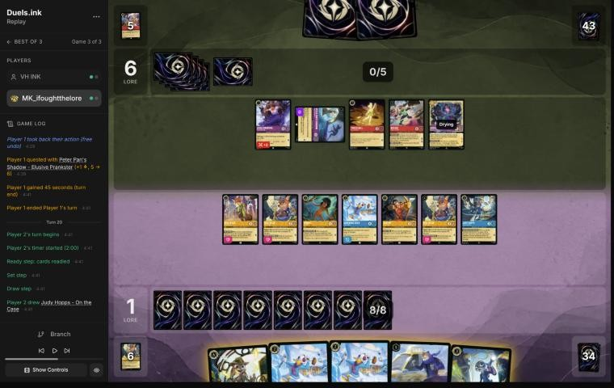
*The board before the decision: [step 89](https://duels.ink/replay/01a19c0c-2b4c-7acf-b635-34b5611f66c6?step=89) in the duels.ink replay viewer.*

**What you did:** Fangmeyer – Icy Officer (returned Uncovering Clues); inked On the Case; two Darkwings; both Nicks'
COMMUNITY OUTREACH drew On the Case and a second Fangmeyer; no quests

**Verdict:** **Inaccuracy (small).** Playing **two Darkwings** is suboptimal because their Shadow sat exerted, and only an
Alert character can reach an Evasive one. **Judy Hopps – Lead Detective Shifted onto Uncovering Clues** (4 ink; she
inherits the dry state, so she acts at once) gives every Detective Alert and Resist +2 this turn. A Darkwing then
kills Shadow and takes nothing back, and Fangmeyer still fits (4 + 5 = 9 ink), so both Nicks still draw. That's
better: it removes their only Evasive quester for free and puts Lead Detective on the board for the coming turns
([RULE-2](#cite-rule-2)). Confidence: medium.

### Turn 21: their turn

**What happened:** A second Wasabi; they inked Dumbo – The Flying Elephant; Ursula's Boost made her Evasive with +1 {L},
and she and Shadow quested (1–10).

### Turn 22: your turn 11

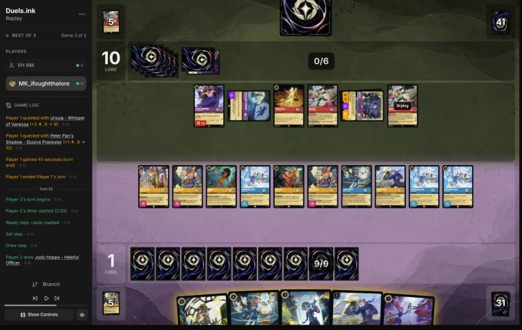
*The board before the decision: [step 103](https://duels.ink/replay/01a19c0c-2b4c-7acf-b635-34b5611f66c6?step=103) in the duels.ink replay viewer.*

**What you did:** Lead Detective (hard-cast); inked On the Case; Uncovering Clues (found Fangmeyer). With Alert and
Resist +2, Darkwing killed Shadow and took nothing; Nick Wilde – Providing Backup quested and gave +3 to Fangmeyer, who
killed Ursula (7 damage, took 2). Eight more quests took you to 9–10; COMMUNITY OUTREACH drew Day Camp Instructor and
The Horseman Strikes!

**Verdict:** **Good play, the best of the game.** At 1–10, facing a board that quested for 10, you had to remove their
Evasive questers and race in the same turn. Lead Detective's Alert reached both Evasives, Resist +2 made Darkwing's
challenge free, and Nick's Support pushed Fangmeyer past Ursula's 5 willpower. Their board dropped from 10 lore a turn
to 6, and you scored 8.

### Turn 23: their turn

**What happened:** Each Wasabi killed a Nick Wilde – Toy Drive Officer, and TWIN BLADES killed Lead Detective and
Uncovering Clues. Cheshire Cat came down and Boost moved 2 damage onto Fangmeyer, killing him. Tinker Bell traded with
the other Uncovering Clues, and Luisa with Nick Wilde – Providing Backup. No quests (9–10).

### Turn 24: your turn 12

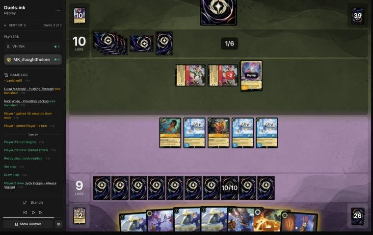
*The board before the decision: [step 141](https://duels.ink/replay/01a19c0c-2b4c-7acf-b635-34b5611f66c6?step=141) in the duels.ink replay viewer.*

**What you did:** Fangmeyer (returned Uncovering Clues); inked Helpful Officer; Uncovering Clues (found Day Camp
Instructor); Day Camp Instructor (LEND A PAW ramped). Gaston traded with the damaged Wasabi; Darkwing and Mowgli
together killed the other. Two Darkwings quested (11–10)

**Verdict:** **Good play.** Both Wasabis were exerted, and with them gone their board was a drying Cheshire Cat. The
coach would have used three Darkwings for the two kills and kept Gaston and Mowgli to quest; the lore comes out the
same. Removing both, rather than racing past them at 9–10, was the safe path ([POS-1](#cite-pos-1)).

### Turn 25: their turn

**What happened:** A third Wasabi; Cheshire Cat traded with a Darkwing. Still 11–10.

### Turn 26: your turn 13

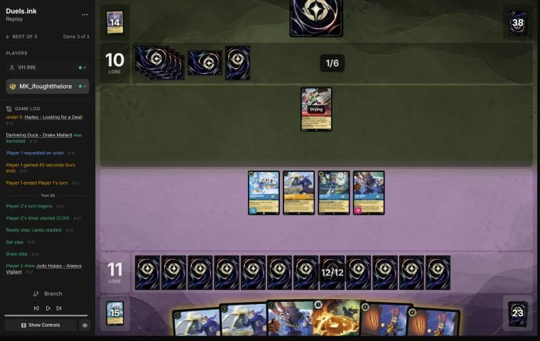
*The board before the decision: [step 159](https://duels.ink/replay/01a19c0c-2b4c-7acf-b635-34b5611f66c6?step=159) in the duels.ink replay viewer.*

**What you did:** Day Camp Instructor quested and gave her Support (+2) to **their** Wasabi; Fangmeyer; they conceded
before Always Vigilant came down

**Verdict:** **Good play.** The Detectives' trick again: Wasabi at 6 {S} was a target for Always Vigilant's GOT YOU NOW,
with Fangmeyer as the other character played that turn, and they conceded facing it
([the coach's Detectives notes](#cite-kb-meta-archetypes-amber-sapphire-detectives-how-it-plays)).

## Lessons
1. **Lead Detective's Alert answers their Evasive questers.** Shadow and a Boosted Ursula can only be challenged by
   Evasive or Alert characters, and Lead Detective gives every Detective Alert on your turn ([RULE-1](#cite-rule-1)).
   Shifted onto a dry Judy she acts the same turn ([RULE-2](#cite-rule-2); [turn 20](#turn-20)), and her Resist +2
   made Darkwing's challenge into Shadow free ([turn 22](#turn-22)).
2. **Against Wasabi, a ready board is a safe board.** With nothing exerted he has nothing to challenge, so TWIN
   BLADES never fires (turns 16 to 20, as game 1 showed the other way round). The turn you quest, expect two
   characters to die per Wasabi.
3. **In a standoff, Nick Wilde – Toy Drive Officer wins the card war:** two Nicks in play draw two cards on any turn
   you play two characters (turns 14, 18 and 20), which is how the Detectives outlast a deck with Demona and Wasabi
   ([the coach's Detectives notes](#cite-kb-meta-archetypes-amber-sapphire-detectives-how-it-plays)).
4. **Support on their character set up the finish** ([turn 26](#turn-26)), as in game 2.

## Proposed knowledge-base updates (applied after discussion)
- **Meta (Amethyst/Ruby notes, from all three games):** this list's standoff behaviour. They held their questers
  back against a ready board and raced only when it was safe (10 lore by turn 21 here). Seen in game 3: Jebidiah, Peter
  Pan's Shadow, Isis, Dumbo – Ninth Wonder (and The Flying Elephant, inked), Goliath, Wasabi ×3, Ursula – Whisper of
  Vanessa (with Demona under her), Cheshire, Red Alert, Tinker Bell, Luisa.
- **Strategy (a new hypothesis):** against an exert-and-challenge deck, keep a wide board ready and draw cards until
  Lead Detective can attack with Alert and Resist. Evidence for: this game, turns 14 to 22. Against: game 1, where
  Demona – Scourge exerted the whole waiting board. Their Demona was in the deck here too (under Ursula), so the
  waiting carried a real risk.
- **Strategy:** [H-5](#cite-h-5), a deep mulligan that sent back strong late cards for an early board (pre-game).

## Hindsight
Doesn't change the verdicts above.
- Ursula had Demona – Scourge under her (Boost), so the deck held it; it never reached their hand.
- Gaston and Lead Detective, sent back in the mulligan, came back by turns 14 and 22, and both mattered.

## The coach's errors
Filled in during discussion.

| When | Error | How it was caught | Fix |
|---|---|---|---|
| [Turns 12–24](#turn-12) | Trimmed the brief's output so its "Knowledge base notes on the cards in view" section went unread | The coach, while writing up | It didn't change those verdicts (the notes cover Wasabi, Shadow and Lead Detective, all weighed anyway). The section is never cut; the same slip happened in game 1 |

## Open questions
- **Pre-game:** why send back Gaston and Lead Detective?
- **Turn 20:** was Lead Detective held to keep her safe from TWIN BLADES, rather than Shifted onto Uncovering Clues to
  kill Shadow?

## Citations
Copies of the coach's knowledge base cited above, as they stood when they were cited (the private repository's commit and date are given with each). They don't change when the knowledge base does.

**MULL-3**: strategy principle, `kb/strategy/principles.md` at `3c71619` (2026-11-02), working tree

> - **MULL-3. The right keep depends on the matchup.** Early interaction against aggro; pressure, draw and engines against slow decks. The mulligan is the first expression of your role. In the Set 14 era the opponent's inks are known before the mulligan (RULE-8), so this applies from game 1 of a match. `[MCL ch.12]` · baseline

**RULE-1**: strategy principle, `kb/strategy/principles.md` at `3c71619` (2026-11-02), working tree

> - **RULE-1. Only exerted characters can be challenged** `[CR 4.6.4.2]`. Questing, singing, or {E} for an ability exposes the character. Staying ready protects it. Every quest is also a decision about what the opponent can challenge next turn. · baseline
>   - *Card text overrides this* (CR 1.2.1). Shere Khan – Khan Industries CEO's NEW INCENTIVE lets one character
>     challenge ready characters that turn. Alert (e.g. from Judy Hopps – Lead Detective, to every Detective on their
>     turn) ignores Evasive. Against Ducktectives, name both in the setup. 01a14574, turns 16 and 18. `[coach, 2026-10-26]`

**CARD-1**: strategy principle, `kb/strategy/principles.md` at `3c71619` (2026-11-02), working tree

> - **CARD-1. Card advantage is having more meaningful options than the opponent.** Ways to get it:
>   - 2-for-1 trades, and removal that hits two targets
>   - characters that survive several challenges
>   - recursion
>   - cards that replace themselves
>   - discard
>
>   *Ask after each exchange: "Who has more useful resources left?"* `[MCL ch.2]` · baseline

**RULE-2**: strategy principle, `kb/strategy/principles.md` at `3c71619` (2026-11-02), working tree

> - **RULE-2. Drying** `[CR 1.7.5]`. A newly played character can't quest, challenge or sing until next turn, so it's exposed to nothing (it's ready) but contributes nothing. **Shifting onto a dry character gives an immediate actor** `[CR 8.10.4]`. Rush allows challenges only `[CR 8.9]`. · baseline

**POS-1**: strategy principle, `kb/strategy/principles.md` at `3c71619` (2026-11-02), working tree

> - **POS-1. From ahead, take the safest path to victory.** Don't overextend into sweepers, don't make unnecessary trades, and make the opponent take the risks. Winning by 1 lore counts the same as winning by 10. `[MCL ch.10]` · baseline

**H-5**: hypothesis, `kb/strategy/hypotheses.md` at `3c71619` (2026-11-02), working tree

> ### H-5. A hand that can't make an opening curve can be worth a deep mulligan, even with a decent core
> - **Claim:** if the opening seven can't spend its ink on turns 1–4 (no early character, or no 1-drop with
>   uninkables and clumped 4-drops), a deep or full mulligan for an opening curve can beat keeping a reasonable core
>   (e.g. two 3-drops and card draw).
> - **Why:** mulligan replacements come from the cards *not* in your hand (CR 2.2.2, draw before shuffling). A seven
>   holding none of your cheap characters leaves all of them in the redraw pool, so the new cards are richer in
>   exactly what the hand lacks. Keeping part of the hand also keeps its cards' share of the next draws away from
>   the cheap ones.
> - **Evidence for:** 01a14574 (vs Shinobana, game 2), pre-game. Seven of Demona – Scourge, Cheshire ×2, Ursula,
>   Mulan – Elite Archer ×2 and Guidebook, on the play against Ducktectives. Simulated over 20,000 deals:
>   - same ink spent on turns 1–4: 9.31 (full mulligan) vs 9.25 (keep Demona, Cheshire ×2, Guidebook)
>   - character by turn 2: 97% vs 79%
>   - characters in play by turn 3: 2.9 vs 2.0
>
>   The user's reasoning: "no characters until turn 3, so I'm doing the full mulligan to try to have an opening curve."
> - **Evidence for:** 01a13b88 (vs Vhalarus, Amber/Emerald Circle of Life), pre-game, on the draw. Seven of Martial
>   Arts Master, Jebidiah, Isis, Luisa – Confident Climber, Dumbo, Shadow and Demona – Imperious Spellcaster: no 1-drop,
>   two uninkables, three 4-drops. The user kept only Jebidiah. Simulated (the five unknown Set 14 cards modelled as
>   1-cost or 3-cost characters):
>   - ink spent on turns 1–4: 9.63 / 9.55 vs 9.24 / 9.15 for keeping 7
>   - characters by turn 4: 4.9 / 4.4 vs 3.8 / 3.6
>
>   The user confirmed the same reasoning (an opening curve), 2026-11-01.
> - **Caveat: the goal isn't maximum ink spend** (user, 2026-11-01). Compare options on curve (a play each turn),
>   early lore pressure, interaction that sets the opponent back, and ink use, then weigh card quality and the
>   matchup. `python3 tools/mulligan.py <replay> --plan --keep "…"` reports the first four for any replay (the original
>   sims were ad hoc scripts, since lost; the tool reproduces their numbers). It can't judge card quality or engines.
>   With the replay card cache (2026-11-01), the user's Set 14 cards have data, so no costs are guessed for these two
>   games:
>   - **01a14574:** the full mulligan led on every measure. Against keeping Demona, Cheshire ×2 and Guidebook: ink
>     9.27 vs 9.18, play turns 3.65 vs 3.37 of 4, lore by turn 4 3.9 vs 2.4, interaction 60% vs 45%.
>   - **01a13b88:** the mulligan made (keep Jebidiah) led on curve and early lore against keeping the engines (Martial
>     Arts Master, Jebidiah, Dumbo, Shadow, Demona – Imperious Spellcaster): play turns 3.70 vs 3.39, lore by turn 4 3.7
>     vs 2.3. The engines option led on interaction (100% vs 90%) and kept Dumbo.
> - **Evidence against:** an independent blind review of 01a13b88 by a fresh coach session (2026-11-01) argued that
>   this hand had a turn-2 play and engines (Dumbo, Martial Arts Master).
>   - **Sending back only Isis and Luisa – Confident Climber** spends 9.29 ink on turns 1–4 (vs 9.51 for the full
>     mulligan, `mulligan.py`) and keeps the engines.
>   - **Against a likely slow sweeper deck** (Circle of Life, 60%), card quality matters more than early bodies
>     (MULL-3), and most of the extra bodies are 0-strength 1-drops.
>   - **So the broadened claim may be too broad.** It fits hands with no early play (01a14574) better than hands with
>     a turn-2 play and engines. The user agreed to grade 01a13b88's mulligan a close call (2026-11-01).
> - **Evidence, a close call:** 01a19bbd (MK_ifoughtthelore vs xBWx, game 2, a match the user sent; 2026-11-02),
>   pre-game, on the draw against Princess Aggro. A seven with no 1-drop and three uninkables: Day Camp Instructor,
>   Fangmeyer, Nick Wilde – Toy Drive Officer, Always Vigilant ×2, The Horseman Strikes! ×2. They kept only Day Camp
>   Instructor. `mulligan.py` (1,500 deals) against also keeping Always Vigilant and one Horseman: ink on turns 1–4
>   9.48 vs 9.58, play turns 3.78 vs 3.66 of 4, lore by turn 4 6.0 vs 5.2, characters 4.9 vs 4.3, interaction 80% vs
>   100%. The deep mulligan led on early board and lore, the partial one on interaction: graded a close call.
> - **Status:** open. Supported for hands with no early character (01a14574). For hands with an early play and
>   engines, test the partial mulligans first; there it's a close call (01a13b88).

**amber-sapphire.md, Removal profile**: knowledge base, `kb/meta/archetypes/amber-sapphire.md` at `3c71619` (2026-11-02), working tree

> ### Removal profile
> Per the user, 2026-10-24. Card text verified from replay data.
>
> | Card | Ink, cost | Effect |
> |---|---|---|
> | Gaston – Superior Archer | Amber character, 5 | When played, may banish chosen character with **5+ {S}** |
> | Judy Hopps – Always Vigilant | Amber character, 4 (Shift 2) | When played, if they played another character this turn, may banish chosen character with **5+ {S}** |
> | World's Greatest Criminal Mind | Amber song, 3 | Banish chosen character with **5+ {S}** |
> | Let It Go | Sapphire song, 5 | Put chosen character into **its owner's** inkwell, facedown and exerted. This removes it but ramps the victim, so it's rarely aimed at cheap characters |
>
> **Implications.**
> - **Characters with 4 or less {S} on the opponent's turn are safe from their main removal.** Temporary
>   "+{S} this turn" boosts end before the opponent's turn (CR 6.1.13.4). Elite Archer's shifted +3 doesn't
>   expose her.
> - **For the user's Amethyst/Ruby list** `[coach]`:
>   - Exposed: Demona – Scourge of the Wyvern Clan (5 {S}), and Wasabi – Called into Battle while you hold
>     an ink drop (4+2 {S}).
>   - Safe from that removal: most of the rest.

**amber-sapphire.md, Detectives: how it plays**: knowledge base, `kb/meta/archetypes/amber-sapphire.md` at `3c71619` (2026-11-02), working tree

> ### Detectives: how it plays `[coach, meta study of the user's 27 Oct 2026 games (tools/scan.py), full games, not blind, 8 games]`
> Games: 01a17e45, 01a17e54, 01a17e5d (Sallinhos, best-of-three); 01a17e64, 01a17e75, 01a17e80 (DuckyRv, best-of-three);
> 01a17e9c; 01a17ef8. Card text verified with `tools/cards.py`.
>
> **The plan:** go wide with cheap Detectives, quest wide, and remove your best characters with "banish chosen character
> with 5 {S} or more", **after pumping them with Support**.
>
> - **The key trick: Support onto your characters.** Support adds "their {S} to another chosen character's {S} this turn",
>   and they choose yours. Then Gaston – Superior Archer or a Judy Hopps – Always Vigilant banishes it.
>   - *Examples:* 01a17e54 turn 21 (+2 on Hades, then Gaston); 01a17e5d turn 12 (+2 on Cheshire, then Judy – Always
>     Vigilant); 01a17e45 turn 23 (two Judy – Always Vigilant Shifts in one turn, banishing Cheshire and Merida, both
>     pumped first).
>   - **Support stacks:** a supported character supports with its new {S}. In 01a17e45 turn 15, Judy – Day Camp gave
>     Nick Wilde +2, then Nick gave +4. Treat **any** character of yours as in range once they have Support questers and
>     their removal available.
> - **Pieces:**
>   - **Cheap Detectives:**
>     - Higgins (1)
>     - Judy – Helpful Officer (1; removes 2 damage)
>     - Nick Wilde – Providing Backup (2; Support while they have another Detective)
>     - Judy – Day Camp Instructor (2, uninkable; Support; tops a card into ink if they played another character this turn)
>     - Daisy Duck – Ghost Finder (2, Support)
>     - Eilonwy (1, Support; not a Detective)
>   - **Nick Wilde – Toy Drive Officer** (4, uninkable; Support; draws at the end of a turn they played 2+ characters).
>   - **Removal:**
>     - **Judy Hopps – Always Vigilant** (4, Shift 2 onto any Judy; GOT YOU NOW needs another character played that turn)
>     - **Gaston – Superior Archer** (5)
>     - The Horseman Strikes!
>   - **Fangmeyer – Icy Officer** (5, uninkable, 2 lore): returns a Detective from their discard, usually Judy – Always
>     Vigilant, so the removal repeats.
>   - **Hand disruption:** Elisa Maza (4; with another Detective in play, you reveal your hand and they pick a non-character
>     card to discard) and Mowgli – Man Cub (2; you discard a non-character card). They took Raging Storm and Remember Me.
>   - **Card flow:** Judy – Uncovering Clues (4; searches the top 3 for a Detective on play and on quest).
>   - **Late game:** Judy – Lead Detective (6, Shift 4; Alert and Resist +2 for Detectives on their turn).
> - **Big turns,** from about their 6th turn: wide quests for +5 to +7 (01a17e45 turn 15: five questers; 01a17e9c turn
>   18: +7 after Lead Detective). Removal turns took 3 or 4 characters by mixing banishes with pumped challengers
>   (01a17e45 turn 23, 01a17e5d turn 12, 01a17e80 turn 26). Your locations were challenged down by two Detectives at once.
> - **What to watch for:**
>   - **Count their Support total against your characters' {S}.** Judys in play are Shift 2 targets for Always Vigilant,
>     and Gaston arrives at 5 ink.
>   - **Expect the removal to repeat** while Fangmeyer can return it.
>   - **Play your actions and songs (sweepers especially) early, before Elisa Maza lands.** She needs another Detective in
>     play first. A wide board of small characters is exactly what sweepers punish.
