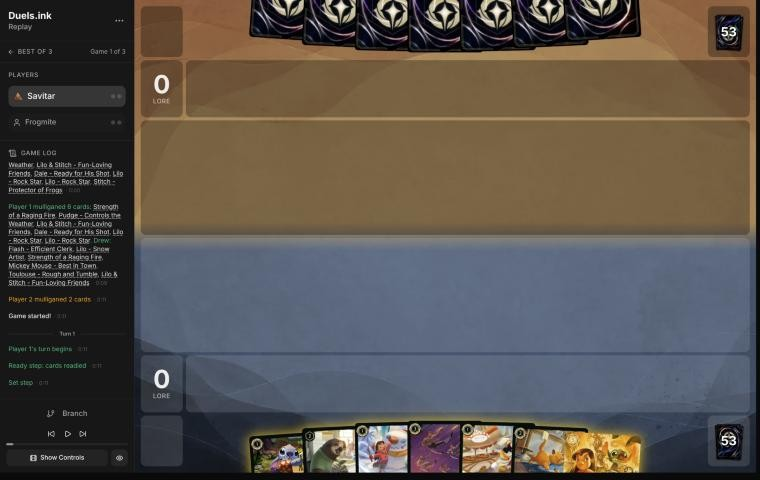
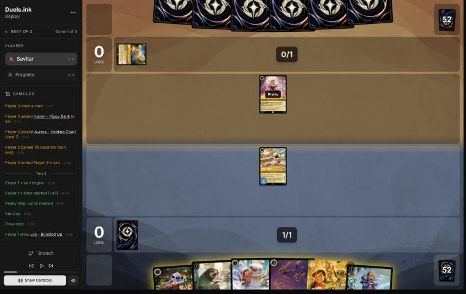
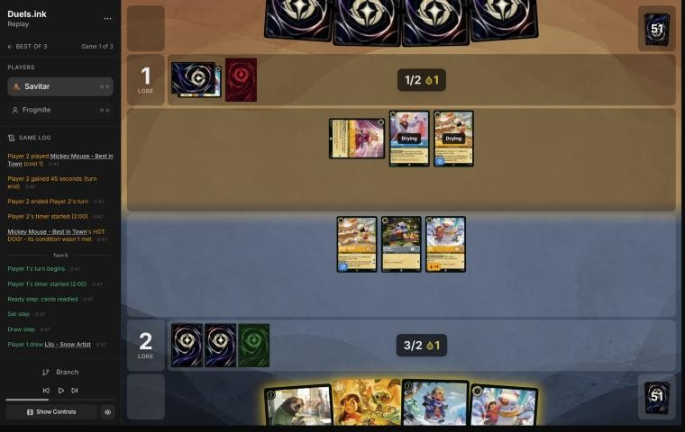
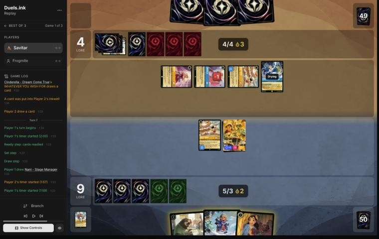

# Review: Savitar vs Frogmite, game 1, 2 Nov 2026

| | |
|---|---|
| **Status** | draft (blind pass done; not discussed, by request) |
| **Replay** | `01a19c38-61d8` (`python3 tools/brief.py 01a19c38-61d8 --turn N`) · [duels.ink viewer](https://duels.ink/replay/01a19c38-61ee-722b-b7d4-67da6ab0b6c4?step=0) |
| **Format** | Core Constructed (stated in the replay), best-of-three. Set 14 era: inks revealed before the coin toss |
| **Decks** | You: Amber/Steel Rockstar Aggro, the Lilo list. Them: Amber/Sapphire; archetype as it became clear: Control (Aurora, Hamm, the Cinderellas, Mickey), from turn 2 |
| **Play/draw** | You went first |
| **Result** | **Win:** Frogmite conceded on their 4th turn (game turn 8) at 14–4 |
| **Meta data** | snapshot of 26 Oct 2026 (fresh until 9 Nov) |
| **Chosen how** | One of the 5 of Savitar's 12 matches the coach reviewed after studying the other 7 (see the TeamAnglerfish game 1 review). **The coach knew one thing about the result in advance:** this match went to a game 3, so games 1 and 2 were split, one win each. Verdicts are guarded against outcome bias |

## Summary
- **Good plays:** the [mulligan](#turn-0) (down to Stitch: both Rock Stars had no Lilo to Shift onto), [3](#turn-3),
  [5](#turn-5) (Lilo & Stitch on turn 3, safe from Spooky Sight), and [7](#turn-7): pressing to 14 while keeping two
  cheap characters to rebuild after a Raging Storm.
- **Close calls:** [1](#turn-1): inking Toulouse, your only answer to their sweepers, rather than Strength.
- **Inaccuracies / mistakes / blunders:** none.
- **Unwinnable from:** never.

**What decided it:** 14 lore by your 4th turn against a Control deck still setting up; facing a board that quested
for 8, they conceded.

## The game, turn by turn
Verdicts judge each decision on what you could know at the time, **including archetype knowledge an experienced
player has**. Hindsight is kept to its own section. Severity scale: good play / close call /
inaccuracy / mistake / blunder. Principle IDs and hypotheses (H-n) link to copies
in the Citations section at the end, as they stood when they were cited.

**What you knew before the game:** their inks, Amber/Sapphire: Control (51%), Detectives (39%) or a list duels.ink
doesn't group (11%). Their key cards, with the earliest turn (you're on the play, so their turn k is game turn 2k):
- **Control:** Raging Storm (8: banish all characters; Cinderella – Unintentional Icon's ink and Belle's WINTER
  STOCKPILE bring it early), Spooky Sight (6: every character costing 3 or less to its owner's inkwell, which is
  nearly your whole deck), Hades – Infernal Schemer (7: one of yours to the inkwell), Let It Go (5).
- **Detectives** (the coach's study of ligerien's games against your deck, [notes](#cite-kb-meta-archetypes-amber-sapphire-detectives-against-rockstar-aggro-ligerien)): Gaston and Judy
  Hopps – Always Vigilant banish a character with 5 {S} or more, and they Support your Dale (0 {S}) up to 5 to banish
  him. Cheap Detectives quest wide; Elisa Maza takes an action from your hand.
- **Mickey's ink drops** count toward their Storm.

### Pre-game

*The board before the decision: [step 0](https://duels.ink/replay/01a19c38-61ee-722b-b7d4-67da6ab0b6c4?step=0) in the duels.ink replay viewer.*

**What you did:** on the play, kept Stitch and sent back six: Strength of a Raging Fire, Pudge, Lilo & Stitch, Dale
and both Lilo – Rock Stars.

**Verdict:** good play. `tools/mulligan.py` (800 deals each, run with your candidates before your mulligan was shown):

| Option | Ink on turns 1–4 | Play turns (of 4) | Lore by turn 4 | Characters by turn 4 | Interaction by turn 4 |
|---|---|---|---|---|---|
| Keep all 7 | 10.00 | 4.00 | 5.8 | 4.1 | 100% |
| Send back both Rock Stars | 9.77 | 4.00 | 6.9 | 5.0 | 100% |
| Keep Stitch, Lilo & Stitch, Dale | 9.53 | 4.00 | 8.1 | 5.4 | 34% |
| Keep Stitch, Lilo & Stitch | 9.41 | 4.00 | 8.5 | 5.6 | 35% |
| **As played** (keep Stitch) | 9.25 | 4.00 | 8.8 | 5.7 | 36% |
| Full mulligan | 9.25 | 3.83 | 8.4 | 5.3 | 47% |

- **Both Rock Stars needed a Lilo** the hand didn't have, Pudge too, so the seven had one early play (Stitch).
- **Keeping Lilo & Stitch with Stitch** (a Shift on turn 3) was almost as good in the sim (8.5). Your deeper
  mulligan led narrowly, and against Control's Spooky Sight and Storm, more cheap bodies early is the plan
  ([MULL-1](#cite-mull-1), [MULL-3](#cite-mull-3)). Confidence: medium.

### Turn 1: your turn 1

*The board before the decision: [step 3](https://duels.ink/replay/01a19c38-61ee-722b-b7d4-67da6ab0b6c4?step=3) in the duels.ink replay viewer.*

**What you did:** after the mulligan (Flash, Lilo – Snow Artist, Strength, Mickey, Toulouse and Lilo & Stitch
arrived), inked Toulouse; played Mickey.

**Verdict:** a close call.
- **Mickey first** quests for 2 from turn 2, the most lore of the three 1-drops. Lilo then Stitch (Lilo +1) next turn
  is close. Against Control his drops add to their ink for Raging Storm (8)
  ([the coach's Mickey notes](#cite-kb-cards-mickey-mouse-best-in-town-what-it-means-in-play)), but early lore is how this deck beats Control.
- **The ink:** Toulouse or Strength. Against Control (51%), Toulouse is your only answer to their sweepers: Raging
  Storm, Spooky Sight and Let It Go are all actions, and he stops them for a turn. Strength has few good targets there.
  Against Detectives (39%) it's the other way round: Strength kills their Gaston or Judy, and Toulouse does little.
  Ink check: either way next turn has Lilo plus Stitch, and turn 3 Lilo & Stitch by Shift. Keeping Toulouse for the
  turn before their Storm was slightly better against the likelier archetype ([INK-2](#cite-ink-2)). Confidence: low.

### Turn 2: their turn

**What happened:** Aurora – Holding Court; Hamm – Piggy Bank inked. Both are Control tells: Control 98%.

### Turn 3: your turn 2

*The board before the decision: [step 9](https://duels.ink/replay/01a19c38-61ee-722b-b7d4-67da6ab0b6c4?step=9) in the duels.ink replay viewer.*

**What you did:** drew a Lilo – Bundled Up; inked Strength of a Raging Fire; played Stitch and Lilo – Snow Artist
(Lilo +1 with Stitch); quested Mickey (2–0).

**Verdict:** good play, the coach's line. Two bodies for 2 ink, one of them Lilo & Stitch's Shift base for next
turn, and Strength was the card Control's few characters make least useful ([INK-2](#cite-ink-2)). Ink check: next
turn has 2 ink, a drop and a new ink for Lilo & Stitch by Shift (3); the uninkable Flash and Bundled Up follow.

### Turn 4: their turn

**What happened:** Aurora quested (1–2) and discounted Cinderella – Homespun Dressmaker; they played their own Mickey –
Best in Town and inked Stitch – Carefree Surfer (7: draws 2 with two other characters in play).

### Turn 5: your turn 3

*The board before the decision: [step 20](https://duels.ink/replay/01a19c38-61ee-722b-b7d4-67da6ab0b6c4?step=20) in the duels.ink replay viewer.*

**What you did:** drew a second Lilo – Snow Artist; Shifted Lilo & Stitch onto Stitch (2 ink and a drop); inked the
Lilo; quested Lilo & Stitch, Lilo and Mickey (9–1).

**Verdict:** good play, the coach's line.
- **Lilo & Stitch now,** rather than Flash and Bundled Up, takes 7 lore this turn instead of 5. Both lines quest for
  about the same over two turns, so the faster one is better against Control, whose sweepers come from their 5th or
  6th turn ([the coach's Control notes](#cite-kb-meta-archetypes-amber-sapphire-control-daman)).
- **She also survives Spooky Sight:** it inkwells characters costing 3 or less, and she costs 5. She stays a Stitch
  for Lilo's +1.
- **Exposure:** their Aurora (1) and Cinderella (2) can't hurt Lilo & Stitch or Mickey; Lilo (2 willpower) is exposed
  to Cinderella, a trade they'd be making with a 1-lore character.

### Turn 6: their turn

**What happened:** Aurora's discount brought Cinderella – Dream Come True (her end-of-turn ink-and-draw fired);
Homespun Dressmaker killed a Lilo; Minnie Mouse – Urban Visionary inked. With your Mickey's drops they banked three:
7 ink's worth next turn, 8 with an ink. 4–9.

### Turn 7: your turn 4

*The board before the decision: [step 37](https://duels.ink/replay/01a19c38-61ee-722b-b7d4-67da6ab0b6c4?step=37) in the duels.ink replay viewer.*

**What you did:** drew Nani; played her (THAT'S YOUR CUE found a second Mickey); quested Mickey and Lilo & Stitch
(14–4); played Flash with your two drops; kept Lilo – Bundled Up and the Mickey.

**Verdict:** **good play**.
- **The threat:** their ink reaches 8 next turn (drops included), so Raging Storm (banish all characters) is castable;
  the brief gives about 1 in 4 that they hold it. An Unintentional Icon Shifted onto either Cinderella would
  challenge at once (4 {S}, kills Mickey).
- **Pressing was right:** at 14, a board questing for 8 next turn wins unless they answer it, and Control's Storm
  comes sooner or later anyway. Holding everything back only delays the win by a turn in the three-in-four branch
  where they don't have it.
- **Hedging was right too:** you kept two cheap characters (Bundled Up and Mickey, 4 lore for 3 ink) to rebuild after
  a Storm, and played Nani and Flash rather than Bundled Up. The coach's line (Flash and Bundled Up, Nani kept) quests
  for 1 more next turn but rebuilds worse ([POS-1](#cite-pos-1)).
- **The cost of the turn-1 ink shows here:** Toulouse would have stopped the Storm for this turn.

## Lessons
1. **Against Control, keep Toulouse for the turn before their sweeper** ([1](#turn-1), [7](#turn-7)): Raging Storm,
   Spooky Sight and Let It Go are actions, and Mickey's drops bring them early.
2. **Press, but keep a rebuild** ([7](#turn-7)): cheap characters held back make a Storm cost them a turn, not the
   game.
3. **Lilo & Stitch is your Spooky Sight insurance** ([5](#turn-5)): at cost 5 she stays in play when every 3-or-less
   character goes to the inkwell.

## Knowledge-base updates (applied 2026-11-02, without discussion at danny's request)
- **Meta, Amber/Sapphire notes:** Frogmite's Control list (match notes after game 3).

## Hindsight
Doesn't change the verdicts above.
- Frogmite had no Storm: they spent their 8-ink turn on Stitch – Carefree Surfer and conceded.

## The coach's errors
None found in the blind pass.

| When | Error | How it was caught | How it won't happen again |
|---|---|---|---|

## Open questions
- [Turn 1](#turn-1): Toulouse or Strength as the first ink against a likely Control deck?

## Citations
Copies of the coach's knowledge base cited above, as they stood when they were cited (the private repository's commit and date are given with each). They don't change when the knowledge base does.

<!-- Filled in by `python3 tools/cite.py <this file>`: every principle ID, H-n, "principle N" and CR rule above
becomes a link to an entry here. Add a file or one of its sections with `--file PATH --section TEXT`, and link to
the anchor it prints. Never link into the private repository. -->

**amber-sapphire.md, Detectives against Rockstar Aggro: ligerien**: knowledge base, `kb/meta/archetypes/amber-sapphire.md` at `c794662` (2026-11-02), working tree

> ### Detectives against Rockstar Aggro: ligerien `[coach, meta study of Savitar's 2 Nov 2026 games (tools/scan.py), full games, not blind, 3 games]`
> 01a19c08-a45f, 01a19c0e-1e9e and 01a19c11-9fbf. Savitar (Amber/Steel Rockstar Aggro) won games 1 and 3 and conceded
> game 2 at 5–15.
> - **Seen:** Gaston ×3, Higgins ×3, Judy Hopps – Always Vigilant ×3, Uncovering Clues ×3, Day Camp Instructor ×2, Lead
>   Detective ×2, On the Case ×2, Nick Wilde – Toy Drive Officer ×2, Nick – Providing Backup, Eilonwy ×2, Mowgli – Man
>   Cub ×2, Daisy Duck – Ghost Finder, Elisa Maza.
> - **They used the Support trick on Savitar's Dale** (0 {S}): three Supports put him at 6 for Gaston (01a19c0e-1e9e
>   turn 9), the same trick as `kb/rules/rulings.md` "Support can add strength to an opposing character".
> - **Dale's SPIKE SUIT beat their small characters:** Stitch and Mike Wazowski dealt their 3 and 4 willpower in
>   challenges and killed Daisy, Mowgli and Higgins on turn 8 of game 1.
> - **Mr. Big's ICE OUT** kept their two best challengers home each turn.

**mickey-mouse-best-in-town.md, What it means in play**: knowledge base, `kb/cards/mickey-mouse-best-in-town.md` at `c794662` (2026-11-02), working tree

> ## What it means in play `[coach, from the 27 Oct 2026 meta study]`
> - **The ramp is symmetric:** every turn he quests, the opponent also gets an ink drop. That's worth more to decks with
>   ink-drop payoffs:
>   - **Jousting Match** (Steel action, 3): 2 damage, or **5 if paid with an ink drop**. Mickey supplied an Amethyst/Steel
>     opponent's drops (01a17e37).
>   - Ink-drop decks also run Ink Explosion, Merlin – Profoundly Curious and Marie – Caught in the Act; Shere Khan –
>     Khan Industries CEO makes drops of his own.
>   - An Emerald/Steel opponent spent four of these drops on turn 6 of 01a17ddb.
> - **Adventurous forces him to quest,** so he ends every turn exerted and can be challenged. 0 strength means he trades
>   for nothing; he's often the first challenge target (01a17e9c turn 14, 01a17ddb turn 6).
> - **Against a Steel opponent,** count the drops you're giving them, and what they could pay for with them, before
>   questing with him.
> - **Drops bring Raging Storm early** `[coach, meta study of Savitar's games, 2 Nov 2026]`: Candle Control (Amber/Ruby)
>   cast it on game turn 9, their 5th turn, with 5 ink and 3 drops from both sides' Mickeys (01a19bdb-d8e4). Against an
>   Amber deck, add your Mickey's drops to their ink when you count down to Storm (8).

**amber-sapphire.md, Control: daman**: knowledge base, `kb/meta/archetypes/amber-sapphire.md` at `c794662` (2026-11-02), working tree

> ### Control: daman `[coach, blind reviews of 01a19d7a, 01a19d83 and 01a19d89 (danny vs daman, 2026-11-02), discussed with danny]`
> - **Cards no listed Control list runs:** Lionheart – Incumbent Mayor (Bodyguard), Scuttle – Birdbrained (Ward), Hades –
>   Meticulous Schemer (Ward, 3 lore), Cinderella – Homespun Dressmaker, Priscilla, Hamm – Piggy Bank, Inkrunner, their
>   own Minnie, and three Unintentional Icons and four Stitches in a game.
> - **Ramp:** Mickey – Best in Town on turn 1 and two Dream Come Trues reached 12 ink by game turn 13 (01a19d83). Hamm's
>   LOOSE CHANGE put Dream Come True down for 3 on turn 6 (01a19d89).
> - **The Icon:** Shifted onto Dream Come True on their 4th turn, it challenged Priscilla at once (01a19d83 turn 7).
> - **Sweepers:** Spooky Sight on turn 11 or 15 (every character costing 3 or less to the inkwell); Raging Storm on turns
>   12, 13 and 23, after questing their own board first.
> - **Belle – Snowfield Strategist** inked each of their banished characters; Belle, Hades and Dream Come True challenged
>   Khan Industries down over turns 17–21 of game 1; their Minnie destroyed it on turn 18 of game 3.
> - **Hades – Infernal Schemer ×3** in game 3; Ohana Means Family on a damaged Stitch drew 4 (01a19d83).

**MULL-1**: strategy principle, `kb/strategy/principles.md` at `c794662` (2026-11-02), working tree

> - **MULL-1. Keep a plan, not the strongest cards.** *Ask: "Which hand gives me the best chance to execute my game plan in this matchup?"* `[MCL ch.12]` · baseline

**MULL-3**: strategy principle, `kb/strategy/principles.md` at `c794662` (2026-11-02), working tree

> - **MULL-3. The right keep depends on the matchup.** Early interaction against aggro; pressure, draw and engines against slow decks. The mulligan is the first expression of your role. In the Set 14 era the opponent's inks are known before the mulligan (RULE-8), so this applies from game 1 of a match. `[MCL ch.12]` · baseline

**INK-2**: strategy principle, `kb/strategy/principles.md` at `c794662` (2026-11-02), working tree

> - **INK-2. Don't automatically ink the most expensive card.** It may be the late-game win condition or the key answer for this matchup. The answer depends on matchup, hand and board. `[MCL ch.4]` · baseline

**POS-1**: strategy principle, `kb/strategy/principles.md` at `c794662` (2026-11-02), working tree

> - **POS-1. From ahead, take the safest path to victory.** Don't overextend into sweepers, don't make unnecessary trades, and make the opponent take the risks. Winning by 1 lore counts the same as winning by 10. `[MCL ch.10]` · baseline
