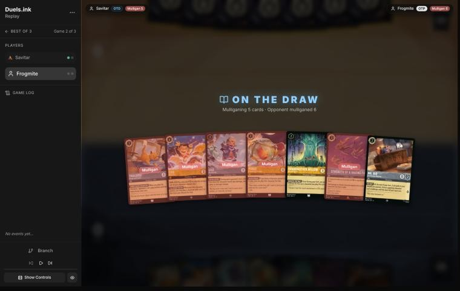
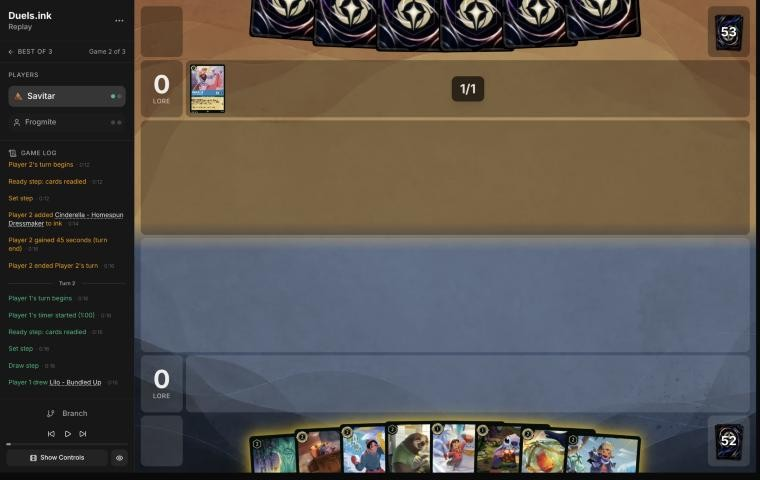
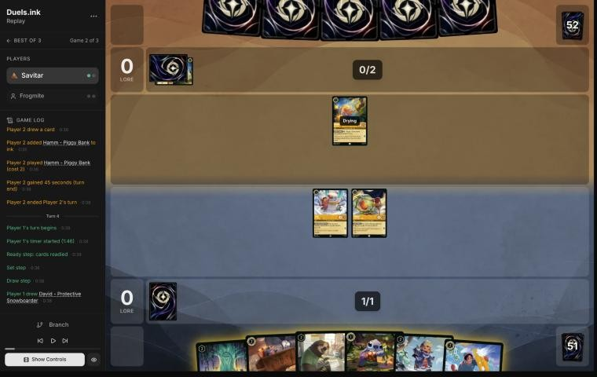
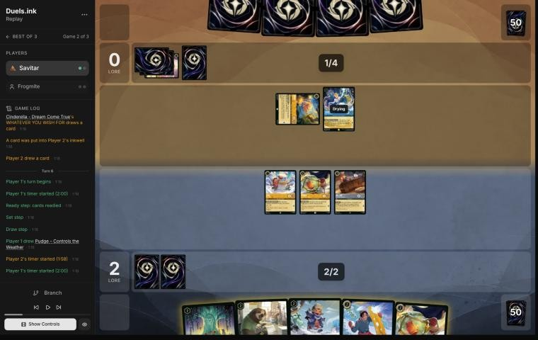
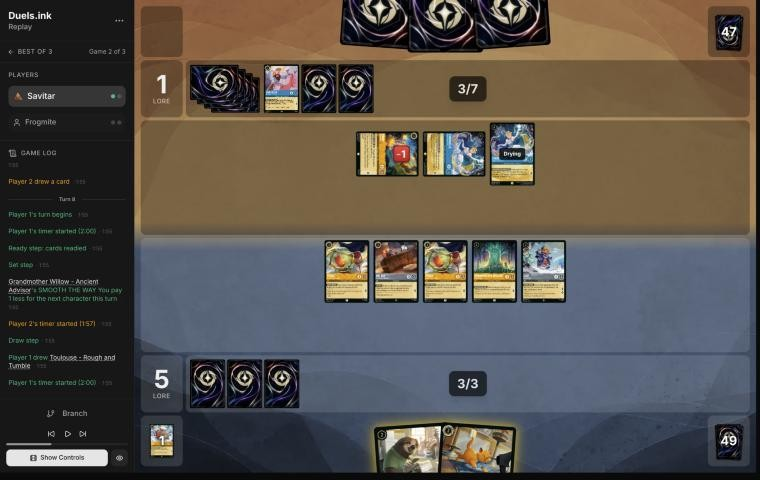
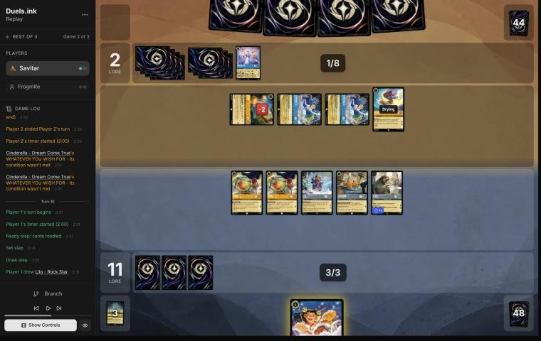
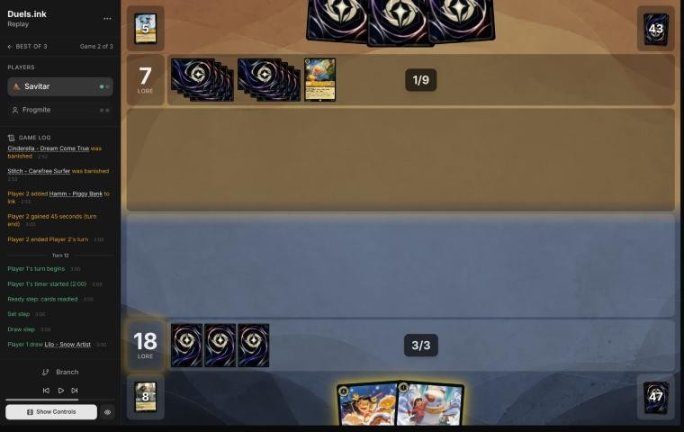
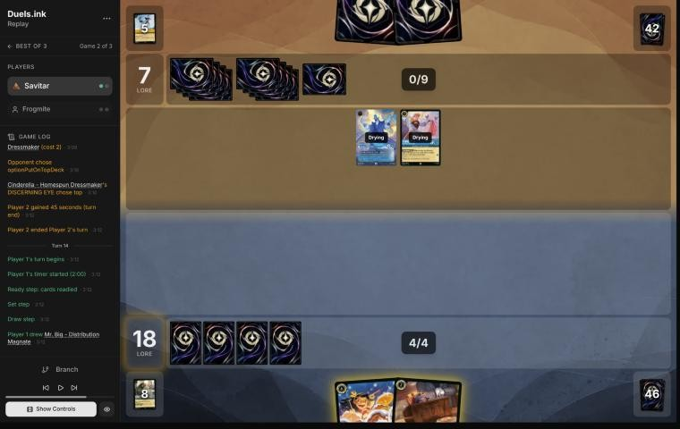
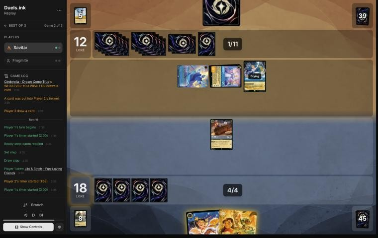

# Review: Savitar vs Frogmite, game 2, 2 Nov 2026

| | |
|---|---|
| **Status** | draft (blind pass done; not discussed, by request) |
| **Replay** | `01a19c3b-62c9` (`python3 tools/brief.py 01a19c3b-62c9 --turn N`) · [duels.ink viewer](https://duels.ink/replay/01a19c3b-62c9-7f5f-b878-b1b3efb0bc42?step=0) |
| **Format** | Core Constructed (from game 1), best-of-three. Set 14 era: inks revealed before the coin toss |
| **Decks** | You: Amber/Steel Rockstar Aggro, the Lilo list. Them: Amber/Sapphire Control, from game 1 |
| **Play/draw** | Frogmite went first (they lost game 1, so the choice was theirs); you were on the draw |
| **Result** | Loss: you conceded at the end of Frogmite's 9th turn (game turn 17), 19–17. Match 1–1, on to game 3 |
| **Meta data** | snapshot of 26 Oct 2026 (fresh until 9 Nov) |
| **Chosen how** | One of the 5 of Savitar's 12 matches the coach reviewed after studying the other 7 (see the TeamAnglerfish game 1 review). **The coach knew this game was a loss before reviewing it:** game 1 was a win and the match went to a game 3. Verdicts are guarded against outcome bias |

## Summary
- **Good plays:** [2](#turn-2), [6](#turn-6), [8](#turn-8) (Toulouse the turn before their 8 ink),
  [10](#turn-10) (questing to 18 rather than fighting), and [12](#turn-12), [14](#turn-14) and [16](#turn-16):
  rebuilding after the Storm with characters that stay ready through their turn, so only an action or Hades could stop
  them.
- **Close calls:** none.
- **Inaccuracies / mistakes / blunders:** two inaccuracies: the [mulligan](#turn-0) (Willow and Mr. Big kept,
  Toulouse sent back) and [4](#turn-4) (Mr. Big rather than Willow and a free Stitch).
- **Unwinnable from:** [17](#turn-17), after the second Hades: no characters, no hand, and they needed 3 with 8 on
  their board.

**What decided it:** Raging Storm on [11](#turn-11), the turn after Toulouse's lock ended, then a Hades – Infernal
Schemer for each of the characters that would have quested for the win ([13](#turn-13), [17](#turn-17)).

## The game, turn by turn
Verdicts judge each decision on what you could know at the time, **including archetype knowledge an experienced
player has**. Hindsight is kept to its own section. Severity scale: good play / close call /
inaccuracy / mistake / blunder. Principle IDs and hypotheses (H-n) link to copies
in the Citations section at the end, as they stood when they were cited.

**What you knew before the game:** game 1. Frogmite's Amber/Sapphire Control: Aurora – Holding Court and Hamm –
Piggy Bank (discounts), Cinderella – Homespun Dressmaker and Dream Come True (ink and draw), their own Mickey – Best in
Town, Stitch – Carefree Surfer, Belle, Minnie Mouse – Urban Visionary. Not yet seen but in the list: Raging Storm (8:
banish all), Spooky Sight (6: every character costing 3 or less to the inkwell), Hades – Infernal Schemer, Let It Go,
Cinderella – Unintentional Icon. Mickeys on both sides gave them 8 ink by their 4th turn in game 1.

### Pre-game

*The board before the decision: [step 0](https://duels.ink/replay/01a19c3b-62c9-7f5f-b878-b1b3efb0bc42?step=0) in the duels.ink replay viewer.*

**What you did:** on the draw, kept Grandmother Willow and Mr. Big and sent back five: Toulouse, Lilo – Rock Star,
Lilo – Bundled Up, Pudge and Strength of a Raging Fire.

**Verdict:** an **inaccuracy**. Keeping **Willow and Mr. Big** is suboptimal because Mr. Big's ICE OUT does little
against Control's few challengers and the mulligan sent back Toulouse, and keeping **Bundled Up, Pudge, Willow and
Toulouse** is better. `tools/mulligan.py` (800 deals each, candidates run before your mulligan was shown):

| Option | Ink on turns 1–4 | Play turns (of 4) | Lore by turn 4 | Characters by turn 4 | Interaction by turn 4 |
|---|---|---|---|---|---|
| Keep all 7 | 9.00 | 3.22 | 4.8 | 4.4 | 100% |
| Send back Rock Star and Strength | 9.11 | 3.53 | 7.3 | 4.9 | 22% |
| **Keep Bundled Up, Pudge, Willow, Toulouse** | 9.28 | 3.65 | 8.2 | 5.1 | 28% |
| **As played** (keep Willow and Mr. Big) | 9.52 | 3.81 | 7.5 | 5.4 | 39% |
| Full mulligan | 9.62 | 3.89 | 8.8 | 5.6 | 48% |

- **Bundled Up is a Lilo,** so Pudge comes free with her: two bodies (3 lore a turn) for 2 ink on turn 2.
- **Toulouse is the deck's one answer to Control's sweepers.** Raging Storm, Spooky Sight and Let It Go are actions,
  and he stops them for a turn. Against a deck that showed 8 ink by its 4th turn in game 1, he's worth keeping.
- **The sim's best was the full mulligan** (8.8), with the four-card keep second (8.2) and yours behind both.
- Inaccuracy rather than mistake: the gap is under a lore by turn 4, and the sim's lore leader was the full mulligan
  ([MULL-1](#cite-mull-1), [MULL-3](#cite-mull-3)). Confidence: medium.

### Turn 2: your turn 1

*The board before the decision: [step 4](https://duels.ink/replay/01a19c3b-62c9-7f5f-b878-b1b3efb0bc42?step=4) in the duels.ink replay viewer.*

**What you did:** the mulligan brought David, Flash, Lilo – Snow Artist, Stitch and Pudge, and you drew Lilo – Bundled
Up; inked David; played Lilo and Pudge free.

**Verdict:** good play: two characters for 1 ink, and David (a Bodyguard against a deck with few challengers) is the
card this matchup needs least ([INK-2](#cite-ink-2)).

### Turn 3: their turn

**What happened:** Hamm – Piggy Bank (2/3; {E}: next character 1 cheaper), and a second Hamm inked.

### Turn 4: your turn 2

*The board before the decision: [step 11](https://duels.ink/replay/01a19c3b-62c9-7f5f-b878-b1b3efb0bc42?step=11) in the duels.ink replay viewer.*

**What you did:** drew a second David; inked Stitch; played Mr. Big; quested Lilo and Pudge (2–0); ICE OUT kept Hamm
from challenging.

**Verdict:** an **inaccuracy**. Inking **Stitch and playing Mr. Big** is suboptimal because it gives up Lilo's bonus
and Willow's engine to protect a 1-drop, and **inking Mr. Big (or David) to play Willow, then Stitch free** is better
because:
- **More lore now:** Willow's discount works the turn she lands ([the coach's notes on your list](#cite-kb-meta-archetypes-amber-steel-rockstar-aggro-savitar-s-lilo-list)), so
  Stitch costs 0. Lilo then quests for 2 this turn: 3 lore against your 2.
- **More lore every turn after:** the board quests for 5 a turn against 3, and Willow makes every later turn's first
  character cheaper.
- **What it exposes:** the quested Lilo (2 willpower) to Hamm (2 {S}). If Hamm trades into her, they give up Hamm's
  quest and LOOSE CHANGE, and you still have Pudge, Willow and Stitch questing for 3 a turn, as many as your line.
- **Ink:** Mr. Big or the second David. Neither does much against Control, which has few challengers; Stitch powers
  Lilo and is a Lilo & Stitch Shift base ([INK-2](#cite-ink-2)).
- Confidence: medium.

### Turn 5: their turn

**What happened:** Hamm's LOOSE CHANGE made Cinderella – Dream Come True cost 3 (she inked a card and drew); Aurora
inked.

### Turn 6: your turn 3

*The board before the decision: [step 22](https://duels.ink/replay/01a19c3b-62c9-7f5f-b878-b1b3efb0bc42?step=22) in the duels.ink replay viewer.*

**What you did:** drew a second Pudge; played it free; played Willow, inked David, and played Lilo – Bundled Up for 1;
quested Lilo, Pudge and Mr. Big (5–0); ICE OUT on Dream Come True.

**Verdict:** good play, the coach's line. Three characters for 3 ink (Pudge free, Bundled Up discounted), every ink
exerted so ICE OUT worked, and the quests exposed only 1-lore characters to Hamm (2 {S}). Next turn, an
Unintentional Icon Shifted onto Dream Come True (5 ink) could challenge at once; there was nothing to do about it
this turn.

### Turn 7: their turn

**What happened:** a second Dream Come True (both Cinderellas inked a card and drew at the end of the turn); Hamm
killed Lilo – Snow Artist. 1–5, and they have 7 ink.

### Turn 8: your turn 4

*The board before the decision: [step 39](https://duels.ink/replay/01a19c3b-62c9-7f5f-b878-b1b3efb0bc42?step=39) in the duels.ink replay viewer.*

**What you did:** drew Toulouse; played him for 1 with Willow (no actions for them until your next turn) and Flash;
quested all five (11–1); ICE OUT on a Dream Come True.

**Verdict:** **good play**, the coach's line.
- **Toulouse came at the right moment:** with 8 ink next turn, Raging Storm, Spooky Sight and Let It Go were all
  live, and they're all actions. He shuts them off for the turn that mattered.
- **Their remaining answers are characters:** an Unintentional Icon Shifted onto a Dream Come True (challenges at
  once with 4) or Hades – Infernal Schemer (one of yours to the inkwell), plus challenges from Hamm and the unlocked
  Cinderella (2 {S} each).
- **The board quests for 9 next turn,** exactly the 9 you need from 11, so every character they remove takes you
  below 20.

### Turn 9: their turn

**What happened:** with no actions allowed, they used characters: a Dream Come True killed Mr. Big and Hamm killed
Willow; Stitch – Carefree Surfer drew 2; an Unintentional Icon was inked. 2–11.

### Turn 10: your turn 5

*The board before the decision: [step 57](https://duels.ink/replay/01a19c3b-62c9-7f5f-b878-b1b3efb0bc42?step=57) in the duels.ink replay viewer.*

**What you did:** drew Lilo – Rock Star (Shift 4, with only 3 ink); quested all five (18–2).

**Verdict:** **good play**, the coach's line.
- **The alternative was fighting:** Flash could kill a Dream Come True (an Icon base and their ink engine) and Pudge
  the damaged Hamm. That costs 3 lore of quests and leaves 15, so 5 still needed next turn.
- **Questing everything leaves you at 18, needing 2:**
  - If they Storm (about 1 in 3 now that Toulouse's lock is over), you're at 18 rather than 15 with an empty board.
  - If they don't, they need to kill all five questers, and their challengers can't. Flash's Resist 1 survives their
    2-strength Cinderellas and Hamm, and Bundled Up ignores the first damage.

  ([QC-5](#cite-qc-5), [POS-1](#cite-pos-1))
- **Rock Star stays uncastable** this turn (Shift 4 with 3 ink); holding her for a rebuild was the only use.

### Turn 11: their turn

**What happened:** they quested everything (7–18), then cast **Raging Storm**: both boards gone.

### Turn 12: your turn 6

*The board before the decision: [step 70](https://duels.ink/replay/01a19c3b-62c9-7f5f-b878-b1b3efb0bc42?step=70) in the duels.ink replay viewer.*

**What you did:** drew Lilo – Snow Artist; played her; kept Lilo – Rock Star; didn't ink.

**Verdict:** good play.
- **At 18 you need 2.** Lilo now and Rock Star Shifted onto her next turn (4 ink: your 3 plus next turn's ink) quests
  for 2 the turn she lands. She's Shifted onto a dry base, and her I'LL COUNT YOU IN replays a 2-drop from your
  discard as well.
- **Lilo is ready through their turn,** so only actions or Hades can remove her, not challenges.
- **Not inking Rock Star** keeps the finisher; inking her would have given 4 ink for whatever you draw but no 2-lore
  quest. Ink check: next turn needs one more ink from the draw (about 4 in 5 of your deck is inkable). If the draw
  isn't inkable, Lilo alone quests for 1 and Rock Star waits a turn.

### Turn 13: their turn

**What happened:** Hades – Infernal Schemer put Lilo – Snow Artist into your inkwell (you now have 4 ink); Cinderella
– Homespun Dressmaker. 7–18.

### Turn 14: your turn 7

*The board before the decision: [step 78](https://duels.ink/replay/01a19c3b-62c9-7f5f-b878-b1b3efb0bc42?step=78) in the duels.ink replay viewer.*

**What you did:** drew Mr. Big; played him; kept Lilo – Rock Star (no Lilo to Shift onto, 6 to hard-cast); didn't ink.

**Verdict:** good play: the only play. Mr. Big is ready through their turn and quests for 1 next turn (19). Rock Star
needs 6 ink or a Lilo, and inking her gives nothing to spend it on. ICE OUT couldn't trigger with two of your four ink
unspent, and nothing else in hand could use them.

### Turn 15: their turn

**What happened:** an Unintentional Icon Shifted onto Homespun Dressmaker; a third Dream Come True; Hades and the
Icon quested (12–18). Their board now quests for 6: they reach 18 next turn and 20 the turn after.

### Turn 16: your turn 8

*The board before the decision: [step 89](https://duels.ink/replay/01a19c3b-62c9-7f5f-b878-b1b3efb0bc42?step=89) in the duels.ink replay viewer.*

**What you did:** drew Lilo & Stitch; inked Rock Star; played Lilo & Stitch for 5; quested Mr. Big (19–12); ICE OUT
on the Icon.

**Verdict:** **good play**, the coach's line.
- **You need 1 next turn, before their 20.** Lilo & Stitch is ready through their turn, so no challenge can reach
  her, and she quests for 3 next turn.
- **What stops her:** only an action or a fresh Hades: Raging Storm or Hades – Infernal Schemer (about 1 in 7 each
  with their draw), or Let It Go. Gaston and Spooky Sight can't (3 {S}, cost 5).
- **Mr. Big's quest now** puts you at 19, so any single quest next turn wins.
- **Ink:** Rock Star had no Lilo to Shift onto and 6 was out of reach; inking her paid for Lilo & Stitch and made
  ICE OUT work.

### Turn 17: their turn

**What happened:** Dream Come True killed the exerted Mr. Big; a second Hades – Infernal Schemer put Lilo & Stitch
into your inkwell; Hades and the Icon quested (17–19); Inkrunner drew a card. You conceded.

**Verdict on the concession:** correct. You had no characters and no hand, so nothing could quest before game turn 20.
Their board quests for 8 and they needed 3; no card in your deck stops a quest. The game was unwinnable from here
([principle 2](#cite-principle-2)).

## Lessons
1. **Willow first, then a free 1-drop** ([4](#turn-4)): against Control, an early lore lead is what makes their Storm
   come too late. Mr. Big's ICE OUT does little against a deck with few challengers.
2. **Toulouse's lock lasts one turn** ([8](#turn-8), [11](#turn-11)): play him the turn before they reach 8 ink, with a
   board that can win the turn after, because the Storm comes as soon as the lock ends.
3. **After a Storm, rebuild with characters that are ready through their turn** ([12](#turn-12), [16](#turn-16)):
   only actions and Hades can touch them. Count their Hades (Control runs 4) alongside Storm and Let It Go.

## Knowledge-base updates (applied 2026-11-02, without discussion at danny's request)
- **Meta, Amber/Sapphire notes:** game 2 of Frogmite's Control list.
- **Meta, Amber/Steel notes on your list:** after a Storm, rebuild with characters that stay ready through their turn.

## Hindsight
Doesn't change the verdicts above.
- **Their hand held the answers:** Raging Storm at the first chance after Toulouse, and two Hades for the two rebuilt
  characters. Unless you'd reached 20 before turn 11, their draws would have beaten any rebuild.
- **The turn 4 line** (Willow and a free Stitch) would have put you a few lore further ahead by turn 8, with Toulouse
  locking their actions on turn 9. Whether that reaches 20 on turn 10 depends on how their turn 9 challenges would have
  gone against a different board.

## The coach's errors
None found in the blind pass.

| When | Error | How it was caught | How it won't happen again |
|---|---|---|---|

## Open questions
- [Pre-game](#turn-0): against a Control deck known from game 1, how much is Toulouse worth in an opening hand?
- [Turn 4](#turn-4): Willow and a free Stitch, exposing Lilo to Hamm, or Mr. Big's ICE OUT on Hamm?

## Citations
Copies of the coach's knowledge base cited above, as they stood when they were cited (the private repository's commit and date are given with each). They don't change when the knowledge base does.

<!-- Filled in by `python3 tools/cite.py <this file>`: every principle ID, H-n, "principle N" and CR rule above
becomes a link to an entry here. Add a file or one of its sections with `--file PATH --section TEXT`, and link to
the anchor it prints. Never link into the private repository. -->

**amber-steel.md, Rockstar Aggro: Savitar's Lilo list**: knowledge base, `kb/meta/archetypes/amber-steel.md` at `82709bf` (2026-11-02), working tree

> ### Rockstar Aggro: Savitar's Lilo list `[coach, meta study of 15 of Savitar's games, 2 Nov 2026 (tools/scan.py), full games, not blind]`
> Studied: 01a19bbd-6ae7 and 01a19bc4-57f1 (GoldenBeast), 01a19bd8-ada2 and 01a19bdb-d8e4 (iKnowZer0), 01a19c02-ae0e,
> 01a19c06-3be1, 01a19cc1-7b0e and 01a19cc5-5243 (Kariminal), 01a19c08-a45f, 01a19c0e-1e9e and 01a19c11-9fbf
> (ligerien), 01a19cbb-e8f7 and 01a19cbe-8319 (Pandagheist), 01a19da0-735c and 01a19dad-a6c9 (DJJAZZYJIMMY). The same
> 60 in every game:
> - **1-drops:** Lilo – Snow Artist ×4 (1/2/1; +1 {L} with a Stitch in play), Stitch – Protector of Frogs ×4 (1/3/1),
>   Mickey Mouse – Best in Town ×4 (0/4/2, Adventurous; HOT DOG gives each player an ink drop).
> - **2-drops:** Grandmother Willow ×4 (uninkable; SMOOTH THE WAY: next character 1 less each turn), Lilo – Bundled Up
>   ×4 (uninkable, 1/2/2; EXTRA LAYERS: the first damage on each opponent's turn is prevented), Pudge – Controls the
>   Weather ×4 (1/3/1; **free with a Lilo in play**), David – Protective Snowboarder ×4 (1/4/1, Bodyguard), Mike Wazowski
>   – Heroic Climber ×4 (uninkable, 0/4/1; FIND A FRIEND on play and each quest: **each player** may keep a character off
>   the top), Flash – Efficient Clerk ×3 (uninkable, 3/2/2, Resist 1; no character can have Rush), Toulouse – Rough and
>   Tumble ×4 (opponents can't play actions, songs included, until your next turn), Mr. Big – Distribution Magnate ×3
>   (0/2/1; ICE OUT: if all your ink is exerted at the end of your turn, a chosen opposing character can't challenge
>   until your next turn).
> - **Higher:** Nani – Stage Manager ×4 (3; finds a 2-cost-or-less character in the top 4), Strength of a Raging Fire ×4
>   (3; damage equal to your character count), Dale – Ready for His Shot ×4 (4, 0/4/2; SPIKE SUIT: in challenges your
>   characters deal damage with their {W}), Lilo & Stitch – Fun-Loving Friends ×4 (Shift 3 onto a Lilo or Stitch;
>   3/5/3, Resist 1, Support), Lilo – Rock Star ×2 (Shift 4 onto a Lilo; each quest replays a 2-cost-or-less character
>   from the discard).
> - **Not in duels.ink's average list:** David, Flash, Mr. Big and Lilo – Rock Star; no Angel, Berlioz or Stitch – Rock
>   Star.
>
> **How it wins:**
> - **A wide board on turn 1:** Lilo – Snow Artist then three free Pudges made four characters on game turn 1 of
>   01a19bc4-57f1. Grandmother Willow's discount and Mickey's drops keep two plays a turn coming.
> - **Quest turns of +5 to +10** once five to seven 1-lore characters are out (01a19bdb-d8e4 turn 8: +10, with Lilo &
>   Stitch Shifted on for 2).
> - **Dale turns high-willpower bodies into removal:** Stitch (3 {W}) and Mike Wazowski (4 {W}) killed three of
>   ligerien's characters in one turn (01a19c08-a45f turn 8).
> - **Locks:** Mr. Big's ICE OUT on their best challenger each turn (two Mr. Bigs, two targets), Toulouse against a
>   song deck on the turn it matters, Flash against Rush.
>
> **What beat it in the study:**
> - **Board damage:** most of the deck has 2 or 3 willpower. Circle of Life's Malicious, Mean, and Scary plus To Wither
>   a Flower killed five characters on turn 7 of 01a19cc5-5243; Don Karnage – Debonair Pirate's 1 damage plus Malicious
>   killed both Mr. Bigs (01a19c02-ae0e turn 6). Emerald/Steel's Don Karnage and Elinor pings did the same slowly.
> - **Raging Storm,** from game turn 9 with ink drops: Mickeys on both sides gave iKnowZer0 three drops for it
>   (01a19bdb-d8e4 turn 9, seven of Savitar's characters at 17–7).
> - **The Headless Horseman – Terror of Sleepy Hollow** (Amber/Ruby singers): banishes a character with 2 {S} or less
>   on play, which is almost every character in this deck.
> - **Savitar conceded early** when a sweeper deck's engine was online: game turn 6 against Chernabog (01a19cc1-7b0e),
>   turn 11 against Milo Thatch (01a19c06-3be1).
>
> **Playing it:**
> - **Grandmother Willow's SMOOTH THE WAY works on the turn she lands:** Willow then a 1-drop costs 2 in all, a 2-drop
>   3 `[coach, from the blind review of 01a19bca-cf89 turn 4, where the coach's plan missed it]`.
> - **Lilo – Rock Star's I'LL COUNT YOU IN plays the character ready,** and ready characters can't be challenged: a
>   replayed Mr. Big or Pudge is lore next turn that only an action can stop `[coach, from the blind review of
>   01a19bf9-b9ff turn 9, where the player's line beat the coach's]`.
> - **David – Protective Snowboarder enters exerted to shield Dale:** as a Bodyguard he must be challenged first, and
>   under SPIKE SUIT he deals 4 back, so their challengers trade into him before they can reach Dale `[coach, from the
>   blind review of 01a19bfe-7db6 turn 8, where the player's line beat the coach's]`.
> - **Lilo & Stitch – Fun-Loving Friends is named Stitch,** so every Lilo – Snow Artist quests for 2 while it's in
>   play, and spare Stitches become ink `[coach, 01a19bca-cf89 turn 6]`.
> - Against Malicious decks (Amber/Emerald Circle of Life, Emerald/Steel Don Karnage), more bodies don't mean more lore
>   once a 1-damage effect is live: count how many survive 1 damage (Stitch, Pudge, David, Mike, Mickey, Dale, Lilo &
>   Stitch) and how many survive 3 (Malicious + To Wither a Flower).
> - Mickey's and Mike's symmetric effects feed the opponent too: count their drops toward Raging Storm (8) and the
>   characters Mike's reveal gives them (`kb/cards/mickey-mouse-best-in-town.md`).
> - Toulouse is the only way to stop a song turn before it happens: play him the turn before their singers can reach a
>   sweeper song.

**MULL-1**: strategy principle, `kb/strategy/principles.md` at `82709bf` (2026-11-02), working tree

> - **MULL-1. Keep a plan, not the strongest cards.** *Ask: "Which hand gives me the best chance to execute my game plan in this matchup?"* `[MCL ch.12]` · baseline

**MULL-3**: strategy principle, `kb/strategy/principles.md` at `82709bf` (2026-11-02), working tree

> - **MULL-3. The right keep depends on the matchup.** Early interaction against aggro; pressure, draw and engines against slow decks. The mulligan is the first expression of your role. In the Set 14 era the opponent's inks are known before the mulligan (RULE-8), so this applies from game 1 of a match. `[MCL ch.12]` · baseline

**INK-2**: strategy principle, `kb/strategy/principles.md` at `82709bf` (2026-11-02), working tree

> - **INK-2. Don't automatically ink the most expensive card.** It may be the late-game win condition or the key answer for this matchup. The answer depends on matchup, hand and board. `[MCL ch.4]` · baseline

**QC-5**: strategy principle, `kb/strategy/principles.md` at `82709bf` (2026-11-02), working tree

> - **QC-5. The race changes everything.** At 18–12 up, take the last 2 lore. At 8–16 down, stopping their close-out matters more than your quests. `[MCL ch.6]` · baseline

**POS-1**: strategy principle, `kb/strategy/principles.md` at `82709bf` (2026-11-02), working tree

> - **POS-1. From ahead, take the safest path to victory.** Don't overextend into sweepers, don't make unnecessary trades, and make the opponent take the risks. Winning by 1 lore counts the same as winning by 10. `[MCL ch.10]` · baseline

**principle 2**: coaching principle, `CLAUDE.md` at `82709bf` (2026-11-02), working tree

> 2. **Some games are unwinnable.** Draws and matchups can make a game lost whatever the player does. Say so
>    when it's true, rather than inventing mistakes to explain a loss.
