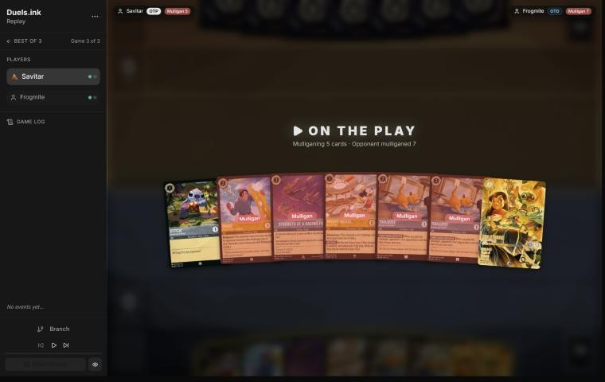
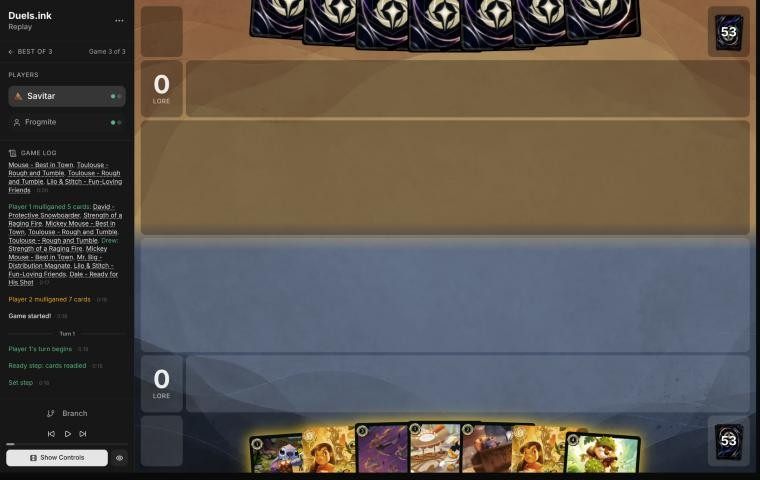
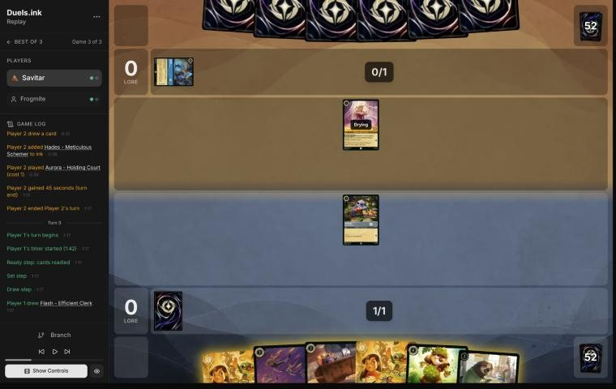
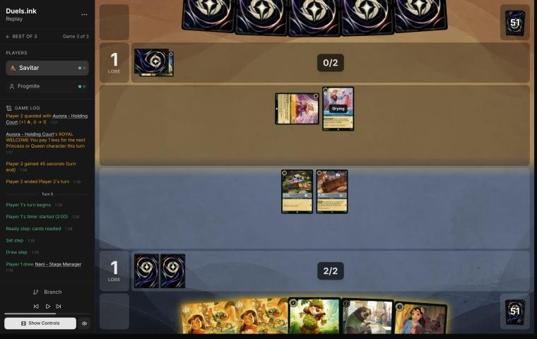

# Review: Savitar vs Frogmite, game 3, 2 Nov 2026

| | |
|---|---|
| **Status** | draft (blind pass done; not discussed, by request) |
| **Replay** | `01a19c3f-185a` (`python3 tools/brief.py 01a19c3f-185a --turn N`) · [duels.ink viewer](https://duels.ink/replay/01a19c3f-185b-7c59-8c30-a5fd7252205e?step=0) |
| **Format** | Core Constructed (from game 1), best-of-three. Set 14 era: inks revealed before the coin toss |
| **Decks** | You: Amber/Steel Rockstar Aggro, the Lilo list. Them: Amber/Sapphire Control, from games 1 and 2 |
| **Play/draw** | You went first (you lost game 2, so the choice was yours) |
| **Result** | Win: Frogmite conceded on their 3rd turn (game turn 6), 2–4. You won the match 2–1 |
| **Meta data** | snapshot of 26 Oct 2026 (fresh until 9 Nov) |
| **Chosen how** | One of the 5 of Savitar's 12 matches the coach reviewed after studying the other 7 (see the TeamAnglerfish game 1 review). The coach knew the match went to a game 3, so games 1 and 2 were split, but not this game's result |

## Summary
- **Good plays:** [5](#turn-5): Lilo & Stitch's Support turned Mr. Big into a 3-strength challenger to kill
  Aurora, their Princess discount. The coach's plan missed it.
- **Close calls:** [1](#turn-1): inking Mickey rather than Mr. Big.
- **Inaccuracies / mistakes / blunders:** two inaccuracies: the [mulligan](#turn-0) (both Toulouses and Mickey sent
  back) and [3](#turn-3) (Mr. Big played and Strength inked, rather than Flash with Mr. Big inked).
- **Unwinnable from:** never.

**What decided it:** Frogmite mulliganed all seven and conceded on their 3rd turn, 2–4, facing Lilo & Stitch with
Aurora gone.

## The game, turn by turn
Verdicts judge each decision on what you could know at the time, **including archetype knowledge an experienced
player has**. Hindsight is kept to its own section. Severity scale: good play / close call /
inaccuracy / mistake / blunder. Principle IDs and hypotheses (H-n) link to copies
in the Citations section at the end, as they stood when they were cited.

**What you knew before the game:** games 1 and 2 against Frogmite's Amber/Sapphire Control. Their key cards, with
the earliest turn each can come:
- **Raging Storm** (8, banish all characters): cast the turn your Toulouse lock ended in game 2 (their 6th turn).
  Both sides' Mickeys gave them 8 ink by their 4th turn in game 1, so with drops it can come that early.
- **Spooky Sight** (6, every character costing 3 or less to its owner's inkwell): from their 5th turn on curve,
  their 4th with one ink from Dream Come True or a drop. Lilo & Stitch (5) and Dale (4) survive it.
- **Hades – Infernal Schemer** (7, one of your characters to your inkwell): two in game 2; with the Icon's and Dream
  Come True's extra ink, from their 5th or 6th turn.
- **Let It Go** (5, song: one character to the inkwell; the Icon, Hades and Carefree Surfer sing it free).
- **Cinderella – Unintentional Icon** (Shift 5 onto a Cinderella, 4/6/3; inks a card at the end of each turn): their
  4th turn onto a Homespun Dressmaker or Dream Come True, and it challenges the turn it's Shifted onto a dry base.
- **Cinderella – Dream Come True** (4; inks a card and draws when they played a Princess) and **Hamm – Piggy Bank**
  (2; the next character costs 1 less), **Aurora – Holding Court** (1; Princess discount when she quests): the ramp.
- **Gaston – Superior Archer** and **The Horseman Strikes!** hit nothing in your deck (5 strength, Evasive).
- **Toulouse** stops all of their sweepers and Let It Go for a turn, since they're actions; only Hades gets through.

### Pre-game

*The board before the decision: [step 0](https://duels.ink/replay/01a19c3f-185b-7c59-8c30-a5fd7252205e?step=0) in the duels.ink replay viewer.*

**What you did:** on the play, kept Stitch and Lilo & Stitch and sent back five: David, Strength of a Raging Fire,
Mickey and both Toulouses. Frogmite sent back all seven.

**Verdict:** an **inaccuracy**. Sending back **both Toulouses and Mickey** is suboptimal because Toulouse is the
deck's one answer to Raging Storm, Spooky Sight and Let It Go, and Mickey is two lore a turn; **keeping Stitch,
Mickey, both Toulouses and Lilo & Stitch** (sending back David and Strength) is better. `tools/mulligan.py` (800 deals
each, candidates run before your mulligan was shown):

| Option | Ink on turns 1–4 | Play turns (of 4) | Lore by turn 4 | Characters by turn 4 | Interaction by turn 4 |
|---|---|---|---|---|---|
| Keep all 7 | 9.72 | 4.00 | 8.5 | 5.9 | 100% |
| **Keep Stitch, Mickey, both Toulouses, Lilo & Stitch** | 9.38 | 4.00 | 9.4 | 5.9 | 19% |
| Keep Stitch, Mickey, one Toulouse, Lilo & Stitch | 9.24 | 4.00 | 9.8 | 5.8 | 23% |
| Keep Stitch, one Toulouse, Lilo & Stitch | 9.50 | 4.00 | 7.6 | 5.5 | 31% |
| **As played** (keep Stitch and Lilo & Stitch) | 9.49 | 4.00 | 8.2 | 5.5 | 35% |
| Full mulligan | 9.28 | 3.74 | 7.6 | 5.1 | 43% |

- **Toulouse:** in game 2 Frogmite cast Raging Storm the turn your Toulouse lock ended. Sent back, you have about a
  1 in 3 chance of a Toulouse by your 4th turn (`tools/odds.py seen`: 18% in the five replacements, then 21% in three
  draws), the turn before they can reach 8 ink.
- **The case for sending Mickey back:** HOT DOG gives them an ink drop too, which brings Storm and Hades a turn
  closer. That argues for one fewer Mickey, not for losing both Toulouses: the sim's three-card keep with a Toulouse
  and no Mickey trails yours by only 0.6 lore and keeps the lock.
- Inaccuracy rather than mistake: all seven cards were inkable and the lore gap to the best keep is about a lore by
  turn 4 ([MULL-1](#cite-mull-1), [MULL-3](#cite-mull-3)). Confidence: medium.

### Turn 1: your turn 1

*The board before the decision: [step 2](https://duels.ink/replay/01a19c3f-185b-7c59-8c30-a5fd7252205e?step=2) in the duels.ink replay viewer.*

**What you did:** the mulligan brought Strength, Mickey, Mr. Big, a second Lilo & Stitch and Dale; inked Mickey;
played Stitch.

**Verdict:** **close call**, fine. Stitch now is the Shift base for Lilo & Stitch on your 3rd turn either way. The
coach would have inked Mr. Big (two lore a turn from Mickey), but inking Mickey is consistent with your mulligan:
HOT DOG gives Control an ink drop each turn too, bringing Storm and Hades closer, and Mr. Big's ICE OUT can keep Hamm
or a Shifted Icon home.

### Turn 2: their turn

**What happened:** Frogmite inked Hades – Meticulous Schemer (6, 5/5/3, Ward: not in any listed Control list) and
played Aurora – Holding Court.

### Turn 3: your turn 2

*The board before the decision: [step 8](https://duels.ink/replay/01a19c3f-185b-7c59-8c30-a5fd7252205e?step=8) in the duels.ink replay viewer.*

**What you did:** drew Flash; inked Strength of a Raging Fire; played Mr. Big; quested Stitch (1–0); ICE OUT on
Aurora.

**Verdict:** an **inaccuracy**. Inking **Strength and playing Mr. Big** is suboptimal because Mr. Big quests for 1
and ICE OUT only stopped a 1-strength Aurora that couldn't hurt Stitch, and **inking Mr. Big and playing Flash** is
better because:
- **Lore:** Flash quests for 2 from next turn, and your next turn's 3 ink goes on Shifting Lilo & Stitch, so Flash
  would otherwise wait until your 4th turn.
- **Strength costs no ink later:** Lilo & Stitch (5) or Dale (4) can sing it, and with three or four characters in
  play it kills Aurora, Hamm or Dream Come True, the pieces that ramp them to Storm and Hades ([H-8](#cite-h-8)).
- Flash is uninkable, so one of Mr. Big and Strength was going in the inkwell; Mr. Big does least against a deck
  with few challengers.
- Confidence: medium. The cost is about a lore and a removal card.

### Turn 4: their turn

**What happened:** Hamm – Piggy Bank inked; Cinderella – Homespun Dressmaker played; Aurora quested (1–1).

### Turn 5: your turn 3

*The board before the decision: [step 18](https://duels.ink/replay/01a19c3f-185b-7c59-8c30-a5fd7252205e?step=18) in the duels.ink replay viewer.*

**What you did:** drew Nani; inked the second Lilo & Stitch; Shifted Lilo & Stitch onto Stitch and quested (4–1);
her Support gave Mr. Big +3 {S}, and Mr. Big challenged and killed the exerted Aurora (taking 1); ICE OUT on
Homespun Dressmaker.

**Verdict:** **good play**, and better than the coach's line.
- **The coach's plan** was to quest both, Lilo & Stitch and Mr. Big (5–1), with ICE OUT on Homespun. It read Mr. Big
  as 0 strength and missed Support.
- **Your line gives up Mr. Big's 1 lore to kill Aurora,** their Princess discount: with her questing next turn, Dream
  Come True or Belle (4) came down with 3 ink. It also takes 1 lore a turn off their board.
- **Nothing is exposed:** Mr. Big (1 damage, 1 willpower left) is exerted, but ICE OUT keeps Homespun home and
  nothing else of theirs is in play. Lilo & Stitch (5 willpower, Resist 1) is out of reach.

### Turn 6: their turn

**What happened:** Frogmite inked an Unintentional Icon, quested Homespun Dressmaker (2–4) and conceded.

## Lessons
1. **Support makes your 0-strength characters into challengers** ([5](#turn-5)): quest Lilo & Stitch first, give her
   +3 {S} to Mr. Big (or Mike, or Dale), and challenge an exerted 2- or 3-willpower character. Against Control, that's
   their ramp: Aurora, Hamm, Dream Come True.
2. **Against Control, Toulouse is worth a slot in the opening hand** ([pre-game](#turn-0)): it's the deck's only answer
   to Raging Storm, Spooky Sight and Let It Go, and sent back it's about a 1 in 3 chance by your 4th turn.

## Knowledge-base updates (applied 2026-11-02, without discussion at danny's request)
- **Meta, Amber/Sapphire notes:** game 3 of Frogmite's Control list.
- **Meta, Amber/Steel notes on your list:** Lilo & Stitch's Support on a 0-strength character to challenge.

## Hindsight
Doesn't change the verdicts above.
- Frogmite sent back all seven cards and conceded on turn 6, before any of their sweepers could come online.

## The coach's errors
Not discussed with the player; the coach found these itself.

| When | Error | How it was caught | How it won't happen again |
|---|---|---|---|
| [Turn 5](#turn-5) plan | Planned to quest Mr. Big and missed Lilo & Stitch's Support, which made him a 3-strength challenger that could kill Aurora. The brief listed Mr. Big's challenge at 0 strength; the knowledge base described Support pumps only from the receiving side (Detectives). | Savitar's line, read after the plan | Proposed (needs danny's OK): the brief's challenge options add each ready character's challenge with the Support total of the Supporters that can quest first, as it already does for strength-threshold removal. Done now: a "Playing it" note on Savitar's list, which the brief prints for Lilo & Stitch |

## Open questions
- [Pre-game](#turn-0): against Control, is Mickey's ink drop for them worth his 2 lore a turn?

## Citations
Copies of the coach's knowledge base cited above, as they stood when they were cited (the private repository's commit and date are given with each). They don't change when the knowledge base does.

<!-- Filled in by `python3 tools/cite.py <this file>`: every principle ID, H-n, "principle N" and CR rule above
becomes a link to an entry here. Add a file or one of its sections with `--file PATH --section TEXT`, and link to
the anchor it prints. Never link into the private repository. -->

**MULL-1**: strategy principle, `kb/strategy/principles.md` at `03594dc` (2026-11-02), working tree

> - **MULL-1. Keep a plan, not the strongest cards.** *Ask: "Which hand gives me the best chance to execute my game plan in this matchup?"* `[MCL ch.12]` · baseline

**MULL-3**: strategy principle, `kb/strategy/principles.md` at `03594dc` (2026-11-02), working tree

> - **MULL-3. The right keep depends on the matchup.** Early interaction against aggro; pressure, draw and engines against slow decks. The mulligan is the first expression of your role. In the Set 14 era the opponent's inks are known before the mulligan (RULE-8), so this applies from game 1 of a match. `[MCL ch.12]` · baseline

**H-8**: hypothesis, `kb/strategy/hypotheses.md` at `03594dc` (2026-11-02), working tree

> ### H-8. Trade cheap characters for the opponent's ramp engine at the first chance
> - **Claim:** against a ramp-control deck, kill their ramp engine (Cinderella – Unintentional Icon) as soon as it's
>   exposed, even at the cost of several cheap characters: those characters are what their sweepers take anyway, and
>   the engine is their lore and their ink.
> - **Evidence for:** 01a19d83 (danny vs daman, game 2), turns 8 and 10. Marie and two Launchpads could kill an exerted
>   Icon (6 willpower) both turns; left alive, she took them from 4 to 11 and ramped them into Raging Storm on turn 13.
>   danny agreed in discussion (2026-11-02): "I should've banished it while I had the chance."
> - **Related:** stonks 📈's rule from the other side (H-6, 01a16039): keep your own Icon ready rather than offer that
>   trade.
> - **Status:** open (one game).
