# Review: MK_ifoughtthelore vs OvoVeg, 2 Nov 2026 (game 1)

| | |
|---|---|
| **Status** | draft, in discussion (turn 10 revisited on 2026-11-02, after MK_ifoughtthelore's feedback) |
| **Replay** | `01a19c72-07d4-7d8b-8e42-489be25d99dc` (`python3 tools/brief.py 01a19c72 --turn N`) · [duels.ink viewer](https://duels.ink/replay/01a19c72-07e2-7d70-ae1c-62c9e0b29409?step=0) |
| **Format** | Core Constructed. Set 14 era: inks revealed before the coin toss |
| **Decks** | You: Amber/Sapphire Detectives. Them: Amber/Emerald ([the coach's notes on Circle of Life](#cite-kb-meta-archetypes-amber-emerald-the-engine-discard-phillip-then-replay-him)); archetype as it became clear: Circle of Life (about 90% from their inked Angel – Siren Singer on turn 1, certain by turn 5) |
| **Play/draw** | OvoVeg went first; you were on the draw |
| **Result** | Won: OvoVeg conceded on turn 23 at 17–2 |
| **Meta data** | snapshot of 26 Oct 2026 (7 days old, fresh) |
| **Chosen how** | Sent by the user as a match zip of two games. Only the replays were read, not the zip's result file, and two games doesn't tell the score: a player can leave before game 3 |

## Summary
- **Good plays:** [6](#turn-6) (LEND A PAW's ramp, setting up Elisa for their wipe turn), [8](#turn-8) (Support onto
  Ariel for Gaston, then Nick into Angel: their Sing Together fell from 10 to 3), [12](#turn-12), [14](#turn-14)
  (Elisa took the Circle of Life in their hand and Nick's Support killed Max Goof – Chart Topper), [16](#turn-16),
  [18](#turn-18) (three challenges cleared their board), [20](#turn-20), [22](#turn-22).
- **Close calls:** the [mulligan](#turn-0) (a deeper mulligan than the coach's, better on curve and early lore),
  [2](#turn-2) (inking Lead Detective over the second Gaston), [10](#turn-10) (no ink, to keep both Elisas and Nick;
  revisited in discussion, leaning to your hold).
- **Inaccuracies:** none. The blind pass called turn 10 one; see [the coach's errors](#coachs-errors).
- **Unwinnable from:** never.

**What decided it:** Circle of Life's wipe needs Phillip in the discard, damage on your characters and 8 for Sing
Together. You broke a different piece each time it was set up: turn 8 cut their singers, turn 14 took the Circle of
Life from their hand and killed the Max Goof that replayed Malicious. Meanwhile you led the race from turn 6.

## The game, turn by turn
Verdicts judge each decision on what you could know at the time, **including archetype knowledge an experienced
player has**. Hindsight is kept to its own section. Severity scale: good play / close call /
inaccuracy / mistake / blunder. Principle IDs and hypotheses (H-n) link to copies
in the Citations section at the end, as they stood when they were cited.

**What you knew before the game:** they're Amber/Emerald: Circle of Life 60%, Princess Aggro 24%, an unlisted list
16%. They went first and sent back 5 cards before your mulligan. Their key cards, and the earliest each can come
(their turn k is game turn 2k−1):
- **Circle of Life** (song 8, Sing Together 8): plays a character from their discard for free. The archetype's
  combo is to discard Prince Phillip (Tod – Clever Fox, Max Goof – Karaoke Star, Strike a Good Match), damage your
  board, then replay him. Two Angel – Siren Singer (Singer 3) and a Tod reach 8, so it can come on their 5th turn
  (game turn 9), as in an earlier Circle of Life game.
- **Prince Phillip – Vanquisher of Foes** (9; 6/6/3, Evasive): on play, banishes all your damaged characters.
  Hard-cast at 9, or 7 after Akood et Emuti's discount; replayed free by Circle of Life.
- **Malicious, Mean, and Scary** (song 3): 1 damage to each of your characters. Castable on their 3rd turn (game
  turn 5), or sung free by any cost-3+ character of theirs that's dry, Angel included.
- **Don Karnage – Debonair Pirate** (6, Shift 4 onto Don Karnage – Khan's Courier): 1 damage to each of your
  characters, through Resist. From their 4th turn by Shift.
- **To Wither a Flower** (song 4, uninkable): 2 damage to each damaged character of yours. Ursula – Vanessa (Singer
  4) sings it free.
- **Milo Thatch – Getting His Hands Dirty** (7, Ward): returns a character of yours to your hand. **Chernabog –
  Unnatural Force** (5): shuffles one of yours into your deck.
- **Max Goof – Karaoke Star** (3): quests for 4 once 5 songs are in their discard.
- If it's **Princess Aggro**: Dale – Ready for His Shot (4; their characters deal damage with their {W} in
  challenges), Elinor (4; 1 damage, a card and a lore at the end of a turn with 3 exerted characters), Pocahontas –
  Peacekeeper (5, Shift 3 onto Pocahontas – Guiding the Tribe; locks challenges), and cost reducers (Pluto, Aurora,
  Grandmother Willow) that bring each a turn early.

Your plan against Circle of Life: they quest little before the wipe, so build a lore lead with characters you can
afford to lose, keep a rebuild in hand, and take Circle of Life or Malicious from their hand with Elisa Maza (a
song is a non-character card). Against Princess Aggro, interaction has to come early.

### Pre-game

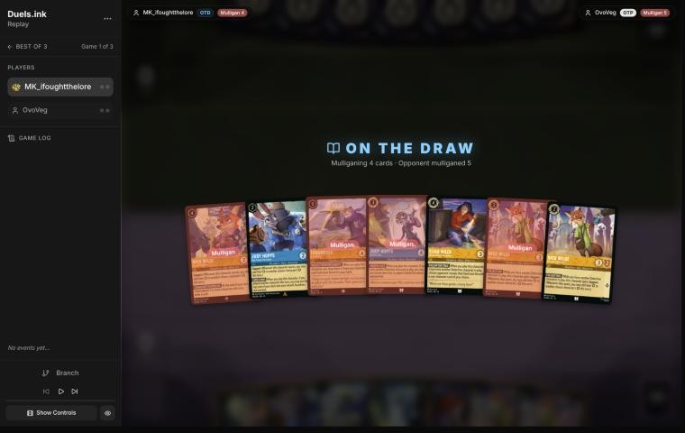
*The board before the decision: [step 0](https://duels.ink/replay/01a19c72-07e2-7d70-ae1c-62c9e0b29409?step=0) in the duels.ink replay viewer.*

**What you did:** sent back 4 (Nick Wilde – Providing Backup, Judy Hopps – On the Case, Fangmeyer – Icy Officer,
Nick Wilde – Toy Drive Officer), keeping Judy Hopps – Day Camp Instructor, Elisa Maza and one Nick Wilde – Providing
Backup. Drew Gaston – Superior Archer, Eilonwy, Fangmeyer and Judy Hopps – Lead Detective.

**Verdict:** close call. The seven had no 1-drop and three uninkables (Toy Drive Officer, Day Camp Instructor,
Fangmeyer), so it couldn't both ink and curve. Keeping all 7 was clearly worst. `tools/mulligan.py` (1,500 deals):

| Option | Ink on turns 1–4 | Play turns (of 4) | Lore by turn 4 | Characters by turn 4 | Interaction by turn 4 |
|---|---|---|---|---|---|
| Keep all 7 | 9.04 | 3.18 | 3.8 | 4.1 | 100% |
| Send back Fangmeyer only | 9.27 | 3.34 | 4.3 | 4.4 | 100% |
| Send back Fangmeyer and Toy Drive Officer (the coach's pick) | 9.41 | 3.46 | 4.7 | 4.7 | 100% |
| **As played** (keep Day Camp, Elisa, one Nick) | 9.40 | 3.66 | 5.4 | 4.7 | 73% |
| Full mulligan | 9.46 | 3.80 | 6.1 | 4.6 | 86% |

Your keep led the coach's on curve and early lore, and gave up Judy – On the Case's early interaction. Against a
deck that's 60% Circle of Life, which quests little before its wipe, early lore is the plan and early interaction
matters less, so your deeper mulligan fits the matchup ([MULL-1](#cite-mull-1), [MULL-3](#cite-mull-3)); against Princess Aggro, the coach's keep
would have been safer. Keeping Elisa, the best card in the matchup, was the important part. Confidence: medium (the
sim can't weigh card quality).

### Turn 2: your turn 1

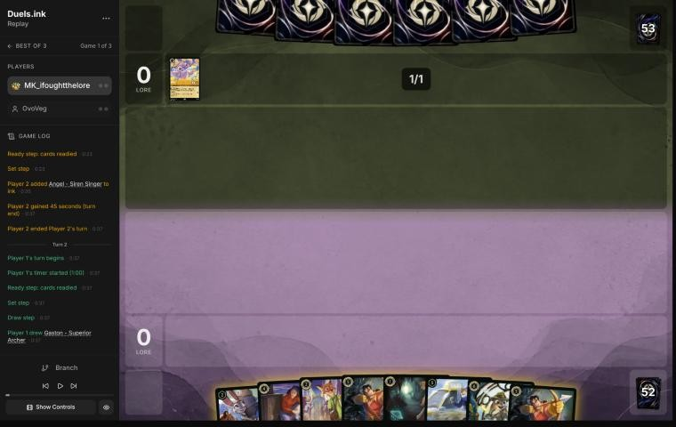
*The board before the decision: [step 5](https://duels.ink/replay/01a19c72-07e2-7d70-ae1c-62c9e0b29409?step=5) in the duels.ink replay viewer.*

**What you did:** drew a second Gaston – Superior Archer, inked Judy Hopps – Lead Detective, and held Eilonwy.

**Verdict:** close call, on both choices. Their inked Angel – Siren Singer made Circle of Life about 90% likely.
- **Holding Eilonwy** loses her quests on your turns 2 and 3, but saves her to be the "other character" for Judy –
  Day Camp Instructor's LEND A PAW on your turn 3 (Eilonwy + Day Camp for 3 ink, ramping you to 5 on turn 4). Played
  now, Day Camp would have no partner until turn 4. Either is fine.
- **The ink:** with two Gastons in hand, inking one of them was the natural choice. Lead Detective is your best
  threat and Day Camp Instructor in hand is a Judy to Shift her onto for 4. Against Circle of Life, though, Gaston
  is the clean answer to a returning Prince Phillip (6 {S}), so the second copy isn't dead. Slightly in favour of
  inking a Gaston ([INK-2](#cite-ink-2)), confidence low.

### Turn 4: your turn 2

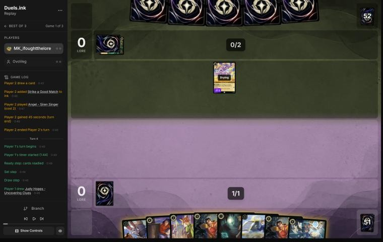
*The board before the decision: [step 10](https://duels.ink/replay/01a19c72-07e2-7d70-ae1c-62c9e0b29409?step=10) in the duels.ink replay viewer.*

**What you did:** inked the second Gaston and played Nick Wilde – Providing Backup.

**Verdict:** the coach's line too. Two Angels (one inked, one in play) put them at nearly 100% Circle of Life. Nick
is the only 2-drop that does anything alone, and holding Eilonwy with Day Camp Instructor keeps LEND A PAW's ramp
for next turn.

### Turn 6: your turn 3

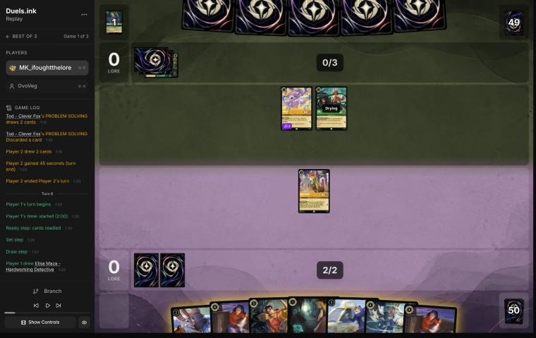
*The board before the decision: [step 17](https://duels.ink/replay/01a19c72-07e2-7d70-ae1c-62c9e0b29409?step=17) in the duels.ink replay viewer.*

**What you did:** inked Judy Hopps – Uncovering Clues, played Eilonwy then Judy – Day Camp Instructor (LEND A PAW put
a card into your inkwell), and quested Nick for 1.

**Verdict:** good play: exactly the coach's line. Tod had discarded Prince Phillip on their turn, so the Circle of
Life wipe was set up for their turn 9: Angel (Singer 3) and Tod make 6 for Sing Together next turn, and any
character they add makes 8 the turn after. This turn's ramp gives you 5 ink on turn 8, enough for Elisa Maza (with a
Detective in play) to see their hand and take Circle of Life or a damage song before that turn. Inking Uncovering
Clues kept the last Gaston (the answer to a returned Phillip) and both Elisas. The quest exposed Nick only to Angel,
a trade they'd rarely take with their singer.

### Turn 7: their turn

**What happened:** Angel sang Akood et Emuti (draw, next character 2 cheaper) for Ariel – Ethereal Voice (4, 3/4/2,
Boost; draws when they play a song with a card under her). They inked a second Prince Phillip, boosted Ariel, and Tod
sang Malicious, Mean, and Scary: Eilonwy died, and Nick and Day Camp Instructor took 1 damage each. Angel, Tod and
Ariel make 10 for Sing Together next turn, with Phillip in their discard: Circle of Life would replay him and
banish every damaged character you have.

### Turn 8: your turn 4

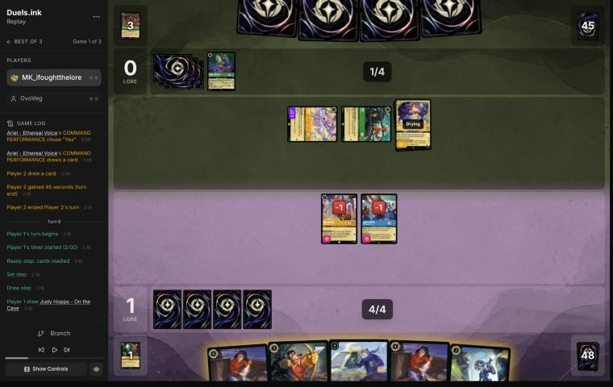
*The board before the decision: [step 32](https://duels.ink/replay/01a19c72-07e2-7d70-ae1c-62c9e0b29409?step=32) in the duels.ink replay viewer.*

**What you did:** quested Day Camp Instructor (+1, 2–0) and gave her Support's +2 to Ariel, making her 5 {S}; inked
Judy Hopps – On the Case; played Gaston – Superior Archer, whose WATCH THIS! banished Ariel; then challenged the
exerted Angel with Nick (both banished).

**Verdict:** good play. The turn had to stop the Circle of Life wipe: Nick and Day Camp were damaged, and Angel, Tod
and Ariel totalled 10 for Sing Together. Your line took them to 3 (Tod alone), so Circle of Life couldn't be sung
next turn, and they had 5 ink, nowhere near its cost of 8.
- **The coach's plan** was Elisa Maza first (Nick and Day Camp in play, so she reveals their hand and takes a
  non-character card, about a 1 in 3 chance of Circle of Life), then Nick and Day Camp into the exerted Tod and
  Angel, both trades. That also took them below 8 (Ariel's 4), saw their hand, and saved Gaston for a returning
  Phillip.
- **Why yours is at least as good:** Ariel was their best card on board, a 2-lore quester that draws with every song,
  and the brief listed her in range of Gaston with Day Camp's +2. Your line removed her and a singer, gained a lore,
  and kept both Elisas for later, when they've dug deeper and Circle of Life is likelier to be in their hand. Its
  costs: the last Gaston in hand (two more and four Always Vigilant are in your deck for Phillip), and Day Camp left
  exerted with 1 damage, so Tod can trade with her and any ping kills her. The coach's line leaves Ariel questing for
  2 a turn and Elisa alone against her. Close to even, slightly in favour of yours ([THREAT-1](#cite-threat-1), [TEMPO-1](#cite-tempo-1)). Confidence:
  medium.

### Turn 9: their turn

**What happened:** a second Ariel – Ethereal Voice (boosted), and Tod traded with the damaged, exerted Day Camp
Instructor. They have no character to sing with next turn but the drying Ariel (Sing Together 4).

### Turn 10: your turn 5

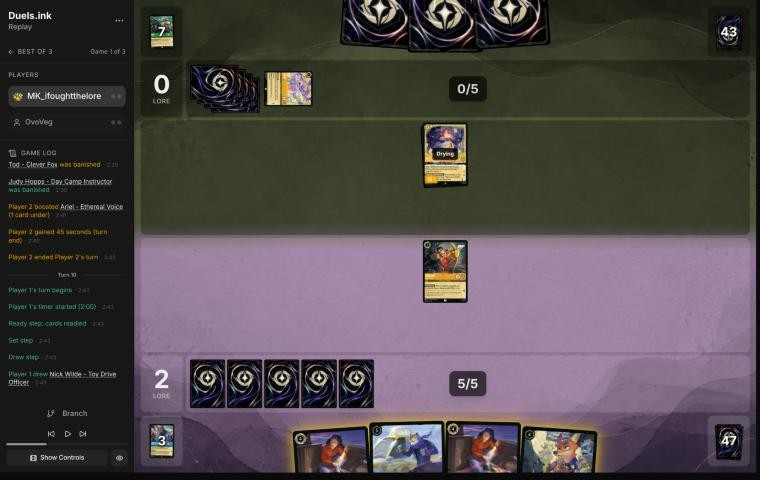
*The board before the decision: [step 45](https://duels.ink/replay/01a19c72-07e2-7d70-ae1c-62c9e0b29409?step=45) in the duels.ink replay viewer.*

**What you did:** drew Nick Wilde – Toy Drive Officer. You played Elisa Maza, whose FOLLOW THE TRAIL failed with no
other Detective in play, and undid it. Then Fangmeyer – Icy Officer returned Nick Wilde – Providing Backup to your
hand, and Gaston quested (+1, 3–0). **No card was inked.**

**Verdict:** the plays were right; the ink is a **close call, leaning to your hold** *(revisited in discussion; the
blind pass called it an inaccuracy)*.
- **Fangmeyer was the play.** With no Detective in play, Elisa's trigger would have failed (the undo caught it), and
  Fangmeyer is a 2-lore Detective that makes both Elisas live and brings back a 2-drop to pair with one next turn.
  Gaston's quest exposed him only to Ariel, a 3-for-3 exchange that kills neither.
- **Inking an Elisa was wrong** (your point in discussion, and the blind pass agreed): before Fangmeyer they were your
  only inkable cards, and each Elisa can take a song from a hand that's all songs and combo pieces, the key answer in
  this matchup ([INK-2](#cite-ink-2)). The blind pass's fallback, returning Day Camp Instructor and inking an Elisa, is
  withdrawn for the same reason.
- **Inking Nick after Fangmeyer returned him** was the blind pass's line, and its case was miscounted. It said next
  turn's Elisa + Nick "uses 6 either way", but an inked Nick isn't in your hand next turn: turn 12 becomes Elisa alone
  with 3 ink unused, unless the draw costs 3 or less. The extra ink pays only from turn 14 (Toy Drive Officer and an
  Elisa together need 8), and two characters a turn into a deck built to wipe the board is what the plan against
  Circle of Life warns against: keep a rebuild in hand. Cards, not ink, are the scarcer resource in that game
  ([H-2](#cite-h-2), [INK-3](#cite-ink-3)).
- **What the hold costs:** the skipped ink is gone for the game, and turn 12's ink then has to come from your draw;
  an uninkable draw brings back the same choice. Slightly in favour of your hold; confidence medium-low.

### Turn 11: their turn

**What happened:** they inked Circle of Life and played Max Goof – Chart Topper (6, 4/5/2): each time he quests, they
play a song costing 4 or less from their discard for free (Malicious, Mean, and Scary and Akood et Emuti are there).
Ariel stayed ready.

### Turn 12: your turn 6

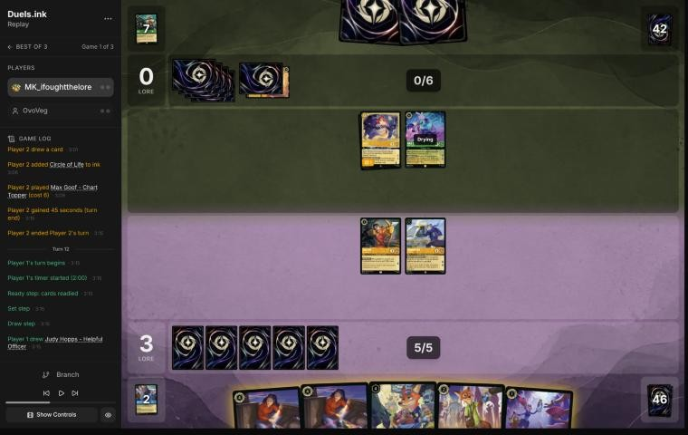
*The board before the decision: [step 55](https://duels.ink/replay/01a19c72-07e2-7d70-ae1c-62c9e0b29409?step=55) in the duels.ink replay viewer.*

**What you did:** inked Judy Hopps – Helpful Officer, played Elisa Maza (FOLLOW THE TRAIL saw their two cards; nothing
was discarded, so neither was a song or action) and Nick Wilde – Providing Backup, and quested Fangmeyer and Gaston
(+3, 6–0).

**Verdict:** good play, the coach's line. Max Goof – Chart Topper was drying and Ariel ready, so nothing could be
challenged. Elisa with Fangmeyer in play was the turn's best card: their deck's combo pieces are songs, and she
showed you their hand. Nick is the better body against a Malicious replay (2 willpower against Helpful Officer's 1).
The quests exposed Fangmeyer to Max (4 {S} kills him, Max survives), but that challenge would cost Max his quest and
his free song.

### Turn 13: their turn

**What happened:** Meilin Lee missed; Max quested (2–6) and replayed Akood et Emuti from their discard; Ariel drew;
Strike a Good Match discarded a second Chernabog; they inked a third Prince Phillip and played Ursula – Vanessa
(Singer 4) free. Max is exerted. Next turn they have 8 ink (Circle of Life's full cost) and Ariel, Meilin and Ursula
total 11 for Sing Together, with Phillip and Malicious in their discard.

### Turn 14: your turn 7

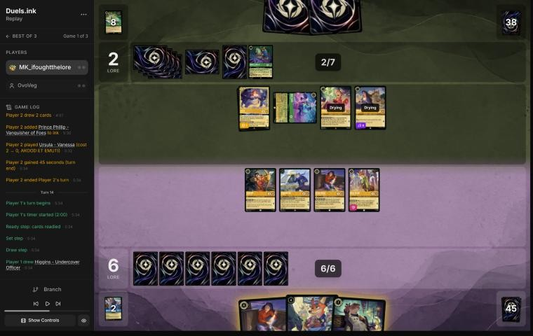
*The board before the decision: [step 72](https://duels.ink/replay/01a19c72-07e2-7d70-ae1c-62c9e0b29409?step=72) in the duels.ink replay viewer.*

**What you did:** drew Higgins. Played the second Elisa Maza: their hand held Circle of Life, and you discarded it.
Nick quested (+1) and gave the first Elisa +3; she challenged the exerted Max Goof – Chart Topper (6 damage to his 5
willpower; both banished). Fangmeyer and Gaston quested (+3, 10–2). Higgins went into the ink last.

**Verdict:** good play, and the coach's line. Two things had to happen:
- **Stop the wipe.** With 8 ink next turn, Phillip and Malicious in their discard and 11 for Sing Together, the
  danger was Max questing to replay Malicious (1 damage on each of yours), then Circle of Life bringing back Phillip
  to banish every damaged character. Elisa took the Circle of Life they held, and killing Max took away the free
  Malicious. They'd now need both a damage card and another Circle of Life from their next draws.
- **Kill Max**, their song engine and a 2-lore quester. Every one of your characters dies to his 4 {S}, so one had to
  be traded; Nick's Support made it one-for-one. The coach would have sent Gaston rather than the first Elisa, but
  they're the same 3/4/1 with nothing left to trigger.

Inking Higgins after seeing their hand was the right order ([SEQ-1](#cite-seq-1)). The race after: 10–2, with your board questing for
5 against their 4.

### Turn 15: their turn

**What happened:** Milo Thatch – Getting His Hands Dirty (7, 5/5/3, Ward); SCHOLAR'S GAMBIT discarded Lenny – Toy
Binoculars to return their own Meilin Lee to hand, so she can search the top 4 for a song again. Nobody quested.
Ward means Gaston and Always Vigilant can't choose Milo; only a challenge, once he's exerted, removes him.

### Turn 16: your turn 8

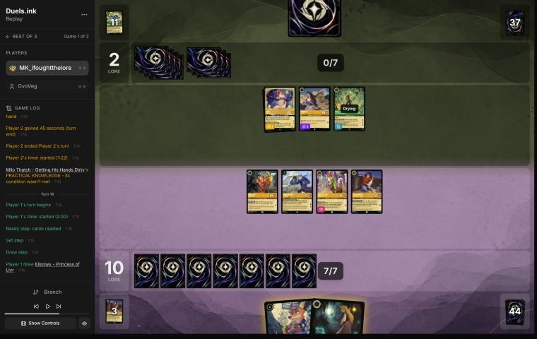
*The board before the decision: [step 87](https://duels.ink/replay/01a19c72-07e2-7d70-ae1c-62c9e0b29409?step=87) in the duels.ink replay viewer.*

**What you did:** played Nick Wilde – Toy Drive Officer and Eilonwy, quested all four others (+5, 15–2), and drew
Judy Hopps – Always Vigilant from COMMUNITY OUTREACH.

**Verdict:** good play, the coach's line. Nothing of theirs was exerted, so the turn was lore and width. At 15 you
need 5 next turn, and six characters can make 7, so their challengers (Milo and Ariel can each kill one exerted
character) can't stop it alone. *Revisited, from this turn's information only:* the coach's exposure count left out
To Wither a Flower (held about 1 in 6 after their draw, more with Meilin Lee's search for a song). Challenges by
Ursula and Ariel damage two characters without killing them, and To Wither then deals 2 to each, so their turn
could remove three of the four questers, not two. The verdict stands: the alternative of questing less leaves you
short of 20 by turn 18 anyway, and every challenge they make is a quest they don't. The wipe needed both a damage card and Circle of Life from a 1-card hand (Meilin Lee),
their draw and Meilin's search: roughly 1 in 20. Holding Toy Drive Officer and Eilonwy back as a rebuild would have
guarded against that small chance at the cost of the redundancy that beats the likely one.

### Turn 17: their turn

**What happened:** Meilin Lee's search found To Wither a Flower. Ursula challenged Nick (1 damage), Ariel challenged
Elisa (3 damage) and Milo killed Fangmeyer; To Wither a Flower then banished the damaged Nick and Elisa. They inked
their fourth Prince Phillip and quested nothing, so they're still on 2. Their three challengers are exerted and each
has 1 willpower left.

### Turn 18: your turn 9

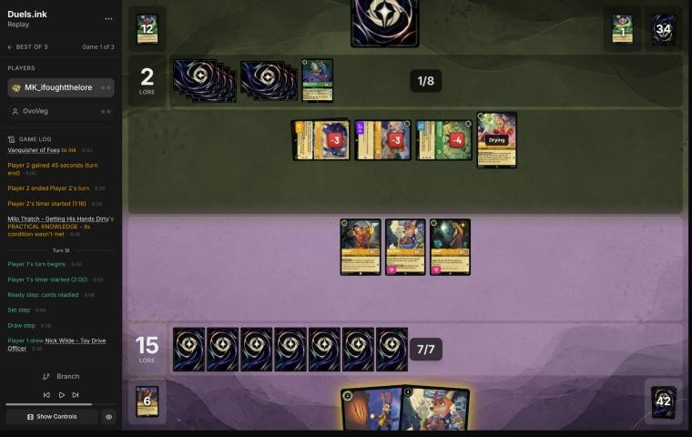
*The board before the decision: [step 106](https://duels.ink/replay/01a19c72-07e2-7d70-ae1c-62c9e0b29409?step=106) in the duels.ink replay viewer.*

**What you did:** played the second Nick Wilde – Toy Drive Officer, then challenged all three exerted characters:
Eilonwy into Milo (both banished), Gaston into Ariel (Gaston survives with 3 damage) and the first Toy Drive Officer
into Ursula (survives with 1). Their board is Meilin Lee alone. 15–2.

**Verdict:** good play, the coach's line. The alternative was questing Gaston, Toy Drive Officer and Eilonwy to 18,
leaving their three damaged characters alive. Their next turn could then kill all three questers (Milo any one;
Ariel and Ursula together a 4-willpower one; Meilin Eilonwy) and quest the rest, leaving you short again. Your line
traded a 1-cost Eilonwy for Milo (7) and took Ariel and Ursula for nothing. They're left with one character, one
card in hand and 2 lore, and you need 5 more from three characters. From this far ahead, the safest path is the one
that leaves them nothing ([POS-1](#cite-pos-1), [TRADE-2](#cite-trade-2)). Their outs are Circle of Life (8 ink) replaying Phillip onto your two damaged characters, and Don Karnage –
Debonair Pirate (6; 1 damage to each of yours on play, about 1 in 6 by their draw), which finishes Gaston and sets
up Meilin's challenge. *Revisited, from this turn's information:* the coach first named only Circle of Life; Don
Karnage was in the brief's key cards too. Neither changes the verdict: the questing line loses as much to both.

### Turn 19: their turn

**What happened:** Don Karnage – Debonair Pirate dealt 1 to each of yours, banishing Gaston; Meilin Lee challenged
the damaged first Toy Drive Officer and banished him. They added Ursula – Vanessa. You keep the second Toy Drive
Officer (1 damage); 15–2.

### Turn 20: your turn 10

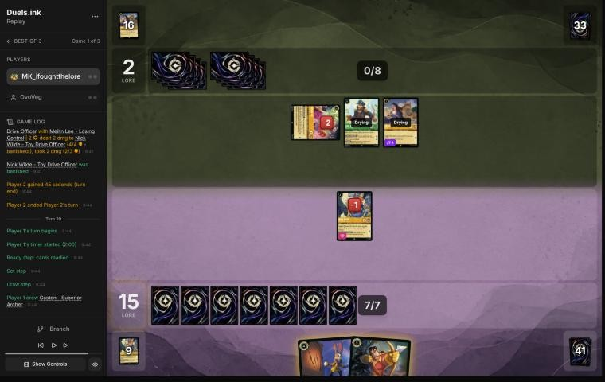
*The board before the decision: [step 117](https://duels.ink/replay/01a19c72-07e2-7d70-ae1c-62c9e0b29409?step=117) in the duels.ink replay viewer.*

**What you did:** drew Gaston; Toy Drive Officer quested (+1, 16–2) and gave Don Karnage +2 {S}, making him 5; Gaston's
WATCH THIS! banished him. Always Vigilant stayed in hand, uninked.

**Verdict:** good play, the coach's line: the Detectives' Support-then-banish on their best remaining body (2 lore,
and SO SUAVE takes a lore off each damaged character of yours while he's exerted). With their hand empty, keeping
Always Vigilant rather than inking it costs nothing: 7 ink already covers anything you'll draw ([H-2](#cite-h-2)).

### Turn 21: their turn

**What happened:** they drew To Wither a Flower: Ursula's challenge added a second damage to Toy Drive Officer and the
song banished him. Gaston is your only character; 16–2.

### Turn 22: your turn 11

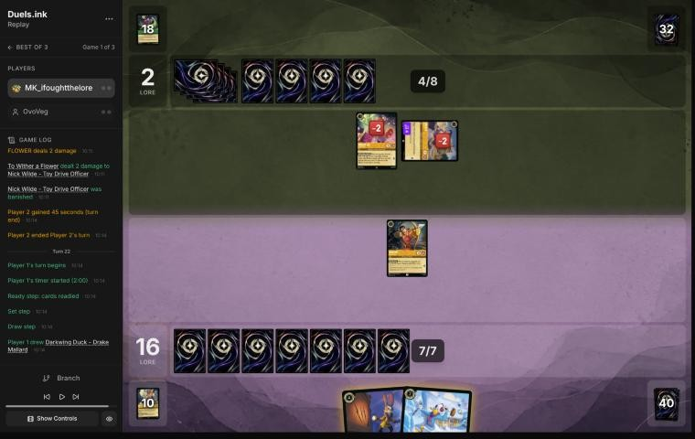
*The board before the decision: [step 126](https://duels.ink/replay/01a19c72-07e2-7d70-ae1c-62c9e0b29409?step=126) in the duels.ink replay viewer.*

**What you did:** drew Darkwing Duck – Drake Mallard; played him and Judy Hopps – Always Vigilant (no target for GOT
YOU NOW), and quested Gaston (+1, 17–2).

**Verdict:** good play. With their hand empty, rebuilding to three questers sets up 20 next turn. Gaston killing the
exerted Ursula was the alternative: one lore less now and a singer fewer for them. Their two 1- and 2-strength
characters can't kill a 4-willpower Gaston together, so the quest costs little. Close to even, not worth flagging.

### Turn 23: their turn

**What happened:** Meilin Lee found Malicious, Mean, and Scary, and they conceded at 17–2.

## Lessons
1. **Circle of Life's wipe has three parts: Prince Phillip in their discard, damage on your characters, and 8 for
   Sing Together (or 8 ink).** Breaking any one stops the turn. Count their singers' total every turn from the moment
   Phillip is discarded, and trade into exerted singers when it's about to reach 8 ([turn 8](#turn-8)).
2. **Elisa Maza is the Detectives' best card against a song deck,** but only with another Detective in play: on
   [turn 10](#turn-10) Fangmeyer had to go first. Holding the second copy until they had dug for Circle of Life found
   it on [turn 14](#turn-14).
3. **Kill Max Goof – Chart Topper on sight.** Each quest replays a song from their discard: a free Malicious every
   turn sets up Phillip and To Wither a Flower.
4. **To Wither a Flower turns their non-lethal challenges into kills** ([turn 17](#turn-17)): 2 damage to each
   damaged character, so a challenge that leaves one of yours on 1 damage is enough.

## Proposed knowledge-base updates (applied after discussion)
- **Meta, the Amber/Emerald notes (Circle of Life), from this game:**
  - OvoVeg's list ran Ariel – Ethereal Voice ×2+ (4, 2 lore; Boost; draws when they play a song with a card under
    her), not in duels.ink's average list. Kill her early: with Akood et Emuti's discount she came down on their 4th
    turn.
  - Max Goof – Chart Topper replays Malicious, Mean, and Scary (or Akood et Emuti) from their discard on each quest.
  - Milo Thatch's SCHOLAR'S GAMBIT returned their own Meilin Lee to hand so she could search for a song again.
  - To Wither a Flower after challenges (turns 17 and 21).
  - They inked Prince Phillip three times once one was in the discard, and inked a Circle of Life.
- **Meta, the Amber/Sapphire notes (Detectives, how to play it against Circle of Life):** Elisa Maza's FOLLOW THE
  TRAIL takes songs, so it hits Circle of Life, Malicious and To Wither a Flower; Support onto Ariel (3 {S} + 2)
  puts her in Gaston's range.
- **Strategy, a new hypothesis:** against Circle of Life, killing exerted singers to keep their Sing Together
  total under 8 stops the wipe turn as surely as taking the song. Evidence: turn 8.
- **Strategy, from discussion (MK_ifoughtthelore's experience of the matchup):** against Circle of Life, don't ink
  Elisa Maza; when she's the only inkable card, skipping the ink can be right. Evidence: turn 10 here, and turn 8
  and the mulligan of game 2. A hypothesis to test, with game 2's counterweight (Lead Detective's Resist).

## Hindsight
Doesn't change the verdicts above.
- The hand Elisa saw on turn 14 held Circle of Life with Phillip in the discard and Max Goof able to replay Malicious:
  without that turn, their turn 15 could have wiped your board.
- Their deck had four Prince Phillips; three went into their inkwell and one stayed in the discard. Circle of Life
  never resolved.

## The coach's errors

| When | Error | How it was caught | How it won't happen again |
|---|---|---|---|
| Turn 16 | The exposure count left out To Wither a Flower after challenges: Ursula's and Ariel's challenges damage without killing, and the song then kills. Verdict unchanged | Reading turn 17; revisited from turn 16's information | Proposed: the brief prints, when their list has a sweeper that hits only damaged characters (To Wither a Flower, Prince Phillip), which of your exerted characters their challengers can damage but not kill, as targets for it |
| Turn 18 | "Their remaining out" named only Circle of Life; Don Karnage – Debonair Pirate was in the brief's key cards. Verdict unchanged | Reading turn 19; revisited | Proposed: a verdict that names "their outs" lists every card the brief tags sweeper or removal at their next ink, copied from the brief, not from memory |
| Turn 3 | Read the brief through sed, which the new hook refused | The hook | Already in place: `.claude/hooks/guard_brief.py` |
| [Turn 10](#turn-10) | Recommended inking Nick – Providing Backup and said next turn's Elisa + Nick "uses 6 either way": an inked Nick can't be played next turn, so the line's cost on turn 12 was never counted. Verdict revisited from inaccuracy to close call | Re-examining the verdict after MK_ifoughtthelore's feedback (relayed by danny, 2026-11-02) | Done (2026-11-02, in the decision method's verdict section, the review template and the skill): every verdict on an ink choice carries an **ink check** line: the plays on the next two turns under each option, with the inked card taken out of the hand |

## Open questions
- [Turn 10](#turn-10): was skipping the ink deliberate, to keep both Elisas and Nick for later turns? **Answered**
  (MK_ifoughtthelore, 2026-11-02): yes; against Circle of Life the Elisas are worth more played than inked. The verdict
  was revisited.
- [Turn 2](#turn-2): why ink Lead Detective over the second Gaston?

## Citations
Copies of the coach's knowledge base cited above, as they stood when they were cited (the private repository's commit and date are given with each). They don't change when the knowledge base does.

**MULL-1**: strategy principle, `kb/strategy/principles.md` at `daa1bc4` (2026-11-02), working tree

> - **MULL-1. Keep a plan, not the strongest cards.** *Ask: "Which hand gives me the best chance to execute my game plan in this matchup?"* `[MCL ch.12]` · baseline

**MULL-3**: strategy principle, `kb/strategy/principles.md` at `daa1bc4` (2026-11-02), working tree

> - **MULL-3. The right keep depends on the matchup.** Early interaction against aggro; pressure, draw and engines against slow decks. The mulligan is the first expression of your role. In the Set 14 era the opponent's inks are known before the mulligan (RULE-8), so this applies from game 1 of a match. `[MCL ch.12]` · baseline

**INK-2**: strategy principle, `kb/strategy/principles.md` at `daa1bc4` (2026-11-02), working tree

> - **INK-2. Don't automatically ink the most expensive card.** It may be the late-game win condition or the key answer for this matchup. The answer depends on matchup, hand and board. `[MCL ch.4]` · baseline

**THREAT-1**: strategy principle, `kb/strategy/principles.md` at `daa1bc4` (2026-11-02), working tree

> - **THREAT-1. Not every threat needs an answer.** *Ask: "What happens if I don't answer this?"* "Very little" means spend resources elsewhere. "I probably lose" means it's the priority. `[MCL ch.9]` · baseline

**TEMPO-1**: strategy principle, `kb/strategy/principles.md` at `daa1bc4` (2026-11-02), working tree

> - **TEMPO-1. Tempo is how much freedom you leave the opponent, not how fast you play.** A play that forces the opponent to spend their turn answering it has stolen part of their turn. *Ask: "If I play this, what does my opponent have to do next?"* `[MCL ch.1]` · baseline

**INK-3**: strategy principle, `kb/strategy/principles.md` at `daa1bc4` (2026-11-02), working tree

> - **INK-3. Usually ink every turn, but not automatically.** Keeping one more playable card can beat one more ink. Missing ink with an expensive hand can leave you permanently behind. `[MCL ch.4]` · baseline

**SEQ-1**: strategy principle, `kb/strategy/principles.md` at `daa1bc4` (2026-11-02), working tree

> - **SEQ-1. Gather information before irreversible decisions.** Draw, look and scry before choosing what to ink. Quest with draw triggers before committing other plays when the order doesn't otherwise matter. `[MCL ch.5]` · baseline

**POS-1**: strategy principle, `kb/strategy/principles.md` at `daa1bc4` (2026-11-02), working tree

> - **POS-1. From ahead, take the safest path to victory.** Don't overextend into sweepers, don't make unnecessary trades, and make the opponent take the risks. Winning by 1 lore counts the same as winning by 10. `[MCL ch.10]` · baseline

**TRADE-2**: strategy principle, `kb/strategy/principles.md` at `daa1bc4` (2026-11-02), working tree

> - **TRADE-2. The best trade removes theirs and keeps yours.** A survivor keeps generating value and demands more answers. `[MCL ch.7]` · baseline

**H-2**: hypothesis, `kb/strategy/hypotheses.md` at `daa1bc4` (2026-11-02), working tree

> ### H-2. Spare ink isn't automatically wasted when later turns will be short of cards
> - **Claim:** Ink grows by one every turn, but cards don't. Once later turns are likely to have more ink than
>   good cards to spend it on, cards are the scarcer resource. Then playing a low-impact card just to use spare
>   ink (giving up a better card to the inkwell instead) is usually worse than leaving the ink unspent.
> - **Applies when:** you're ahead on board (POS-1) and the extra play has little impact (WIN-2). Also when the
>   backup value of the extra card is low, e.g. a second Shift target when the opponent's removal can't hit the first.
> - **Doesn't apply when:** you're behind and need board presence now, or the cheap card has real impact.
> - **The converse, for the opponent:** extra cards are worth less to an opponent who already has a full hand and is
>   short of ink. When an effect offers "they draw 2 or you lose a body" (Hades – Looking for a Deal), keeping
>   the body is more attractive the more cards they already hold. Discard-payoff decks still get some fuel from
>   extra cards. Evidence: 01a139ad, turn 14. The opponent had 5 cards and 7 ink, and the user kept Isis
>   rather than bottoming her. Discussed 2026-10-26 and judged a close call.
> - **Evidence for:** replay 01a14bf9 (vs Goop), turn 5. The user left 1 ink unspent rather than ink Cheshire to
>   play a second Mulan – Injured Soldier. Coach first called it a close call, then agreed after the user's argument.
> - **Evidence against:** none yet.
> - **Status:** open.

**amber-emerald.md, The engine: discard Phillip, then replay him**: knowledge base, `kb/meta/archetypes/amber-emerald.md` at `daa1bc4` (2026-11-02), working tree

> ### The engine: discard Phillip, then replay him `[coach + user, one game]`
> 1. **Put Prince Phillip – Vanquisher of Foes (9) in the discard.** Tod – Clever Fox (draw 2, discard 1), Max Goof –
>    Karaoke Star (discard a song, draw 2) and Strike a Good Match (draw 2, discard 1) all do it. In 01a13b88 Tod
>    discarded him on turn 5.
> 2. **Damage your board:** Malicious, Mean, and Scary puts 1 damage on each of your characters; so does Don Karnage
>    – Debonair Pirate when played (6, or 4 by Shift onto Don Karnage – Khan's Courier). A character already damaged,
>    or exerted (so it can be challenged), doesn't need this step.
> 3. **Circle of Life** (song 8, Sing Together 8): "Play a character from your discard for free." Phillip's SWIFT AND
>    SURE then banishes every damaged character you have.
>
> - **When it can come:** as soon as Phillip is in the discard, their characters total 8 for Sing Together, and they
>   can pay 3 for Malicious or sing it.
>   - Singer counts toward Sing Together (`kb/rules/rulings.md`). Angel – Siren Singer (Singer 3) ×2 plus Tod made 9
>     on turn 9, at 5 ink. Two Ursula – Vanessa (Singer 4) make 8 alone.
>   - It happened twice in 01a13b88: turn 9 (four characters) and turn 19 (five).
> - **How likely the wipe is next turn** `[coach + user, 01a13b88 turn 18, revisited 2026-11-01]`: count the damage
>   cards together (Malicious and Don Karnage, plus Max Goof – Rebellious Teen, which takes Malicious back from their
>   discard), then add their dig. Meilin Lee (top 4, takes a song, so finds Malicious and Circle of Life), Tod, Strike
>   a Good Match, Max Goof – Karaoke Star and Akood et Emuti all let them see more cards first, and Akood also makes Don
>   Karnage cost 4. On 01a13b88 turn 18 that was about 43%, against 17% for Malicious in their hand and draw alone
>   (`kb/cards/board-damage.md`).
> - **What to do:**
>   - **Watch their discard for Phillip and count their singing total.** The decision brief shows both.
>   - The turn before, keep characters ready and undamaged where possible, and don't add more than you need.
>   - Hold the answer to the returning Phillip (6/6/3, Evasive). Wasabi's TWIN BLADES, boosted by Mulan – Martial Arts
>     Master's +2 {S}, deals 6 to him without challenging him.
> - **Known cards:** Meilin Lee – Losing Control's RED PANDA POWER reveals a song or Red Panda into their hand. On turn
>   17 it revealed Circle of Life, so it was a known card from then on.
