# Review: MK_ifoughtthelore vs OvoVeg, 2 Nov 2026 (game 2)

| | |
|---|---|
| **Status** | draft, in discussion (turn 8 revisited on 2026-11-02, after MK_ifoughtthelore's feedback; turns 10 and 16 re-checked the same day against the hands Elisa revealed, verdicts unchanged) |
| **Replay** | `01a19c7c-3fe2-7c13-b7b6-600fb39252d3` (`python3 tools/brief.py 01a19c7c --turn N`) · [duels.ink viewer](https://duels.ink/replay/01a19c7c-3fe3-713e-b0c0-c501c0dd5d51?step=0) |
| **Format** | Core Constructed. Set 14 era: inks revealed before the coin toss |
| **Decks** | You: Amber/Sapphire Detectives. Them: Amber/Emerald Circle of Life, known from game 1 ([the coach's notes on Circle of Life](#cite-kb-meta-archetypes-amber-emerald-the-engine-discard-phillip-then-replay-him)) |
| **Play/draw** | OvoVeg went first again (they lost game 1, so the choice was theirs); you were on the draw |
| **Result** | Won: OvoVeg conceded on turn 19 at 14–2 |
| **Meta data** | snapshot of 26 Oct 2026 (7 days old, fresh) |
| **Chosen how** | Sent by the user as a match zip of two games. Only the replays were read, not the zip's result file, and two games doesn't tell the score: a player can leave before game 3 |

## Summary
- **Good plays:** the [mulligan](#turn-0), [2](#turn-2), [4](#turn-4), [6](#turn-6), the Darkwing choice on
  [their turn 9](#turn-9), [10](#turn-10) (Gaston on Chernabog, Darkwing into Ariel, Elisa into Tod: their board
  went from 7 lore a turn to 2), [12](#turn-12) (Elisa took Akood et Emuti before it could discount a Phillip),
  [14](#turn-14), [16](#turn-16), [18](#turn-18) (Max Goof killed on sight).
- **Close calls:** [8](#turn-8) (inking Judy Hopps – Lead Detective rather than a third Elisa; revisited in
  discussion), [12](#turn-12) (inking Nick over Uncovering Clues), [18](#turn-18) (Toy Drive Officer over Fangmeyer).
- **Inaccuracies:** none. The blind pass called turn 8 one; see [the coach's errors](#coachs-errors).
- **Unwinnable from:** never.

**What decided it:** three Elisas took Strike a Good Match and Akood et Emuti and showed you Milo Thatch, so their
Circle of Life replayed only Chernabog, never Phillip. Turn 10's three removals took their board from 7 lore a turn
to 2 while you kept questing.

## The game, turn by turn
Verdicts judge each decision on what you could know at the time, **including archetype knowledge an experienced
player has**. Hindsight is kept to its own section. Severity scale: good play / close call /
inaccuracy / mistake / blunder. Principle IDs and hypotheses (H-n) link to copies
in the Citations section at the end, as they stood when they were cited.

**What you knew before the game:** game 1 showed their list: Circle of Life with Angel – Siren Singer, Tod, Meilin
Lee, Ursula – Vanessa, Ariel – Ethereal Voice, Max Goof – Chart Topper, Milo Thatch, Chernabog, Don Karnage –
Debonair Pirate, four Prince Phillips, Malicious, Mean, and Scary, To Wither a Flower, Akood et Emuti and Strike a Good
Match. Their key cards and when each can come (their turn k is game turn 2k−1):
- **The wipe:** Prince Phillip discarded (Tod, Strike a Good Match), your characters damaged (Malicious from their 3rd
  turn, sung free by any cost-3+ character; Don Karnage at 6), then Circle of Life with 8 for Sing Together (from
  their 4th or 5th turn) or 8 ink.
- **Max Goof – Chart Topper** (6): replays a song of cost 4 or less from their discard each time he quests.
- **To Wither a Flower** (4): 2 damage to each damaged character of yours; their challenges set it up too.
- **Milo Thatch** (7, Ward) and **Chernabog** (5) remove one character each.

Your plan, as in game 1: lead the race with characters you can afford to lose, use Elisa Maza (with another Detective
in play) to take Circle of Life or a damage song from their hand, and kill exerted singers when their Sing Together
total nears 8.

### Pre-game

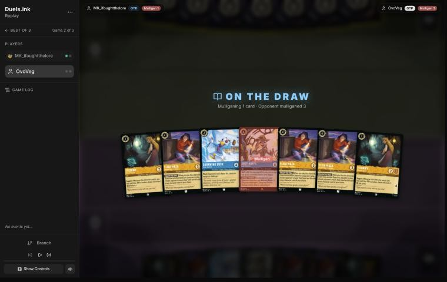
*The board before the decision: [step 0](https://duels.ink/replay/01a19c7c-3fe3-713e-b0c0-c501c0dd5d51?step=0) in the duels.ink replay viewer.*

**What you did:** sent back Judy Hopps – Lead Detective (drew Judy Hopps – On the Case), keeping Eilonwy ×2, Darkwing
Duck – Drake Mallard and Elisa Maza ×3.

**Verdict:** good play. The seven already had a play on each of turns 1–4 and all seven cards are inkable.
`tools/mulligan.py` (1,500 deals) put every sensible option within noise of each other:

| Option | Ink on turns 1–4 | Play turns (of 4) | Lore by turn 4 | Characters by turn 4 | Interaction by turn 4 |
|---|---|---|---|---|---|
| Keep all 7 | 9.62 | 4.00 | 7.1 | 5.0 | 47% |
| **As played** (send back Lead Detective) | 9.68 | 4.00 | 7.3 | 5.2 | 54% |
| Send back one Elisa | 9.68 | 4.00 | 7.3 | 5.2 | 58% |
| Send back one Elisa and Lead Detective | 9.65 | 3.99 | 7.5 | 5.4 | 61% |
| Send back two Elisas and Lead Detective | 9.57 | 3.98 | 7.7 | 5.5 | 67% |
| Full mulligan | 9.41 | 3.73 | 5.8 | 4.5 | 88% |

Lead Detective had no Judy in the hand to Shift onto and costs 6 to hard-cast; three Elisas against a deck whose
combo pieces are songs is not too many, since each one played later sees a hand that has dug deeper ([MULL-1](#cite-mull-1), [MULL-3](#cite-mull-3)).

### Turn 1: their turn

**What happened:** they inked a Prince Phillip.

### Turn 2: your turn 1

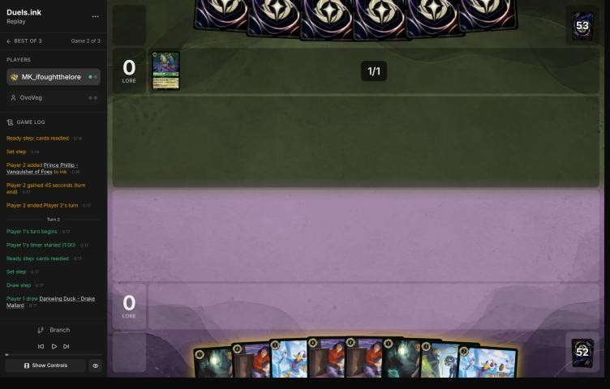
*The board before the decision: [step 4](https://duels.ink/replay/01a19c7c-3fe3-713e-b0c0-c501c0dd5d51?step=4) in the duels.ink replay viewer.*

**What you did:** drew a second Darkwing Duck – Drake Mallard, inked one Eilonwy and played the other.

**Verdict:** good play. A 1-drop on turn 1 starts the race against a deck that quests little early. The coach would
have inked one of the three Elisas instead, but the second Eilonwy (1 willpower, dead to any Malicious) is the card
least worth keeping against Circle of Life, so your ink is at least as good ([INK-2](#cite-ink-2)).

### Turn 3: their turn

**What happened:** Angel – Siren Singer, inked and played.

### Turn 4: your turn 2

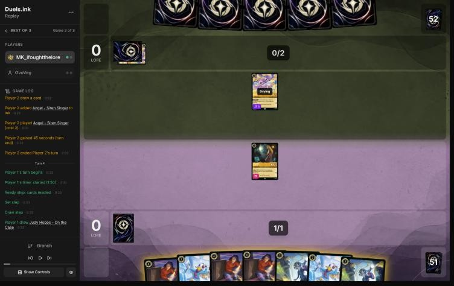
*The board before the decision: [step 10](https://duels.ink/replay/01a19c7c-3fe3-713e-b0c0-c501c0dd5d51?step=10) in the duels.ink replay viewer.*

**What you did:** drew a second Judy Hopps – On the Case; inked one Darkwing Duck – Drake Mallard, played the other,
and quested Eilonwy (+1).

**Verdict:** good play, the coach's line. Darkwing (4/1, Ward) is a Detective, so next turn's On the Case or Elisa has
the partner its ability needs. Eilonwy's quest exposes her to Angel (dry next turn), a 1-for-1 that costs them their
singer.

### Turn 5: their turn

**What happened:** Tod drew 2 and discarded Chernabog; Angel sang Malicious, Mean, and Scary, banishing Eilonwy and
Darkwing (1 willpower each). Your board is empty; 1–0.

### Turn 6: your turn 3

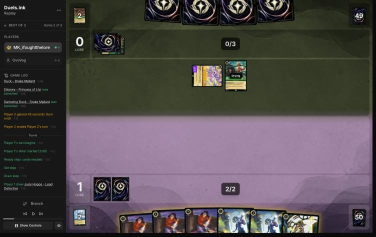
*The board before the decision: [step 21](https://duels.ink/replay/01a19c7c-3fe3-713e-b0c0-c501c0dd5d51?step=21) in the duels.ink replay viewer.*

**What you did:** drew Judy Hopps – Lead Detective; inked one On the Case and played the other.

**Verdict:** good play. On the Case was the only play at 3, and she is both a Detective (so next turn's Elisa can
look at their hand) and a Judy (so Lead Detective can Shift onto her for 4). Inking the spare On the Case rather than
an Elisa keeps all three Elisas, which is reasonable against a hand of songs ([INK-2](#cite-ink-2)).

### Turn 7: their turn

**What happened:** Ariel – Ethereal Voice. Angel, Tod and Ariel make 10 for Sing Together next turn, but no Phillip
is in their discard yet.

### Turn 8: your turn 4

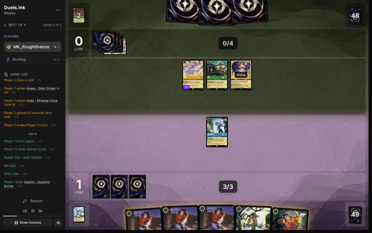
*The board before the decision: [step 27](https://duels.ink/replay/01a19c7c-3fe3-713e-b0c0-c501c0dd5d51?step=27) in the duels.ink replay viewer.*

**What you did:** drew Gaston; inked Judy Hopps – Lead Detective; played Elisa Maza, who took Strike a Good Match from
their 3-card hand; quested On the Case (+1, 2–0).

**Verdict:** Elisa was right; the ink is a **close call** *(revisited in discussion; the blind pass called it an
inaccuracy)*.
- **Elisa before anything else:** their hand had 3 cards and their combo pieces are songs. She found Strike a Good
  Match, their way of putting Prince Phillip in the discard.
- **The ink came first.** With 3 ink, Elisa (4) needed it, so you chose among your five inkable cards before her
  FOLLOW THE TRAIL showed their hand. The blind pass's main reason for inking an Elisa, that "the third copy is worth
  least now that you've seen their hand", used what you only learned afterwards. Nor would it have held: their hand
  turns over fast (Tod and Strike a Good Match draw 2, Akood et Emuti draws one, Meilin Lee takes a song from the top
  4, Max Goof – Karaoke Star draws 2; the brief's dig list), so each later Elisa sees a different hand.
- **For keeping the Elisa (your line):** she's the only card in your deck that takes their combo out of their hand
  before it's cast, and a wipe would take Lead Detective along with everything else ([INK-2](#cite-ink-2)).
- **For keeping Lead Detective:** Shifted onto On the Case on turn 10 she's a 6/4/2 for 4 ink that can act at once,
  and her LATERAL THINKING gives your Detectives Resist +2 on your turn: they could challenge Angel, Tod or Meilin
  Lee without taking damage, and damage on your characters is what Prince Phillip and To Wither a Flower need. Alert
  also lets them reach an Evasive Phillip. But the 4-ink Shift wasn't secure, as the blind pass assumed: Chernabog
  was in their discard, and Circle of Life (Sing Together 10 next turn) would replay him to shuffle On the Case away;
  Akood et Emuti's discount made Milo Thatch castable with their 5 ink; and a questing On the Case could be traded
  with Ariel (3 {S} into her 3 {W}). Without the base, Lead Detective costs 6, so turn 12.
- **Both lines are reasonable,** and the coach can't separate them from this game. Your mulligan (three Elisas kept,
  Lead Detective sent back) shows a consistent view of the matchup, and your experience of it may well be right; it's
  proposed below as a hypothesis to test ([INK-1](#cite-ink-1)). Confidence: low.

### Turn 9: their turn

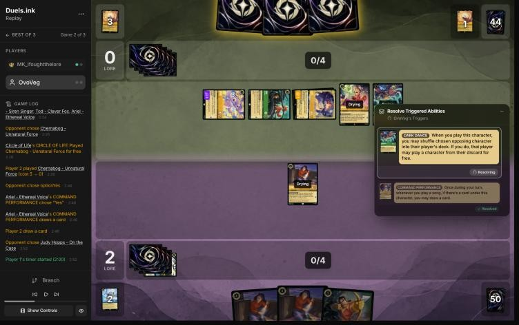
*The board before your choice: [step 42](https://duels.ink/replay/01a19c7c-3fe3-713e-b0c0-c501c0dd5d51?step=42) in the duels.ink replay viewer.*

**What happened:** Meilin Lee's search found Circle of Life; Angel, Tod and Ariel sang it to replay Chernabog –
Unnatural Force, whose DARK DANCE shuffled On the Case into your deck. They inked Ursula – Vanessa.

**Your choice:** DARK DANCE let you play a character from your discard for free, and you took Darkwing Duck – Drake
Mallard over Eilonwy. **Verdict:** good play: a 4-strength Detective with Ward keeps Elisa's trigger live and can
trade with any of their exerted singers next turn, where Eilonwy's 2 strength trades only with Angel or Tod.

### Turn 10: your turn 5

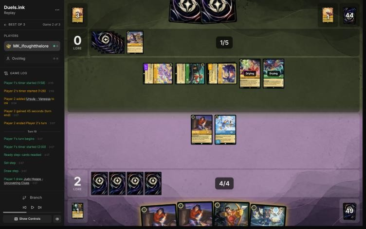
*The board before the decision: [step 46](https://duels.ink/replay/01a19c7c-3fe3-713e-b0c0-c501c0dd5d51?step=46) in the duels.ink replay viewer.*

**What you did:** inked an Elisa; Gaston banished Chernabog (5 {S}); Darkwing challenged Ariel (both banished); Elisa
challenged Tod (Tod banished, Elisa on 1 damage). An Elisa-into-Angel challenge was undone first.

**Verdict:** good play, and the coach's line, down to the choice of Tod. Their board quested for 7 a turn and would
have reached 20 on turn 15; it now quests for 2 (Angel and Meilin Lee). Gaston on Chernabog was the turn's anchor
(the brief listed him in range), and trading the 2-cost Darkwing for Ariel removed their 2-lore draw engine. Elisa
into Tod rather than Angel left her on 1 damage instead of 2, so To Wither a Flower (2 to each damaged character)
doesn't kill her ([THREAT-1](#cite-threat-1), [TRADE-1](#cite-trade-1)).

**Re-checked with the hand Elisa revealed** *(revisited 2026-11-02, from this turn's brief only)*: the brief now lists
the Prince Phillip she showed on turn 8 as known in their hand. The verdict stands, and Phillip adds a reason for it.
- **His only way into play next turn was Circle of Life from their discard.** Casting him takes 9 ink (they'd have 6),
  and his Shift 6 needs a Phillip in play. So they'd need a discard outlet and a second Circle of Life, sung by
  characters totalling 8.
- **Your line left them Angel (Singer 3) and Meilin Lee (3): 6.** A character played next turn can't sing while
  drying ([CR 3.2.2.1](#cite-cr-3-2-2-1)), so even both cards wouldn't have done it. Killing Angel instead of Tod gives the same 6, so the
  choice of Tod still rests on Elisa's damage.
- **The cost:** Elisa's damage counter stays, so she's a Phillip target for the rest of the game. But the wipe needs
  Malicious or Don Karnage to damage the rest of your board anyway.

### Turn 11: their turn

**What happened:** a second Meilin Lee found Akood et Emuti (now known in their hand); they inked a third Prince
Phillip and didn't quest or challenge. Angel and two Meilins make 9 for Sing Together next turn.

### Turn 12: your turn 6

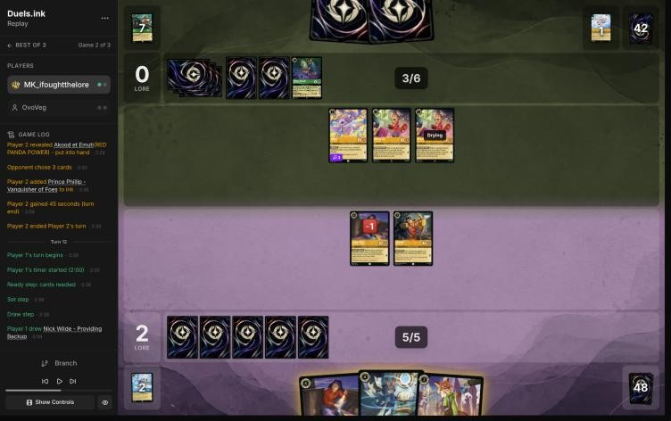
*The board before the decision: [step 59](https://duels.ink/replay/01a19c7c-3fe3-713e-b0c0-c501c0dd5d51?step=59) in the duels.ink replay viewer.*

**What you did:** drew Nick Wilde – Providing Backup; played the third Elisa, who took the known Akood et Emuti; inked
Nick; quested the first Elisa and Gaston (+2, 4–0). 2 ink unused.

**Verdict:** good play on the main decision, a close call on the ink.
- **Elisa on Akood et Emuti** was the turn's point: with 7 ink next turn, Akood's discount makes a Prince Phillip from
  their hand castable (9 − 2), and Phillip banishes every damaged character (your first Elisa had 1 damage).
- **The ink:** inking Uncovering Clues and playing Nick would have used all 6 ink and put a 1-lore Supporter on the
  board a turn earlier. Your line kept Uncovering Clues, the better card (she digs for a Detective on play and on each
  quest), for next turn. With no Phillip in their discard, there was no wipe to hold back for, so the extra body was
  worth a little; keeping the better card was worth a little too ([H-2](#cite-h-2)). Not worth flagging.

### Turn 13: their turn

**What happened:** they drew and passed: no ink, no quest, no play. Elisa had shown Milo Thatch (7) in their hand, one
ink more than they had.

### Turn 14: your turn 7

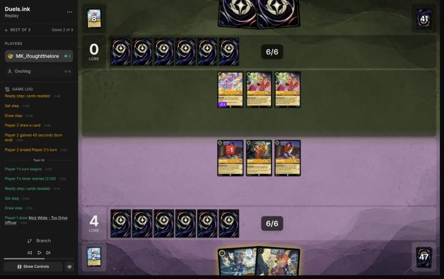
*The board before the decision: [step 66](https://duels.ink/replay/01a19c7c-3fe3-713e-b0c0-c501c0dd5d51?step=66) in the duels.ink replay viewer.*

**What you did:** drew Nick Wilde – Toy Drive Officer; played Judy Hopps – Uncovering Clues (found Fangmeyer); quested
both Elisas and Gaston (+3, 7–0). No ink: your only inkable card was Uncovering Clues.

**Verdict:** good play, the coach's line. Nothing of theirs was exerted. Uncovering Clues before Toy Drive Officer digs
first ([SEQ-1](#cite-seq-1)) and saves Toy Drive for a turn with a second character to trigger COMMUNITY OUTREACH. The quests expose
your 4-willpower characters to their three 2-strength characters, which need two challenges to kill one, and every
challenge is a quest they don't make. Milo Thatch (seen in their hand on turn 12) comes down next turn at 7 ink and
bounces one character whatever you do.

### Turn 15: their turn

**What happened:** Max Goof – Chart Topper (6), drying. Still no quest and no ink; 7–0. From next turn each Max quest
replays a song from their discard (Malicious, Strike a Good Match, Akood et Emuti).

### Turn 16: your turn 8

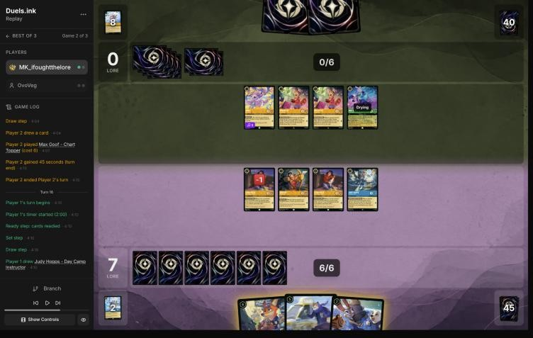
*The board before the decision: [step 75](https://duels.ink/replay/01a19c7c-3fe3-713e-b0c0-c501c0dd5d51?step=75) in the duels.ink replay viewer.*

**What you did:** drew Judy – Day Camp Instructor; quested Uncovering Clues first (found a second Day Camp
Instructor); played Toy Drive Officer, then Day Camp (LEND A PAW added an ink); quested both Elisas and Gaston (+4 in
all, 11–0); COMMUNITY OUTREACH drew a second Uncovering Clues.

**Verdict:** good play, the coach's line, with a better order: questing Uncovering Clues before spending the ink dug a
card first ([SEQ-1](#cite-seq-1)). Toy Drive Officer + Day Camp used all 6 ink and turned on both their abilities (a card and an
ink), where Fangmeyer would have left one ink and no draw.

**Re-checked with the hand Elisa revealed** *(revisited 2026-11-02, from this turn's brief only)*: Milo Thatch, shown
on turn 12, was still known in their hand.
- **A bounce was coming whatever you played.** Max Goof's quest next turn could replay Akood et Emuti from their
  discard, making Milo cost 5 with their 6 ink. His SCHOLAR'S GAMBIT returns one of your characters to your hand, and
  nothing of yours has Ward.
- **That favours your line a little more.** LEND A PAW's ink and COMMUNITY OUTREACH's card are banked this turn, and a
  bounce can't take them back. Fangmeyer's value is his 2 lore on later turns, which a bounce would delay.
- **Their likely target is a character without a play ability** (Toy Drive Officer, Day Camp): bouncing Gaston,
  Elisa or Uncovering Clues would give you WATCH THIS!, FOLLOW THE TRAIL or THOROUGH INVESTIGATION again.

Verdict unchanged.

### Turn 17: their turn

**What happened:** Max Goof quested (2–11) and replayed Akood et Emuti; Milo Thatch came down for 5, discarding Max
Goof – Karaoke Star to return Toy Drive Officer to your hand. Then three challenges: Meilin into the damaged Elisa (Elisa
survives on 3 damage, Meilin dies), and Angel and the other Meilin together killed Uncovering Clues (both died). They
first quested Max to replay Malicious, then undid it.

### Turn 18: your turn 9

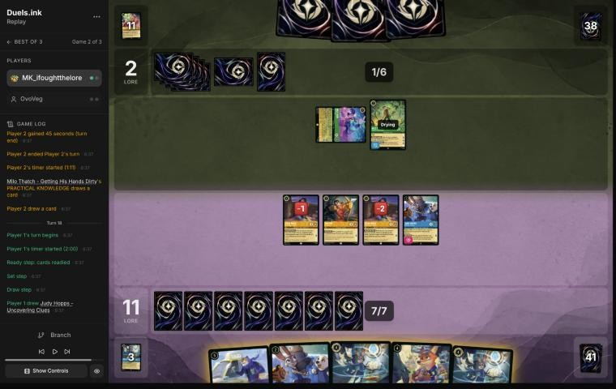
*The board before the decision: [step 100](https://duels.ink/replay/01a19c7c-3fe3-713e-b0c0-c501c0dd5d51?step=100) in the duels.ink replay viewer.*

**What you did:** Day Camp Instructor quested (+1) and gave +2 to the Elisa on 2 damage, who challenged the exerted Max
Goof (5 damage to his 5 willpower; both banished). You played Toy Drive Officer and the second Day Camp (LEND A PAW
added an ink), quested the other Elisa and Gaston (14–2), and COMMUNITY OUTREACH drew another Toy Drive Officer.

**Verdict:** good play on the kill, a close call on the plays.
- **Killing Max** was the priority again: each quest replays a song from their discard, Malicious included. Sending
  the Elisa on 2 damage, who would die to any ping, was the cheapest trade.
- **Fangmeyer + Day Camp** (7 ink) was slightly better than Toy Drive Officer + Day Camp (6): Fangmeyer quests for 2,
  so next turn's board could make 6 (exactly 20) instead of 5, and REQUEST REINFORCEMENTS returns a Detective from your
  discard, a card as good as COMMUNITY OUTREACH's draw. Milo Thatch will likely kill one exerted character either way,
  so it's one lore either way short of 20 in most branches. Not worth flagging.

### Turn 19: their turn

**What happened:** they drew and conceded at 14–2.

## Lessons
1. **Against Circle of Life, Elisa Maza is worth more than an extra body.** Three copies took Strike a Good Match (how
   Phillip reaches their discard) and Akood et Emuti (the discount that makes Phillip castable at 7), and showed you
   Milo Thatch two turns before it landed ([8](#turn-8), [12](#turn-12)).
2. **Count their board's lore and cut it when it outgrows yours.** On [turn 10](#turn-10) they quested for 7 a turn to
   your 2; Gaston, a Darkwing trade and an Elisa trade cut it to 2 in one turn.
3. **Kill Max Goof – Chart Topper on sight**, as in game 1 ([18](#turn-18)): use the character already on damage.
4. **A Shift threat's discount is only as safe as its base** ([8](#turn-8)): On the Case made Lead Detective a 4-ink
   play, but Chernabog in their discard and Circle of Life could take the base first. And an ink that pays for Elisa
   is chosen before she shows their hand.

## Proposed knowledge-base updates (applied after discussion)
- **Meta, the Amber/Emerald notes (Circle of Life), from this game:** Circle of Life replayed Chernabog (shuffling your
  best character away) when no Phillip was in the discard; Milo Thatch's SCHOLAR'S GAMBIT discarded Max Goof – Karaoke
  Star to bounce your Toy Drive Officer; they passed whole turns (turn 13) holding Milo for 7 ink.
- **Strategy, from discussion (MK_ifoughtthelore's experience of the matchup):** against Circle of Life, Elisa Maza
  is too valuable to ink, even the third copy and even over a Shift threat. Evidence: turn 8 and the mulligan here,
  and game 1's turn 10. Against it: Lead Detective's Resist +2 on your turn keeps your challengers undamaged, which
  starves the damage-based wipe. A hypothesis to test, not a principle.
- **Tools, from discussion (done 2026-11-02):** the brief lists, for each Shift card in hand whose base is in play,
  what of theirs can remove the base on their next turn (turn 8: Chernabog via Circle of Life, Milo after Akood et
  Emuti).
- **Tools (done 2026-11-02):** the brief lists the cards Elisa Maza's FOLLOW THE TRAIL revealed (Milo Thatch on turn
  12) under "KNOWN IN THEIR HAND" until they're played. It had shown Milo among cards seen, but not as known in hand.

## Hindsight
Doesn't change the verdicts above.
- They never discarded a Prince Phillip this game (three went into their inkwell), so Circle of Life could only
  replay Chernabog: the wipe never threatened.
- Their slow start (no lore until turn 17) left your 2-lore-a-turn board enough time even after losing Eilonwy and
  Darkwing to Malicious on turn 5.

## The coach's errors

| When | Error | How it was caught | How it won't happen again |
|---|---|---|---|
| [Turn 8](#turn-8) | Justified inking an Elisa by "the third copy is worth least now that you've seen their hand", but the ink paid for that Elisa, so it was chosen before her trigger showed their hand. Their dig (Meilin Lee, Tod, Strike a Good Match) also means each later Elisa sees a new hand. Verdict revisited from inaccuracy to close call | Re-examining the verdict after MK_ifoughtthelore's feedback (relayed by danny, 2026-11-02) | Done (2026-11-02): the **ink check** line every ink verdict carries (game 1, turn 10) also says where the ink falls in the turn's order and judges it only on what was known then |
| [Turn 8](#turn-8) | Counted Lead Detective's 4-ink Shift as certain without checking what could remove On the Case first: Chernabog in their discard with Sing Together 10 for Circle of Life, and Milo Thatch at 5 after Akood et Emuti | Same | Done (2026-11-02): the brief's "YOUR SHIFT BASES" lists, for each Shift card in hand whose base is in play, what of theirs can remove the base on their next turn |
| — | The brief's missing "known in hand" line for cards Elisa revealed is a tool gap, listed above | — | Done (2026-11-02): `tools/replay.py` reads the revealed hand from the state, and `tests/test_brief_sections.py` checks it. The brief now shows Prince Phillip known in their hand on turns 9–11 and Milo on turns 13–17; turns [10](#turn-10) and [16](#turn-16) were re-checked with them, and neither verdict changed |

## Open questions
- [Turn 8](#turn-8): why ink Lead Detective, with On the Case in play as her Shift base? In game 1 you inked her on turn
  2 as well. Is she weak in this matchup in your view? **Answered** (MK_ifoughtthelore, 2026-11-02): Elisa is too
  strong to ink in this matchup, so Lead Detective went in instead. The verdict was revisited to a close call. Still
  open: whether a third Elisa beats a Shifted Lead Detective against Circle of Life (proposed as a hypothesis).

## Citations
Copies of the coach's knowledge base cited above, as they stood when they were cited (the private repository's commit and date are given with each). They don't change when the knowledge base does.

**MULL-1**: strategy principle, `kb/strategy/principles.md` at `938a315` (2026-11-02), working tree

> - **MULL-1. Keep a plan, not the strongest cards.** *Ask: "Which hand gives me the best chance to execute my game plan in this matchup?"* `[MCL ch.12]` · baseline

**MULL-3**: strategy principle, `kb/strategy/principles.md` at `938a315` (2026-11-02), working tree

> - **MULL-3. The right keep depends on the matchup.** Early interaction against aggro; pressure, draw and engines against slow decks. The mulligan is the first expression of your role. In the Set 14 era the opponent's inks are known before the mulligan (RULE-8), so this applies from game 1 of a match. `[MCL ch.12]` · baseline

**INK-2**: strategy principle, `kb/strategy/principles.md` at `938a315` (2026-11-02), working tree

> - **INK-2. Don't automatically ink the most expensive card.** It may be the late-game win condition or the key answer for this matchup. The answer depends on matchup, hand and board. `[MCL ch.4]` · baseline

**INK-1**: strategy principle, `kb/strategy/principles.md` at `938a315` (2026-11-02), working tree

> - **INK-1. Inking is permanent.** Every inked card is one line of play removed for the rest of the game. *Ask: "Will I regret losing access to this card?"* `[MCL ch.4]` · baseline

**THREAT-1**: strategy principle, `kb/strategy/principles.md` at `938a315` (2026-11-02), working tree

> - **THREAT-1. Not every threat needs an answer.** *Ask: "What happens if I don't answer this?"* "Very little" means spend resources elsewhere. "I probably lose" means it's the priority. `[MCL ch.9]` · baseline

**TRADE-1**: strategy principle, `kb/strategy/principles.md` at `938a315` (2026-11-02), working tree

> - **TRADE-1. Judge a trade by ink invested, tempo, value already generated, and the board afterwards**, not by card count. A 2-cost for a 5-cost is a big win even if it's one-for-one. *Ask: "What does the board look like after this challenge?"* `[MCL ch.7]` · baseline

**SEQ-1**: strategy principle, `kb/strategy/principles.md` at `938a315` (2026-11-02), working tree

> - **SEQ-1. Gather information before irreversible decisions.** Draw, look and scry before choosing what to ink. Quest with draw triggers before committing other plays when the order doesn't otherwise matter. `[MCL ch.5]` · baseline

**H-2**: hypothesis, `kb/strategy/hypotheses.md` at `938a315` (2026-11-02), working tree

> ### H-2. Spare ink isn't automatically wasted when later turns will be short of cards
> - **Claim:** Ink grows by one every turn, but cards don't. Once later turns are likely to have more ink than
>   good cards to spend it on, cards are the scarcer resource. Then playing a low-impact card just to use spare
>   ink (giving up a better card to the inkwell instead) is usually worse than leaving the ink unspent.
> - **Applies when:** you're ahead on board (POS-1) and the extra play has little impact (WIN-2). Also when the
>   backup value of the extra card is low, e.g. a second Shift target when the opponent's removal can't hit the first.
> - **Doesn't apply when:** you're behind and need board presence now, or the cheap card has real impact.
> - **The converse, for the opponent:** extra cards are worth less to an opponent who already has a full hand and is
>   short of ink. When an effect offers "they draw 2 or you lose a body" (Hades – Looking for a Deal), keeping
>   the body is more attractive the more cards they already hold. Discard-payoff decks still get some fuel from
>   extra cards. Evidence: 01a139ad, turn 14. The opponent had 5 cards and 7 ink, and the user kept Isis
>   rather than bottoming her. Discussed 2026-10-26 and judged a close call.
> - **Evidence for:** replay 01a14bf9 (vs Goop), turn 5. The user left 1 ink unspent rather than ink Cheshire to
>   play a second Mulan – Injured Soldier. Coach first called it a close call, then agreed after the user's argument.
> - **Evidence against:** none yet.
> - **Status:** open.

**amber-emerald.md, The engine: discard Phillip, then replay him**: knowledge base, `kb/meta/archetypes/amber-emerald.md` at `938a315` (2026-11-02), working tree

> ### The engine: discard Phillip, then replay him `[coach + user, one game]`
> 1. **Put Prince Phillip – Vanquisher of Foes (9) in the discard.** Tod – Clever Fox (draw 2, discard 1), Max Goof –
>    Karaoke Star (discard a song, draw 2) and Strike a Good Match (draw 2, discard 1) all do it. In 01a13b88 Tod
>    discarded him on turn 5.
> 2. **Damage your board:** Malicious, Mean, and Scary puts 1 damage on each of your characters; so does Don Karnage
>    – Debonair Pirate when played (6, or 4 by Shift onto Don Karnage – Khan's Courier). A character already damaged,
>    or exerted (so it can be challenged), doesn't need this step.
> 3. **Circle of Life** (song 8, Sing Together 8): "Play a character from your discard for free." Phillip's SWIFT AND
>    SURE then banishes every damaged character you have.
>
> - **When it can come:** as soon as Phillip is in the discard, their characters total 8 for Sing Together, and they
>   can pay 3 for Malicious or sing it.
>   - Singer counts toward Sing Together (`kb/rules/rulings.md`). Angel – Siren Singer (Singer 3) ×2 plus Tod made 9
>     on turn 9, at 5 ink. Two Ursula – Vanessa (Singer 4) make 8 alone.
>   - It happened twice in 01a13b88: turn 9 (four characters) and turn 19 (five).
> - **How likely the wipe is next turn** `[coach + user, 01a13b88 turn 18, revisited 2026-11-01]`: count the damage
>   cards together (Malicious and Don Karnage, plus Max Goof – Rebellious Teen, which takes Malicious back from their
>   discard), then add their dig. Meilin Lee (top 4, takes a song, so finds Malicious and Circle of Life), Tod, Strike
>   a Good Match, Max Goof – Karaoke Star and Akood et Emuti all let them see more cards first, and Akood also makes Don
>   Karnage cost 4. On 01a13b88 turn 18 that was about 43%, against 17% for Malicious in their hand and draw alone
>   (`kb/cards/board-damage.md`).
> - **What to do:**
>   - **Watch their discard for Phillip and count their singing total.** The decision brief shows both.
>   - The turn before, keep characters ready and undamaged where possible, and don't add more than you need.
>   - Hold the answer to the returning Phillip (6/6/3, Evasive). Wasabi's TWIN BLADES, boosted by Mulan – Martial Arts
>     Master's +2 {S}, deals 6 to him without challenging him.
> - **Known cards:** Meilin Lee – Losing Control's RED PANDA POWER reveals a song or Red Panda into their hand. On turn
>   17 it revealed Circle of Life, so it was a known card from then on.

**CR 3.2.2.1**: Comprehensive Rules, `kb/rules/cr/03-turn-structure.md` at `b42c65e` (2026-11-02), working tree

> **3.2.2.1.** The active player’s characters that are in play are no longer “drying” and will be able to quest, challenge, or {E} to pay costs for activated abilities or song cards.
