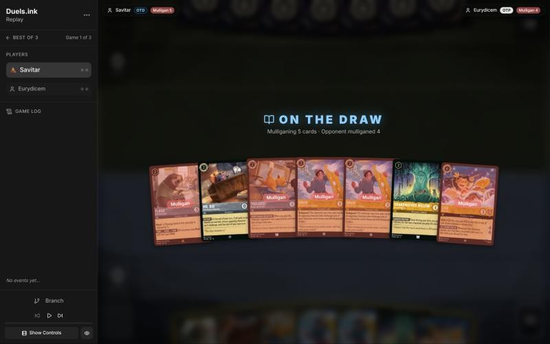
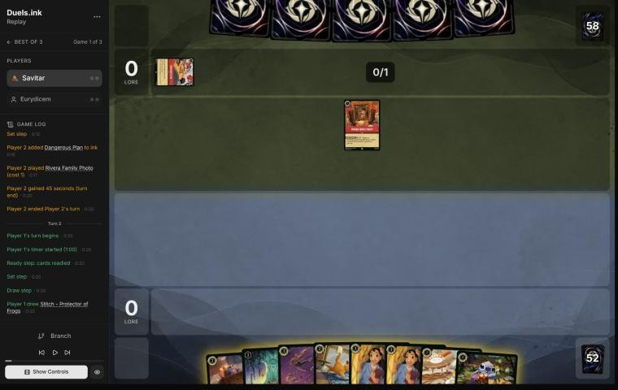
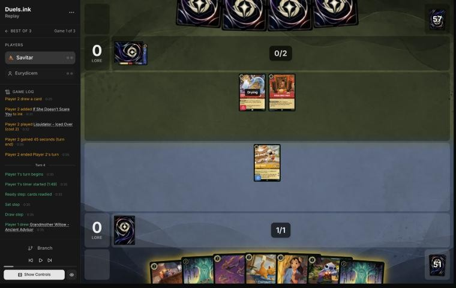
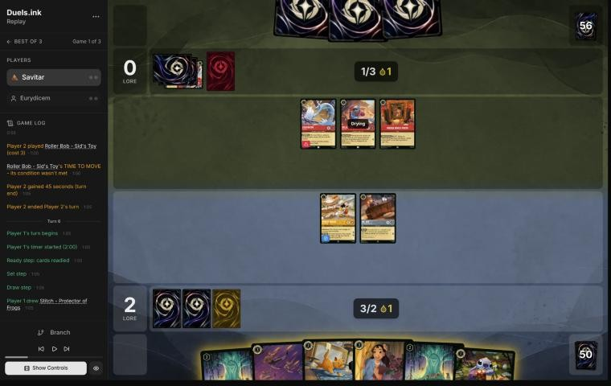
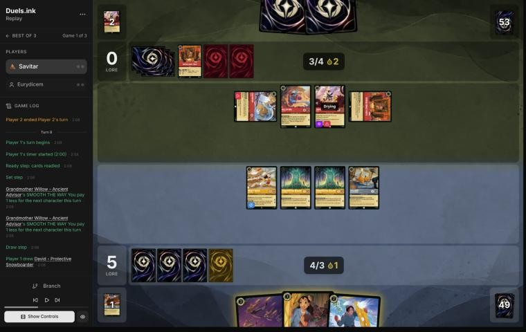
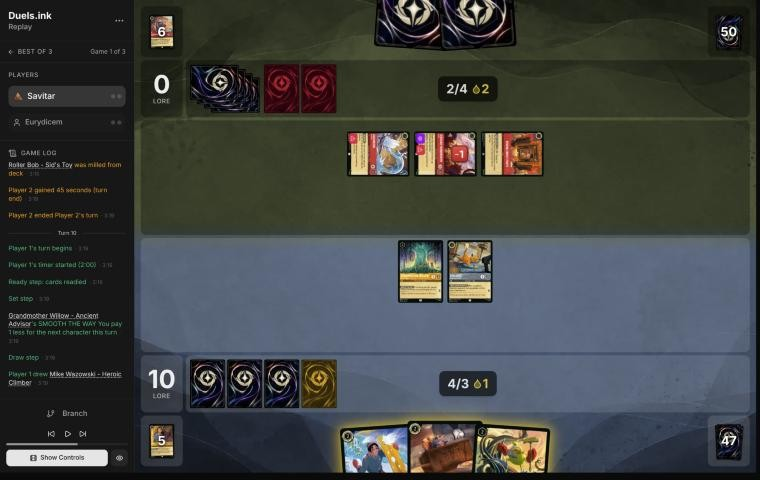
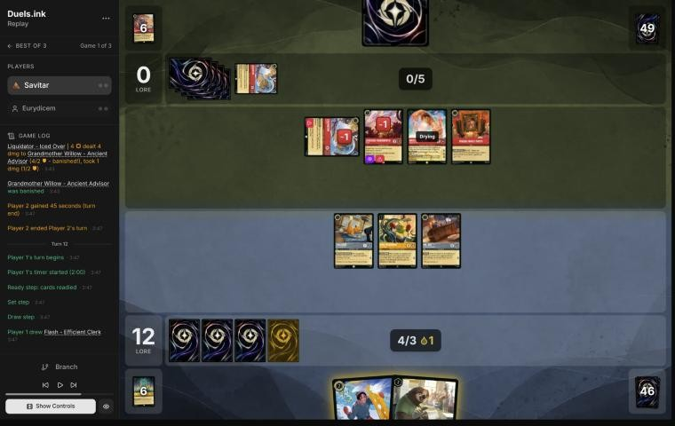
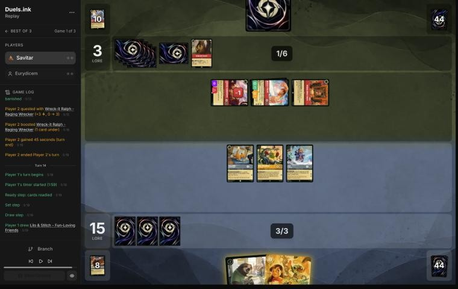

# Review: Savitar vs Eurydicem, game 1, 2 Nov 2026

| | |
|---|---|
| **Status** | draft (blind pass done; not discussed, by request) |
| **Replay** | `01a19cc8-0739` (`python3 tools/brief.py 01a19cc8-0739 --turn N`) · [duels.ink viewer](https://duels.ink/replay/01a19cc8-0751-748c-a022-ad11bde6ae52?step=0) |
| **Format** | Core Constructed (stated in the replay), best-of-three. Set 14 era: inks revealed before the coin toss |
| **Decks** | You: Amber/Steel Rockstar Aggro, the Lilo list. Them: Amber/Ruby; archetype as it became clear: see the turns |
| **Play/draw** | Eurydicem went first; you were on the draw |
| **Result** | Win: 20–3 on your 7th turn (game turn 14) |
| **Meta data** | snapshot of 26 Oct 2026 (fresh until 9 Nov) |
| **Chosen how** | One of the 5 of Savitar's 12 matches the coach reviewed after studying the other 7 (see the TeamAnglerfish game 1 review). The coach doesn't know this match's result; it has two games, which says nothing about who won |

## Summary
- **Good plays:** [4](#turn-4) (Mr. Big's ICE OUT on Liquidator to save Mickey), [8](#turn-8) (questing
  everything with Storm live, cards held for a rebuild), [12](#turn-12) (Mike's reveal first, which found Bundled Up)
  and [14](#turn-14): Lilo & Stitch Shifted onto a dry Bundled Up for exactly 20.
- **Close calls:** [2](#turn-2) (Mickey's ink drops feed their Storm), the Strength target on [8](#turn-8), and
  Toulouse questing rather than trading with Liquidator on [12](#turn-12).
- **Inaccuracies / mistakes / blunders:** three inaccuracies: the [mulligan](#turn-0) (Flash and Toulouse sent back),
  [6](#turn-6) (Liquidator left free, Toulouse spent early) and [10](#turn-10) (Mike rather than David as a Bodyguard).
- **Unwinnable from:** never.

**What decided it:** a fast start (10 lore by your 4th turn) against Candle Control's challengers, and Lilo & Stitch
drawn on the turn she could Shift onto a dry Lilo for the last 3.

## The game, turn by turn
Verdicts judge each decision on what you could know at the time, **including archetype knowledge an experienced
player has**. Hindsight is kept to its own section. Severity scale: good play / close call /
inaccuracy / mistake / blunder. Principle IDs and hypotheses (H-n) link to copies
in the Citations section at the end, as they stood when they were cited.

**What you knew before the game:** only their inks, Amber/Ruby. duels.ink's Amber/Ruby games are half Candle
Control, a third unlisted lists, then Boosties and Sid Toys
([the coach's notes on the pair](#cite-kb-meta-archetypes-amber-ruby-from-reviewed-games-and-discussion)). Candle Control's key cards, with the earliest turn each can come:
- **Raging Storm** (8, banish all characters): in the study, iKnowZer0 cast it on game turn 9 (their 5th turn) with
  ink drops from both sides' Mickeys.
- **Red Alert** (4, banish a character with 3 {S} or less): reaches every character in your deck, from their 4th turn.
- **Firefly Swarm** (3, banish a character with 2 {S} or less): most of your deck.
- **Olaf – Snowman of Action** (9, 1 less for each action in their discard; you lose 2 lore when he's played): free
  from about their 10th turn in TheBigGrin's games, and recurred by Sulley – The New Boss and Remember Me.
- **Liquidator – Iced Over** (2, 4/2/0, Reckless) and **Roller Bob** (3, 4/3/1, Rush if they put 2 characters from
  their discard on the bottom): challengers that kill any of your 2- and 3-willpower characters. Liquidator's
  discount doesn't apply: they went first.
- **Jebidiah Farnsworth – Cookie** (2, 3/3/0, Evasive, Reckless): your deck has no Evasive, so only Strength of a
  Raging Fire answers him.
- **Though I Have to Say Goodbye** and **Inner Strength** (strength pumps), **The Torn Corner**, **Rivera Family
  Photo** and **Land of the Dead** (1 lore, +2 with 10 cards in their discard): the self-mill engine.
- **Meilin Lee singers** (Pandagheist, in the study): The Headless Horseman banishes a character with 2 {S} or less
  when played, and came back each turn.

### Pre-game

*The board before the decision: [step 0](https://duels.ink/replay/01a19cc8-0751-748c-a022-ad11bde6ae52?step=0) in the duels.ink replay viewer.*

**What you did:** on the draw, kept Grandmother Willow and Mr. Big and sent back five: Lilo – Rock Star, both Davids,
Toulouse and Flash.

**Verdict:** an **inaccuracy**. Keeping **Willow and Mr. Big** is suboptimal because Flash (2 lore a turn, Resist 1)
and Toulouse (no actions for a turn: Raging Storm and Red Alert are actions) are better cards to keep than Mr. Big
alone, and **keeping Flash, Toulouse, Willow and Mr. Big** (sending back Rock Star and the Davids) is better.
`tools/mulligan.py` (800 deals each, candidates run before your mulligan was shown):

| Option | Ink on turns 1–4 | Play turns (of 4) | Lore by turn 4 | Characters by turn 4 | Interaction by turn 4 |
|---|---|---|---|---|---|
| Keep all 7 | 8.79 | 3.22 | 6.4 | 4.5 | 16% |
| Send back Rock Star | 8.94 | 3.40 | 7.1 | 4.8 | 16% |
| **Keep Flash, Toulouse, Willow, Mr. Big** | 9.28 | 3.65 | 8.2 | 5.1 | 30% |
| Keep Toulouse, Willow, Mr. Big | 9.44 | 3.73 | 6.9 | 5.2 | 36% |
| **As played** (keep Willow and Mr. Big) | 9.45 | 3.78 | 7.3 | 5.3 | 41% |
| Full mulligan | 9.60 | 3.89 | 8.8 | 5.6 | 51% |

- **The hand has no 1-drop and no Lilo,** so sending back Rock Star and the Davids is right; the question is Flash and
  Toulouse.
- **The sim's best is the full mulligan** (8.8), with the four-card keep second (8.2) and yours behind both (7.3).
  The sim doesn't price Toulouse's lock, which is worth more against Amber/Ruby's Storm and Red Alert.
- Inaccuracy rather than mistake: the hand was weak whichever way, and Willow's discount is in your keep ([MULL-1](#cite-mull-1),
  [MULL-2](#cite-mull-2)). Confidence: medium.

### Turn 1: their turn

**What happened:** Dangerous Plan inked, Rivera Family Photo played: both Candle Control tells (94% now).

### Turn 2: your turn 1

*The board before the decision: [step 6](https://duels.ink/replay/01a19cc8-0751-748c-a022-ad11bde6ae52?step=6) in the duels.ink replay viewer.*

**What you did:** the mulligan brought Strength, Toulouse, two Nanis and Mickey; drew Stitch; inked a Nani; played
Mickey.

**Verdict:** **close call**, worth a note. Mickey quests for 2 a turn, the most lore any 1-drop gives, but each
HOT DOG gives Candle Control an ink drop too, toward Raging Storm at 8. In the study, iKnowZer0 cast it on game
turn 9 that way ([the coach's notes](#cite-kb-meta-archetypes-amber-ruby-candle-control-against-rockstar-aggro-iknowzer0)). Stitch first (Mickey later, or inked) keeps their Storm a turn or two
further off; Mickey first is the faster clock. With Toulouse in hand to cover one Storm turn, Mickey is fine. Inking a
Nani (you hold two) was right.

### Turn 3: their turn

**What happened:** If She Doesn't Scare You inked (4, song: banish one of theirs to banish one of yours); Liquidator
– Iced Over (4/2/0, Reckless) played.

### Turn 4: your turn 2

*The board before the decision: [step 12](https://duels.ink/replay/01a19cc8-0751-748c-a022-ad11bde6ae52?step=12) in the duels.ink replay viewer.*

**What you did:** drew a second Willow; inked Stitch; played Mr. Big; quested Mickey (2–0); ICE OUT on Liquidator.

**Verdict:** **good play**, the coach's line. Mickey must quest (Adventurous), and an exerted Mickey (4 willpower) dies
to Liquidator's 4 {S}. Mr. Big with every ink exerted is the only 2-ink play that stops it: Liquidator is Reckless, so
it can't do anything else next turn. Willow and a free Stitch would have lost Mickey.

### Turn 5: their turn

**What happened:** a second Dangerous Plan inked; Roller Bob (4/3/1) played without Rush (no characters in their
discard). Candle Control is now near certain.

### Turn 6: your turn 3

*The board before the decision: [step 21](https://duels.ink/replay/01a19cc8-0751-748c-a022-ad11bde6ae52?step=21) in the duels.ink replay viewer.*

**What you did:** drew a second Stitch; played Willow, the second Willow for 1 (paid with Mickey's ink drop), inked
Stitch and played Toulouse for 1 (no actions for them next turn); quested Mickey and Mr. Big (5–0); ICE OUT on Roller
Bob.

**Verdict:** an **inaccuracy**, low confidence. Playing **both Willows and Toulouse** is suboptimal because it leaves
Liquidator (Reckless, 4 {S}) free to kill Mickey or Mr. Big next turn, taking no damage back from either, and spends
Toulouse on a turn they can't reach Storm. **Stitch, then Strength on Roller Bob** (three characters: 3 damage), with
**ICE OUT on Liquidator**, is better because:
- **Nothing of yours can be challenged next turn:** Roller Bob is dead and Liquidator frozen. Your line gives them a
  free kill.
- **Toulouse stays for the Storm turn.** With Mickey's drops (two now, a third if he quests next turn) they can have
  8 on their 5th turn (game turn 9), and Toulouse played the turn before stops it.
- **The cost:** your three 2-drops come a turn later (about 3 lore), and Red Alert (about 1 in 4 after their draw)
  can still take one character. Your line blocks that, which is why this is close.
- Confidence: low ([POS-1](#cite-pos-1)).

### Turn 7: their turn

**What happened:** Liquidator killed Mr. Big; Rivera milled Olaf and a Jebidiah; another Jebidiah Farnsworth –
Cookie (3/3/0, Evasive, Reckless) played; a second Rivera inked. 0–5.

### Turn 8: your turn 4

*The board before the decision: [step 36](https://duels.ink/replay/01a19cc8-0751-748c-a022-ad11bde6ae52?step=36) in the duels.ink replay viewer.*

**What you did:** drew David; played Nani for 1 (both Willows' discounts) and took Mr. Big; Strength (five
characters: 5 damage) killed Roller Bob; quested all four (10–0); didn't ink.

**Verdict:** **good play**, with a close call on the target.
- **Mickey must quest,** and his drop gives them 8 next turn (4 ink, 3 drops and their ink): Raging Storm is live.
  Questing everything (+5) is right when a Storm may take the board anyway.
- **Not inking keeps David and Mr. Big in hand** for a rebuild; the extra ink had nothing to pay for this turn.
- **The target, a close call:** the coach would have killed Jebidiah. Strength is your deck's only answer to him
  (Evasive), and Nani can trade with an exerted Roller Bob or Liquidator later. Roller Bob is their only lore and
  his 4 {S} kills Mickey, which Jebidiah's 3 doesn't. Either is reasonable.

### Turn 9: their turn

**What happened:** Jebidiah killed a Willow and Liquidator killed Mickey; Red Alert banished Nani; Rivera milled
Land of the Dead and a second Roller Bob. 0–10, six cards in their discard.

### Turn 10: your turn 5

*The board before the decision: [step 53](https://duels.ink/replay/01a19cc8-0751-748c-a022-ad11bde6ae52?step=53) in the duels.ink replay viewer.*

**What you did:** drew Mike Wazowski; played Mike for 1 (Willow) and Mr. Big; quested Willow and Toulouse (12–0);
ICE OUT on Jebidiah; didn't ink.

**Verdict:** an **inaccuracy**. Playing **Mike and Mr. Big** is suboptimal because Liquidator (4 {S}) is still free to
kill the exerted Willow or Toulouse, and playing **David, exerted, and Mr. Big, with ICE OUT on Liquidator** is better
because:
- **Bodyguard forces Jebidiah into David:** Jebidiah is Reckless and must challenge, and his 3 {S} doesn't kill
  David's 4 willpower. Nothing of yours dies, against one character in your line.
- **The same ink:** Mr. Big for 1 (Willow) and David for 2 use your three ink exactly, so ICE OUT still works.
- **Mike waits a turn,** which costs nothing now: he'd have been drying, and FIND A FRIEND reveals for them too.
- Confidence: medium ([POS-1](#cite-pos-1)).

### Turn 11: their turn

**What happened:** Wreck-it Ralph – Raging Wrecker (7, 3/4/3; Boost 1, +1 {S} per card under him; **when he's
banished, every character with {S} no higher than his is banished**) played with both drops; Liquidator killed the
other Willow (taking 1); a second Liquidator inked. 0–12.

### Turn 12: your turn 6

*The board before the decision: [step 63](https://duels.ink/replay/01a19cc8-0751-748c-a022-ad11bde6ae52?step=63) in the duels.ink replay viewer.*

**What you did:** drew Flash; quested Mike first (13–0), whose reveal found Lilo – Bundled Up; played Bundled Up and
David (exerted, with the drop); quested Toulouse and Mr. Big (15–0); ICE OUT on Ralph; kept Flash.

**Verdict:** **good play** in the order, **close call** in the trade.
- **Mike first** found Bundled Up, a better play than Flash here: 2 lore and she ignores the first damage on their
  turn, where Flash (2 willpower, Resist 1) dies to Jebidiah.
- **ICE OUT on Ralph** stops the one character that can Boost past David's 4 willpower without taking damage back.
- **The close call:** the coach would have traded Toulouse into the exerted Liquidator (1 willpower left; both die).
  Bodyguard then sends Jebidiah into David, who survives, and nothing else of yours can be challenged. Your line is a
  lore ahead, but Liquidator kills David next turn and Jebidiah another exerted character. Two characters for a lore
  is a slightly worse trade, with Storm still two turns off (6 ink next turn, no drops).

### Turn 13: their turn

**What happened:** Rivera milled a second Olaf and a Time to Go! (3: banish one of theirs to draw 2, or 3 if it had
a card under it); The Horseman Strikes! drew a card (they chose not to banish their own Jebidiah); Liquidator died
challenging David (both banished); Jebidiah killed Mr. Big; Ralph quested (3–15) and Boosted (4 {S}). Three actions
in their discard make Olaf cost 6, castable next turn.

### Turn 14: your turn 7

*The board before the decision: [step 84](https://duels.ink/replay/01a19cc8-0751-748c-a022-ad11bde6ae52?step=84) in the duels.ink replay viewer.*

**What you did:** drew Lilo & Stitch; Shifted her onto Lilo – Bundled Up; quested Toulouse, Mike and Lilo & Stitch
(20–3). Won.

**Verdict:** **good play**, the coach's line. Bundled Up was dry, so Lilo & Stitch Shifted onto her quests at once
([CR 8.10.5](#cite-cr-8-10-5)): 3 + 1 + 1 makes exactly 20. Waiting would have faced Olaf (−2) and Ralph's wipe, if they banished him
with a Time to Go! or If She Doesn't Scare You.

## Lessons
1. **Against Reckless challengers, count who they must hit** ([6](#turn-6), [10](#turn-10)): Liquidator and Jebidiah
   must challenge, so ICE OUT on one and David exerted as a Bodyguard decides where the other's damage goes.
   Jebidiah's 3 {S} doesn't kill David.
2. **Mickey's drops count toward their Storm** ([2](#turn-2), [8](#turn-8)): with three drops they had 8 ink on
   their 5th turn. Keep Toulouse for that turn rather than the first turn he's affordable.
3. **Strength of a Raging Fire is your only answer to Jebidiah** ([8](#turn-8)), who is Evasive; your challengers
   can trade with Liquidator and Roller Bob.
4. **Wreck-it Ralph – Raging Wrecker is a sweeper in waiting** ([11](#turn-11), [13](#turn-13)): banishing him (Time
   to Go!, If She Doesn't Scare You, or a challenge of yours) banishes every character with {S} no higher than his.

## Knowledge-base updates (applied 2026-11-02, without discussion at danny's request)
- **Meta, Amber/Ruby notes:** Eurydicem's Candle Control list (match notes after game 2).
- **Cards:** Wreck-it Ralph – Raging Wrecker's banish trigger, with Time to Go! as the combo.

## Hindsight
Doesn't change the verdicts above.
- They never cast Raging Storm or Olaf; the challengers and Red Alert did their removal.

## The coach's errors
None found in the blind pass.

| When | Error | How it was caught | How it won't happen again |
|---|---|---|---|

## Open questions
- [Turn 6](#turn-6): develop three 2-drops and lock actions with Toulouse, or kill Roller Bob with Strength and keep
  Toulouse for the Storm turn?
- [Turn 8](#turn-8): Strength on Roller Bob (lore, kills Mickey) or Jebidiah (only Strength answers him)?

## Citations
Copies of the coach's knowledge base cited above, as they stood when they were cited (the private repository's commit and date are given with each). They don't change when the knowledge base does.

<!-- Filled in by `python3 tools/cite.py <this file>`: every principle ID, H-n, "principle N" and CR rule above
becomes a link to an entry here. Add a file or one of its sections with `--file PATH --section TEXT`, and link to
the anchor it prints. Never link into the private repository. -->

**amber-ruby.md, From reviewed games and discussion**: knowledge base, `kb/meta/archetypes/amber-ruby.md` at `dd4a173` (2026-11-03), working tree

> ## From reviewed games and discussion
> ### Candle Control: TheBigGrin `[coach, blind reviews of 01a19d60, 01a19d66 and 01a19d75 (danny vs TheBigGrin, 2026-11-02), discussed with danny]`
> - **The self-mill is fast:** Rivera Family Photo each turn and two Dangerous Plans put 10 cards in their discard by
>   their 4th turn (game turn 7), switching on Rivera's lore, The Torn Corner's draw and Land of the Dead; six actions
>   there made Olaf cost 3 from turn 9 (01a19d60).
> - **Beyond duels.ink's average list:** Mulan – Martial Arts Master ×4+ with Mulan – Elite Archer ×3+ (Shift 5; TRIPLE
>   SHOT hits ready characters too), Copper – On the Scent (8 {S}, Rush, Reckless), Vincenzo Santorini – On the Run,
>   Liquidator ×4, Jebidiah Farnsworth – Cookie (Evasive, Reckless: only an action, Windstorm or an Evasive character
>   reaches it). Three Jebidiahs early were their removal in game 3.
> - **The Olaf loop:** Olaf free from about their 10th turn, recurred by Sulley and Remember Me: six Olafs, 12 lore lost
>   in game 2, 13 with Red Alert. Count every Olaf they can reach as −2 in the race.
> - **Four Raging Storms;** Land of the Dead (3 lore a turn) and Rivera (1) can win the race with no characters in play.
>   Their characters challenge locations: two Olafs (4 + 4) killed Khan Industries on turn 19 of game 2.
> - **How Big Ramp beat it:** Khan Industries and Ward threats (see the Sapphire/Steel notes); it lost game 2 without
>   Storm-proof lore.
>
> ### Candle Control against Rockstar Aggro: iKnowZer0 `[coach, meta study of Savitar's 2 Nov 2026 games (tools/scan.py), full games, not blind, 2 games]`
> 01a19bd8-ada2 and 01a19bdb-d8e4. Savitar (Amber/Steel Rockstar Aggro) won both, at 17–4 and 19–10.
> - **Seen beyond TheBigGrin's list:** Hercules – Young Rescuer ×2 (2, 2/1/1; discard your hand to return a card from
>   the discard), Roller Bob ×2, Della's Moon Lullaby ×2 (−2 {S} and draw), The Horseman Strikes! ×2, Mickey Mouse – Best
>   in Town, Copper ×2.
> - **Raging Storm came on game turn 9,** their 5th turn, at 5 ink plus 3 ink drops from both sides' Mickeys: seven
>   characters at 17–7 (01a19bdb-d8e4). On turn 11 of game 1 it took five. The aggro side still won both by rebuilding:
>   Lilo – Bundled Up and Flash quest for 2.
>
> ### Meilin Lee singers (not in duels.ink's lists): Pandagheist `[coach, meta study of Savitar's 2 Nov 2026 games (tools/scan.py), full games, not blind, 2 games]`
> 01a19cbb-e8f7 and 01a19cbe-8319. Savitar (Amber/Steel Rockstar Aggro) conceded both, at 8–1 on game turn 7 (the log
> doesn't show why) and at 10–2 on turn 12.
> - **Singers:** Meilin Lee – Lead Vocalist ×3+ (1, 0/3/1, Singer 3 but only for Sing Together), Meilin Lee – Ecstatic
>   Fan (3, Singer 5; an ink drop each time they play a song), Meilin Lee – Losing Control, Powerline – Taking the Stage
>   (2, Singer 4) and World's Greatest Rock Star (Shift 4, Singer 9; a free song from the top 4 when he sings).
> - **Songs:** Akood et Emuti, Be Our Guest (finds a character), Look at This Family (Sing Together 7, two characters),
>   Della's Moon Lullaby, Remember Me ×2 (replay characters from the discard).
> - **The threat:** The Headless Horseman – Terror of Sleepy Hollow ×3 (5, uninkable, 4/2/2): on play, banish a
>   character with 2 {S} or less, and +1 {S} to all theirs for each banish that turn. Akood made him cost 3 on game turn
>   8, and he came back every turn (Be Our Guest, Remember Me). Liquidator – Iced Over (4 {S}) killed Mickey on turn 4.

**amber-ruby.md, Candle Control against Rockstar Aggro: iKnowZer0**: knowledge base, `kb/meta/archetypes/amber-ruby.md` at `dd4a173` (2026-11-03), working tree

> ### Candle Control against Rockstar Aggro: iKnowZer0 `[coach, meta study of Savitar's 2 Nov 2026 games (tools/scan.py), full games, not blind, 2 games]`
> 01a19bd8-ada2 and 01a19bdb-d8e4. Savitar (Amber/Steel Rockstar Aggro) won both, at 17–4 and 19–10.
> - **Seen beyond TheBigGrin's list:** Hercules – Young Rescuer ×2 (2, 2/1/1; discard your hand to return a card from
>   the discard), Roller Bob ×2, Della's Moon Lullaby ×2 (−2 {S} and draw), The Horseman Strikes! ×2, Mickey Mouse – Best
>   in Town, Copper ×2.
> - **Raging Storm came on game turn 9,** their 5th turn, at 5 ink plus 3 ink drops from both sides' Mickeys: seven
>   characters at 17–7 (01a19bdb-d8e4). On turn 11 of game 1 it took five. The aggro side still won both by rebuilding:
>   Lilo – Bundled Up and Flash quest for 2.

**MULL-1**: strategy principle, `kb/strategy/principles.md` at `dd4a173` (2026-11-03), working tree

> - **MULL-1. Keep a plan, not the strongest cards.** *Ask: "Which hand gives me the best chance to execute my game plan in this matchup?"* `[MCL ch.12]` · baseline

**MULL-2**: strategy principle, `kb/strategy/principles.md` at `dd4a173` (2026-11-03), working tree

> - **MULL-2. A smooth curve beats a few powerful cards.** Check that you can spend ink well on turns 1–4, have enough inkable cards, and know what turn 4 looks like. `[MCL ch.12]` · baseline
>   - **Ink spent isn't the goal by itself.** Judge a keep by a nice curve (a play each turn), early lore pressure, and
>     interaction that sets the opponent back, as well as by ink, then weigh card quality and the matchup
>     (user, 2026-11-01). `tools/mulligan.py` reports all of these.

**POS-1**: strategy principle, `kb/strategy/principles.md` at `dd4a173` (2026-11-03), working tree

> - **POS-1. From ahead, take the safest path to victory.** Don't overextend into sweepers, don't make unnecessary trades, and make the opponent take the risks. Winning by 1 lore counts the same as winning by 10. `[MCL ch.10]` · baseline

**CR 8.10.5**: Comprehensive Rules, `kb/rules/cr/08-keywords.md` at `dd4a173` (2026-11-03), working tree

> **8.10.5.** A player can use a shifted character to perform all turn actions of the character it was put on top of. The shifted character doesn’t gain the text of the character it’s put on top of (e.g., an activated ability), but it does keep any effects that apply to that character when the shifted character enters play. A player can exert a shifted character to sing a song if the character it was put on top of was dry when the shifted character entered play.
