# Review: Savitar vs Eurydicem, game 2, 2 Nov 2026

| | |
|---|---|
| **Status** | draft (blind pass done; not discussed, by request) |
| **Replay** | `01a19ccd-3f04` (`python3 tools/brief.py 01a19ccd-3f04 --turn N`) · [duels.ink viewer](https://duels.ink/replay/01a19ccd-3f04-7004-bb88-9a2aa0083e22?step=0) |
| **Format** | Core Constructed (from game 1), best-of-three. Set 14 era: inks revealed before the coin toss |
| **Decks** | You: Amber/Steel Rockstar Aggro, the Lilo list. Them: Amber/Ruby Candle Control, from game 1 |
| **Play/draw** | Eurydicem went first (they lost game 1, so the choice was theirs); you were on the draw |
| **Result** | Loss: you conceded on Eurydicem's 12th turn (game turn 23), 14–9. The games split 1–1, and the replays have no game 3 |
| **Meta data** | snapshot of 26 Oct 2026 (fresh until 9 Nov) |
| **Chosen how** | One of the 5 of Savitar's 12 matches the coach reviewed after studying the other 7 (see the TeamAnglerfish game 1 review). The coach knew game 1 was a win, but not this game's result |

## Summary
- **Good plays:** [10](#turn-10) (Mikes' reveals first, ICE OUT on Olaf, a Bundled Up kept back), [12](#turn-12)
  (Lilo & Stitch alone, Bundled Up kept), [14](#turn-14), [18](#turn-18), [20](#turn-20) (David exerted as a
  Bodyguard) and [22](#turn-22).
- **Close calls:** [4](#turn-4) (Willow and Stitch rather than Bundled Up and a free Pudge), [16](#turn-16) (Pudge
  quested into Liquidator).
- **Inaccuracies / mistakes / blunders:** one mistake, [6](#turn-6): Lilo & Stitch inked rather than Shifted onto
  Stitch for 2. Three inaccuracies: the [mulligan](#turn-0), and Toulouse inked on [2](#turn-2) and again on
  [8](#turn-8).
- **Unwinnable from:** [22](#turn-22), after two Olafs, Sulley and Red Alert took 5 lore and David on turn 21.

**What decided it:** Raging Storm on [11](#turn-11), the first turn Mickey's drops made 8 possible, with no Toulouse
in hand to stop it; then Land of the Dead and two Olafs recurred by Sulley outran your rebuild.

## The game, turn by turn
Verdicts judge each decision on what you could know at the time, **including archetype knowledge an experienced
player has**. Hindsight is kept to its own section. Severity scale: good play / close call /
inaccuracy / mistake / blunder. Principle IDs and hypotheses (H-n) link to copies
in the Citations section at the end, as they stood when they were cited.

**What you knew before the game:** game 1 against Eurydicem's Candle Control
([the coach's notes on it](#cite-kb-meta-archetypes-amber-ruby-candle-control-against-rockstar-aggro-eurydicem)). Their key cards, with the earliest turn each can come:
- **Liquidator – Iced Over** (2, 4/2/0, Reckless; 1 ink on their first turn if they're the second player, which
  they aren't) and **Jebidiah Farnsworth – Cookie** (2, 3/3/0, Evasive, Reckless): from their 2nd turn, each must
  challenge every turn and kills a 2-willpower character. Only Strength of a Raging Fire reaches Jebidiah.
- **Roller Bob** (3, 4/3/1; Rush once two characters are in their discard).
- **Red Alert** (4, banish a character with 3 {S} or less): every character you have, from their 4th turn.
- **Wreck-it Ralph – Raging Wrecker** (7, Boost 1): when he's banished, so is every character with {S} up to his, and
  their Time to Go! (3) or If She Doesn't Scare You (4) banishes him on their own turn.
- **Raging Storm** (8): their 8th turn on curve, earlier with Mickey's drops (game 1: 8 possible on their 5th turn).
- **Olaf – Snowman of Action** (9, 1 less per action in their discard; you lose 2 lore): castable from about the
  time three or four actions are in their discard (6 in game 1 on their 7th turn).

### Pre-game

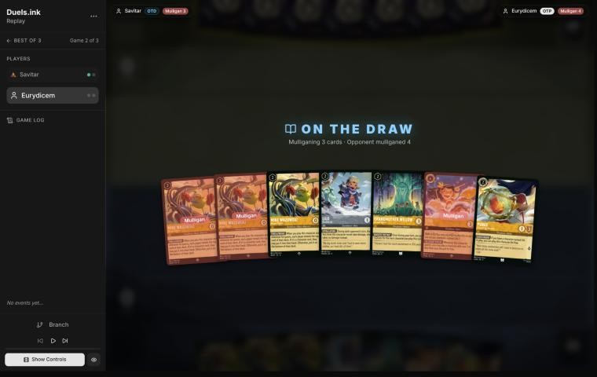
*The board before the decision: [step 0](https://duels.ink/replay/01a19ccd-3f04-7004-bb88-9a2aa0083e22?step=0) in the duels.ink replay viewer.*

**What you did:** on the draw, kept Mike, Lilo – Bundled Up, Willow and Pudge, and sent back Lilo – Rock Star and two
Mikes.

**Verdict:** an **inaccuracy**. Keeping **Mike, Bundled Up, Willow and Pudge** is suboptimal because three of the four
are uninkable and Mike quests for 1, and keeping **Bundled Up, Pudge and Rock Star** is better because Bundled Up is a
Lilo: Pudge comes free with her, and Rock Star Shifts onto her for 4. `tools/mulligan.py` (800 deals each, candidates
run before your mulligan was shown):

| Option | Ink on turns 1–4 | Play turns (of 4) | Lore by turn 4 | Characters by turn 4 | Interaction by turn 4 |
|---|---|---|---|---|---|
| Keep all 7 | 8.57 | 3.21 | 4.3 | 4.4 | 16% |
| Keep Bundled Up, Willow, Pudge, Rock Star | 9.39 | 3.66 | 8.3 | 5.1 | 37% |
| Keep that and a Mike | 9.20 | 3.54 | 7.8 | 4.9 | 31% |
| **Keep Bundled Up, Pudge, Rock Star** | 9.52 | 3.74 | 8.9 | 5.2 | 42% |
| Keep Bundled Up, Pudge, Willow | 9.38 | 3.74 | 8.9 | 5.2 | 37% |
| **As played** (Mike, Bundled Up, Willow, Pudge) | 9.18 | 3.66 | 7.2 | 5.1 | 31% |
| Full mulligan | 9.66 | 3.90 | 9.0 | 5.6 | 52% |

- **The gap is the largest of the mulligans flagged in this set** (1.7 lore by turn 4 against the three-card keeps
  and the full mulligan). Mike is the weakest of the 2-drops here: 1 lore, no strength, and his reveal feeds them too.
- Inaccuracy rather than mistake: every kept card is a 2-drop you can play, and Bundled Up with a free Pudge is your
  best start ([MULL-1](#cite-mull-1), [MULL-2](#cite-mull-2)). Confidence: medium.

### Turn 1: their turn

**What happened:** Rivera Family Photo inked, and a second one played.

### Turn 2: your turn 1

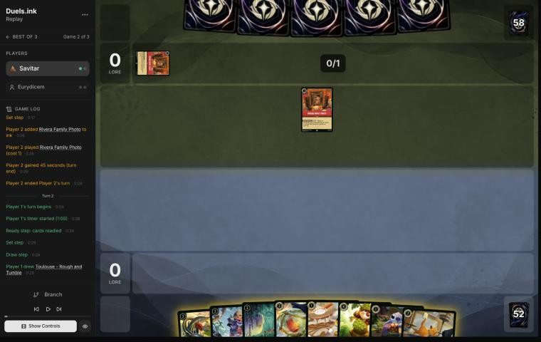
*The board before the decision: [step 5](https://duels.ink/replay/01a19ccd-3f04-7004-bb88-9a2aa0083e22?step=5) in the duels.ink replay viewer.*

**What you did:** the mulligan brought Mickey, Dale and Stitch; drew Toulouse; inked Toulouse; played Mickey.

**Verdict:** an **inaccuracy**. Inking **Toulouse** is suboptimal because he's your only way to stop Raging Storm and
Red Alert for a turn, and with Mickey in play their 8 ink can come early (their 5th turn in game 1); inking **Stitch**
is better because a third 1-drop matters least in a hand with Bundled Up, a free Pudge, Willow and Mike to play.
- **Mickey first is fine** (the close call from game 1): with Dale in hand, SPIKE SUIT makes Mickey deal 4 back to a
  Reckless challenger.
- Confidence: medium. Three more Toulouses are in your deck, but this one is certain.

### Turn 3: their turn

**What happened:** The Horseman Strikes! inked; Liquidator played. It will be dry next turn, and Mickey must quest.

### Turn 4: your turn 2

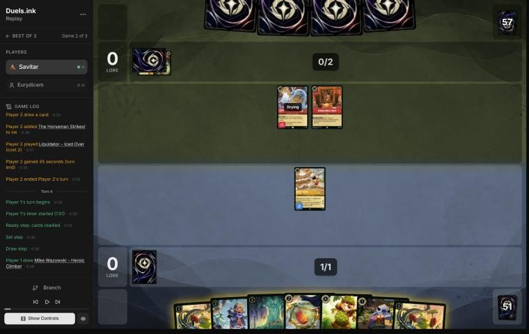
*The board before the decision: [step 11](https://duels.ink/replay/01a19ccd-3f04-7004-bb88-9a2aa0083e22?step=11) in the duels.ink replay viewer.*

**What you did:** drew a second Mike; inked Pudge; played Willow and Stitch (free with her discount); quested Mickey
(2–0).

**Verdict:** **close call**, slight edge to the alternative. **Bundled Up and a free Pudge** (inking Stitch) puts 3
lore a turn on the board against your 2, and Bundled Up ignores Liquidator's first hit on their turn. Your line keeps
Bundled Up for next turn with Willow's discount, so it costs about a lore, and Pudge, free with any Lilo, is the card
you'd rather keep than ink. Mickey is lost to Liquidator either way: he must quest, and you had no Mr. Big.

### Turn 5: their turn

**What happened:** Rivera milled a Liquidator and Remember Me; Liquidator killed Mickey; Red Alert inked; a third
Rivera milled Time to Go! and Jebidiah. Two actions in their discard make Olaf cost 7.

### Turn 6: your turn 3

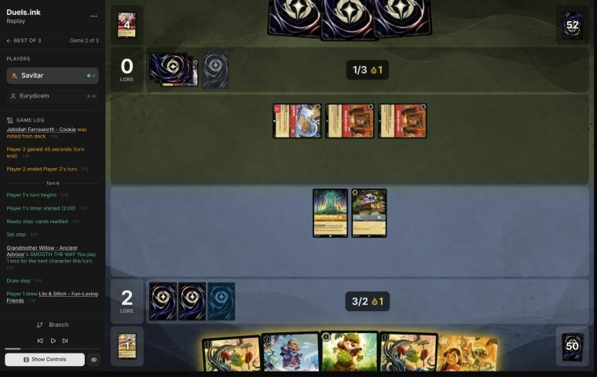
*The board before the decision: [step 24](https://duels.ink/replay/01a19ccd-3f04-7004-bb88-9a2aa0083e22?step=24) in the duels.ink replay viewer.*

**What you did:** drew Lilo & Stitch; played Dale for 3 (Willow) with the drop; Stitch challenged the exerted
Liquidator under SPIKE SUIT (3 damage) and both died; inked Lilo & Stitch; quested Willow (3–0).

**Verdict:** a **mistake**. Inking **Lilo & Stitch** and trading Stitch is suboptimal because she's your best card
and Shifted onto the dry Stitch she cost 2 this turn (Willow's discount applies to Shift), and **Shifting Lilo &
Stitch onto Stitch, playing Bundled Up and questing only Lilo & Stitch (5–0)** (inking Dale) is better because:
- **Liquidator has to hit her:** it's Reckless, and with Willow kept ready she's the only exerted character. Her 3
  {S} kills it (2 willpower) and she survives its 4 (Resist 1). Your line trades Stitch for it.
- **Lore:** 5 now, and 6 a turn on board (Lilo & Stitch 3, Bundled Up 2, Willow 1), against 3 now and 3 a turn
  (Dale 2, Willow 1). That's about 5 lore by the end of your next turn.
- **The risk is Red Alert** (about 1 in 5 after their draw), which takes Lilo & Stitch (3 {S}) or Dale (0) alike.
- **Dale's line has a point:** SPIKE SUIT makes your two Mikes deal 4 to any challenger next turn. But Dale can come
  next turn, and Lilo & Stitch inked is gone for good.
- Confidence: medium ([POS-1](#cite-pos-1)).

### Turn 7: their turn

**What happened:** two Rivera activations milled Dangerous Plan, The Horseman Strikes!, Wreck-it Ralph and Though I
Have to Say Goodbye; Inner Strength (on your Willow, just to draw); If She Doesn't Scare You inked. Six actions in
their discard make **Olaf cost 3**.

### Turn 8: your turn 4

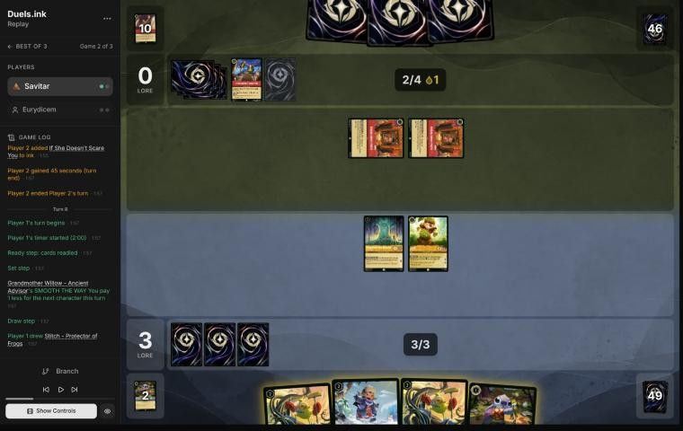
*The board before the decision: [step 37](https://duels.ink/replay/01a19ccd-3f04-7004-bb88-9a2aa0083e22?step=37) in the duels.ink replay viewer.*

**What you did:** drew Stitch; played Mike for 1 (Willow), whose reveal gave you Toulouse and them Liquidator; played
the second Mike, which gave you Mickey and them Hercules – Young Rescuer; inked Toulouse; played Mickey; quested
Willow and Dale (6–0).

**Verdict:** an **inaccuracy**. Inking **Toulouse** is suboptimal for the same reason as on [turn 2](#turn-2), and
inking **Stitch** is better because it pays for the same three characters:
- **Their Storm turn is close:** 6 ink next turn, and Mickey's drop from your next quest makes 8 on their 6th turn
  (game turn 11). Toulouse played on your next turn stops it, and Red Alert, Time to Go! and If She Doesn't Scare You
  with it.
- **Olaf isn't an action,** so Toulouse doesn't stop him: at cost 3 with six actions in their discard, each Olaf
  costs you 2 lore whatever you do. That makes the race tighter, not Toulouse less useful.
- **The two Mikes** are a fair trade: each reveal gave you a card and them a character (Liquidator, Hercules).
- Confidence: medium.

### Turn 9: their turn

**What happened:** Rivera milled three Wreck-it Ralphs between them, Medallion Weights and an Inner Strength; **Olaf –
Snowman of Action** for 2 (you lose 2: 0–4); Liquidator inked. Their discard is past 10, so Rivera can gain lore.

### Turn 10: your turn 5

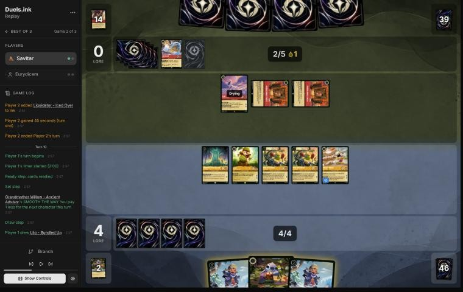
*The board before the decision: [step 55](https://duels.ink/replay/01a19ccd-3f04-7004-bb88-9a2aa0083e22?step=55) in the duels.ink replay viewer.*

**What you did:** drew a second Bundled Up; quested both Mikes first (a third Bundled Up and Mr. Big for you,
Jebidiah for them); played Mr. Big for 1, two Bundled Ups (inking Stitch); quested Willow, Dale and Mickey (11–0);
ICE OUT on Olaf; kept the third Bundled Up.

**Verdict:** **good play**.
- **Mikes first** turned two quests into two cards before you spent your ink.
- **Every ink exerted for ICE OUT** keeps Olaf from challenging, and SPIKE SUIT makes any other challenger take 4
  from your 4-willpower characters.
- **The race:** eight characters quest for 12 next turn, from 11. Mickey's drop gives them 8 next turn, so Raging
  Storm (about 1 in 3 after their draw) is the one card that stops it. Holding a Bundled Up is the rebuild if it
  comes ([POS-1](#cite-pos-1)).

### Turn 11: their turn

**What happened:** Olaf quested (2–11), then **Raging Storm** with both ink drops: all nine characters gone, Olaf
too. Eight actions in their discard: Olaf now costs 1.

### Turn 12: your turn 6

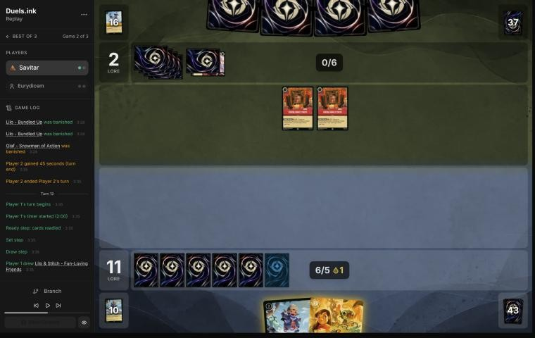
*The board before the decision: [step 74](https://duels.ink/replay/01a19ccd-3f04-7004-bb88-9a2aa0083e22?step=74) in the duels.ink replay viewer.*

**What you did:** drew Lilo & Stitch; played her for 5; kept Bundled Up.

**Verdict:** **good play**, the coach's line. Bundled Up then Lilo & Stitch Shifted onto her also costs 5 but spends
two cards on one body. Lilo & Stitch alone quests for 3 next turn, and Bundled Up stays in hand for after their next
answer.

### Turn 13: their turn

**What happened:** Rivera milled The Torn Corner (played free from the discard, then drew) and a second Remember Me;
**Red Alert** banished Lilo & Stitch; Lonely Grave inked. 2–11, with 11 actions in their discard: Olaf now costs 0.

### Turn 14: your turn 7

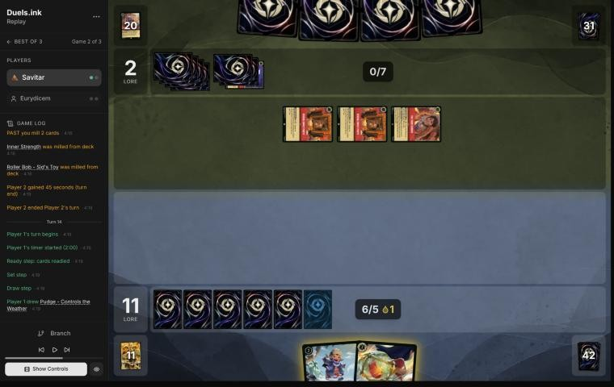
*The board before the decision: [step 86](https://duels.ink/replay/01a19ccd-3f04-7004-bb88-9a2aa0083e22?step=86) in the duels.ink replay viewer.*

**What you did:** drew Pudge; played Bundled Up and Pudge (free).

**Verdict:** **good play**, the only one: two bodies for 2 ink. Nothing was in play to quest.

### Turn 15: their turn

**What happened:** The Torn Corner drew; Rivera milled a second Raging Storm, a third The Horseman Strikes! and two
Copper – On the Scent (6, 8/5/0, Rush, Reckless); a fourth Liquidator played. 2–11.

### Turn 16: your turn 8

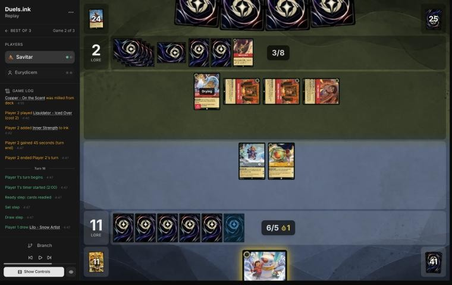
*The board before the decision: [step 97](https://duels.ink/replay/01a19ccd-3f04-7004-bb88-9a2aa0083e22?step=97) in the duels.ink replay viewer.*

**What you did:** drew Lilo – Snow Artist; played her; quested Bundled Up and Pudge (14–2).

**Verdict:** **close call**. Keeping **Pudge** home leaves Bundled Up as the only exerted character, so the Reckless
Liquidator must challenge her, and EXTRA LAYERS takes its 4 damage. Pudge survives to quest next turn, and the lore
evens out by your next turn (17 either way) with a body more. Questing both is a lore now against Pudge's life (the
brief's challenge list doesn't count EXTRA LAYERS, so it shows Bundled Up dying to Liquidator; she doesn't).

### Turn 17: their turn

**What happened:** Liquidator killed Pudge; Time to Go! banished their own Liquidator to draw 2; **Red Alert**
banished Bundled Up; Rivera gained a lore (3–14).

### Turn 18: your turn 9

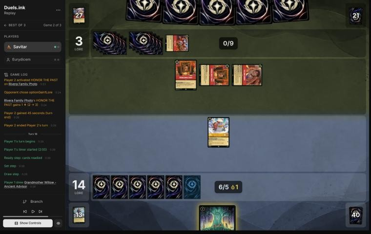
*The board before the decision: [step 111](https://duels.ink/replay/01a19ccd-3f04-7004-bb88-9a2aa0083e22?step=111) in the duels.ink replay viewer.*

**What you did:** drew Willow; played her; quested Lilo – Snow Artist (15–3).

**Verdict:** **good play**, the only one.

### Turn 19: their turn

**What happened:** **Land of the Dead – Marigold Bridge** (1 lore, +2 with 10 cards in their discard: 3 a turn), a
second Torn Corner and a fourth Rivera Family Photo. 3–15; their lore now comes from a location and items.

### Turn 20: your turn 10

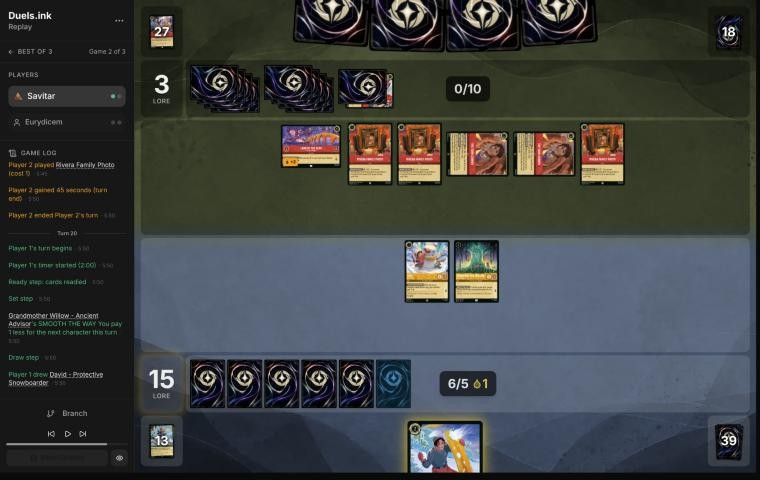
*The board before the decision: [step 121](https://duels.ink/replay/01a19ccd-3f04-7004-bb88-9a2aa0083e22?step=121) in the duels.ink replay viewer.*

**What you did:** drew David; played him exerted (Bodyguard); quested Lilo and Willow (17–3).

**Verdict:** **good play**. David exerted makes any Rush challenger (Roller Bob with two characters in their
discard) hit his 4 willpower before Lilo or Willow. You need 3 more; they quest for 3 a turn from Land of the Dead,
plus a lore per Rivera they can pay for. Land of the Dead (8 willpower) is out of your reach.

### Turn 21: their turn

**What happened:** Land of the Dead gave 3 (6–17); two Torn Corners drew 2; **Olaf for 0** (you lose 2), **Sulley –
The New Boss** returned the other Olaf from the discard and **Olaf again** (you lose 2 more); **Red Alert** on David,
and with Sulley (a Monster) in play you lose 1 more. 6–12, and their board now makes 8 a turn.

### Turn 22: your turn 11

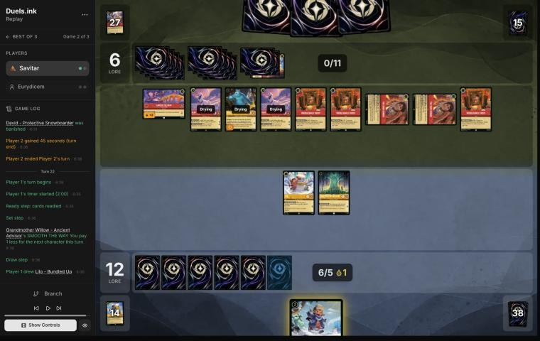
*The board before the decision: [step 138](https://duels.ink/replay/01a19ccd-3f04-7004-bb88-9a2aa0083e22?step=138) in the duels.ink replay viewer.*

**What you did:** drew Bundled Up; quested Lilo and Willow (14–6); played Bundled Up for 1.

**Verdict:** **good play**, and the game was very likely lost from here ([principle 2](#cite-principle-2)). You need 6 more and can make
at most 4 next turn (Lilo, Willow, Bundled Up), if three 4-strength challengers leave them alone. They're at 6 with
8 a turn from Land of the Dead, two Olafs and Sulley, plus a lore per Rivera, so they reach 20 on their next turn but
one at the latest.

### Turn 23: their turn

**What happened:** Land of the Dead gave 3 (9–14); both Torn Corners drew. You conceded before they quested.

**Verdict on the concession:** correct. Their two Olafs and Sulley quest for 5 this turn and the Riveras add up to 3
(17 or more), and you could make at most 4 of the 6 you needed next turn.

## Lessons
1. **Don't ink Toulouse against a Storm deck** ([2](#turn-2), [8](#turn-8)): their 8 ink came on game turn 11, and
   the only card that stops it was in your inkwell twice.
2. **Lilo & Stitch is worth more in play than in the inkwell** ([6](#turn-6)): Shifted onto a dry Stitch with
   Willow's discount she cost 2, quests for 3 and wins any fight with a Reckless 4-strength challenger.
3. **Dale's SPIKE SUIT works on defence too** ([6](#turn-6)): with Dale in play, Mike, Mickey and David deal 4 to a
   challenger, enough to kill Liquidator, Jebidiah or Roller Bob.
4. **Against Candle Control late, count Olaf as −2 per copy they can reach** ([21](#turn-21)): with 15 actions in
   their discard he costs 0, and Sulley returns one from the discard.

## Knowledge-base updates (applied 2026-11-02, without discussion at danny's request)
- **Meta, Amber/Ruby notes:** game 2 of Eurydicem's Candle Control list.
- **Meta, Amber/Steel notes on your list:** Toulouse against Storm decks; Dale's SPIKE SUIT on defence.

## Hindsight
Doesn't change the verdicts above.
- Their Storm came the first turn it could, so a held Toulouse on turn 10 would have stopped it, though Red Alert,
  Olaf and Land of the Dead were still to come.

## The coach's errors
None found in the blind pass. One tool gap noted: the brief's challenge list ignores Lilo – Bundled Up's EXTRA
LAYERS and shows her dying to a challenge she survives ([16](#turn-16)).

| When | Error | How it was caught | How it won't happen again |
|---|---|---|---|

## Open questions
- [Turn 6](#turn-6): Dale with SPIKE SUIT and a Stitch trade, or Lilo & Stitch Shifted in? The coach's line is more
  lore; Savitar's kept a 4-damage threat on every challenge.
- [Turn 10](#turn-10): play out everything to win a turn sooner, or hold more back against a Storm that is live?

## Citations
Copies of the coach's knowledge base cited above, as they stood when they were cited (the private repository's commit and date are given with each). They don't change when the knowledge base does.

<!-- Filled in by `python3 tools/cite.py <this file>`: every principle ID, H-n, "principle N" and CR rule above
becomes a link to an entry here. Add a file or one of its sections with `--file PATH --section TEXT`, and link to
the anchor it prints. Never link into the private repository. -->

**amber-ruby.md, Candle Control against Rockstar Aggro: Eurydicem**: knowledge base, `kb/meta/archetypes/amber-ruby.md` at `994eb5b` (2026-11-03), working tree

> ### Candle Control against Rockstar Aggro: Eurydicem `[coach, blind reviews of 01a19cc8-0739 and 01a19ccd-3f04 (Savitar vs Eurydicem, 2 Nov 2026)]`
> - **Game 1** (01a19cc8-0739; Savitar won 20–3 on game turn 14): Rivera Family Photo turn 1, then a challenger a turn:
>   Liquidator (turn 3), Roller Bob (5), Jebidiah ×2 (7), Wreck-it Ralph – Raging Wrecker (11, not in duels.ink's list).
>   The Reckless pair killed a character a turn; Red Alert took Nani. Also seen: If She Doesn't Scare You, Time to Go!
>   ×2, The Horseman Strikes!, Medallion Weights ×2, Olaf ×2 (milled), Land of the Dead. No Storm by turn 13, with 8
>   ink possible on turn 9 thanks to Mickey's drops.

**MULL-1**: strategy principle, `kb/strategy/principles.md` at `994eb5b` (2026-11-03), working tree

> - **MULL-1. Keep a plan, not the strongest cards.** *Ask: "Which hand gives me the best chance to execute my game plan in this matchup?"* `[MCL ch.12]` · baseline

**MULL-2**: strategy principle, `kb/strategy/principles.md` at `994eb5b` (2026-11-03), working tree

> - **MULL-2. A smooth curve beats a few powerful cards.** Check that you can spend ink well on turns 1–4, have enough inkable cards, and know what turn 4 looks like. `[MCL ch.12]` · baseline
>   - **Ink spent isn't the goal by itself.** Judge a keep by a nice curve (a play each turn), early lore pressure, and
>     interaction that sets the opponent back, as well as by ink, then weigh card quality and the matchup
>     (user, 2026-11-01). `tools/mulligan.py` reports all of these.

**POS-1**: strategy principle, `kb/strategy/principles.md` at `994eb5b` (2026-11-03), working tree

> - **POS-1. From ahead, take the safest path to victory.** Don't overextend into sweepers, don't make unnecessary trades, and make the opponent take the risks. Winning by 1 lore counts the same as winning by 10. `[MCL ch.10]` · baseline

**principle 2**: coaching principle, `CLAUDE.md` at `994eb5b` (2026-11-03), working tree

> 2. **Some games are unwinnable.** Draws and matchups can make a game lost whatever the player does. Say so
>    when it's true, rather than inventing mistakes to explain a loss.
