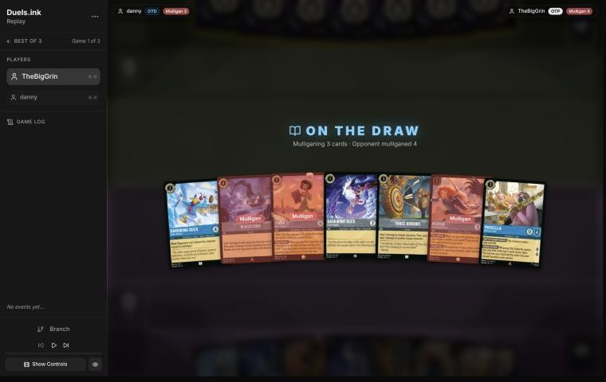
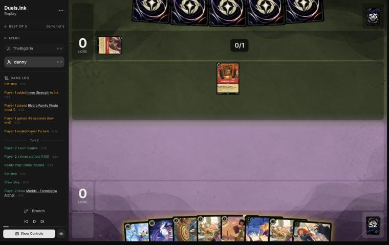
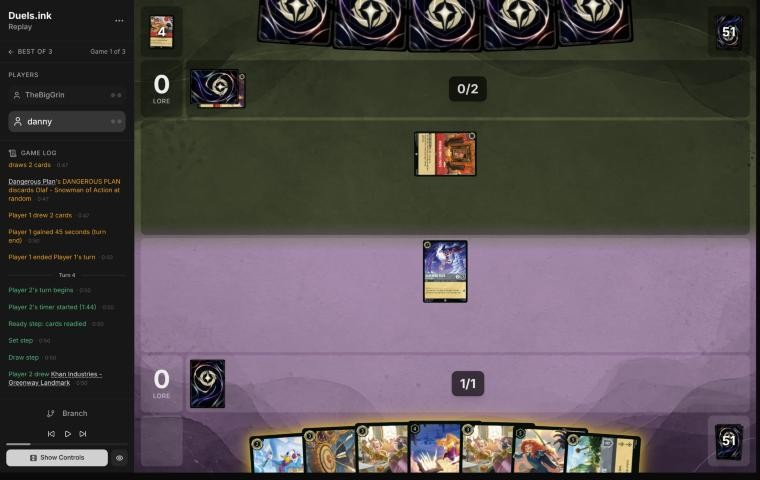
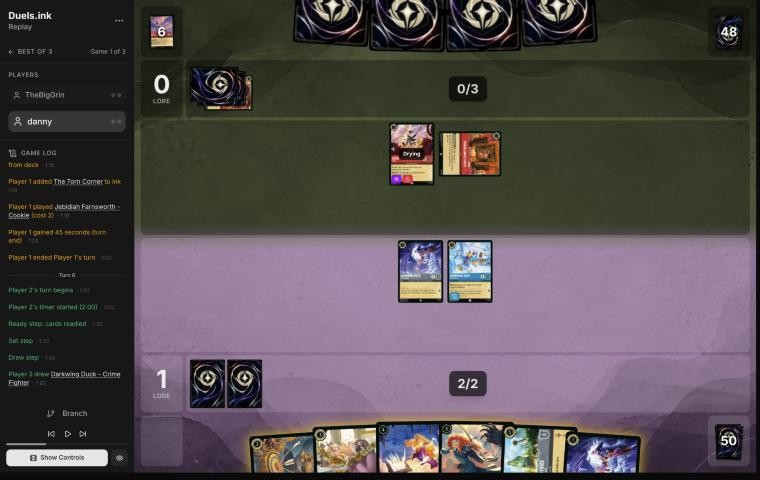
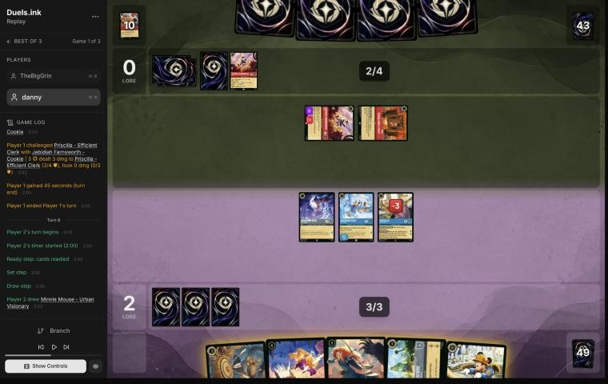
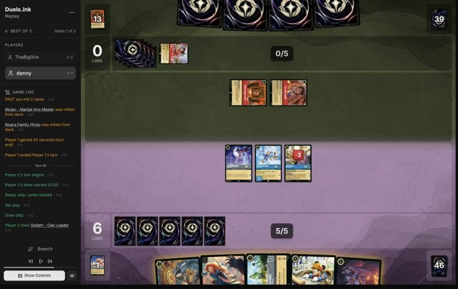
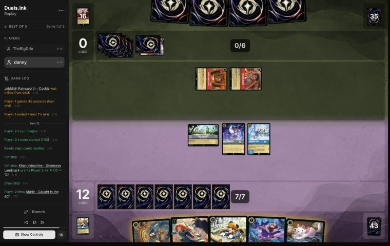

# Review: danny vs TheBigGrin, 2 Nov 2026 (game 1)

| | |
|---|---|
| **Status** | **final** (2026-11-02; discussed with danny, no verdict changed) |
| **Replay** | `01a19d60-c6bc-7488-b9d6-d6bc08cb38b2` (`python3 tools/brief.py 01a19d60 --turn N`) · [duels.ink viewer](https://duels.ink/replay/01a19d60-c6c9-7293-bc45-defe0402e54e?step=0) |
| **Format** | Core Constructed. Set 14 era: inks revealed before the coin toss |
| **Decks** | You: Sapphire/Steel Big Ramp with the Darkwing package ([the coach's notes on it](#cite-kb-meta-archetypes-sapphire-steel-big-ramp-with-the-darkwing-package-how-to-play-it)). Them: Amber/Ruby ([the coach's notes on Candle Control](#cite-kb-meta-archetypes-amber-ruby-candle-control)); archetype as it became clear: Candle Control (94% from their turn 1, certain by turn 5) |
| **Play/draw** | TheBigGrin went first; you were on the draw |
| **Result** | Won: TheBigGrin conceded on turn 13 at 14–0 |
| **Meta data** | snapshot of 26 Oct 2026 (7 days old, fresh) |
| **Chosen how** | Sent by the user as a match zip of three games; only the replays were read, not the zip's result file. A third game means games 1 and 2 were split, but not which way |

## Summary
- **Good plays:** [2](#turn-2), [4](#turn-4), [6](#turn-6) (Crime Fighter kept back from the Reckless Jebidiah),
  [8](#turn-8) (Priscilla quested before the ink, and Thunderbolt on Jebidiah), [10](#turn-10) (Khan Industries, the
  lore Raging Storm can't touch), [12](#turn-12) (Minnie a turn early, so both Ward threats quest on turn 14).
- **Close calls:** the [mulligan](#turn-0) (Merida and Windstorm sent back).
- **Inaccuracies or worse:** none.
- **Unwinnable from:** never.

**What decided it:** Candle Control needs the game long and ends it with Raging Storm at 8 ink and Olaf's lore drain.
Their self-mill threw two Storms into the discard, and you reached 14 lore by turn 12, a turn's quests from 20 before
the Storm could come. Khan Industries and two Ward threats left them nothing worth answering.

## The game, turn by turn
Verdicts judge each decision on what you could know at the time, **including archetype knowledge an experienced
player has**. Hindsight is kept to its own section. Severity scale: good play / close call /
inaccuracy / mistake / blunder. Principle IDs and hypotheses (H-n) link to copies
in the Citations section at the end, as they stood when they were cited.

**What you knew before the game:** they're Amber/Ruby: Candle Control 50%, an unlisted list 33%, Boosties 11%, Sid
Toys 5%. They went first and sent back 4 cards before your mulligan. Candle Control is a control deck that fills its own discard and wins late. Its key cards,
and the earliest each can come (their turn k is game turn 2k−1):
- **Raging Storm** (8, uninkable): banishes all characters, theirs too. No ramp in the list, so their 8th turn (game
  turn 15). It doesn't touch locations.
- **Olaf – Snowman of Action** (9): costs 1 less for each action in their discard, and on play you lose 2 lore.
  Their self-mill (Rivera Family Photo, Though I Have to Say Goodbye, Dangerous Plan's random discard) feeds it, so
  with 4–5 actions in the discard he comes at 4–5 ink, from about their 5th turn (game turn 9).
- **Red Alert** (4): banishes a character with 3 {S} or less (and you lose 1 lore if they have a Monster, such as
  Sulley). From their 4th turn (game turn 7). Most of your cheap characters are in range.
- **The Horseman Strikes!** (3): draws, and banishes an Evasive character. **Firefly Swarm** (3): banishes a
  character with 2 {S} or less, or any character if 2 other cards went to their discard that turn.
- **Recursion:** Sulley – The New Boss (5, Bodyguard; returns a character from their discard to hand), Remember Me
  (song 6, Sing Together 6; plays characters from their discard, exerted), Or Rewrite History! (3).
- **Discard payoffs:** Land of the Dead – Marigold Bridge (location 4, 8 {W}; +2 lore with 10+ cards in their
  discard), Rivera Family Photo (1 lore a turn at 10+), The Torn Corner (draws at 10+).
- **Early bodies:** Liquidator – Iced Over (2; 4/2, Reckless, can't quest), Jebidiah Farnsworth – Cookie (2; 3/3,
  Evasive, Reckless), Hercules – Young Rescuer (2), Roller Bob (3; 4/3, Rush by bottoming 2 characters from the
  discard). Though I Have to Say Goodbye and Inner Strength pump challengers.
- If it's **Boosties** instead: Gaston – Superior Archer (5; banishes a 5+ {S} character), Aladdin, Scrooge McDuck
  and Webby's Diary, and the same Red Alert and Raging Storm.

Your plan against Candle Control: they want the game long and end it with Raging Storm and Olaf's lore drain, so you
are the aggressor ([ROLE-1](#cite-role-1)). Build lore early with cheap characters, keep a rebuild in hand rather than putting
everything into one Storm, and lean on what survives it: Khan Industries is a location. Windstorm has few targets
against a deck with so few characters.

### Pre-game

*The board before the decision: [step 0](https://duels.ink/replay/01a19d60-c6c9-7293-bc45-defe0402e54e?step=0) in the duels.ink replay viewer.*

**What you did:** sent back Tiana – Party Hostess, Windstorm and Merida – Formidable Archer, keeping Darkwing Duck –
Crime Fighter, Darkwing Duck – Drake Mallard, Three Arrows and Priscilla – Efficient Clerk.

**Verdict:** close call. The seven already had a play on each of turns 1–5 (Crime Fighter, Drake Mallard, Priscilla,
Windstorm, Merida) with Tiana to ink. `tools/mulligan.py` (1,500 deals) puts the options level on curve and lore:

| Option | Ink on turns 1–4 | Play turns (of 4) | Lore by turn 4 | Characters by turn 4 | Interaction by turn 4 |
|---|---|---|---|---|---|
| Keep all 7 (the coach's pick) | 9.81 | 4.00 | 7.0 | 4.0 | 100% |
| Send back Tiana only | 9.72 | 4.00 | 7.0 | 4.1 | 100% |
| **As played** (send back Tiana, Windstorm, Merida) | 9.79 | 4.00 | 7.1 | 4.5 | 100% |
| Full mulligan | 9.11 | 3.60 | 5.1 | 3.4 | 92% |

Your mulligan fits the matchup: Windstorm has few targets against Candle Control, and digging for more early bodies,
Khan Industries or Cinderella suits the aggressor's role ([MULL-3](#cite-mull-3)). Its cost is Merida: the hand's
turn-5 play, a 2-lore body, and STEADY AIM with the Three Arrows you kept (4 and 3 damage). The coach would have kept
her and sent back only Tiana, but the sim can't separate the two, and against a deck whose removal is Red Alert and
Raging Storm, Merida is one more 3-strength target. Confidence: low.

*In discussion:* danny's aim was more bodies ("especially Priscilla"). That's the reading the verdict gave: early
bodies for the aggressor's role. Its cost stays Merida, so the verdict stands.

### Turn 1: their turn

**What happened:** they inked Inner Strength and played Rivera Family Photo, two Candle Control tells (94% from here).

### Turn 2: your turn 1

*The board before the decision: [step 6](https://duels.ink/replay/01a19d60-c6c9-7293-bc45-defe0402e54e?step=6) in the duels.ink replay viewer.*

**What you did:** drew Merida – Formidable Archer; inked Tiana – Party Hostess and played Darkwing Duck – Crime
Fighter.

**Verdict:** good play, the coach's line. The 1-drop starts the lore against a deck that wants the game long, and
Tiana (7, no Tiana to Shift onto) was the card least needed: the two Priscillas are the ramp, and Three Arrows with
Merida answers their Reckless 2-drops ([INK-2](#cite-ink-2)).

### Turn 3: their turn

**What happened:** Rivera Family Photo milled Mulan – Martial Arts Master and Time to Go!; they inked a second Inner
Strength, and Dangerous Plan drew 2 and discarded Olaf at random. Two actions in their discard make Olaf cost 7, and
two characters there let Roller Bob gain Rush.

### Turn 4: your turn 2

*The board before the decision: [step 14](https://duels.ink/replay/01a19d60-c6c9-7293-bc45-defe0402e54e?step=14) in the duels.ink replay viewer.*

**What you did:** drew Khan Industries – Greenway Landmark; quested Crime Fighter (+1, 1–0), inked the second
Priscilla and played Darkwing Duck – Drake Mallard.

**Verdict:** good play. Drake Mallard was the only 2-drop, and the quest risked only a 1-drop: with Mulan and Olaf in
their discard, a Roller Bob could gain Rush and challenge it, spending their turn on it. The ink kept Khan Industries
(the lore that survives Raging Storm) and Three Arrows; one Priscilla is enough for next turn, and the coach would
have been happy inking either the second Priscilla or the Arrows ([INK-2](#cite-ink-2)).

### Turn 5: their turn

**What happened:** Rivera Family Photo milled Sulley – The New Boss and a second Olaf; they inked The Torn Corner and
played Jebidiah Farnsworth – Cookie (3/3, Evasive, Reckless: it can't quest, must challenge each turn if able, and
only Evasive characters can challenge it). Candle Control is now certain.

### Turn 6: your turn 3

*The board before the decision: [step 23](https://duels.ink/replay/01a19d60-c6c9-7293-bc45-defe0402e54e?step=23) in the duels.ink replay viewer.*

**What you did:** drew a second Crime Fighter and inked it; played Priscilla – Efficient Clerk and quested Drake
Mallard (+1, 2–0), leaving the first Crime Fighter ready.

**Verdict:** good play. Jebidiah must challenge an exerted character next turn, and Priscilla enters exerted, so the
real question was what else to expose. Questing both Darkwings gains a lore but hands Jebidiah the 2-willpower Crime
Fighter, a free kill. Your line leaves it two choices: Priscilla (4 {W} survives his 3) or Drake Mallard (a trade of
2-drops, and their removal engine gone). Keeping a 1-lore quester for many turns is worth more than one lore now
([RULE-1](#cite-rule-1), [TRADE-2](#cite-trade-2)). Inking the spare Crime Fighter kept Three Arrows, which with Merida
kills Sulley or Olaf (2 + 2) and Jebidiah (1 + 2). Their next turn has 4 ink: Red Alert (about a third) can take
Priscilla but not the Warded Drake.

### Turn 7: their turn

**What happened:** Rivera Family Photo milled Inner Strength and a Raging Storm, and Dangerous Plan discarded a second
Raging Storm from their hand; they inked a second Jebidiah, and Jebidiah challenged Priscilla (3 damage, 1 {W} left).
Their discard reached 10 cards, so Rivera Family Photo now gains a lore and The Torn Corner draws; six actions there
make Olaf cost 3. Two of their four Raging Storms are gone.

### Turn 8: your turn 4

*The board before the decision: [step 33](https://duels.ink/replay/01a19d60-c6c9-7293-bc45-defe0402e54e?step=33) in the duels.ink replay viewer.*

**What you did:** drew Minnie Mouse – Urban Visionary; quested Priscilla first (+2; FILING SYSTEM put Marie – Caught in
the Act in your hand and the other card in your inkwell), then Crime Fighter and Drake Mallard (+2, 6–0); inked Marie
and played He Hurled His Thunderbolt on the exerted Jebidiah.

**Verdict:** good play, better than the coach's plan on the ink. Jebidiah had to go: Evasive, so none of your
characters could challenge it, and Reckless, so it would have killed the 1-willpower Priscilla or a Crime Fighter
every turn. Thunderbolt (4) was the only card that killed it, and with it gone every quest was safe from challenges
(only a Roller Bob with Rush could reach your exerted characters next turn).
- **The order:** questing Priscilla before choosing the ink gave you Marie, a 1-drop worth little against Candle
  Control, to ink ([SEQ-1](#cite-seq-1)). The coach had planned to ink Three Arrows, which Merida's FULL QUIVER can
  bring back and which kills Olaf or Sulley with her; your line kept it, Khan Industries and Minnie.
- **Their next turn:** 5 ink, and Olaf costs 3 (you'd lose 2 lore); Red Alert (about a third) can take Priscilla or
  a Crime Fighter, never the Warded Drake.

### Turn 9: their turn

**What happened:** The Torn Corner (played and used: a card), Mulan inked, and Rivera Family Photo milled Mulan and a
second Rivera Family Photo. No characters. Their discard holds 13 cards: two Olafs, Sulley, two Mulans and Jebidiah
for their recursion, and six actions, so Olaf costs 3.

### Turn 10: your turn 5

*The board before the decision: [step 48](https://duels.ink/replay/01a19d60-c6c9-7293-bc45-defe0402e54e?step=48) in the duels.ink replay viewer.*

**What you did:** drew Goliath – Clan Leader; quested Priscilla first (+2; St. Canard's Finest to your hand), played
Khan Industries – Greenway Landmark, inked Goliath, and quested both Darkwings (+2, 10–0).

**Verdict:** good play, the coach's line in full. At 6–0 against a deck that ends the game with Raging Storm (two
left; 8 ink, their 8th turn, game turn 15 at the earliest), lore that survives the Storm is worth most: Khan Industries
gains 2 at the start of each of your turns and isn't a character. With four quests next turn as well, you'd reach 16 on
turn 12 and 20 on turn 14 if nothing changes ([ROLE-1](#cite-role-1), [POS-1](#cite-pos-1)).
- **Inking Goliath:** his DUSK TO DAWN would make them discard down to 2 each turn, and their deck wants cards in its
  discard (Olaf's discount, Remember Me's replays). Merida is uninkable and Minnie and Finest are your Ward threats.
- **Their next turn:** 6 ink, so **Remember Me** (song 6, two in the list) can be cast to play characters from their
  discard, exerted: one Olaf (you lose 2), Sulley, a Mulan and Jebidiah. A lone Olaf costs 3. Red Alert can take
  Priscilla or a Crime Fighter.

### Turn 11: their turn

**What happened:** The Torn Corner drew, Red Alert banished Priscilla, they inked a second Red Alert, and Rivera
Family Photo milled Roller Bob and a Jebidiah. Still no characters and no lore.

### Turn 12: your turn 6

*The board before the decision: [step 63](https://duels.ink/replay/01a19d60-c6c9-7293-bc45-defe0402e54e?step=63) in the duels.ink replay viewer.*

**What you did:** Khan Industries gave 2 (12–0); drew Marie and inked her; played Minnie Mouse – Urban Visionary and
quested both Darkwings (+2, 14–0).

**Verdict:** good play, and the better of the two lines the coach compared. Raging Storm needs 8 ink, so it can't
come before turn 15 (they'll have 7 next turn): the job was to reach 20 on turn 14. Their turn 13 can take 2 lore with
Olaf (3 ink, or replayed by Remember Me) and Red Alert a non-Ward character.
- **Minnie now (your line):** 14 after this turn. On turn 14, Khan's 2, Minnie's 3, St. Canard's Finest Shifted onto a
  dry Darkwing (it quests at once) for 2, and a Crime Fighter's 1 make +8: 20 even after an Olaf.
- **Finest now, Shifted onto Drake Mallard:** it quests at once, so 15 after this turn, but Minnie played on turn 14
  would still be drying: Khan 2, Finest 2, Crime Fighter 1, Marie 1 make +6, so 19 after an Olaf.
- Both put Ward characters out of Red Alert's reach. Yours is a lore ahead in the branch that matters
  ([QC-5](#cite-qc-5)).

### Turn 13: their turn

**What happened:** they drew and conceded at 0–14.

## Lessons
1. **Against Candle Control, count back from Raging Storm.** It costs 8 and the list has no ramp, so it comes on their
   8th turn at the earliest (game turn 15 on the play). Plan to reach 20 the turn before, and put lore where the Storm
   can't reach: Khan Industries is a location ([10](#turn-10), [12](#turn-12)).
2. **A Reckless character is removal you can steer.** Jebidiah must challenge an exerted character each turn, so
   what you exert chooses its target: Priscilla (4 {W}) absorbed it while the 2-willpower Crime Fighter stayed ready
   ([6](#turn-6)). Evasive kept your challengers off it, so Thunderbolt had to do it ([8](#turn-8)).
3. **Ward is the answer to their removal:** Red Alert, Firefly Swarm and The Horseman Strikes! all choose a target,
   so Drake Mallard, Minnie and St. Canard's Finest were safe from everything but Raging Storm.

## Knowledge-base updates (applied 2026-11-02, after discussion)
- **Meta, the Amber/Ruby notes (Candle Control), from this game:**
  - The self-mill is fast: Rivera Family Photo each turn and two Dangerous Plans put 10 cards in their discard by
    their 4th turn (game turn 7), switching on Rivera's lore, The Torn Corner's draw and Land of the Dead, and six
    actions there made Olaf cost 3 from turn 9.
  - It milled and discarded two of their own Raging Storms, and played no character but Jebidiah in 13 turns.
  - Jebidiah Farnsworth – Cookie (Evasive, Reckless) was their early removal: only Evasive characters can challenge
    it, so it needs an action (He Hurled His Thunderbolt) or Windstorm.
- **Meta, the Sapphire/Steel notes (Big Ramp with the Darkwing package), against Candle Control:** Khan Industries and
  the Ward threats (Drake Mallard, Minnie, St. Canard's Finest) are the plan; their removal targets, so Ward blanks it.
  Race to 20 before their 8th turn.
- **Strategy:** none new; lesson 2 applies [RULE-1](#cite-rule-1) and lesson 3 [CARD-2](#cite-card-2).

## Hindsight
Doesn't change the verdicts above.
- Their own mill and Dangerous Plan's random discard threw away two of their four Raging Storms by turn 7, so only two
  were left in their deck and hand when they conceded.
- They never cast a character after Jebidiah: the game ended before Olaf or Remember Me came.

## The coach's errors
Filled in during discussion.

| When | Error | How it was caught | How it won't happen again |
|---|---|---|---|
| — | None found in the blind pass. On turn 8 your ink (Marie, after Priscilla's quest) beat the coach's plan to ink Three Arrows | — | — |

## Open questions
Closed when the review was finalised (2026-11-02), with danny's answers.
- **The mulligan:** the aim was more early bodies, especially Priscilla. The close call stands.

## Citations
Copies of the coach's knowledge base cited above, as they stood when they were cited (the private repository's commit and date are given with each). They don't change when the knowledge base does.

<!-- Filled in by `python3 tools/cite.py <this file>`: every principle ID, H-n, "principle N" and CR rule above
becomes a link to an entry here. Add a file or one of its sections with `--file PATH --section TEXT`, and link to
the anchor it prints. Never link into the private repository. -->

**sapphire-steel.md, Big Ramp with the Darkwing package: how to play it**: knowledge base, `kb/meta/archetypes/sapphire-steel.md` at `b533e92` (2026-11-02), working tree

> ### Big Ramp with the Darkwing package: how to play it `[coach, study of stonks 📈's 22 games of 21 Oct 2026 (sent by the user), full games, not blind]`
> The user calls this list Sapphire/Steel Detectives, or Big Ramp. It matches duels.ink's "Big Ramp #1" (Windstorm,
> Minnie) with the Darkwing Detectives added. Games: `01a15f98` to `01a1602c` (22; see `kb/meta/index.md`). Card text
> verified with `tools/cards.py`. Also `01a15f8e` (vs MFork, game 2) and `01a16978` (vs AkatsukiCap, game 1).
> - **The list (60):**
>   - **1-drops:** Darkwing Duck – Crime Fighter ×4, Marie – Caught in the Act ×4
>   - **2-drops:** Darkwing Duck – Drake Mallard ×4 (Ward), Launchpad – Trusty Sidekick ×4, The Terror That Flaps in
>     the Night ×4
>   - **3–4:** Three Arrows ×4, Priscilla – Efficient Clerk ×3, Cinderella – Dream Come True ×4, He Hurled His
>     Thunderbolt ×2, Windstorm ×3
>   - **5–6:** Merida – Formidable Archer ×4, Khan Industries – Greenway Landmark ×4, Goliath – Clan Leader ×3
>   - **7–8:** Darkwing Duck & Launchpad – St. Canard's Finest ×4, Cinderella – Unintentional Icon ×2, Tiana – Party
>     Hostess ×4, Minnie Mouse – Urban Visionary ×3
> - **The plan:**
>   1. **Early removal** keeps their board small: Terror (3 damage while a Darkwing is in play), Three Arrows (2, then 1).
>      A Darkwing in play also makes Launchpad's draw free of the discard.
>   2. **Ramp:** Priscilla (enters exerted; each quest puts one of the top 2 into hand and the other into the inkwell,
>      2 lore), Cinderella – Dream Come True (at the end of a turn you played a Princess, ink a card from hand to draw),
>      Cinderella – Unintentional Icon (Shift 5 onto her; ramps one a turn, 3 lore), Marie (an ink drop when she quests
>      after an opposing character took damage). Ink at the start of its 5th turn was usually 5–6, and 8–9 by its 6th in the fastest games.
>   3. **The sweep: Merida, then Windstorm.** STEADY AIM adds 2 damage to every instance of action damage to an
>      opposing character, so Windstorm deals 3 to each (5 to an Evasive one): a 4- to 6-character wipe (01a1601c
>      turn 11: six Princess Aggro characters). Merida's FULL QUIVER also returns Three Arrows (then 4 and 3).
>   4. **Lore:** Khan Industries (2 a turn at their Set step; characters there can't be challenged, so Merida and
>      Priscilla move in), Merida 2, Priscilla 2, Cinderella – Unintentional Icon 3, Minnie 3, St. Canard's Finest 2
>      plus VICTORY POSE (+2 per banish in a challenge on its turn).
>   5. **Tiana – Party Hostess** (7): draw 2 and discard one; a discarded Khan Industries is played free (01a15fee,
>      01a15ff6, 01a1602c). **Minnie** (8, Ward) returns a card from the inkwell to hand when she ends a turn exerted.
>      **Goliath – Clan Leader** puts both hands to 2 at the end of each turn: strictly for pressing an advantage when
>      ahead, or for keeping a control deck's hand small; otherwise rarely played (user, 2026-11-02).
> - **Results by matchup** (13–9): Emerald/Steel Midrange 8–4, all four game 1s lost and every game 2 and 3 won;
>   Amber/Emerald Circle of Life 2–4; Princess Aggro 2–1; Amethyst/Steel Midrange 1–0.
> - **What won:** the Merida and Windstorm sweep, Finest's VICTORY POSE, Khan Industries with protected questers. Early
>   Priscilla matters: in the Emerald/Steel wins she was down by its 4th turn in five of eight, and in the four losses never
>   (a correlation from few games).
> - **It can race from behind once the questers are gone:** in 01a16978, at 5–17 against Emerald/Steel, Three Arrows
>   with STEADY AIM killed Vixey and The Queen, a second Merida returned the Arrows, and wide quests (two Meridas at 2
>   each, Darkwings, Cinderella) won 20–19.
> - **What beat it:**
>   - **Resist:** Flash – Efficient Clerk (2, 3/2/2, Resist 1) takes nothing from Windstorm's 1 and less from every
>     ping; it quested for 8 to 10 in two lost game 1s.
>   - **Ward plus recursion:** Circle of Life replayed Milo Thatch – Getting His Hands Dirty (7, Ward, bounces a
>     character on play), which bounced Merida; conceded at 3–0 (01a15f9d turn 14). Only Windstorm reaches a Ward
>     character.
>   - **Fast wide quests:** Princess Aggro's +5 and +6 turns came before the sweep (01a16020, lost 14–21); a song-and-
>     Evasive Amber/Emerald list quested +7 and +8 (01a15fdb).
> - **Coaching points:**
>   - Merida before any damage action; with their board at 2–3 willpower, hold Windstorm for her.
>   - Keep a Darkwing in play for Terror's 3 and Launchpad's free draw. Quest Marie after removal for the ink drop.
>   - Move questers to Khan Industries; plan Tiana for the turn a Khan is in hand. Whether to ink a Khan is too
>     situational for a rule (user, 2026-11-02): judge it from the hand.
>   - Name the answer to Resist and Ward early (Thunderbolt's 4, challenges, Finest): the pings don't do it.
>   - **Mulligan from the hand you have, not to a fixed plan** (user, 2026-11-02). The play pattern varies widely with
>     the opening seven, and no one line suits a given matchup: see what the hand already does, keep what bridges
>     turn 1 to the late game, and send back the rest, avoiding a full mulligan where possible. The deep mulligans
>     (3 to 7 cards) in these games came partly from the player's first games on the deck, so they aren't a guide.
>   - **Judge the plan from the hand, then the matchup:** a coached line should say how this hand gets from its early
>     turns to Merida, the sweep and the 3-lore finishers, rather than follow a stock sequence.

**amber-ruby.md, Candle Control**: knowledge base, `kb/meta/archetypes/amber-ruby.md` at `b533e92` (2026-11-02), working tree

> ### Candle Control
> 50% of the pair's games (22,793).
>
> | # | Card | Type | Cost | Tag |
> |---|---|---|---|---|
> | 2 | Hercules - Young Rescuer | character | 2 |  |
> | 3 | Jebidiah Farnsworth - Cookie | character | 2 |  |
> | 4 | Liquidator - Iced Over | character | 2 |  |
> | 3 | Roller Bob - Sid's Toy | character | 3 |  |
> | 3 | Sulley - The New Boss | character | 5 | recursion |
> | 2 | Sulley & Boo - Scare Buddies | character | 6 |  |
> | 4 | Olaf - Snowman of Action | character | 9 |  |
> | 4 | Dangerous Plan | action | 1 |  |
> | 4 | Inner Strength | action | 1 | combat |
> | 1 | Firefly Swarm | action | 3 | removal |
> | 3 | The Horseman Strikes! | action | 3 | removal |
> | 2 | Time to Go! | action | 3 |  |
> | 4 | Red Alert | action | 4 | removal |
> | 4 | Raging Storm | action | 8 | sweeper |
> | 4 | Though I Have to Say Goodbye | song | 2 | combat |
> | 1 | Or Rewrite History! | song | 3 | recursion |
> | 2 | Remember Me | song | 6 |  |
> | 4 | Rivera Family Photo | item | 1 |  |
> | 4 | The Torn Corner | item | 3 |  |
> | 2 | Land of the Dead - Marigold Bridge | location | 4 |  |

**ROLE-1**: strategy principle, `kb/strategy/principles.md` at `b533e92` (2026-11-02), working tree

> - **ROLE-1. The matchup decides your role, not your deck.** In nearly every game one player wants it short (aggressor) and one wants it long (defender). The same list can play either role. *Ask: "Which deck benefits if this game goes long?"* `[MCL ch.8]` · baseline

**RULE-1**: strategy principle, `kb/strategy/principles.md` at `b533e92` (2026-11-02), working tree

> - **RULE-1. Only exerted characters can be challenged** `[CR 4.6.4.2]`. Questing, singing, or {E} for an ability exposes the character. Staying ready protects it. Every quest is also a decision about what the opponent can challenge next turn. · baseline
>   - *Card text overrides this* (CR 1.2.1). Shere Khan – Khan Industries CEO's NEW INCENTIVE lets one character
>     challenge ready characters that turn. Alert (e.g. from Judy Hopps – Lead Detective, to every Detective on their
>     turn) ignores Evasive. Against Ducktectives, name both in the setup. 01a14574, turns 16 and 18. `[coach, 2026-10-26]`

**CARD-2**: strategy principle, `kb/strategy/principles.md` at `b533e92` (2026-11-02), working tree

> - **CARD-2. Virtual card advantage means making the opponent's cards dead without trading for them.** Don't overextend into narrow removal you know or suspect they hold. Ward makes targeted answers useless. `[MCL ch.2]` · baseline

**MULL-3**: strategy principle, `kb/strategy/principles.md` at `b533e92` (2026-11-02), working tree

> - **MULL-3. The right keep depends on the matchup.** Early interaction against aggro; pressure, draw and engines against slow decks. The mulligan is the first expression of your role. In the Set 14 era the opponent's inks are known before the mulligan (RULE-8), so this applies from game 1 of a match. `[MCL ch.12]` · baseline

**INK-2**: strategy principle, `kb/strategy/principles.md` at `b533e92` (2026-11-02), working tree

> - **INK-2. Don't automatically ink the most expensive card.** It may be the late-game win condition or the key answer for this matchup. The answer depends on matchup, hand and board. `[MCL ch.4]` · baseline

**TRADE-2**: strategy principle, `kb/strategy/principles.md` at `b533e92` (2026-11-02), working tree

> - **TRADE-2. The best trade removes theirs and keeps yours.** A survivor keeps generating value and demands more answers. `[MCL ch.7]` · baseline

**SEQ-1**: strategy principle, `kb/strategy/principles.md` at `b533e92` (2026-11-02), working tree

> - **SEQ-1. Gather information before irreversible decisions.** Draw, look and scry before choosing what to ink. Quest with draw triggers before committing other plays when the order doesn't otherwise matter. `[MCL ch.5]` · baseline

**POS-1**: strategy principle, `kb/strategy/principles.md` at `b533e92` (2026-11-02), working tree

> - **POS-1. From ahead, take the safest path to victory.** Don't overextend into sweepers, don't make unnecessary trades, and make the opponent take the risks. Winning by 1 lore counts the same as winning by 10. `[MCL ch.10]` · baseline

**QC-5**: strategy principle, `kb/strategy/principles.md` at `b533e92` (2026-11-02), working tree

> - **QC-5. The race changes everything.** At 18–12 up, take the last 2 lore. At 8–16 down, stopping their close-out matters more than your quests. `[MCL ch.6]` · baseline
