# Review: danny vs TheBigGrin, 2 Nov 2026 (game 2)

| | |
|---|---|
| **Status** | **final** (2026-11-02; discussed with danny, no verdict changed) |
| **Replay** | `01a19d66-1de9-747a-982a-81039bd58165` (`python3 tools/brief.py 01a19d66 --turn N`) · [duels.ink viewer](https://duels.ink/replay/01a19d66-1dea-7df6-8ad0-c37dadb14517?step=0) |
| **Format** | Core Constructed. Set 14 era: inks revealed before the coin toss |
| **Decks** | You: Sapphire/Steel Big Ramp with the Darkwing package ([the coach's notes on it](#cite-kb-meta-archetypes-sapphire-steel-big-ramp-with-the-darkwing-package-how-to-play-it)). Them: Amber/Ruby Candle Control, known from game 1 ([the coach's notes on Candle Control](#cite-kb-meta-archetypes-amber-ruby-candle-control)) |
| **Play/draw** | TheBigGrin went first again (they lost game 1, so the choice was theirs); you were on the draw |
| **Result** | Lost: you conceded on turn 30 at 14–15, with their win certain next turn |
| **Meta data** | snapshot of 26 Oct 2026 (7 days old, fresh) |
| **Chosen how** | Sent by the user as a match zip of three games. **The coach knew the result before this review:** you won game 1 and the match went to a third game, so this game was a loss. Every verdict below was written from that turn's brief alone, and checked for outcome bias: a lost game doesn't mean a mistake was made |

## Summary
- **Inaccuracies:** the [mulligan](#turn-0) (both Khan Industries sent back with the late game) and [4](#turn-4)
  (Khan inked when Cinderella – Unintentional Icon was the card least likely to be played in time). Khan, the lore Raging
  Storm can't touch, didn't reach the board until turn 16.
- **Good plays:** [2](#turn-2), [6](#turn-6) (Launchpad's draw before the ink found the Cinderella Shift base),
  [8](#turn-8), [10](#turn-10), [12](#turn-12), [14](#turn-14) (Thunderbolt and Dream Come True on Mulan – Elite
  Archer), [16](#turn-16), [18](#turn-18), [20](#turn-20), [22](#turn-22) (two Arrows with Merida cleared their board),
  [24](#turn-24), [26](#turn-26), [28](#turn-28).
- **Unwinnable from:** [turn 30](#turn-30).

**What decided it:** Candle Control had every answer this time: all four Raging Storms (turns 15, 19, 27, plus one
milled), Mulan – Elite Archer's TRIPLE SHOT, and Olaf six times over, each costing you 2 lore (12 in all, plus a lore
to Red Alert). You reached 16 three times and were dragged back each time. From turn 12 on, the coach found your line
best or equal on every turn.

## The game, turn by turn
Verdicts judge each decision on what you could know at the time, **including archetype knowledge an experienced
player has**. Hindsight is kept to its own section. Severity scale: good play / close call /
inaccuracy / mistake / blunder. Principle IDs and hypotheses (H-n) link to copies
in the Citations section at the end, as they stood when they were cited.

**What you knew before the game:** they went first and sent back 6 cards before your mulligan. Game 1 showed their list: Candle Control, with Rivera Family Photo, The Torn
Corner, Dangerous Plan and Inner Strength filling their discard, Jebidiah Farnsworth – Cookie (Evasive, Reckless),
Roller Bob, Mulan – Martial Arts Master, Sulley – The New Boss, Time to Go!, Red Alert, Olaf and Raging Storm. Their
key cards and when each can come (their turn k is game turn 2k−1):
- **Raging Storm** (8): banishes all characters; their 8th turn (game turn 15) at the earliest. Locations survive.
- **Olaf – Snowman of Action** (9, 1 less per action in their discard; you lose 2 lore on play): in game 1 he cost 3
  by their 5th turn.
- **Red Alert** (4; a character with 3 {S} or less) from game turn 7; The Horseman Strikes! (Evasive) and Firefly
  Swarm. All three choose their target, so Ward characters are safe from them.
- **Recursion:** Sulley (5), Remember Me (song 6: characters from their discard, exerted), Or Rewrite History!.
- **Jebidiah** (2): must challenge an exerted character each turn; only Evasive characters can challenge him.

Your plan, as in game 1: race to 20 before their 8th turn, with lore Raging Storm can't touch (Khan Industries) and
Ward threats their removal can't target (Drake Mallard, Minnie, St. Canard's Finest).

### Pre-game

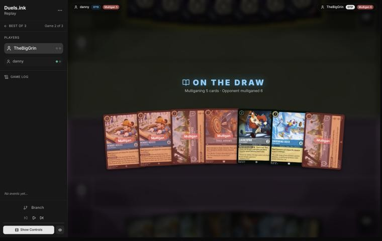
*The board before the decision: [step 0](https://duels.ink/replay/01a19d66-1dea-7df6-8ad0-c37dadb14517?step=0) in the duels.ink replay viewer.*

**What you did:** sent back 5 (both Minnies, both Khan Industries and Three Arrows), keeping Launchpad – Trusty
Sidekick and Darkwing Duck – Drake Mallard.

**Verdict:** inaccuracy. The seven were top-heavy (two 8s, two 5s, Launchpad uninkable), so a mulligan was right; the
question was how deep. `tools/mulligan.py` (1,500 deals):

| Option | Ink on turns 1–4 | Play turns (of 4) | Lore by turn 4 | Characters by turn 4 | Interaction by turn 4 |
|---|---|---|---|---|---|
| Keep all 7 | 8.91 | 3.14 | 3.3 | 2.9 | 100% |
| Send back both Minnies | 9.28 | 3.39 | 4.3 | 3.5 | 100% |
| Keep Khan, Three Arrows, Launchpad, Drake Mallard (the coach's pick) | 9.38 | 3.49 | 4.7 | 3.7 | 100% |
| **As played** (keep Launchpad and Drake Mallard) | 9.31 | 3.63 | 5.5 | 4.1 | 89% |
| Full mulligan | 9.16 | 3.65 | 5.4 | 3.4 | 94% |

Sending back all five is suboptimal because it threw away the card game 1 turned on: Khan Industries, the lore
Raging Storm can't reach. Kept, it comes down on turn 10 for certain; sent back, the chance you hold one by your 5th
turn is about 46% (exact hypergeometric over the replacements and draws). Keeping one Khan with Three Arrows,
Launchpad and Drake Mallard is better because it gives up little of the early curve (0.8 lore by turn 4, a seventh of
a play turn) against a deck that plays almost no characters early, and keeps what bridges to the late game
([MULL-1](#cite-mull-1), [MULL-3](#cite-mull-3)). Confidence: low (the sim can't value Khan, and the five fresh cards could find Priscilla's ramp).

*In discussion:* danny was missing a 1-drop and characters for turn 4, and wanted a more consistent curve; he
agrees Khan Industries is strong in this matchup. The sim above already prices that: neither line had a 1-drop, and
keeping a Khan cost 0.8 lore by turn 4 and a seventh of a play turn. That's a small price for the matchup's
Storm-proof lore, so the verdict stands.

### Turn 1: their turn

**What happened:** your mulligan drew Windstorm, Khan Industries, Marie, Cinderella – Unintentional Icon and St.
Canard's Finest. They inked Inner Strength and played Rivera Family Photo, as in game 1.

### Turn 2: your turn 1

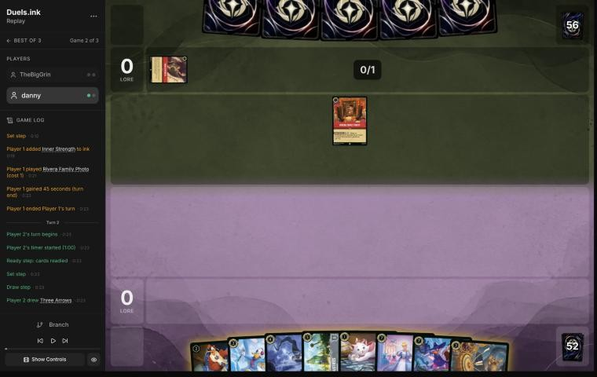
*The board before the decision: [step 5](https://duels.ink/replay/01a19d66-1dea-7df6-8ad0-c37dadb14517?step=5) in the duels.ink replay viewer.*

**What you did:** drew Three Arrows, inked it and played Marie – Caught in the Act.

**Verdict:** good play. Marie is the 1-drop that starts the race. Without Merida, Three Arrows' 2 and 1 kill almost
nothing in their list (Jebidiah has 3 {W}), while Windstorm deals 3 to an Evasive Jebidiah. The coach would have
inked Cinderella – Unintentional Icon (7, no Cinderella to Shift onto), but against a deck with this few characters
the Arrows is the weaker card ([INK-2](#cite-ink-2)).

### Turn 3: their turn

**What happened:** they inked Mulan – Elite Archer (6, Shift 5 onto a Mulan; with TRIPLE SHOT her challenge damage
hits two more characters) and played Liquidator – Iced Over (4/2, Reckless: it can't quest and must challenge an
exerted character each turn if it can).

### Turn 4: your turn 2

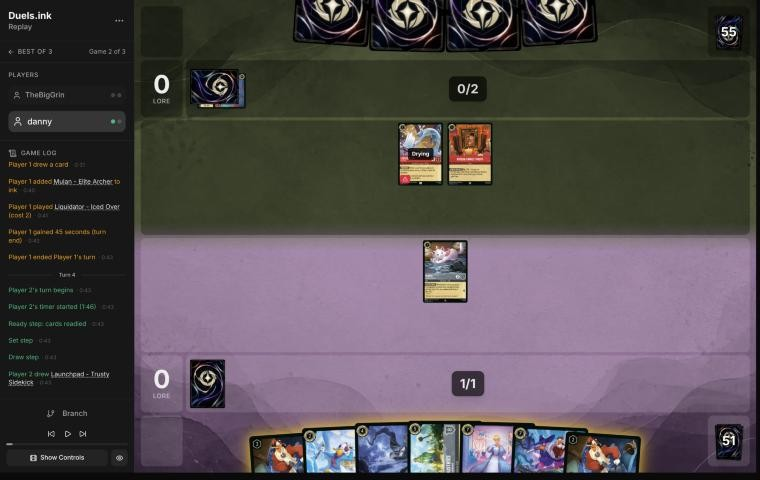
*The board before the decision: [step 11](https://duels.ink/replay/01a19d66-1dea-7df6-8ad0-c37dadb14517?step=11) in the duels.ink replay viewer.*

**What you did:** drew a second Launchpad; inked Khan Industries, played Launchpad – Trusty Sidekick and quested Marie
(+1, 1–0).

**Verdict:** the plays were good; the ink an inaccuracy.
- **Launchpad before Drake Mallard** lets him draw next turn (he must be dry to use {E}), and Drake played first next
  turn makes that draw discard-free. **Marie's quest** offers Liquidator a trade it must take: Reckless makes it
  challenge her, and her 2 {S} kills its 2 {W}. A 1-drop for their removal piece.
- **Inking Khan Industries** is suboptimal because it's the card this matchup turns on: lore Raging Storm can't
  touch, and characters there can't be challenged (game 1, turns 10–12). **Inking Cinderella – Unintentional Icon** is
  better: with no Cinderella to Shift onto she costs 7, so she comes on turn 14 at the earliest, the turn before
  their first possible Storm, and dies to it. Your hand already had two 5-ink plays for turn 10 (Khan, and St. Canard's
  Finest Shifted onto a Darkwing), so Cinderella was the card least likely to be played in time ([INK-2](#cite-ink-2)).
  Confidence: medium (the knowledge base leaves inking a Khan to the hand, and this hand had another late threat).

*In discussion:* danny agrees: "probably a mistake. Khan Industries is strong in this matchup." The verdict stands.

### Turn 5: their turn

**What happened:** Liquidator sang Though I Have to Say Goodbye, which exerted it before it had to challenge Marie, and
milled Jebidiah, Copper – On the Scent (6, 8/5, Rush, Reckless) and a second Mulan – Elite Archer. They inked Red Alert
and played The Torn Corner. Liquidator ends the turn exerted, and their hand is down to 2.

### Turn 6: your turn 3

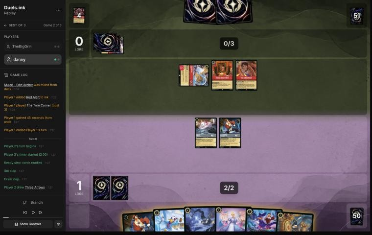
*The board before the decision: [step 20](https://duels.ink/replay/01a19d66-1dea-7df6-8ad0-c37dadb14517?step=20) in the duels.ink replay viewer.*

**What you did:** drew a second Three Arrows. Launchpad's WHAT DID YOU NEED? drew Cinderella – Dream Come True (you
discarded Windstorm); you inked St. Canard's Finest; Three Arrows banished the exerted Liquidator (2) and put its
second point on your own Launchpad; Marie quested (+1, 2–0) and A LITTLE TREAT gave you an ink drop.

**Verdict:** good play, better than the coach's plan. The coach had Three Arrows on Liquidator too, but planned the
ink before the draw. Launching Launchpad first found Cinderella – Dream Come True, a Shift base that makes
Cinderella – Unintentional Icon a 5-ink play, and only then choosing the ink ([SEQ-1](#cite-seq-1)): with both 7-drops now Shift 5,
either could go in, and Finest was a fair choice. The Arrows killed their only character without a trade, and the
damage it dealt switched on Marie's ink drop.
- **One slip:** Three Arrows' second point is optional ("you may"), and putting it on your own Launchpad (2 {W} left)
  gained nothing. Decline it when there's no second target. Tiny.

### Turn 7: their turn

**What happened:** Rivera Family Photo milled Vincenzo Santorini – On the Run (4, 4/2, Evasive; your items can't ready)
and The Horseman Strikes!; Dangerous Plan discarded Mulan – Martial Arts Master; they inked a second Vincenzo. No
characters again; 9 cards in their discard, three of them actions (Olaf costs 6).

### Turn 8: your turn 4

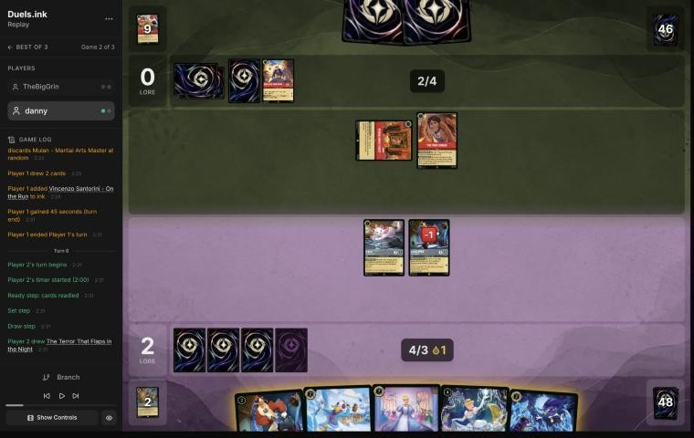
*The board before the decision: [step 33](https://duels.ink/replay/01a19d66-1dea-7df6-8ad0-c37dadb14517?step=33) in the duels.ink replay viewer.*

**What you did:** drew The Terror That Flaps in the Night and inked it; played Cinderella – Dream Come True and quested
Launchpad and Marie (+2, 4–0). At the end of the turn WHATEVER YOU WISH FOR put your second (uninkable) Launchpad into
your inkwell and drew Darkwing Duck – Crime Fighter.

**Verdict:** good play, the coach's line. Dream Come True is the Shift base that makes Cinderella – Unintentional Icon
a 5-ink, 3-lore play next turn, and her own end-of-turn trigger ramps: putting the uninkable Launchpad in was the
best use of it. Questing Launchpad rather than drawing with him (no Darkwing in play, so he'd have discarded) took a
lore. Their next turn has 5 ink and no characters on board, so only Red Alert or a Rush Roller Bob reach your exerted
characters.

### Turn 9: their turn

**What happened:** Rivera Family Photo milled Olaf and a second Rivera; The Torn Corner drew; they inked a Jebidiah.
Still no characters; 11 cards in their discard.

### Turn 10: your turn 5

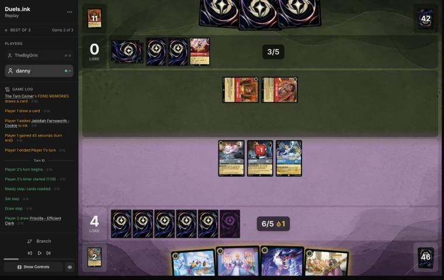
*The board before the decision: [step 44](https://duels.ink/replay/01a19d66-1dea-7df6-8ad0-c37dadb14517?step=44) in the duels.ink replay viewer.*

**What you did:** drew Priscilla; inked Drake Mallard, played Crime Fighter so Launchpad's draw was free (it found a
second Dream Come True), Shifted Cinderella – Unintentional Icon onto Dream Come True, and quested Marie and Cinderella
(+4, 8–0). BESPOKE DESIGN inked a card from the top of your deck.

**Verdict:** good play, the coach's line with a cheaper Darkwing. Unintentional Icon on a dry Dream Come True quests at
once for 3 and ramps every turn; a Darkwing in play first made Launchpad's draw discard-free. The coach would have
inked Crime Fighter and played Drake Mallard with the ink drop; your line kept the drop and played the 1-drop. Equal.
- **The race:** 8–0, with Cinderella 3, Marie, Launchpad and Crime Fighter questing for 6 a turn: 14 on turn 12 and 20
  on turn 14, the turn before Raging Storm can come (8 ink, game turn 15).
- **What their next turn (6 ink) can do:** Olaf costs 6 (three actions in their discard): you'd lose 2. Copper – On the
  Scent (6, 8 {S}, Rush) would kill the exerted Cinderella; Firefly Swarm's second mode banishes any character once
  Rivera has milled 2. Red Alert can't target her (4 {S}).

### Turn 11: their turn

**What happened:** The Torn Corner drew; they inked Liquidator and played Mulan – Martial Arts Master; Rivera Family
Photo milled a Torn Corner (played free by MEND THE PHOTO) and Though I Have to Say Goodbye. Mulan is the Shift base
for **Mulan – Elite Archer** (5 ink next turn): Shifted, she has 5 {S}, and TRIPLE SHOT deals her challenge damage to
up to two other characters as well, ready or not.

### Turn 12: your turn 6

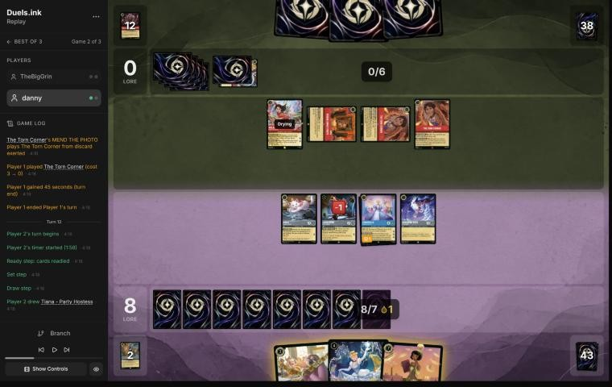
*The board before the decision: [step 62](https://duels.ink/replay/01a19d66-1dea-7df6-8ad0-c37dadb14517?step=62) in the duels.ink replay viewer.*

**What you did:** drew Tiana – Party Hostess; Launchpad drew a Crime Fighter; you played Dream Come True, Priscilla
and the Crime Fighter (with the ink drop), and quested Marie, Cinderella and the first Crime Fighter (+5, 13–0). At the
end of the turn BESPOKE DESIGN inked a card from your deck, and WHATEVER YOU WISH FOR inked Tiana to draw Launchpad.

**Verdict:** good play. Raging Storm can't come before turn 15, so the goal was 20 on turn 14.
- **Your line:** 13 now, with seven characters who can quest for 10 on turn 14.
- **The coach's line:** Tiana – Party Hostess (her draw could find a Khan to play free) and Priscilla, with Launchpad
  questing: 14 now and six characters questing for 10.
- **Equal on the race.** Neither line can stop Mulan – Elite Archer, which can kill three of your small characters in
  one challenge. Yours spreads the lore over more bodies, and Dream Come True turned Tiana into a card. Their next turn
  has 7 ink: an Elite Archer Shift (5) or Olaf (5 now; you'd lose 2), not both.

### Turn 13: their turn

**What happened:** Inner Strength (+1 {S}, a card) on Mulan – Martial Arts Master, then Mulan – Elite Archer Shifted
onto her (6 {S} this turn). She challenged Priscilla, and TRIPLE SHOT dealt 6 to Cinderella – Unintentional Icon and
Launchpad as well: all three banished. Elite Archer is left exerted with no damage. You're at 13 with Marie, two Crime
Fighters and Dream Come True.

### Turn 14: your turn 7

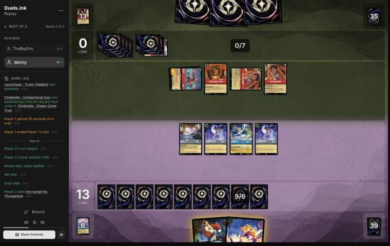
*The board before the decision: [step 85](https://duels.ink/replay/01a19d66-1dea-7df6-8ad0-c37dadb14517?step=85) in the duels.ink replay viewer.*

**What you did:** drew He Hurled His Thunderbolt and paid for it: 4 damage to Mulan – Elite Archer; Dream Come True
challenged her (2 more, banished; Dream Come True survived on 1); Marie and both Crime Fighters quested (+3, 16–0), and
Marie's ink drop came back. Launchpad stayed in hand.

**Verdict:** good play, the coach's line. Elite Archer had to die: with TRIPLE SHOT her 2 {S} challenge would have dealt
2 to three of your characters next turn, and every one but Dream Come True has 2 {W} or less. Paying for Thunderbolt
rather than singing it with Dream Come True left her free to make the finishing challenge, and with 3 {W} she survived
it. Holding Launchpad keeps a body back from Raging Storm, now castable (8 ink next turn; held about 37% after their
draw): your four questers make exactly 20 on turn 16 without him ([POS-1](#cite-pos-1)).

### Turn 15: their turn

**What happened:** they inked a Mulan and cast Raging Storm on the first turn they could (8 ink): Marie, both Crime
Fighters and Dream Come True were banished. 16–0, your board empty, Launchpad in hand.

### Turn 16: your turn 8

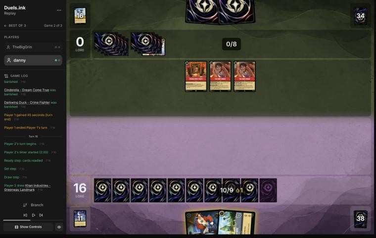
*The board before the decision: [step 95](https://duels.ink/replay/01a19d66-1dea-7df6-8ad0-c37dadb14517?step=95) in the duels.ink replay viewer.*

**What you did:** drew Khan Industries; played it and Launchpad, and moved Launchpad there.

**Verdict:** good play, the only line. Khan gives 2 at the start of each of your turns (18 on turn 18, 20 on turn 20),
and Launchpad there can't be challenged. Their outs now are Olaf (3 ink, with six actions in their discard: you lose 2
each time one is played), and a character with 8 {S} challenging Khan itself (Copper – On the Scent, from their
discard by Sulley's REHIRE or Remember Me).

### Turn 17: their turn

**What happened:** Sulley – The New Boss returned Olaf from their discard; Rivera Family Photo milled another Rivera
and a third Raging Storm; Olaf cost 2 and took 2 of your lore (14–0). Sulley and Olaf are on the board.

### Turn 18: your turn 9

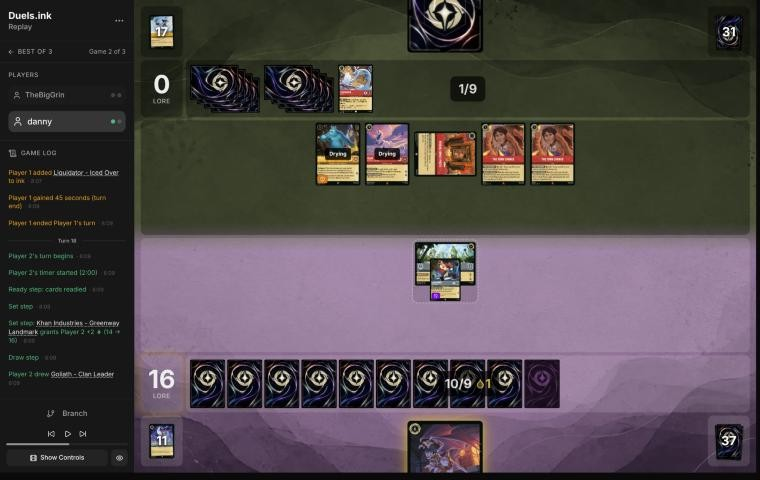
*The board before the decision: [step 108](https://duels.ink/replay/01a19d66-1dea-7df6-8ad0-c37dadb14517?step=108) in the duels.ink replay viewer.*

**What you did:** Khan gave 2 (16); drew Goliath – Clan Leader; Launchpad quested (17), and Goliath was played and moved
to Khan Industries. DUSK TO DAWN drew you up to 2 at the end of the turn (Drake Mallard, Merida).

**Verdict:** good play, the coach's line. At 17, next turn's Khan (2) and a Launchpad quest win; Goliath at Khan can't be
challenged and adds 2 more, so even an Olaf replay (−2) or Sulley and Olaf challenging Khan to death (4 + 4 = its 8
{W}) leaves 20 within reach. DUSK TO DAWN refilled your empty hand to 2; it also tops their hand up to 2, a fair price
when yours is the emptier.

### Turn 19: their turn

**What happened:** Olaf and Sulley challenged Khan Industries (4 + 4: banished). Then a second Raging Storm cleared
both boards, Launchpad and Goliath with it. 17–0, nothing in play on either side; you hold Drake Mallard and Merida.

### Turn 20: your turn 10

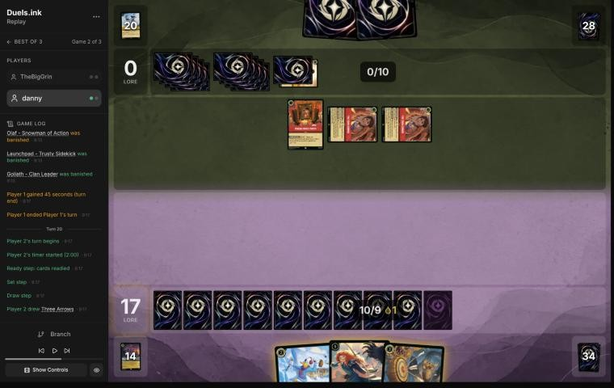
*The board before the decision: [step 119](https://duels.ink/replay/01a19d66-1dea-7df6-8ad0-c37dadb14517?step=119) in the duels.ink replay viewer.*

**What you did:** drew a Three Arrows; played Merida (FULL QUIVER took the other Arrows back from your discard) and Drake
Mallard.

**Verdict:** good play, the only line. Merida's 2 and Drake's 1 are exactly the 3 you need on turn 22. Three of their
four Raging Storms are gone, so committing both is right. Their outs: Olaf again (Remember Me or another Sulley from the
discard; you'd lose 2), or Red Alert on Merida (Drake's Ward keeps him safe).

### Turn 21: their turn

**What happened:** Inner Strength twice, The Horseman Strikes! and two Torn Corner draws dug them to two Olafs, both free
(ABOUT TIME! with nine actions in their discard): you lost 4 (13). They added Jebidiah, and Rivera Family Photo gained
their first lore (13–1).

### Turn 22: your turn 11

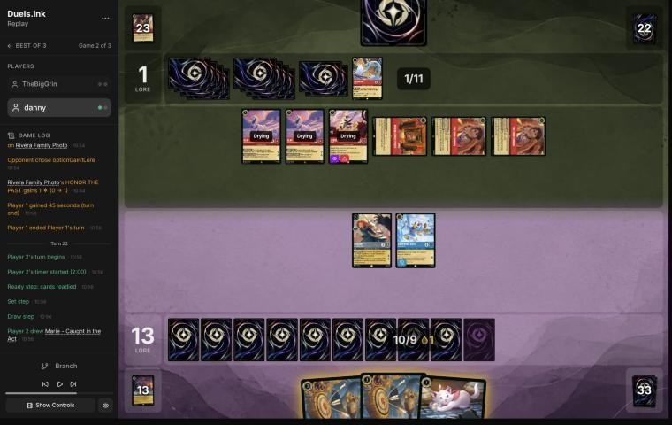
*The board before the decision: [step 138](https://duels.ink/replay/01a19d66-1dea-7df6-8ad0-c37dadb14517?step=138) in the duels.ink replay viewer.*

**What you did:** drew Marie. Three Arrows with Merida's STEADY AIM dealt 4 to an Olaf and 3 to Jebidiah (both
banished); the second Arrows killed the other Olaf (its optional second point declined). You played Marie and quested
Merida and Drake Mallard (+3, 16–1).

**Verdict:** good play, the deck's signature turn: each Arrows with Merida is 4 and 3 damage, enough to clear all three
of their characters for 6 ink, and the quests are safe with their board empty. 4 more on turn 24 wins (Merida, Drake,
Marie), unless another Olaf costs you 2: Sulley or Remember Me can bring one back from their discard.

### Turn 23: their turn

**What happened:** they inked Land of the Dead and cast Remember Me: Sulley came back from their discard and REHIRE
returned an Olaf; two Olafs then came down free, and you lost 4 more (12–1). Sulley and one Olaf entered exerted.

### Turn 24: your turn 12

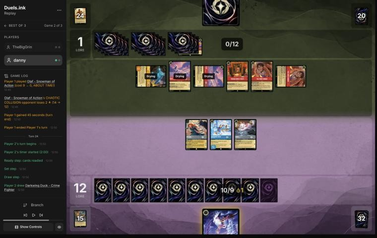
*The board before the decision: [step 158](https://duels.ink/replay/01a19d66-1dea-7df6-8ad0-c37dadb14517?step=158) in the duels.ink replay viewer.*

**What you did:** drew a Crime Fighter and played it; quested Merida, Drake Mallard and Marie (+4, 16–1).

**Verdict:** good play, a hard spot. You need 8; they need 19, with two Olafs and Sulley questing for 5 a turn plus
Rivera's 1.
- **Questing everything** puts you on 16 with 5 lore of questers for turn 26 (Merida, Drake, Marie, Crime Fighter). To
  stop 20 next time, their three 4-strength characters must spend two challenges (Merida's 5 {W} takes two; Drake and
  Marie one each), and every challenge is a quest they don't make.
- **Clearing first** doesn't work: Drake can trade with the exerted Sulley (Bodyguard forces it), but nothing else can
  kill an Olaf without Arrows, and every challenger is a quest lost.
- Their deck has few answers left to see (one Raging Storm, two Red Alerts). The race favours you as long as Olaf's drain
  stops; whether it does depends on Sulley or Remember Me coming back.

### Turn 25: their turn

**What happened:** Red Alert banished Merida (and with Sulley, a Monster, in play you lost a lore: 15); they played Land
of the Dead (3 lore a turn with their discard over 10); Sulley traded with Drake Mallard and an Olaf killed Marie; the
other Olaf quested (15–3).

### Turn 26: your turn 13

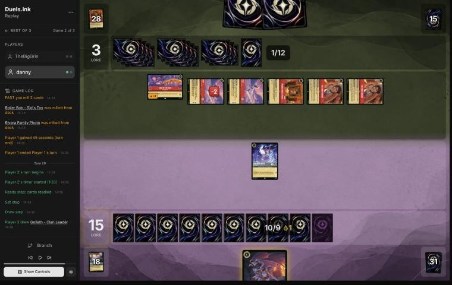
*The board before the decision: [step 176](https://duels.ink/replay/01a19d66-1dea-7df6-8ad0-c37dadb14517?step=176) in the duels.ink replay viewer.*

**What you did:** drew the second Goliath and played it; Crime Fighter quested (16–3). DUSK TO DAWN drew you St. Canard's
Finest and Priscilla.

**Verdict:** good play. Their board now makes 8 a turn (Land of the Dead 3, two Olafs, Rivera), so they reach 20 on turn
31 at the latest; you need 4 more first.
- **The alternative:** Crime Fighter could kill the damaged Olaf (2 {W} left) and die, cutting their clock by 2 a turn.
  But that loses your only Darkwing, the Shift base that makes St. Canard's Finest a 5-ink, quest-at-once 2-lore play.
- **Your line** keeps it: on turn 28, Finest Shifted onto a dry Crime Fighter (2) and Goliath (2) make 20, so they have
  to spend their turn killing Crime Fighter rather than questing. Goliath also refills your hand to 2 every turn.

### Turn 27: their turn

**What happened:** Land of the Dead gave 3; both Olafs quested (10); then their fourth Raging Storm cleared the board,
their Olafs with it, and Rivera added a lore (16–11). They now gain 4 a turn without a character in play.

### Turn 28: your turn 14

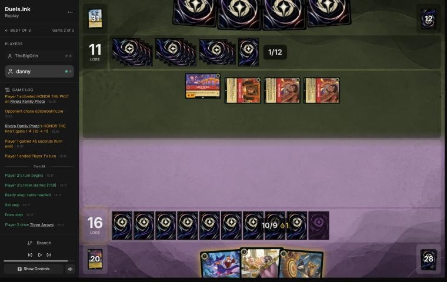
*The board before the decision: [step 187](https://duels.ink/replay/01a19d66-1dea-7df6-8ad0-c37dadb14517?step=187) in the duels.ink replay viewer.*

**What you did:** drew a Three Arrows; played St. Canard's Finest and Priscilla (with the ink drop).

**Verdict:** good play, the only line. All four Storms are gone. Finest (2, Ward, 7 {W}) and Priscilla (2) make exactly the
4 you need on turn 30, against their 15 then and 19 on turn 31. Their outs: an Olaf back from their discard (Sulley's
REHIRE; you'd lose 2), or removing Priscilla (one Red Alert left, Firefly Swarm). Holding Three Arrows for a character
they play is right: it has no target now.

### Turn 29: their turn

**What happened:** Land of the Dead gave 3 (14). Roller Bob, given Rush by bottoming two characters from their discard
and +2 {S} by Mulan – Martial Arts Master, challenged Priscilla (she enters play exerted) and banished her. Sulley
returned an Olaf, who came down free (you lost 2: 14), and Rivera made it 15–14.

### Turn 30: your turn 15

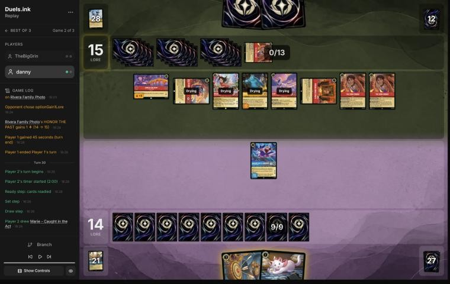
*The board before the decision: [step 206](https://duels.ink/replay/01a19d66-1dea-7df6-8ad0-c37dadb14517?step=206) in the duels.ink replay viewer.*

**What you did:** drew Marie and conceded.

**Verdict:** unwinnable from here ([principle 2](#cite-principle-2)). You're at 14 with St. Canard's Finest and Marie; the most this turn can
make is 16. At the start of their turn Land of the Dead takes them to 18 and Rivera to 19, and any one of their four
characters (Olaf, Mulan, Sulley, Roller Bob) questing finishes it. Three Arrows and one Finest challenge can't remove all
four, and nothing of yours can destroy Land of the Dead (8 {W}).

## Lessons
1. **Olaf is Candle Control's second win condition, and it recurs.** Once their discard holds nine actions he costs
   nothing; Sulley's REHIRE and Remember Me bring him back, and every copy played costs you 2 lore. Count each Olaf
   they can reach as −2 in your lore clock, not just the one on the board ([20](#turn-20) to [29](#turn-29)).
2. **Keep the lore that survives the Storm.** Khan Industries was the card game 1 turned on; this game it went back at
   the mulligan and into the inkwell on turn 4, and wasn't in play until after the first Storm ([0](#turn-0),
   [4](#turn-4)).
3. **TRIPLE SHOT ignores readiness.** Mulan – Elite Archer's extra damage hits any two characters, ready or not, so
   holding characters back doesn't protect them from it; only killing her does ([13](#turn-13), [14](#turn-14)).
4. **Priscilla enters exerted,** so a Rush challenger (Roller Bob's TIME TO MOVE, Mulan's WARRIOR SPIRIT) can hit her the
   turn she's played ([29](#turn-29)).

## Knowledge-base updates (applied 2026-11-02, after discussion)
- **Meta, the Amber/Ruby notes (Candle Control), TheBigGrin's list across games 1 and 2:**
  - Beyond duels.ink's average list: Mulan – Martial Arts Master ×4+ with Mulan – Elite Archer ×3+ (Shift 5; TRIPLE
    SHOT), Copper – On the Scent (8 {S}, Rush, Reckless), Vincenzo Santorini – On the Run, Liquidator ×4.
  - The Olaf loop: Olaf free from about their 10th turn, recurred by Sulley and Remember Me: six Olafs played, 12 lore, and
    one more to Red Alert, 13 lore lost in game 2.
  - Four Raging Storms; Land of the Dead (3 lore a turn) and Rivera (1) won the race with no characters in play.
  - Their characters challenge locations: two Olafs (4 + 4) killed Khan Industries (8 {W}) on turn 19.
- **Tools, still proposed (awaiting your OK):** a brief line for lore-loss effects, and Rush-granting abilities tagged
  as combat (see the coach's errors).

## Hindsight
Doesn't change the verdicts above.
- Khan Industries was drawn twice more after the mulligan: the one inked on turn 4, and the one played on turn 16. A
  Khan in play from turn 10 would have gained about 2 lore a turn through the first Storm.
- They drew and cast three Raging Storms (the fourth was milled), and played Olaf six times.

## The coach's errors
Filled in during discussion; these were found while reading the next turn.

| When | Error | How it was caught | How it won't happen again |
|---|---|---|---|
| [Turns 20](#turn-20), [22](#turn-22) | Counted Olaf's drain only from recursion (Sulley, Remember Me); fresh copies from their hand, free with nine actions in their discard, weren't counted. They played two on turn 21. Verdicts unchanged (each was the only line) | Reading turn 21 | Proposed: a brief line for lore-loss effects (Olaf's CHAOTIC COLLISION): their current cost, copies not yet seen with hold odds, and the recursion that can replay them |
| [Turn 28](#turn-28) | "Their outs" left out Roller Bob (TIME TO MOVE gives Rush) with Mulan's +2, though Priscilla enters exerted. Verdict unchanged | Reading turn 29 | Proposed: the brief tags abilities that grant Rush (Roller Bob's TIME TO MOVE, Mulan's WARRIOR SPIRIT) as combat, and a verdict's "outs" sentence copies every removal and combat tag from the brief |

## Open questions
Closed when the review was finalised (2026-11-02), with danny's answers.
- **The mulligan:** a 1-drop and turn-4 characters were missing, and a consistent curve was the aim. The sim had
  already counted that cost; the inaccuracy stands.
- **Turn 4:** agreed, probably a mistake; Khan Industries is strong in this matchup. The inaccuracy stands.

## Citations
Copies of the coach's knowledge base cited above, as they stood when they were cited (the private repository's commit and date are given with each). They don't change when the knowledge base does.

<!-- Filled in by `python3 tools/cite.py <this file>`: every principle ID, H-n, "principle N" and CR rule above
becomes a link to an entry here. Add a file or one of its sections with `--file PATH --section TEXT`, and link to
the anchor it prints. Never link into the private repository. -->

**sapphire-steel.md, Big Ramp with the Darkwing package: how to play it**: knowledge base, `kb/meta/archetypes/sapphire-steel.md` at `8168a97` (2026-11-02), working tree

> ### Big Ramp with the Darkwing package: how to play it `[coach, study of stonks 📈's 22 games of 21 Oct 2026 (sent by the user), full games, not blind]`
> The user calls this list Sapphire/Steel Detectives, or Big Ramp. It matches duels.ink's "Big Ramp #1" (Windstorm,
> Minnie) with the Darkwing Detectives added. Games: `01a15f98` to `01a1602c` (22; see `kb/meta/index.md`). Card text
> verified with `tools/cards.py`. Also `01a15f8e` (vs MFork, game 2) and `01a16978` (vs AkatsukiCap, game 1).
> - **The list (60):**
>   - **1-drops:** Darkwing Duck – Crime Fighter ×4, Marie – Caught in the Act ×4
>   - **2-drops:** Darkwing Duck – Drake Mallard ×4 (Ward), Launchpad – Trusty Sidekick ×4, The Terror That Flaps in
>     the Night ×4
>   - **3–4:** Three Arrows ×4, Priscilla – Efficient Clerk ×3, Cinderella – Dream Come True ×4, He Hurled His
>     Thunderbolt ×2, Windstorm ×3
>   - **5–6:** Merida – Formidable Archer ×4, Khan Industries – Greenway Landmark ×4, Goliath – Clan Leader ×3
>   - **7–8:** Darkwing Duck & Launchpad – St. Canard's Finest ×4, Cinderella – Unintentional Icon ×2, Tiana – Party
>     Hostess ×4, Minnie Mouse – Urban Visionary ×3
> - **The plan:**
>   1. **Early removal** keeps their board small: Terror (3 damage while a Darkwing is in play), Three Arrows (2, then 1).
>      A Darkwing in play also makes Launchpad's draw free of the discard.
>   2. **Ramp:** Priscilla (enters exerted; each quest puts one of the top 2 into hand and the other into the inkwell,
>      2 lore), Cinderella – Dream Come True (at the end of a turn you played a Princess, ink a card from hand to draw),
>      Cinderella – Unintentional Icon (Shift 5 onto her; ramps one a turn, 3 lore), Marie (an ink drop when she quests
>      after an opposing character took damage). Ink at the start of its 5th turn was usually 5–6, and 8–9 by its 6th in the fastest games.
>   3. **The sweep: Merida, then Windstorm.** STEADY AIM adds 2 damage to every instance of action damage to an
>      opposing character, so Windstorm deals 3 to each (5 to an Evasive one): a 4- to 6-character wipe (01a1601c
>      turn 11: six Princess Aggro characters). Merida's FULL QUIVER also returns Three Arrows (then 4 and 3).
>   4. **Lore:** Khan Industries (2 a turn at their Set step; characters there can't be challenged, so Merida and
>      Priscilla move in), Merida 2, Priscilla 2, Cinderella – Unintentional Icon 3, Minnie 3, St. Canard's Finest 2
>      plus VICTORY POSE (+2 per banish in a challenge on its turn).
>   5. **Tiana – Party Hostess** (7): draw 2 and discard one; a discarded Khan Industries is played free (01a15fee,
>      01a15ff6, 01a1602c). **Minnie** (8, Ward) returns a card from the inkwell to hand when she ends a turn exerted.
>      **Goliath – Clan Leader** puts both hands to 2 at the end of each turn: strictly for pressing an advantage when
>      ahead, or for keeping a control deck's hand small; otherwise rarely played (user, 2026-11-02).
> - **Results by matchup** (13–9): Emerald/Steel Midrange 8–4, all four game 1s lost and every game 2 and 3 won;
>   Amber/Emerald Circle of Life 2–4; Princess Aggro 2–1; Amethyst/Steel Midrange 1–0.
> - **What won:** the Merida and Windstorm sweep, Finest's VICTORY POSE, Khan Industries with protected questers. Early
>   Priscilla matters: in the Emerald/Steel wins she was down by its 4th turn in five of eight, and in the four losses never
>   (a correlation from few games).
> - **It can race from behind once the questers are gone:** in 01a16978, at 5–17 against Emerald/Steel, Three Arrows
>   with STEADY AIM killed Vixey and The Queen, a second Merida returned the Arrows, and wide quests (two Meridas at 2
>   each, Darkwings, Cinderella) won 20–19.
> - **What beat it:**
>   - **Resist:** Flash – Efficient Clerk (2, 3/2/2, Resist 1) takes nothing from Windstorm's 1 and less from every
>     ping; it quested for 8 to 10 in two lost game 1s.
>   - **Ward plus recursion:** Circle of Life replayed Milo Thatch – Getting His Hands Dirty (7, Ward, bounces a
>     character on play), which bounced Merida; conceded at 3–0 (01a15f9d turn 14). Only Windstorm reaches a Ward
>     character.
>   - **Fast wide quests:** Princess Aggro's +5 and +6 turns came before the sweep (01a16020, lost 14–21); a song-and-
>     Evasive Amber/Emerald list quested +7 and +8 (01a15fdb).
> - **Coaching points:**
>   - Merida before any damage action; with their board at 2–3 willpower, hold Windstorm for her.
>   - Keep a Darkwing in play for Terror's 3 and Launchpad's free draw. Quest Marie after removal for the ink drop.
>   - Move questers to Khan Industries; plan Tiana for the turn a Khan is in hand. Whether to ink a Khan is too
>     situational for a rule (user, 2026-11-02): judge it from the hand.
>   - Name the answer to Resist and Ward early (Thunderbolt's 4, challenges, Finest): the pings don't do it.
>   - **Mulligan from the hand you have, not to a fixed plan** (user, 2026-11-02). The play pattern varies widely with
>     the opening seven, and no one line suits a given matchup: see what the hand already does, keep what bridges
>     turn 1 to the late game, and send back the rest, avoiding a full mulligan where possible. The deep mulligans
>     (3 to 7 cards) in these games came partly from the player's first games on the deck, so they aren't a guide.
>   - **Judge the plan from the hand, then the matchup:** a coached line should say how this hand gets from its early
>     turns to Merida, the sweep and the 3-lore finishers, rather than follow a stock sequence.

**amber-ruby.md, Candle Control**: knowledge base, `kb/meta/archetypes/amber-ruby.md` at `8168a97` (2026-11-02), working tree

> ### Candle Control
> 50% of the pair's games (22,793).
>
> | # | Card | Type | Cost | Tag |
> |---|---|---|---|---|
> | 2 | Hercules - Young Rescuer | character | 2 |  |
> | 3 | Jebidiah Farnsworth - Cookie | character | 2 |  |
> | 4 | Liquidator - Iced Over | character | 2 |  |
> | 3 | Roller Bob - Sid's Toy | character | 3 |  |
> | 3 | Sulley - The New Boss | character | 5 | recursion |
> | 2 | Sulley & Boo - Scare Buddies | character | 6 |  |
> | 4 | Olaf - Snowman of Action | character | 9 |  |
> | 4 | Dangerous Plan | action | 1 |  |
> | 4 | Inner Strength | action | 1 | combat |
> | 1 | Firefly Swarm | action | 3 | removal |
> | 3 | The Horseman Strikes! | action | 3 | removal |
> | 2 | Time to Go! | action | 3 |  |
> | 4 | Red Alert | action | 4 | removal |
> | 4 | Raging Storm | action | 8 | sweeper |
> | 4 | Though I Have to Say Goodbye | song | 2 | combat |
> | 1 | Or Rewrite History! | song | 3 | recursion |
> | 2 | Remember Me | song | 6 |  |
> | 4 | Rivera Family Photo | item | 1 |  |
> | 4 | The Torn Corner | item | 3 |  |
> | 2 | Land of the Dead - Marigold Bridge | location | 4 |  |

**MULL-1**: strategy principle, `kb/strategy/principles.md` at `8168a97` (2026-11-02), working tree

> - **MULL-1. Keep a plan, not the strongest cards.** *Ask: "Which hand gives me the best chance to execute my game plan in this matchup?"* `[MCL ch.12]` · baseline

**MULL-3**: strategy principle, `kb/strategy/principles.md` at `8168a97` (2026-11-02), working tree

> - **MULL-3. The right keep depends on the matchup.** Early interaction against aggro; pressure, draw and engines against slow decks. The mulligan is the first expression of your role. In the Set 14 era the opponent's inks are known before the mulligan (RULE-8), so this applies from game 1 of a match. `[MCL ch.12]` · baseline

**INK-2**: strategy principle, `kb/strategy/principles.md` at `8168a97` (2026-11-02), working tree

> - **INK-2. Don't automatically ink the most expensive card.** It may be the late-game win condition or the key answer for this matchup. The answer depends on matchup, hand and board. `[MCL ch.4]` · baseline

**SEQ-1**: strategy principle, `kb/strategy/principles.md` at `8168a97` (2026-11-02), working tree

> - **SEQ-1. Gather information before irreversible decisions.** Draw, look and scry before choosing what to ink. Quest with draw triggers before committing other plays when the order doesn't otherwise matter. `[MCL ch.5]` · baseline

**POS-1**: strategy principle, `kb/strategy/principles.md` at `8168a97` (2026-11-02), working tree

> - **POS-1. From ahead, take the safest path to victory.** Don't overextend into sweepers, don't make unnecessary trades, and make the opponent take the risks. Winning by 1 lore counts the same as winning by 10. `[MCL ch.10]` · baseline

**principle 2**: coaching principle, `CLAUDE.md` at `8168a97` (2026-11-02), working tree

> 2. **Some games are unwinnable.** Draws and matchups can make a game lost whatever the player does. Say so
>    when it's true, rather than inventing mistakes to explain a loss.
