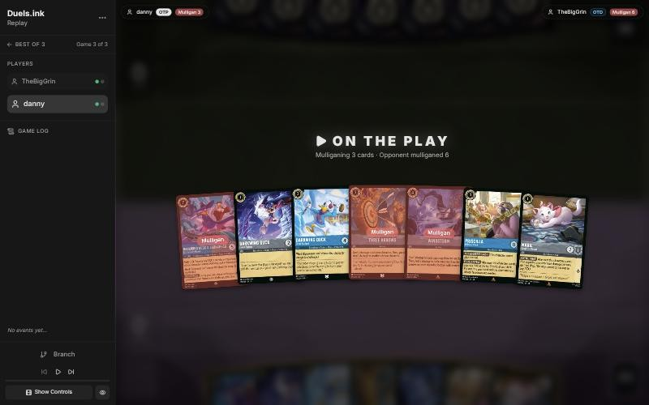
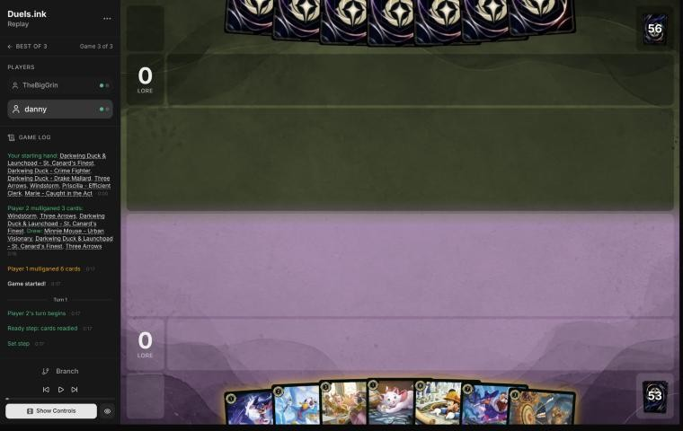
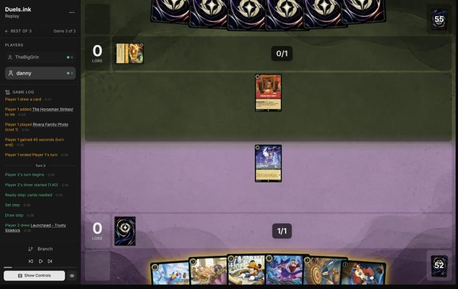
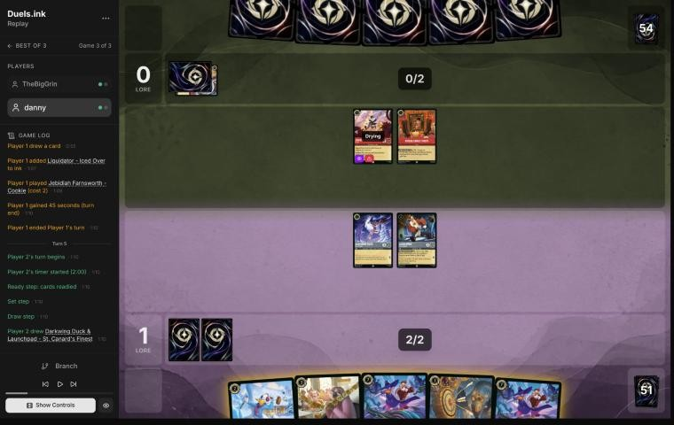
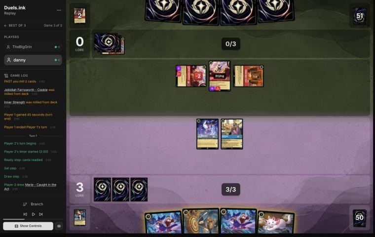
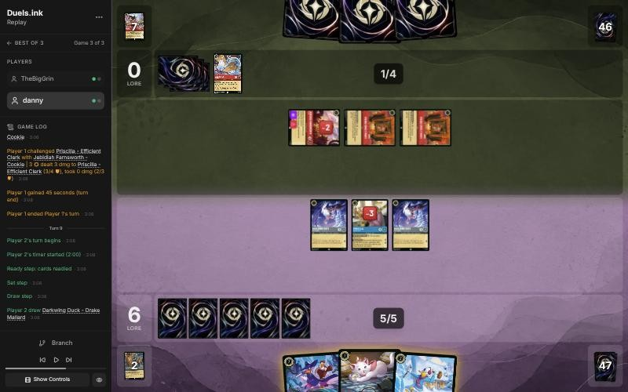
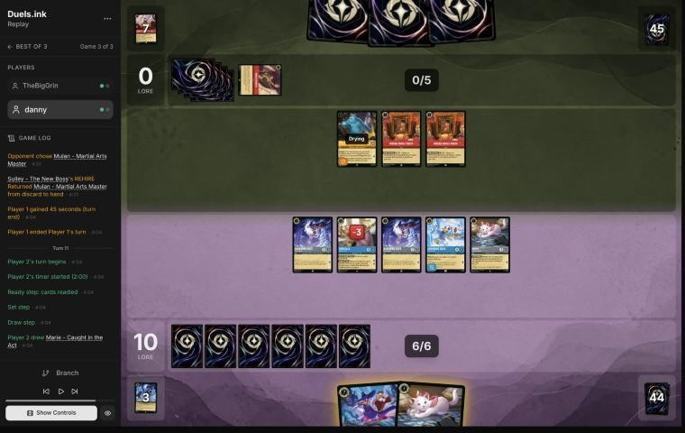

# Review: danny vs TheBigGrin, 2 Nov 2026 (game 3)

| | |
|---|---|
| **Status** | **final** (2026-11-02; discussed with danny, no verdict changed) |
| **Replay** | `01a19d75-46a8-739c-96c1-773e6b8b1a26` (`python3 tools/brief.py 01a19d75 --turn N`) · [duels.ink viewer](https://duels.ink/replay/01a19d75-46a9-7d4e-b2ab-aec44afc791d?step=0) |
| **Format** | Core Constructed. Set 14 era: inks revealed before the coin toss |
| **Decks** | You: Sapphire/Steel Big Ramp with the Darkwing package ([the coach's notes on it](#cite-kb-meta-archetypes-sapphire-steel-big-ramp-with-the-darkwing-package-how-to-play-it)). Them: Amber/Ruby Candle Control, known from games 1 and 2 ([the coach's notes on Candle Control](#cite-kb-meta-archetypes-amber-ruby-candle-control)) |
| **Play/draw** | You went first (you lost game 2, so the choice was yours) |
| **Result** | Won: TheBigGrin played an Olaf (17 → 15) and conceded on turn 12; you won the match 2–1 |
| **Meta data** | snapshot of 26 Oct 2026 (7 days old, fresh) |
| **Chosen how** | Sent by the user as a match zip of three games; only the replays were read. The deciding game: the coach didn't know its result before the blind pass |

## Summary
- **Inaccuracy:** the [mulligan](#turn-0), St. Canard's Finest sent back with two Darkwings to Shift it onto (the
  replacements brought another Finest).
- **Good plays:** [1](#turn-1), [3](#turn-3), [5](#turn-5) (Drake inked, keeping both Finests on Launchpad and Crime
  Fighter bases), [7](#turn-7), [9](#turn-9) (Priscilla first found Terror for Jebidiah; Finest waited a turn),
  [11](#turn-11).
- **Unwinnable from:** never.

**What decided it:** you went first and never gave Candle Control a target worth its removal: Jebidiah was answered
twice (Three Arrows, Terror), Priscilla quested first every turn for cards and ink, and Finest's Ward kept 2 lore a turn
safe. You were at 17 on turn 11, before their first possible Raging Storm (turn 16).

## The game, turn by turn
Verdicts judge each decision on what you could know at the time, **including archetype knowledge an experienced
player has**. Hindsight is kept to its own section. Severity scale: good play / close call /
inaccuracy / mistake / blunder. Principle IDs and hypotheses (H-n) link to copies
in the Citations section at the end, as they stood when they were cited.

**What you knew before the game:** games 1 and 2 showed TheBigGrin's Candle Control list: Rivera Family Photo, The
Torn Corner and Dangerous Plan filling their discard; Land of the Dead (3 lore a turn once the discard holds 10);
four Raging Storms (8); Olaf (free once nine actions are in their discard; you lose 2 each time one is played),
recurred by Sulley and Remember Me; Red Alert, The Horseman Strikes!, Firefly Swarm; and small attackers: Liquidator,
Jebidiah (Evasive, Reckless), Vincenzo, Roller Bob (Rush), Mulan – Martial Arts Master with Mulan – Elite Archer
(TRIPLE SHOT), Copper. On the play, their 8th turn (Raging Storm's first chance) is game turn 16.

Your plan: race to 20 before the Storms and the Olaf drains catch up, with Storm-proof lore (Khan Industries) and Ward
threats (Drake Mallard, St. Canard's Finest, Minnie) that their targeted removal can't touch.

### Pre-game

*The board before the decision: [step 0](https://duels.ink/replay/01a19d75-46a9-7d4e-b2ab-aec44afc791d?step=0) in the duels.ink replay viewer.*

**What you did:** sent back St. Canard's Finest, Three Arrows and Windstorm, keeping Crime Fighter, Drake Mallard,
Priscilla and Marie.

**Verdict:** inaccuracy. The seven already curved out (Marie or Crime Fighter, Drake Mallard, Priscilla, then St.
Canard's Finest Shifted onto a Darkwing for 5), with two removal spells. `tools/mulligan.py` (1,500 deals; the as-played
line from a 1,000-deal run):

| Option | Ink on turns 1–4 | Play turns (of 4) | Lore by turn 4 | Characters by turn 4 | Interaction by turn 4 |
|---|---|---|---|---|---|
| Keep all 7 (the coach's pick) | 9.69 | 4.00 | 7.1 | 4.4 | 100% |
| Send back Windstorm only | 9.56 | 3.98 | 7.2 | 4.5 | 100% |
| **As played** (send back Finest, Arrows, Windstorm) | 9.12 | 3.94 | 7.3 | 4.5 | 68% |
| Full mulligan | 8.56 | 3.40 | 4.5 | 3.0 | 89% |

Sending back St. Canard's Finest is suboptimal because it was the hand's bridge to the late game: with two Darkwings
to Shift onto it comes down on turn 5 as a 2-lore Ward character that Red Alert, Firefly Swarm and The Horseman Strikes!
can't target, and with 7 {W} that one Olaf can't kill. Keeping it (and the Arrows, which kill Liquidator, Vincenzo or
Roller Bob) is better because the sim finds nothing gained by sending them back: the same curve and early lore, less ink
used and a third less interaction ([MULL-1](#cite-mull-1)). Confidence: medium-low (the sim can't value Finest, and the three new cards
might bring Khan Industries).

*In discussion:* danny didn't expect much to challenge, so VICTORY POSE had little to do, and wanted more cheap
characters to go wide and quest fast. The verdict's case for Finest wasn't VICTORY POSE, though: it was Ward and 7
willpower against their targeted removal and Olaf. And the sim found going wide gained nothing (7.3 lore by turn 4
against 7.1, 4.5 characters against 4.4) while giving up a third of the interaction. The verdict stands.

### Turn 1: your turn 1

*The board before the decision: [step 2](https://duels.ink/replay/01a19d75-46a9-7d4e-b2ab-aec44afc791d?step=2) in the duels.ink replay viewer.*

**What you did:** your mulligan drew Minnie, a second St. Canard's Finest and a second Three Arrows. You inked Marie and
played Crime Fighter.

**Verdict:** good play. Crime Fighter is the Darkwing that Finest Shifts onto and that makes Launchpad's draw free.
Of the rest, Marie was the card least needed: Minnie and Finest are the Ward threats, Three Arrows answers their small
attackers, and Priscilla and Drake Mallard are turns 2 and 3 ([INK-2](#cite-ink-2)).

### Turn 2: their turn

**What happened:** they inked The Horseman Strikes! and played Rivera Family Photo.

### Turn 3: your turn 2

*The board before the decision: [step 8](https://duels.ink/replay/01a19d75-46a9-7d4e-b2ab-aec44afc791d?step=8) in the duels.ink replay viewer.*

**What you did:** drew Launchpad; inked Minnie, played Launchpad and quested Crime Fighter (+1).

**Verdict:** good play. Launchpad before Drake Mallard means he can draw next turn, free with Crime Fighter in play.
Minnie (8) was the hand's latest play; St. Canard's Finest gives you a Ward threat on turn 5, and three more Minnies
remain in the deck ([INK-2](#cite-ink-2)). The quest exposes Crime Fighter only to a Rush Roller Bob, which needs two characters in
their discard (none yet).

### Turn 4: their turn

**What happened:** they inked Liquidator and played Jebidiah Farnsworth – Cookie (Evasive, Reckless: he must challenge an
exerted character of yours next turn, and only Evasive characters can challenge him).

### Turn 5: your turn 3

*The board before the decision: [step 15](https://duels.ink/replay/01a19d75-46a9-7d4e-b2ab-aec44afc791d?step=15) in the duels.ink replay viewer.*

**What you did:** drew a second St. Canard's Finest; inked Drake Mallard, played Priscilla and quested Crime Fighter and
Launchpad (+2, 3–0).

**Verdict:** good play.
- **The ink:** Finest Shifts onto a Darkwing *or a Launchpad*, so Crime Fighter and Launchpad are already bases for both
  Finests (turns 9 and 11 at 5 ink). Inking Drake Mallard kept both Ward threats. The coach had planned to ink the spare
  Finest; your choice is better.
- **The exposure:** Jebidiah must challenge an exerted character next turn: Priscilla (enters exerted; 4 {W} survives),
  Crime Fighter or Launchpad (either dies, and Jebidiah takes 2). Questing both buys 2 lore for one of them, and leaves
  Jebidiah on 1 {W}, where Three Arrows finishes him (only Evasive characters can challenge him). Launchpad's draw instead
  of his quest was equal: the same exposure for a card instead of a lore.

### Turn 6: their turn

**What happened:** Jebidiah challenged Launchpad (banished; Jebidiah on 2 damage, 1 {W} left, exerted). They played a
second Jebidiah and inked Time to Go!; Rivera Family Photo milled a third Jebidiah and Inner Strength.

### Turn 7: your turn 4

*The board before the decision: [step 26](https://duels.ink/replay/01a19d75-46a9-7d4e-b2ab-aec44afc791d?step=26) in the duels.ink replay viewer.*

**What you did:** drew Marie; Priscilla quested first (+2; FILING SYSTEM found a second Crime Fighter); you inked one
Finest; Three Arrows killed the damaged Jebidiah (1) and put 2 on the other; Crime Fighter quested (+1, 6–0) and the
second Crime Fighter was played.

**Verdict:** good play, the coach's line. Questing Priscilla before choosing the ink found the second Darkwing, a
second Shift base, so one Finest could go into the inkwell knowing the other has a home ([SEQ-1](#cite-seq-1)). Splitting the Arrows
killed one Jebidiah and left the other on 1 {W}: he must challenge next turn, and Crime Fighter's 2 {S} kills him if he
takes her. The new Crime Fighter is a better play than Marie: it's a Finest base, and it's drying, so Jebidiah can't
reach it.

### Turn 8: their turn

**What happened:** two Rivera Family Photos milled Though I Have to Say Goodbye, Remember Me, Red Alert and Mulan; they
inked Liquidator, and Jebidiah challenged Priscilla rather than Crime Fighter (Priscilla on 1 {W}; Jebidiah exerted,
still on 1).

### Turn 9: your turn 5

*The board before the decision: [step 44](https://duels.ink/replay/01a19d75-46a9-7d4e-b2ab-aec44afc791d?step=44) in the duels.ink replay viewer.*

**What you did:** drew Drake Mallard; Priscilla quested first (+2; FILING SYSTEM found The Terror That Flaps in the
Night), Terror killed Jebidiah (3 with a Darkwing in play), and you played Drake Mallard and Marie and quested both
Crime Fighters (+2, 10–0). St. Canard's Finest stayed in hand; no card was inked.

**Verdict:** good play, better than the coach's plan. The coach had Finest Shifted onto a Crime Fighter this turn (11
lore), leaving Jebidiah alive to kill Priscilla (1 {W}) or a Crime Fighter. Questing Priscilla first found the Terror,
and your line used it: their only character is gone, your board is five wide with Drake's Ward among them, and Finest
waits a turn on a Shift base that's already in play. Next turn Finest Shifted (5) and five quests make about 7, so 17
on turn 11, against a Raging Storm that can't come before turn 16. Red Alert can take one of your small characters,
not Drake or Finest.

### Turn 10: their turn

**What happened:** they inked Inner Strength and played Sulley – The New Boss, ready (Bodyguard), returning Mulan –
Martial Arts Master from their discard to hand.

### Turn 11: your turn 6

*The board before the decision: [step 60](https://duels.ink/replay/01a19d75-46a9-7d4e-b2ab-aec44afc791d?step=60) in the duels.ink replay viewer.*

**What you did:** drew Marie; Priscilla quested first (+2; another Terror to hand); St. Canard's Finest Shifted onto a
dry Crime Fighter; you played Marie and quested Crime Fighter, Finest, Drake Mallard and Marie (+5, 17–0).

**Verdict:** good play, the coach's line. Finest on a dry Darkwing quests at once for 2 instead of 1, and every quest
was worth taking: Raging Storm can't come before turn 16, and you need 3 on turn 13 with six characters able to quest.
Their outs next turn (6 ink): Olaf (5 now: you'd lose 2), Red Alert on a small character, and Sulley's challenge. Even
all three leave you more than enough questers for turn 13.

### Turn 12: their turn

**What happened:** Olaf cost 5 and took 2 of your lore (15–0); they conceded.

## Lessons
1. **Quest Priscilla before anything else.** Three times this game FILING SYSTEM found the card that shaped the turn (a
   second Crime Fighter on turn 7, Terror on turns 9 and 11), and twice that changed what was worth inking or casting
   ([7](#turn-7), [9](#turn-9)).
2. **St. Canard's Finest Shifts onto Launchpad too,** so Launchpad and the Darkwings are all bases ([5](#turn-5)).
3. **Against Candle Control, going first matters:** their first Raging Storm comes on game turn 16 rather than 15, and
   you reached 17 on turn 11.

## Knowledge-base updates (applied 2026-11-02, after discussion)
- **Meta, the Amber/Ruby notes (Candle Control), TheBigGrin's game 3:** three Jebidiahs early (two in play by turn 6) as
  their removal; Sulley's REHIRE returned Mulan – Martial Arts Master; Olaf at 5 on turn 12.
- **Sapphire/Steel notes (Big Ramp with the Darkwing package), against Candle Control:** across the match, the winning
  pattern was early bodies, Priscilla first each turn, and Ward threats (Finest, Minnie) or Khan Industries for lore
  their targeted removal and Storm can't reach; the loss came when Storm-proof lore was missing and Olaf recurred.

## Hindsight
Doesn't change the verdicts above.
- The mulligan's three replacements were Minnie, another St. Canard's Finest and another Three Arrows: the hand you'd
  sent back, nearly card for card.

## The coach's errors
Filled in during discussion.

| When | Error | How it was caught | How it won't happen again |
|---|---|---|---|
| — | None found in the blind pass. Your line beat the coach's plan on turns 5 (the ink) and 9 (Terror before Finest) | — | — |

## Open questions
Closed when the review was finalised (2026-11-02), with danny's answers.
- **The mulligan:** there'd be little to challenge, and more cheap characters would go wide faster. Finest's value here
  was Ward, not VICTORY POSE, and the sim found nothing gained by going wide; the inaccuracy stands.

## Citations
Copies of the coach's knowledge base cited above, as they stood when they were cited (the private repository's commit and date are given with each). They don't change when the knowledge base does.

<!-- Filled in by `python3 tools/cite.py <this file>`: every principle ID, H-n, "principle N" and CR rule above
becomes a link to an entry here. Add a file or one of its sections with `--file PATH --section TEXT`, and link to
the anchor it prints. Never link into the private repository. -->

**sapphire-steel.md, Big Ramp with the Darkwing package: how to play it**: knowledge base, `kb/meta/archetypes/sapphire-steel.md` at `9be81c9` (2026-11-02), working tree

> ### Big Ramp with the Darkwing package: how to play it `[coach, study of stonks 📈's 22 games of 21 Oct 2026 (sent by the user), full games, not blind]`
> The user calls this list Sapphire/Steel Detectives, or Big Ramp. It matches duels.ink's "Big Ramp #1" (Windstorm,
> Minnie) with the Darkwing Detectives added. Games: `01a15f98` to `01a1602c` (22; see `kb/meta/index.md`). Card text
> verified with `tools/cards.py`. Also `01a15f8e` (vs MFork, game 2) and `01a16978` (vs AkatsukiCap, game 1).
> - **The list (60):**
>   - **1-drops:** Darkwing Duck – Crime Fighter ×4, Marie – Caught in the Act ×4
>   - **2-drops:** Darkwing Duck – Drake Mallard ×4 (Ward), Launchpad – Trusty Sidekick ×4, The Terror That Flaps in
>     the Night ×4
>   - **3–4:** Three Arrows ×4, Priscilla – Efficient Clerk ×3, Cinderella – Dream Come True ×4, He Hurled His
>     Thunderbolt ×2, Windstorm ×3
>   - **5–6:** Merida – Formidable Archer ×4, Khan Industries – Greenway Landmark ×4, Goliath – Clan Leader ×3
>   - **7–8:** Darkwing Duck & Launchpad – St. Canard's Finest ×4, Cinderella – Unintentional Icon ×2, Tiana – Party
>     Hostess ×4, Minnie Mouse – Urban Visionary ×3
> - **The plan:**
>   1. **Early removal** keeps their board small: Terror (3 damage while a Darkwing is in play), Three Arrows (2, then 1).
>      A Darkwing in play also makes Launchpad's draw free of the discard.
>   2. **Ramp:** Priscilla (enters exerted; each quest puts one of the top 2 into hand and the other into the inkwell,
>      2 lore), Cinderella – Dream Come True (at the end of a turn you played a Princess, ink a card from hand to draw),
>      Cinderella – Unintentional Icon (Shift 5 onto her; ramps one a turn, 3 lore), Marie (an ink drop when she quests
>      after an opposing character took damage). Ink at the start of its 5th turn was usually 5–6, and 8–9 by its 6th in the fastest games.
>   3. **The sweep: Merida, then Windstorm.** STEADY AIM adds 2 damage to every instance of action damage to an
>      opposing character, so Windstorm deals 3 to each (5 to an Evasive one): a 4- to 6-character wipe (01a1601c
>      turn 11: six Princess Aggro characters). Merida's FULL QUIVER also returns Three Arrows (then 4 and 3).
>   4. **Lore:** Khan Industries (2 a turn at their Set step; characters there can't be challenged, so Merida and
>      Priscilla move in), Merida 2, Priscilla 2, Cinderella – Unintentional Icon 3, Minnie 3, St. Canard's Finest 2
>      plus VICTORY POSE (+2 per banish in a challenge on its turn).
>   5. **Tiana – Party Hostess** (7): draw 2 and discard one; a discarded Khan Industries is played free (01a15fee,
>      01a15ff6, 01a1602c). **Minnie** (8, Ward) returns a card from the inkwell to hand when she ends a turn exerted.
>      **Goliath – Clan Leader** puts both hands to 2 at the end of each turn: strictly for pressing an advantage when
>      ahead, or for keeping a control deck's hand small; otherwise rarely played (user, 2026-11-02).
> - **Results by matchup** (13–9): Emerald/Steel Midrange 8–4, all four game 1s lost and every game 2 and 3 won;
>   Amber/Emerald Circle of Life 2–4; Princess Aggro 2–1; Amethyst/Steel Midrange 1–0.
> - **What won:** the Merida and Windstorm sweep, Finest's VICTORY POSE, Khan Industries with protected questers. Early
>   Priscilla matters: in the Emerald/Steel wins she was down by its 4th turn in five of eight, and in the four losses never
>   (a correlation from few games).
> - **It can race from behind once the questers are gone:** in 01a16978, at 5–17 against Emerald/Steel, Three Arrows
>   with STEADY AIM killed Vixey and The Queen, a second Merida returned the Arrows, and wide quests (two Meridas at 2
>   each, Darkwings, Cinderella) won 20–19.
> - **What beat it:**
>   - **Resist:** Flash – Efficient Clerk (2, 3/2/2, Resist 1) takes nothing from Windstorm's 1 and less from every
>     ping; it quested for 8 to 10 in two lost game 1s.
>   - **Ward plus recursion:** Circle of Life replayed Milo Thatch – Getting His Hands Dirty (7, Ward, bounces a
>     character on play), which bounced Merida; conceded at 3–0 (01a15f9d turn 14). Only Windstorm reaches a Ward
>     character.
>   - **Fast wide quests:** Princess Aggro's +5 and +6 turns came before the sweep (01a16020, lost 14–21); a song-and-
>     Evasive Amber/Emerald list quested +7 and +8 (01a15fdb).
> - **Coaching points:**
>   - Merida before any damage action; with their board at 2–3 willpower, hold Windstorm for her.
>   - Keep a Darkwing in play for Terror's 3 and Launchpad's free draw. Quest Marie after removal for the ink drop.
>   - Move questers to Khan Industries; plan Tiana for the turn a Khan is in hand. Whether to ink a Khan is too
>     situational for a rule (user, 2026-11-02): judge it from the hand.
>   - Name the answer to Resist and Ward early (Thunderbolt's 4, challenges, Finest): the pings don't do it.
>   - **Mulligan from the hand you have, not to a fixed plan** (user, 2026-11-02). The play pattern varies widely with
>     the opening seven, and no one line suits a given matchup: see what the hand already does, keep what bridges
>     turn 1 to the late game, and send back the rest, avoiding a full mulligan where possible. The deep mulligans
>     (3 to 7 cards) in these games came partly from the player's first games on the deck, so they aren't a guide.
>   - **Judge the plan from the hand, then the matchup:** a coached line should say how this hand gets from its early
>     turns to Merida, the sweep and the 3-lore finishers, rather than follow a stock sequence.

**amber-ruby.md, Candle Control**: knowledge base, `kb/meta/archetypes/amber-ruby.md` at `9be81c9` (2026-11-02), working tree

> ### Candle Control
> 50% of the pair's games (22,793).
>
> | # | Card | Type | Cost | Tag |
> |---|---|---|---|---|
> | 2 | Hercules - Young Rescuer | character | 2 |  |
> | 3 | Jebidiah Farnsworth - Cookie | character | 2 |  |
> | 4 | Liquidator - Iced Over | character | 2 |  |
> | 3 | Roller Bob - Sid's Toy | character | 3 |  |
> | 3 | Sulley - The New Boss | character | 5 | recursion |
> | 2 | Sulley & Boo - Scare Buddies | character | 6 |  |
> | 4 | Olaf - Snowman of Action | character | 9 |  |
> | 4 | Dangerous Plan | action | 1 |  |
> | 4 | Inner Strength | action | 1 | combat |
> | 1 | Firefly Swarm | action | 3 | removal |
> | 3 | The Horseman Strikes! | action | 3 | removal |
> | 2 | Time to Go! | action | 3 |  |
> | 4 | Red Alert | action | 4 | removal |
> | 4 | Raging Storm | action | 8 | sweeper |
> | 4 | Though I Have to Say Goodbye | song | 2 | combat |
> | 1 | Or Rewrite History! | song | 3 | recursion |
> | 2 | Remember Me | song | 6 |  |
> | 4 | Rivera Family Photo | item | 1 |  |
> | 4 | The Torn Corner | item | 3 |  |
> | 2 | Land of the Dead - Marigold Bridge | location | 4 |  |

**MULL-1**: strategy principle, `kb/strategy/principles.md` at `9be81c9` (2026-11-02), working tree

> - **MULL-1. Keep a plan, not the strongest cards.** *Ask: "Which hand gives me the best chance to execute my game plan in this matchup?"* `[MCL ch.12]` · baseline

**INK-2**: strategy principle, `kb/strategy/principles.md` at `9be81c9` (2026-11-02), working tree

> - **INK-2. Don't automatically ink the most expensive card.** It may be the late-game win condition or the key answer for this matchup. The answer depends on matchup, hand and board. `[MCL ch.4]` · baseline

**SEQ-1**: strategy principle, `kb/strategy/principles.md` at `9be81c9` (2026-11-02), working tree

> - **SEQ-1. Gather information before irreversible decisions.** Draw, look and scry before choosing what to ink. Quest with draw triggers before committing other plays when the order doesn't otherwise matter. `[MCL ch.5]` · baseline
