# Review: danny vs daman, 2 Nov 2026 (game 1)

| | |
|---|---|
| **Status** | **final** (2026-11-02; the pre-game revisited in discussion with danny) |
| **Replay** | `01a19d7a-8552-7eee-bcbf-47d3ae1e99a3` (`python3 tools/brief.py 01a19d7a --turn N`) · [duels.ink viewer](https://duels.ink/replay/01a19d7a-8560-7ae9-8e51-af12258f1ef9?step=0) |
| **Format** | Core Constructed. Set 14 era: inks revealed before the coin toss |
| **Decks** | You: Sapphire/Steel Big Ramp with the Darkwing package ([the coach's notes on it](#cite-kb-meta-archetypes-sapphire-steel-big-ramp-with-the-darkwing-package-how-to-play-it)). Them: Amber/Sapphire Control ([its average list](#cite-kb-meta-archetypes-amber-sapphire-control)), clear from turn 13 (Hades – Infernal Schemer, Belle – Snowfield Strategist), with cards no listed Control list runs: Lionheart – Incumbent Mayor, Scuttle – Birdbrained, Hades – Meticulous Schemer |
| **Play/draw** | daman went first; you were on the draw |
| **Result** | Won: daman played Stitch – Carefree Surfer and conceded on turn 27 at 19–12 |
| **Meta data** | snapshot of 26 Oct 2026 (7 days old, fresh) |
| **Chosen how** | Sent by the user as a match zip of three games; only the replays were read, not the zip's result file. A third game means games 1 and 2 were split, but not which way, so the coach didn't know this result before the blind pass |

## Summary
- **Inaccuracies:**
  - [2](#turn-2): Khan Industries inked rather than the second Priscilla.
  - [26](#turn-26): Minnie's ALL BY DESIGN returned Tiana – Party Hostess rather than Khan Industries, a win at 19 that
    Raging Storm can't reach.
- **Close calls:** the [mulligan](#turn-0) (five sent back), [10](#turn-10) (developing three bodies rather than
  Shifting in Finest), [14](#turn-14) (holding everything behind Minnie).
- **Good plays:** [4](#turn-4), [6](#turn-6) (Three Arrows and Launchpad killed their Priscilla before she quested),
  [8](#turn-8), [12](#turn-12), [16](#turn-16), [18](#turn-18), [20](#turn-20) (Merida and the returned Arrows took
  Belle; better than the coach's plan), [22](#turn-22), [24](#turn-24).
- **Unwinnable from:** never.

**What decided it:** Ward and Khan Industries. Their targeted removal (Hades – Infernal Schemer, Gaston, Let It Go)
couldn't touch Minnie or St. Canard's Finest, and Khan paid 4 lore before three of their characters challenged it
down. Each of their two resets, Spooky Sight on [turn 11](#turn-11) and Raging Storm on [turn 23](#turn-23), was
answered by a Minnie from hand the next turn (with Finest held back behind her), and the second Minnie reached 19 on
turn 26.

## The game, turn by turn
Verdicts judge each decision on what you could know at the time, **including archetype knowledge an experienced
player has**. Hindsight is kept to its own section. Severity scale: good play / close call /
inaccuracy / mistake / blunder. Principle IDs and hypotheses (H-n) link to copies
in the Citations section at the end, as they stood when they were cited.

**What you knew before the game:** they're Amber/Sapphire: Control 51%, Detectives 39%, an unlisted list 11%. They went
first. Their key cards, and the earliest each can come (their turn k is game turn 2k−1):
- **Removal that chooses its target** (so Ward stops all of it: Drake Mallard, St. Canard's Finest and Minnie are
  immune):
  - Gaston – Superior Archer (5): banishes a character with 5+ {S}; their 5th turn (game turn 9). Judy Hopps – Always
    Vigilant (Detectives; Shift 2 onto a Judy) does the same from their 3rd turn, and World's Greatest Criminal Mind
    (song 3) too. Your 5+ {S} characters without Ward: Goliath (6), Tiana – Party Hostess is 4 and safe.
  - Hades – Infernal Schemer (7, Control): puts a character of yours into your inkwell. Let It Go (song 5) the same.
    The Horseman Strikes! banishes an Evasive character (you have none).
- **Raging Storm** (8, Control): banishes all characters; their 8th turn (game turn 15), earlier with their ramp
  (Cinderella – Dream Come True and Unintentional Icon, Belle's WINTER STOCKPILE, Mickey Mouse – Best in Town's ink
  drops: in another game Storm came on turn 9).
- **Detectives:** Support onto your character to put it in range of the 5-strength removal, wide quests for +5 to +7
  from their 6th turn, and Elisa Maza taking an action or song from your hand.
- **Control:** Minnie (8) and Cinderella – Unintentional Icon for lore; Stitch – Carefree Surfer draws.

Your plan: develop early lore, lean on Ward threats and Khan Industries (their targeted removal can't touch Ward, and
Storm doesn't touch locations), keep characters at 4 {S} or less where you can, and hold a rebuild for Raging Storm.

### Pre-game

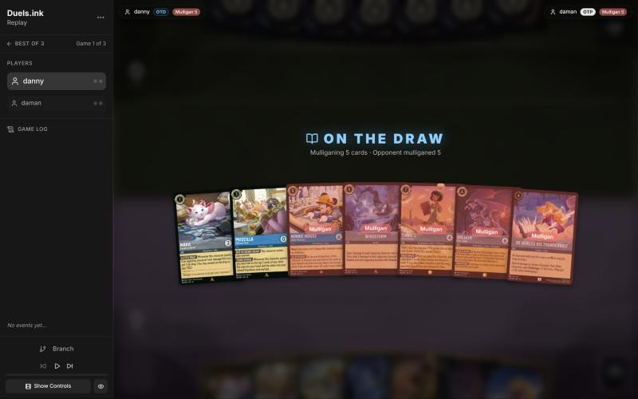
*The board before the decision: [step 0](https://duels.ink/replay/01a19d7a-8560-7ae9-8e51-af12258f1ef9?step=0) in the duels.ink replay viewer.*

**What you did:** sent back 5 (Minnie, Windstorm, Tiana – Party Hostess, Goliath and He Hurled His Thunderbolt),
keeping Marie and Priscilla.

**Verdict:** close call *(revisited in discussion; the blind pass leaned to a shallower mulligan)*. The seven were top-heavy (an 8, a 7, a 6 and an uninkable 4),
so a mulligan was right. `tools/mulligan.py` (1,000 deals):

| Option | Ink on turns 1–4 | Play turns (of 4) | Lore by turn 4 | Characters by turn 4 | Interaction by turn 4 |
|---|---|---|---|---|---|
| Keep all 7 | 9.05 | 3.61 | 6.0 | 3.0 | 100% |
| Keep Marie, Priscilla, Minnie, Windstorm (the coach's pick) | 9.66 | 3.91 | 6.6 | 3.8 | 100% |
| Keep Marie, Priscilla, Windstorm | 9.69 | 3.94 | 6.7 | 4.0 | 100% |
| **As played** (keep Marie, Priscilla) | 9.59 | 3.96 | 6.8 | 4.2 | 86% |
| Full mulligan | 9.14 | 3.64 | 5.2 | 3.4 | 91% |

Your deeper mulligan gains a little on curve and early bodies. The coach would have kept Windstorm (1 to every opposing
character: against Detectives, 39% here, it can clear a wide board of 1- and 2-drops) and Minnie, the 3-lore finisher
that none of their targeted removal can touch through Ward. The sim can't weigh either, so it's close ([MULL-1](#cite-mull-1), [MULL-3](#cite-mull-3)).
Confidence: low.

*In discussion:* danny was short of a curve, so he kept the 1- and 3-drop and hoped for a 2 and a 4. That's what the
sim rewards (the best curve and early board above). The coach's lean was for Windstorm and Minnie, but the deck's own
rules for the draw (stonks 📈, from his reviews) send Windstorm back without a Terror or Three Arrows in hand, and Minnie
is an 8-drop a curve-light hand can't use early. Without those, no lean remains.

### Turn 1: their turn

**What happened:** your mulligan drew Launchpad, Three Arrows, a second Priscilla, Cinderella – Dream Come True and Khan
Industries. They inked Lionheart – Incumbent Mayor (6, 4/7/2, Bodyguard; not in either average list) and played Aurora
– Holding Court, a Control tell.

### Turn 2: your turn 1

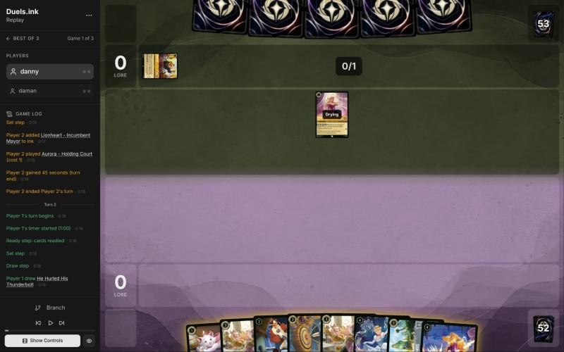
*The board before the decision: [step 6](https://duels.ink/replay/01a19d7a-8560-7ae9-8e51-af12258f1ef9?step=6) in the duels.ink replay viewer.*

**What you did:** drew He Hurled His Thunderbolt; inked Khan Industries and played Marie.

**Verdict:** Marie was right; the ink an inaccuracy. Three of your eight cards are uninkable (Launchpad, Dream Come
True, Thunderbolt), so the ink had to come from Marie, two Priscillas, Three Arrows and Khan.
- **Inking Khan Industries** is suboptimal because against a deck that's 74% Control (Raging Storm, Gaston, Hades)
  it's your lore that their removal can't reach: a location, untouched by Storm, and characters there can't be
  challenged. It's also your hand's only 5-drop, the play for turn 10.
- **Inking the second Priscilla** is better: one Priscilla is turn 6's play and ramps from there, and the second
  arrives too late to matter as much ([INK-2](#cite-ink-2)). Three Arrows was the other candidate. Confidence: medium-low; you inked a
  Khan early in the TheBigGrin match too (open question).

*In discussion:* danny agrees: "should've inked 2nd Priscilla, knowing how effective those locations can be against
wipes." The inaccuracy stands. Against sweeper Control, Khan Industries is worth keeping, unlike the midrange
matchups stonks 📈 described.

### Turn 3: their turn

**What happened:** they inked Scuttle – Birdbrained (5, 5/5/2, Ward) and passed.

### Turn 4: your turn 2

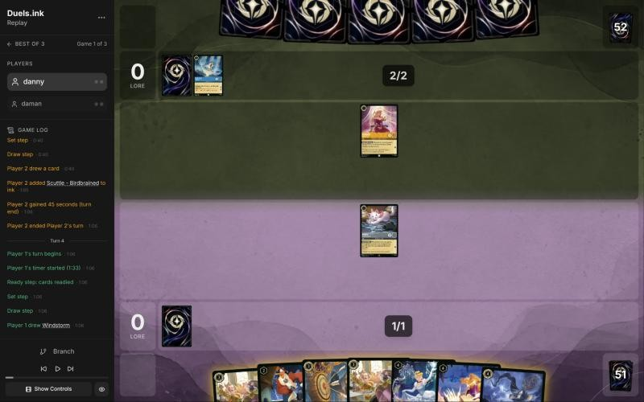
*The board before the decision: [step 11](https://duels.ink/replay/01a19d7a-8560-7ae9-8e51-af12258f1ef9?step=11) in the duels.ink replay viewer.*

**What you did:** drew Windstorm and inked it; played Launchpad and quested Marie (+1).

**Verdict:** good play. Their list now looks like an unlisted variant (Lionheart, Scuttle) built on big characters
(5/5 and 4/7), so Windstorm's 1 damage had few targets and was the right ink. Launchpad is the only 2-drop, and Marie's
quest offers Aurora a 1-for-1 trade at most.

### Turn 5: their turn

**What happened:** they inked Mickey Mouse – Best in Town and played their own Priscilla – Efficient Clerk; Aurora traded
with Marie.

### Turn 6: your turn 3

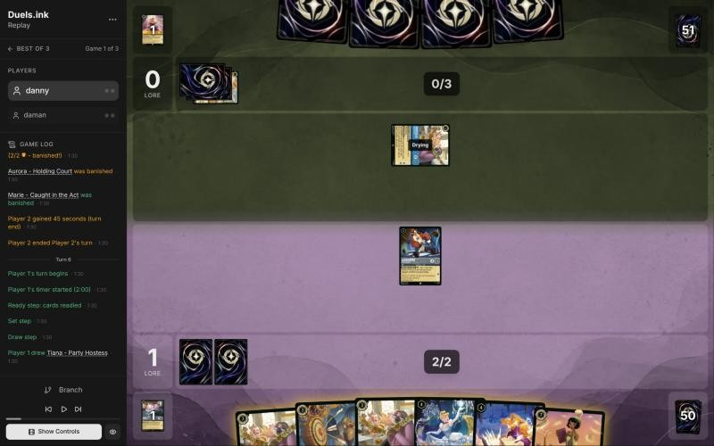
*The board before the decision: [step 19](https://duels.ink/replay/01a19d7a-8560-7ae9-8e51-af12258f1ef9?step=19) in the duels.ink replay viewer.*

**What you did:** drew Tiana – Party Hostess and inked her; Three Arrows put 2 on their exerted Priscilla and
Launchpad's challenge finished her (Launchpad took nothing).

**Verdict:** good play, at least as good as the coach's plan (your own Priscilla now, their Priscilla to
Thunderbolt later). Their Priscilla was their engine: each quest is 2 lore, a card and an ink. Killing her before she
quested once, with Launchpad untouched (0 {S}), is a clean tempo swing ([TEMPO-2](#cite-tempo-2)), and your Priscilla still comes next
turn. Tiana (7, no Tiana to Shift onto) was the right ink with three uninkables in hand.

### Turn 7: their turn

**What happened:** they inked Ohana Means Family and played Cinderella – Dream Come True, whose end-of-turn trigger
inked a card and drew one (they have 6 ink now).

### Turn 8: your turn 4

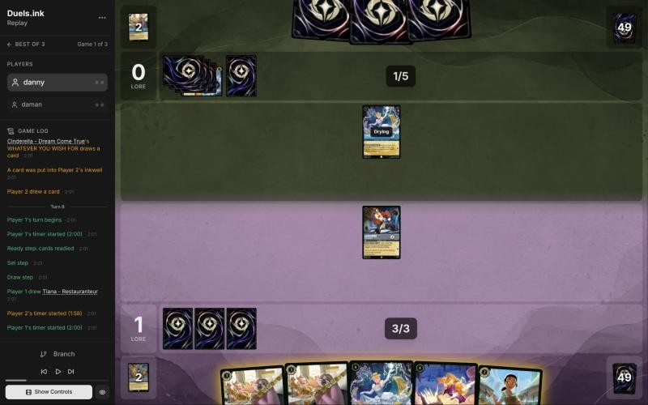
*The board before the decision: [step 29](https://duels.ink/replay/01a19d7a-8560-7ae9-8e51-af12258f1ef9?step=29) in the duels.ink replay viewer.*

**What you did:** drew Tiana – Restauranteur and inked her; played Cinderella – Dream Come True, whose end-of-turn
trigger inked a Priscilla and drew Drake Mallard. Launchpad stayed ready.

**Verdict:** good play, the coach's line: Dream Come True is a Princess, so she triggers herself the turn she's played,
an extra ink and a card. The alternative, Thunderbolt on their Dream Come True, spends the whole turn on a 2/3 whose
ramp needs another Princess.
- **One slip:** Launchpad could have quested. Their only character, Dream Come True (2 {S}), can't kill him (3 {W}), so
  it was a free lore. Tiny.

### Turn 9: their turn

**What happened:** they inked Cinderella – Homespun Dressmaker and played Hades – Meticulous Schemer (6, 5/5/3, Ward):
a 3-lore quester your targeted removal can't touch.

### Turn 10: your turn 5

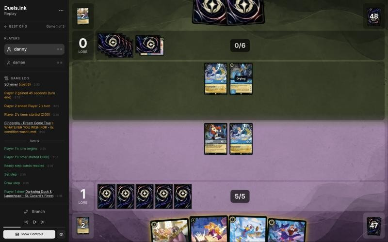
*The board before the decision: [step 40](https://duels.ink/replay/01a19d7a-8560-7ae9-8e51-af12258f1ef9?step=40) in the duels.ink replay viewer.*

**What you did:** drew St. Canard's Finest. Your Dream Come True sang He Hurled His Thunderbolt for free (4 to their
Dream Come True, banished); you played Drake Mallard and Priscilla, Launchpad drew Marie (free with a Darkwing in play),
and you inked her. Finest stayed in hand.

**Verdict:** good play on the Thunderbolt (singing it with a cost-4 character made their ramp engine's removal free);
close call on the rest.
- **Your line:** two more bodies, Priscilla's ramp from next turn, and a card, for no lore this turn. Priscilla enters
  exerted and Launchpad exerted himself to draw, so Hades – Meticulous Schemer (5 {S}, dry next turn) can kill either,
  at the cost of his 3-lore quest.
- **The coach's line:** Finest Shifted onto the dry Launchpad and quested (+2), keeping Drake and Priscilla in hand.
  Finest exerted is safe: Hades challenging her would die to her 5 {S}.
- Yours develops more and draws; the coach's banks 2 lore with nothing exposed. Close ([TEMPO-1](#cite-tempo-1), [RULE-1](#cite-rule-1)).

### Turn 11: their turn

**What happened:** Spooky Sight (6, uninkable: every character with cost 3 or less goes into its owner's inkwell)
took Launchpad, Drake Mallard and Priscilla into your inkwell, and Hades killed your exerted Dream Come True. Your board
is empty; you have 9 ink.

*Revisited from turn 10's information:* Spooky Sight is in the [Control average list](#cite-kb-meta-archetypes-amber-sapphire-control) (1 copy). Neither the coach's
pre-game read nor the brief's removal tags named it, so turn 10's setup missed it. The chance they held it then was
about 6% (`odds.py hold 50 1 3`), so the turn-10 verdict stays a close call, but the coach's line (Finest, cost 7, out
of its reach) had that edge too. Logged in [the coach's errors](#coachs-errors).

### Turn 12: your turn 6

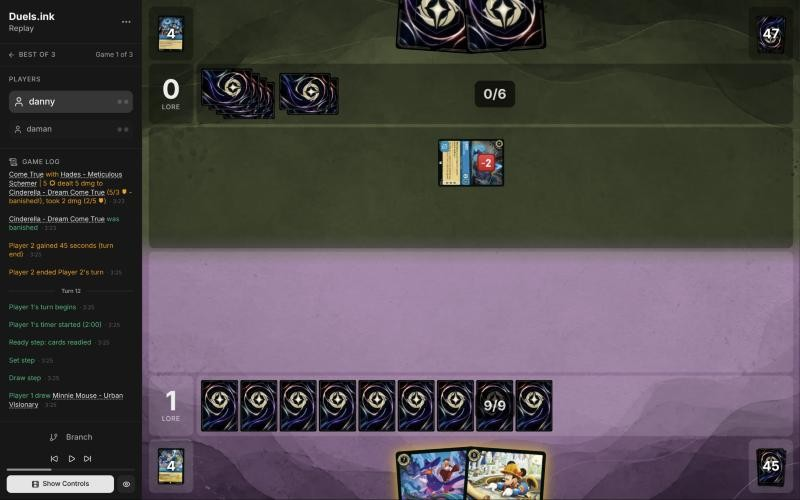
*The board before the decision: [step 50](https://duels.ink/replay/01a19d7a-8560-7ae9-8e51-af12258f1ef9?step=50) in the duels.ink replay viewer.*

**What you did:** drew Minnie and played her (8 of your 9 ink), keeping St. Canard's Finest in hand.

**Verdict:** good play, the coach's line. Minnie's 3 lore and Ward put her beyond all their targeted removal, and Hades
(5 {S}) can't challenge her profitably (her 6 {W} survives, his 5 doesn't). Keeping Finest rather than inking her holds
a Ward rebuild for Raging Storm (8 ink; they have 6, 7 next turn), and 9 ink is already enough for anything in your deck.

### Turn 13: their turn

**What happened:** they started Hades – Infernal Schemer and undid it (Minnie's Ward left it no target); Ohana Means
Family healed Hades – Meticulous Schemer and drew 2; they played Hamm – Piggy Bank (a cost reducer) and quested Hades
(+3, 1–3).

### Turn 14: your turn 7

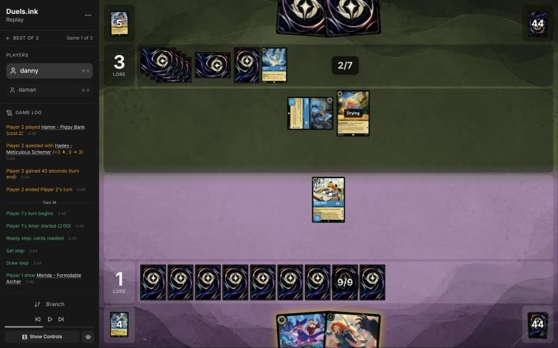
*The board before the decision: [step 61](https://duels.ink/replay/01a19d7a-8560-7ae9-8e51-af12258f1ef9?step=61) in the duels.ink replay viewer.*

**What you did:** drew Merida; Minnie quested (+3, 4–3) and you played nothing, holding St. Canard's Finest and Merida.
At the end of the turn Minnie's ALL BY DESIGN returned Khan Industries from your inkwell to your hand.

**Verdict:** close call. They reach 8 ink next turn, Raging Storm's cost (about a quarter to hold one after their draw,
more with their dig).
- **Your line** risks only Minnie to a Storm and keeps two rebuilds (Finest, Merida) plus Khan for after it, at the cost
  of 9 unused ink and a turn of development.
- **The coach's line:** quest Minnie and play Finest (Ward and 7 {W}, so nothing but a Storm removes her), keeping
  Merida. Without a Storm (about three times in four) that's 2 more lore next turn; with one, you lose Finest too.
- Minnie challenging the exerted Hades (6 kills his 5 {W}) was the other option, but she'd be left on 1 {W}, exerted, for
  Hamm to finish.
Both are reasonable; yours plays around the card the archetype is built on ([POS-1](#cite-pos-1)). Fetching Khan with ALL BY DESIGN was
a good find: lore Storm can't touch.

### Turn 15: their turn

**What happened:** Belle – Snowfield Strategist (WINTER STOCKPILE: their banished characters go into their inkwell),
then Hades challenged Minnie (Hades banished, Minnie on 5 damage) and Hamm finished her (Hamm banished). Both went into
their inkwell.

*Revisited from turns 12 and 14:* the coach said Hades couldn't challenge Minnie profitably. Counted together, Hades and
Hamm (5 + 2) kill her 6 {W}, and Belle turned both losses into ink. The verdicts stand (the trade cost them their 3-lore
Hades, and the alternatives exposed Minnie too), but the exposure count was wrong: see [the coach's errors](#coachs-errors).

### Turn 16: your turn 8

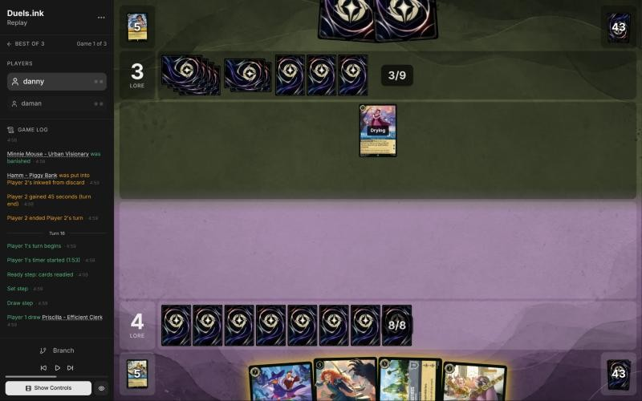
*The board before the decision: [step 71](https://duels.ink/replay/01a19d7a-8560-7ae9-8e51-af12258f1ef9?step=71) in the duels.ink replay viewer.*

**What you did:** drew Priscilla; played Khan Industries and Priscilla (8 ink), holding St. Canard's Finest and Merida.

**Verdict:** good play, the coach's line. Khan gains 2 a turn whatever they do (Raging Storm doesn't touch locations),
Priscilla starts the ramp and her 4 {W} survives Belle, their only character, and Finest and Merida stay in hand as the
rebuild for a Storm (they have 10 ink next turn; about a quarter to hold one).

### Turn 17: their turn

**What happened:** Hades – Infernal Schemer (7, 3/6/2) put Priscilla into your inkwell; Belle challenged Khan Industries
(2 damage, 6 {W} left).

### Turn 18: your turn 9

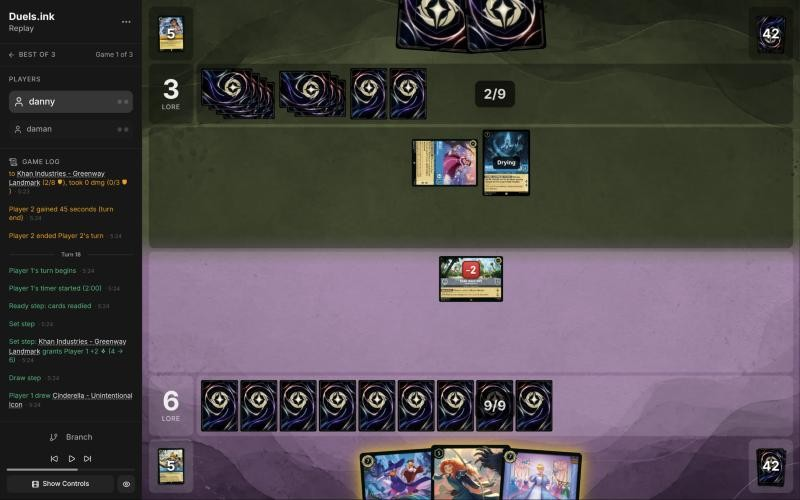
*The board before the decision: [step 79](https://duels.ink/replay/01a19d7a-8560-7ae9-8e51-af12258f1ef9?step=79) in the duels.ink replay viewer.*

**What you did:** Khan gave 2 (6–3); drew Cinderella – Unintentional Icon, played her and moved her to Khan Industries.
BESPOKE DESIGN inked a card and put Minnie on top of your deck.

**Verdict:** good play. The coach would have put St. Canard's Finest at Khan (Ward, so Hades – Infernal Schemer and Let
It Go can't take her). Cinderella is 3 lore instead of 2, ramps every turn, and her BESPOKE DESIGN lined up Minnie for
next turn; at Khan she can't be challenged, so only a chosen-target effect or Raging Storm reaches her. Finest and Merida
stay in hand for a rebuild. Equal or better.

### Turn 19: their turn

**What happened:** they played a second Cinderella – Dream Come True (ink and a card at the end of the turn); Hades and
Belle challenged Khan Industries (7 damage of its 8). Still 3 lore.

### Turn 20: your turn 10

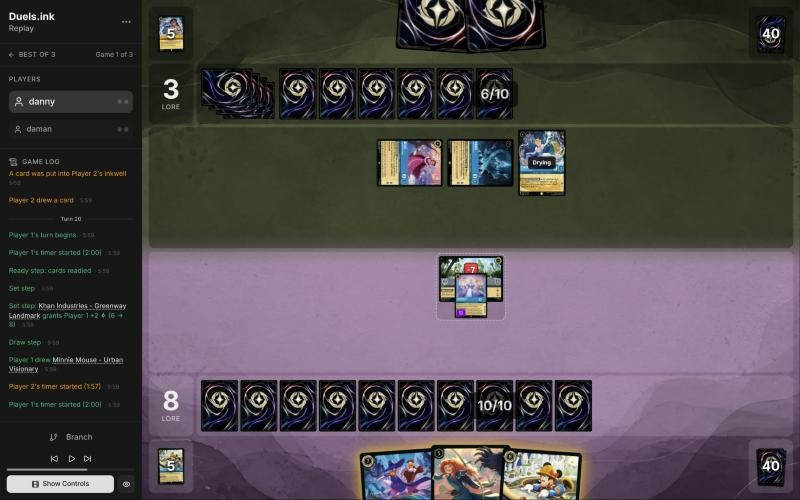
*The board before the decision: [step 90](https://duels.ink/replay/01a19d7a-8560-7ae9-8e51-af12258f1ef9?step=90) in the duels.ink replay viewer.*

**What you did:** Khan gave 2 (8–3); drew Minnie. Merida's FULL QUIVER returned Three Arrows, and the Arrows with STEADY
AIM put 4 on Hades (2 {W} left) and killed Belle (3); Cinderella quested (+3, 11–3). BESPOKE DESIGN inked a card.
Minnie and St. Canard's Finest stayed in hand.

**Verdict:** good play, better than the coach's plan (Minnie now). Merida plus the Arrows she returned cost 8 and took
their 2-lore Belle (whose WINTER STOCKPILE was ramping them off every trade), left Hades on 2, and added a 2-lore body,
while Minnie and Finest wait as the rebuild for a Raging Storm (they reach 11 ink next turn). Their board now makes 3 a
turn to your 5, and Khan, on 1 {W}, has done its job.

### Turn 21: their turn

**What happened:** their Dream Come True finished Khan Industries; they played their own Cinderella – Unintentional Icon
and quested Hades (+2, 11–5).

### Turn 22: your turn 11

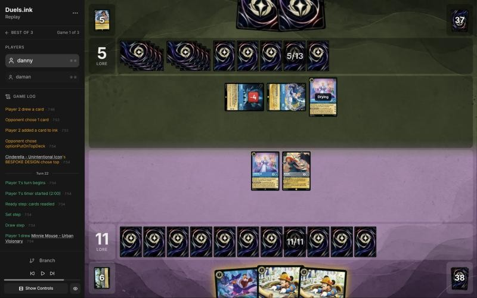
*The board before the decision: [step 112](https://duels.ink/replay/01a19d7a-8560-7ae9-8e51-af12258f1ef9?step=112) in the duels.ink replay viewer.*

**What you did:** drew a second Minnie; played St. Canard's Finest and quested Cinderella and Merida (+5, 16–5).
BESPOKE DESIGN put another Finest on top of your deck. Both Minnies stayed in hand.

**Verdict:** good play. At 16 with Cinderella (3), Merida (2) and Finest (2) able to quest next turn, you win on turn 24
unless they remove two of the three or Storm; their board makes 6 a turn and can't reach 20 before then. The coach
considered Merida killing the damaged Hades (3 into his 2 {W}) instead of questing: it slows them by 2 a turn but
costs 2 lore now, and their clock isn't the threat. Two Minnies in hand are the rebuild if Raging Storm comes.

### Turn 23: their turn

**What happened:** they quested all three (+6, 16–11), then Raging Storm banished every character, theirs too, and they
played Aurora.

### Turn 24: your turn 12

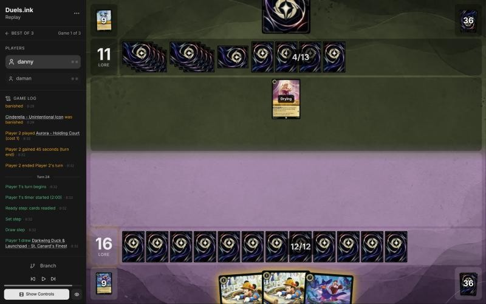
*The board before the decision: [step 125](https://duels.ink/replay/01a19d7a-8560-7ae9-8e51-af12258f1ef9?step=125) in the duels.ink replay viewer.*

**What you did:** drew St. Canard's Finest and played one Minnie, holding the other Minnie and a Finest.

**Verdict:** good play, the only line. 12 ink pays for one of your threats (two would need 15), and Minnie is the biggest:
3 lore on turn 26 puts you on 19, with the next threat down on turn 26 for the win on turn 28. Holding the rest keeps a
rebuild if another Raging Storm comes (about one in six after their draw).

### Turn 25: their turn

**What happened:** they played Cinderella – Unintentional Icon and The Horseman Strikes! (a card; you have nothing
Evasive), and Aurora quested (16–12).

### Turn 26: your turn 13

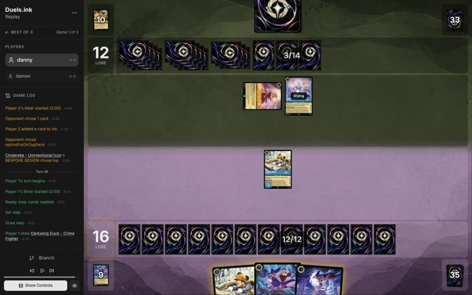
*The board before the decision: [step 134](https://duels.ink/replay/01a19d7a-8560-7ae9-8e51-af12258f1ef9?step=134) in the duels.ink replay viewer.*

**What you did:** drew Darkwing Duck – Crime Fighter, quested Minnie (19–12) and played St. Canard's Finest for its
full 7, holding Minnie and Crime Fighter. At the end of the turn Minnie's ALL BY DESIGN returned Tiana – Party
Hostess from your inkwell.

**The setup:**
- **The race:** at 19 you win with any quest on turn 28. Their board (Aurora 1, Cinderella 3) reaches 16 on turn 27
  and 20 on turn 29, too late if anything of yours survives.
- **What can stop it:** Minnie and Finest both have Ward, so Hades – Infernal Schemer, Gaston, Let It Go and The
  Horseman Strikes! can't touch them, and Cinderella's 4 strength plus Aurora's 1 can't kill an exerted Minnie (6
  willpower). Only Raging Storm (8; one already used) clears your board: about one in six after their draw, more if
  Cinderella's BESPOKE DESIGN put one on top.
- **After a Storm on turn 27:** they'd be on 16 at most, with a board they cast that turn from the 7 ink left over,
  so 20 on turn 29 is out of reach. Your rebuild comes on turn 28 and wins on turn 30 if it survives their turn 29.

**Verdict:**
- **Questing Minnie to 19 and playing Finest:** good play. A second Ward threat means only a Storm stops the win.
  Paying 7 rather than Crime Fighter plus Shift 5 cost nothing (the other 5 ink had no use) and keeps Crime Fighter
  as an extra body for a rebuild.
- **ALL BY DESIGN: Inaccuracy (medium confidence).** Returning **Tiana – Party Hostess** is suboptimal because her
  draw only matters in a long game, and returning **Khan Industries** is better because it's a win a Storm can't
  reach: at 19, Khan played on turn 28 pays 2 lore at the start of turn 30 ([CR 3.2.2.2](#cite-cr-3-2-2-2)), so after a Storm only an
  answer to an 8-willpower location stops you. With Tiana, the rebuild (Minnie and Crime Fighter) loses to a second
  Storm on turn 29. The edge is small, since they need a Storm on turn 27 and a second by turn 29, but Khan does
  everything Tiana does here and more ([POS-1](#cite-pos-1), [RULE-3](#cite-rule-3), [CARD-3](#cite-card-3)).

*In discussion:* danny agrees: "I should've taken the location, that would've basically guaranteed me the win." The
inaccuracy stands: the edge was small only because it needed a Storm and then a second one to matter.

### Turn 27: their turn

**What happened:** they played Stitch – Carefree Surfer, drew 2 with his OHANA, and conceded at 19–12.

## Lessons
1. **Against Amber/Sapphire Control, hold a Ward rebuild for every reset.** Their targeted removal can't touch Ward,
   so their answers are challenges, Spooky Sight (cost 3 or less) and Raging Storm, and you kept a threat behind each
   time ([12](#turn-12), [16](#turn-16), [22](#turn-22),
   [24](#turn-24)).
2. **At 18 or more lore, a location is a win a sweeper can't reach.** Its lore comes at the start of your turn, so a
   Storm on their turn doesn't stop it. Minnie's ALL BY DESIGN can fetch Khan Industries from the inkwell for it
   ([14](#turn-14), [26](#turn-26)).
3. **Spooky Sight punishes cheap bodies, Ward or not:** every character costing 3 or less goes to the inkwell
   ([11](#turn-11)). Against this archetype, put the cheap characters out when they'll do something before their 6th
   turn, not as filler.
4. **Count their challengers together.** Hades (5) and Hamm (2) killed a 6-willpower Minnie between them
   ([15](#turn-15)).

## Knowledge-base updates (applied 2026-11-02, after discussion)
- **Meta, the Amber/Sapphire notes (Control), daman's game 1:**
  - Cards no listed Control list runs: Lionheart – Incumbent Mayor, Scuttle – Birdbrained (Ward), Hades – Meticulous
    Schemer (Ward, 3 lore), Cinderella – Homespun Dressmaker, Priscilla – Efficient Clerk, Hamm – Piggy Bank.
  - Spooky Sight on turn 11 (their 6th turn) took Launchpad, Drake Mallard and Priscilla; Raging Storm on turn 23,
    after they quested all three characters.
  - Belle – Snowfield Strategist's WINTER STOCKPILE turned each of their trades into ink; Belle, Hades and their Dream
    Come True challenged Khan Industries down over turns 17–21.
- **Sapphire/Steel notes (Big Ramp with the Darkwing package), against Amber/Sapphire Control:** Ward threats and Khan
  Industries blank their targeted removal (Hades – Infernal Schemer fizzled on Minnie on turn 13); hold a Ward rebuild
  for each reset; at 18+ lore, fetch Khan with ALL BY DESIGN.
- **Cards:** add Spooky Sight to the card notes on cards that hit every opposing character, in a new table of cards that remove characters without
  damage or banish, so the brief and the pre-game read count it with the sweepers (see the coach's errors).
- **Strategy, a new hypothesis:** "At 18+ lore against a deck with a sweeper, a location in play beats card draw: its
  lore comes at your Set step ([CR 3.2.2.2](#cite-cr-3-2-2-2)), before anything they do on your turn." From [turn 26](#turn-26).

## Hindsight
Doesn't change the verdicts above.
- No second Raging Storm came: they played Stitch – Carefree Surfer and conceded, so the turn-26 choice of Tiana over
  Khan never mattered.

## The coach's errors
Filled in during discussion.

| When | Error | How it was caught | How it won't happen again |
|---|---|---|---|
| [10](#turn-10) | The setup didn't name Spooky Sight (in the Control average list, 1 copy) among their sweepers: it puts characters into the inkwell, so the brief's removal tags and the pre-game read skipped it | Turn 11's brief | Done (2026-11-02): the card notes on board-wide effects have a table for cards that put characters into the inkwell, with Spooky Sight. Still proposed (awaiting your OK): the brief tags "put all characters … into their inkwell" as a sweeper |
| [12](#turn-12), [14](#turn-14) | "Hades can't challenge Minnie profitably" counted one challenger. Hades and Hamm together (5 + 2) killed her 6 willpower | Turn 15's brief | Proposed: the brief's exposure line sums the strength of every character of theirs that can challenge next turn, against each character you'd exert (awaiting your OK) |

## Open questions
Closed when the review was finalised (2026-11-02), with danny's answers.
- **The mulligan:** the hand lacked a curve, so the 1- and 3-drop stayed and the rest went to find a 2 and a 4. The
  verdict moved from leaning to a shallower mulligan to an even close call.
- **Turn 2:** agreed, the second Priscilla should have been the ink, given how good locations are against wipes. The
  inaccuracy stands.
- **Turn 26:** agreed, Khan Industries would have all but guaranteed the win. The inaccuracy stands.

## Citations
Copies of the coach's knowledge base cited above, as they stood when they were cited (the private repository's commit and date are given with each). They don't change when the knowledge base does.

<!-- Filled in by `python3 tools/cite.py <this file>`: every principle ID, H-n, "principle N" and CR rule above
becomes a link to an entry here. Add a file or one of its sections with `--file PATH --section TEXT`, and link to
the anchor it prints. Never link into the private repository. -->

**sapphire-steel.md, Big Ramp with the Darkwing package: how to play it**: knowledge base, `kb/meta/archetypes/sapphire-steel.md` at `60d0b86` (2026-11-02), working tree

> ### Big Ramp with the Darkwing package: how to play it `[coach, study of stonks 📈's 22 games of 21 Oct 2026 (sent by the user), full games, not blind]`
> The user calls this list Sapphire/Steel Detectives, or Big Ramp. It matches duels.ink's "Big Ramp #1" (Windstorm,
> Minnie) with the Darkwing Detectives added. Games: `01a15f98` to `01a1602c` (22; see `kb/meta/index.md`). Card text
> verified with `tools/cards.py`. Also `01a15f8e` (vs MFork, game 2) and `01a16978` (vs AkatsukiCap, game 1).
> - **The list (60):**
>   - **1-drops:** Darkwing Duck – Crime Fighter ×4, Marie – Caught in the Act ×4
>   - **2-drops:** Darkwing Duck – Drake Mallard ×4 (Ward), Launchpad – Trusty Sidekick ×4, The Terror That Flaps in
>     the Night ×4
>   - **3–4:** Three Arrows ×4, Priscilla – Efficient Clerk ×3, Cinderella – Dream Come True ×4, He Hurled His
>     Thunderbolt ×2, Windstorm ×3
>   - **5–6:** Merida – Formidable Archer ×4, Khan Industries – Greenway Landmark ×4, Goliath – Clan Leader ×3
>   - **7–8:** Darkwing Duck & Launchpad – St. Canard's Finest ×4, Cinderella – Unintentional Icon ×2, Tiana – Party
>     Hostess ×4, Minnie Mouse – Urban Visionary ×3
> - **The plan:**
>   1. **Early removal** keeps their board small: Terror (3 damage while a Darkwing is in play), Three Arrows (2, then 1).
>      A Darkwing in play also makes Launchpad's draw free of the discard.
>   2. **Ramp:** Priscilla (enters exerted; each quest puts one of the top 2 into hand and the other into the inkwell,
>      2 lore), Cinderella – Dream Come True (at the end of a turn you played a Princess, ink a card from hand to draw),
>      Cinderella – Unintentional Icon (Shift 5 onto her; ramps one a turn, 3 lore), Marie (an ink drop when she quests
>      after an opposing character took damage). Ink at the start of its 5th turn was usually 5–6, and 8–9 by its 6th in the fastest games.
>   3. **The sweep: Merida, then Windstorm.** STEADY AIM adds 2 damage to every instance of action damage to an
>      opposing character, so Windstorm deals 3 to each (5 to an Evasive one): a 4- to 6-character wipe (01a1601c
>      turn 11: six Princess Aggro characters). Merida's FULL QUIVER also returns Three Arrows (then 4 and 3).
>   4. **Lore:** Khan Industries (2 a turn at their Set step; characters there can't be challenged, so Merida and
>      Priscilla move in), Merida 2, Priscilla 2, Cinderella – Unintentional Icon 3, Minnie 3, St. Canard's Finest 2
>      plus VICTORY POSE (+2 per banish in a challenge on its turn).
>   5. **Tiana – Party Hostess** (7): draw 2 and discard one; a discarded Khan Industries is played free (01a15fee,
>      01a15ff6, 01a1602c). **Minnie** (8, Ward) returns a card from the inkwell to hand when she ends a turn exerted.
>      **Goliath – Clan Leader** puts both hands to 2 at the end of each turn: strictly for pressing an advantage when
>      ahead, or for keeping a control deck's hand small; otherwise rarely played (user, 2026-11-02).
> - **Results by matchup** (13–9): Emerald/Steel Midrange 8–4, all four game 1s lost and every game 2 and 3 won;
>   Amber/Emerald Circle of Life 2–4; Princess Aggro 2–1; Amethyst/Steel Midrange 1–0.
> - **What won:** the Merida and Windstorm sweep, Finest's VICTORY POSE, Khan Industries with protected questers. Early
>   Priscilla matters: in the Emerald/Steel wins she was down by its 4th turn in five of eight, and in the four losses never
>   (a correlation from few games).
> - **It can race from behind once the questers are gone:** in 01a16978, at 5–17 against Emerald/Steel, Three Arrows
>   with STEADY AIM killed Vixey and The Queen, a second Merida returned the Arrows, and wide quests (two Meridas at 2
>   each, Darkwings, Cinderella) won 20–19.
> - **What beat it:**
>   - **Resist:** Flash – Efficient Clerk (2, 3/2/2, Resist 1) takes nothing from Windstorm's 1 and less from every
>     ping; it quested for 8 to 10 in two lost game 1s.
>   - **Ward plus recursion:** Circle of Life replayed Milo Thatch – Getting His Hands Dirty (7, Ward, bounces a
>     character on play), which bounced Merida; conceded at 3–0 (01a15f9d turn 14). Only Windstorm reaches a Ward
>     character.
>   - **Fast wide quests:** Princess Aggro's +5 and +6 turns came before the sweep (01a16020, lost 14–21); a song-and-
>     Evasive Amber/Emerald list quested +7 and +8 (01a15fdb).
> - **Coaching points:**
>   - Merida before any damage action; with their board at 2–3 willpower, hold Windstorm for her.
>   - Keep a Darkwing in play for Terror's 3 and Launchpad's free draw. Quest Marie after removal for the ink drop.
>   - Move questers to Khan Industries; plan Tiana for the turn a Khan is in hand. Whether to ink a Khan is too
>     situational for a rule (user, 2026-11-02): judge it from the hand.
>   - Name the answer to Resist and Ward early (Thunderbolt's 4, challenges, Finest): the pings don't do it.
>   - **Mulligan from the hand you have, not to a fixed plan** (user, 2026-11-02). The play pattern varies widely with
>     the opening seven, and no one line suits a given matchup: see what the hand already does, keep what bridges
>     turn 1 to the late game, and send back the rest, avoiding a full mulligan where possible. The deep mulligans
>     (3 to 7 cards) in these games came partly from the player's first games on the deck, so they aren't a guide.
>   - **Judge the plan from the hand, then the matchup:** a coached line should say how this hand gets from its early
>     turns to Merida, the sweep and the 3-lore finishers, rather than follow a stock sequence.

**amber-sapphire.md, Control**: knowledge base, `kb/meta/archetypes/amber-sapphire.md` at `60d0b86` (2026-11-02), working tree

> ### Control
> 51% of the pair's games (51,350).
>
> | # | Card | Type | Cost | Tag |
> |---|---|---|---|---|
> | 4 | Aurora - Holding Court | character | 1 |  |
> | 4 | Mickey Mouse - Best in Town | character | 1 |  |
> | 4 | Hamm - Piggy Bank | character | 2 |  |
> | 4 | Belle - Snowfield Strategist | character | 4 |  |
> | 4 | Cinderella - Dream Come True | character | 4 |  |
> | 3 | Gaston - Superior Archer | character | 5 | removal |
> | 3 | Moana - Curious Explorer | character | 5 |  |
> | 4 | Cinderella - Unintentional Icon | character | 7 |  |
> | 4 | Hades - Infernal Schemer | character | 7 | removal |
> | 4 | Stitch - Carefree Surfer | character | 7 |  |
> | 3 | Minnie Mouse - Urban Visionary | character | 8 |  |
> | 4 | Besties, Assemble! | action | 1 |  |
> | 4 | Develop Your Brain | action | 1 |  |
> | 1 | Ohana Means Family | action | 3 |  |
> | 3 | The Horseman Strikes! | action | 3 | removal |
> | 1 | Spooky Sight | action | 6 |  |
> | 4 | Raging Storm | action | 8 | sweeper |
> | 1 | Let It Go | song | 5 | removal |
> | 1 | The Black Cauldron | item | 3 |  |

**MULL-1**: strategy principle, `kb/strategy/principles.md` at `60d0b86` (2026-11-02), working tree

> - **MULL-1. Keep a plan, not the strongest cards.** *Ask: "Which hand gives me the best chance to execute my game plan in this matchup?"* `[MCL ch.12]` · baseline

**MULL-3**: strategy principle, `kb/strategy/principles.md` at `60d0b86` (2026-11-02), working tree

> - **MULL-3. The right keep depends on the matchup.** Early interaction against aggro; pressure, draw and engines against slow decks. The mulligan is the first expression of your role. In the Set 14 era the opponent's inks are known before the mulligan (RULE-8), so this applies from game 1 of a match. `[MCL ch.12]` · baseline

**INK-2**: strategy principle, `kb/strategy/principles.md` at `60d0b86` (2026-11-02), working tree

> - **INK-2. Don't automatically ink the most expensive card.** It may be the late-game win condition or the key answer for this matchup. The answer depends on matchup, hand and board. `[MCL ch.4]` · baseline

**TEMPO-2**: strategy principle, `kb/strategy/principles.md` at `60d0b86` (2026-11-02), working tree

> - **TEMPO-2. Answering an expensive threat with a cheap card is a tempo swing**, and more so if the answer was sung for no ink. Other examples: playing Shift threats before the opponent can answer them, and ramping into several threats in one turn. `[MCL ch.1, ch.7]` · baseline

**TEMPO-1**: strategy principle, `kb/strategy/principles.md` at `60d0b86` (2026-11-02), working tree

> - **TEMPO-1. Tempo is how much freedom you leave the opponent, not how fast you play.** A play that forces the opponent to spend their turn answering it has stolen part of their turn. *Ask: "If I play this, what does my opponent have to do next?"* `[MCL ch.1]` · baseline

**RULE-1**: strategy principle, `kb/strategy/principles.md` at `60d0b86` (2026-11-02), working tree

> - **RULE-1. Only exerted characters can be challenged** `[CR 4.6.4.2]`. Questing, singing, or {E} for an ability exposes the character. Staying ready protects it. Every quest is also a decision about what the opponent can challenge next turn. · baseline
>   - *Card text overrides this* (CR 1.2.1). Shere Khan – Khan Industries CEO's NEW INCENTIVE lets one character
>     challenge ready characters that turn. Alert (e.g. from Judy Hopps – Lead Detective, to every Detective on their
>     turn) ignores Evasive. Against Ducktectives, name both in the setup. 01a14574, turns 16 and 18. `[coach, 2026-10-26]`

**POS-1**: strategy principle, `kb/strategy/principles.md` at `60d0b86` (2026-11-02), working tree

> - **POS-1. From ahead, take the safest path to victory.** Don't overextend into sweepers, don't make unnecessary trades, and make the opponent take the risks. Winning by 1 lore counts the same as winning by 10. `[MCL ch.10]` · baseline

**RULE-3**: strategy principle, `kb/strategy/principles.md` at `60d0b86` (2026-11-02), working tree

> - **RULE-3. Locations can be challenged at any time and don't hit back** `[CR 4.6.8]`. They pay lore at your Set step `[CR 3.2.2.2]`, so a location that survives one opponent turn has usually already paid something. · baseline

**CARD-3**: strategy principle, `kb/strategy/principles.md` at `60d0b86` (2026-11-02), working tree

> - **CARD-3. Card advantage only matters if you survive to use it.** Weigh draw effects against the lore race. `[MCL ch.2]` · baseline

**CR 3.2.2.2**: Comprehensive Rules, `kb/rules/cr/03-turn-structure.md` at `60d0b86` (2026-11-02), working tree

> **3.2.2.2.** The active player gains lore from locations they have in play with a {L} characteristic. This isn’t a triggered ability and doesn’t use the bag.
