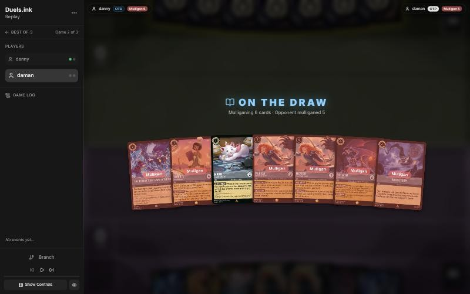
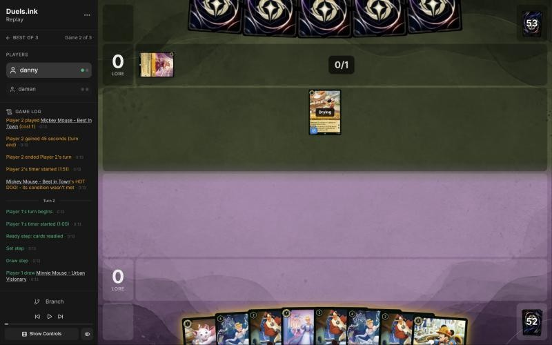
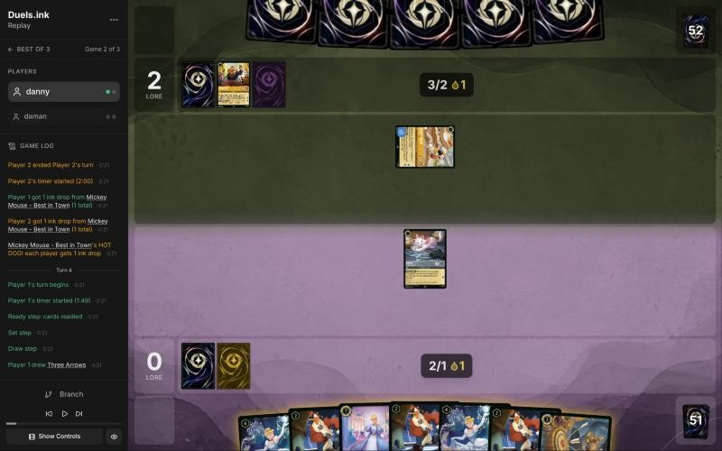
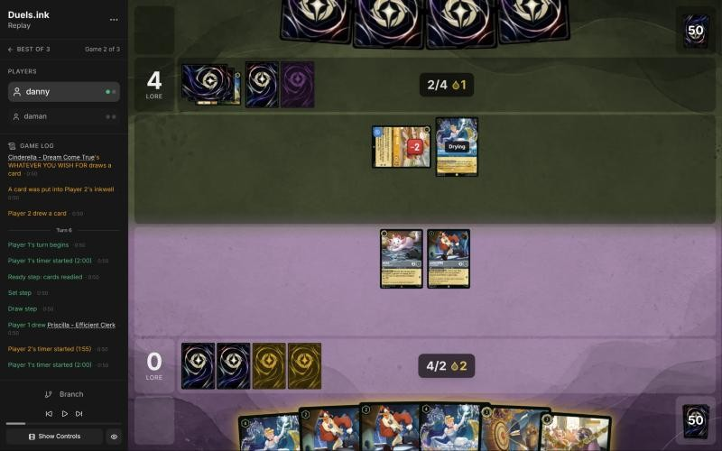
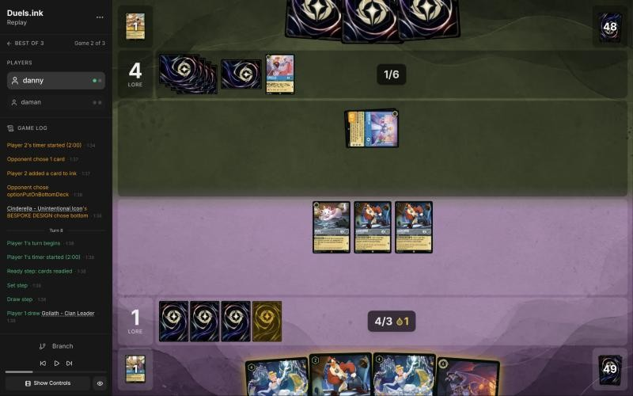
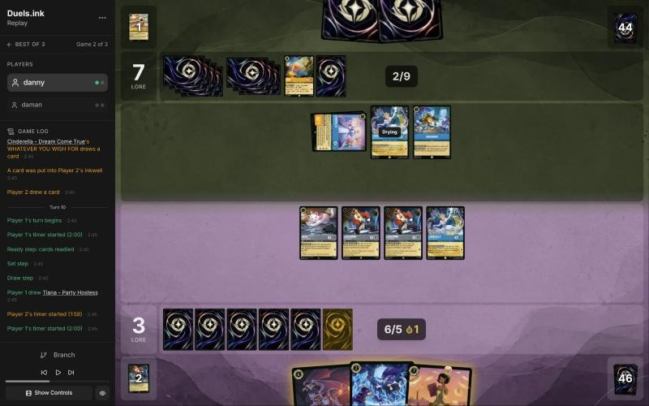
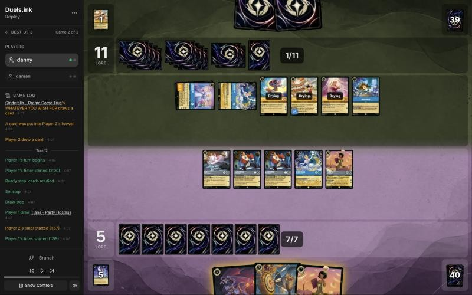
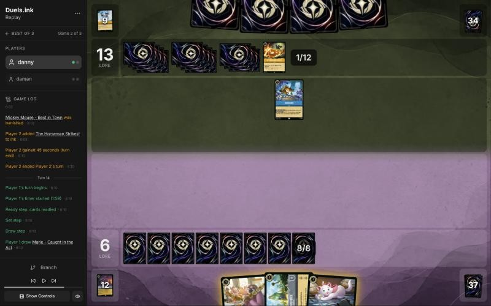
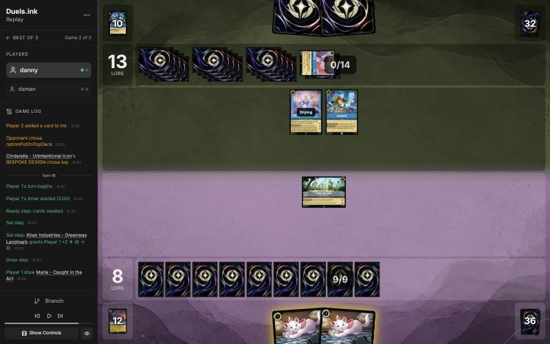
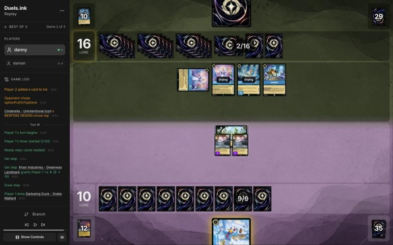

# Review: danny vs daman, 2 Nov 2026 (game 2)

| | |
|---|---|
| **Status** | **final** (2026-11-02; discussed with danny, no verdict changed) |
| **Replay** | `01a19d83-2df2-78f9-9299-18ca8a2012da` (`python3 tools/brief.py 01a19d83 --turn N`) · [duels.ink viewer](https://duels.ink/replay/01a19d83-2df2-78f9-9299-18cbc68565c2?step=0) |
| **Format** | Core Constructed. Set 14 era: inks revealed before the coin toss |
| **Decks** | You: Sapphire/Steel Big Ramp with the Darkwing package ([the coach's notes on it](#cite-kb-meta-archetypes-sapphire-steel-big-ramp-with-the-darkwing-package-how-to-play-it)). Them: Amber/Sapphire Control ([its average list](#cite-kb-meta-archetypes-amber-sapphire-control)), known from game 1 |
| **Play/draw** | daman went first (they lost game 1, so the choice was theirs); you were on the draw |
| **Result** | Lost: you conceded on turn 18 at 12–16, with their win certain next turn |
| **Meta data** | snapshot of 26 Oct 2026 (7 days old, fresh) |
| **Chosen how** | Sent by the user as a match zip of three games; only the replays were read. **The coach knew the result before the blind pass:** you won game 1 and the match went to three games, so this game was a loss. Each verdict is judged from its turn's brief only, to guard against outcome bias |

## Summary
- **Inaccuracies:**
  - [4](#turn-4): Cinderella – Unintentional Icon inked rather than Three Arrows, with two Dream Come Trues to Shift
    her onto.
  - [10](#turn-10): their Icon left alive (the Launchpads dug instead of trading for her), with five of your
    characters in front of Raging Storm.
- **Close calls:** the [mulligan](#turn-0) (only Marie kept), [6](#turn-6) (Priscilla into a Shifted Icon's challenge;
  revisited), [8](#turn-8) (no trade for the exerted Icon; Khan Industries inked rather than Goliath).
- **Good plays:** [2](#turn-2), [12](#turn-12) (Three Arrows, Tiana and two challenges took the Icon, Dream Come True
  and Aurora, so they couldn't reach 20), [14](#turn-14), [16](#turn-16).
- **Unwinnable from:** [18](#turn-18). Two Icons and Scuttle quested for 8 and they needed 4; the concession was right.

**What decided it:** their Cinderella – Unintentional Icon. Shifted onto Dream Come True on turn 7, she killed
Priscilla at once and quested them from 4 to 11 before you killed her on turn 12. Then Raging Storm (turn 13) and Spooky
Sight (turn 15) cleared your rebuilds, and two hard-cast Icons with Scuttle ran out the clock. The mulligan's
replacements (five uninkable 2- and 4-drops) left you little to answer with early.

## The game, turn by turn
Verdicts judge each decision on what you could know at the time, **including archetype knowledge an experienced
player has**. Hindsight is kept to its own section. Severity scale: good play / close call /
inaccuracy / mistake / blunder. Principle IDs and hypotheses (H-n) link to copies
in the Citations section at the end, as they stood when they were cited.

**What you knew before the game:** game 1 showed daman's list: Amber/Sapphire Control with some cards no listed
Control list runs. They go first, so their turn k is game turn 2k−1. Their key cards, and the earliest each can come:
- **Removal that chooses its target** (Ward stops all of it: Drake Mallard, St. Canard's Finest and Minnie are immune):
  - Hades – Infernal Schemer (7, uninkable): puts a character of yours into your inkwell; their 7th turn (game turn
    13), a turn or two earlier with their ramp.
  - Gaston – Superior Archer (5): banishes a character with 5+ {S}; game turn 9. Your 5+ {S} characters without
    Ward: Goliath (6). Let It Go (song 5) inks a character, sung free by any of their 5+ cost characters.
  - The Horseman Strikes! (3) draws a card and banishes an Evasive character (you have none).
- **Sweepers:**
  - Spooky Sight (6, uninkable): every character costing 3 or less goes into its owner's inkwell; game turn 11 (it
    came then in game 1 and took three of yours).
  - Raging Storm (8, uninkable): banishes all characters; game turn 15, earlier with their ramp (it came on turn 23
    in game 1).
- **Ramp and dig:** Cinderella – Dream Come True (ink a card to draw one at the end of a turn they played a
  Princess), Cinderella – Unintentional Icon (Shift 5; 3 lore; inks one of the top 2 each turn), Belle – Snowfield
  Strategist (WINTER STOCKPILE: their banished characters go into their inkwell), Mickey Mouse – Best in Town (an ink
  drop for each player when he ends a turn exerted), Aurora (−1 for their next Princess when she quests), Hamm –
  Piggy Bank (−1 for their next character), Priscilla, Develop Your Brain, Stitch – Carefree Surfer (draws 2).
- **Their bodies:** Hades – Meticulous Schemer (6, 5/5/3, Ward), Scuttle – Birdbrained (5, 5/5/2, Ward), Lionheart
  – Incumbent Mayor (6, 4/7/2, Bodyguard; +1 lore to two characters the turn he's played). In game 1 Hades (5) and
  Hamm (2) challenged together to kill a 6-willpower Minnie: count their challengers together.

Your plan: develop early (Priscilla, Marie, Darkwings) while their hand is slow; then Ward threats and Khan Industries,
which their targeted removal can't touch; keep cheap characters out of Spooky Sight's way from turn 11; hold a Ward
rebuild for each reset.

### Pre-game

*The board before the decision: [step 0](https://duels.ink/replay/01a19d83-2df2-78f9-9299-18cbc68565c2?step=0) in the duels.ink replay viewer.*

**What you did:** kept only Marie, sending back six (The Terror That Flaps in the Night, Tiana – Party Hostess, two
Meridas, Goliath and Windstorm).

**Verdict:** close call. The seven had two uninkable Meridas and three 6+ drops, so a mulligan was right.
`tools/mulligan.py` (1,000 deals):

| Option | Ink on turns 1–4 | Play turns (of 4) | Lore by turn 4 | Characters by turn 4 | Interaction by turn 4 |
|---|---|---|---|---|---|
| Keep all 7 | 8.87 | 3.84 | 4.4 | 2.3 | 100% |
| Keep Marie, Terror, Windstorm, a Merida (the coach's pick) | 9.48 | 3.96 | 5.7 | 3.3 | 100% |
| Keep Marie, Terror, Windstorm | 9.72 | 3.99 | 6.1 | 3.7 | 100% |
| **As played** (keep Marie) | 9.45 | 3.94 | 6.8 | 4.1 | 90% |
| Full mulligan | 9.27 | 3.64 | 5.5 | 3.6 | 93% |

Your near-full mulligan is the best for early bodies and lore. The coach would have kept Terror (2, inkable; 3 damage
with a Darkwing in play answers Aurora, Dream Come True or Belle, their early engines) and Merida with Windstorm
(3 to each of their characters), which the sim can't value. Against a list that rarely goes wide, early development
may matter more, though [the coach's notes on your deck](#cite-kb-meta-archetypes-sapphire-steel-big-ramp-with-the-darkwing-package-how-to-play-it)
say to avoid near-full mulligans where possible. Close
([MULL-1](#cite-mull-1), [MULL-3](#cite-mull-3)). Confidence: low.

*In discussion:* danny saw nothing like a good curve and wanted plays for the opening turns. The deck's rules for the
draw (stonks 📈) agree on chasing early plays but would keep The Terror That Flaps in the Night, the hand's only
interaction, as the coach's pick did. The close call stands.

### Turn 1: their turn

**What happened:** they inked Aurora and played Mickey Mouse – Best in Town (0/4/2, Adventurous: he must quest each
turn, and when he ends their turn exerted, each player gets an ink drop).

### Turn 2: your turn 1

*The board before the decision: [step 5](https://duels.ink/replay/01a19d83-2df2-78f9-9299-18cbc68565c2?step=5) in the duels.ink replay viewer.*

**What you did:** the mulligan brought two Cinderella – Dream Come True, three Launchpads and Cinderella – Unintentional
Icon, five of them uninkable; you drew Minnie, inked her and played Marie.

**Verdict:** good play, the coach's line. Only Marie, Unintentional Icon and Minnie can be inked.
- **Unintentional Icon is the card to keep:** Shifted onto a Dream Come True for 5 on your turn 5 (game turn 10), she's
  3 lore and an ink a turn, and none of their removal before Hades – Infernal Schemer (game turn 13) can touch her.
- **Minnie is the one to give up:** she's the Ward finisher, but at 8 ink she's six turns away, and your deck has two
  more plus four St. Canard's Finests ([INK-2](#cite-ink-2)).
- **Marie now** is a lore a turn, and Mickey must quest every turn (Adventurous), so Marie can challenge him: 2 damage
  a time against his 4 willpower, taking nothing back (0 {S}).

### Turn 3: their turn

**What happened:** Mickey quested (+2, 0–2) and they inked Lionheart; HOT DOG! gave each player an ink drop.

### Turn 4: your turn 2

*The board before the decision: [step 11](https://duels.ink/replay/01a19d83-2df2-78f9-9299-18cbc68565c2?step=11) in the duels.ink replay viewer.*

**What you did:** drew Three Arrows; Marie challenged the exerted Mickey (2 damage, nothing back), you inked
Cinderella – Unintentional Icon and played Launchpad, keeping Three Arrows.

**The setup:** Mickey is 2 lore a turn for them and an ink drop each for both players; he must quest every turn, so
he's always open to a challenge, and his 0 {S} means Marie takes nothing. Your only inkable cards are Unintentional
Icon and Three Arrows, beside two Dream Come Trues and three Launchpads.

**Verdict:**
- **Marie's challenge and Launchpad:** good play. Marie finishes Mickey next turn (2 + 2 = his 4 willpower), and
  Launchpad is your only play for 2.
- **The ink: Inaccuracy (medium-low confidence).** Inking **Unintentional Icon** is suboptimal because she was this
  hand's best threat, and inking **Three Arrows** is better because it keeps her line:
  - **Ink check, the next two turns, keeping Icon:** turn 6, Marie kills Mickey and you play Dream Come True (3 ink
    plus an ink drop), whose trigger inks a Launchpad and draws; turn 8, 5 ink Shifts Icon onto her: 3 lore and an ink
    a turn from turn 10, before their Hades – Infernal Schemer (game turn 13) and out of Spooky Sight's reach.
  - **Keeping Three Arrows instead:** 2 damage and 1 for their early engines (Aurora, Dream Come True, Belle), but
    Marie already handles Mickey, and Ward stops it on Hades – Meticulous Schemer and Scuttle. Your next threat that
    size is now a 7- or 8-drop from the deck.
  - Don't automatically ink the most expensive card ([INK-2](#cite-ink-2)); here the 7-drop came down for 5 on turn 8.

*In discussion:* danny agrees: he kept Three Arrows as removal for next turn, but with two Dream Come Trues to Shift
onto, the Icon should have stayed in hand. The inaccuracy stands.

### Turn 5: their turn

**What happened:** they inked Hamm, played Cinderella – Dream Come True (her trigger inked a card and drew one) and
quested Mickey (+2, 0–4). HOT DOG! gave each player another ink drop (you have 2).

### Turn 6: your turn 3

*The board before the decision: [step 21](https://duels.ink/replay/01a19d83-2df2-78f9-9299-18cbc68565c2?step=21) in the duels.ink replay viewer.*

**What you did:** drew Priscilla. Launchpad finished Mickey, then Marie quested (+1, 1–4) and her A LITTLE TREAT gave
an ink drop; you played Priscilla, inked Three Arrows and played the second Launchpad, with an ink drop to spare.

**Verdict:** good play, the coach's line. Launchpad rather than Marie took Mickey, so Marie could quest after the
damage for the extra ink drop ([SEQ-2](#cite-seq-2)). Priscilla now quests from next turn for 2 lore, a card and an ink; Dream Come
True (cost 4, out of Spooky Sight's reach) is the alternative, but her trigger only repeats when you play another
Princess. Their Dream Come True (2 {S}) can kill the exerted Marie next turn; she has already paid for herself.

### Turn 7: their turn

**What happened:** they Shifted Cinderella – Unintentional Icon onto their Dream Come True and challenged your exerted
Priscilla at once (4 into her 4 willpower, banished); they inked Cinderella – Homespun Dressmaker, and BESPOKE DESIGN
inked a card.

*Revisited from turn 6's information:* the coach's setup missed this. A character Shifted onto one already in play
can challenge the turn it arrives ([CR 8.10.4](#cite-cr-8-10-4)), and their Dream Come True was the base for the Icon they ran in game 1.
With 6 ink they could Shift her, and the chance they held one was a quarter to a third (`odds.py hold 54 4 5`: 33%
for the list average of four, 18% for two). Priscilla enters play exerted, so she was exposed; Dream Come True enters
ready and couldn't be challenged. Weighed again, turn 6 is a **close call** rather than a clear good play: Priscilla
quests for 2 lore, a card and an ink a turn about two times in three, against Dream Come True's ink and card now and
a safe body. Logged in [the coach's errors](#coachs-errors).

### Turn 8: your turn 4

*The board before the decision: [step 34](https://duels.ink/replay/01a19d83-2df2-78f9-9299-18cbc68565c2?step=34) in the duels.ink replay viewer.*

**What you did:** drew Goliath. Launchpad's WHAT DID YOU NEED? drew Khan Industries (discarding the Launchpad in
hand); you inked Khan, played Dream Come True and quested Marie and the other Launchpad (+2, 3–4). Her trigger inked
the second Dream Come True and drew The Terror That Flaps in the Night.

**The setup:**
- **Their Unintentional Icon is exerted** after killing Priscilla: 3 lore a turn, an ink a turn, and 4 {S} that kills
  any of your characters that's exerted. It's their only character.
- **Marie and both Launchpads together** deal 6, exactly her willpower, but she hits back for 4, so all three die.
- **Their next turn:** 7 ink (Hades – Infernal Schemer), Raging Storm from game turn 11.

**Verdict:**
- **Not trading for Unintentional Icon: close call, leaning to the trade.**
  - **The trade now:** 5 ink of 1- and 2-drops for 9 of theirs (Dream Come True plus the Shift), and their only
    threat and ramp engine gone ([TEMPO-2](#cite-tempo-2), [THREAT-2](#cite-threat-2)). Your cheap characters are what Spooky Sight and Storm sweep anyway.
  - **Your line:** 2 lore and a card now. The trade stays open next turn if she quests (and if she challenges
    instead, Marie and a Launchpad can finish her), but she'd have banked 3 more lore and an ink, and Lionheart
    (Bodyguard, seen this game) or Spooky Sight would take the chance away.
- **Inking Khan Industries rather than Goliath: close call.** Khan is lore that Raging Storm and their targeted
  removal can't touch, and characters at Khan can't be challenged by the Icon. Goliath (6 {S}) kills the Icon in a
  challenge and survives, and DUSK TO DAWN cuts a control hand to 2 every turn, but Gaston and Hades – Infernal Schemer
  both reach him. Either is reasonable; see the open question.
- **Launchpad's draw and the Dream Come True trigger:** good play. Both turned the uninkable Launchpad and Dream Come
  True into a card and an ink.

*In discussion:* danny didn't see the danger the Icon posed and hoped to find a stronger card or removal for it; he
agrees he should have banished it while he could. He inked Khan Industries rather than Goliath for the draw Goliath
might give. Both close calls stand.

### Turn 9: their turn

**What happened:** they played a second Dream Come True and Inkrunner (an item: draws a card; later {E} and 1 ink give
a character Alert), inked Hamm, started a challenge on Launchpad with the Icon and undid it, then quested her (+3,
3–7). BESPOKE DESIGN and Dream Come True each inked a card.

### Turn 10: your turn 5

*The board before the decision: [step 53](https://duels.ink/replay/01a19d83-2df2-78f9-9299-18cbc68565c2?step=53) in the duels.ink replay viewer.*

**What you did:** drew Tiana – Party Hostess. Both Launchpads drew (discarding both Terrors that came up, finding a
Dream Come True); you inked Goliath and played Tiana (IDEAL VENUE drew Crime Fighter and a second Goliath, discarding
Crime Fighter), and quested Marie and Dream Come True (+2, 5–7). Dream Come True's trigger inked the new Dream Come
True and drew Three Arrows.

**The setup:**
- **Their Unintentional Icon quested and is exerted again** (7 lore; 3 a turn and an ink a turn). Marie and both
  Launchpads still deal exactly her 6 willpower between them, and all three die doing it. Dream Come True would be the
  one to keep: she's cost 4, out of Spooky Sight's reach, and triggers on your Princesses.
- **Their next turn:** 10 ink. Raging Storm is online (about a quarter to hold after their draw, more with Inkrunner,
  Dream Come True and BESPOKE DESIGN digging), and so is Spooky Sight, which inks every character of yours costing 3
  or less. The Icon (4 {S}) kills any character of yours left exerted.

**Verdict: Inaccuracy (medium-low confidence).** Using the Launchpads to dig and leaving the Icon alive is suboptimal
because it leaves their only lore engine questing and puts five characters, four of them exerted, in front of a
deck with Raging Storm online. Trading Marie and both Launchpads for the Icon, questing Dream Come True and playing
Tiana is better:
- **It takes their clock from 4 a turn to 1** (their second Dream Come True), and their ramp with it, while their
  hand is down to 2.
- **It costs you little the sweepers wouldn't take anyway:** the three are Spooky Sight's targets, and a Storm into
  Dream Come True and Tiana alone is a poor trade for them.
- **Tiana and Dream Come True's trigger come either way**, so the turn still draws.
- **Your line's upside:** if no Storm or Spooky Sight comes, you quest for up to 6 a turn from turn 12 against their
  4, but the Icon picks off an exerted character whenever it suits them ([THREAT-2](#cite-threat-2), [TEMPO-2](#cite-tempo-2), [CARD-2](#cite-card-2)).

*In discussion:* the same answer as turn 8: he should have traded for the Icon. The inaccuracy stands.

### Turn 11: their turn

**What happened:** Stitch – Carefree Surfer (4/8/2) drew 2; they played Mickey and Aurora, and quested the Icon and
Dream Come True (+4, 5–11). BESPOKE DESIGN and Dream Come True each inked a card.

### Turn 12: your turn 6

*The board before the decision: [step 76](https://duels.ink/replay/01a19d83-2df2-78f9-9299-18cbc68565c2?step=76) in the duels.ink replay viewer.*

**What you did:** drew a second Tiana. Three Arrows killed Aurora (2) and put 1 on the Icon; Tiana (4) and a
Launchpad (2) killed the Icon (the Launchpad died), the other Launchpad and Dream Come True killed their Dream Come
True; Marie quested (+1, 6–11, and an ink drop), you inked the second Tiana and played Goliath. DUSK TO DAWN drew you
Priscilla and Khan Industries.

**The setup:** at 11 with the Icon (3), Stitch (2), Mickey (2), Dream Come True (1) and Aurora (1) able to quest,
they reach 20 next turn unless you take at least 1 lore off that board, and at least 3 if they hold Lionheart
(APPROVAL RATING: +1 lore to two characters). So the Icon (6 willpower, exerted) has to die; Stitch, Mickey and Aurora
are drying, so only Three Arrows reaches them.

**Verdict:** good play. Their board can now quest for 4 next turn (6 with Lionheart), so 17 at most.
- **The coach's version** put Three Arrows' 2 on the Icon so that Tiana could finish her alone, keeping the Launchpad,
  with the 1 on Aurora (leaving her a 1/1). Yours trades the Launchpad for Aurora's lore and Princess discount
  instead. About equal.
- **Goliath** over Shifting the second Tiana onto the damaged first: DUSK TO DAWN refilled you to 2 (Priscilla, Khan),
  and at the end of their turn it cuts their hand to 2.
- **Their next turn:** Stitch (4 {S}) can kill any of your exerted characters, and Raging Storm (12 ink) would clear
  both boards (about a quarter, more with their dig).

### Turn 13: their turn

**What happened:** Stitch killed Tiana; Ohana Means Family healed his 4 damage and drew 4; Mickey quested (+2, 6–13);
then Raging Storm banished every character on both sides. They inked The Horseman Strikes!.

### Turn 14: your turn 7

*The board before the decision: [step 95](https://duels.ink/replay/01a19d83-2df2-78f9-9299-18cbc68565c2?step=95) in the duels.ink replay viewer.*

**What you did:** drew Marie; played Khan Industries and Priscilla (8 ink), keeping Marie.

**The setup:** both boards are empty, 6–13. They have 12 ink, 4 cards and Inkrunner; whatever they play next turn
quests from turn 17, so they need two turns of questing (7 lore) at the earliest. Your lore has to come from what
survives their next Storm, Hades – Infernal Schemer or Spooky Sight.

**Verdict:** good play, the coach's line. Khan Industries pays 2 at the start of each of your turns whatever they do
to characters, and Priscilla quests for 2, a card and an ink from turn 16; their characters played next turn can't
challenge her. Inking Marie for one more ink next turn was the alternative; keeping her is a body for later. Equal.

### Turn 15: their turn

**What happened:** Spooky Sight put Priscilla into your inkwell; they played Cinderella – Unintentional Icon (7,
hard-cast) and BESPOKE DESIGN inked a card.

### Turn 16: your turn 8

*The board before the decision: [step 105](https://duels.ink/replay/01a19d83-2df2-78f9-9299-18cbc68565c2?step=105) in the duels.ink replay viewer.*

**What you did:** Khan gave 2 (8–13); drew the second Marie, played both and moved them to Khan Industries.

**The setup:** the race is behind. Their Icon quests for 3 a turn (16, 19, 22: they win on turn 21); Khan and two
Maries make 4 a turn from turn 18 (12, 16, 20: you'd win on turn 22). So the Icon has to leave, or a bigger quester
has to come, from your next two draws: He Hurled His Thunderbolt with a Marie's challenge, Merida with an action, or
St. Canard's Finest with a Marie (5 + 2 into her 6 willpower).

**Verdict:** good play, the only line. Moving now spends ink you had no other use for, so next turn's ink is free for
what you draw, and at Khan the Maries can quest without the Icon picking them off.

### Turn 17: their turn

**What happened:** they played a second Unintentional Icon (hard-cast) and Scuttle – Birdbrained (5/5/2, Ward), and
quested the first Icon (+3, 8–16). Both Icons' BESPOKE DESIGN inked a card.

### Turn 18: your turn 9

*The board before the decision: [step 120](https://duels.ink/replay/01a19d83-2df2-78f9-9299-18cbc68565c2?step=120) in the duels.ink replay viewer.*

**What you did:** Khan gave 2 (10–16); drew Drake Mallard and played him, quested both Maries (12–16) and conceded.

**Verdict:** unwinnable from here, so the concession was right ([principle 2](#cite-principle-2)). Their two Icons and Scuttle quest for 8
next turn and they need 4. Only the exerted Icon can be challenged, and your two Maries deal 4 of her 6; even with
her gone, the other Icon and Scuttle make 5. You can reach 12 at most.

## Lessons
1. **A character Shifted onto one already in play can challenge at once** ([CR 8.10.4](#cite-cr-8-10-4)). Count their Shift cards onto
   their bases whenever you leave a character exerted: Priscilla enters play exerted ([6](#turn-6), [7](#turn-7)).
2. **Against Amber/Sapphire Control, trade your cheap characters for their engine while it's exerted.** Your 1- and
   2-drops are what Spooky Sight and Raging Storm take anyway; their Unintentional Icon is their lore and their ramp
   ([8](#turn-8), [10](#turn-10), [12](#turn-12)).
3. **Unintentional Icon with a Dream Come True in hand is a turn-8 threat,** not a 7-drop to ink ([4](#turn-4)). They
   showed what it does on [turn 7](#turn-7).
4. **Khan Industries keeps lore coming through their sweepers,** and characters moved there can quest without being
   picked off ([14](#turn-14), [16](#turn-16)).

## Knowledge-base updates (applied 2026-11-02, after discussion)
- **Meta, the Amber/Sapphire notes (Control), daman's game 2:**
  - Mickey – Best in Town on turn 1 and two Dream Come Trues ramped them to 12 ink by game turn 13 and 16 by turn 17.
  - Unintentional Icon Shifted onto Dream Come True on turn 7 (their 4th turn) and challenged Priscilla at once; they
    ran three Icons this game, two of them hard-cast on turns 15 and 17.
  - Ohana Means Family on a damaged Stitch drew 4; Raging Storm on turn 13 after questing Mickey; Spooky Sight on turn
    15; Inkrunner and Scuttle – Birdbrained (Ward) too.
- **Sapphire/Steel notes (Big Ramp with the Darkwing package), against Amber/Sapphire Control:** trade cheap
  characters for their Icon while it's exerted; keep your own Icon when a Dream Come True is in hand; Priscilla is
  exposed to a Shifted challenger.
- **Strategy, a new hypothesis:** "Against a ramp-control deck, trade cheap characters for their ramp engine at the
  first chance: the cheap characters are what their sweepers would take anyway." From [turns 8 and 10](#turn-8).

## Hindsight
Doesn't change the verdicts above.
- The mulligan's six replacements were two Dream Come Trues, three Launchpads and an Unintentional Icon: five
  uninkable cards.
- Raging Storm came on turn 13; on turn 11 they played Stitch, Mickey and Aurora instead.

## The coach's errors
Filled in during discussion.

| When | Error | How it was caught | How it won't happen again |
|---|---|---|---|
| [6](#turn-6) | Called Priscilla a clear good play without seeing their Dream Come True as a Shift base: an Icon Shifted onto her could challenge at once ([CR 8.10.4](#cite-cr-8-10-4)), and Priscilla enters exerted | Turn 7's brief | Done (2026-11-02): the brief lists, for each opposing character in play, the Shift cards their list runs onto it that their next turn's ink can pay for, with their strength, as immediate challengers, and counts them in the exposure of every character you'd leave exerted. It extends the Shift-base line from the OvoVeg game 2 review to the opponent's side |

## Open questions
Closed when the review was finalised (2026-11-02), with danny's answers.
- **The mulligan:** nothing like a good curve, so the aim was plays for the opening turns. The close call stands.
- **Turn 4:** agreed: Three Arrows was kept for removal, but the Icon should have stayed with two Shift bases in hand.
- **Turns 8 and 10:** agreed: the Icon's danger wasn't recognised, and it should have been banished while it could be.
- **Turn 8's ink:** Goliath was kept for the cards his DUSK TO DAWN could draw. The close call stands.

## Citations
Copies of the coach's knowledge base cited above, as they stood when they were cited (the private repository's commit and date are given with each). They don't change when the knowledge base does.

<!-- Filled in by `python3 tools/cite.py <this file>`: every principle ID, H-n, "principle N" and CR rule above
becomes a link to an entry here. Add a file or one of its sections with `--file PATH --section TEXT`, and link to
the anchor it prints. Never link into the private repository. -->

**sapphire-steel.md, Big Ramp with the Darkwing package: how to play it**: knowledge base, `kb/meta/archetypes/sapphire-steel.md` at `b8504fa` (2026-11-02), working tree

> ### Big Ramp with the Darkwing package: how to play it `[coach, study of stonks 📈's 22 games of 21 Oct 2026 (sent by the user), full games, not blind]`
> The user calls this list Sapphire/Steel Detectives, or Big Ramp. It matches duels.ink's "Big Ramp #1" (Windstorm,
> Minnie) with the Darkwing Detectives added. Games: `01a15f98` to `01a1602c` (22; see `kb/meta/index.md`). Card text
> verified with `tools/cards.py`. Also `01a15f8e` (vs MFork, game 2) and `01a16978` (vs AkatsukiCap, game 1).
> - **The list (60):**
>   - **1-drops:** Darkwing Duck – Crime Fighter ×4, Marie – Caught in the Act ×4
>   - **2-drops:** Darkwing Duck – Drake Mallard ×4 (Ward), Launchpad – Trusty Sidekick ×4, The Terror That Flaps in
>     the Night ×4
>   - **3–4:** Three Arrows ×4, Priscilla – Efficient Clerk ×3, Cinderella – Dream Come True ×4, He Hurled His
>     Thunderbolt ×2, Windstorm ×3
>   - **5–6:** Merida – Formidable Archer ×4, Khan Industries – Greenway Landmark ×4, Goliath – Clan Leader ×3
>   - **7–8:** Darkwing Duck & Launchpad – St. Canard's Finest ×4, Cinderella – Unintentional Icon ×2, Tiana – Party
>     Hostess ×4, Minnie Mouse – Urban Visionary ×3
> - **The plan:**
>   1. **Early removal** keeps their board small: Terror (3 damage while a Darkwing is in play), Three Arrows (2, then 1).
>      A Darkwing in play also makes Launchpad's draw free of the discard.
>   2. **Ramp:** Priscilla (enters exerted; each quest puts one of the top 2 into hand and the other into the inkwell,
>      2 lore), Cinderella – Dream Come True (at the end of a turn you played a Princess, ink a card from hand to draw),
>      Cinderella – Unintentional Icon (Shift 5 onto her; ramps one a turn, 3 lore), Marie (an ink drop when she quests
>      after an opposing character took damage). Ink at the start of its 5th turn was usually 5–6, and 8–9 by its 6th in the fastest games.
>   3. **The sweep: Merida, then Windstorm.** STEADY AIM adds 2 damage to every instance of action damage to an
>      opposing character, so Windstorm deals 3 to each (5 to an Evasive one): a 4- to 6-character wipe (01a1601c
>      turn 11: six Princess Aggro characters). Merida's FULL QUIVER also returns Three Arrows (then 4 and 3).
>   4. **Lore:** Khan Industries (2 a turn at their Set step; characters there can't be challenged, so Merida and
>      Priscilla move in), Merida 2, Priscilla 2, Cinderella – Unintentional Icon 3, Minnie 3, St. Canard's Finest 2
>      plus VICTORY POSE (+2 per banish in a challenge on its turn).
>   5. **Tiana – Party Hostess** (7): draw 2 and discard one; a discarded Khan Industries is played free (01a15fee,
>      01a15ff6, 01a1602c). **Minnie** (8, Ward) returns a card from the inkwell to hand when she ends a turn exerted.
>      **Goliath – Clan Leader** puts both hands to 2 at the end of each turn: strictly for pressing an advantage when
>      ahead, or for keeping a control deck's hand small; otherwise rarely played (user, 2026-11-02).
> - **Results by matchup** (13–9): Emerald/Steel Midrange 8–4, all four game 1s lost and every game 2 and 3 won;
>   Amber/Emerald Circle of Life 2–4; Princess Aggro 2–1; Amethyst/Steel Midrange 1–0.
> - **What won:** the Merida and Windstorm sweep, Finest's VICTORY POSE, Khan Industries with protected questers. Early
>   Priscilla matters: in the Emerald/Steel wins she was down by its 4th turn in five of eight, and in the four losses never
>   (a correlation from few games).
> - **It can race from behind once the questers are gone:** in 01a16978, at 5–17 against Emerald/Steel, Three Arrows
>   with STEADY AIM killed Vixey and The Queen, a second Merida returned the Arrows, and wide quests (two Meridas at 2
>   each, Darkwings, Cinderella) won 20–19.
> - **What beat it:**
>   - **Resist:** Flash – Efficient Clerk (2, 3/2/2, Resist 1) takes nothing from Windstorm's 1 and less from every
>     ping; it quested for 8 to 10 in two lost game 1s.
>   - **Ward plus recursion:** Circle of Life replayed Milo Thatch – Getting His Hands Dirty (7, Ward, bounces a
>     character on play), which bounced Merida; conceded at 3–0 (01a15f9d turn 14). Only Windstorm reaches a Ward
>     character.
>   - **Fast wide quests:** Princess Aggro's +5 and +6 turns came before the sweep (01a16020, lost 14–21); a song-and-
>     Evasive Amber/Emerald list quested +7 and +8 (01a15fdb).
> - **Coaching points:**
>   - Merida before any damage action; with their board at 2–3 willpower, hold Windstorm for her.
>   - Keep a Darkwing in play for Terror's 3 and Launchpad's free draw. Quest Marie after removal for the ink drop.
>   - Move questers to Khan Industries; plan Tiana for the turn a Khan is in hand. Whether to ink a Khan is too
>     situational for a rule (user, 2026-11-02): judge it from the hand.
>   - Name the answer to Resist and Ward early (Thunderbolt's 4, challenges, Finest): the pings don't do it.
>   - **Mulligan from the hand you have, not to a fixed plan** (user, 2026-11-02). The play pattern varies widely with
>     the opening seven, and no one line suits a given matchup: see what the hand already does, keep what bridges
>     turn 1 to the late game, and send back the rest, avoiding a full mulligan where possible. The deep mulligans
>     (3 to 7 cards) in these games came partly from the player's first games on the deck, so they aren't a guide.
>   - **Judge the plan from the hand, then the matchup:** a coached line should say how this hand gets from its early
>     turns to Merida, the sweep and the 3-lore finishers, rather than follow a stock sequence.

**amber-sapphire.md, Control**: knowledge base, `kb/meta/archetypes/amber-sapphire.md` at `b8504fa` (2026-11-02), working tree

> ### Control
> 51% of the pair's games (51,350).
>
> | # | Card | Type | Cost | Tag |
> |---|---|---|---|---|
> | 4 | Aurora - Holding Court | character | 1 |  |
> | 4 | Mickey Mouse - Best in Town | character | 1 |  |
> | 4 | Hamm - Piggy Bank | character | 2 |  |
> | 4 | Belle - Snowfield Strategist | character | 4 |  |
> | 4 | Cinderella - Dream Come True | character | 4 |  |
> | 3 | Gaston - Superior Archer | character | 5 | removal |
> | 3 | Moana - Curious Explorer | character | 5 |  |
> | 4 | Cinderella - Unintentional Icon | character | 7 |  |
> | 4 | Hades - Infernal Schemer | character | 7 | removal |
> | 4 | Stitch - Carefree Surfer | character | 7 |  |
> | 3 | Minnie Mouse - Urban Visionary | character | 8 |  |
> | 4 | Besties, Assemble! | action | 1 |  |
> | 4 | Develop Your Brain | action | 1 |  |
> | 1 | Ohana Means Family | action | 3 |  |
> | 3 | The Horseman Strikes! | action | 3 | removal |
> | 1 | Spooky Sight | action | 6 |  |
> | 4 | Raging Storm | action | 8 | sweeper |
> | 1 | Let It Go | song | 5 | removal |
> | 1 | The Black Cauldron | item | 3 |  |

**MULL-1**: strategy principle, `kb/strategy/principles.md` at `b8504fa` (2026-11-02), working tree

> - **MULL-1. Keep a plan, not the strongest cards.** *Ask: "Which hand gives me the best chance to execute my game plan in this matchup?"* `[MCL ch.12]` · baseline

**MULL-3**: strategy principle, `kb/strategy/principles.md` at `b8504fa` (2026-11-02), working tree

> - **MULL-3. The right keep depends on the matchup.** Early interaction against aggro; pressure, draw and engines against slow decks. The mulligan is the first expression of your role. In the Set 14 era the opponent's inks are known before the mulligan (RULE-8), so this applies from game 1 of a match. `[MCL ch.12]` · baseline

**INK-2**: strategy principle, `kb/strategy/principles.md` at `b8504fa` (2026-11-02), working tree

> - **INK-2. Don't automatically ink the most expensive card.** It may be the late-game win condition or the key answer for this matchup. The answer depends on matchup, hand and board. `[MCL ch.4]` · baseline

**SEQ-2**: strategy principle, `kb/strategy/principles.md` at `b8504fa` (2026-11-02), working tree

> - **SEQ-2. Plan the whole turn before the first action.**
>   - Who quests? Who challenges?
>   - What if a challenge fails?
>   - What gets inked? What ink is left?
>   - What does this leave the opponent?
>
>   `[MCL ch.5]` · baseline

**TEMPO-2**: strategy principle, `kb/strategy/principles.md` at `b8504fa` (2026-11-02), working tree

> - **TEMPO-2. Answering an expensive threat with a cheap card is a tempo swing**, and more so if the answer was sung for no ink. Other examples: playing Shift threats before the opponent can answer them, and ramping into several threats in one turn. `[MCL ch.1, ch.7]` · baseline

**THREAT-2**: strategy principle, `kb/strategy/principles.md` at `b8504fa` (2026-11-02), working tree

> - **THREAT-2. Distinguish immediate threats (big lore next turn) from slow engines (card advantage over turns).** Role decides which matters more: the aggressor can often ignore engines, but the defender usually can't. `[MCL ch.9]` · baseline

**CARD-2**: strategy principle, `kb/strategy/principles.md` at `b8504fa` (2026-11-02), working tree

> - **CARD-2. Virtual card advantage means making the opponent's cards dead without trading for them.** Don't overextend into narrow removal you know or suspect they hold. Ward makes targeted answers useless. `[MCL ch.2]` · baseline

**principle 2**: coaching principle, `CLAUDE.md` at `b8504fa` (2026-11-02), working tree

> 2. **Some games are unwinnable.** Draws and matchups can make a game lost whatever the player does. Say so
>    when it's true, rather than inventing mistakes to explain a loss.

**CR 8.10.4**: Comprehensive Rules, `kb/rules/cr/08-keywords.md` at `b8504fa` (2026-11-02), working tree

> **8.10.4.** If a shifted character is put on top of a dry character, the shifted character enters play dry. If a shifted character is put on top of a drying character, the shifted character enters play drying.
