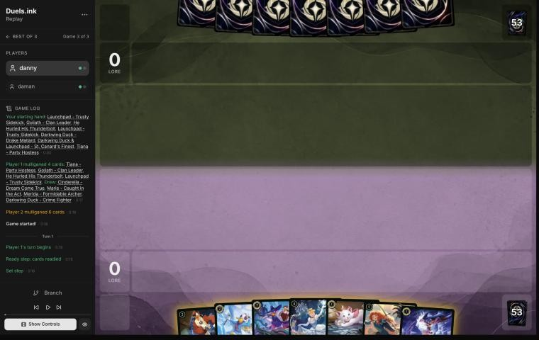
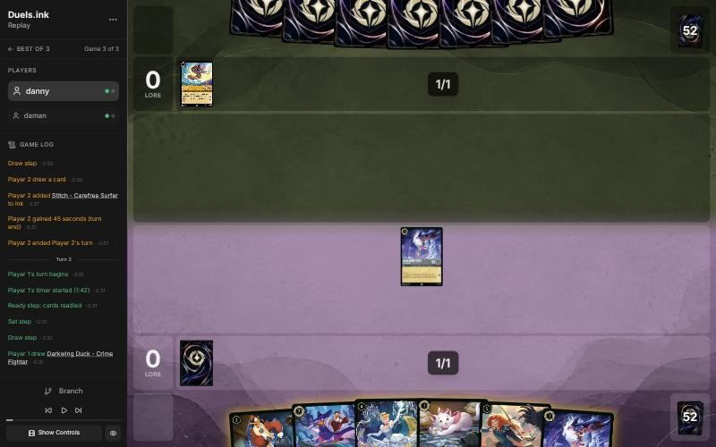
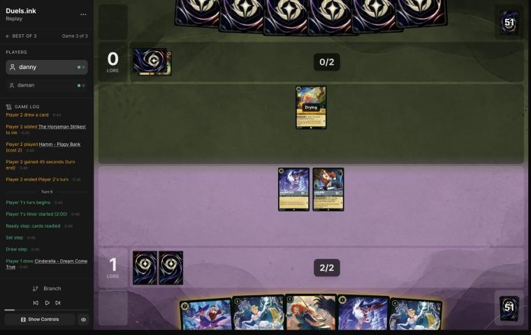
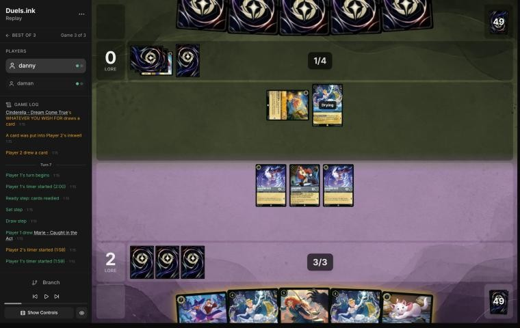
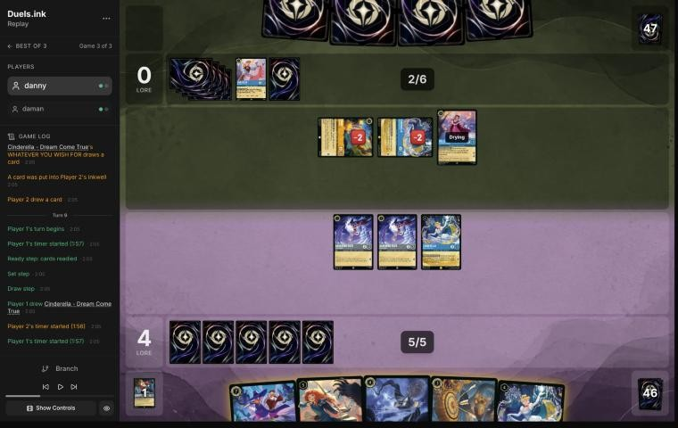
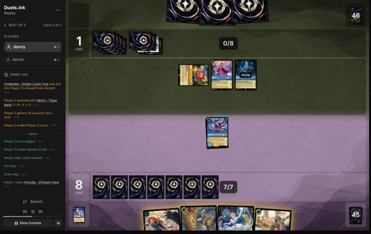
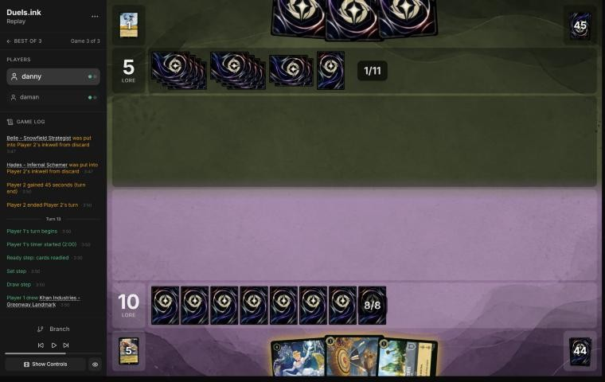
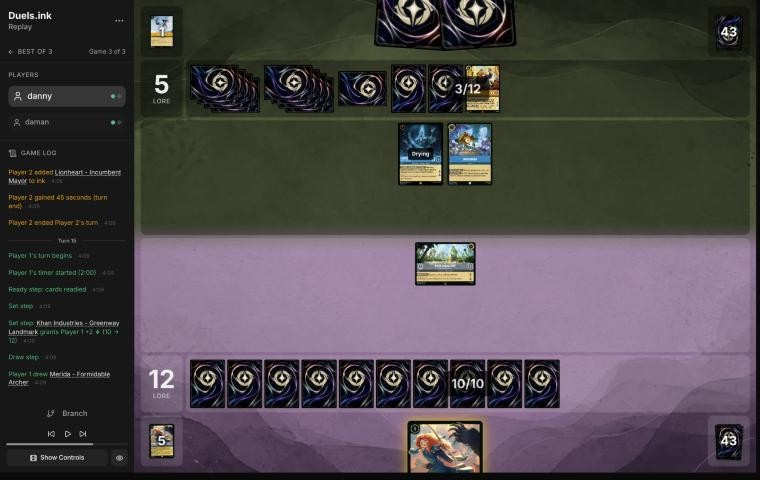
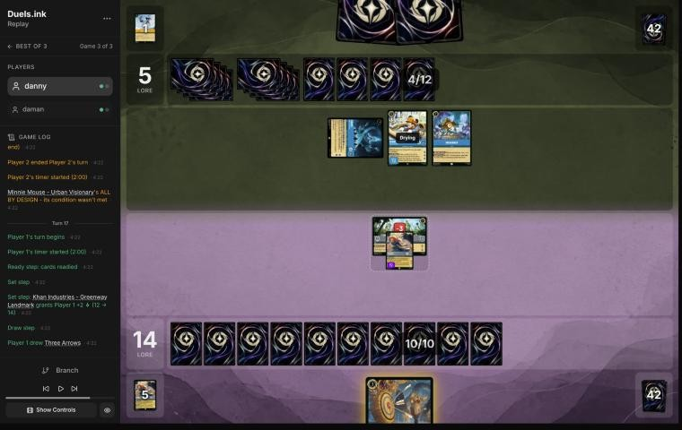
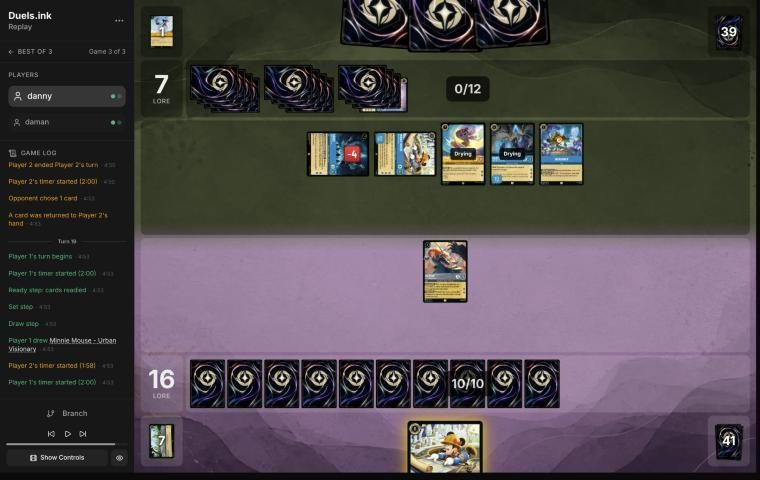

# Review: danny vs daman, 2 Nov 2026 (game 3)

| | |
|---|---|
| **Status** | draft (blind pass done, not yet discussed) |
| **Replay** | `01a19d89-9871-7ffd-82eb-faec0b5d5ca8` (`python3 tools/brief.py 01a19d89 --turn N`) · [duels.ink viewer](https://duels.ink/replay/01a19d89-9871-7ffd-82eb-faedee163e1e?step=0) |
| **Format** | Core Constructed. Set 14 era: inks revealed before the coin toss |
| **Decks** | You: Sapphire/Steel Big Ramp with the Darkwing package ([the coach's notes on it](#cite-kb-meta-archetypes-sapphire-steel-big-ramp-with-the-darkwing-package-how-to-play-it)). Them: Amber/Sapphire Control ([its average list](#cite-kb-meta-archetypes-amber-sapphire-control)), known from games 1 and 2 |
| **Play/draw** | You went first (you lost game 2, so the choice was yours) |
| **Result** | Won: daman conceded on turn 20 at 18–17, with your Minnie ready to quest for the win; you won the match 2–1 |
| **Meta data** | snapshot of 26 Oct 2026 (7 days old, fresh) |
| **Chosen how** | Sent by the user as a match zip of three games; only the replays were read. The deciding game: the coach didn't know its result before the blind pass |

## Summary
- **No inaccuracies.**
- **Good plays:** the [mulligan](#turn-0) (better than the coach's pick), [1](#turn-1), [3](#turn-3), [7](#turn-7),
  [11](#turn-11) (Three Arrows before Merida, so FULL QUIVER returned them; better than the coach's plan),
  [13](#turn-13), [15](#turn-15), [19](#turn-19) (Merida to 18, then Minnie, whom only a Storm could stop).
- **Close calls:** [5](#turn-5) (Minnie inked rather than Crime Fighter), [9](#turn-9) (Finest quested rather than
  killing their damaged engines, which kept their ink below Raging Storm), [17](#turn-17) (Three Arrows on Hades at
  once).
- **Unwinnable from:** never.

**What decided it:** you went first and kept the lead: St. Canard's Finest Shifted in on turn 9 took you to 8–0, Merida
and Finest to 10 before their Raging Storm (turn 12), and Khan Industries paid 4 more while their Hades – Infernal
Schemers took one character a time. At 18 on turn 19 your Minnie, drying and with Ward, could only be stopped by a
second Storm.

## The game, turn by turn
Verdicts judge each decision on what you could know at the time, **including archetype knowledge an experienced
player has**. Hindsight is kept to its own section. Severity scale: good play / close call /
inaccuracy / mistake / blunder. Principle IDs and hypotheses (H-n) link to copies
in the Citations section at the end, as they stood when they were cited.

**What you knew before the game:** games 1 and 2 showed daman's Amber/Sapphire Control list. You go first, so their
turn k is game turn 2k. Their key cards, and the earliest each can come (their ramp has run a turn or two ahead of
this: 12 ink by game turn 13 in game 2):
- **Removal that chooses its target** (Ward stops all of it: Drake Mallard, St. Canard's Finest and Minnie are immune):
  Hades – Infernal Schemer (7, uninkable; inks a character of yours), Gaston – Superior Archer (5; banishes 5+ {S}:
  Goliath), Let It Go (song 5), The Horseman Strikes! (Evasive only).
- **Sweepers:** Spooky Sight (6, uninkable; every character costing 3 or less goes into its owner's inkwell; game
  turn 12 at the earliest, turn 15 in game 2) and Raging Storm (8, uninkable; banishes all characters; turn 23 in game
  1, turn 13 in game 2).
- **Their engine: Cinderella – Unintentional Icon** (7, Shift 5 onto a Dream Come True; 3 lore, inks a card a turn).
  In game 2 she was Shifted on their 4th turn and challenged at once (a Shifted character needn't dry), and they ran
  three. Dream Come True, Mickey Mouse – Best in Town (an ink drop for each player), Belle – Snowfield Strategist,
  Aurora, Hamm – Piggy Bank and Inkrunner ramp or draw around her.
- **Their bodies:** Stitch – Carefree Surfer (7, 4/8/2; draws 2), Hades – Meticulous Schemer (6, 5/5/3, Ward),
  Scuttle – Birdbrained (5, 5/5/2, Ward), Lionheart – Incumbent Mayor (6, Bodyguard; +1 lore to two characters the turn
  he's played). Ohana Means Family draws a card per damage healed.

Your plan: Ward threats (Drake, Finest, Minnie) and Khan Industries, which their targeted removal can't touch; kill the
Icon whenever it's exerted, trading cheap characters if needed; keep cheap characters out of Spooky Sight's way and a
Ward rebuild back for each Storm.

### Pre-game

*The board before the decision: [step 0](https://duels.ink/replay/01a19d89-9871-7ffd-82eb-faedee163e1e?step=0) in the duels.ink replay viewer.*

**What you did:** kept Launchpad, Drake Mallard and St. Canard's Finest, sending back four (the other Launchpad,
Goliath, He Hurled His Thunderbolt and Tiana – Party Hostess).

**Verdict:** good play. The seven had three uninkable cards and three 6- and 7-drops; the core was Finest with two
bases to Shift onto. `tools/mulligan.py` (1,000 deals):

| Option | Ink on turns 1–4 | Play turns (of 4) | Lore by turn 4 | Characters by turn 4 | Interaction by turn 4 |
|---|---|---|---|---|---|
| Keep all 7 | 8.51 | 3.00 | 3.3 | 3.2 | 100% |
| Keep both Launchpads, Drake, Finest (the coach's pick) | 8.92 | 3.41 | 4.6 | 4.0 | 72% |
| Keep both Launchpads, Drake, Finest, Thunderbolt | 8.84 | 3.30 | 4.2 | 3.5 | 100% |
| **As played** (keep Launchpad, Drake, Finest) | 8.97 | 3.50 | 5.0 | 3.8 | 81% |
| Full mulligan | 8.72 | 3.53 | 5.0 | 3.1 | 91% |

Your keep matches the full mulligan's early curve while keeping Finest and two Ward-or-Shift bases for her on turn 5
(Drake and Launchpad), and it beats the coach's pick on everything but one character. The second Launchpad is a third
uninkable card in a 7-card hand ([MULL-1](#cite-mull-1), [MULL-2](#cite-mull-2)).

### Turn 1: your turn 1

*The board before the decision: [step 2](https://duels.ink/replay/01a19d89-9871-7ffd-82eb-faedee163e1e?step=2) in the duels.ink replay viewer.*

**What you did:** the mulligan brought Dream Come True, Marie, Merida and Crime Fighter. You inked Drake Mallard and
played Crime Fighter.

**Verdict:** good play. Three of the seven are uninkable (Launchpad, Dream Come True, Merida), so the ink had to come
from Drake, Finest, Marie or Crime Fighter.
- **Crime Fighter first** is right: he's a Darkwing, so Launchpad draws without discarding and Finest can Shift onto
  him.
- **Drake or Marie as the ink** is about equal. Drake is a Ward body and a third base for Finest; Marie makes an ink
  drop when she quests after Merida or a challenge has done damage. Both are Spooky Sight's targets later.

### Turn 2: their turn

**What happened:** they inked Stitch – Carefree Surfer and passed.

### Turn 3: your turn 2

*The board before the decision: [step 7](https://duels.ink/replay/01a19d89-9871-7ffd-82eb-faedee163e1e?step=7) in the duels.ink replay viewer.*

**What you did:** drew a second Crime Fighter; inked Marie, played Launchpad and quested Crime Fighter (+1, 1–0).

**Verdict:** good play, the coach's line. With a Darkwing in play, Launchpad draws a card a turn without discarding,
and their empty board makes the quest free. Two 1-drops instead (Marie and Crime Fighter) would quest for more but
draw nothing.

### Turn 4: their turn

**What happened:** they inked The Horseman Strikes! and played Hamm – Piggy Bank (2/3/1; exert to cut 1 off their next
character).

### Turn 5: your turn 3

*The board before the decision: [step 14](https://duels.ink/replay/01a19d89-9871-7ffd-82eb-faedee163e1e?step=14) in the duels.ink replay viewer.*

**What you did:** drew a second Dream Come True. Launchpad drew Minnie; you played the second Crime Fighter, inked
Minnie and quested the first Crime Fighter (+1, 2–0).

**Verdict:**
- **Launchpad's draw before the ink:** good play ([SEQ-1](#cite-seq-1)). Your only inkable cards were St. Canard's Finest and Crime
  Fighter beside two Dream Come Trues and Merida, so the draw decided what could be inked.
- **Inking Minnie rather than the second Crime Fighter: close call.** Yours puts another 1-lore body down now and
  keeps both cards a Ward rebuild needs short of Minnie, but Minnie was game 1's finisher against this deck: 3 lore and
  Ward, and two Dream Come Trues ramp you toward 8 ink. Keeping her and inking Crime Fighter gives up a lore a turn
  now. Your deck has two more Minnies and three more Finests, so either is reasonable ([INK-2](#cite-ink-2)).

### Turn 6: their turn

**What happened:** they inked a second Stitch, used Hamm's LOOSE CHANGE (Hamm is exerted) to play Cinderella – Dream
Come True for 3, and her trigger inked a card and drew one.

### Turn 7: your turn 4

*The board before the decision: [step 24](https://duels.ink/replay/01a19d89-9871-7ffd-82eb-faedee163e1e?step=24) in the duels.ink replay viewer.*

**What you did:** drew Marie. Launchpad drew Windstorm; you inked Marie, played Dream Come True and quested both
Crime Fighters (+2, 4–0). Her trigger inked the second Dream Come True and drew Three Arrows.

**The setup:** their Dream Come True dries next turn, and with 5 ink (4 after Hamm's LOOSE CHANGE) an Unintentional
Icon Shifted onto her challenges at once for 4, enough to kill any of your characters left exerted. Hamm is exerted
now: Launchpad and a Crime Fighter could kill him, losing the Crime Fighter.

**Verdict:** good play, the coach's line. Dream Come True turns an uninkable card into ink and a card every turn you
play a Princess, and next turn's 6 ink pays for St. Canard's Finest's Shift. The Crime Fighters' quests expose them to
the Icon and Hamm, but they're 1-drops, and keeping one Darkwing or Launchpad alive is all Finest needs. Trading a
Crime Fighter and Launchpad's draw for Hamm was the alternative; his discount matters less than the card.

### Turn 8: their turn

**What happened:** Hamm and Dream Come True challenged Launchpad together (2 + 2 into his 3 willpower, banished; each
took 2 and has 1 willpower left); they inked Cinderella – Homespun Dressmaker and played Belle – Snowfield Strategist
(WINTER STOCKPILE: each of their banished characters goes into their inkwell). Dream Come True inked a card.

### Turn 9: your turn 5

*The board before the decision: [step 37](https://duels.ink/replay/01a19d89-9871-7ffd-82eb-faedee163e1e?step=37) in the duels.ink replay viewer.*

**What you did:** drew a third Dream Come True; Shifted St. Canard's Finest onto a Crime Fighter, inked Windstorm and
quested Finest, the other Crime Fighter and Dream Come True (+4, 8–0).

**The setup:**
- **Their Hamm and Dream Come True are exerted on 1 willpower each.** Dream Come True is their Icon's Shift base
  and ramp; Hamm cuts 1 off each character they play.
- **Belle's WINTER STOCKPILE** puts each of their banished characters into their inkwell. They have 6 ink and 7 next
  turn, one short of Raging Storm (35% to hold one after their draw), so every kill now brings Storm a turn closer.
- **Finest Shifted onto a dry Crime Fighter can act at once** ([CR 8.10.4](#cite-cr-8-10-4)): challenging their Dream Come True gains 2
  lore (VICTORY POSE), the same as a quest, and your Dream Come True (2 {S}, 3 willpower) can kill Hamm and survive.

**Verdict: close call.**
- **The coach's line:** Finest kills their Dream Come True (+2), your Dream Come True kills Hamm, the Crime Fighter
  quests: 3 lore, both damaged engines and the Icon's base gone, Belle alone on their board. But two kills give them
  9 ink next turn, and Storm comes online.
- **Your line:** a lore more, and their ink stays at 7, so no Storm next turn. Their Hamm, Dream Come True and Belle
  ready (4 lore a turn), and an Icon Shifted onto Dream Come True can challenge your exerted Crime Fighter or Dream
  Come True at once. Three Arrows (2 and 1) still kills both damaged ones next turn.
- Yours trades tempo for a turn's safety from Storm; neither is clearly better ([TEMPO-1](#cite-tempo-1), [POS-1](#cite-pos-1)).

### Turn 10: their turn

**What happened:** Hades – Infernal Schemer put your Dream Come True into your inkwell; their Dream Come True traded
with your Crime Fighter (WINTER STOCKPILE inked her), and Hamm quested (+1, 8–1).

### Turn 11: your turn 6

*The board before the decision: [step 57](https://duels.ink/replay/01a19d89-9871-7ffd-82eb-faedee163e1e?step=57) in the duels.ink replay viewer.*

**What you did:** drew Priscilla and inked her. Three Arrows put 2 on Belle (1 willpower left) and finished Hamm
(WINTER STOCKPILE inked him); then Merida's FULL QUIVER returned the Arrows to your hand; Finest quested (+2, 10–1).

**The setup:** their board quests for 5 a turn (Belle 2, Hades 2, Hamm 1), Belle ramps them off every kill, and they
reach 9 ink next turn, Raging Storm's cost (30% to hold one after their draw). Hades and Belle together (3 + 2) can't
kill an exerted Finest (7 willpower).

**Verdict:** good play, better than the coach's plan.
- **The coach's plan:** Merida first, so STEADY AIM made the Arrows 4 and 3: Belle dead, 3 on Hades, then Finest
  kills Hamm for VICTORY POSE's 2. That clears two characters now, but the Arrows end in the discard.
- **Yours:** the Arrows' 2 and 1 still killed Hamm and left Belle on 1, and casting them before Merida let FULL QUIVER
  return them: next turn they're 4 and 3 again. The same lore (Finest quested for 2), one card more, and Merida
  and the Arrows are still a sweep after a Storm ([CARD-1](#cite-card-1), [SEQ-2](#cite-seq-2)).
- **The cost:** Belle quests for 2 more and inks one more of their banished characters before she dies.

### Turn 12: their turn

**What happened:** Belle and Hades quested (+4, 10–5), then Raging Storm banished every character; WINTER STOCKPILE
inked Belle and Hades.

### Turn 13: your turn 7

*The board before the decision: [step 73](https://duels.ink/replay/01a19d89-9871-7ffd-82eb-faedee163e1e?step=73) in the duels.ink replay viewer.*

**What you did:** drew Khan Industries; played Dream Come True, inked Three Arrows and played Khan (9 ink). Dream Come
True's trigger had no card to ink.

**Verdict:** good play, the coach's line. Both boards are empty at 10–5, and Khan's 2 a turn is lore their Storms
can't reach. Without Merida, Three Arrows (2 and 1) kills little of what they play next, so it was the right ink to
get both down.

### Turn 14: their turn

**What happened:** a second Hades – Infernal Schemer put your Dream Come True into your inkwell; they played Inkrunner
(drew a card) and inked Lionheart.

### Turn 15: your turn 8

*The board before the decision: [step 83](https://duels.ink/replay/01a19d89-9871-7ffd-82eb-faedee163e1e?step=83) in the duels.ink replay viewer.*

**What you did:** Khan gave 2 (12–5); drew Merida, played her and moved her to Khan Industries.

**Verdict:** good play, the only line. Khan alone wins on turn 23; with Merida questing from turn 17 it's turn 19.
At Khan she can't be challenged, so only Hades – Infernal Schemer, Let It Go or Raging Storm (about one in five after
their draw) remove her, and Khan keeps paying whatever happens to her.

### Turn 16: their turn

**What happened:** they played their own Minnie Mouse – Urban Visionary (6/6/3, Ward), and Hades challenged Khan
Industries (3 damage, 5 willpower left).

### Turn 17: your turn 9

*The board before the decision: [step 90](https://duels.ink/replay/01a19d89-9871-7ffd-82eb-faedee163e1e?step=90) in the duels.ink replay viewer.*

**What you did:** Khan gave 2 (14–5); drew Three Arrows and put 4 on Hades (2 plus STEADY AIM's 2; the second arrow
had no legal target, as Minnie has Ward), then Merida quested (+2, 16–5).

**The setup:** Khan and Merida win on turn 19 if Khan survives. It won't if they want it gone: Minnie (6 {S}, dry next
turn) destroys it alone (5 willpower left), and then Merida wins on turn 21 by herself. Their outs against Merida are
Hades – Infernal Schemer, Let It Go (Minnie can sing it for free) and Raging Storm.

**Verdict:** good play on the quest; the Arrows were a close call.
- **Questing Merida** is right: 2 lore toward 20 beats Merida finishing the damaged Hades (2 lore a turn for them, far
  from 20).
- **The Arrows now** use STEADY AIM while Merida is certainly alive, but they leave Hades on 2 willpower: a target for
  Ohana Means Family, which drew them 4 off Stitch's damage in game 2. Holding them for next turn's play, with Merida's
  4 and 3 if she survives, was the alternative.

### Turn 18: their turn

**What happened:** Minnie destroyed Khan Industries; Stitch drew 2; they inked an Unintentional Icon, played Hades –
Meticulous Schemer (5/5/3, Ward) and quested Hades – Infernal Schemer (+2, 16–7). Minnie's ALL BY DESIGN returned a
card from their inkwell to their hand.

### Turn 19: your turn 10

*The board before the decision: [step 104](https://duels.ink/replay/01a19d89-9871-7ffd-82eb-faedee163e1e?step=104) in the duels.ink replay viewer.*

**What you did:** drew Minnie; Merida quested (+2, 18–7) and you played Minnie.

**The setup:**
- **Their race:** Hades – Infernal Schemer, Minnie, Stitch and Hades – Meticulous Schemer quest for 10 next turn,
  to 17; Lionheart's +2 (if the card Minnie returned is him) makes 19. They can't reach 20 before your turn 21.
- **Your race:** you need 4. Minnie played now is drying through their turn, so she can't be challenged, and Ward
  stops Hades – Infernal Schemer, Let It Go and Gaston. Only Raging Storm (about a quarter after their draw) stops her
  questing for 3 on turn 21.
- **Merida:** if she quests she's exerted, and Minnie, Hades – Meticulous Schemer or Stitch kills her. Challenging
  the damaged Hades – Infernal Schemer (2 left) slows them by 2 a turn but leaves you on 16, where Minnie's 3 isn't
  enough.

**Verdict:** good play, the coach's line. Merida's 2 now puts you on 18, so Minnie alone wins on turn 21 whatever
happens to Merida, and only a Storm stops it.

### Turn 20: their turn

**What happened:** a third Hades – Infernal Schemer put Merida into your inkwell; they quested all four characters
(+10, 18–17) and conceded, with your Minnie ready to quest for the win.

## Lessons
1. **Three Arrows before Merida when their 2 and 1 already do the job:** FULL QUIVER returns them, and next time
   they're 4 and 3 ([11](#turn-11)). Merida first is right when STEADY AIM's extra damage is what kills.
2. **Belle's WINTER STOCKPILE turns your kills into their ink.** When Raging Storm is an ink or two away, count each
   kill as an ink for them ([9](#turn-9)).
3. **A character played on your turn can't be challenged on theirs, and Ward stops their targeted removal.** At 18,
   your Minnie left them only Raging Storm ([19](#turn-19)).
4. **Draw before you ink:** Launchpad's draw decided what could be inked ([5](#turn-5)).

## Proposed knowledge-base updates (applied after discussion)
- **Sapphire/Steel notes (Big Ramp with the Darkwing package), coaching points:** "Merida before any damage action"
  gets an exception: cast Three Arrows first when its 2 and 1 already kill what matters, so FULL QUIVER returns it
  (daman game 3, [turn 11](#turn-11)).
- **Meta, the Amber/Sapphire notes (Control), daman's game 3:**
  - Hamm's LOOSE CHANGE put Dream Come True down for 3 on turn 6, and Hamm with Dream Come True ganged up on Launchpad
    on turn 8.
  - Belle – Snowfield Strategist (turn 8) inked each banished character; Raging Storm came on turn 12, the first turn
    they had 8 ink.
  - Three Hades – Infernal Schemers (turns 10, 14, 20) and four Stitches; their own Minnie destroyed Khan Industries
    on turn 18; Hades – Meticulous Schemer.
- **Across the match (for both pair files):** Ward threats and Khan Industries won games 1 and 3; game 2's loss came
  from an early Unintentional Icon left alive.

## Hindsight
Doesn't change the verdicts above.
- They played Raging Storm on turn 12, the first turn your turn-9 line gave them 8 ink. Whether they held it on turn
  10 isn't in the replay.
- Their third Hades – Infernal Schemer came on turn 20; Ward left it only Merida.

## The coach's errors
Filled in during discussion.

| When | Error | How it was caught | How it won't happen again |
|---|---|---|---|
| [11](#turn-11) | The plan cast Merida before Three Arrows for STEADY AIM, missing that Arrows first lets FULL QUIVER return them. Your line beat it | Your turn 11 | Proposed: when Merida and Three Arrows are both in hand, the brief prints both orders (STEADY AIM's damage now, or the Arrows returned) |
| [Pre-game](#turn-0) | `tools/mulligan.py` silently dropped two of the coach's candidates: `--keep` options of the same size overwrite each other (also in game 2) | Rerunning them separately | Proposed: key the options by their cards, not their size |
| — | Your mulligan also beat the coach's pick on the sim | — | — |

## Open questions
- [Turn 5](#turn-5): why ink Minnie rather than the second Crime Fighter?
- [Turn 9](#turn-9): was questing Finest rather than killing their damaged Hamm and Dream Come True about keeping
  their ink below Raging Storm?
- [Turn 17](#turn-17): why Three Arrows on Hades at once rather than holding them?

## Citations
Copies of the coach's knowledge base cited above, as they stood when they were cited (the private repository's commit and date are given with each). They don't change when the knowledge base does.

<!-- Filled in by `python3 tools/cite.py <this file>`: every principle ID, H-n, "principle N" and CR rule above
becomes a link to an entry here. Add a file or one of its sections with `--file PATH --section TEXT`, and link to
the anchor it prints. Never link into the private repository. -->

**sapphire-steel.md, Big Ramp with the Darkwing package: how to play it**: knowledge base, `kb/meta/archetypes/sapphire-steel.md` at `150d92a` (2026-11-02), working tree

> ### Big Ramp with the Darkwing package: how to play it `[coach, study of stonks 📈's 22 games of 21 Oct 2026 (sent by the user), full games, not blind]`
> The user calls this list Sapphire/Steel Detectives, or Big Ramp. It matches duels.ink's "Big Ramp #1" (Windstorm,
> Minnie) with the Darkwing Detectives added. Games: `01a15f98` to `01a1602c` (22; see `kb/meta/index.md`). Card text
> verified with `tools/cards.py`. Also `01a15f8e` (vs MFork, game 2) and `01a16978` (vs AkatsukiCap, game 1).
> - **The list (60):**
>   - **1-drops:** Darkwing Duck – Crime Fighter ×4, Marie – Caught in the Act ×4
>   - **2-drops:** Darkwing Duck – Drake Mallard ×4 (Ward), Launchpad – Trusty Sidekick ×4, The Terror That Flaps in
>     the Night ×4
>   - **3–4:** Three Arrows ×4, Priscilla – Efficient Clerk ×3, Cinderella – Dream Come True ×4, He Hurled His
>     Thunderbolt ×2, Windstorm ×3
>   - **5–6:** Merida – Formidable Archer ×4, Khan Industries – Greenway Landmark ×4, Goliath – Clan Leader ×3
>   - **7–8:** Darkwing Duck & Launchpad – St. Canard's Finest ×4, Cinderella – Unintentional Icon ×2, Tiana – Party
>     Hostess ×4, Minnie Mouse – Urban Visionary ×3
> - **The plan:**
>   1. **Early removal** keeps their board small: Terror (3 damage while a Darkwing is in play), Three Arrows (2, then 1).
>      A Darkwing in play also makes Launchpad's draw free of the discard.
>   2. **Ramp:** Priscilla (enters exerted; each quest puts one of the top 2 into hand and the other into the inkwell,
>      2 lore), Cinderella – Dream Come True (at the end of a turn you played a Princess, ink a card from hand to draw),
>      Cinderella – Unintentional Icon (Shift 5 onto her; ramps one a turn, 3 lore), Marie (an ink drop when she quests
>      after an opposing character took damage). Ink at the start of its 5th turn was usually 5–6, and 8–9 by its 6th in the fastest games.
>   3. **The sweep: Merida, then Windstorm.** STEADY AIM adds 2 damage to every instance of action damage to an
>      opposing character, so Windstorm deals 3 to each (5 to an Evasive one): a 4- to 6-character wipe (01a1601c
>      turn 11: six Princess Aggro characters). Merida's FULL QUIVER also returns Three Arrows (then 4 and 3).
>   4. **Lore:** Khan Industries (2 a turn at their Set step; characters there can't be challenged, so Merida and
>      Priscilla move in), Merida 2, Priscilla 2, Cinderella – Unintentional Icon 3, Minnie 3, St. Canard's Finest 2
>      plus VICTORY POSE (+2 per banish in a challenge on its turn).
>   5. **Tiana – Party Hostess** (7): draw 2 and discard one; a discarded Khan Industries is played free (01a15fee,
>      01a15ff6, 01a1602c). **Minnie** (8, Ward) returns a card from the inkwell to hand when she ends a turn exerted.
>      **Goliath – Clan Leader** puts both hands to 2 at the end of each turn: strictly for pressing an advantage when
>      ahead, or for keeping a control deck's hand small; otherwise rarely played (user, 2026-11-02).
> - **Results by matchup** (13–9): Emerald/Steel Midrange 8–4, all four game 1s lost and every game 2 and 3 won;
>   Amber/Emerald Circle of Life 2–4; Princess Aggro 2–1; Amethyst/Steel Midrange 1–0.
> - **What won:** the Merida and Windstorm sweep, Finest's VICTORY POSE, Khan Industries with protected questers. Early
>   Priscilla matters: in the Emerald/Steel wins she was down by its 4th turn in five of eight, and in the four losses never
>   (a correlation from few games).
> - **It can race from behind once the questers are gone:** in 01a16978, at 5–17 against Emerald/Steel, Three Arrows
>   with STEADY AIM killed Vixey and The Queen, a second Merida returned the Arrows, and wide quests (two Meridas at 2
>   each, Darkwings, Cinderella) won 20–19.
> - **What beat it:**
>   - **Resist:** Flash – Efficient Clerk (2, 3/2/2, Resist 1) takes nothing from Windstorm's 1 and less from every
>     ping; it quested for 8 to 10 in two lost game 1s.
>   - **Ward plus recursion:** Circle of Life replayed Milo Thatch – Getting His Hands Dirty (7, Ward, bounces a
>     character on play), which bounced Merida; conceded at 3–0 (01a15f9d turn 14). Only Windstorm reaches a Ward
>     character.
>   - **Fast wide quests:** Princess Aggro's +5 and +6 turns came before the sweep (01a16020, lost 14–21); a song-and-
>     Evasive Amber/Emerald list quested +7 and +8 (01a15fdb).
> - **Coaching points:**
>   - Merida before any damage action; with their board at 2–3 willpower, hold Windstorm for her.
>   - Keep a Darkwing in play for Terror's 3 and Launchpad's free draw. Quest Marie after removal for the ink drop.
>   - Move questers to Khan Industries; plan Tiana for the turn a Khan is in hand. Whether to ink a Khan is too
>     situational for a rule (user, 2026-11-02): judge it from the hand.
>   - Name the answer to Resist and Ward early (Thunderbolt's 4, challenges, Finest): the pings don't do it.
>   - **Mulligan from the hand you have, not to a fixed plan** (user, 2026-11-02). The play pattern varies widely with
>     the opening seven, and no one line suits a given matchup: see what the hand already does, keep what bridges
>     turn 1 to the late game, and send back the rest, avoiding a full mulligan where possible. The deep mulligans
>     (3 to 7 cards) in these games came partly from the player's first games on the deck, so they aren't a guide.
>   - **Judge the plan from the hand, then the matchup:** a coached line should say how this hand gets from its early
>     turns to Merida, the sweep and the 3-lore finishers, rather than follow a stock sequence.

**amber-sapphire.md, Control**: knowledge base, `kb/meta/archetypes/amber-sapphire.md` at `150d92a` (2026-11-02), working tree

> ### Control
> 51% of the pair's games (51,350).
>
> | # | Card | Type | Cost | Tag |
> |---|---|---|---|---|
> | 4 | Aurora - Holding Court | character | 1 |  |
> | 4 | Mickey Mouse - Best in Town | character | 1 |  |
> | 4 | Hamm - Piggy Bank | character | 2 |  |
> | 4 | Belle - Snowfield Strategist | character | 4 |  |
> | 4 | Cinderella - Dream Come True | character | 4 |  |
> | 3 | Gaston - Superior Archer | character | 5 | removal |
> | 3 | Moana - Curious Explorer | character | 5 |  |
> | 4 | Cinderella - Unintentional Icon | character | 7 |  |
> | 4 | Hades - Infernal Schemer | character | 7 | removal |
> | 4 | Stitch - Carefree Surfer | character | 7 |  |
> | 3 | Minnie Mouse - Urban Visionary | character | 8 |  |
> | 4 | Besties, Assemble! | action | 1 |  |
> | 4 | Develop Your Brain | action | 1 |  |
> | 1 | Ohana Means Family | action | 3 |  |
> | 3 | The Horseman Strikes! | action | 3 | removal |
> | 1 | Spooky Sight | action | 6 |  |
> | 4 | Raging Storm | action | 8 | sweeper |
> | 1 | Let It Go | song | 5 | removal |
> | 1 | The Black Cauldron | item | 3 |  |

**MULL-1**: strategy principle, `kb/strategy/principles.md` at `150d92a` (2026-11-02), working tree

> - **MULL-1. Keep a plan, not the strongest cards.** *Ask: "Which hand gives me the best chance to execute my game plan in this matchup?"* `[MCL ch.12]` · baseline

**MULL-2**: strategy principle, `kb/strategy/principles.md` at `150d92a` (2026-11-02), working tree

> - **MULL-2. A smooth curve beats a few powerful cards.** Check that you can spend ink well on turns 1–4, have enough inkable cards, and know what turn 4 looks like. `[MCL ch.12]` · baseline
>   - **Ink spent isn't the goal by itself.** Judge a keep by a nice curve (a play each turn), early lore pressure, and
>     interaction that sets the opponent back, as well as by ink, then weigh card quality and the matchup
>     (user, 2026-11-01). `tools/mulligan.py` reports all of these.

**SEQ-1**: strategy principle, `kb/strategy/principles.md` at `150d92a` (2026-11-02), working tree

> - **SEQ-1. Gather information before irreversible decisions.** Draw, look and scry before choosing what to ink. Quest with draw triggers before committing other plays when the order doesn't otherwise matter. `[MCL ch.5]` · baseline

**INK-2**: strategy principle, `kb/strategy/principles.md` at `150d92a` (2026-11-02), working tree

> - **INK-2. Don't automatically ink the most expensive card.** It may be the late-game win condition or the key answer for this matchup. The answer depends on matchup, hand and board. `[MCL ch.4]` · baseline

**TEMPO-1**: strategy principle, `kb/strategy/principles.md` at `150d92a` (2026-11-02), working tree

> - **TEMPO-1. Tempo is how much freedom you leave the opponent, not how fast you play.** A play that forces the opponent to spend their turn answering it has stolen part of their turn. *Ask: "If I play this, what does my opponent have to do next?"* `[MCL ch.1]` · baseline

**POS-1**: strategy principle, `kb/strategy/principles.md` at `150d92a` (2026-11-02), working tree

> - **POS-1. From ahead, take the safest path to victory.** Don't overextend into sweepers, don't make unnecessary trades, and make the opponent take the risks. Winning by 1 lore counts the same as winning by 10. `[MCL ch.10]` · baseline

**CARD-1**: strategy principle, `kb/strategy/principles.md` at `150d92a` (2026-11-02), working tree

> - **CARD-1. Card advantage is having more meaningful options than the opponent.** Ways to get it:
>   - 2-for-1 trades, and removal that hits two targets
>   - characters that survive several challenges
>   - recursion
>   - cards that replace themselves
>   - discard
>
>   *Ask after each exchange: "Who has more useful resources left?"* `[MCL ch.2]` · baseline

**SEQ-2**: strategy principle, `kb/strategy/principles.md` at `150d92a` (2026-11-02), working tree

> - **SEQ-2. Plan the whole turn before the first action.**
>   - Who quests? Who challenges?
>   - What if a challenge fails?
>   - What gets inked? What ink is left?
>   - What does this leave the opponent?
>
>   `[MCL ch.5]` · baseline

**CR 8.10.4**: Comprehensive Rules, `kb/rules/cr/08-keywords.md` at `150d92a` (2026-11-02), working tree

> **8.10.4.** If a shifted character is put on top of a dry character, the shifted character enters play dry. If a shifted character is put on top of a drying character, the shifted character enters play drying.
