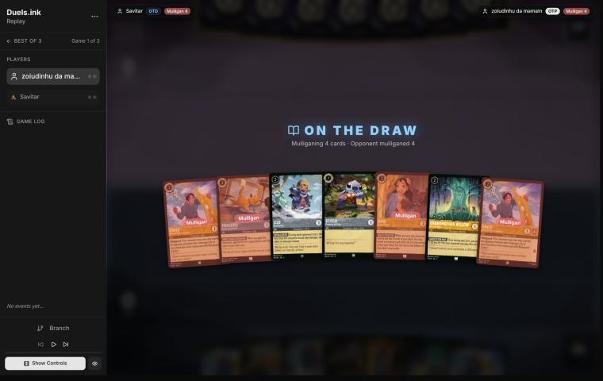
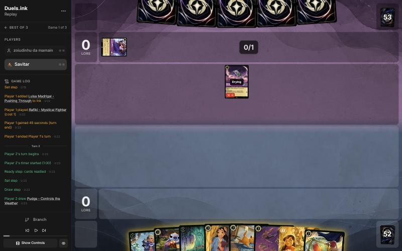
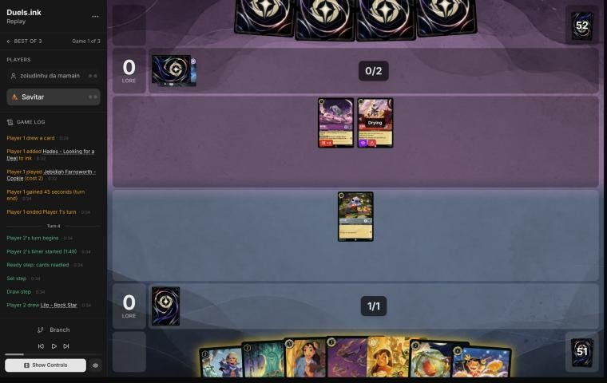
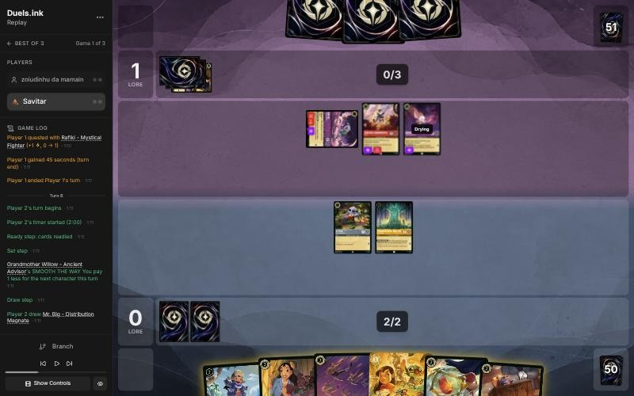
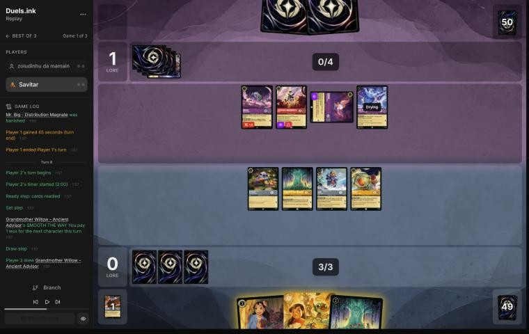
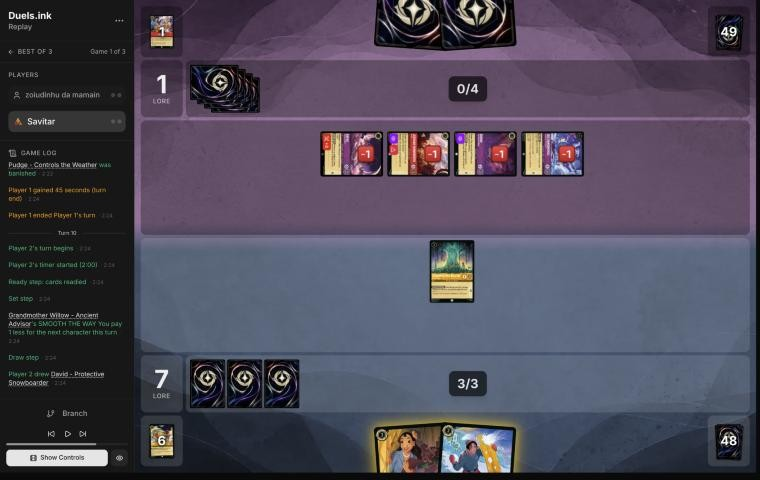

# Review: Savitar vs zoiudinhu da mamain, game 1, 2 Nov 2026

| | |
|---|---|
| **Status** | draft (blind pass done; not discussed, by request) |
| **Replay** | `01a19d97-25e5` (`python3 tools/brief.py 01a19d97-25e5 --turn N`) · [duels.ink viewer](https://duels.ink/replay/01a19d97-25f2-761b-a79d-1312174ed649?step=0) |
| **Format** | Core Constructed (stated in the replay), best-of-three. Set 14 era: inks revealed before the coin toss |
| **Decks** | You: Amber/Steel Rockstar Aggro, the Lilo list. Them: Amethyst/Ruby; archetype as it became clear: see the turns |
| **Play/draw** | zoiudinhu da mamain went first; you were on the draw |
| **Result** | Loss: you conceded on their 6th turn (game turn 11), 7–3 |
| **Meta data** | snapshot of 26 Oct 2026 (fresh until 9 Nov) |
| **Chosen how** | One of the 5 of Savitar's 12 matches the coach reviewed after studying the other 7 (see the TeamAnglerfish game 1 review). The coach knew the match went to a game 3, so games 1 and 2 were split, but not which way |

## Summary
- **Good plays:** the [mulligan](#turn-0), [2](#turn-2), [6](#turn-6) (three bodies, nothing exposed, ICE OUT on
  Jebidiah).
- **Close calls:** [8](#turn-8) (questing everything into four challengers) and the [concession](#turn-11).
- **Inaccuracies / mistakes / blunders:** two inaccuracies: [4](#turn-4) (Willow rather than Bundled Up and a free
  Pudge) and [10](#turn-10) (Rafiki left alive when Willow could kill him for free).
- **Unwinnable from:** close to it after [9](#turn-9), when Red Alert and three challenges took four characters.

**What decided it:** their exert-and-challenge turn on [9](#turn-9): Red Alert on Lilo & Stitch, then Jebidiah,
Rafiki, Dumbo and Isis killed every other quester. Two Isises kept it going.

## The game, turn by turn
Verdicts judge each decision on what you could know at the time, **including archetype knowledge an experienced
player has**. Hindsight is kept to its own section. Severity scale: good play / close call /
inaccuracy / mistake / blunder. Principle IDs and hypotheses (H-n) link to copies
in the Citations section at the end, as they stood when they were cited.

**What you knew before the game:** only their inks, Amethyst/Ruby. Half of duels.ink's Amethyst/Ruby games are lists
it doesn't group; the largest listed one runs Demona – Imperious Spellcaster ([the coach's notes on the
pair](#cite-kb-meta-archetypes-amethyst-ruby-from-reviewed-games-and-discussion)). The key cards across those lists, with the earliest turn each can come:
- **Demona – Scourge of the Wyvern Clan** (6, 5/6/2): exerts all your characters on play, then refills hands to 3.
  From their 6th turn, earlier with ramp; every character you have can then be challenged.
- **Isis Vanderchill** (4) and **Peter Pan's Shadow** (3, Evasive): each exerts one of yours on play, so a ready
  character isn't safe from their challengers.
- **Mulan – Martial Arts Master** (4; +2 {S} on play, and her quest gives Rush), **Jebidiah Farnsworth – Cookie** (2,
  Evasive, Reckless), **Pepita** and **Luisa** (Challenger): the challengers.
- **Hades – Looking for a Deal** (5): one of yours to the bottom of your deck, or they draw 2.
- **Red Alert** (4, banish a character with 3 {S} or less), in some lists.
- In VH INK's list (another player, the same pair): Wasabi – Called into Battle (every challenge on their turn also
  deals 4 to another character) and Goliath.

### Pre-game

*The board before the decision: [step 0](https://duels.ink/replay/01a19d97-25f2-761b-a79d-1312174ed649?step=0) in the duels.ink replay viewer.*

**What you did:** on the draw, kept Lilo – Bundled Up, Stitch and Willow, and sent back both Davids, Toulouse and
Nani.

**Verdict:** **good play**, the coach's pick. `tools/mulligan.py` (800 deals each, candidates run before your
mulligan was shown):

| Option | Ink on turns 1–4 | Play turns (of 4) | Lore by turn 4 | Characters by turn 4 | Interaction by turn 4 |
|---|---|---|---|---|---|
| Keep all 7 | 9.61 | 4.00 | 7.5 | 5.5 | 15% |
| Send back both Davids | 9.61 | 4.00 | 8.2 | 5.6 | 30% |
| Send back one David | 9.70 | 4.00 | 8.1 | 5.6 | 23% |
| **Keep Bundled Up, Stitch, Willow** (as played) | 9.48 | 3.99 | 9.4 | 5.7 | 37% |
| Full mulligan | 9.65 | 3.88 | 8.7 | 5.5 | 52% |

- **Bundled Up is a Lilo,** so a drawn Pudge comes free, and Lilo & Stitch can Shift onto her or Stitch.
- **Davids and Toulouse matter less here:** their exert effects get round Bodyguard's timing, and Amethyst/Ruby lists
  run few actions for Toulouse to stop.

### Turn 1: their turn

**What happened:** Luisa Madrigal – Pushing Through (Challenger 2) inked; Rafiki – Mystical Fighter (1, 0/2/1,
Challenger 3) played. The closest listed archetype is now Unnamed #1 (77%).

### Turn 2: your turn 1

*The board before the decision: [step 6](https://duels.ink/replay/01a19d97-25f2-761b-a79d-1312174ed649?step=6) in the duels.ink replay viewer.*

**What you did:** drew Pudge; inked Toulouse; played Stitch.

**Verdict:** **good play**, the coach's line. Stitch now is a Shift base for Lilo & Stitch on your 3rd turn, and
Bundled Up with a free Pudge is next turn's play. Toulouse is the least useful card against a deck of challengers
and exert effects with few actions.

### Turn 3: their turn

**What happened:** Hades – Looking for a Deal inked; Jebidiah Farnsworth – Cookie (3/3/0, Evasive, Reckless)
played. Unnamed #1 is now 95%.

### Turn 4: your turn 2

*The board before the decision: [step 12](https://duels.ink/replay/01a19d97-25f2-761b-a79d-1312174ed649?step=12) in the duels.ink replay viewer.*

**What you did:** drew Lilo – Rock Star; inked her; played Willow; kept Stitch home.

**Verdict:** an **inaccuracy**. Playing **Willow** is suboptimal because it's one body for your 2 ink, and **Bundled
Up with a free Pudge** (inking Nani) is better because:
- **Two bodies for the same ink,** 3 lore a turn against 1, and Willow stays in hand for a later turn.
- **Neither can be challenged next turn:** both are drying, and Stitch stays ready for Lilo & Stitch to Shift onto.
  Jebidiah is Reckless and has nothing exerted to hit.
- **Rock Star is better kept:** Shifted onto Bundled Up for 4, she replays a 2-drop every quest. Nani is the spare.
- Confidence: medium.

### Turn 5: their turn

**What happened:** Goliath – Transformed Warrior (5/5) inked; Dumbo – The Flying Elephant (Evasive; gave Rafiki
Evasive); Rafiki quested (1–0).

### Turn 6: your turn 3

*The board before the decision: [step 20](https://duels.ink/replay/01a19d97-25f2-761b-a79d-1312174ed649?step=20) in the duels.ink replay viewer.*

**What you did:** drew Mr. Big; played him for 1 (Willow), inked Strength, played Bundled Up and Pudge (free); no
quests; ICE OUT on Jebidiah.

**Verdict:** **good play**, the coach's line.
- **Three bodies for 3 ink, none exposed:** the new ones are drying, and Stitch and Willow stayed home, so Rafiki
  (Challenger 3) and Dumbo have nothing to challenge. Jebidiah, who must challenge, is frozen.
- **The alternative** was Lilo & Stitch Shifted onto Stitch for 2 and questing for 3 now. It's 3 lore sooner, but it
  leaves her alone against three challengers, and next turn's board (five characters, then Lilo & Stitch on top)
  quests for more.
- Inking Strength was fine: none of their characters is in its range with only two of yours in play.

### Turn 7: their turn

**What happened:** a second Luisa inked; **Isis Vanderchill** exerted Mr. Big, and Dumbo challenged and killed him.
The exert-then-challenge pattern from the notes on this pair.

### Turn 8: your turn 4

*The board before the decision: [step 31](https://duels.ink/replay/01a19d97-25f2-761b-a79d-1312174ed649?step=31) in the duels.ink replay viewer.*

**What you did:** drew a second Willow; played her for 1; Shifted Lilo & Stitch onto Stitch for 2 (the second
Willow's discount); quested Lilo & Stitch, Willow, Bundled Up and Pudge (7–1); declined Support; didn't ink.

**Verdict:** **close call**, worth a note.
- **Your line races:** 7 lore, and every challenge they make exerts a character that then doesn't quest. Their four
  challengers (Isis 4, Jebidiah 3, Rafiki 3 when challenging, Dumbo 2) can take three of your questers next turn, and
  two of them together kill Lilo & Stitch.
- **The careful line** quests only Lilo & Stitch and Bundled Up (5) and keeps Willow and Pudge home: Bundled Up's
  EXTRA LAYERS takes the first hit, Lilo & Stitch kills whatever 3-willpower challenger hits her, and the two at home
  can't be challenged unless Isis-style exert effects reach them.
- **Not inking** keeps Nani for next turn but leaves the fourth ink unused; Nani as ink would have let you play her
  next turn with ink to spare. Either way the difference is small.

### Turn 9: their turn

**What happened:** **Red Alert** banished Lilo & Stitch; Jebidiah hit Bundled Up (EXTRA LAYERS took it), then Rafiki
killed her; Dumbo killed a Willow and Isis killed Pudge. All four of their characters are exerted with 1 damage.
1–7.

### Turn 10: your turn 5

*The board before the decision: [step 46](https://duels.ink/replay/01a19d97-25f2-761b-a79d-1312174ed649?step=46) in the duels.ink replay viewer.*

**What you did:** drew David; played Nani for 2 (Willow), who found Mike; inked David; played Mike, whose reveal gave
you Mickey and them **Demona – Scourge of the Wyvern Clan**; no challenges.

**Verdict:** an **inaccuracy**. Leaving **Rafiki** alive is suboptimal because Willow could challenge him for free:
he's exerted with 1 willpower left and has 0 {S} when he's the one challenged, so Willow kills him and takes nothing.
**Willow challenging Rafiki, then the same plays** is better: Rafiki's Challenger 3 kills one of your 2- and
3-willpower characters every turn he lives.
- **Mike's reveal** gives them a character too; here it handed them their best card. That's the risk of his
  symmetric FIND A FRIEND against a deck whose characters matter more than yours.
- Confidence: high on the challenge.

### Turn 11: their turn

**What happened:** Demona – Scourge inked; a **second Isis** exerted Mike and killed him; Dumbo and Rafiki quested
(3–7). You conceded.

**Verdict on the concession:** reasonable; the game was very likely lost. Their five characters quest for 4 a turn
and kill one or two of yours each turn (two Isis exerts, Rafiki's Challenger 3, Jebidiah), and you had Willow, Nani
and Mickey against 13 more lore needed. Playing on kept a small chance on strong draws (Lilo & Stitch, Strength with
a wide board), so this gave up a little.

## Lessons
1. **Against exert-and-challenge decks, a quest is an offer** ([8](#turn-8), [9](#turn-9)): count their challengers
   (Isis exerts one of yours, so even a ready character can be hit) before questing everything.
2. **Take free kills on exerted, damaged challengers** ([10](#turn-10)): a character challenged deals its own {S},
   and Rafiki's is 0 outside his own challenges.
3. **Bundled Up and a free Pudge is your best 2-ink play** ([4](#turn-4)).

## Knowledge-base updates (applied 2026-11-02, without discussion at danny's request)
- **Meta, Amethyst/Ruby notes:** zoiudinhu da mamain's list (match notes after game 3).

## Hindsight
Doesn't change the verdicts above.
- Mike's reveal handing them Demona – Scourge didn't matter: they inked her.

## The coach's errors
None found in the blind pass.

| When | Error | How it was caught | How it won't happen again |
|---|---|---|---|

## Open questions
- [Turn 8](#turn-8): race with every quester, or quest only the sturdy ones against four challengers?

## Citations
Copies of the coach's knowledge base cited above, as they stood when they were cited (the private repository's commit and date are given with each). They don't change when the knowledge base does.

<!-- Filled in by `python3 tools/cite.py <this file>`: every principle ID, H-n, "principle N" and CR rule above
becomes a link to an entry here. Add a file or one of its sections with `--file PATH --section TEXT`, and link to
the anchor it prints. Never link into the private repository. -->

**amethyst-ruby.md, From reviewed games and discussion**: knowledge base, `kb/meta/archetypes/amethyst-ruby.md` at `56a0b8b` (2026-11-03), working tree

> ## From reviewed games and discussion
> ### Unnamed #1: one more game `[coach, meta study of the user's 27 Oct 2026 games (tools/scan.py), full games, not blind]`
> 01a17f05: Cheshire ×3, Dumbo ×2, Jebidiah, Peter Pan – Vine Duelist ×2, Vincenzo ×2, Shadow, Luisa, Taran and Broken
> Pod. A tempo-midrange list close to the user's old deck. No swing turns flagged.
>
> ### Unnamed #1: VH INK's list, from MK_ifoughtthelore's match `[coach, one match of three games, 2026-11-02; applied at the user's request]`
> Games 01a19c00 (lost by the Detectives player), 01a19c08-7f38 and 01a19c0c (won); reviews in
> `output/reviews/2026-11-02_01a19c00_vs-vh-ink-g1.md` and the g2 and g3 files beside it. Card text verified from the
> replays.
> - **The plan:** cheap challengers plus exert effects, so your characters can be challenged whether or not they quest,
>   with card flow behind them.
>   - **Exert effects:** Peter Pan's Shadow – Elusive Prankster (3, Evasive; exerts one of yours on play), Isis
>     Vanderchill – Ice Queen of St. Canard (4; exerts one), Demona – Scourge of the Wyvern Clan (6; exerts **all** of
>     yours, then each player draws up to 3). Ward (Darkwing Duck – Drake Mallard) blanks the first two; Demona's
>     doesn't choose, so Ward doesn't stop it.
>   - **Challengers:** Luisa Madrigal – Pushing Through and Pepita – Watchful Alebrije (Challenger +2), Tinker Bell –
>     Fancy Footwork (3/1), Jebidiah Farnsworth – Cookie (Evasive, Reckless), Goliath – Transformed Warrior (4, 5/5;
>     discards a card to move 2 of his damage onto your character), Mulan – Martial Arts Master (+2 {S} on play; her
>     quest gives a character played that turn Rush).
>   - **Wasabi – Called into Battle** (5, 4/5/2): any challenge on their turn also deals 4 to another chosen character,
>     ready or not, so one exert plus Wasabi is two kills. TWIN BLADES isn't optional (`kb/rules/rulings.md`).
>   - **Card flow:** Dumbo – Ninth Wonder of the Universe (Evasive characters draw and gain a lore for 1 ink), Cheshire
>     Cat – Inexplicable (Boost moves 2 damage onto your character), Ursula – Whisper of Vanessa (Boost: Evasive and +1
>     {L}), Hades – Looking for a Deal; Red Alert (banish a character with 3 {S} or less).
>   - Not in duels.ink's average list: Goliath, Peter Pan & Tinker Bell – Fast Friends (Shift 4; their characters gain
>     Evasive), Ursula – Whisper of Vanessa, Red Alert.
> - **Swing turn: Demona – Scourge at 6 ink.** In 01a19c00 turn 11 she exerted a waiting board of five small
>   characters, and their challengers plus TWIN BLADES killed all five.
> - **Habits:** they kept their questers home while a ready board could punish a quest (0 lore until turn 13 of game 1;
>   5 lore from turn 15 to turn 19 of game 3), and raced only when it was safe (game 3, turn 21: 6 to 10).
> - **What beat it** (games 2 and 3):
>   - Darkwing's Ward
>   - Gaston – Superior Archer and Judy Hopps – Always Vigilant on their 5-strength cards (Goliath, Demona, Peter Pan
>     & Tinker Bell), with Support lifting others into range (Mulan in 01a19c08-7f38 turn 9, Wasabi in 01a19c0c turn 26)
>   - The Horseman Strikes! on Dumbo or Jebidiah
>   - Judy Hopps – Lead Detective's Alert against their Evasive questers (01a19c0c turn 22)
>   - two Nick Wilde – Toy Drive Officers drawing cards through the standoff (`kb/strategy/hypotheses.md`, H-6)
> - **Their cards across the match** (most copies seen in one game): Goliath ×3, Tinker Bell ×3, Wasabi ×3, Cheshire ×2,
>   Demona – Scourge ×2, Dumbo – Ninth Wonder ×2, Hades ×2, Mulan – Martial Arts Master ×2, Peter Pan's Shadow ×2,
>   Ursula – Whisper of Vanessa ×2, and one each of Dumbo – The Flying Elephant, Isis, Jebidiah, Luisa, Medallion
>   Weights, Pepita, Peter Pan & Tinker Bell – Fast Friends and Red Alert.
