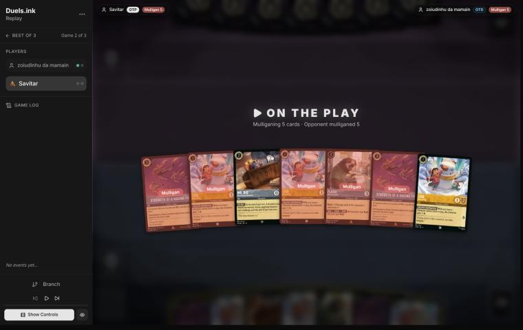
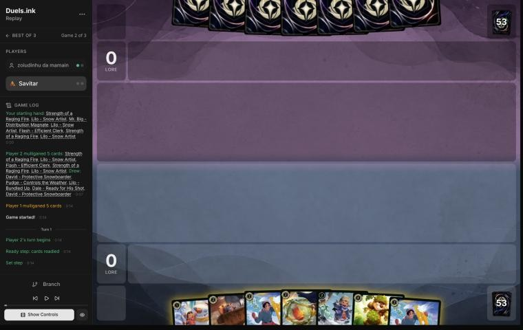
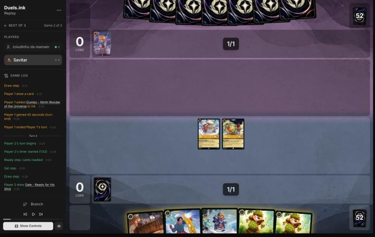
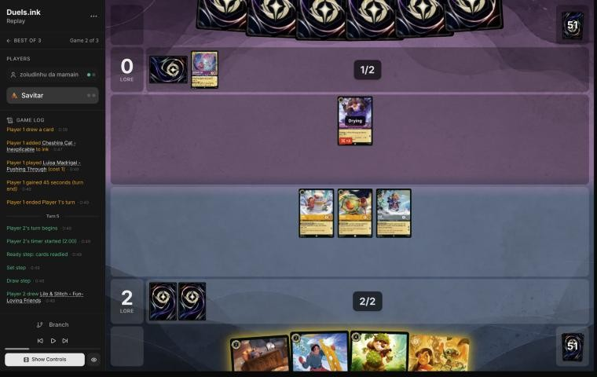
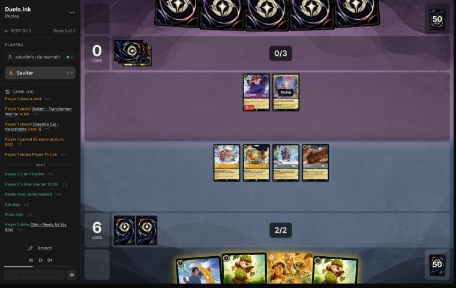
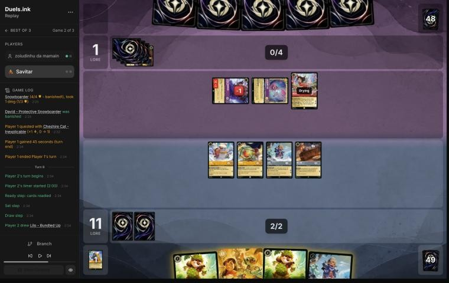
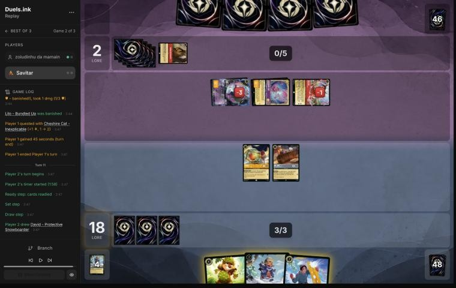

# Review: Savitar vs zoiudinhu da mamain, game 2, 2 Nov 2026

| | |
|---|---|
| **Status** | draft (blind pass done; not discussed, by request) |
| **Replay** | `01a19d99-ea68` (`python3 tools/brief.py 01a19d99-ea68 --turn N`) · [duels.ink viewer](https://duels.ink/replay/01a19d99-ea69-7b81-934f-ed7c7f9fcf71?step=0) |
| **Format** | Core Constructed (from game 1), best-of-three. Set 14 era: inks revealed before the coin toss |
| **Decks** | You: Amber/Steel Rockstar Aggro, the Lilo list. Them: Amethyst/Ruby, Unnamed #1 from game 1 |
| **Play/draw** | You went first (you lost game 1, so the choice was yours) |
| **Result** | Win: 20–2 on your 6th turn (game turn 11). Match 1–1, on to game 3 |
| **Meta data** | snapshot of 26 Oct 2026 (fresh until 9 Nov) |
| **Chosen how** | One of the 5 of Savitar's 12 matches the coach reviewed after studying the other 7 (see the TeamAnglerfish game 1 review). **The coach knew this game was a win before reviewing it:** game 1 was a loss and the match went to a game 3. Verdicts are guarded against outcome bias |

## Summary
- **Good plays:** [1](#turn-1) (Lilo and a free Pudge), [3](#turn-3), [9](#turn-9) (Lilo & Stitch Shifted in for
  7 lore and 18) and [11](#turn-11).
- **Close calls:** none.
- **Inaccuracies / mistakes / blunders:** three inaccuracies: the [mulligan](#turn-0) (both Strengths and Flash sent
  back), and Lilo & Stitch held with ink unspent on [5](#turn-5) and [7](#turn-7).
- **Unwinnable from:** never.

**What decided it:** they were stuck on 2 ink for two turns while your 1- and 2-drops quested for 11 unopposed; by
the time their challengers arrived you needed 2.

## The game, turn by turn
Verdicts judge each decision on what you could know at the time, **including archetype knowledge an experienced
player has**. Hindsight is kept to its own section. Severity scale: good play / close call /
inaccuracy / mistake / blunder. Principle IDs and hypotheses (H-n) link to copies
in the Citations section at the end, as they stood when they were cited.

**What you knew before the game:** game 1 ([the coach's notes](#cite-kb-meta-archetypes-amethyst-ruby-unnamed-1-against-rockstar-aggro-zoiudinhu-da-mamain)). Their key cards, with the earliest turn
each can come:
- **Rafiki – Mystical Fighter** (1, Challenger 3) and **Jebidiah** (2, Evasive, Reckless): from their 1st and 2nd
  turns, each kills a 2- or 3-willpower quester. Only Strength of a Raging Fire reaches Jebidiah.
- **Dumbo – The Flying Elephant** (3, Evasive; gives another character Evasive).
- **Isis Vanderchill** (4, ×2 in game 1): exerts one of yours on play, then a challenger kills it.
- **Red Alert** (4, banish a character with 3 {S} or less): took Lilo & Stitch in game 1.
- **Hades – Looking for a Deal** (5), **Goliath** (4, 5/5), **Demona – Scourge** (6: exerts all of yours).

### Pre-game

*The board before the decision: [step 0](https://duels.ink/replay/01a19d99-ea69-7b81-934f-ed7c7f9fcf71?step=0) in the duels.ink replay viewer.*

**What you did:** on the play, kept Lilo – Snow Artist and Mr. Big, and sent back five: both Strengths, two Lilos and
Flash.

**Verdict:** an **inaccuracy**. Keeping **Lilo and Mr. Big** is suboptimal because it sends back both Strengths
(your only answer to Jebidiah and Dumbo, who are Evasive) and Flash (2 lore), and **keeping two Lilos, Flash and a
Strength** is better. `tools/mulligan.py` (800 deals each, candidates run before your mulligan was shown):

| Option | Ink on turns 1–4 | Play turns (of 4) | Lore by turn 4 | Characters by turn 4 | Interaction by turn 4 |
|---|---|---|---|---|---|
| Keep all 7 | 8.92 | 4.00 | 8.8 | 5.8 | 100% |
| Send back a Lilo | 9.49 | 4.00 | 8.5 | 5.8 | 100% |
| Send back a Lilo and Mr. Big | 9.31 | 4.00 | 9.0 | 5.9 | 100% |
| **Keep two Lilos, Flash, a Strength** | 9.18 | 4.00 | 9.6 | 5.8 | 100% |
| **As played** (Lilo and Mr. Big) | 9.39 | 4.00 | 8.1 | 5.6 | 23% |
| Full mulligan | 9.29 | 3.76 | 7.9 | 5.2 | 31% |

- **Game 1 showed what Strength is for:** Jebidiah and Dumbo can't be challenged by anything in your deck.
- **This is the fourth mulligan in the set that kept Mr. Big and sent back 2-lore or interactive cards**; the sim
  preferred the alternative each time.
- Confidence: medium ([MULL-1](#cite-mull-1), [MULL-3](#cite-mull-3)).

### Turn 1: your turn 1

*The board before the decision: [step 2](https://duels.ink/replay/01a19d99-ea69-7b81-934f-ed7c7f9fcf71?step=2) in the duels.ink replay viewer.*

**What you did:** the mulligan brought two Davids, Pudge, Bundled Up and Dale; inked a David; played Lilo and Pudge
(free).

**Verdict:** **good play**: two characters for 1 ink.

### Turn 2: their turn

**What happened:** Dumbo – Ninth Wonder of the Universe inked; nothing played.

### Turn 3: your turn 2

*The board before the decision: [step 8](https://duels.ink/replay/01a19d99-ea69-7b81-934f-ed7c7f9fcf71?step=8) in the duels.ink replay viewer.*

**What you did:** drew a second Dale; inked one; played Bundled Up; quested Lilo and Pudge (2–0).

**Verdict:** **good play**, the coach's line: their board is empty, so both quests are safe, and Bundled Up adds 2
lore a turn. A second Dale is the right card to ink.

### Turn 4: their turn

**What happened:** Cheshire Cat inked; Luisa Madrigal – Pushing Through (0/3/1, Challenger 2) played. They have only
2 ink after two turns.

### Turn 5: your turn 3

*The board before the decision: [step 16](https://duels.ink/replay/01a19d99-ea69-7b81-934f-ed7c7f9fcf71?step=16) in the duels.ink replay viewer.*

**What you did:** drew Lilo & Stitch; didn't ink; played Mr. Big; quested Lilo, Pudge and Bundled Up (6–0); ICE OUT on
Luisa.

**Verdict:** an **inaccuracy**. Holding **Lilo & Stitch** and the ink is suboptimal because Luisa (2 {S} when she
challenges) couldn't kill anything of yours anyway, and **inking Mr. Big or David and Shifting Lilo & Stitch onto Lilo
– Snow Artist** (both dry) is better because:
- **Lore:** she quests at once, 8 instead of 6 now, and the board quests for 6 a turn (Lilo & Stitch 3, Bundled Up 2,
  Pudge 1).
- **Onto Snow Artist, not Bundled Up:** the lore comes out the same (Snow Artist would get +1 from a Stitch), and
  Bundled Up's EXTRA LAYERS stays on the board.
- **Nothing is exposed:** Luisa's 2 doesn't kill Pudge (3), Bundled Up (shield) or Lilo & Stitch (5, Resist 1).
- **Ink:** a third ink brings Dale next turn.
- Confidence: medium. Holding Lilo & Stitch keeps her from Red Alert for a turn, but she's worth more questing.

### Turn 6: their turn

**What happened:** Goliath inked; Cheshire Cat – Inexplicable (3/4; Boost 2 moves 2 damage onto one of yours)
played. Still 3 ink.

### Turn 7: your turn 4

*The board before the decision: [step 25](https://duels.ink/replay/01a19d99-ea69-7b81-934f-ed7c7f9fcf71?step=25) in the duels.ink replay viewer.*

**What you did:** drew a third Dale; didn't ink; played David exerted (Bodyguard); quested Lilo, Pudge, Bundled Up
and Mr. Big (11–0); ICE OUT on Cheshire.

**Verdict:** an **inaccuracy**, the same as on [turn 5](#turn-5). **Inking a Dale and Shifting Lilo & Stitch onto
Lilo – Snow Artist** (3 ink, so ICE OUT still works) is better than David because she quests for 3 at once (13
rather than 11) and every turn after. With four cards in hand (two Dales, Lilo & Stitch, David), the ink costs you
nothing, and a fourth ink next turn brings Dale.
- **David's Bodyguard** does keep Luisa off your 2-willpower questers; in the coach's line, keep Mr. Big home instead
  (12 lore).
- Confidence: medium.

### Turn 8: their turn

**What happened:** a second Goliath inked; Mulan – Martial Arts Master gave Luisa +2 {S}, and Luisa killed David
(drawing a card); Cheshire quested (1–11).

### Turn 9: your turn 5

*The board before the decision: [step 39](https://duels.ink/replay/01a19d99-ea69-7b81-934f-ed7c7f9fcf71?step=39) in the duels.ink replay viewer.*

**What you did:** drew a second Bundled Up; inked a Dale; Shifted Lilo & Stitch onto Lilo – Snow Artist and quested
everything (18–1); ICE OUT on Cheshire.

**Verdict:** **good play**, the coach's line. 7 lore leaves you needing 2, from five questers; they'd have to kill or
exert four of them next turn.

### Turn 10: their turn

**What happened:** Luisa Madrigal – Confident Climber Shifted onto Luisa (6 {S}); Cheshire's Boost moved a damage onto
Bundled Up (using up EXTRA LAYERS); Luisa killed Lilo & Stitch and Mulan killed Bundled Up; Cheshire quested (2–18).

### Turn 11: your turn 6

*The board before the decision: [step 60](https://duels.ink/replay/01a19d99-ea69-7b81-934f-ed7c7f9fcf71?step=60) in the duels.ink replay viewer.*

**What you did:** quested Pudge and Mr. Big (20–2). Won.

**Verdict:** **good play**: the two survivors made the last 2.

## Lessons
1. **Shift Lilo & Stitch in as soon as a dry Lilo or Stitch is there** ([5](#turn-5), [7](#turn-7)): she quests for
   3 at once, and holding her doesn't make her safer from Red Alert later.
2. **Keep Strength against Amethyst/Ruby** ([pre-game](#turn-0)): it's your only answer to their Evasive Jebidiah
   and Dumbo.
3. **Every ink drop counts while you're ahead:** two turns at 2 ink kept Dale and Lilo & Stitch in hand.

## Knowledge-base updates (applied 2026-11-02, without discussion at danny's request)
- **Meta, Amethyst/Ruby notes:** game 2 of zoiudinhu da mamain's list.

## Hindsight
Doesn't change the verdicts above.
- Their slow start (2 ink until turn 6) did most of the work.

## The coach's errors
None found in the blind pass.

| When | Error | How it was caught | How it won't happen again |
|---|---|---|---|

## Open questions
- [Turn 5](#turn-5): why hold Lilo & Stitch and the ink with a safe Shift available?

## Citations
Copies of the coach's knowledge base cited above, as they stood when they were cited (the private repository's commit and date are given with each). They don't change when the knowledge base does.

<!-- Filled in by `python3 tools/cite.py <this file>`: every principle ID, H-n, "principle N" and CR rule above
becomes a link to an entry here. Add a file or one of its sections with `--file PATH --section TEXT`, and link to
the anchor it prints. Never link into the private repository. -->

**amethyst-ruby.md, Unnamed #1 against Rockstar Aggro: zoiudinhu da mamain**: knowledge base, `kb/meta/archetypes/amethyst-ruby.md` at `a3d7ab9` (2026-11-03), working tree

> ### Unnamed #1 against Rockstar Aggro: zoiudinhu da mamain `[coach, blind reviews of 01a19d97-25e5, 01a19d99-ea68 and 01a19d9d-7dcf (Savitar vs zoiudinhu da mamain, 2 Nov 2026)]`
> - **Game 1** (01a19d97-25e5; Savitar conceded at 7–3 on game turn 11): Rafiki – Mystical Fighter (1, Challenger 3)
>   turn 1, Jebidiah turn 3, Dumbo – The Flying Elephant (gives Evasive) turn 5, Isis Vanderchill ×2 (exerts one of
>   yours, then a challenger kills it), Red Alert, Hades – Looking for a Deal, Goliath, Luisa ×2, Demona – Scourge.
> - **Their swing turn** (game turn 9): Red Alert on Lilo & Stitch, then Jebidiah, Rafiki, Dumbo and Isis killed every
>   quester. Four cheap challengers punish questing everything; Bundled Up's EXTRA LAYERS only stops the first hit.
> - **Rafiki has 0 {S} when he's the one challenged:** an exerted, damaged Rafiki is a free kill for any character.

**MULL-1**: strategy principle, `kb/strategy/principles.md` at `a3d7ab9` (2026-11-03), working tree

> - **MULL-1. Keep a plan, not the strongest cards.** *Ask: "Which hand gives me the best chance to execute my game plan in this matchup?"* `[MCL ch.12]` · baseline

**MULL-3**: strategy principle, `kb/strategy/principles.md` at `a3d7ab9` (2026-11-03), working tree

> - **MULL-3. The right keep depends on the matchup.** Early interaction against aggro; pressure, draw and engines against slow decks. The mulligan is the first expression of your role. In the Set 14 era the opponent's inks are known before the mulligan (RULE-8), so this applies from game 1 of a match. `[MCL ch.12]` · baseline
