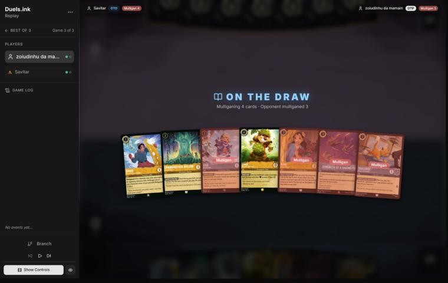
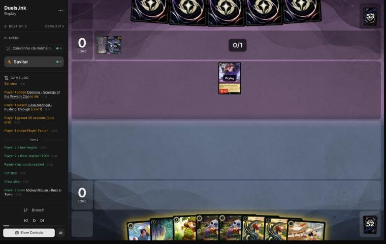
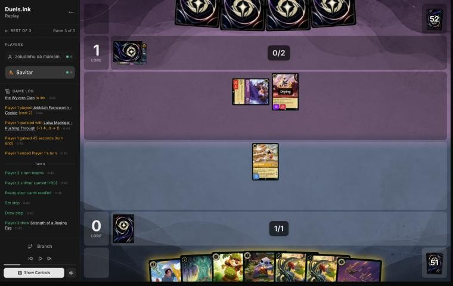
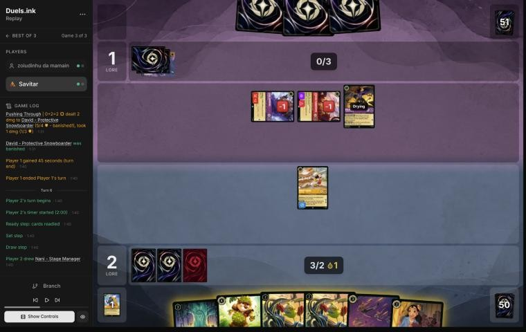
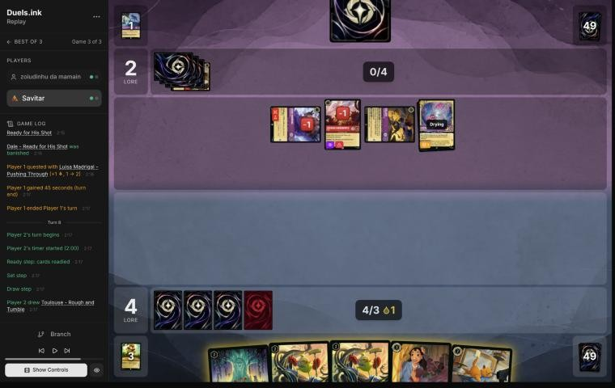

# Review: Savitar vs zoiudinhu da mamain, game 3, 2 Nov 2026

| | |
|---|---|
| **Status** | draft (blind pass done; not discussed, by request) |
| **Replay** | `01a19d9d-7dcf` (`python3 tools/brief.py 01a19d9d-7dcf --turn N`) · [duels.ink viewer](https://duels.ink/replay/01a19d9d-7dd0-774f-8eb8-89a56e149322?step=0) |
| **Format** | Core Constructed (from game 1), best-of-three. Set 14 era: inks revealed before the coin toss |
| **Decks** | You: Amber/Steel Rockstar Aggro, the Lilo list. Them: Amethyst/Ruby, Unnamed #1 from games 1 and 2 |
| **Play/draw** | zoiudinhu da mamain went first (they lost game 2, so the choice was theirs); you were on the draw |
| **Result** | Loss: you conceded on their 5th turn (game turn 9), 4–2. Match lost 1–2 |
| **Meta data** | snapshot of 26 Oct 2026 (fresh until 9 Nov) |
| **Chosen how** | One of the 5 of Savitar's 12 matches the coach reviewed after studying the other 7 (see the TeamAnglerfish game 1 review). The coach knew games 1 and 2 were split, but not this game's result |

## Summary
- **Good plays:** [2](#turn-2), [6](#turn-6) (Dale for SPIKE SUIT), [8](#turn-8).
- **Close calls:** [4](#turn-4) (David exerted rather than Willow and a free Stitch) and the
  [concession](#turn-9).
- **Inaccuracies / mistakes / blunders:** one inaccuracy, the [mulligan](#turn-0) (Bundled Up and Strength sent back,
  David and Dale kept).
- **Unwinnable from:** close to it after [7](#turn-7), when Goliath and Cheshire's damage-moving cleared Mickey and
  Dale in one turn.

**What decided it:** Goliath – Transformed Warrior with Cheshire Cat: he challenged, then he and Cheshire moved his
damage onto your other characters, so even 4-willpower bodies and SPIKE SUIT didn't hold. Then Isis exerted what was
left.

## The game, turn by turn
Verdicts judge each decision on what you could know at the time, **including archetype knowledge an experienced
player has**. Hindsight is kept to its own section. Severity scale: good play / close call /
inaccuracy / mistake / blunder. Principle IDs and hypotheses (H-n) link to copies
in the Citations section at the end, as they stood when they were cited.

**What you knew before the game:** games 1 and 2 ([the coach's notes](#cite-kb-meta-archetypes-amethyst-ruby-unnamed-1-against-rockstar-aggro-zoiudinhu-da-mamain)). Their key cards, with the earliest
turn each can come:
- **Cheap challengers:** Rafiki (1, Challenger 3), Luisa (1, Challenger 2; Shift 3 into Confident Climber, 6 {S}),
  Jebidiah (2, Evasive, Reckless), Dumbo – The Flying Elephant (3, Evasive).
- **Isis Vanderchill** (4): exerts one of yours on play so a challenger can reach it. Two in game 1.
- **Mulan – Martial Arts Master** (4; +2 {S} to one of theirs on play), **Cheshire Cat – Inexplicable** (3; Boost
  moves damage onto yours).
- **Red Alert** (4): banished Lilo & Stitch in game 1.
- **Demona – Scourge** (6), **Hades – Looking for a Deal** (5), **Goliath** (4).

### Pre-game

*The board before the decision: [step 0](https://duels.ink/replay/01a19d9d-7dd0-774f-8eb8-89a56e149322?step=0) in the duels.ink replay viewer.*

**What you did:** on the draw, kept David, Willow and Dale, and sent back Bundled Up, Toulouse, Strength and Nani.

**Verdict:** an **inaccuracy**. Keeping **David, Willow and Dale** is suboptimal because it sends back Bundled Up (2
lore, and her EXTRA LAYERS takes the first challenge) and Strength (your answer to Jebidiah and Dumbo), and **keeping
Bundled Up, Willow and Strength** is better. `tools/mulligan.py` (800 deals each, candidates run before your mulligan
was shown):

| Option | Ink on turns 1–4 | Play turns (of 4) | Lore by turn 4 | Characters by turn 4 | Interaction by turn 4 |
|---|---|---|---|---|---|
| Keep all 7 | 9.21 | 3.22 | 4.0 | 4.2 | 100% |
| Send back Toulouse | 9.41 | 3.42 | 7.2 | 4.8 | 100% |
| Send back Toulouse and David | 9.51 | 3.56 | 7.8 | 5.0 | 100% |
| **Keep Bundled Up, Willow, Strength** | 9.46 | 3.74 | 8.7 | 5.2 | 100% |
| **As played** (David, Willow, Dale) | 9.47 | 3.74 | 7.0 | 5.2 | 35% |
| Full mulligan | 9.58 | 3.88 | 8.8 | 5.6 | 44% |

- **Dale's SPIKE SUIT is good against these challengers,** but at 4 ink it comes late, and David's 1 lore is the
  slowest 2-drop.
- Confidence: medium ([MULL-1](#cite-mull-1), [MULL-3](#cite-mull-3)).

### Turn 1: their turn

**What happened:** Demona – Scourge inked; Luisa Madrigal – Pushing Through played.

### Turn 2: your turn 1

*The board before the decision: [step 5](https://duels.ink/replay/01a19d9d-7dd0-774f-8eb8-89a56e149322?step=5) in the duels.ink replay viewer.*

**What you did:** the mulligan brought two Stitches and two Mikes; drew Mickey; inked a Stitch; played Mickey.

**Verdict:** **good play**, the coach's line: Mickey's 4 willpower survives Luisa (2 when she challenges), Rafiki (3)
and Jebidiah (3), and he quests for 2. His ink drops do bring Demona – Scourge (6) a little closer.

### Turn 3: their turn

**What happened:** a second Demona – Scourge inked; Jebidiah played; Luisa quested (1–0).

### Turn 4: your turn 2

*The board before the decision: [step 12](https://duels.ink/replay/01a19d9d-7dd0-774f-8eb8-89a56e149322?step=12) in the duels.ink replay viewer.*

**What you did:** drew Strength; quested Mickey (2–1); inked the second Stitch; played David exerted.

**Verdict:** **close call**. **Willow and a free Stitch** (inking David) puts two bodies and 2 lore a turn on the
board for the same ink, and nothing new of yours could be challenged (Mickey's 4 willpower survives Jebidiah's 3).
David exerted is safer still (Jebidiah must hit him) but adds 1 lore, and the Stitch you inked was a body.

### Turn 5: their turn

**What happened:** Dumbo – Ninth Wonder inked; **Goliath** (5/5) played with Mickey's drop; Jebidiah then Luisa
challenged David and killed him (each took 1).

### Turn 6: your turn 3

*The board before the decision: [step 22](https://duels.ink/replay/01a19d9d-7dd0-774f-8eb8-89a56e149322?step=22) in the duels.ink replay viewer.*

**What you did:** drew a second Nani; quested Mickey (4–1); inked Strength; played Dale with the drop.

**Verdict:** **good play**. Dale's SPIKE SUIT turns Mickey and both Mikes into 4-damage blockers against their
challengers, so Luisa and Jebidiah die if they challenge them. Strength had no target in range with only two
characters of yours in play, so it was the card to ink.

### Turn 7: their turn

**What happened:** Medallion Weights inked; Cheshire Cat played; **Goliath** killed Mickey (taking 4 from SPIKE
SUIT), then moved 2 of that damage onto Dale (discarding Peter Pan's Shadow) and Cheshire's Boost moved the other 2:
Dale banished. Your board is empty; 4–2.

### Turn 8: your turn 4

*The board before the decision: [step 40](https://duels.ink/replay/01a19d9d-7dd0-774f-8eb8-89a56e149322?step=40) in the duels.ink replay viewer.*

**What you did:** drew Toulouse; played Nani, who found a second Willow; inked Toulouse; played Willow with the drop.

**Verdict:** **good play**: two bodies and the best of the four Nani looked at, with nothing of theirs in reach this
turn (every character either drying or out of your reach). Goliath and Cheshire's damage-moving makes 4 willpower
no safer than 2 against this list.

### Turn 9: their turn

**What happened:** **Isis** exerted Nani and Goliath killed her (taking 3). You conceded, 4–2.

**Verdict on the concession:** reasonable; very likely lost. Their five characters (Luisa, Jebidiah, Goliath,
Cheshire, Isis) quest for 4 a turn and kill a character each, and Goliath and Cheshire move damage onto ready
characters too. You had Willow in play and Willow and two Mikes in hand, 1 lore each, needing 16. Playing on kept a
small chance on strong draws.

## Lessons
1. **Goliath and Cheshire Cat move damage onto ready characters** ([7](#turn-7)): a challenge that "only" damages
   Goliath can be paid back onto your board. SPIKE SUIT's 4 damage on Goliath became Dale's death.
2. **Against this list, keep the cards that answer Evasive and absorb hits** ([pre-game](#turn-0)): Strength and
   Bundled Up.
3. **Concessions:** in both losses of this match you conceded with a small chance left. It saves time in a best-of-
   three but gives that chance away.

## Knowledge-base updates (applied 2026-11-02, without discussion at danny's request)
- **Meta, Amethyst/Ruby notes:** game 3 of zoiudinhu da mamain's list, and the Goliath and Cheshire damage-moving
  combination.

## Hindsight
Doesn't change the verdicts above.
- They never needed Demona – Scourge (two inked): their 3- and 4-drops did the work.

## The coach's errors
None found in the blind pass.

| When | Error | How it was caught | How it won't happen again |
|---|---|---|---|

## Open questions
- [Turn 6](#turn-6): Dale into a board with Goliath and Cheshire, or more cheap bodies?

## Citations
Copies of the coach's knowledge base cited above, as they stood when they were cited (the private repository's commit and date are given with each). They don't change when the knowledge base does.

<!-- Filled in by `python3 tools/cite.py <this file>`: every principle ID, H-n, "principle N" and CR rule above
becomes a link to an entry here. Add a file or one of its sections with `--file PATH --section TEXT`, and link to
the anchor it prints. Never link into the private repository. -->

**amethyst-ruby.md, Unnamed #1 against Rockstar Aggro: zoiudinhu da mamain**: knowledge base, `kb/meta/archetypes/amethyst-ruby.md` at `9b4dc9f` (2026-11-03), working tree

> ### Unnamed #1 against Rockstar Aggro: zoiudinhu da mamain `[coach, blind reviews of 01a19d97-25e5, 01a19d99-ea68 and 01a19d9d-7dcf (Savitar vs zoiudinhu da mamain, 2 Nov 2026)]`
> - **Game 1** (01a19d97-25e5; Savitar conceded at 7–3 on game turn 11): Rafiki – Mystical Fighter (1, Challenger 3)
>   turn 1, Jebidiah turn 3, Dumbo – The Flying Elephant (gives Evasive) turn 5, Isis Vanderchill ×2 (exerts one of
>   yours, then a challenger kills it), Red Alert, Hades – Looking for a Deal, Goliath, Luisa ×2, Demona – Scourge.
> - **Their swing turn** (game turn 9): Red Alert on Lilo & Stitch, then Jebidiah, Rafiki, Dumbo and Isis killed every
>   quester. Four cheap challengers punish questing everything; Bundled Up's EXTRA LAYERS only stops the first hit.
> - **Rafiki has 0 {S} when he's the one challenged:** an exerted, damaged Rafiki is a free kill for any character.
> - **Game 2** (01a19d99-ea68; Savitar won 20–2 on game turn 11): stuck on 2 ink until their 3rd turn (Dumbo – Ninth
>   Wonder and Cheshire inked); Luisa, Cheshire Cat – Inexplicable (Boost 2 moves damage onto yours), Mulan – Martial
>   Arts Master (+2 {S} to Luisa, who killed David), Luisa – Confident Climber (Shift 3, 6 {S}) killed Lilo & Stitch.
>   Two Goliaths inked.

**MULL-1**: strategy principle, `kb/strategy/principles.md` at `9b4dc9f` (2026-11-03), working tree

> - **MULL-1. Keep a plan, not the strongest cards.** *Ask: "Which hand gives me the best chance to execute my game plan in this matchup?"* `[MCL ch.12]` · baseline

**MULL-3**: strategy principle, `kb/strategy/principles.md` at `9b4dc9f` (2026-11-03), working tree

> - **MULL-3. The right keep depends on the matchup.** Early interaction against aggro; pressure, draw and engines against slow decks. The mulligan is the first expression of your role. In the Set 14 era the opponent's inks are known before the mulligan (RULE-8), so this applies from game 1 of a match. `[MCL ch.12]` · baseline
