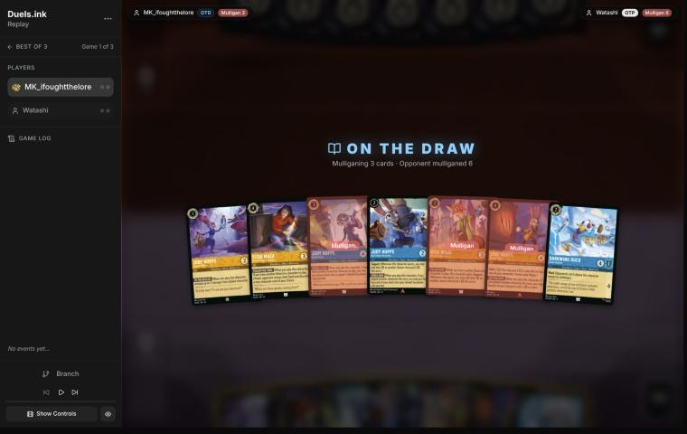
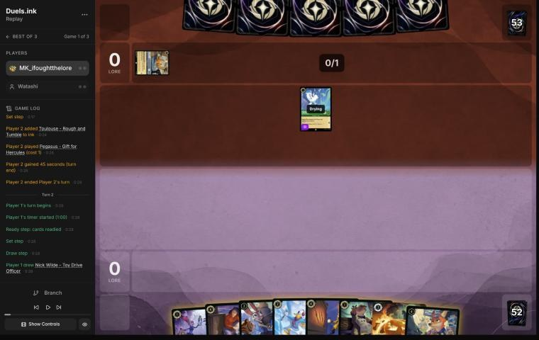
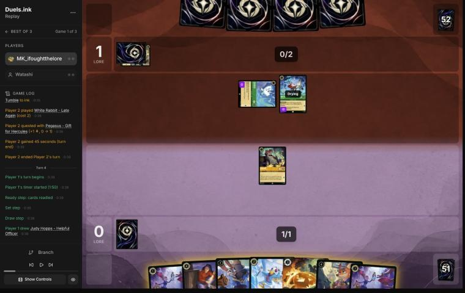
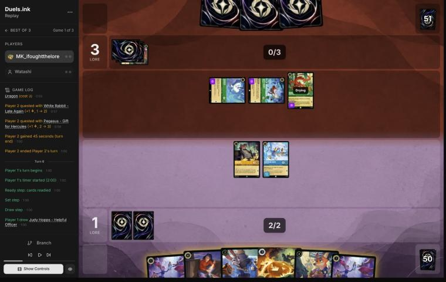
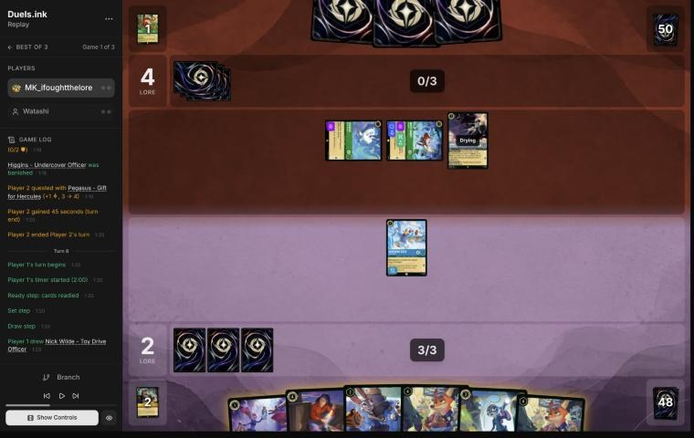
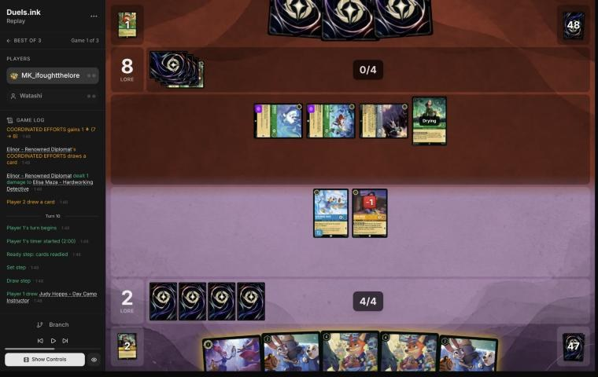
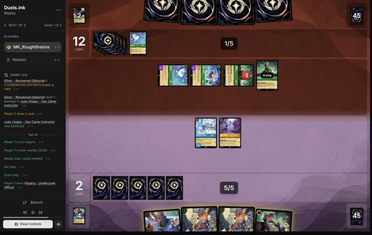
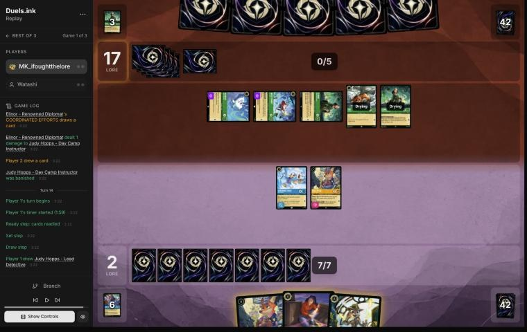

# Review: MK_ifoughtthelore vs Watashi, game 1, 3 Nov 2026

| | |
|---|---|
| **Status** | draft (blind pass done, not yet discussed) |
| **Replay** | `01a1a189-bb09` (`python3 tools/brief.py 01a1a189-bb09 --turn N`) · [duels.ink viewer](https://duels.ink/replay/01a1a189-bb1a-752c-bbfb-311ce6637237?step=0) |
| **Format** | Core Constructed (stated in the replay), best-of-three, game 1. Set 14 era: inks revealed before the coin toss |
| **Decks** | You: Amber/Sapphire Detectives (the list from your match against VH INK). Them: Emerald/Steel ([the coach's notes on this pair](#cite-kb-meta-archetypes-emerald-steel-midrange-how-it-plays)); archetype as it became clear: Midrange #1, 97% from their first card (Pegasus) and 99% from turn 4 |
| **Play/draw** | They went first |
| **Result** | **Loss.** You conceded on game turn 14 at 2–17 |
| **Meta data** | snapshot of 26 Oct 2026 (fresh until 9 Nov) |
| **Chosen how** | Sent by danny, the coach's user: a match of MK_ifoughtthelore's, reviewed for them game by game. The match went to a third game, so the coach knew games 1 and 2 were split, but not which way |

## Summary
Links go to the turn sections below.
- **Good plays:** turns [2](#turn-2), [4](#turn-4), [6](#turn-6) (The Horseman Strikes! on Mushu, their card engine),
  [10](#turn-10) (Helpful Officer's heal kept Elisa alive after her challenge, a line the coach's plan missed) and
  [12](#turn-12).
- **Close calls:** the [pre-game](#turn-0) (sending back On the Case, Always Vigilant and Nick – Providing Backup from a
  hand that already curved out) and [turn 8](#turn-8) (Elisa rather than two cheaper bodies).
- **Inaccuracies / mistakes / blunders:** none.
- **Unwinnable from:** [turn 14](#turn-14). They were at 17 with five questers for their next turn, and two challenges
  couldn't bring that below three. The concession was right.

**What decided it:** their draw against yours. They curved three cheap Evasive questers (Pegasus, White Rabbit, Mushu)
into four Elinors by game turn 13, which added a ping, a lore and a card each at the end of every turn. Your hand had
four uninkables (two Day Camp Instructors, two Toy Drive Officers) and only one answer to Evasive (The Horseman
Strikes!) until Lead Detective came on turn 14, a turn after the race was gone. No decision of yours stands out as the
reason.

## The game, turn by turn
Verdicts judge each decision on what you could know at the time, **including archetype knowledge an experienced
player has**. Hindsight is kept to its own section. Severity scale: good play / close call /
inaccuracy / mistake / blunder. Principle IDs and hypotheses (H-n) link to copies
in the Citations section at the end, as they stood when they were cited.

**What you knew before the game:** their inks, Emerald/Steel. duels.ink's lists put that at Midrange #1 83%, an
unlisted list 13% and Midrange #2 5%. Both Midrange lists are cheap Evasive and 2-lore questers with pings and a
damage song. Their key cards, with the earliest game turn each can come (they're on the play, so their turn k is game
turn 2k−1):
- **Strength of a Raging Fire** (3, song): damage to a chosen character equal to the number of characters they have
  in play. Castable with 3 ink (game turn 5), or sung free by any cost-3+ character of theirs that's dry. Four copies,
  and Max Goof – Rebellious Teen (3) pays 1 to return it from the discard.
- **Angel – Experiment 624** (4, 3/3): once a turn, discard a card to deal 2 damage to a chosen character. Game turn 7.
- **Elinor – Renowned Diplomat** (4, uninkable): at the end of their turn, with 3+ exerted characters, 1 damage to a
  chosen character of yours, 1 lore and a card. Game turn 7.
- **The Terror That Flaps in the Night** (2, action; 1 copy): 2 damage, 3 while they have a Darkwing Duck in play.
- **Angela – Night Warrior** (3): Challenger +2 and Resist +2 to a character until their next turn. Game turn 5.
- **Toulouse – Rough and Tumble** (2): you can't play actions until their next turn (The Horseman Strikes!).
- **Ursula – Deceiver** (2): you reveal your hand and discard a song of their choice.
- **Evasive questers:** Pegasus (1), White Rabbit (2), Vixey – Forest Friend (3, 2 lore; 2 with Tod in play), Mushu
  – Stealthy Dragon (3, 3/2, draws when you hold more cards). Only your Evasive or Alert characters can challenge them:
  Judy – Lead Detective gives every Detective Alert on your turn.
- **Big bodies:** Flash – Efficient Clerk (2, 3/2/2, Resist 1), Woolter & Jesse (3, 4/4 Bodyguard, Challenger 2),
  Broadway (5, 4/6/2 Bodyguard), and **The Queen – Devious Disguise** (4, **5/3**: a natural target for Always
  Vigilant and Gaston; +2 lore while you lead, and her draw gives you 2 lore).

Your own deck's trick, from the Detectives notes: Support can add {S} to **their** character, lifting it to 5 for Judy
– Always Vigilant or Gaston ([ruling](#cite-kb-rules-rulings-support-can-add-strength-to-an-opposing-character)). Their list has few natural 5-{S} characters (only The
Queen), so that trick is how your removal finds targets.

### Pre-game

*The board before the decision: [step 0](https://duels.ink/replay/01a1a189-bb1a-752c-bbfb-311ce6637237?step=0) in the duels.ink replay viewer.*

**What you did:** on the draw. From Judy – Helpful Officer, Elisa Maza, Judy – On the Case, Judy – Day Camp
Instructor, Nick Wilde – Providing Backup, Judy – Always Vigilant and Darkwing Duck – Drake Mallard, you kept
Helpful Officer, Elisa, Day Camp Instructor and Darkwing, and sent back On the Case, Always Vigilant and Nick.

**Verdict:** **close call.** The seven already curved out: a 1-drop, three 2-drops, a 3 and two 4s, six of them
inkable. `mulligan.py` (1,500 deals):

| Option | Ink spent, turns 1–4 | Turns with a play | Lore by turn 4 | Characters by turn 4 | Interaction |
|---|---|---|---|---|---|
| Keep all 7 | 9.97 / 10 | 4.00 / 4 | 6.4 | 5.3 | 100% |
| As played (keep 4) | 9.70 / 10 | 3.99 / 4 | 6.8 | 5.2 | 66% |
| Full mulligan | 9.36 / 10 | 3.73 / 4 | 5.8 | 4.4 | 88% |

Keeping all seven used its ink a little better and kept the removal; your keep scored a little more early lore. The
sim's "interaction" counts Always Vigilant and On the Case, and against this list On the Case's HIDDEN CLUES has no
items to hit and Always Vigilant has one natural target (The Queen), so that gap is smaller than it looks. Sending back
Nick – Providing Backup is the part I'd question: he's your best 2-drop Supporter, and Support is what makes Always
Vigilant and Gaston work here. Confidence: low; it turns on card quality the sim can't see.

### Turn 2: your turn 1

*The board before the decision: [step 6](https://duels.ink/replay/01a1a189-bb1a-752c-bbfb-311ce6637237?step=6) in the duels.ink replay viewer.*

**What you did:** inked Judy – Always Vigilant and played Higgins.

**Verdict:** **good play.** Two uninkables in hand (Day Camp Instructor and the Nick – Toy Drive Officer you drew)
meant the inkable cards had to carry the curve, and you kept both 1-drops for the next turns: Helpful Officer with
Day Camp Instructor on turn 3 turns on LEND A PAW. Always Vigilant was the right card to give up in this matchup:
their list has one natural 5-{S} target (The Queen), and you kept The Horseman Strikes! for their Evasive questers
(Pegasus is already out) and Elisa for their Strength of a Raging Fire.

### Turn 4: your turn 2

*The board before the decision: [step 13](https://duels.ink/replay/01a1a189-bb1a-752c-bbfb-311ce6637237?step=13) in the duels.ink replay viewer.*

**What you did:** inked the second Judy – Helpful Officer, played Darkwing Duck – Drake Mallard, and quested with
Higgins (1–1).

**Verdict:** **good play.** It keeps one Helpful Officer for next turn, where with 3 ink she and Day Camp Instructor
turn on LEND A PAW (a 5th ink on turn 8). Playing both 1-drops now would have used them up and left Day Camp
Instructor without a partner. Darkwing's Ward matters against this list: Strength of a Raging Fire, Angel's GOOD AIM
and Elinor's ping all *choose* their target, so only a challenge can kill him. Higgins' quest exposed him only to
trades you'd take: White Rabbit kills him and dies, Pegasus dies to him.

### Turn 6: your turn 3

*The board before the decision: [step 22](https://duels.ink/replay/01a1a189-bb1a-752c-bbfb-311ce6637237?step=22) in the duels.ink replay viewer.*

**What you did:** inked the third Helpful Officer, cast The Horseman Strikes! on Mushu – Stealthy Dragon (drawing
Judy – On the Case), and quested with Higgins only (2–3). Darkwing stayed ready.

**Verdict:** **good play.** All three of their characters were Evasive, so nothing of yours could challenge them;
the race was 3 a turn to your 2. The alternative was Helpful Officer and Day Camp Instructor for LEND A PAW, a 5th ink
next turn and Lead Detective a turn sooner. Horseman on Mushu was better:
- Mushu was their best quester (3 {S}) and an engine: TIP THE SCALES draws whenever you hold more cards, and you held
  6 to their 3. Each turn he lived was a card for them ([THREAT-2](#cite-threat-2)).
- It cost 3 ink for their 3-drop and replaced itself ([TEMPO-2](#cite-tempo-2)).
- Toulouse would have locked your actions for a turn. Two were already inked, so the risk was small, but it's a reason
  to play the action while you can.

Keeping Darkwing ready was right too: at 1 willpower, any of their characters kills him in a challenge, and Pegasus
(a 1-drop) for your 2-drop is a trade they'd want. Higgins was safe to send: Pegasus dies to him, and White Rabbit
trades.

### Turn 8: your turn 4

*The board before the decision: [step 33](https://duels.ink/replay/01a1a189-bb1a-752c-bbfb-311ce6637237?step=33) in the duels.ink replay viewer.*

**What you did:** inked Judy – On the Case and played Elisa Maza. FOLLOW THE TRAIL showed their hand of three; there
was no non-character card to discard. Darkwing stayed ready again (2–4).

**Verdict:** **close call.** You held three uninkables (Day Camp Instructor and two Nick – Toy Drive Officers), so
this turn was about ink as much as board. The candidates:
- **Elisa (played):** all 4 ink, a 3/4 body, and their whole hand seen. The discard was a long shot: their list runs
  five non-characters (Strength of a Raging Fire ×4, The Terror ×1), about a 1-in-4 chance one was among their 3
  cards.
- **Helpful Officer and On the Case:** all 4 ink and two bodies (2/1 and 4/3), one more lore a turn.
- **Helpful Officer and Day Camp Instructor:** LEND A PAW's extra ink for the Toy Drive Officers, but 1 ink unspent.

They're within the uncertainty: the second line had more lore pressure, yours had information and the body that best
survives their pings (4 willpower). Inking On the Case over Helpful Officer kept the 1-drop for Day Camp Instructor's
LEND A PAW, which was right with three uninkables in hand.

### Turn 10: your turn 5

*The board before the decision: [step 43](https://duels.ink/replay/01a1a189-bb1a-752c-bbfb-311ce6637237?step=43) in the duels.ink replay viewer.*

**What you did:** Elisa challenged and banished Angela (taking 2), then Judy – Helpful Officer's TO THE RESCUE removed
2 damage from Elisa, and Day Camp Instructor's LEND A PAW put a card into your inkwell. Darkwing stayed ready; 1 ink
went unspent (2–8).

**Verdict:** **good play**, better than the coach's plan. The setup:
- **The race:** 2–8, and their board quests for 4, plus 1 a turn from Elinor's COORDINATED EFFORTS (and another
  Elinor was known in their hand). On that pace they reach 20 around game turn 15, so their questers had to die.
- **What could die:** only Angela. Pegasus and White Rabbit are Evasive, and Elinor was still drying (ready).
- **The coach's plan:** Elisa kills Angela; Darkwing stays ready for Elinor, since his Ward makes him immune to her
  ping; Day Camp Instructor twice, for LEND A PAW and both 4 ink, keeping Helpful Officer to pair with a Toy Drive
  Officer next turn. That plan left Elisa on 1 willpower after the challenge, where Elinor's end-of-turn ping or
  Pegasus would kill her.
- **Your line was better:** the coach's plan missed TO THE RESCUE. Healing Elisa back to 1 damage keeps a 4-drop
  alive through the ping and through Pegasus or White Rabbit; only Elinor's 3 {S} kills her now. That's worth more
  than keeping a 1-drop for COMMUNITY OUTREACH, and it cost the same LEND A PAW ramp.
- Darkwing ready again was right: he's the one character that can kill a questing Elinor next turn.

### Turn 12: your turn 6

*The board before the decision: [step 63](https://duels.ink/replay/01a1a189-bb1a-752c-bbfb-311ce6637237?step=63) in the duels.ink replay viewer.*

**What you did:** played Nick – Toy Drive Officer, inked Higgins, played Day Camp Instructor (LEND A PAW: another ink),
and challenged the damaged Elinor with Helpful Officer; both were banished. COMMUNITY OUTREACH drew Elisa Maza at the
end of the turn. Darkwing stayed ready (2–12).

**Verdict:** **good play**, the same line the coach would pick. At 2–12 their board quested for 4 and two Elinors added
2 more at the end of each turn, so they'd reach 20 on game turn 15. Killing the damaged Elinor (1 willpower left) with
a 1-drop was the cheapest trade available, and it takes away one ping, one lore and one card a turn. Inking Higgins,
your only inkable card, paid for Toy Drive Officer and Day Camp Instructor together: two characters for COMMUNITY
OUTREACH's card, and LEND A PAW's ink. Darkwing stayed ready to kill the other Elinor once she quests.

You were still far behind: your board quests for about 3 against their 3 plus an Elinor trigger, from 2–12. The way back
needed their Evasive questers gone, which only The Horseman Strikes! and Judy – Lead Detective's Alert can do.

### Turn 14: your turn 7

*The board before the decision: [step 78](https://duels.ink/replay/01a1a189-bb1a-752c-bbfb-311ce6637237?step=78) in the duels.ink replay viewer.*

**What you did:** played Judy – Lead Detective (drawn this turn). With her Alert and Resist +2, Darkwing banished the
exerted Elinor (and died) and Toy Drive Officer banished White Rabbit (taking nothing). Then you conceded at 2–17.

**Verdict:** **unwinnable; the concession was right.** At 17, they needed 3 lore. Five characters would be dry for
their next turn (Pegasus, White Rabbit, both Elinors and Tod), and you had two characters able to challenge, Darkwing
and Toy Drive Officer; Lead Detective and Elisa would enter drying. However the two challenges went, three questers
were left, and three quests make 20. Your own 2 lore couldn't race that. Playing Lead Detective and taking the two
kills first was the right way to check whether anything was left.

## Lessons
1. **Against this list, your answers to Evasive are The Horseman Strikes! and Judy – Lead Detective's Alert.** Nothing
   else of yours can challenge Pegasus, White Rabbit, Vixey or Mushu. Spend the Horseman early on the quester that
   also draws: Mushu's TIP THE SCALES draws whenever you hold more cards, which against a Detectives hand is most turns
   ([turn 6](#turn-6)).
2. **Kill Elinor – Renowned Diplomat on sight.** She isn't Evasive, and with three exerted characters she pings, gains
   1 and draws at the end of each of their turns. Two Elinors took the game from 8 to 17 in two turns. Her ping
   *chooses*, so Darkwing's Ward makes him immune to it; he's the one to keep ready for her.
3. **Judy – Helpful Officer's TO THE RESCUE turns a challenge into a free one.** Challenge first, then heal the
   challenger, as on [turn 10](#turn-10).

## Proposed knowledge-base updates (applied after discussion)
- **Meta** (the Emerald/Steel pair file, a section for Watashi, game 1): Midrange #1 from the first card.
  Seen: Pegasus ×2, White Rabbit, Mushu – Stealthy Dragon, Angela – Night Warrior (Challenger +2 on White Rabbit to kill
  Higgins), Elinor ×4 by game turn 13, Tod; inked Toulouse ×2, Bobby Zimuruski, Vixey, Pegasus. Two Elinors with three
  Evasive questers made +5 on turns 11 and 13 (quests plus COORDINATED EFFORTS). They held no non-character card on
  game turn 8 (Elisa's look).
- **Strategy:** none new. Lesson 2 fits [THREAT-2](#cite-threat-2) (Elinor is an engine as well as a quester).

## Hindsight
Doesn't change the verdicts above.
- **Your draws:** after the mulligan you saw three Helpful Officers, two Day Camp Instructors, two Toy Drive Officers,
  one Horseman and Lead Detective on turn 14. Four uninkables in the first 14 cards is why the ink was tight on turns 8
  and 10.
- **Their draws:** all four Elinors by game turn 13, and three Evasive questers in their first three turns. Against
  that, a single Horseman wasn't enough. Lead Detective a turn earlier (turn 12) would have let Darkwing and Toy Drive
  Officer kill two Evasive questers that turn, which might have held them under 20 for another turn.

## The coach's errors
Filled in during discussion.

| When | Error | How it was caught | How it won't happen again |
|---|---|---|---|
| Blind pass, [turn 10](#turn-10) | The plan left Elisa on 1 willpower after her challenge, missing Judy – Helpful Officer's TO THE RESCUE (remove 2 damage), though the card was in hand and its text in the brief | The player's line, read in the same turn | Proposed: the brief's challenge lines, when your challenger survives damaged, add the heals in your hand and what it's left on after them ("then Helpful Officer removes 2: 3 willpower left"). Made when you agree |

## Open questions
- **The mulligan:** why send back Nick – Providing Backup? He's your cheapest Supporter, and Support is what puts their
  characters in range of Always Vigilant and Gaston.
- **Turn 8:** was Elisa chosen for the look at their hand, or for her 4 willpower against their pings?

## Citations
Copies of the coach's knowledge base cited above, as they stood when they were cited (the private repository's commit and date are given with each). They don't change when the knowledge base does.

**THREAT-2**: strategy principle, `kb/strategy/principles.md` at `1d76ee7` (2026-11-03), working tree

> - **THREAT-2. Distinguish immediate threats (big lore next turn) from slow engines (card advantage over turns).** Role decides which matters more: the aggressor can often ignore engines, but the defender usually can't. `[MCL ch.9]` · baseline

**TEMPO-2**: strategy principle, `kb/strategy/principles.md` at `1d76ee7` (2026-11-03), working tree

> - **TEMPO-2. Answering an expensive threat with a cheap card is a tempo swing**, and more so if the answer was sung for no ink. Other examples: playing Shift threats before the opponent can answer them, and ramping into several threats in one turn. `[MCL ch.1, ch.7]` · baseline

**emerald-steel.md, Midrange: how it plays**: knowledge base, `kb/meta/archetypes/emerald-steel.md` at `1d76ee7` (2026-11-03), working tree

> ### Midrange: how it plays `[coach, meta study of the user's 27 Oct 2026 games (tools/scan.py), full games, not blind, 3 games]`
> Games: 01a17ddb, 01a17ead, 01a17f0e.
> - **Cheap Evasive questers:** White Rabbit (2), Vixey (3, or 2 with a Tod in play; 2 lore), and Mushu – Stealthy Dragon
>   (3; draws when you hold more cards).
> - **2-lore bodies:** Flash – Efficient Clerk (Resist 1; all characters lose Rush and can't gain it) and Broadway.
> - **The Queen – Devious Disguise:** +2 {L} while you lead, so she quests for 3. Her draw on play gives you 2 lore.
> - **Locks:**
>   - Toulouse – Rough and Tumble: when played, **you can't play actions (songs included) until their next turn**
>   - Ursula – Deceiver: you discard a song of their choice
> - **Fighting:** Angela – Night Warrior gives a character Challenger +2 and Resist +2. Strength of a Raging Fire deals
>   damage equal to their character count (4 in 01a17f0e turn 13).
> - **Big turns:** steady +6 quest turns (01a17ead turn 12: The Queen for 3 plus three 1s; 01a17f0e turn 13 after
>   Strength of a Raging Fire).
> - **They also used the ink drops your Mickey – Best in Town gives each player:** four on turn 6 of 01a17ddb
>   (`kb/cards/mickey-mouse-best-in-town.md`).

**rulings.md, Support can add strength to an opposing character**: knowledge base, `kb/rules/rulings.md` at `1d76ee7` (2026-11-03), working tree

> ### Support can add strength to an opposing character
> - **Situation:** a Support character quests while the opponent has a character you want to remove with a "5 {S} or
>   more" banish: Judy Hopps – Always Vigilant's GOT YOU NOW, Gaston – Superior Archer's WATCH THIS.
> - **Ruling:** Support may choose any other character, including an opposing one. Adding the Support character's {S}
>   to theirs can lift a small character to 5 {S} for the banish. Supports stack, and a supported character supports
>   with its new {S}.
> - **Basis:** CR 8.13.1 (Support: "add this character's {S} to another chosen character's {S} this turn"; "another
>   chosen character" isn't limited to your own).
> - **Confidence:** derived from CR and confirmed by duels.ink's engine: Detectives opponents did it to the user's
>   characters (01a17e54 turn 21, 01a17e5d turn 12, 01a17e45 turn 23; `kb/meta/archetypes/amber-sapphire.md`), and
>   MK_ifoughtthelore did it to their opponent's (01a19bb9 turn 7, 01a19bbd-79c2 turn 8). Not an official ruling.
> - **Added:** 2026-11-02, from the review of 01a19bb9 (vs xBWx); the trick was first recorded in the meta study of
>   1 Nov 2026.
