# Review: MK_ifoughtthelore vs Watashi, game 2, 3 Nov 2026

| | |
|---|---|
| **Status** | draft (blind pass done, not yet discussed) |
| **Replay** | `01a1a18d-4acf` (`python3 tools/brief.py 01a1a18d-4acf --turn N`) · [duels.ink viewer](https://duels.ink/replay/01a1a18d-4acf-74c4-8216-07ef97d65a5b?step=0) |
| **Format** | Core Constructed (from game 1), best-of-three, game 2. Set 14 era: inks revealed before the coin toss |
| **Decks** | You: Amber/Sapphire Detectives, as in game 1. Them: Emerald/Steel Midrange #1, known from game 1 ([the coach's notes on this pair](#cite-kb-meta-archetypes-emerald-steel-midrange-how-it-plays)) |
| **Play/draw** | You went first (you lost game 1, so it was your choice) |
| **Result** | **Win.** They conceded on game turn 30 at 13–17, levelling the match at 1–1 |
| **Meta data** | snapshot of 26 Oct 2026 (fresh until 9 Nov) |
| **Chosen how** | Sent by danny, the coach's user: a match of MK_ifoughtthelore's, reviewed for them game by game. **The coach knew this game's result before the blind pass:** game 1 was a loss and the match went to a third game, so you won this one. Every verdict below was checked against outcome bias: a play isn't good because the game was won |

## Summary
Links go to the turn sections below.
- **Good plays:** the [pre-game](#turn-0) and turns [1](#turn-1), [3](#turn-3), [9](#turn-9) (the Lead Detective
  turn: three questers killed for nothing), [11](#turn-11), [13](#turn-13), [15](#turn-15), [19](#turn-19) (better
  than the coach's plan), [21](#turn-21), [23](#turn-23) (the best of the game: Support into Gaston, a challenge and a
  heal), [25](#turn-25), [27](#turn-27) and [29](#turn-29).
- **Close calls:** [turn 7](#turn-7) (no quests, keeping the board for the Lead Detective turn) and [turn 17](#turn-17)
  (holding both Lead Detectives rather than inking one).
- **Inaccuracies:** [turn 5](#turn-5): inking On the Case left no Judy for Lead Detective's Shift the next turn.
- **Mistakes / blunders:** none.

**What decided it:** answering their Evasive board, then out-trading their wall. Lead Detective's Alert on
[turn 9](#turn-9) killed Vixey, Tod and Mushu, and the Horseman took Gaetan. When they stopped questing and stood
behind Woolter & Jesse, you broke the standoff with Support into Gaston ([turn 23](#turn-23)) and Always Vigilant
([turn 29](#turn-29)), with Fangmeyer recycling the pieces. Two Strength of a Raging Fires took both Lead Detectives on
turn 22, and the board you'd built still won the race.

## The game, turn by turn
Verdicts judge each decision on what you could know at the time, **including archetype knowledge an experienced
player has**. Hindsight is kept to its own section. Severity scale: good play / close call /
inaccuracy / mistake / blunder. Principle IDs and hypotheses (H-n) link to copies
in the Citations section at the end, as they stood when they were cited.

**What you knew before the game:** their deck from game 1: Emerald/Steel Midrange #1 (100% on game 1's cards). Their
key cards, with the earliest game turn each can come (you're on the play, so their turn k is game turn 2k):
- **Evasive questers:** Pegasus (1), White Rabbit (2), Vixey (3, 2 lore; 2 with Tod in play), Mushu – Stealthy Dragon
  (3, draws when you hold more cards). Your answers: The Horseman Strikes! and Judy – Lead Detective's Alert.
- **Elinor – Renowned Diplomat** (4, game turn 8): with 3+ exerted characters at the end of their turn, 1 damage to a
  chosen character of yours, 1 lore and a card. All four came out in game 1. Her ping chooses, so Ward (Darkwing)
  stops it.
- **Strength of a Raging Fire** (3, song; game turn 6, or sung free by a cost-3+ character): damage equal to their
  character count. **Angel – Experiment 624** (4, game turn 8): discard a card for 2 damage, once a turn.
- **Angela – Night Warrior** (3, game turn 6): Challenger +2 and Resist +2 to a character; in game 1 it let White
  Rabbit kill Higgins.
- **Toulouse** (2): no actions for you until their next turn. **Ursula – Deceiver** (2): you discard a song.
- **The Queen – Devious Disguise** (4, 5/3): your one natural Always Vigilant and Gaston target. Otherwise Support puts
  their characters in range ([ruling](#cite-kb-rules-rulings-support-can-add-strength-to-an-opposing-character)).

### Pre-game

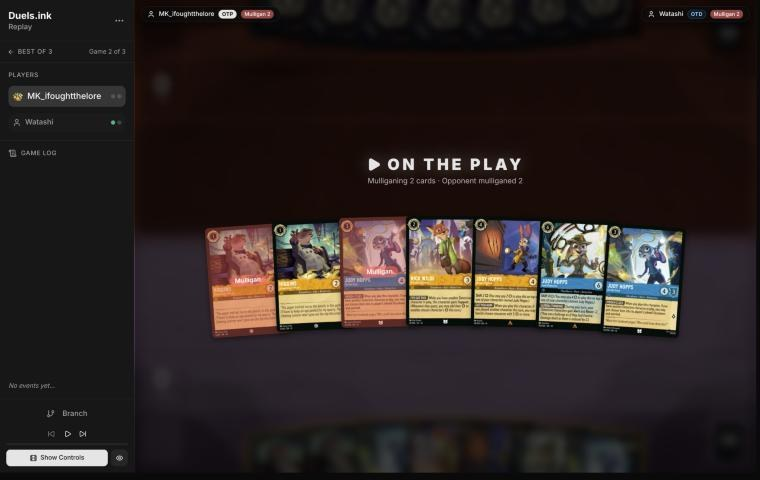
*The board before the decision: [step 0](https://duels.ink/replay/01a1a18d-4acf-74c4-8216-07ef97d65a5b?step=0) in the duels.ink replay viewer.*

**What you did:** on the play. From Higgins ×2, Judy – On the Case ×2, Nick – Providing Backup, Judy – Always
Vigilant and Judy – Lead Detective, you sent back one Higgins and one On the Case.

**Verdict:** **good play.** `mulligan.py` (1,500 deals):

| Option | Ink spent, turns 1–4 | Turns with a play | Lore by turn 4 | Characters by turn 4 | Interaction |
|---|---|---|---|---|---|
| Keep all 7 | 9.70 / 10 | 3.99 / 4 | 6.7 | 5.0 | 100% |
| As played (keep 5) | 9.78 / 10 | 3.99 / 4 | 6.4 | 4.7 | 100% |
| Keep 6 (send back one On the Case) | 9.59 / 10 | 3.98 / 4 | 7.1 | 5.0 | 100% |
| Full mulligan | 8.94 / 10 | 3.60 / 4 | 5.3 | 4.1 | 82% |

The keeps are within noise of each other on every measure. Yours kept the cards that matter in this matchup: Lead
Detective (your answer to their Evasive questers), Nick (your Supporter) and Always Vigilant, and sent back the
duplicates. On the Case's HIDDEN CLUES has no items to hit in their list, so a second copy is just a 4/3.

### Turn 1: your turn 1

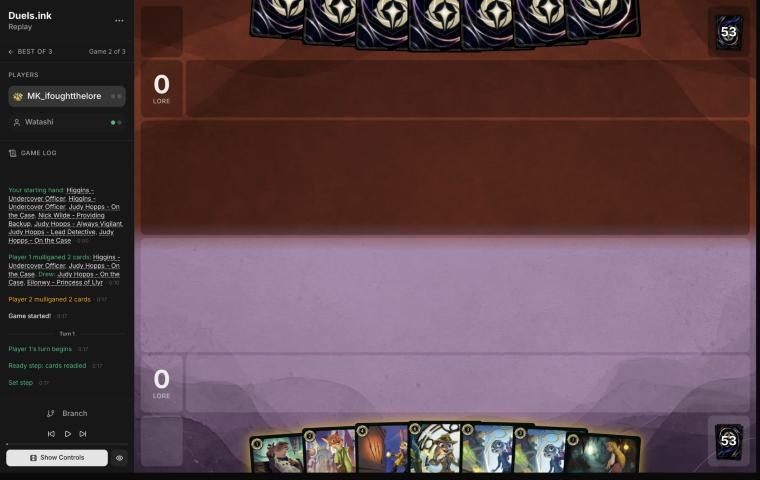
*The board before the decision: [step 2](https://duels.ink/replay/01a1a18d-4acf-74c4-8216-07ef97d65a5b?step=2) in the duels.ink replay viewer.*

**What you did:** inked a Judy – On the Case and played Higgins.

**Verdict:** **good play.** The mulligan drew back another On the Case and Eilonwy, so you held two On the Cases; the
spare one was the right ink, since its HIDDEN CLUES has no items to hit here. Higgins before Eilonwy because he's a
Detective: next turn he gives Nick – Providing Backup his Support.

### Turn 3: your turn 2

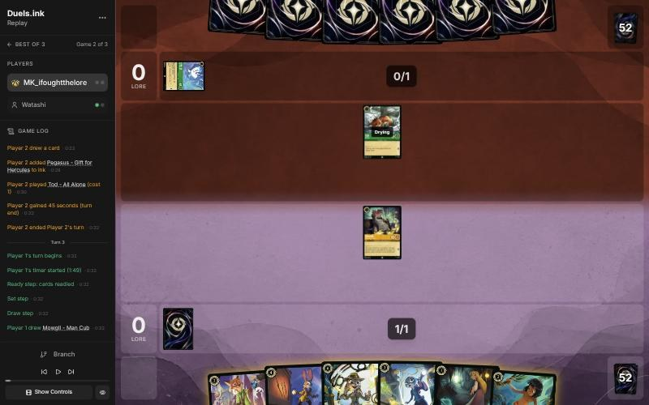
*The board before the decision: [step 8](https://duels.ink/replay/01a1a18d-4acf-74c4-8216-07ef97d65a5b?step=8) in the duels.ink replay viewer.*

**What you did:** inked Eilonwy, played Mowgli – Man Cub (HAVE A BETTER LOOK showed their hand of six; they had no
non-character card to discard), and quested with Higgins (1–0).

**Verdict:** **good play.** The alternative was Nick – Providing Backup, a better body (3/2, Support with Higgins in
play). Mowgli's case:
- Their list's non-characters are Strength of a Raging Fire ×4 and The Terror ×1, and the brief put the chance they
  held one at about 36%. Mowgli would have taken it.
- Even with no discard, you saw all six cards, which lets you plan the next turns exactly.
- Nick isn't lost: he comes down later beside another play.

Inking Eilonwy over Mowgli or Always Vigilant was fine. Always Vigilant plus Nick's +3 Support is your removal for
their 2-{S} Evasive questers here (2 + 3 = 5 {S}), so she was the one to keep.

Higgins' quest exposed him only to Tod, a 1-drop trade.

### Turn 5: your turn 3

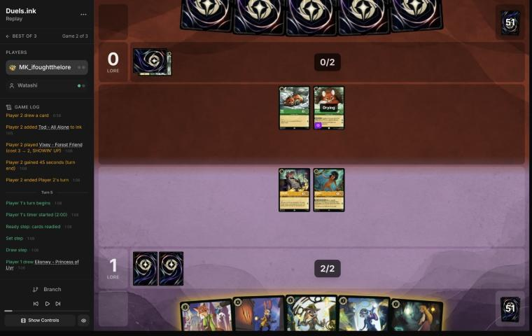
*The board before the decision: [step 15](https://duels.ink/replay/01a1a18d-4acf-74c4-8216-07ef97d65a5b?step=15) in the duels.ink replay viewer.*

**What you did:** inked your last Judy – On the Case, played Eilonwy and Nick – Providing Backup, and quested with
nobody (a Higgins quest was undone). 1–0.

**The setup:**
- **Their hand was known** from Mowgli, minus one draw: Angela – Night Warrior, Gaetan Moliere – Clever Burrower (4,
  2/5 Evasive; draws 2 and discards 2 when he quests), Elinor, Woolter & Jesse (3, 4/4 Bodyguard, Challenger 2) and
  Mushu. Vixey (Evasive, 2 lore) was on the board with Tod.
- **What they can do next turn with 3 ink:** Mushu, Woolter & Jesse, or Angela. Angela's Challenger +2 and Resist +2 on
  Tod would kill any exerted character of yours for free. No Strength of a Raging Fire in hand (8% after their draw),
  and Elinor needs 4 ink.
- **Your answer to their Evasive board is Lead Detective's Alert.** She costs 6, or Shift 4 onto any Judy Hopps.

**Verdict:** **inaccuracy.** Playing **Eilonwy and Nick**, and inking On the Case, is suboptimal because it leaves no
Judy in play, so Lead Detective can't Shift next turn. Her Alert is the only way your characters reach Vixey, Mushu
and Gaetan, and all three were on the board or in their hand.

Playing **On the Case** (inking Eilonwy) is better because it's the Shift base: next turn Lead Detective goes onto
her for 4 ink, already dry. She can challenge at once with Alert and Resist +2, and Higgins gets Alert too.
- **The timing:** in your line the earliest Lead Detective is game turn 9, after Always Vigilant is hard-cast on turn
  7 to serve as the base. That's a turn later, and it spends Always Vigilant as a base rather than as removal.
- **What On the Case exposes:** nothing. She enters ready and drying, and their only chosen damage (Elinor) needs
  4 ink.
- **What it gives up:** Nick and Eilonwy wait a turn. They're the Supporters for Always Vigilant later, and they're
  still in hand for that.

Keeping Higgins ready was sound with Angela known in their hand: a quest would have offered Tod a free kill.
([TEMPO-1](#cite-tempo-1), [THREAT-3](#cite-threat-3); confidence medium, since the wider board has value against their 1- and 2-drops.)

### Turn 7: your turn 4

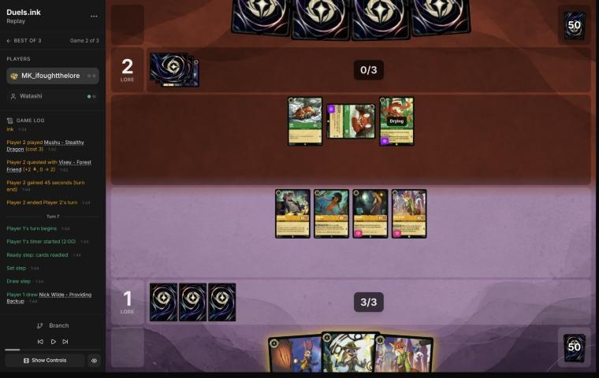
*The board before the decision: [step 25](https://duels.ink/replay/01a1a18d-4acf-74c4-8216-07ef97d65a5b?step=25) in the duels.ink replay viewer.*

**What you did:** inked the Nick you drew and hard-cast Judy – Always Vigilant (GOT YOU NOW had no condition met). No
quests (1–2).

**The setup:** Always Vigilant's banish was out of reach this turn. Nick and Eilonwy could Support Mushu or Tod up to
5 {S}, but GOT YOU NOW needs another character played first, and hard-casting her took all 4 ink. So the choices were
how to use the ink, and whether to quest.

**Verdict:** **close call**, and a good plan.
- **Always Vigilant now is right:** she's a Judy, so next turn Lead Detective Shifts onto her for 4 of your 5 ink and
  gives your Detectives Alert. Nick #2 instead would have left Lead Detective uncastable until game turn 11.
- **Not questing** gave up 4 lore at 1–2. The coach's first lean was to quest with all four, since each challenge
  costs them a quest. Your line has a strong case:
  - Angela was known in their hand. On Mushu or Tod it gives Challenger +2 and Resist +2, a free kill on any exerted
    character of yours.
  - A ready board gives them nothing to challenge, so their characters quest. Questers are exerted on your turn,
    which is when Lead Detective's Alert lets Higgins, Nick and Lead Detective herself challenge Evasive characters.
  - Every character that survives to that turn is a challenger then.
- **The cost:** 4 lore, and the race. They quest for 4 a turn (Vixey 2, Mushu, Tod).

Both lines are within the uncertainty: yours trades lore now for a bigger turn 9. ([H-6](#cite-h-6) is the pattern; [RULE-1](#cite-rule-1).)

### Turn 9: your turn 5

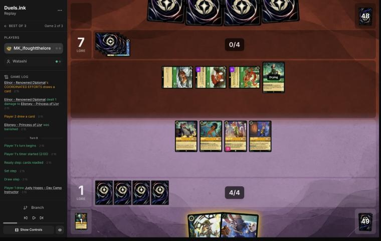
*The board before the decision: [step 37](https://duels.ink/replay/01a1a18d-4acf-74c4-8216-07ef97d65a5b?step=37) in the duels.ink replay viewer.*

**What you did:** Shifted Judy – Lead Detective onto Always Vigilant. With her Alert and Resist +2, Nick banished
Vixey, Higgins banished Tod and Lead Detective banished Mushu, none of them taking real damage (Lead Detective took 1).
Mowgli quested (2–7).

**Verdict:** **good play.** This was the turn the last two set up: all three of their questers were exerted, and only
Alert reaches the two Evasive ones. The coach also weighed keeping Lead Detective ready:
- **That line:** Nick on Vixey and Higgins on Mushu kill both Evasive questers, and Lead Detective stays ready, so
  nothing can challenge her and she gives Alert again next turn against Gaetan (Evasive, 2/5, known in their hand).
  Tod lives.
- **Your line kills Tod as well,** and leaves Lead Detective exerted on 3 willpower. Elinor (3 {S}) can then trade
  with her, as can Angela's Challenger +2 on Elinor. That trade is their engine (Elinor's ping, lore and card each
  turn) for yours, and otherwise their board is empty.

The two are close. Yours takes the sure extra kill and leaves them a single character; the other keeps the engine
safe for Gaetan. Mowgli's quest was free lore: he's not a Detective, so he couldn't use Alert.

### Turn 11: your turn 6

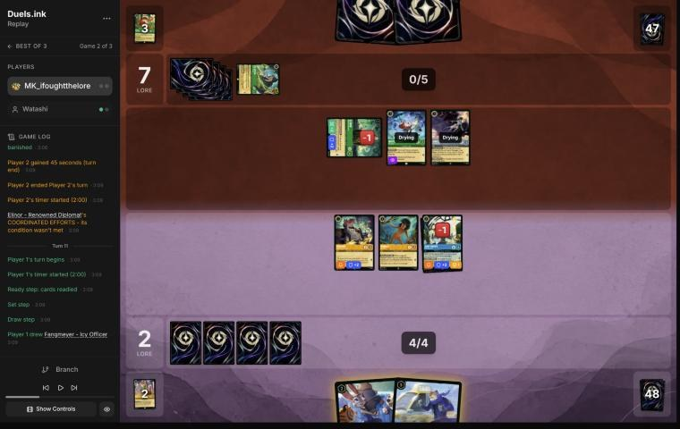
*The board before the decision: [step 50](https://duels.ink/replay/01a1a18d-4acf-74c4-8216-07ef97d65a5b?step=50) in the duels.ink replay viewer.*

**What you did:** Lead Detective challenged and banished the exerted Elinor (Angela's Resist +2 still on her cut the
damage to 4, enough with her 1 damage), taking 1. Then Day Camp Instructor (no LEND A PAW: nothing else was played),
and Higgins quested (3–7). Mowgli stayed ready.

**Verdict:** **good play.** Your hand was two uninkables (Day Camp Instructor, Fangmeyer), so ink was stuck at 4 and
the choices were on the board.
- **Killing Elinor** takes their engine (a ping, a lore and a card at the end of each turn with three exerted
  characters; [THREAT-2](#cite-threat-2)).
- **The cost:** Lead Detective is left exerted on 2 willpower, so White Rabbit or Angela can trade with her next turn.
- **Why the cost is bearable:** Fangmeyer's REQUEST REINFORCEMENTS returns a Detective from your discard, and Day
  Camp Instructor is a Judy, a base for a Shift 4. So she can come back.
- **The alternative,** keeping her ready for another Alert turn, leaves Elinor's engine running. Woolter & Jesse,
  known in their hand, can enter exerted as a Bodyguard and soak up that Alert turn's challenges.

### Turn 13: your turn 7

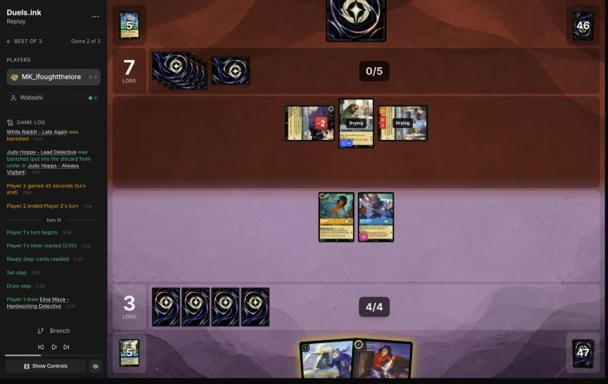
*The board before the decision: [step 60](https://duels.ink/replay/01a1a18d-4acf-74c4-8216-07ef97d65a5b?step=60) in the duels.ink replay viewer.*

**What you did:** inked Elisa Maza and played Fangmeyer, whose REQUEST REINFORCEMENTS returned Judy – Lead Detective
to your hand. No quests (3–7).

**Verdict:** **good play**, the coach's line. Elisa's look was worth nothing here (their one card was known: Gaetan),
so she was the right ink, and it made Fangmeyer castable. Lead Detective is the card to return: Day Camp Instructor is
a Judy, so she can Shift back next turn for 4 ink, and Gaetan (Evasive) is coming. Keeping Day Camp Instructor ready
protects that Shift base from Flash, Angela and Woolter & Jesse (6 {S} when challenging). Mowgli's 1 lore wasn't worth
offering them a free kill.
- **No challenges:** Woolter & Jesse was exerted with Bodyguard, so any challenge had to go into his 4 willpower, and
  the damaged Angela behind him was out of reach.

### Turn 15: your turn 8

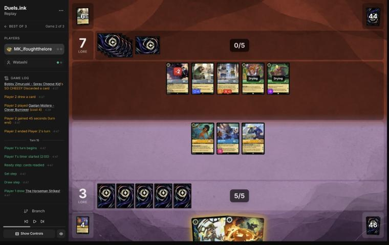
*The board before the decision: [step 70](https://duels.ink/replay/01a1a18d-4acf-74c4-8216-07ef97d65a5b?step=70) in the duels.ink replay viewer.*

**What you did:** cast The Horseman Strikes! on Gaetan Moliere, drawing Nick – Toy Drive Officer. No ink (your only
inkable card was Lead Detective), no quests (3–7).

**Verdict:** **good play**, the coach's pick.
- **The setup:** both boards were ready, so nothing could be challenged. Their hand was empty, and Gaetan was their one
  Evasive character and their card filter. The other candidate was Lead Detective Shifted onto Day Camp Instructor now.
- **Why the Horseman first:** it's the cheap, exact answer to their last Evasive character, and it replaces itself.
  That leaves Lead Detective for next turn as a 6/4 that quests for 2.
- **Holding Lead Detective rather than inking her** keeps your recurring threat; 2 ink unspent was the price.
- **Not questing** kept Fangmeyer away from Woolter & Jesse, who challenges for 6. A quest there would have been a
  trade of your 5-drop for their 3-drop.

### Turn 17: your turn 9

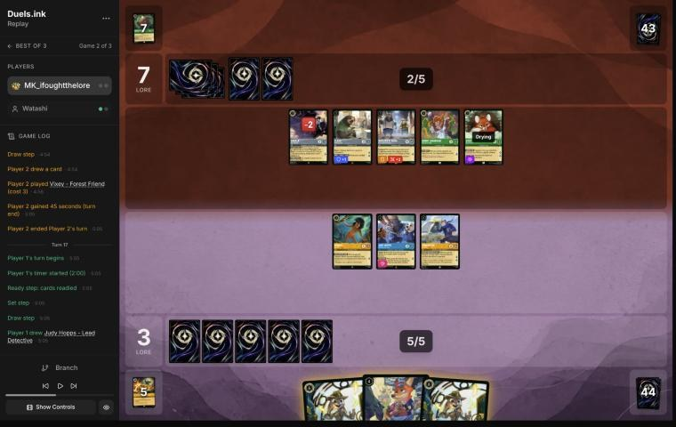
*The board before the decision: [step 75](https://duels.ink/replay/01a1a18d-4acf-74c4-8216-07ef97d65a5b?step=75) in the duels.ink replay viewer.*

**What you did:** played Nick – Toy Drive Officer and kept both Lead Detectives (you drew the second), with no ink
and no quests (3–7).

**The setup:** a standoff. Neither side had quested since game turn 12. All five of their characters stood ready:
Angela on 1 willpower left, Flash, Woolter & Jesse, Bobby, and Vixey (drying). Their hand was empty, and their board
quests for 7 a turn. You held two Lead Detectives and Toy Drive Officer, with 5 ink and nothing else inkable.

**Verdict:** **close call.**
- **Toy Drive Officer now:** keeps Lead Detective hidden for a turn when they do quest, and adds a Supporter with 4
  willpower.
- **Inking a Lead Detective to reach 6 ink** was the other option, then Shifting the other onto Day Camp Instructor.
  That's a permanent extra ink in a deck with 12 uninkables, and your fifth and sixth cards cost 5 and 6. A second
  copy in hand is worth less than the first.
- **The cost of your choice:** the second Lead Detective can only be hard-cast at 6, so it waits for a drawn inkable.

The two are close ([INK-3](#cite-ink-3)). Not questing was consistent with the standoff: Woolter & Jesse challenges for 6.

### Turn 19: your turn 10

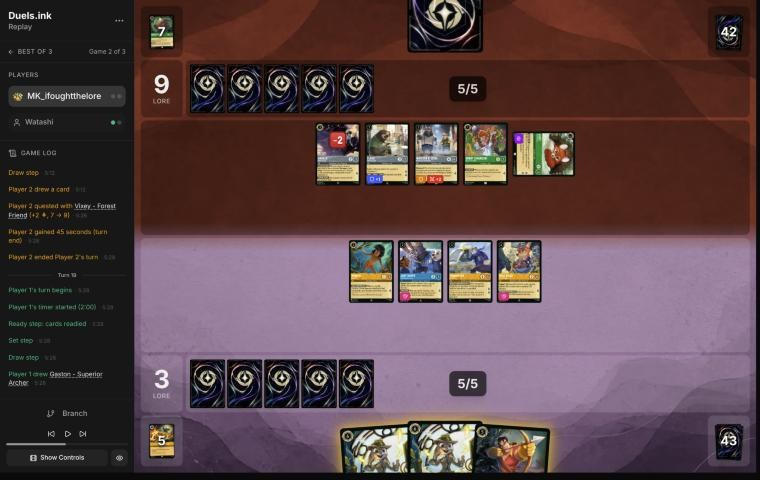
*The board before the decision: [step 79](https://duels.ink/replay/01a1a18d-4acf-74c4-8216-07ef97d65a5b?step=79) in the duels.ink replay viewer.*

**What you did:** inked Gaston, hard-cast Lead Detective for 6, and Fangmeyer (with her Alert and Resist +2)
banished the exerted Vixey, taking nothing (3–9).

**Verdict:** **good play**, better than the coach's plan.
- **What had to happen:** Vixey had just quested. She was their one quester that's safe from your normal challenges
  (Evasive, 2 lore), and Alert was the only way to reach her.
- **The coach's plan:** ink the second Lead Detective, Shift the first onto Day Camp Instructor for 4, and keep Gaston,
  whose WATCH THIS! with Toy Drive Officer's +2 Support reaches Woolter & Jesse (4 + 2 = 6) or Flash. That uses 4 of
  your 6 ink.
- **Your line uses all 6.** It keeps Day Camp Instructor as the base for the second Lead Detective next turn (4 ink),
  so you'll have two 2-lore, 6-{S} threats.
- **What it gave up:** Gaston's single banish. In a standoff where they keep everything ready, two big questers and
  the ink are worth more.
- **Fangmeyer, not Lead Detective, took the challenge:** he's the one left exerted for Woolter & Jesse (6 when
  challenging), and he's the cheaper one to lose.

### Turn 21: your turn 11

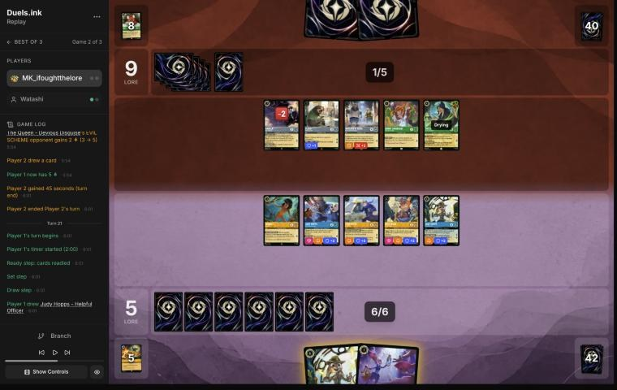
*The board before the decision: [step 86](https://duels.ink/replay/01a1a18d-4acf-74c4-8216-07ef97d65a5b?step=86) in the duels.ink replay viewer.*

**What you did:** hard-cast the second Lead Detective (a Shift onto the first was undone), kept the Helpful Officer
you drew, and quested with Fangmeyer and Mowgli (8–9). The two Lead Detectives, Toy Drive Officer and Day Camp
Instructor stayed ready.

**Verdict:** **good play.**
- **Hard-cast or Shift onto Day Camp Instructor:** the Shift costs 4 and leaves room for Helpful Officer, with the
  same number of characters at the end. It also gives a Lead Detective who's dry and can quest now. Hard-casting keeps
  Day Camp Instructor's Support and Helpful Officer's heal for later. Close; both are fine. Undoing the Shift onto the
  other Lead Detective was right, since that only stacks two Lead Detectives into one character.
- **The quests were chosen well.** Their challengers that matter are Woolter & Jesse (6 when challenging) and The
  Queen (5 {S}, 3 willpower).
  - Fangmeyer kills either one if they challenge him (4 {S} against 4 and 3 willpower), so his quest offers only
    even trades.
  - Mowgli is a 2-drop.
  - The Lead Detectives stayed ready, so their 2 lore each wasn't put at risk against The Queen and Woolter & Jesse.
- **The race:** you're 8–9. Passing them turns on The Queen's JEALOUS HEART (+2 lore while you lead), so she quests for
  3. Count that in the next turn's race.

### Turn 23: your turn 12

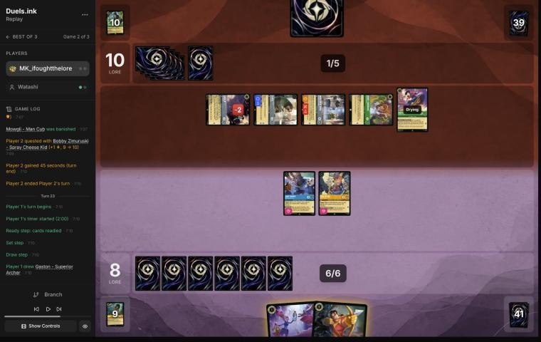
*The board before the decision: [step 104](https://duels.ink/replay/01a1a18d-4acf-74c4-8216-07ef97d65a5b?step=104) in the duels.ink replay viewer.*

**What you did:** Day Camp Instructor quested (9–10) and Supported Woolter & Jesse up to 6 {S}, Gaston's WATCH THIS!
banished him, Toy Drive Officer challenged and banished Angela, and Helpful Officer removed the 2 damage Toy Drive
Officer took. COMMUNITY OUTREACH drew Judy – Uncovering Clues.

**Verdict:** **good play**, the best line of the game so far, and better than the coach's.
- **The setup:** at 8–10, the two Lead Detectives were gone to two Strength of a Raging Fires (Max Goof had returned
  the first). Their board quested for 6 a turn, which reaches 20 on game turn 26.
- **The Bodyguard first:** Woolter & Jesse was exerted, so every challenge of yours had to go into him first. Support
  turned him into a Gaston target. That removed both their best challenger (6 {S} when challenging) and the block.
- **The coach's plan** was the same Support and Gaston, but then Day Camp Instructor challenging Bobby, which
  leaves her on 1 willpower and gives up her quest.
- **Your line did better in two ways:**
  - Day Camp Instructor quested *and* Supported, so she both scored and set up the banish.
  - Toy Drive Officer (4 willpower) took the challenge into Angela, and Helpful Officer's TO THE RESCUE put him back to
    full. That's two kills, a lore, a card, and no damage left on your board.
- The coach missed TO THE RESCUE here, as in game 1, turn 10.
- **What it leaves exposed:** Day Camp Instructor (exerted, 2 willpower) to Flash or Max Goof, a 2-drop for their
  challenge. Their biggest challenger is now Flash's 3.

### Turn 25: your turn 13

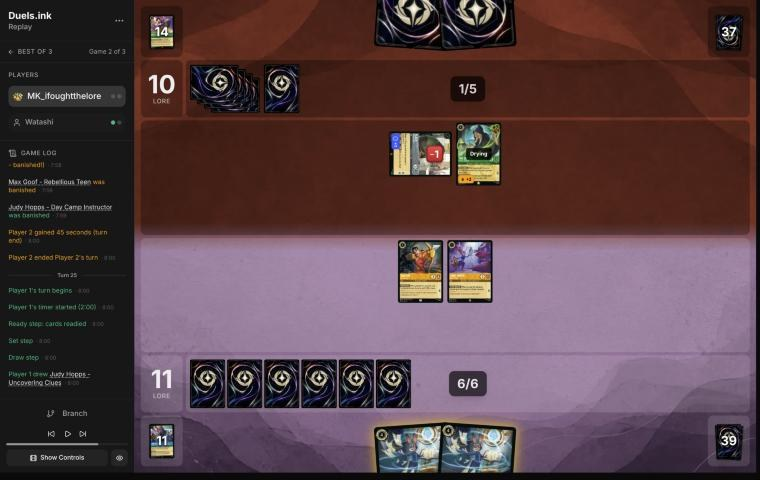
*The board before the decision: [step 122](https://duels.ink/replay/01a1a18d-4acf-74c4-8216-07ef97d65a5b?step=122) in the duels.ink replay viewer.*

**What you did:** played Judy – Uncovering Clues (THOROUGH INVESTIGATION found a third one), traded Helpful Officer for
the damaged Flash, and quested with Gaston (12–10). No ink.

**Verdict:** **good play.**
- **Helpful Officer for Flash:** your spent 1-drop for their 2-lore quester. Flash's Resist 1 still let 1 damage
  through, which was enough on 1 willpower.
- **Gaston's quest:** his ability was spent, so he's a 3/4 for 1 lore. The only thing that can punish the quest is
  The Queen (5 {S}), and she dies to his 3 {S} back (3 willpower). That's a trade you'd take, and if she challenges she
  doesn't quest for 3 (her JEALOUS HEART is on while you lead).
- **No ink:** with two Uncovering Clues in hand, inking one now or next turn reaches the same ink then, and waiting
  keeps the choice open for next turn's draw ([SEQ-1](#cite-seq-1)).

### Turn 27: your turn 14

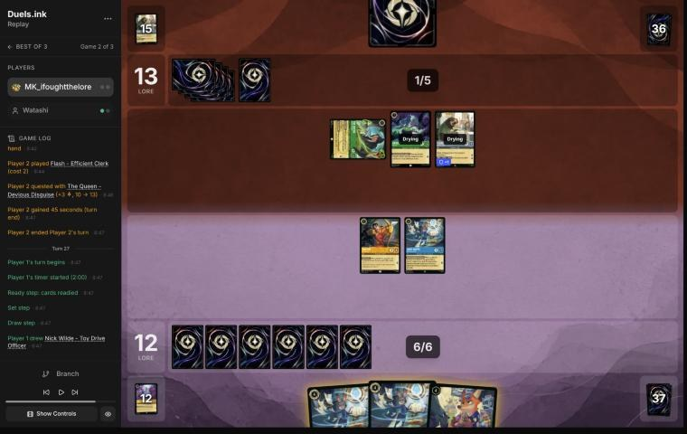
*The board before the decision: [step 132](https://duels.ink/replay/01a1a18d-4acf-74c4-8216-07ef97d65a5b?step=132) in the duels.ink replay viewer.*

**What you did:** Gaston challenged The Queen (both banished). Uncovering Clues quested (13–13), and THOROUGH
INVESTIGATION found Fangmeyer. You played him, returned Nick – Providing Backup with REQUEST REINFORCEMENTS, then
inked an Uncovering Clues and played Nick: all 7 ink.

**Verdict:** **good play.**
- **The Queen had to go:** at 12–13 she was one lore of quest, but three the moment you took the lead (JEALOUS
  HEART). Gaston, whose ability was spent, was the right one to trade. Uncovering Clues' quest digs, so she was worth
  more alive.
- **The order was right** ([SEQ-1](#cite-seq-1)): quest the digger first, then decide the plays and the ink once you'd seen what
  came. Fangmeyer turned the dig into a second card.
- **The one alternative** was returning a Lead Detective, castable next turn, instead of Nick. Nick used the last 2
  ink now, and there are no Evasive characters left on their side for Lead Detective's Alert to matter. Close.
- **What's exposed:** Uncovering Clues (exerted, 3 willpower) to Flash's 3 {S}.

### Turn 29: your turn 15

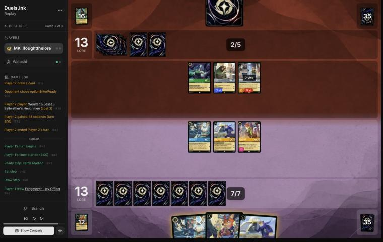
*The board before the decision: [step 145](https://duels.ink/replay/01a1a18d-4acf-74c4-8216-07ef97d65a5b?step=145) in the duels.ink replay viewer.*

**What you did:** played the second Fangmeyer (returning Judy – Always Vigilant). Nick quested and Supported Flash up
to 6 {S}. Uncovering Clues quested and dug another Always Vigilant. One Always Vigilant Shifted onto Uncovering Clues
for 2, and GOT YOU NOW banished Flash. The first Fangmeyer quested: 17–13.

**Verdict:** **good play**, and the coach had planned almost exactly this line.
- **The race:** at 13–13 both boards quest for about 4, and you quest first. Getting to 17 means they must spend
  their turn stopping your next quests rather than scoring.
- **The ink:** Fangmeyer (5) plus the Shift (2) is all 7, with GOT YOU NOW's condition met by Fangmeyer.
- **The order is right:** quest Nick for the Support and Uncovering Clues for the dig *before* the Shift covers her.
- **Flash or Woolter & Jesse:** the coach would have pushed Woolter & Jesse (4 + 3 = 7) instead. He's the one that
  can kill a 4-willpower character on their turn. Flash is 2 lore to his 1. Neither leaves them a way to 20 next turn:
  Ursula and Woolter & Jesse quest for 2 at most.
- **Your next turn:** Fangmeyer #2 (ready), Always Vigilant, Nick and the first Fangmeyer are 6 lore between them, and
  Woolter & Jesse can stop only one. Their outs are a couple of removal cards at about 16% each, none of which kills
  two.

### Turn 30: their turn

**What happened:** they drew and conceded at 13–17.

## Lessons
1. **Lead Detective needs a Judy to Shift onto, so keep one.** Shift 4 onto any Judy Hopps brings her two turns before
   her hard cost, and she can act at once. Against an Evasive board, the Judy in hand is a Shift base before it's an
   ink ([turn 5](#turn-5)).
2. **Support turns your strength removal on their wall.** Day Camp Instructor or Nick pushes Woolter & Jesse, Flash or
   anything else to 5 {S}, then Gaston or Always Vigilant banishes it ([turns 23](#turn-23) and [29](#turn-29)). Their
   list has one natural target, The Queen; Support makes every character a target.
3. **Fangmeyer is the engine of a long game.** Twice he returned the card the turn needed: Lead Detective on turn 13,
   Always Vigilant on turn 29.
4. **Strength of a Raging Fire comes back.** Max Goof returns it, and any of their cost-3+ characters sings it. On turn
   22 it was cast twice and took both Lead Detectives (5 and 6 damage). With Max Goof unseen and their board wide,
   count two Strengths, not one.

## Proposed knowledge-base updates (applied after discussion)
- **Meta** (the Emerald/Steel pair file, Watashi's section, from games 1 and 2): Gaetan Moliere – Clever Burrower
  (4, 2/5 Evasive, draws 2 and discards 2 on each quest) is in this list, though in neither duels.ink list. When their
  Evasive questers died, they stopped questing for six turns behind a ready Woolter & Jesse (entered exerted as a
  Bodyguard on turn 12). Max Goof returned Strength of a Raging Fire for a second cast in the same turn (turn 22).
- **Strategy:** [H-6](#cite-h-6) (a ready board that waits) gets evidence from both sides: your no-quest turn 7 set up turn 9, and
  their six-turn wait didn't stop your Support-and-banish turns. A candidate hypothesis: *against a ready wall,
  Support plus strength removal breaks it without exposing anything*. Watching it, not proposing it yet.

## Hindsight
Doesn't change the verdicts above.
- **Turn 22's double Strength** took 11 damage across two Lead Detectives. Keeping one Lead Detective ready on turn 21
  wouldn't have helped: Strength chooses its target, ready or not.
- **The standoff, turns 12–17:** neither side quested for six turns. Their hand was empty most of that time, while
  yours rebuilt through Fangmeyer and Uncovering Clues. Waiting favoured the side with recursion.

## The coach's errors
Filled in during discussion.

| When | Error | How it was caught | How it won't happen again |
|---|---|---|---|
| Blind pass, [turn 23](#turn-23) | Again planned a challenge without Helpful Officer's TO THE RESCUE, though it was in hand (the second time in two games) | The player's line, read in the same turn | The game 1 proposal (the brief adds your hand's heals to challenge lines) covers it |
| Blind pass, [turn 19](#turn-19) | Planned a Shift that wasted 2 ink when a hard cast kept the Shift base for the second copy | The player's line | Proposed: the brief's options list, for a Shift in hand, whether hard-casting it keeps the base for another Shift card in hand. Made when you agree |

## Open questions
- **Turn 5:** was inking On the Case a plan (Always Vigilant as the base on turn 7), or did you not want the 4/3?
- **Turn 7:** was not questing about Angela in their hand, or about saving the board for Lead Detective?

## Citations
Copies of the coach's knowledge base cited above, as they stood when they were cited (the private repository's commit and date are given with each). They don't change when the knowledge base does.

**TEMPO-1**: strategy principle, `kb/strategy/principles.md` at `1c9c5e9` (2026-11-03), working tree

> - **TEMPO-1. Tempo is how much freedom you leave the opponent, not how fast you play.** A play that forces the opponent to spend their turn answering it has stolen part of their turn. *Ask: "If I play this, what does my opponent have to do next?"* `[MCL ch.1]` · baseline

**THREAT-3**: strategy principle, `kb/strategy/principles.md` at `1c9c5e9` (2026-11-03), working tree

> - **THREAT-3. The biggest threat may not be on the board yet.** Consider:
>   - the opponent's ink next turn
>   - shift targets already in play
>   - support pieces that enable their next turn
>
>   `[MCL ch.9]` · baseline

**RULE-1**: strategy principle, `kb/strategy/principles.md` at `1c9c5e9` (2026-11-03), working tree

> - **RULE-1. Only exerted characters can be challenged** `[CR 4.6.4.2]`. Questing, singing, or {E} for an ability exposes the character. Staying ready protects it. Every quest is also a decision about what the opponent can challenge next turn. · baseline
>   - *Card text overrides this* (CR 1.2.1). Shere Khan – Khan Industries CEO's NEW INCENTIVE lets one character
>     challenge ready characters that turn. Alert (e.g. from Judy Hopps – Lead Detective, to every Detective on their
>     turn) ignores Evasive. Against Ducktectives, name both in the setup. 01a14574, turns 16 and 18. `[coach, 2026-10-26]`

**THREAT-2**: strategy principle, `kb/strategy/principles.md` at `1c9c5e9` (2026-11-03), working tree

> - **THREAT-2. Distinguish immediate threats (big lore next turn) from slow engines (card advantage over turns).** Role decides which matters more: the aggressor can often ignore engines, but the defender usually can't. `[MCL ch.9]` · baseline

**INK-3**: strategy principle, `kb/strategy/principles.md` at `1c9c5e9` (2026-11-03), working tree

> - **INK-3. Usually ink every turn, but not automatically.** Keeping one more playable card can beat one more ink. Missing ink with an expensive hand can leave you permanently behind. `[MCL ch.4]` · baseline

**SEQ-1**: strategy principle, `kb/strategy/principles.md` at `1c9c5e9` (2026-11-03), working tree

> - **SEQ-1. Gather information before irreversible decisions.** Draw, look and scry before choosing what to ink. Quest with draw triggers before committing other plays when the order doesn't otherwise matter. `[MCL ch.5]` · baseline

**H-6**: hypothesis, `kb/strategy/hypotheses.md` at `1c9c5e9` (2026-11-03), working tree

> ### H-6. Against an exert-and-challenge deck, a ready board that keeps drawing can outlast it
> - **Claim:** against decks whose removal is challenges set up by exert effects (Amethyst/Ruby tempo-midrange: Peter
>   Pan's Shadow, Isis, Wasabi's TWIN BLADES), keeping a wide board ready and drawing cards can beat questing into
>   their challengers, until a turn with a decisive attack (Judy Hopps – Lead Detective's Alert and Resist) or removal.
>   The risk is an exert-all (Demona – Scourge of the Wyvern Clan), which turns the waiting board into free kills.
> - **Why:** with nothing exerted, their challengers have no targets, so they must quest into your ready challengers or
>   wait too. Each waiting turn is a card for you (Nick Wilde – Toy Drive Officer's COMMUNITY OUTREACH) rather than
>   lore for them.
> - **Evidence for:** 01a19c0c (MK_ifoughtthelore vs VH INK, game 3; 2026-11-02). From turn 14 to turn 20 they mostly
>   didn't quest, and the waiting board found eight extra cards (six from COMMUNITY OUTREACH, one from Uncovering
>   Clues, one returned by Fangmeyer). On turn 22, Lead Detective's
>   Alert removed both Evasive questers and the board scored 8 (1 to 9 against 10). Won.
> - **Evidence against:** 01a19c00 (game 1). A ready board of five small characters waited, correctly at about 15% for
>   Demona that turn, and Demona – Scourge exerted it all on turn 11; every character died. A waiting board of 1- and
>   2-willpower characters loses everything to an exert-all.
> - **Evidence for, from the player:** 01a16039 (stonks 📈 vs roycelikerolls, game 3; relayed by danny, 2026-11-02).
>   Unintentional Icon and Merida stayed ready on turns 9, 11 and 17 at 1–4 and 3–4. The blind review called it a
>   mistake, since every challenger into them would die. The player's reasons: two cheap characters for Icon is a trade
>   they want, Icon's BESPOKE DESIGN is worth another turn, and a ready board forced them to spend Peter Pan's Shadow and
>   Shere Khan to reach it while their own board didn't quest. Revisited to close calls; won 13–4.
> - **Status:** open (two games for, one against). Applied at the user's request, 2026-11-02.

**emerald-steel.md, Midrange: how it plays**: knowledge base, `kb/meta/archetypes/emerald-steel.md` at `1c9c5e9` (2026-11-03), working tree

> ### Midrange: how it plays `[coach, meta study of the user's 27 Oct 2026 games (tools/scan.py), full games, not blind, 3 games]`
> Games: 01a17ddb, 01a17ead, 01a17f0e.
> - **Cheap Evasive questers:** White Rabbit (2), Vixey (3, or 2 with a Tod in play; 2 lore), and Mushu – Stealthy Dragon
>   (3; draws when you hold more cards).
> - **2-lore bodies:** Flash – Efficient Clerk (Resist 1; all characters lose Rush and can't gain it) and Broadway.
> - **The Queen – Devious Disguise:** +2 {L} while you lead, so she quests for 3. Her draw on play gives you 2 lore.
> - **Locks:**
>   - Toulouse – Rough and Tumble: when played, **you can't play actions (songs included) until their next turn**
>   - Ursula – Deceiver: you discard a song of their choice
> - **Fighting:** Angela – Night Warrior gives a character Challenger +2 and Resist +2. Strength of a Raging Fire deals
>   damage equal to their character count (4 in 01a17f0e turn 13).
> - **Big turns:** steady +6 quest turns (01a17ead turn 12: The Queen for 3 plus three 1s; 01a17f0e turn 13 after
>   Strength of a Raging Fire).
> - **They also used the ink drops your Mickey – Best in Town gives each player:** four on turn 6 of 01a17ddb
>   (`kb/cards/mickey-mouse-best-in-town.md`).

**rulings.md, Support can add strength to an opposing character**: knowledge base, `kb/rules/rulings.md` at `1c9c5e9` (2026-11-03), working tree

> ### Support can add strength to an opposing character
> - **Situation:** a Support character quests while the opponent has a character you want to remove with a "5 {S} or
>   more" banish: Judy Hopps – Always Vigilant's GOT YOU NOW, Gaston – Superior Archer's WATCH THIS.
> - **Ruling:** Support may choose any other character, including an opposing one. Adding the Support character's {S}
>   to theirs can lift a small character to 5 {S} for the banish. Supports stack, and a supported character supports
>   with its new {S}.
> - **Basis:** CR 8.13.1 (Support: "add this character's {S} to another chosen character's {S} this turn"; "another
>   chosen character" isn't limited to your own).
> - **Confidence:** derived from CR and confirmed by duels.ink's engine: Detectives opponents did it to the user's
>   characters (01a17e54 turn 21, 01a17e5d turn 12, 01a17e45 turn 23; `kb/meta/archetypes/amber-sapphire.md`), and
>   MK_ifoughtthelore did it to their opponent's (01a19bb9 turn 7, 01a19bbd-79c2 turn 8). Not an official ruling.
> - **Added:** 2026-11-02, from the review of 01a19bb9 (vs xBWx); the trick was first recorded in the meta study of
>   1 Nov 2026.
