# Review: MK_ifoughtthelore vs Watashi, game 3, 3 Nov 2026

| | |
|---|---|
| **Status** | draft (blind pass done, not yet discussed) |
| **Replay** | `01a1a196-ea89` (`python3 tools/brief.py 01a1a196-ea89 --turn N`) · [duels.ink viewer](https://duels.ink/replay/01a1a196-ea8a-78d8-bec3-5f4e1a486c57?step=0) |
| **Format** | Core Constructed (from game 1), best-of-three, the deciding game. Set 14 era: inks revealed before the coin toss |
| **Decks** | You: Amber/Sapphire Detectives, as in games 1 and 2. Them: Emerald/Steel Midrange #1, known from games 1 and 2 ([the coach's notes on this pair](#cite-kb-meta-archetypes-emerald-steel-midrange-how-it-plays)) |
| **Play/draw** | They went first (they lost game 2, so it was their choice) |
| **Result** | **Win.** They conceded on game turn 20 at 15–17, giving you the match 2–1 |
| **Meta data** | snapshot of 26 Oct 2026 (fresh until 9 Nov) |
| **Chosen how** | Sent by danny, the coach's user: a match of MK_ifoughtthelore's, reviewed for them game by game. The match was 1–1, so this game decided it; the coach didn't know its result before the blind pass |

## Summary
Links go to the turn sections below.
- **Good plays:** the [pre-game](#turn-0) and turns [2](#turn-2), [6](#turn-6), [8](#turn-8), [10](#turn-10)
  (two Shift bases against Strength), [12](#turn-12) (Lead Detective on Gaetan, the one kill only she could make),
  [14](#turn-14), [16](#turn-16), [18](#turn-18) (three kills, with the Horseman's draw paying for Lead Detective) and
  [20](#turn-20).
- **Close calls:** [turn 4](#turn-4) (Mowgli's look rather than Darkwing's Ward).
- **Inaccuracies / mistakes / blunders:** none.

**What decided it:** recovering from 1–13. Their Evasive start (two Vixeys, Pegasus, Gaetan) and two Strength of a
Raging Fires took both Shift bases and the first Lead Detective. You answered with the cards that reach Evasive
characters: two Horsemen and Lead Detective twice, Fangmeyer returning her. Each time, you killed their exerted
questers in one turn ([12](#turn-12), [18](#turn-18)), and then quested while their 1-{S} characters couldn't punish
it. Gaston on The Queen closed it.

## The game, turn by turn
Verdicts judge each decision on what you could know at the time, **including archetype knowledge an experienced
player has**. Hindsight is kept to its own section. Severity scale: good play / close call /
inaccuracy / mistake / blunder. Principle IDs and hypotheses (H-n) link to copies
in the Citations section at the end, as they stood when they were cited.

**What you knew before the game:** their deck from games 1 and 2: Emerald/Steel Midrange #1, plus Gaetan Moliere.
Their key cards, with the earliest game turn each can come (they're on the play, so their turn k is game turn 2k−1):
- **Evasive questers:** Pegasus (1), White Rabbit (2), Vixey (3, 2 lore; 2 with Tod in play), Mushu (3), Gaetan
  Moliere (4, 2/5, filters 2 cards a quest). Your answers: The Horseman Strikes! and Judy – Lead Detective's Alert.
- **Elinor – Renowned Diplomat** (4, game turn 7): a ping, a lore and a card at the end of their turn with 3+ exerted
  characters. Four in the list; they drew all four in game 1.
- **Strength of a Raging Fire** (3, song; game turn 5, or sung by a dry cost-3+ character): damage equal to their
  character count, to any character of yours, ready or not. Max Goof (3) returns it, so count two in a turn (game 2,
  turn 22). **Angel – Experiment 624** (4): 2 damage a turn for a discard.
- **Angela – Night Warrior** (3): Challenger +2 and Resist +2 on one character. **Woolter & Jesse** (3, uninkable):
  4/4 Bodyguard, Challenger 2; may enter exerted to soak your challenges. **Flash** (2, 3/2/2, Resist 1).
- **The Queen – Devious Disguise** (4, 5/3): your one natural Gaston and Always Vigilant target; +2 lore while you lead.
- **Locks:** Toulouse (no actions for you until their next turn), Ursula – Deceiver (you discard a song).
- **Your answers from game 2:** Support onto their character, then Gaston or Always Vigilant
  ([ruling](#cite-kb-rules-rulings-support-can-add-strength-to-an-opposing-character)); Fangmeyer recycling either.

### Pre-game

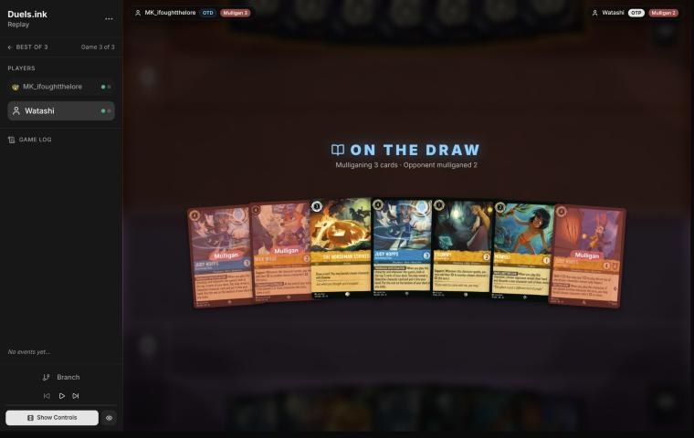
*The board before the decision: [step 0](https://duels.ink/replay/01a1a196-ea8a-78d8-bec3-5f4e1a486c57?step=0) in the duels.ink replay viewer.*

**What you did:** on the draw. From Uncovering Clues ×2, Nick – Toy Drive Officer, The Horseman Strikes!, Eilonwy,
Mowgli and Always Vigilant, you kept Horseman, one Uncovering Clues, Eilonwy and Mowgli, and sent back the other
three.

**Verdict:** **good play**, the coach's keep. The seven held four 4-drops, one of them uninkable. `mulligan.py`
(1,500 deals):

| Option | Ink spent, turns 1–4 | Turns with a play | Lore by turn 4 | Characters by turn 4 | Interaction |
|---|---|---|---|---|---|
| Keep all 7 | 9.99 / 10 | 4.00 / 4 | 5.7 | 3.9 | 100% |
| Keep 5 (also Always Vigilant) | 9.92 / 10 | 4.00 / 4 | 6.3 | 4.5 | 100% |
| As played (keep 4) | 9.85 / 10 | 4.00 / 4 | 6.5 | 4.8 | 100% |
| Keep 3 (also send back Uncovering Clues) | 9.75 / 10 | 3.99 / 4 | 6.8 | 5.0 | 100% |
| Full mulligan | 9.40 / 10 | 3.76 / 4 | 5.9 | 4.6 | 86% |

On the draw against cheap Evasive questers, early bodies matter, and your keep gained almost a character over keeping
all seven. You kept the Horseman (your Evasive answer) and one Uncovering Clues (card flow), and sent back the
duplicate and the clunky uninkable. Sending back the second Uncovering Clues as well gains a little early board but
loses the dig.

### Turn 2: your turn 1

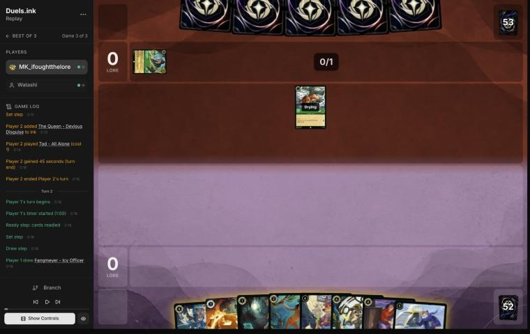
*The board before the decision: [step 5](https://duels.ink/replay/01a1a196-ea8a-78d8-bec3-5f4e1a486c57?step=5) in the duels.ink replay viewer.*

**What you did:** inked Elisa Maza and played Eilonwy.

**Verdict:** **good play.** The mulligan drew back Toy Drive Officer, Lead Detective and Elisa, and you drew Fangmeyer:
two uninkables, so the other six cards carry the ink. Elisa is the right one to give up. Her FOLLOW THE TRAIL found
nothing in game 1, since their list has only five non-character cards, and Mowgli does the same look for 2. Eilonwy is
your only 1-drop.

### Turn 4: your turn 2

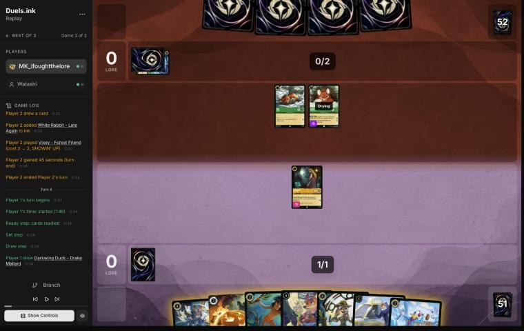
*The board before the decision: [step 11](https://duels.ink/replay/01a1a196-ea8a-78d8-bec3-5f4e1a486c57?step=11) in the duels.ink replay viewer.*

**What you did:** inked the Darkwing Duck you drew and played Mowgli; HAVE A BETTER LOOK showed their four cards, with
no non-character to discard. Eilonwy stayed ready.

**Verdict:** **close call.** The other way round, Darkwing in play and Mowgli in the ink, gives a 4/1 with Ward.
Strength of a Raging Fire, Angel and Elinor all choose their targets, so Ward makes him immune to the removal that
killed your Lead Detectives in game 2. Mowgli gives a look at their whole hand and about a 1-in-3 chance of taking a
Strength. Both are reasonable. Keeping Eilonwy back avoided only an even trade with Tod.

### Turn 6: your turn 3

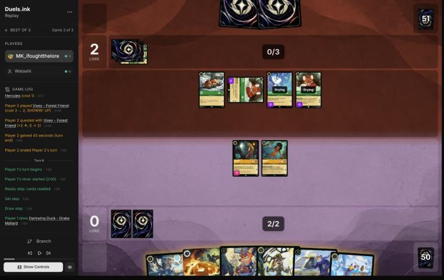
*The board before the decision: [step 19](https://duels.ink/replay/01a1a196-ea8a-78d8-bec3-5f4e1a486c57?step=19) in the duels.ink replay viewer.*

**What you did:** inked the second Darkwing and cast The Horseman Strikes! on a Vixey, drawing Judy – On the Case. No
quests (0–2).

**Verdict:** **good play.**
- **The setup:** their board was two Vixeys, Pegasus and Tod, all but Tod Evasive, questing for 6 a turn. That reaches
  20 by game turn 11, and Angela was known in their hand.
- **The play:** Horseman on a 2-lore Evasive quester is the best use of your one answer before Lead Detective. It cuts
  their clock by a third and replaces itself.
- **The ink:** Darkwing was your one spare inkable. You kept Uncovering Clues, the Judy that Lead Detective can Shift
  onto.
- **No quests:** Eilonwy and Mowgli would each have been a free kill for Tod, with Angela's Challenger +2 in their hand.

### Turn 8: your turn 4

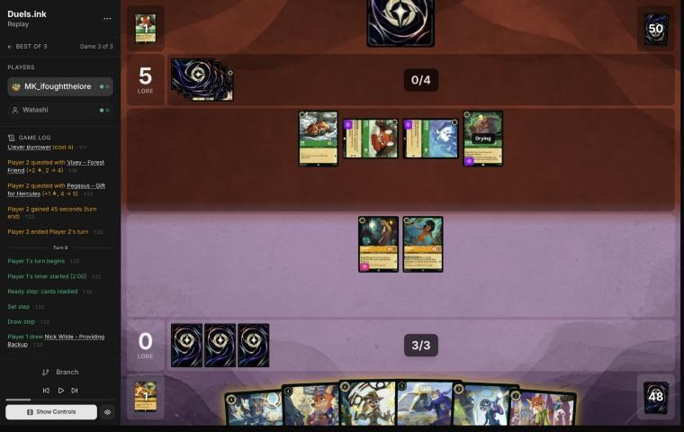
*The board before the decision: [step 28](https://duels.ink/replay/01a1a196-ea8a-78d8-bec3-5f4e1a486c57?step=28) in the duels.ink replay viewer.*

**What you did:** inked the Nick – Providing Backup you drew and played Judy – Uncovering Clues, whose dig found
Darkwing. Mowgli quested (1–5); Eilonwy stayed ready.

**Verdict:** **good play**, the coach's line.
- **The clock:** their board (Tod, Vixey, Pegasus and Gaetan, three of them Evasive) quests for 5 a turn and reaches
  20 by game turn 13. Lead Detective's Alert had to come next turn.
- **Uncovering Clues is the Judy for that:** Lead Detective Shifts onto her next turn for 4 of your 5 ink. Her dig
  pays for herself today.
- **The ink:** Nick went to the ink, and On the Case stayed in hand as a second Shift base if Strength of a Raging Fire
  (about 29% with Gaetan's dig) kills Uncovering Clues. That was the right ink to keep.
- **The quests:** Mowgli's quest offered them a trade they'd pay a quest for. Eilonwy, on 1 willpower, would have died
  to anything.

### Turn 10: your turn 5

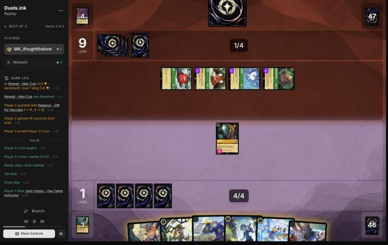
*The board before the decision: [step 43](https://duels.ink/replay/01a1a196-ea8a-78d8-bec3-5f4e1a486c57?step=43) in the duels.ink replay viewer.*

**What you did:** played Judy – On the Case, inked Darkwing, played Judy – Day Camp Instructor (LEND A PAW: another ink),
and traded Eilonwy for the damaged Tod (1–9).

**Verdict:** **good play**, the coach's line.
- **The setup:** Strength of a Raging Fire had killed Uncovering Clues, the Shift base, so Lead Detective couldn't
  come this turn: hard-cast is 6, and a Judy plus the Shift was 6 or 7. All four of their characters were exerted, and
  they quest for 5 a turn.
- **Two Judys, not one:** Strength chooses its target, ready or not, and their dig made a second copy about 23% likely.
  With On the Case *and* Day Camp Instructor down, one Strength can't take both Shift bases.
- **LEND A PAW's ink** makes next turn 7: Lead Detective's Shift (4) plus Darkwing (2).
- **Eilonwy for Tod:** a 1-drop for a 1-lore quester, which slows their clock.
- **Next turn's plan:** with Alert and Resist +2, Lead Detective, On the Case and Day Camp Instructor each kill an
  exerted Evasive quester, if they quest again.

### Turn 12: your turn 6

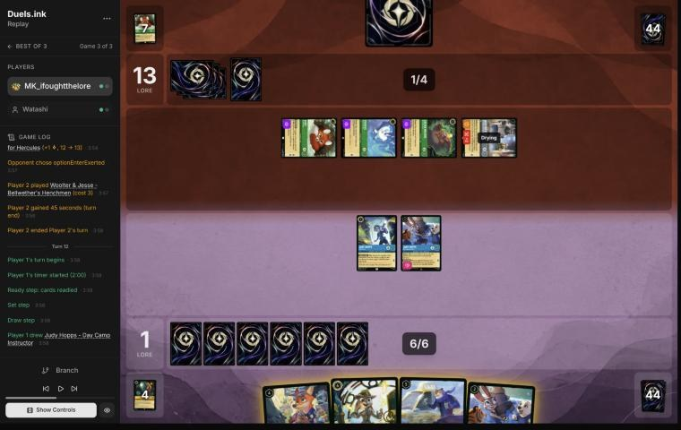
*The board before the decision: [step 57](https://duels.ink/replay/01a1a196-ea8a-78d8-bec3-5f4e1a486c57?step=57) in the duels.ink replay viewer.*

**What you did:** Shifted Lead Detective onto a Day Camp Instructor. With her Alert and Resist +2, On the Case killed
the exerted Bodyguard Woolter & Jesse (taking 2), and Lead Detective killed Gaetan Moliere (taking nothing). Then the
second Day Camp Instructor, with LEND A PAW (1–13).

**Verdict:** **good play**, a little better than the coach's plan.
- **The setup:** 1–13, with all four of their characters exerted. Woolter & Jesse, an exerted Bodyguard, had to be
  challenged first.
- **The base:** Shifting onto Day Camp Instructor, not On the Case, kept On the Case's 4 {S} as the challenger that
  kills Woolter & Jesse.
- **The second target:** the coach had Vixey (2 lore) for Lead Detective's second kill. Your choice was better:
  - Gaetan has 5 willpower, so only Lead Detective can kill him in one challenge.
  - His UNEARTH had already filtered four cards for them (it found Strength of a Raging Fire).
  - Vixey's 3 willpower is in reach of On the Case or Fangmeyer next turn.
  - It costs one lore a turn now, for a kill only this character could make ([SEQ-4](#cite-seq-4)).
- **What's left exposed:** On the Case on 1 willpower, exerted, where Pegasus or Vixey kills her. Lead Detective (4
  willpower, exerted) dies only to a Strength cast with four characters in play.

### Turn 14: your turn 7

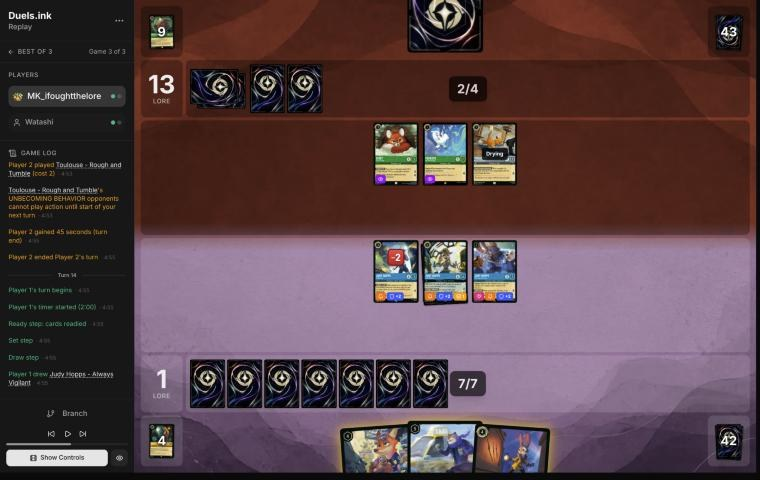
*The board before the decision: [step 65](https://duels.ink/replay/01a1a196-ea8a-78d8-bec3-5f4e1a486c57?step=65) in the duels.ink replay viewer.*

**What you did:** played Nick – Toy Drive Officer, Shifted Always Vigilant onto the dry Day Camp Instructor (no target
for GOT YOU NOW), and quested with Always Vigilant, On the Case and Lead Detective (5–13). COMMUNITY OUTREACH drew
another On the Case.

**Verdict:** **good play.**
- **The setup:** they'd stopped questing again (Vixey and Pegasus ready, Toulouse drying), so nothing could be
  challenged. At 1–13, you had to score.
- **Why questing is safe now:** their characters have 1 {S} each, so only On the Case (1 willpower left) can be killed
  by one challenge. Each challenge costs them a quest and loses the challenger to her 4 {S}.
- **Shifting onto the dry Day Camp Instructor** gave a 4/4 that quested the same turn.
- **The alternative** was Fangmeyer with the Shift (all 7 ink): a 2-lore body for next turn, and Uncovering Clues back
  to hand. Toy Drive Officer drew a card now instead. They're close; Fangmeyer's extra lore a turn would matter in a
  race this far behind.

### Turn 16: your turn 8

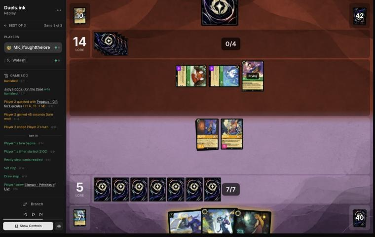
*The board before the decision: [step 81](https://duels.ink/replay/01a1a196-ea8a-78d8-bec3-5f4e1a486c57?step=81) in the duels.ink replay viewer.*

**What you did:** played Fangmeyer (returning Lead Detective), inked Eilonwy, played On the Case, and quested with
Always Vigilant and Toy Drive Officer (7–14). COMMUNITY OUTREACH drew The Horseman Strikes!.

**Verdict:** **good play**, the coach's line.
- **The setup:** a second Strength of a Raging Fire (Max Goof returned it) had killed Lead Detective, and Toulouse had
  traded with On the Case. At 5–14, their board of Vixey, Pegasus and Max Goof quests for 4.
- **This turn could only build:** the two Evasive ones were exerted, but nothing of yours could reach them.
- **Fangmeyer's return is the one that matters:** Lead Detective, who can Shift onto Always Vigilant next turn for 4.
- **On the Case** adds a 4-{S} Detective for that Alert turn.
- **Eilonwy** was the spare ink.
- **The race:** you can't reach 20 before their turn 19, so the plan has to be killing their questers on turn 18.

### Turn 18: your turn 9

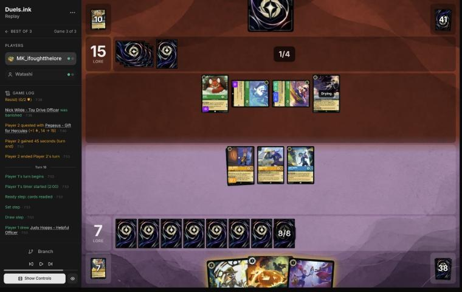
*The board before the decision: [step 98](https://duels.ink/replay/01a1a196-ea8a-78d8-bec3-5f4e1a486c57?step=98) in the duels.ink replay viewer.*

**What you did:** cast The Horseman Strikes! on the ready Vixey (drawing Higgins), inked Higgins, and hard-cast Lead
Detective for 6. With her Alert and Resist +2, On the Case killed Max Goof (Angela's Resist +2 still on him) and
Always Vigilant killed Pegasus, both taking nothing. Fangmeyer quested (9–15).

**Verdict:** **good play**, slightly better than the coach's line.
- **What had to happen:** at 15 they needed 5, and Vixey, Pegasus, Max Goof and Angela quest for exactly 5. An
  Elinor's end-of-turn lore could add one more, so killing one wasn't enough.
- **The coach's line:** the Horseman on Vixey, Lead Detective Shifted onto On the Case (dry, so she could quest),
  Fangmeyer and Always Vigilant on Pegasus and Max Goof, and Helpful Officer with the last ink.
- **Your line kills the same three and is better in two ways:**
  - The Horseman went first, so its draw (Higgins) became the ink that paid for the hard cast ([SEQ-1](#cite-seq-1)).
  - Hard-casting kept On the Case as a separate body, and it left Lead Detective ready, so nothing can challenge her
    on their turn.
- **What's left:** their whole board is Angela (drying), and they're at 15. They can't reach 20 next turn unless
  Elinor and new questers come down, and new characters can't quest the turn they're played.

### Turn 20: your turn 10

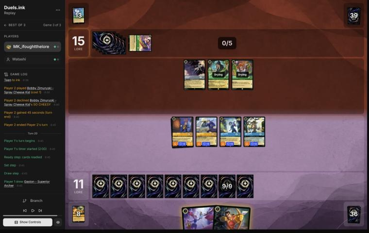
*The board before the decision: [step 112](https://duels.ink/replay/01a1a196-ea8a-78d8-bec3-5f4e1a486c57?step=112) in the duels.ink replay viewer.*

**What you did:** played Gaston, whose WATCH THIS! banished The Queen. Then Helpful Officer, and quests with Always
Vigilant, Fangmeyer, On the Case and Lead Detective (17–15). They conceded.

**Verdict:** **good play**, the coach's line. The Queen (5 {S}) was the one card that could beat you:
- **Her lore:** once you passed 15, JEALOUS HEART would make her quest for 3. With Angela and Bobby that's 15 + 5 = 20
  on their turn.
- **Her challenges:** her 5 {S} kills any of your exerted 4-willpower questers.

With her banished, Angela and Bobby quest for 2 at most, and neither can kill a 4-willpower character. You'd reach 20
next turn first, and the concession was theirs to make.

## Lessons
1. **Against Strength of a Raging Fire, keep two Shift bases.** It chooses any character, ready or not, and Max Goof
   brings it back. On [turn 10](#turn-10) two Judys meant one Strength couldn't stop Lead Detective. On turn 9 a single
   base (Uncovering Clues) had been killed.
2. **Spend each removal on the target only it can reach.** Lead Detective's 6 {S} on Gaetan's 5 willpower, and leave
   the 3-willpower Vixey for the next Alert turn ([turn 12](#turn-12)). The Horseman takes any Evasive, so use it on
   the one your challengers can't.
3. **Sequence the draw before the ink.** The Horseman's card on [turn 18](#turn-18) became the ink that paid for Lead
   Detective ([SEQ-1](#cite-seq-1)).
4. **Once their characters have 1–2 {S}, quest with your 4-willpower Detectives.** Nothing they had could kill one in a
   single challenge, and each challenge cost them a quester ([turns 14](#turn-14) and [20](#turn-20)).

## Proposed knowledge-base updates (applied after discussion)
- **Meta** (the Emerald/Steel pair file, Watashi's section, from all three games): the list ran Gaetan Moliere (in
  neither duels.ink list), at least three Vixeys, two Max Goofs and two Woolter & Jesse. Max Goof returned Strength of
  a Raging Fire in games 2 and 3, so expect two Strengths a game. Their pattern was to quest with Evasive characters,
  then wall up behind ready characters (and Woolter & Jesse entering exerted as a Bodyguard) once Lead Detective was
  down.
- **Strategy:** a candidate hypothesis from games 2 and 3: *against Emerald/Steel Midrange, Lead Detective is the win
  condition for Detectives, so protect the route to her*. That means Judys kept as Shift bases (two against
  Strength), Fangmeyer to bring her back, and the Horseman for the Evasive questers she can't reach in time. It was the
  turning point of both wins and absent from the loss. Watching it, not proposing it yet.

## Hindsight
Doesn't change the verdicts above.
- **Across the match:** you won the two games where Lead Detective landed by your turn 5 or 6 (game 2 turn 9, game 3
  turn 12), and lost the one where she came on turn 14.
- **Their second Strength** (Max Goof's return on turn 15) cost you the first Lead Detective; Fangmeyer's return
  replaced her the next turn.

## The coach's errors
Filled in during discussion.

| When | Error | How it was caught | How it won't happen again |
|---|---|---|---|
| Blind pass, [turn 12](#turn-12) | Planned Lead Detective's second kill on Vixey (2 lore), missing that Gaetan's 5 willpower made him the target only she could reach | The player's line, read in the same turn | Proposed: the brief's challenge options mark targets only one of your characters can kill ("only Lead Detective kills this"). Made when you agree |

## Open questions
- **Turn 4:** Mowgli's look over Darkwing's Ward: was it to plan the Horseman target?
- **Turn 14:** Toy Drive Officer over Fangmeyer: was the card draw worth more than the 2-lore body, at 1–13?

## Citations
Copies of the coach's knowledge base cited above, as they stood when they were cited (the private repository's commit and date are given with each). They don't change when the knowledge base does.

**SEQ-4**: strategy principle, `kb/strategy/principles.md` at `81fef75` (2026-11-03), working tree

> - **SEQ-4. Sequence across turns.** A slightly weaker play now can set up a much stronger next turn: keep a shift target alive, keep a singer ready, hold removal for a bigger threat. `[MCL ch.5]` · baseline

**SEQ-1**: strategy principle, `kb/strategy/principles.md` at `81fef75` (2026-11-03), working tree

> - **SEQ-1. Gather information before irreversible decisions.** Draw, look and scry before choosing what to ink. Quest with draw triggers before committing other plays when the order doesn't otherwise matter. `[MCL ch.5]` · baseline

**emerald-steel.md, Midrange: how it plays**: knowledge base, `kb/meta/archetypes/emerald-steel.md` at `81fef75` (2026-11-03), working tree

> ### Midrange: how it plays `[coach, meta study of the user's 27 Oct 2026 games (tools/scan.py), full games, not blind, 3 games]`
> Games: 01a17ddb, 01a17ead, 01a17f0e.
> - **Cheap Evasive questers:** White Rabbit (2), Vixey (3, or 2 with a Tod in play; 2 lore), and Mushu – Stealthy Dragon
>   (3; draws when you hold more cards).
> - **2-lore bodies:** Flash – Efficient Clerk (Resist 1; all characters lose Rush and can't gain it) and Broadway.
> - **The Queen – Devious Disguise:** +2 {L} while you lead, so she quests for 3. Her draw on play gives you 2 lore.
> - **Locks:**
>   - Toulouse – Rough and Tumble: when played, **you can't play actions (songs included) until their next turn**
>   - Ursula – Deceiver: you discard a song of their choice
> - **Fighting:** Angela – Night Warrior gives a character Challenger +2 and Resist +2. Strength of a Raging Fire deals
>   damage equal to their character count (4 in 01a17f0e turn 13).
> - **Big turns:** steady +6 quest turns (01a17ead turn 12: The Queen for 3 plus three 1s; 01a17f0e turn 13 after
>   Strength of a Raging Fire).
> - **They also used the ink drops your Mickey – Best in Town gives each player:** four on turn 6 of 01a17ddb
>   (`kb/cards/mickey-mouse-best-in-town.md`).

**rulings.md, Support can add strength to an opposing character**: knowledge base, `kb/rules/rulings.md` at `81fef75` (2026-11-03), working tree

> ### Support can add strength to an opposing character
> - **Situation:** a Support character quests while the opponent has a character you want to remove with a "5 {S} or
>   more" banish: Judy Hopps – Always Vigilant's GOT YOU NOW, Gaston – Superior Archer's WATCH THIS.
> - **Ruling:** Support may choose any other character, including an opposing one. Adding the Support character's {S}
>   to theirs can lift a small character to 5 {S} for the banish. Supports stack, and a supported character supports
>   with its new {S}.
> - **Basis:** CR 8.13.1 (Support: "add this character's {S} to another chosen character's {S} this turn"; "another
>   chosen character" isn't limited to your own).
> - **Confidence:** derived from CR and confirmed by duels.ink's engine: Detectives opponents did it to the user's
>   characters (01a17e54 turn 21, 01a17e5d turn 12, 01a17e45 turn 23; `kb/meta/archetypes/amber-sapphire.md`), and
>   MK_ifoughtthelore did it to their opponent's (01a19bb9 turn 7, 01a19bbd-79c2 turn 8). Not an official ruling.
> - **Added:** 2026-11-02, from the review of 01a19bb9 (vs xBWx); the trick was first recorded in the meta study of
>   1 Nov 2026.
