# Review: MK_ifoughtthelore vs George, game 1, 3 Nov 2026

| | |
|---|---|
| **Status** | draft (blind pass done, not yet discussed) |
| **Replay** | `01a1a1ee-148c` (`python3 tools/brief.py 01a1a1ee-148c --turn N`) · [duels.ink viewer](https://duels.ink/replay/01a1a1ee-1499-73a8-8638-ce580909c41c?step=0) |
| **Format** | Core Constructed (stated in the replay), best-of-three, game 1. Set 14 era: inks revealed before the coin toss |
| **Decks** | You: Amber/Sapphire Detectives (the list from your matches against VH INK and Watashi). Them: Emerald/Steel ([the coach's notes on this pair](#cite-kb-meta-archetypes-emerald-steel-midrange-how-it-plays)); archetype as it became clear: Midrange #1 (99% by turn 17), with Aladdin – Doing His Part from outside the listed lists |
| **Play/draw** | You went first |
| **Result** | **Win.** George conceded on game turn 25 at 8–12, with no cards in hand against your refilled board |
| **Meta data** | snapshot of 26 Oct 2026 (fresh until 9 Nov) |
| **Chosen how** | Sent by danny, the coach's user: a match of MK_ifoughtthelore's, reviewed for them game by game. The zip held two games; the coach didn't know either result before the blind pass |

## Summary
Links go to the turn sections below.
- **Inaccuracies:**
  - [Turn 5](#turn-5): no quests when nothing of theirs could punish one.
  - [Turn 17](#turn-17): Toy Drive Officer over Elisa, whose 3 {S} would have challenged on the counterattack turn.
  - [Turn 21](#turn-21): no quests against an all-ready board whose counter-attacks cost them characters.
- **Close calls:** turns [7](#turn-7), [11](#turn-11) and [15](#turn-15).
- **Good plays:**
  - the [pre-game](#turn-0) and turns [1](#turn-1), [3](#turn-3), [23](#turn-23) and [25](#turn-25)
  - three that beat the coach's plan:
    - [turn 9](#turn-9): Support from Toy Drive Officer freed Nick for a second kill
    - [turn 13](#turn-13): Lead Detective's Resist +2 kept Fangmeyer alive through the Elinor challenge
    - [turn 19](#turn-19): the second Lead Detective cast *before* the challenge, for Resist +4
- **How it went:**
  - Two Strengths of a Raging Fire (one returned by Max Goof) and their Evasive questers had you 2–6 down by turn 13,
    and 4–12 by turn 19.
  - From turn 20 they stopped questing into your Alert and walled up with ready characters.
  - Your Uncovering Clues digs and Toy Drive Officer's draws refilled your hand while theirs stayed empty. Once their
    attacks on your questers had cost them Flash, Toulouse and The Queen, the race turned and George conceded.

## The game, turn by turn
Verdicts judge each decision on what you could know at the time, **including archetype knowledge an experienced
player has**. Hindsight is kept to its own section. Severity scale: good play / close call /
inaccuracy / mistake / blunder. Principle IDs and hypotheses (H-n) link to copies
in the Citations section at the end, as they stood when they were cited.

**What you knew before the game:** their inks, Emerald/Steel. duels.ink's lists put that at Midrange #1 83%, an
unlisted list 13% and Midrange #2 5%. Both Midrange lists are cheap Evasive and 2-lore questers with pings and a
damage song. Their key cards, with the earliest game turn each can come (you're on the play, so their turn k is game
turn 2k):
- **Evasive questers:** Pegasus (1), White Rabbit (2), Vixey – Forest Friend (3, 2 lore; 2 with Tod in play), Mushu
  – Stealthy Dragon (3, draws when you hold more cards). Your answers: The Horseman Strikes! and Judy – Lead
  Detective's Alert on your turn.
- **Elinor – Renowned Diplomat** (4, game turn 8): at the end of their turn, with 3+ exerted characters, 1 damage to a
  chosen character of yours, 1 lore and a card. Her ping chooses, so Darkwing's Ward stops it.
- **Strength of a Raging Fire** (3, song; game turn 6, or sung free by a dry cost-3+ character): damage equal to their
  character count, to any character, ready or not. Max Goof – Rebellious Teen returns it for 1.
- **Angel – Experiment 624** (4): discard a card for 2 damage, once a turn. **The Terror That Flaps in the Night** (2,
  one copy): 2 damage.
- **Angela – Night Warrior** (3): Challenger +2 and Resist +2 on one character. **Woolter & Jesse** (3): 4/4
  Bodyguard, Challenger 2. **Flash – Efficient Clerk** (2, 3/2/2, Resist 1).
- **The Queen – Devious Disguise** (4, 5/3): the one natural 5-{S} target for Gaston and Always Vigilant; +2 lore
  while you lead. Otherwise Support onto their character puts it in range
  ([ruling](#cite-kb-rules-rulings-support-can-add-strength-to-an-opposing-character)).
- **Locks:** Toulouse (no actions for you until their next turn), Ursula – Deceiver (you discard a song).

### Pre-game

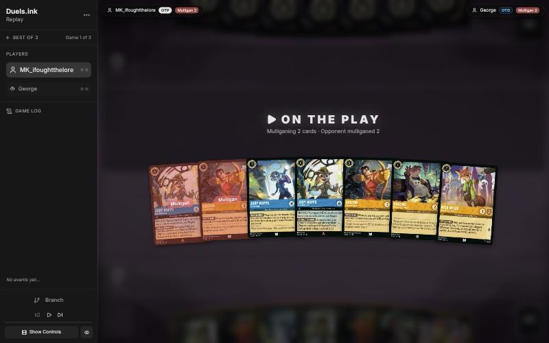
*The board before the decision: [step 0](https://duels.ink/replay/01a1a1ee-1499-73a8-8638-ce580909c41c?step=0) in the duels.ink replay viewer.*

**What you did:** on the play. From Lead Detective ×2, Gaston ×2, Judy – On the Case, Higgins and Nick – Providing
Backup, you sent back one Lead Detective and one Gaston.

**Verdict:** **good play.** The seven had two 6-drops and two 5-drops. `mulligan.py` (1,500 deals):

| Option | Ink spent, turns 1–4 | Turns with a play | Lore by turn 4 | Characters by turn 4 | Interaction |
|---|---|---|---|---|---|
| Keep all 7 | 9.76 / 10 | 4.00 / 4 | 6.1 | 4.3 | 100% |
| As played (keep 5) | 9.78 / 10 | 3.99 / 4 | 6.4 | 4.6 | 100% |
| Keep 4 (also send back Gaston) | 9.58 / 10 | 3.97 / 4 | 6.6 | 4.7 | 100% |
| Keep 3 (only the cheap cards) | 9.34 / 10 | 3.94 / 4 | 6.7 | 4.7 | 100% |
| Full mulligan | 8.94 / 10 | 3.65 / 4 | 5.6 | 4.2 | 78% |

Your keep led on ink and was level on the rest. It kept one of each top-end card: Lead Detective (Alert against their
Evasive questers, with On the Case as her Shift base) and Gaston (The Queen, or anything Support pushes to 5).

### Turn 1: your turn 1

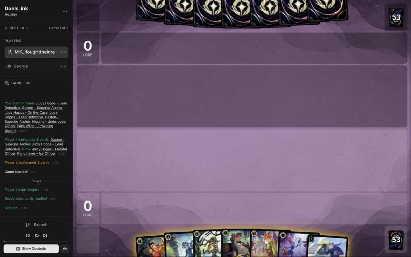
*The board before the decision: [step 3](https://duels.ink/replay/01a1a1ee-1499-73a8-8638-ce580909c41c?step=3) in the duels.ink replay viewer.*

**What you did:** inked Judy – Helpful Officer and played Higgins.

**Verdict:** **good play.** The mulligan drew back Helpful Officer and Fangmeyer (uninkable). The curve from here is
Higgins, then Nick (who gets Support with Higgins in play), then On the Case, then Lead Detective Shifted onto her on
turn 7. Helpful Officer was the spare 1-drop. Gaston, the one answer to The Queen, stayed in hand.

### Turn 3: your turn 2

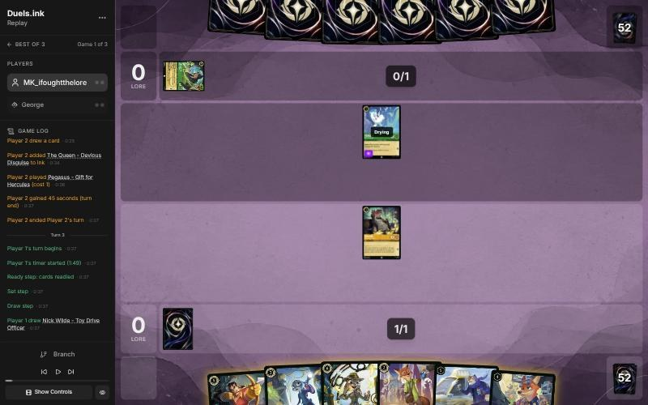
*The board before the decision: [step 9](https://duels.ink/replay/01a1a1ee-1499-73a8-8638-ce580909c41c?step=9) in the duels.ink replay viewer.*

**What you did:** inked Gaston, played Nick – Providing Backup, and quested with Higgins (1–0).

**Verdict:** **good play**, the coach's line.
- **The hand:** with two uninkables (Toy Drive Officer, Fangmeyer), On the Case and Lead Detective had to stay for the
  turn-7 Shift.
- **Gaston was the spare card:** they had already inked one of their two Queens, his one natural target.
- **Higgins' quest was free:** Pegasus (1 {S}) can't kill him.

### Turn 5: your turn 3

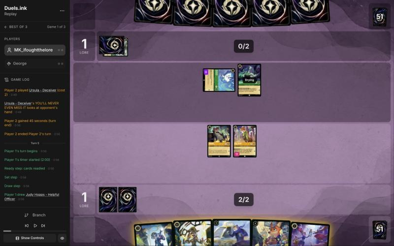
*The board before the decision: [step 17](https://duels.ink/replay/01a1a1ee-1499-73a8-8638-ce580909c41c?step=17) in the duels.ink replay viewer.*

**What you did:** inked the Helpful Officer you drew and played Judy – On the Case. No quests (1–1).

**Verdict:** **inaccuracy.** On the Case is right: she's the Shift base for Lead Detective next turn, and Helpful
Officer was the spare ink. The quests are the issue.

Keeping Higgins and Nick ready is suboptimal because their board couldn't punish a quest. Pegasus and Ursula have 1
{S} each:
- Neither kills a 2-willpower character alone.
- Killing one takes both of them challenging, which costs both their quests.
- Pegasus dies to the 2–3 {S} that hits back.

Questing with both is better: 2 lore at no real risk. The risk is Angela – Night Warrior (about 29%), whose Challenger
+2 would let one of their characters kill a quester for free. That's one 1- or 2-drop against 2 lore and a challenge
they'd have to spend.

([QC-3](#cite-qc-3), [RULE-1](#cite-rule-1); confidence medium. The edge is small, but it recurs: see the Watashi match, game 2, turn 7, where the
same wait was right because Angela was known in their hand.)

### Turn 7: your turn 4

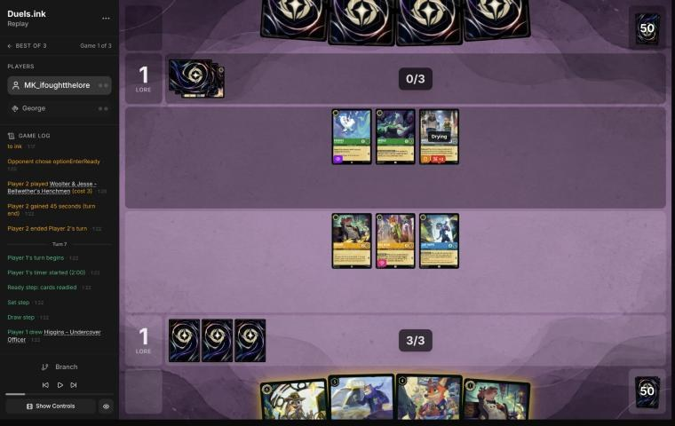
*The board before the decision: [step 25](https://duels.ink/replay/01a1a1ee-1499-73a8-8638-ce580909c41c?step=25) in the duels.ink replay viewer.*

**What you did:** inked the second Higgins, played Nick – Toy Drive Officer, kept Lead Detective, and didn't quest
(1–1).

**Verdict:** **close call.**
- **The alternative:** Lead Detective Shifted onto On the Case for the same 4 ink. She's a 2-lore, 6-{S} threat, but
  her Alert had nothing to aim at: their characters were all ready, since they'd stopped questing. And she'd be exposed
  to Strength of a Raging Fire (about a third after their draw; with four characters in play it deals 4).
- **Your line** keeps her hidden for the turn they quest, adds a Supporter with 4 willpower, and leaves On the Case as
  her Shift base for next turn.
- **Not questing this time** had a real reason: Woolter & Jesse can challenge from next turn for 6, which kills any of
  your characters. A quest offers him a free kill. That's different from turn 5, where nothing of theirs could punish
  one.

### Turn 9: your turn 5

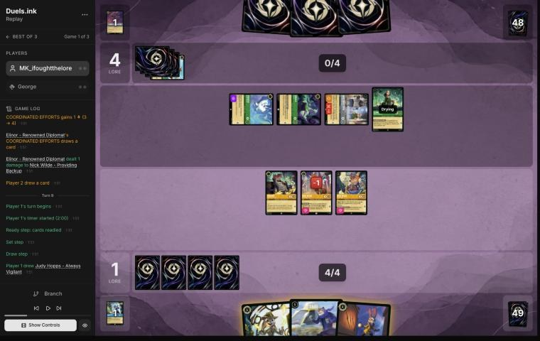
*The board before the decision: [step 36](https://duels.ink/replay/01a1a1ee-1499-73a8-8638-ce580909c41c?step=36) in the duels.ink replay viewer.*

**What you did:** inked Always Vigilant and played Fangmeyer, returning On the Case. Toy Drive Officer quested and
Supported Higgins to 4 {S}, and Higgins traded with the exerted Bodyguard Woolter & Jesse. Then Nick – Providing
Backup traded with Ursula (2–4).

**Verdict:** **good play**, better than the coach's plan.
- **The setup:** Strength of a Raging Fire had killed On the Case, Lead Detective's only Shift base. Woolter & Jesse
  was an exerted Bodyguard, so any challenge had to go into him first. Elinor's ping was coming at the end of their
  turn, and Nick was on 1 willpower left.
- **The coach's plan:** Nick quests and Supports Higgins (+3) into Woolter & Jesse, and Toy Drive Officer quests
  too. That's one kill and 2 lore.
- **Your line is one kill better for one lore less:**
  - Toy Drive Officer gave the Support, so Nick was free to challenge.
  - Nick was dying to Elinor's ping anyway, so trading him for Ursula cost nothing.
- **Fangmeyer returning On the Case** rebuilds Lead Detective's Shift base. Always Vigilant was the right ink: GOT YOU
  NOW had no way to trigger this turn, and she's a second copy of a Judy.

### Turn 11: your turn 6

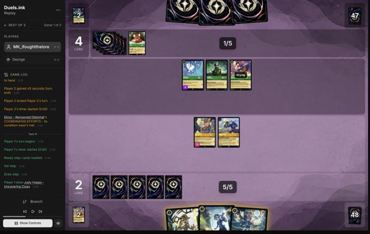
*The board before the decision: [step 52](https://duels.ink/replay/01a1a1ee-1499-73a8-8638-ce580909c41c?step=52) in the duels.ink replay viewer.*

**What you did:** played Judy – Uncovering Clues (her dig found Nick – Providing Backup), *then* inked On the Case,
and played Nick. COMMUNITY OUTREACH drew Elisa Maza. No quests; Lead Detective stayed in hand (2–4).

**Verdict:** **close call.**
- **The setup:** Max Goof had just returned Strength of a Raging Fire to their hand, so it was a known card. It deals
  3 now, and 4 once they add a character, to any target.
- **Holding Lead Detective was right:** hard-cast into a known Strength, she'd likely die before acting. Uncovering
  Clues gives her a Shift base instead.
- **The order was good** ([SEQ-1](#cite-seq-1)): dig before choosing the ink. You saw Nick first, then inked On the Case and still
  had the 2 for him, which turned on COMMUNITY OUTREACH's card.
- **The cost is the quests.** Fangmeyer (2 lore) and Toy Drive Officer (1) have 4 willpower, and no single character
  of theirs kills either. It would take Elinor plus Max Goof, two of their quests, to kill one.
- **The coach's line** inked On the Case, played Uncovering Clues and quested both for 3 lore, without Nick and the
  card. They're close: cards and bodies against 3 lore, at 2–4.

### Turn 13: your turn 7

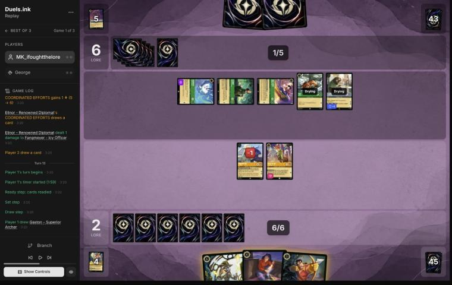
*The board before the decision: [step 68](https://duels.ink/replay/01a1a1ee-1499-73a8-8638-ce580909c41c?step=68) in the duels.ink replay viewer.*

**What you did:** hard-cast Lead Detective. With her Resist +2 and Alert, Fangmeyer banished Elinor (taking 1, so he
survived) and Nick banished the Evasive Pegasus (taking nothing). No ink (2–6).

**Verdict:** **good play**, better than the coach's plan.
- **The setup:** both Strengths were in their discard. Elinor, Pegasus and Max Goof were exerted, and their board
  quests for 6 plus Elinor's lore, which reaches 20 by game turn 17.
- **The coach's two lines:**
  - Gaston, with Nick's Support (+3) on Elinor, banishes her, and Fangmeyer kills Max Goof.
  - Or Lead Detective, then Alert kills on Pegasus and Max Goof.
- **Your line combines both, and the coach missed it:** Lead Detective's Resist +2 also changes the Elinor challenge.
  Fangmeyer takes 1 instead of 3 and lives. So you killed their engine and their Evasive quester and lost nothing,
  with Gaston still in hand.
- **The no-ink was a small cost:** 6 ink was exactly enough, so inking Elisa or Gaston only bought next turn's 7th.
  Keeping both is defensible.
- **What's exposed:** Fangmeyer (2 damage, exerted) and Nick (exerted) to Flash (3 {S}), Tod and Max Goof. Lead
  Detective is ready and can't be challenged.

### Turn 15: your turn 8

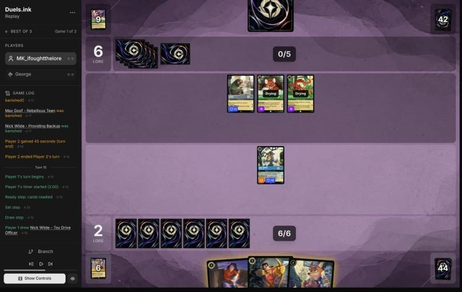
*The board before the decision: [step 77](https://duels.ink/replay/01a1a1ee-1499-73a8-8638-ce580909c41c?step=77) in the duels.ink replay viewer.*

**What you did:** played Nick – Toy Drive Officer and inked Gaston. Lead Detective stayed ready (2–6).

**Verdict:** **close call.**
- **The setup:** their board was Flash, plus Vixey and Mushu, both Evasive and both drying. They quest for 5 a turn.
  Two 4-drops cost 8 and you had 7, so one of Elisa and Toy Drive Officer had to wait.
- **Keeping Lead Detective ready was right.** Flash and Mushu (3 {S} each) can kill her together on their turn. Ready,
  she gives Alert next turn, when Vixey and Mushu will have quested.
- **The ink choice is the close part:**
  - Gaston plus Toy Drive Officer's +2 Support reaches Flash or Mushu (3 + 2 = 5), so he was removal for next turn.
  - Elisa, the card you kept, is a 3/4 Detective that challenges with Alert. Her look at a one-card hand is worth
    little.
  - The coach would have inked Elisa and kept Gaston. Both are reasonable.

### Turn 17: your turn 9

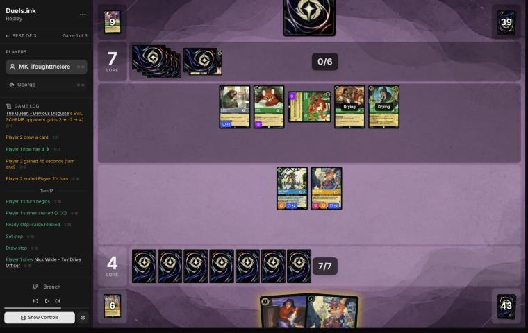
*The board before the decision: [step 92](https://duels.ink/replay/01a1a1ee-1499-73a8-8638-ce580909c41c?step=92) in the duels.ink replay viewer.*

**What you did:** drew the second Nick – Toy Drive Officer and played it. The first Toy Drive Officer banished the
exerted Mushu, taking 1. Lead Detective stayed ready, and Elisa stayed in hand. No ink, because Elisa was the only
inkable card. No quests (4–7).

**Verdict:** **inaccuracy** ([SEQ-4](#cite-seq-4), [RULE-2](#cite-rule-2)), medium confidence.
- **The setup:** they were at 7 and their board quests for 7, which reaches 20 on game turn 20. The Queen (5 {S}) and
  Aladdin had just been played, and Flash and Vixey were ready. Only Mushu was exerted.
  - **Their removal:** both Strengths are in the discard. The brief puts the chance they hold one at 5% now and 10%
    after their draw. Angel – Experiment 624 and The Terror That Flaps in the Night deal 2, which kills nothing of
    yours.
  - **The ink:** you had 7, and both 4-drops can't be played together, so one waits.
- **What you got right:**
  - Toy Drive Officer, not Lead Detective, took Mushu: an Evasive quester that draws while you hold more cards. Lead
    Detective stayed ready, out of reach of The Queen, and keeps her Alert for next turn.
  - Not questing her was right too. Exerted, she dies to The Queen alone, or to Flash plus Aladdin.
- **Playing Toy Drive Officer is suboptimal because** a character played now acts next turn, and next turn is the
  counterattack. That's when their questers will be exerted and need to be killed ([RULE-2](#cite-rule-2), [SEQ-4](#cite-seq-4)). Toy Drive Officer's
  2 {S} kills only Aladdin; to kill anything else it has to be Supported by the other Officer's quest.
  - With Toy Drive Officer now, Elisa comes down next turn, still drying. Best case: Lead Detective kills one, and one
    Officer quests to Support the other into a second kill. That's two kills and 1 lore.
- **Playing Elisa is better because** her 3 {S} with Alert kills any of their current characters: Flash (Resist 1),
  Vixey, Aladdin or The Queen.
  - Next turn, Lead Detective, Elisa and the first Toy Drive Officer could kill three questers: Elisa on Flash, Lead
    Detective on Vixey, the Officer on Aladdin. If the Officer dies on their turn, it's still two kills of your choice
    instead of one plus Aladdin.
  - FOLLOW THE TRAIL also reveals their one card now and discards it if it isn't a character, which would strip a
    Strength before it can hit Lead Detective.
- **The second Toy Drive Officer loses nothing by waiting:** next turn it can still be one of two characters played,
  and then both Officers' COMMUNITY OUTREACH draws, just as Elisa would make them.
- **Why only an inaccuracy:** in the base case both lines stop them reaching 20 on game turn 20. The difference is
  one more kill, about a 1-lore quester, on the turn the race is decided.

### Turn 19: your turn 10

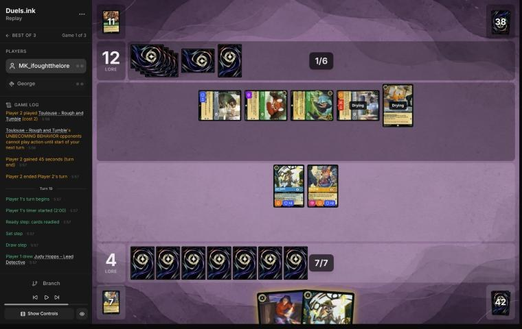
*The board before the decision: [step 105](https://duels.ink/replay/01a1a1ee-1499-73a8-8638-ce580909c41c?step=105) in the duels.ink replay viewer.*

**What you did:** drew the second Lead Detective and hard-cast it *before* challenging. With two LATERAL THINKINGs,
your Detectives had Resist +4, so the first Lead Detective banished Woolter & Jesse and took no damage. No ink,
keeping Elisa, and Toy Drive Officer stayed ready (4–12).

**Verdict:** **good play**, and the order beat the coach's plan.
- **The setup:**
  - **Their clock:** they were at 12 with no cards in hand. Their board quests for 7, which reaches 19 next turn. An
    Elinor off the top (8% per the brief) would add the 20th at the end of that turn.
  - **Their board:** Woolter & Jesse had entered exerted as a Bodyguard, so every challenge had to go into it first.
    That meant one kill at most this turn. Toy Drive Officer's 2 {S} kills nothing they had except the drying
    Toulouse, which can't be challenged.
  - **Your hand:** Elisa had no hand to look at.
- **Killing Woolter & Jesse** takes their board to 6 lore a turn. That holds them to 18, or 19 with an Elinor, so
  they can't win next turn.
- **The second Lead Detective over Elisa:**
  - If the first one dies on their turn (The Queen kills her alone), your Detectives keep Alert next turn without
    paying 6 then.
  - Next turn's attackers are 6, 6 and 2 {S} instead of 6, 3 and 2.
  - Keeping Elisa rather than inking her for an 8th ink you couldn't use was right ([INK-1](#cite-ink-1)).
- **Casting her first** is the part the coach's plan missed. Resist stacks ([CR 8.8.1](#cite-cr-8-8-1)), so Lead Detective took 0 from
  Woolter & Jesse instead of 2 ([SEQ-2](#cite-seq-2)). Undamaged and exerted, she now dies only to The Queen, or to two of their
  characters together. With 2 damage, Flash alone would have killed her.
- **Toy Drive Officer staying ready** keeps it safe from The Queen. Its 1 lore matters little in this race.
- **Where the game stands:** they need 8 more lore and quest for 6 a turn, while you need 16. You win only by killing
  nearly everything that quests each turn while they topdeck. That's a long shot, but it's open while their hand is
  empty.

### Turn 21: your turn 11

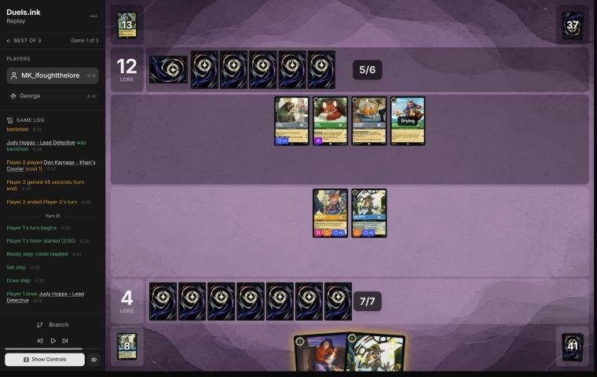
*The board before the decision: [step 111](https://duels.ink/replay/01a1a1ee-1499-73a8-8638-ce580909c41c?step=111) in the duels.ink replay viewer.*

**What you did:** drew the third Lead Detective and hard-cast it. No quests, no ink, and Elisa stayed in hand (4–12).

**Verdict:** **inaccuracy** ([QC-1](#cite-qc-1), [POS-2](#cite-pos-2)), medium confidence.
- **The setup:**
  - **Their last turn:** they quested with nothing. The Queen traded with your exerted Lead Detective, and Don
    Karnage came down. Their board (Flash, Vixey, Toulouse and Don, 6 lore a turn) was all ready, so there was
    nothing to challenge. They had no cards in hand.
  - **The race:** they're at 12, so 8 lore of dry questers wins in one turn. They have 6 now, and one or two more
    characters off the top gets them there. Your Alert can't touch ready characters, so waiting favours them.
  - **Their removal** is all off the top: Strength 5%, Angel or Elinor 8% each.
- **Playing Lead Detective was right.** She's a second copy of the engine and a 6-{S} challenger next turn. Elisa had
  no hand to look at, and her 3 {S} is less.
- **Keeping Lead Detective and Toy Drive Officer home is suboptimal because** it gave up 3 lore for almost no safety.
  - Your characters ready again at the start of your turn either way, so next turn's challenges are the same.
  - The only cost of questing is that they can challenge an exerted character on their turn, at no Resist. Their
    strengths are 3, 2, 1 and 1 against your 4 willpower, so a kill takes two of their characters, and each
    challenger takes your strength back:
    - Lead Detective's 6 kills every challenger, so a kill costs them two characters.
    - Toy Drive Officer's 2 kills Don or Toulouse.
    - Whatever challenges is exerted on your turn, where Alert kills it.
- **Questing both is better because** it puts you at 7 and makes every attack of theirs cost a character. A thinner
  board takes longer to reach the 8 lore that wins in one turn. Last turn they showed they'll attack an exerted
  character (The Queen into Lead Detective).
- **The case for your line** ([QC-5](#cite-qc-5)): at 4–12, stopping their close-out matters more than your lore, and a ready Toy
  Drive Officer can't be killed before it challenges next turn. But they close out by questing everything in one
  turn, which your ready board can't stop, so waiting doesn't help.
- **Where the game stands:** close to lost on either line. You need 16 more lore, and they need one or two more
  characters in play before they can quest out from 12. Your outs are blank draws on their side, or them questing a
  few at a time into your Alert.

### Turn 23: your turn 12

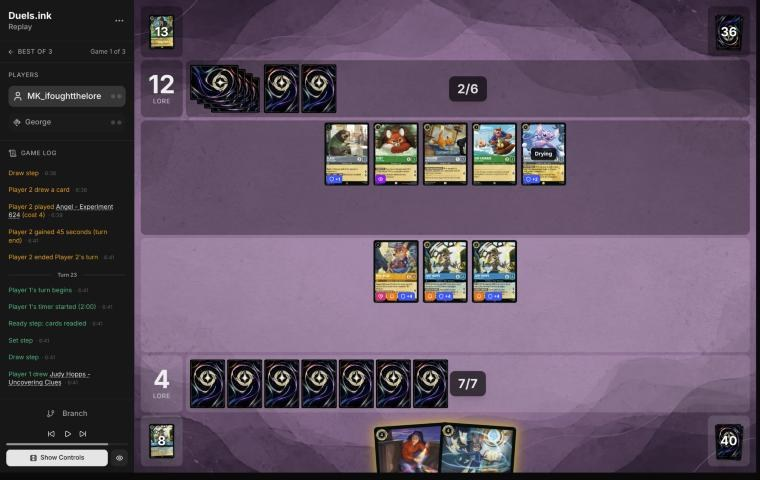
*The board before the decision: [step 115](https://duels.ink/replay/01a1a1ee-1499-73a8-8638-ce580909c41c?step=115) in the duels.ink replay viewer.*

**What you did:**
- Played Judy – Uncovering Clues, and her dig found the second copy.
- Inked Elisa and played that second Uncovering Clues, whose dig found Nick – Providing Backup.
- Quested one Lead Detective and Toy Drive Officer (7–12). Playing two characters turned on COMMUNITY OUTREACH, which
  drew Fangmeyer.

**Verdict:** **good play.**
- **The setup:** they had passed again, playing Angel – Experiment 624: Resist +2 while their hand is empty, and once
  a turn it can discard a card to deal 2 damage. Their ready board quests for 7, which reaches 19 next turn. Their
  only way to 20 next turn is an Elinor off the top (8%), whose end-of-turn lore adds the last point.
- **The race:** you can't kill ready characters, so you have to win by lore before they get 8 lore of dry questers.
  The coach's plan was to quest everything and play two characters.
- **The order was right** ([SEQ-1](#cite-seq-1)). You dug before choosing the ink, and inking Elisa only once the second Uncovering
  Clues turned up made two plays: a second dig, and the card from COMMUNITY OUTREACH.
- **Keeping one Lead Detective home** was a fair hedge: she can't be challenged on their turn. The 2 lore wouldn't
  have changed your clock. You're at 7 with 7 a turn on board, and at 9 you'd need game turn 27 just the same. Keeping
  the engine safe is worth it: questing both would let two of their characters kill one, though both would die
  doing it.
- **Next turn** you have 8 ink for Fangmeyer and Nick, two more characters and another card.

### Turn 25: your turn 13

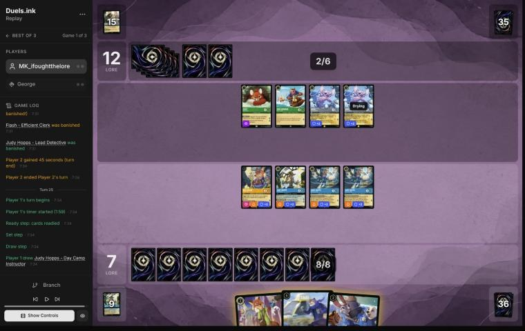
*The board before the decision: [step 131](https://duels.ink/replay/01a1a1ee-1499-73a8-8638-ce580909c41c?step=131) in the duels.ink replay viewer.*

**What you did:** quested an Uncovering Clues first, and her dig found Judy – Always Vigilant. Then you played Nick –
Providing Backup, and George conceded (8–12).

**Verdict:** **good play.**
- **The setup:**
  - **Their last turn:** they played the second Angel and killed your exerted Lead Detective with Toulouse and
    Flash, losing both. That left Vixey, Don and two Angels, 5 lore a turn, all ready.
  - **The race had turned your way:** their 5 lore a turn reaches only 17 next turn, or 18 with an Elinor, while
    you were 7 with 5 a turn on board and Fangmeyer, Nick and Day Camp Instructor in hand.
- **Digging before playing anything** was right ([SEQ-1](#cite-seq-1)). You had 8 ink for Fangmeyer (who returns a Lead Detective)
  plus a 2-drop for COMMUNITY OUTREACH, and the dig might change which.
- The concession came before the rest of the turn, so there's nothing more to judge.

## Lessons
1. **Lead Detective's Resist applies the turn she arrives, so cast her before you challenge.** On [turn 13](#turn-13)
   her +2 kept Fangmeyer alive against Elinor. On [turn 19](#turn-19), a second copy made it +4 (Resist stacks, CR
   8.8.1), and Woolter & Jesse dealt nothing. The coach missed this both times.
2. **Before their questers are exerted, deploy the character that can challenge them.** A character played now acts
   on the counterattack turn ([turn 17](#turn-17), [RULE-2](#cite-rule-2)). Elisa's 3 {S} with Alert kills any of their 2–3-willpower
   questers. Toy Drive Officer's 2 kills only the smallest.
3. **Against a ready wall, quest with your 4-willpower Detectives.** Their 1–3 {S} characters need two challenges to
   kill one, and each challenger takes the damage back. On their turn 24 Toulouse and Flash both died to kill one
   Lead Detective ([turn 25](#turn-25)). Waiting lets them build the 8 lore that quests out in one turn ([turn 21](#turn-21)). This is
   the Watashi match's lesson 4 again.
4. **An exerted Bodyguard caps you at one kill unless you have a second challenger for after it dies.** On
   [turn 19](#turn-19), Woolter & Jesse took Lead Detective's challenge, and Toy Drive Officer's 2 {S} had nothing
   left to kill.
5. **Dig before you ink** ([SEQ-1](#cite-seq-1)). On turns [11](#turn-11), [23](#turn-23) and [25](#turn-25), the
   dig decided what to ink or play.

## Proposed knowledge-base updates (applied after discussion)
- **Meta** (the Emerald/Steel pair file, a George section):
  - **Cards seen:** Aladdin – Doing His Part (in neither duels.ink list), You Broke My Smolder, two Don Karnage, two
    Angel – Experiment 624, Toulouse, two Queens, two Woolter & Jesse, Elinor.
  - **Strength:** Max Goof returned it on turn 10, and both copies were cast by turn 12.
  - **Their pattern:** they quested with Evasive characters early. Once Lead Detective's Alert was online they
    stopped questing (turns 20 and 22) and attacked only your exerted characters.
- **Strategy:** evidence for the candidate from the Watashi match (*against Emerald/Steel Midrange, Lead Detective is
  the Detectives' win condition, so protect the route to her*). Three copies landed here, and their side spent
  The Queen, Flash and Toulouse killing two. Still watching it, not proposing it yet.

## Hindsight
Doesn't change the verdicts above.
- **Turn 17:** their held card and their next draw were Woolter & Jesse and Toulouse, both characters, so Elisa
  would have discarded nothing. On turn 19, though, she'd have been dry: once Lead Detective killed the Bodyguard,
  her 3 {S} could have killed Flash or Vixey as a second kill.
- **Their concession at 12–8:** they had no cards in hand from turn 19 on, and the five characters they drew after
  that never got a quest in.

## The coach's errors
Filled in during discussion.

| When | Error | How it was caught | How it won't happen again |
|---|---|---|---|
| Blind pass, [turn 11](#turn-11) | The brief put Strength of a Raging Fire at "held 17%" after Max Goof had returned it to their hand in full view, so the setup had to correct it by hand | The coach, reading the log | Proposed: the brief tracks cards returned from the discard to hand as known in their hand (100%). Made when you agree |
| Blind pass, [turns 13](#turn-13) and [19](#turn-19) | The coach's plans missed that a Lead Detective cast this turn gives her Resist +2 to the same turn's challenges, so damage it would prevent was counted | The player's line, both times | Proposed: when a Lead Detective in hand is castable, the brief's challenge lines also show the result "with Lead Detective played first". Made when you agree |

## Open questions
- **Turn 17:** what decided Toy Drive Officer over Elisa? Was it keeping Elisa for a bigger hand to look at?
- **Turn 21:** was keeping everything home meant to bait them into questing into your Alert?

## Citations
Copies of the coach's knowledge base cited above, as they stood when they were cited (the private repository's commit and date are given with each). They don't change when the knowledge base does.

**QC-3**: strategy principle, `kb/strategy/principles.md` at `289cd15` (2026-11-03), working tree

> - **QC-3. Questing is favoured when:**
>   - you control the board
>   - your exerted characters can't be punished
>   - the race favours you
>   - removing their characters gains little
>
>   **Challenging is favoured when:**
>   - they have an engine or repeated-value piece
>   - the trade is efficient
>   - you need to slow the game
>   - your deck is stronger late
>
>   `[MCL ch.6]` · baseline

**RULE-1**: strategy principle, `kb/strategy/principles.md` at `289cd15` (2026-11-03), working tree

> - **RULE-1. Only exerted characters can be challenged** `[CR 4.6.4.2]`. Questing, singing, or {E} for an ability exposes the character. Staying ready protects it. Every quest is also a decision about what the opponent can challenge next turn. · baseline
>   - *Card text overrides this* (CR 1.2.1). Shere Khan – Khan Industries CEO's NEW INCENTIVE lets one character
>     challenge ready characters that turn. Alert (e.g. from Judy Hopps – Lead Detective, to every Detective on their
>     turn) ignores Evasive. Against Ducktectives, name both in the setup. 01a14574, turns 16 and 18. `[coach, 2026-10-26]`

**SEQ-1**: strategy principle, `kb/strategy/principles.md` at `289cd15` (2026-11-03), working tree

> - **SEQ-1. Gather information before irreversible decisions.** Draw, look and scry before choosing what to ink. Quest with draw triggers before committing other plays when the order doesn't otherwise matter. `[MCL ch.5]` · baseline

**SEQ-4**: strategy principle, `kb/strategy/principles.md` at `289cd15` (2026-11-03), working tree

> - **SEQ-4. Sequence across turns.** A slightly weaker play now can set up a much stronger next turn: keep a shift target alive, keep a singer ready, hold removal for a bigger threat. `[MCL ch.5]` · baseline

**RULE-2**: strategy principle, `kb/strategy/principles.md` at `289cd15` (2026-11-03), working tree

> - **RULE-2. Drying** `[CR 1.7.5]`. A newly played character can't quest, challenge or sing until next turn, so it's exposed to nothing (it's ready) but contributes nothing. **Shifting onto a dry character gives an immediate actor** `[CR 8.10.4]`. Rush allows challenges only `[CR 8.9]`. · baseline

**INK-1**: strategy principle, `kb/strategy/principles.md` at `289cd15` (2026-11-03), working tree

> - **INK-1. Inking is permanent.** Every inked card is one line of play removed for the rest of the game. *Ask: "Will I regret losing access to this card?"* `[MCL ch.4]` · baseline

**SEQ-2**: strategy principle, `kb/strategy/principles.md` at `289cd15` (2026-11-03), working tree

> - **SEQ-2. Plan the whole turn before the first action.**
>   - Who quests? Who challenges?
>   - What if a challenge fails?
>   - What gets inked? What ink is left?
>   - What does this leave the opponent?
>
>   `[MCL ch.5]` · baseline

**QC-1**: strategy principle, `kb/strategy/principles.md` at `289cd15` (2026-11-03), working tree

> - **QC-1. Lore is the only win condition.** Board control is only worth what it does to the lore race. `[MCL ch.6]` · baseline

**POS-2**: strategy principle, `kb/strategy/principles.md` at `289cd15` (2026-11-03), working tree

> - **POS-2. From behind, play to your outs and accept calculated risk.** Safe efficient play from a losing position loses slowly. A line with a 30% chance beats a line with 0%. *Ask: "What has to happen for me to win, and which play makes it most likely?"* `[MCL ch.10]` · baseline

**QC-5**: strategy principle, `kb/strategy/principles.md` at `289cd15` (2026-11-03), working tree

> - **QC-5. The race changes everything.** At 18–12 up, take the last 2 lore. At 8–16 down, stopping their close-out matters more than your quests. `[MCL ch.6]` · baseline

**CR 8.8.1**: Comprehensive Rules, `kb/rules/cr/08-keywords.md` at `289cd15` (2026-11-03), working tree

> **8.8.1.** The Resist keyword represents a static ability that modifies the amount of damage dealt to the card with the keyword. Resist +N means “Damage that would be dealt to this character or location is reduced by N.” Resist is a damage reduction (see 4.6.6.1). Because this is a +N ability, this stacks with other Resist effects.

**emerald-steel.md, Midrange: how it plays**: knowledge base, `kb/meta/archetypes/emerald-steel.md` at `289cd15` (2026-11-03), working tree

> ### Midrange: how it plays `[coach, meta study of the user's 27 Oct 2026 games (tools/scan.py), full games, not blind, 3 games]`
> Games: 01a17ddb, 01a17ead, 01a17f0e.
> - **Cheap Evasive questers:** White Rabbit (2), Vixey (3, or 2 with a Tod in play; 2 lore), and Mushu – Stealthy Dragon
>   (3; draws when you hold more cards).
> - **2-lore bodies:** Flash – Efficient Clerk (Resist 1; all characters lose Rush and can't gain it) and Broadway.
> - **The Queen – Devious Disguise:** +2 {L} while you lead, so she quests for 3. Her draw on play gives you 2 lore.
> - **Locks:**
>   - Toulouse – Rough and Tumble: when played, **you can't play actions (songs included) until their next turn**
>   - Ursula – Deceiver: you discard a song of their choice
> - **Fighting:** Angela – Night Warrior gives a character Challenger +2 and Resist +2. Strength of a Raging Fire deals
>   damage equal to their character count (4 in 01a17f0e turn 13).
> - **Big turns:** steady +6 quest turns (01a17ead turn 12: The Queen for 3 plus three 1s; 01a17f0e turn 13 after
>   Strength of a Raging Fire).
> - **They also used the ink drops your Mickey – Best in Town gives each player:** four on turn 6 of 01a17ddb
>   (`kb/cards/mickey-mouse-best-in-town.md`).

**rulings.md, Support can add strength to an opposing character**: knowledge base, `kb/rules/rulings.md` at `289cd15` (2026-11-03), working tree

> ### Support can add strength to an opposing character
> - **Situation:** a Support character quests while the opponent has a character you want to remove with a "5 {S} or
>   more" banish: Judy Hopps – Always Vigilant's GOT YOU NOW, Gaston – Superior Archer's WATCH THIS.
> - **Ruling:** Support may choose any other character, including an opposing one. Adding the Support character's {S}
>   to theirs can lift a small character to 5 {S} for the banish. Supports stack, and a supported character supports
>   with its new {S}.
> - **Basis:** CR 8.13.1 (Support: "add this character's {S} to another chosen character's {S} this turn"; "another
>   chosen character" isn't limited to your own).
> - **Confidence:** derived from CR and confirmed by duels.ink's engine: Detectives opponents did it to the user's
>   characters (01a17e54 turn 21, 01a17e5d turn 12, 01a17e45 turn 23; `kb/meta/archetypes/amber-sapphire.md`), and
>   MK_ifoughtthelore did it to their opponent's (01a19bb9 turn 7, 01a19bbd-79c2 turn 8). Not an official ruling.
> - **Added:** 2026-11-02, from the review of 01a19bb9 (vs xBWx); the trick was first recorded in the meta study of
>   1 Nov 2026.
