# Review: MK_ifoughtthelore vs George, game 2, 3 Nov 2026

| | |
|---|---|
| **Status** | draft (blind pass done, not yet discussed) |
| **Replay** | `01a1a1f5-4995` (`python3 tools/brief.py 01a1a1f5-4995 --turn N`) · [duels.ink viewer](https://duels.ink/replay/01a1a1f5-4996-7548-94c3-ad87b237f2b4?step=0) |
| **Format** | Core Constructed (from game 1), best-of-three, game 2. Set 14 era: inks revealed before the coin toss |
| **Decks** | You: Amber/Sapphire Detectives, as in game 1. Them: Emerald/Steel ([the coach's notes on this pair](#cite-kb-meta-archetypes-emerald-steel-midrange-how-it-plays)); archetype as it became clear: Midrange #1 (99% from turn 0, on game 1's cards) |
| **Play/draw** | They went first (they lost game 1, so it was their choice) |
| **Result** | **Win.** George conceded on game turn 22 at 3–8, giving you the match 2–0 |
| **Meta data** | snapshot of 26 Oct 2026 (fresh until 9 Nov) |
| **Chosen how** | Sent by danny, the coach's user: a match of MK_ifoughtthelore's, reviewed for them game by game. The coach knew game 1 was a win. The zip held only two games, which doesn't settle this one: a match can end without a game 3 (a concession or a time-out). So the coach didn't know this game's result before the blind pass |

## Summary
Links go to the turn sections below.
- **No inaccuracies.**
- **Close calls:**
  - [The pre-game](#turn-0): two uninkables sent back, one of them a Shift base.
  - [Turn 16](#turn-16): the first Lead Detective kept home, which avoids a Flash-plus-Elinor-ping kill.
- **Good plays:**
  - turns [2](#turn-2), [4](#turn-4), [6](#turn-6), [12](#turn-12), [14](#turn-14) and [22](#turn-22)
  - three that beat the coach's plan:
    - [turn 8](#turn-8): the exerted Bodyguard killed on the turn it was exposed
    - [turn 10](#turn-10): Fangmeyer returning Lead Detective
    - [turn 18](#turn-18): no quests into their best reply
  - [turn 20](#turn-20), the best line of the game: Support on *their* Elinor, then Always Vigilant banished her
- **How it went:**
  - Strength of a Raging Fire took both Shift bases (turns 7 and 13, the second with two Elinor pings), and they led
    8–0 by turn 13.
  - From then on they never quested again: whatever quested would die to Alert. They stayed on 8 for nine turns and
    attacked only your exerted Detectives.
  - Uncovering Clues' digs and Toy Drive Officer's draws refilled your hand while theirs stayed empty, and George
    conceded at 3–8.

## The game, turn by turn
Verdicts judge each decision on what you could know at the time, **including archetype knowledge an experienced
player has**. Hindsight is kept to its own section. Severity scale: good play / close call /
inaccuracy / mistake / blunder. Principle IDs and hypotheses (H-n) link to copies
in the Citations section at the end, as they stood when they were cited.

**What you knew before the game:** their inks, Emerald/Steel, and game 1's cards. Those put them on Midrange #1 at
99%, and game 1 added Aladdin – Doing His Part from outside the listed lists. Game 1 also showed how George plays:
Evasive questers early, then a ready wall with no quests once your Lead Detective's Alert is online. You're on the
draw, so their turn k is game turn 2k − 1. Their key cards, with the earliest game turn each can come:
- **Evasive questers:** Pegasus (1), White Rabbit (3), Vixey – Forest Friend (5, or 3 with Tod in play), Mushu
  (5). Your answers: The Horseman Strikes! (two in hand: draw a card and banish an Evasive character), and Lead
  Detective's Alert on your turn.
- **Elinor – Renowned Diplomat** (game turn 7): with 3+ exerted characters at the end of their turn, 1 damage to a
  chosen character of yours, 1 lore and a card. Darkwing's Ward stops the ping.
- **Strength of a Raging Fire** (3, song; game turn 5, or sung free by a dry cost-3+ character): damage equal to their
  character count, to any character, ready or not. Max Goof returns it for 1, as in game 1. Keep two Judys as Shift
  bases for Lead Detective.
- **Angel – Experiment 624** (4): discard a card for 2 damage, once a turn, and Resist +2 while their hand is empty.
  **The Terror That Flaps in the Night** (2): 2 damage.
- **Angela – Night Warrior** (3): Challenger +2 and Resist +2 on one character. **Woolter & Jesse** (3): 4/4
  Bodyguard, Challenger 2, which can enter exerted to soak your first challenge. **Flash** (2, 3/2/2, Resist 1).
- **The Queen – Devious Disguise** (4, 5/3): a natural target for Gaston and Always Vigilant (5 {S}). Her EVIL SCHEME
  draws them a card and gives you 2 lore.
- **Locks:** Toulouse (no actions for you until their next turn, so it can stop the Horseman), Ursula – Deceiver (you
  discard a song; you have none).

### Pre-game

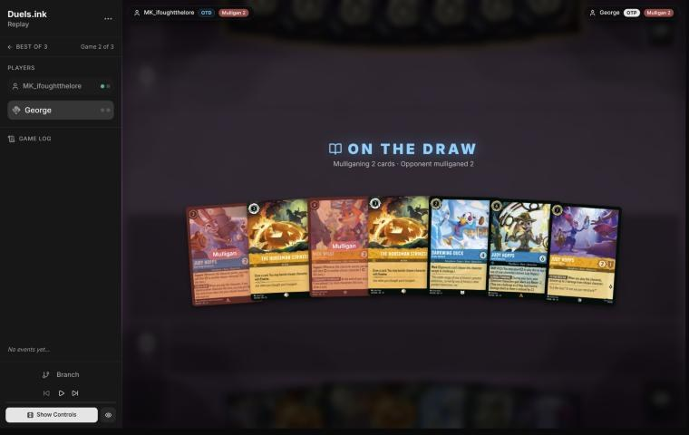
*The board before the decision: [step 0](https://duels.ink/replay/01a1a1f5-4996-7548-94c3-ad87b237f2b4?step=0) in the duels.ink replay viewer.*

**Your candidates, before seeing the mulligan:** keep all seven. The hand has a 1-drop (Helpful Officer), two
2-drops (Darkwing, Day Camp Instructor), two Horsemen, Toy Drive Officer and Lead Detective, with two Judys to Shift
her onto. Five cards are inkable. `mulligan.py` (1,500 deals):

| Option | Ink spent, turns 1–4 | Turns with a play | Lore by turn 4 | Characters by turn 4 | Interaction |
|---|---|---|---|---|---|
| Keep all 7 | 9.99 / 10 | 4.00 / 4 | 6.0 | 4.4 | 100% |
| Keep 6 (send back a Horseman) | 9.86 / 10 | 4.00 / 4 | 6.3 | 4.6 | 100% |
| Keep 5 (also send back Toy Drive Officer) | 9.88 / 10 | 4.00 / 4 | 6.4 | 4.9 | 100% |
| Full mulligan | 9.30 / 10 | 3.71 / 4 | 5.6 | 4.5 | 86% |

The sim counts the Horseman only as ink spent, not as removal. Against four kinds of Evasive quester, two
Horsemen are worth more than its slight edge in characters.

**What you did:** on the draw. You sent back the two uninkables, Toy Drive Officer and Day Camp Instructor, and drew
Judy – Always Vigilant and Judy – Uncovering Clues.

**Verdict:** **close call.** `mulligan.py` scores your keep level with keeping all seven: 9.88 ink spent against
9.99, 6.2 lore against 6.0, and 4.5 characters against 4.4.
- **What your keep gains:** all five cards are inkable, so the two Horsemen and Lead Detective never compete for ink
  with cards that can't be inked.
- **What it gives up:**
  - Day Camp Instructor was a second Judy to Shift Lead Detective onto. Game 1 showed why that matters against
    Strength (lesson 1 there).
  - Toy Drive Officer is the card engine that refilled your hand in game 1.
- **It worked out:** both cards drawn back were Judys, but that's the draw, not the decision.

### Turn 2: your turn 1

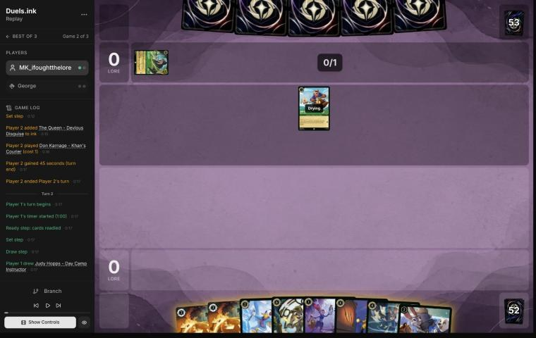
*The board before the decision: [step 5](https://duels.ink/replay/01a1a1f5-4996-7548-94c3-ad87b237f2b4?step=5) in the duels.ink replay viewer.*

**What you did:** drew Day Camp Instructor, inked Always Vigilant and played Judy – Helpful Officer.

**Verdict:** **good play.** Helpful Officer is the 1-drop and a Judy for later Shifts.
- **The ink:** seven of the eight cards were inkable. Always Vigilant needs a 5-{S} target: The Queen, or something
  your Support pushes to 5. They had just inked a Queen, so one fewer is left.
- **Inking the second Horseman** was the alternative. Two answers to Evasive questers matter in this matchup, so
  keeping both is fine.

### Turn 4: your turn 2

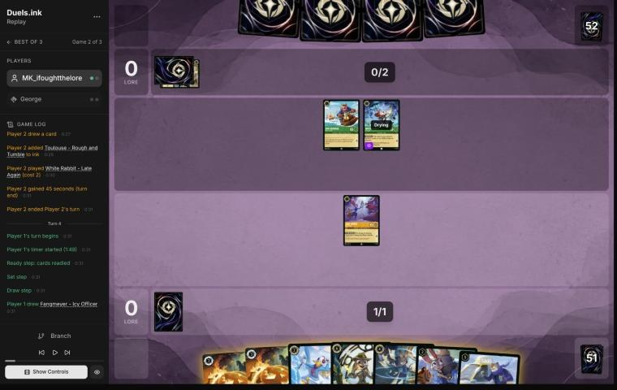
*The board before the decision: [step 12](https://duels.ink/replay/01a1a1f5-4996-7548-94c3-ad87b237f2b4?step=12) in the duels.ink replay viewer.*

**What you did:** drew Fangmeyer, inked Darkwing and played Judy – Day Camp Instructor. You started a quest with
Helpful Officer, then undid it (0–0).

**Verdict:** **good play.**
- **The setup:** they had Don Karnage (2/2, ready) and White Rabbit (2/2 Evasive, drying). Lead Detective's Shift
  needs 4 ink, on game turn 8, and a Judy to land on.
- **Day Camp Instructor over Darkwing:** she's a second Judy, so a single Strength can't take the Shift away (game
  1's lesson 1). She's also uninkable, so she was always going to be played.
- **Undoing the quest kept both bases.** Exerted, Helpful Officer (1 willpower) dies to Don or White Rabbit. Either
  trade costs them a quester, but it costs you a Shift base. That's the difference from game 1, turn 5, where nothing
  of theirs could punish a quest.
- **Inking Darkwing** kept both Horsemen for the Evasive questers. His 4/1 body trades up, but Lead Detective's
  Alert and the Horsemen do his job here.

### Turn 6: your turn 3

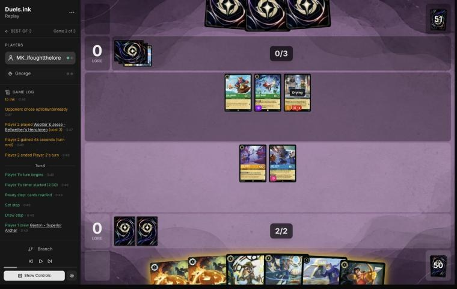
*The board before the decision: [step 21](https://duels.ink/replay/01a1a1f5-4996-7548-94c3-ad87b237f2b4?step=21) in the duels.ink replay viewer.*

**What you did:** drew Gaston and inked him. The Horseman banished White Rabbit and drew Higgins. No quests (0–0).

**Verdict:** **good play**, the coach's line.
- **The setup:**
  - **Their board:** Don Karnage and White Rabbit hadn't quested, and Woolter & Jesse had entered ready.
  - **Your 3 ink:** the Horseman was the only thing you could cast. Uncovering Clues costs 4, and Gaston and
    Fangmeyer cost 5.
- **The Horseman** spends the turn's ink on their only Evasive quester and replaces itself. It also leaves Strength of
  a Raging Fire one character weaker.
- **No quests was right:** Helpful Officer and Day Camp Instructor are next turn's Shift bases for Lead Detective.
  Exerted, each dies to any of their three characters.
- **The ink was a close choice.** Gaston can banish Woolter & Jesse once Day Camp Instructor's Support puts him at 6,
  or The Queen. The second Horseman answers Vixey or Mushu, but so will Lead Detective's Alert. Either was fine.

### Turn 8: your turn 4

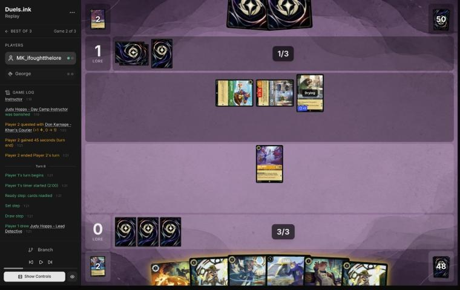
*The board before the decision: [step 30](https://duels.ink/replay/01a1a1f5-4996-7548-94c3-ad87b237f2b4?step=30) in the duels.ink replay viewer.*

**What you did:** drew the second Lead Detective, inked Higgins and Shifted Lead Detective onto Helpful Officer. She
banished the exerted Woolter & Jesse at once, taking 2 (0–1).

**Verdict:** **good play**, better than the coach's plan.
- **The setup:**
  - **Their last turn:** Strength of a Raging Fire, sung by Woolter & Jesse, had killed Day Camp Instructor, so
    Helpful Officer was your last Shift base. Woolter & Jesse was exerted from singing, and Don Karnage from
    questing. Flash was drying.
  - **The Shift:** Helpful Officer was dry, so Lead Detective could act straight away ([CR 8.10.4](#cite-cr-8-10-4)).
- **The coach's plan** was to Shift and keep her ready, where nothing can challenge her, and take her Alert
  challenges next turn.
- **Your line is better: it used the rare turn when Woolter & Jesse was exposed.**
  - Ready, he can't be challenged. On their turn, his Challenger 2 makes him a 6-{S} challenger that kills any
    exerted character of yours. Lead Detective would trade with him the first time she quested or challenged anyway.
  - He's also their only character that can sing Strength for free. Flash and Don cost too little.
- **What it exposed:** Lead Detective on 2 willpower left. Flash or Don can kill her, but each dies to her 6 {S} in
  return. You have the second Lead Detective in hand, with Uncovering Clues as her next base, and Fangmeyer to bring a
  Detective back.

### Turn 10: your turn 5

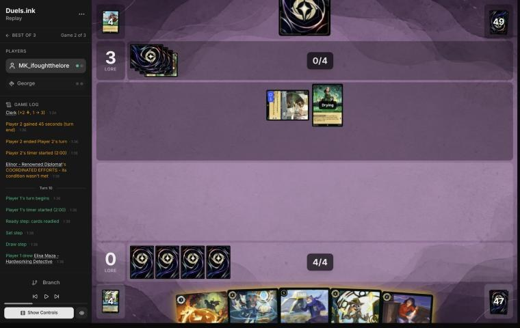
*The board before the decision: [step 39](https://duels.ink/replay/01a1a1f5-4996-7548-94c3-ad87b237f2b4?step=39) in the duels.ink replay viewer.*

**What you did:** drew Elisa and inked her, then played Fangmeyer, returning Lead Detective (0–3).

**Verdict:** **good play**, at least as good as the coach's plan.
- **The setup:**
  - **Their last turn:** Don Karnage traded into your exerted Lead Detective, Flash quested, and Elinor came down.
  - **Your board** was empty, and their hand was down to one card.
  - **Elisa** had no Detective in play to turn on her look at their hand.
- **The coach's plan:** Uncovering Clues (dig) as a dry Judy, so Lead Detective could be Shifted onto her next turn
  and act at once.
- **Your line gets the same Alert next turn, with more on the board.**
  - Hard-casting Lead Detective next turn (6 ink) gives Fangmeyer Alert and Resist +2 straight away, since LATERAL
    THINKING works while she's drying. So Fangmeyer's 4 {S} attacks that turn.
  - That leaves two bodies, where the coach's line leaves one, plus a dig card.
  - Fangmeyer also used all 5 ink, and getting Lead Detective back means you hold two.
- **Fangmeyer is safe while ready:** their damage is Strength (12% after their draw, and 2–3 damage with their board),
  Angel's 2 or Elinor's 1, none of which kills a 4-willpower character.

### Turn 12: your turn 6

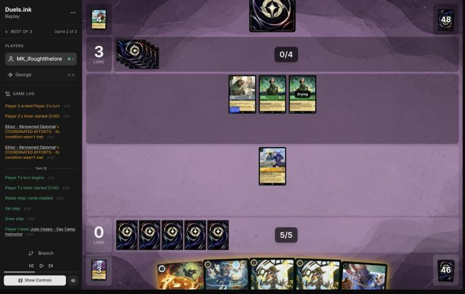
*The board before the decision: [step 48](https://duels.ink/replay/01a1a1f5-4996-7548-94c3-ad87b237f2b4?step=48) in the duels.ink replay viewer.*

**What you did:** drew Day Camp Instructor and played Uncovering Clues first. Her dig found On the Case, which you
inked. Then Day Camp Instructor, with another character played that turn, ramped the top card into your inkwell.
Fangmeyer stayed home (0–3).

**Verdict:** **good play**, the coach's line, with a better ink.
- **The setup:**
  - **Their board:** Flash and two Elinors, all ready, so there was nothing to challenge.
  - **Elinor's threat:** each Elinor triggers on her own at the end of their turn once 3 of their characters are
    exerted. If all three quest, that's 4 + 2 lore, two cards and two 1-damage pings.
- **The line sets up next turn:**
  - Two dry Judys plus the ramp give 8 ink next turn: both Lead Detectives Shifted on, acting at once with Resist +4.
  - With no Lead Detective on board now, they have less reason to hold back their quests.
- **Digging before inking** ([SEQ-1](#cite-seq-1)) let you ink On the Case and keep the Horseman.
- **Fangmeyer's quest was a close call.** It was 2 lore at little risk.
  - Exerted, he dies only to two of their three characters together, and his 4 {S} kills either one in return.
  - With a challenger dead, they'd have only two exerted characters, so neither Elinor would trigger.
  - Keeping him ready does protect a third attacker for next turn's swing.
- **What's exposed:** Day Camp Instructor (2 willpower) dies to two Elinor pings if all three of theirs quest. That
  still leaves Uncovering Clues as a base.

### Turn 14: your turn 7

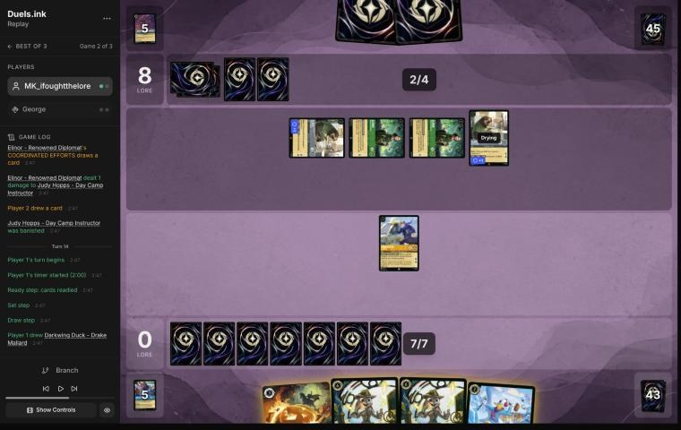
*The board before the decision: [step 67](https://duels.ink/replay/01a1a1f5-4996-7548-94c3-ad87b237f2b4?step=67) in the duels.ink replay viewer.*

**What you did:** drew Darkwing and hard-cast Lead Detective. With her Resist +2, Fangmeyer banished an exerted Elinor,
taking 1. Then you inked the Horseman and played Darkwing (0–8).

**Verdict:** **good play**, the coach's line.
- **The setup:**
  - **Their last turn:** an Elinor sang their second Strength of a Raging Fire into Uncovering Clues. Then both
    Elinors' pings finished Day Camp Instructor, so both your Judy bases were gone, and they were up to 8.
  - **Their clock:** 6 lore a turn on board, plus 1 per Elinor, reaches 20 on game turn 17.
  - **What you could challenge:** Flash and both Elinors were exerted. Fangmeyer was your only character that could
    challenge.
- **Elinor over Flash:** either kill leaves them on 14 next turn. But Elinor is the engine, a ping and a card each
  turn, so she was the target.
- **The order was right:** Lead Detective first, so Fangmeyer took 1, not 3 (the game 1 lesson). Darkwing adds a
  4-{S} Alert challenger for next turn, and Ward keeps him safe from the other Elinor's ping and from Strength.
- **The ink:** none of their characters is Evasive, so the Horseman was the card to ink. Keeping the second Lead
  Detective guards against a third Strength (12% after their draw).

### Turn 16: your turn 8

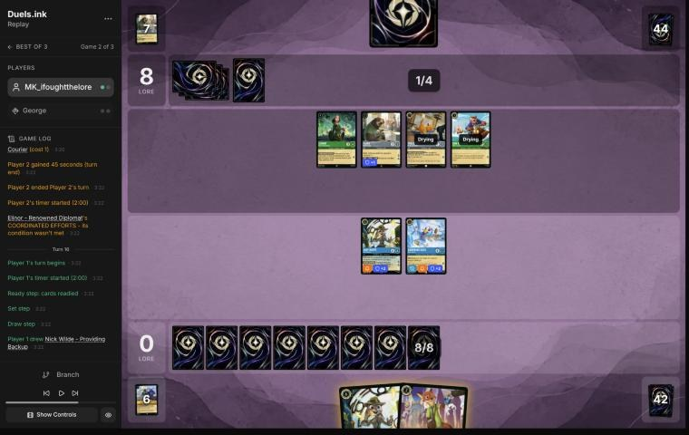
*The board before the decision: [step 76](https://duels.ink/replay/01a1a1f5-4996-7548-94c3-ad87b237f2b4?step=76) in the duels.ink replay viewer.*

**What you did:** drew Nick – Providing Backup and played him and the second Lead Detective, using all 8 ink. Darkwing
quested, and the first Lead Detective stayed ready (1–8).

**Verdict:** **close call.**
- **The setup:**
  - **Their last turn:** Flash traded into the exerted Fangmeyer, and Toulouse and Don came down. None of them
    quested again.
  - **Their board:** Elinor, Flash, Toulouse and Don, all ready, so there was nothing to challenge. They quest for 5 a
    turn, plus Elinor's 1.
- **The second Lead Detective and Nick** used all 8 ink. They give Resist +4 on your turns and a Supporter.
- **The coach first wanted the first Lead Detective to quest too,** for 2 lore, since a second copy was arriving.
  Then it found the line against her:
  - Flash challenges her for 3 and dies to her 6.
  - Their other three quest, so three are exerted and Elinor triggers at the end of the turn.
  - Elinor's ping is the fourth damage, so Lead Detective dies to Flash plus a ping.
  - A 6-drop for a 2-drop is a bad trade, even with a second copy on board. Keeping her home is defensible.
- **Darkwing's quest was free:** Ward stops the ping, and whatever challenges him dies to his 4 {S}.

### Turn 18: your turn 9

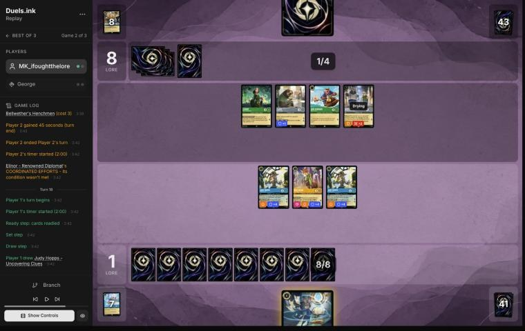
*The board before the decision: [step 84](https://duels.ink/replay/01a1a1f5-4996-7548-94c3-ad87b237f2b4?step=84) in the duels.ink replay viewer.*

**What you did:** drew Uncovering Clues and played her. Her dig found Nick – Toy Drive Officer, and you played him
too. With two characters played, COMMUNITY OUTREACH drew the second Toy Drive Officer. No quests (1–8).

**Verdict:** **good play**, better than the coach's plan.
- **The setup:**
  - **Their last turn:** Toulouse traded into the exerted Darkwing, and Woolter & Jesse came down ready. Still no
    quests.
  - **What was exposed:** their board was all ready. On their turn, Woolter & Jesse challenges for 6, which kills an
    exerted Lead Detective.
- **The coach's plan** was Uncovering Clues for the dig, plus a quest by one Lead Detective as bait for Woolter &
  Jesse.
- **The dig before spending the rest of the ink** ([SEQ-1](#cite-seq-1)) found a second character, and with it the card from
  COMMUNITY OUTREACH: 8 ink, two bodies and a card.
- **No quests was right this time.** Quest everything for 5 and their best answer takes most of it back:
  - Woolter & Jesse kills a Lead Detective, and both die.
  - Elinor kills Nick and survives his 3.
  - Flash and Don quest, so Elinor triggers, and her ping lands on the other Lead Detective.
  - You'd lose two characters for one of theirs, and they'd reach 12.

### Turn 20: your turn 10

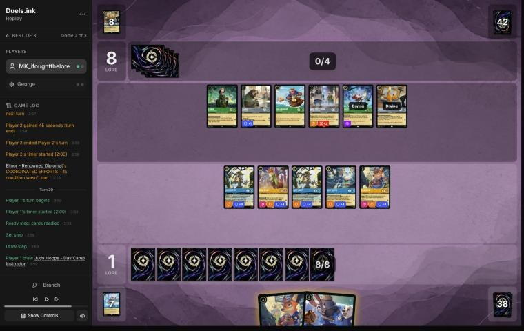
*The board before the decision: [step 92](https://duels.ink/replay/01a1a1f5-4996-7548-94c3-ad87b237f2b4?step=92) in the duels.ink replay viewer.*

**What you did:**
- Uncovering Clues quested first, and her dig found Judy – Always Vigilant.
- Toy Drive Officer quested and gave his Support (+2) to *their* Elinor, taking her to 5 {S}.
- Then you played the second Toy Drive Officer and Always Vigilant, whose GOT YOU NOW banished Elinor.
- Both Officers' COMMUNITY OUTREACH drew a card each (3–8).

**Verdict:** **good play**, the best line of the game.
- **The setup:** their six characters were all ready, so Alert had no targets. Elinor was the engine: a ping, a lore
  and a card each turn they exerted three. They're at 8 with 7 lore a turn on board.
- **The Detectives' signature trick:** Support can be given to an opposing character
  ([ruling](#cite-kb-rules-rulings-support-can-add-strength-to-an-opposing-character)). That put Elinor at 5 {S},
  in range of a 5-{S} banish that ignores whether she's ready.
- **The order made it work** ([SEQ-1](#cite-seq-1), [SEQ-2](#cite-seq-2)):
  - The dig came first, and it found the banish.
  - The Support quest came before Always Vigilant, so Elinor was at 5 when GOT YOU NOW resolved.
  - Two characters played turned on both Officers' draws.
- **Hard-casting Always Vigilant rather than Shifting her (2) onto Uncovering Clues** keeps Uncovering Clues' dig
  as a separate body. Shifting would have freed 2 ink for Day Camp Instructor and her ramp. The two are about even.
- **What's exposed:** the questers, Uncovering Clues (3 willpower) and Toy Drive Officer (4). Woolter & Jesse kills
  either, and Flash kills Uncovering Clues. Each challenger is then exerted for your Alert.

### Turn 22: your turn 11

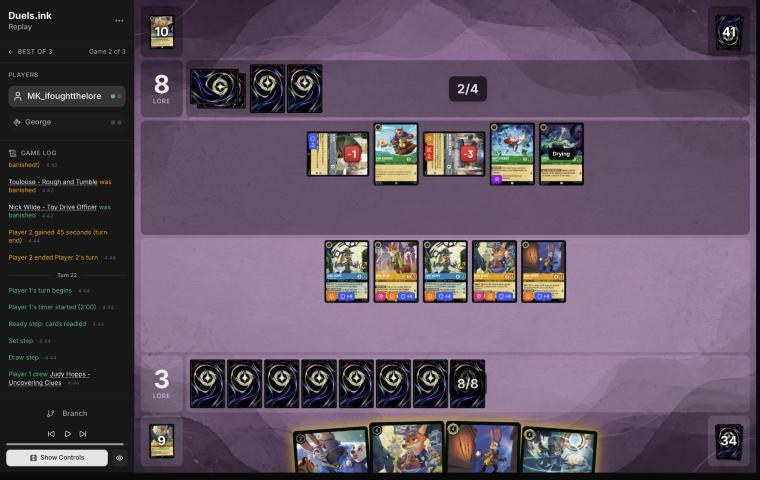
*The board before the decision: [step 111](https://duels.ink/replay/01a1a1f5-4996-7548-94c3-ad87b237f2b4?step=111) in the duels.ink replay viewer.*

**What you did:** drew Uncovering Clues and played her first, and her dig found Fangmeyer. George conceded (3–8).

**Verdict:** **good play.**
- **The setup:**
  - **Their last turn:** Woolter & Jesse killed Uncovering Clues, and Flash plus Toulouse killed a Toy Drive Officer.
    That left Woolter & Jesse (1 willpower left) and Flash (1 left) exerted.
  - **Your board:** you had five ready Detectives with Resist +4.
- **The line on offer** was three kills and 5 lore:
  - Toy Drive Officer kills the exerted Bodyguard first.
  - Always Vigilant (the one in play) kills Flash.
  - Nick quests and Supports Don or White Rabbit to 5 {S}. Always Vigilant from hand, Shifted onto Uncovering Clues
    for 2, banishes it.
  - Day Camp Instructor follows for her ramp, and both Lead Detectives quest.
- **Playing Uncovering Clues first** was the right start: the dig came before any other choice.

## Lessons
1. **Kill an exerted Bodyguard while you can** ([turn 8](#turn-8)). Ready, Woolter & Jesse can't be challenged and
   threatens 6 {S} on their turn. It was exerted only because it sang Strength.
2. **Support works on their characters, so a ready wall isn't safe from a 5-{S} banish** ([turn 20](#turn-20),
   [ruling](#cite-kb-rules-rulings-support-can-add-strength-to-an-opposing-character)). Quest the Supporter onto
   their best character, then play Always Vigilant or Gaston.
3. **Count Elinor's pings with Strength when you choose Shift bases.** On their turn 13, a sung Strength took
   Uncovering Clues, and two Elinor pings took Day Camp Instructor: both bases in one turn.
4. **Lead Detective's LATERAL THINKING works the turn she's cast** ([turn 10](#turn-10), [turn 14](#turn-14)). A
   hard-cast copy makes every other Detective a challenger at once. This is game 1's lesson 1 again.
5. **Dig before you spend** ([SEQ-1](#cite-seq-1)). Uncovering Clues found the card that decided the turn on turns
   [12](#turn-12), [18](#turn-18), [20](#turn-20) and [22](#turn-22).

## Proposed knowledge-base updates (applied after discussion)
- **Meta** (the Emerald/Steel pair file, a George section, from both games): applied with the Watashi notes in commit `a99f20d`, under your 3 Nov rule
  that knowledge-base changes are committed straight away.
  - **Game 2's cards:** White Rabbit ×2, Toulouse ×3, Flash ×2, Elinor ×2, Woolter & Jesse ×2, Ursula and Don
    Karnage ×2.
  - **Strength:** two cast by game turn 13 with no Max Goof, so the list runs at least three.
  - **Their pattern, in both games:** once Lead Detective was down, no quests at all (game 2, turns 13–21), only
    attacks on exerted Detectives.
- **Strategy:** more evidence for the candidate from the Watashi match and game 1 (*against Emerald/Steel Midrange,
  Lead Detective is the Detectives' win condition, so protect the route to her*). Here she pinned them on 8 lore for
  nine turns. Four wins now share it. It's ready to propose as a hypothesis when you agree.

## Hindsight
Doesn't change the verdicts above.
- **Turn 12's double-Shift plan** never happened: their turn 13 had Strength in hand, plus the second Elinor's ping.
- **Their ink stayed at 4** from game turn 7 to the end. With no cards in hand from turn 19, the five characters they
  drew after Elinor died never quested.

## The coach's errors
Filled in during discussion.

| When | Error | How it was caught | How it won't happen again |
|---|---|---|---|
| Blind pass, [turn 8](#turn-8) | Planned to keep Lead Detective ready, underrating the rare turn when their Bodyguard was exerted and could be killed | The player's line | Proposed: when an opposing Bodyguard is exerted, the brief's challenge options flag it ("exerted Bodyguard: killable now; it may enter ready next time"). Made when you agree |
| Blind pass, [turn 10](#turn-10) | Planned Uncovering Clues as a Shift base, missing that a hard-cast Lead Detective gives Fangmeyer Alert on the turn she lands. That's the same miss as game 1's turns 13 and 19 | The player's line | The game 1 fix covers it: challenge lines also shown "with Lead Detective played first" |
| Blind pass, [turn 18](#turn-18) | Suggested a bait quest that their best reply would have punished: Woolter & Jesse on a Lead Detective, Elinor on Nick, then Elinor's end-of-turn ping | Comparing with the player's line, in the same turn | Proposed: the brief's "what can challenge" lines add Elinor-style end-of-turn pings when the opponent's reply would leave 3 of theirs exerted. Made when you agree |

## Open questions
- **Pre-game:** you sent back Toy Drive Officer and Day Camp Instructor. Was the aim an all-inkable hand?
- **Turn 16:** was the first Lead Detective kept home because of the Flash-plus-Elinor-ping line, or for another
  reason?

## Citations
Copies of the coach's knowledge base cited above, as they stood when they were cited (the private repository's commit and date are given with each). They don't change when the knowledge base does.

**SEQ-1**: strategy principle, `kb/strategy/principles.md` at `3f286bf` (2026-11-03), working tree

> - **SEQ-1. Gather information before irreversible decisions.** Draw, look and scry before choosing what to ink. Quest with draw triggers before committing other plays when the order doesn't otherwise matter. `[MCL ch.5]` · baseline

**SEQ-2**: strategy principle, `kb/strategy/principles.md` at `3f286bf` (2026-11-03), working tree

> - **SEQ-2. Plan the whole turn before the first action.**
>   - Who quests? Who challenges?
>   - What if a challenge fails?
>   - What gets inked? What ink is left?
>   - What does this leave the opponent?
>
>   `[MCL ch.5]` · baseline

**CR 8.10.4**: Comprehensive Rules, `kb/rules/cr/08-keywords.md` at `3f286bf` (2026-11-03), working tree

> **8.10.4.** If a shifted character is put on top of a dry character, the shifted character enters play dry. If a shifted character is put on top of a drying character, the shifted character enters play drying.

**emerald-steel.md, Midrange: how it plays**: knowledge base, `kb/meta/archetypes/emerald-steel.md` at `3f286bf` (2026-11-03), working tree

> ### Midrange: how it plays `[coach, meta study of the user's 27 Oct 2026 games (tools/scan.py), full games, not blind, 3 games]`
> Games: 01a17ddb, 01a17ead, 01a17f0e.
> - **Cheap Evasive questers:** White Rabbit (2), Vixey (3, or 2 with a Tod in play; 2 lore), and Mushu – Stealthy Dragon
>   (3; draws when you hold more cards).
> - **2-lore bodies:** Flash – Efficient Clerk (Resist 1; all characters lose Rush and can't gain it) and Broadway.
> - **The Queen – Devious Disguise:** +2 {L} while you lead, so she quests for 3. Her draw on play gives you 2 lore.
> - **Locks:**
>   - Toulouse – Rough and Tumble: when played, **you can't play actions (songs included) until their next turn**
>   - Ursula – Deceiver: you discard a song of their choice
> - **Fighting:** Angela – Night Warrior gives a character Challenger +2 and Resist +2. Strength of a Raging Fire deals
>   damage equal to their character count (4 in 01a17f0e turn 13).
> - **Big turns:** steady +6 quest turns (01a17ead turn 12: The Queen for 3 plus three 1s; 01a17f0e turn 13 after
>   Strength of a Raging Fire).
> - **They also used the ink drops your Mickey – Best in Town gives each player:** four on turn 6 of 01a17ddb
>   (`kb/cards/mickey-mouse-best-in-town.md`).

**rulings.md, Support can add strength to an opposing character**: knowledge base, `kb/rules/rulings.md` at `3f286bf` (2026-11-03), working tree

> ### Support can add strength to an opposing character
> - **Situation:** a Support character quests while the opponent has a character you want to remove with a "5 {S} or
>   more" banish: Judy Hopps – Always Vigilant's GOT YOU NOW, Gaston – Superior Archer's WATCH THIS.
> - **Ruling:** Support may choose any other character, including an opposing one. Adding the Support character's {S}
>   to theirs can lift a small character to 5 {S} for the banish. Supports stack, and a supported character supports
>   with its new {S}.
> - **Basis:** CR 8.13.1 (Support: "add this character's {S} to another chosen character's {S} this turn"; "another
>   chosen character" isn't limited to your own).
> - **Confidence:** derived from CR and confirmed by duels.ink's engine: Detectives opponents did it to the user's
>   characters (01a17e54 turn 21, 01a17e5d turn 12, 01a17e45 turn 23; `kb/meta/archetypes/amber-sapphire.md`), and
>   MK_ifoughtthelore did it to their opponent's (01a19bb9 turn 7, 01a19bbd-79c2 turn 8). Not an official ruling.
> - **Added:** 2026-11-02, from the review of 01a19bb9 (vs xBWx); the trick was first recorded in the meta study of
>   1 Nov 2026.
