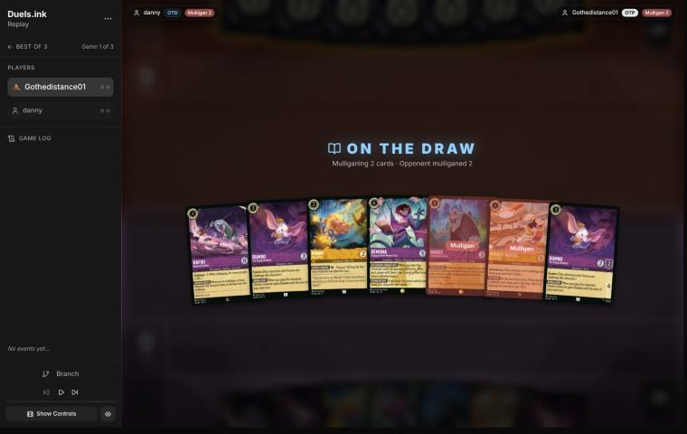
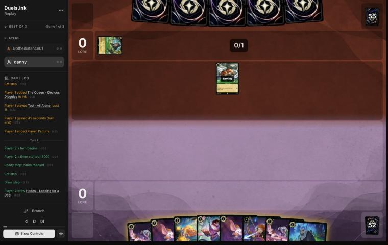
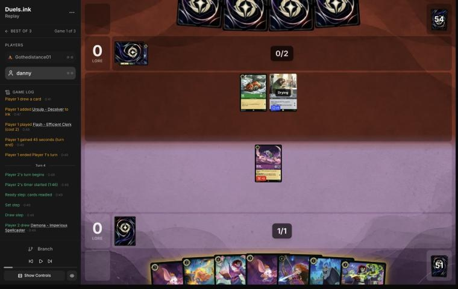
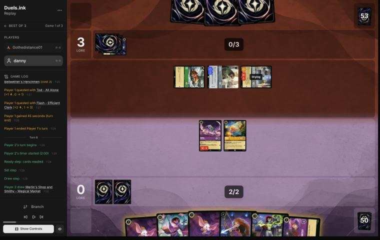
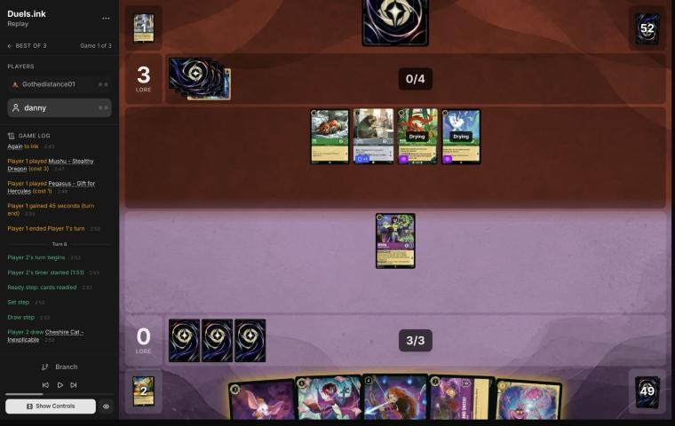
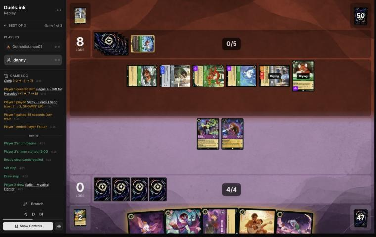
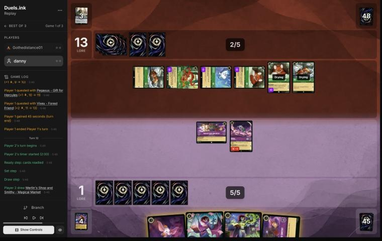
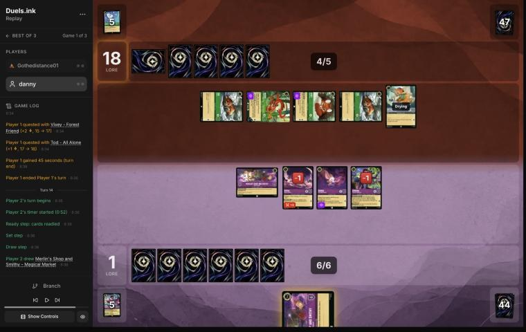

# Review: danny vs Gothedistance01, game 1, 3 Nov 2026

| | |
|---|---|
| **Status** | draft (blind pass done, not yet discussed) |
| **Replay** | `01a1a27e-a21c` (`python3 tools/brief.py 01a1a27e-a21c --turn N`) · [duels.ink viewer](https://duels.ink/replay/01a1a27e-a22e-7484-9df3-3937f40b28fb?step=0) |
| **Format** | Core Constructed (stated in the replay), best-of-three, game 1. Set 14 era: inks revealed before the coin toss |
| **Decks** | You: Amber/Amethyst Remember Merida ([your list](#cite-kb-meta-archetypes-amber-amethyst-remember-merida-danny-s-list)). Them: Emerald/Steel ([the coach's notes on this pair](#cite-kb-meta-archetypes-emerald-steel-midrange-how-it-plays)); archetype as it became clear: Midrange #1 (98% from turn 8), with Kit Cloudkicker from outside the listed lists |
| **Play/draw** | You went second |
| **Result** | **Loss** by lore on game turn 15, 2–20 |
| **Meta data** | snapshot of 26 Oct 2026 (fresh until 9 Nov) |
| **Chosen how** | Sent by you: the match zip held three games, so the coach knew games 1 and 2 were split, but not which way |

## Summary
Links go to the turn sections below.
- **No inaccuracies or worse.**
- **Close calls:** the [pre-game](#turn-0) (sending back Mickey) and [turn 6](#turn-6) (two cheap characters for the
  exerted Woolter & Jesse).
- **Good plays:** turns [2](#turn-2), [4](#turn-4), [8](#turn-8) and [12](#turn-12), and one that beat the coach's
  plan:
  - [turn 10](#turn-10): Merida moved to the Shop for a card and a lore *before* trading with Flash.
- **Unwinnable from:** [turn 14](#turn-14). They were at 18 with five questers and you had three challengers; only a
  14% draw from the Shop gave a fourth kill, and even that left them on 19. From [turn 12](#turn-12) the best line
  already left them two quests from 20.

**What decided it:** they curved cheap Evasive and 2-lore characters (Tod, Flash, Mushu, Pegasus, two Vixeys) into
8 lore a turn by game turn 9. Two Woolter & Jesses entered exerted as Bodyguards and took your first challenge each
time, and Flash turned off Imperious's Rush until you killed him on turn 10. Your hand had the answers for a longer
game (Scourge, Remember Me, the Shops), but you were 0–8 before they could start.

## The game, turn by turn
Verdicts judge each decision on what you could know at the time, **including archetype knowledge an experienced
player has**. Hindsight is kept to its own section. Severity scale: good play / close call /
inaccuracy / mistake / blunder. Principle IDs and hypotheses (H-n) link to copies
in the Citations section at the end, as they stood when they were cited.

**What you knew before the game:** their inks, Emerald/Steel. duels.ink's lists put that at Midrange #1 83%, an
unlisted list 13% and Midrange #2 5%. Both Midrange lists are cheap Evasive and 2-lore questers with pings and a
damage song. Their key cards, with the earliest game turn each can come (you're on the draw, so their turn k is game
turn 2k − 1):
- **Evasive questers:** Pegasus (1), White Rabbit (2, or 1 on their first turn only if they're second, so not here),
  Vixey – Forest Friend (3, 2 lore; 2 with Tod in play, so game turn 3), Mushu – Stealthy Dragon (3, 3/2; draws on a
  quest when you hold more cards). Your answers: The Horseman Strikes! (draw, banish an Evasive character), Dumbo's
  Evasive, and your Challenger 1-drops and Pepita.
- **Elinor – Renowned Diplomat** (4, uninkable, game turn 7): at the end of their turn, with 3+ exerted characters,
  1 damage to a character of yours, 1 lore and a card. Two Elinors made +6 a turn against your list before
  ([notes](#cite-kb-meta-archetypes-emerald-steel-midrange-against-danny-s-remember-merida-crazecard-bro-and-three-more)).
- **Strength of a Raging Fire** (3, song; game turn 5, or sung free by a dry cost-3+ character): damage equal to their
  character count, to any character. Max Goof – Rebellious Teen returns it for 1. Sung twice in one turn, it took
  three of yours (Bro, game turn 11).
- **Angel – Experiment 624** (4): discard a card for 2 damage, once a turn. **The Terror That Flaps in the Night** (2,
  one copy): 2 damage. Most of your list has 2 or 3 willpower, so these kill.
- **Angela – Night Warrior** (3): Challenger +2 and Resist +2 on one character. **Woolter & Jesse** (3, uninkable): 4/4
  Bodyguard, Challenger 2. **Broadway** (5): 4/6 Bodyguard, 2 lore. **Flash – Efficient Clerk** (2, 3/2/2, Resist 1):
  while he's in play no character can gain Rush, which turns off Demona – Imperious Spellcaster's IMPETUS IMPROVISUS
  half (the Evasive still applies).
- **The Queen – Devious Disguise** (4, 5/3): draws for them and gives you 2 lore; +2 lore while you lead.
- **Locks on your deck:** Toulouse (game turn 3: no actions for you until their next turn, so no Horseman, Storm or
  Remember Me that turn); Ursula – Deceiver (game turn 3: you reveal your hand and discard a song of their choice, i.e.
  Remember Me).
- **Their wipe:** none in the lists. Strength of a Raging Fire and Elinor's pings are one target at a time, and the
  earliest sweep of your board seen from this archetype was two Strengths on game turn 8 (your notes).

What answered them before: Demona – Scourge with Imperious exerting and killing four, and Raging Storm twice (your
notes above).

### Pre-game

*The board before the decision: [step 0](https://duels.ink/replay/01a1a27e-a22e-7484-9df3-3937f40b28fb?step=0) in the duels.ink replay viewer.*

**What you did:** on the draw. From Rafiki, Dumbo ×2, Hamm, Demona – Scourge, Hades and Mickey – Best in Town, you
sent back Hades and Mickey, keeping Rafiki, Dumbo ×2, Hamm and Scourge.

**Verdict:** **close call.** `mulligan.py` (1,500 deals):

| Option | Ink spent, turns 1–4 | Turns with a play | Lore by turn 4 | Characters by turn 4 | Interaction |
|---|---|---|---|---|---|
| Keep all 7 | 9.79 / 10 | 4.00 / 4 | 8.1 | 4.9 | 100% |
| As played (keep 5) | 9.86 / 10 | 4.00 / 4 | 6.7 | 4.5 | 100% |
| Keep 5 (Hades and Scourge back) | 9.79 / 10 | 3.99 / 4 | 9.0 | 4.9 | 100% |
| Full mulligan | 9.41 / 10 | 3.66 / 4 | 6.2 | 3.7 | 98% |

- The seven already curved (Rafiki, Hamm, Dumbo, Dumbo) and every card was inkable, so a full mulligan was never in
  question.
- **Mickey:** the sim gives him his 2 lore a turn, which is why keeping him scores higher. It doesn't count the ink
  drop he gives *them* each turn he quests, and this archetype has spent those before
  ([Mickey's notes](#cite-kb-cards-mickey-mouse-best-in-town-what-it-means-in-play)): a drop brings Elinor (uninkable,
  4) or a sung Strength a turn early. Against cheap Evasive questers, 2 lore that also ramps them is closer to even.
- **Scourge or Hades:** the sim prefers sending Scourge back, since a 6-drop does nothing on turns 1–4. Against this
  list she's the card that answered a wide board before, so keeping her over Hades is the right one of the two.

The coach would have kept Mickey and sent back Hades alone; the difference is within what the sim can't see (the
drops), so this is a close call, not a flag. [MULL-1](#cite-mull-1), [MULL-3](#cite-mull-3). Confidence: medium.

### Turn 2: your turn 1

*The board before the decision: [step 6](https://duels.ink/replay/01a1a27e-a22e-7484-9df3-3937f40b28fb?step=6) in the duels.ink replay viewer.*

**What you did:** drew Hades. Inked one Rafiki, played the other. They had inked The Queen and played Tod.

**Verdict:** **good play.** Rafiki (Challenger 3) trades with Tod or any small quester that exerts. The ink check:
with the second Rafiki gone, turn 4 is still Hamm and turn 6 Dumbo, so the spare 1-drop was the right card to lose;
both Dumbos (your Evasive answers to their Evasive questers) and Hades stay. [INK-2](#cite-ink-2).

### Turn 4: your turn 2

*The board before the decision: [step 12](https://duels.ink/replay/01a1a27e-a22e-7484-9df3-3937f40b28fb?step=12) in the duels.ink replay viewer.*

**What you did:** drew Demona – Imperious Spellcaster. Inked Hades, played Hamm, and kept Rafiki home.

**Verdict:** **good play.** Both of their characters were ready, so Rafiki had nothing to challenge, and a quest
would have handed Tod or Flash a free kill (Rafiki has 0 {S} on defence). Kept ready, he trades with whichever of them
quests: 3 damage kills Tod, and 3 − 1 kills Flash through Resist. [RULE-1](#cite-rule-1), [QC-4](#cite-qc-4).
- **The ink:** Hades or the second Dumbo were the spare cards. With Hades gone, the next two turns are still Dumbo or
  Imperious (3), then Merida, or Hamm's LOOSE CHANGE plus two 3-drops. Against a cheap, wide board Hades is weaker than
  usual (they bottom a 1-drop rather than give you 2 cards), and both Dumbos stay as Evasive answers. [INK-2](#cite-ink-2).

### Turn 6: your turn 3

*The board before the decision: [step 21](https://duels.ink/replay/01a1a27e-a22e-7484-9df3-3937f40b28fb?step=21) in the duels.ink replay viewer.*

**What you did:** drew Merlin's Shop. Inked a Dumbo and played Demona – Imperious Spellcaster. Her IMPETUS IMPROVISUS
couldn't give Rush while Flash was in play (you undid it, keeping Merida). Then Rafiki and Hamm both challenged
Woolter & Jesse, which had entered exerted as a Bodyguard: 3 + 2 damage killed it, and both of yours died. Lore 0–3.

**The setup:**
- **Their board:** Tod, Flash (2 lore, Resist 1) and Woolter & Jesse, all exerted. Bodyguard meant every challenge
  had to go to Woolter & Jesse, a 4/4 that hits for 6 as a challenger. Their clock: 4 lore a turn, 20 on game turn 15.
- **Their next turn (4 ink, hand 3, 4 after the draw):** Elinor (26% after their draw), Angel (20%) or Strength of a
  Raging Fire (26%, damage equal to their character count, so 3 or 4). Each kills any one of your characters; none
  hits more than one.
- **Flash also blanks Imperious's Rush,** so the Demona combo needs Flash dead first.

**The candidates:**
1. **As played:** Imperious, and Rafiki plus Hamm kill Woolter & Jesse. No lore; your board is one 4/3 Demona, theirs
   Tod and Flash (3 lore a turn).
2. **Dumbo, with AERIAL DUO on Hamm, and Hamm quests:** none of theirs is Evasive, so Hamm can't be challenged, and
   Rafiki stays home as the threat to whatever quests. +1 lore and three bodies, but Woolter & Jesse lives. Once it
   readies it can challenge anything you exert, and whenever it's exerted again it soaks your challenges.
3. **Rafiki alone into Woolter & Jesse** (leaving it on 1 willpower) and Dumbo with Evasive on a questing Hamm. It
   still hits back for 4, so finishing it later costs another character anyway.

**Verdict:** **close call.** The challenges spent two cheap cards on one, but on the merits the trade was sound:
- That was the only turn Woolter & Jesse could be challenged, and it's the card that beats your whole cheap
  board in a fight. Against this list it would come back as a Bodyguard on every Demona – Scourge turn, soaking the
  first challenge after her exert-all.
- Rafiki and Hamm are what your Remember Me replays from the discard, so cheap trades cost this deck less than most.
  [TRADE-1](#cite-trade-1), [TRADE-3](#cite-trade-3).
- Line 2's lore was real (1 now, and three bodies to quest with later), and Imperious alone is one Strength from an
  empty board. That's why it's close rather than good.

Confidence: low. It turns on how much Woolter & Jesse would have cost you over the next turns, which the tools can't
measure.

### Turn 8: your turn 4

*The board before the decision: [step 34](https://duels.ink/replay/01a1a27e-a22e-7484-9df3-3937f40b28fb?step=34) in the duels.ink replay viewer.*

**What you did:** drew Cheshire Cat. Inked Cheshire and played Merida exerted (FOCUSED ENERGY), drawing Remember Me.
Imperious stayed home. Lore 0–3.

**The setup:**
- **Their board:** Tod, Flash, Mushu and Pegasus (the last two Evasive and drying), all ready, so nothing to
  challenge. On turn 7 they'd kept Tod and Flash home rather than quest into your ready Imperious. With everything
  questing they make 5 a turn, 20 on game turn 15.
- **Their hand:** 1 card, 2 after the draw, with 5 ink. Strength or Elinor 15% each after the draw.
- **Imperious can't reach Mushu or Pegasus** (Evasive); only Dumbo can.

**The candidates:**
1. **As played:** Merida exerted for a card. She's exposed, but every challenge that kills her is a trade: her 3 {S}
   kills Flash through Resist (3 − 1 = 2) and kills Mushu, and Tod can't kill her.
2. **Dumbo:** a ready Evasive body that trades with a questing Mushu or eats Pegasus. No card.
3. **Shop, and move Imperious there:** a card and 1 lore, and Imperious stays ready. No new body.

**Verdict:** **good play.** The draw was free in all but a trade, and an even trade suits you when they're ahead on
lore and short of cards (a challenge also costs them a quest). Merida is also your Remember Me engine (BECKON draws
for each character that comes back exerted), and if she dies, Remember Me can bring her back first. Dumbo's case is
real: their Evasive pair quests for 2 a turn untouched. But it can still come next turn alongside the Shop.
- **The ink:** Cheshire, Dumbo, Shop and Scourge were the inkable cards. With Cheshire gone, next turn is still Dumbo
  plus Shop (5) and the turn after Scourge (6). Cheshire was the least needed: his damage moves need damage on the
  board first. [INK-2](#cite-ink-2). Confidence: medium.

### Turn 10: your turn 5

*The board before the decision: [step 48](https://duels.ink/replay/01a1a27e-a22e-7484-9df3-3937f40b28fb?step=48) in the duels.ink replay viewer.*

**What you did:** drew Rafiki. Inked Remember Me. Imperious challenged the exerted Woolter & Jesse (a second copy,
again entered exerted as a Bodyguard), and both died. You played the Shop and moved Merida there (a card, Imperious,
and 1 lore), played Rafiki, then Merida challenged Flash, and both died. Lore 1–8.

**The setup:**
- **The race:** 0–8, and their board quested for 8 a turn (Vixey and Flash 2 each, four others 1), so 16 next turn
  and 20 on game turn 13. Stopping lore was the whole turn. [QC-5](#cite-qc-5), [ROLE-2](#cite-role-2).
- **Their hand was empty** (Mushu's TIP THE SCALES draws them a card on each quest while you hold more), so their
  next turn is a top-deck: Strength or Elinor 8% each.
- **What you could reach:** everything but Vixey was exerted, but the Bodyguard took the first challenge. Imperious
  (4) kills Woolter & Jesse alone; then Merida could take Flash (3 − 1 kills him, and she dies), Tod (she survives on 1),
  or with Dumbo's AERIAL DUO giving her Evasive, Mushu or Pegasus. Rafiki and Dumbo would be drying.
- **Their next ink is 6,** but with no cards their threat is the board, not removal.

**The coach's plan** was Imperious into Woolter & Jesse, Merida into Flash, and Dumbo plus the Shop.

**Verdict:** **good play, better than the coach's plan.** Moving Merida to the Shop doesn't exert her, so she drew a
card and made 1 lore *before* her trade with Flash. That's the same two kills as the coach's line plus a card, a lore
and Rafiki on board. Dumbo stayed in hand for the Evasive questers next turn. [SEQ-2](#cite-seq-2).
- **Flash was the right second target:** 2 lore, and his death turns Imperious's Rush back on (she was the card the
  Shop drew).
- **The ink:** Remember Me, Dumbo or Scourge. Remember Me needs 6 cost of ready singers and then ink to replay
  characters: a rebuild for a long game, and you were 8 lore down against a board that needed answering now. Dumbo is
  the only one of your cards that reaches their three Evasive questers, and Scourge is next turn's play. With Remember
  Me gone, the next two turns are Scourge (6), or Dumbo plus Imperious, then 7 ink. [INK-2](#cite-ink-2). Confidence: medium.

### Turn 12: your turn 6

*The board before the decision: [step 63](https://duels.ink/replay/01a1a27e-a22e-7484-9df3-3937f40b28fb?step=63) in the duels.ink replay viewer.*

**What you did:** drew a second Shop and inked it. Dumbo gave Rafiki Evasive (AERIAL DUO), then Imperious, discarding
Scourge to her own IMPETUS IMPROVISUS for Rush and Evasive. Rafiki killed Vixey and Imperious killed Pegasus; both
survived. Lore 1–13.

**The setup:**
- **The race:** they were at 13 and their six characters quested for 8, so they needed 7. Every new character of
  theirs would be drying, so lore had to come off the board *this* turn. With Elinor's end-of-turn lore possible
  (8% on their top-deck), the safe target was taking 3 lore of questers off. [QC-5](#cite-qc-5).
- **What was exerted:** Tod, Mushu, Pegasus and one Vixey; the second Vixey and Tod were drying and ready.
- **Flash was dead,** so Imperious's IMPETUS IMPROVISUS gave Rush again, and it puts Evasive on her too, which their
  fliers need.

**The candidates:**
1. **Scourge** (ink to 6): exerts all six, but only Rafiki is ready to challenge (Scourge is drying), so one Tod dies
   and they quest for 7: 20. And her refill gives their empty hand 3 cards. It loses on the spot.
2. **As played:** Dumbo and Imperious with IMPETUS (6 ink), two kills worth 3 lore, both challengers survive. The
   last card has to go to IMPETUS (or the ink), so Scourge goes.
3. **Imperious with IMPETUS (discarding Dumbo), and Rafiki moves to the Shop then challenges Tod:** also 3 lore off,
   plus a lore and a card, and Scourge stays in hand, but Rafiki dies and nothing reaches their fliers next turn.

**Verdict:** **good play.** It took 3 lore off their board without losing anything: Rafiki's Challenger 3 is exactly
Vixey's willpower, and Imperious took Pegasus for 1 damage. Line 3 keeps Scourge, but for next turn Scourge needs
challengers that are ready, and line 2 leaves three of them.
- **What it leaves:** Imperious and Rafiki exerted, but Evasive until your next turn, so only Mushu (3 {S}) or Vixey
  (1) can reach them. Each challenge costs them a quest.
- **Where the game stands:** they quest to 18 next turn, and on game turn 15 need only 2 from Tod, Tod, Mushu, Vixey
  and whatever they add. Next turn you'd have to clear almost their whole board to stop that. Whether that's possible
  is judged on turn 14.

Confidence: high.

### Turn 14: your turn 7

*The board before the decision: [step 83](https://duels.ink/replay/01a1a27e-a22e-7484-9df3-3937f40b28fb?step=83) in the duels.ink replay viewer.*

**What you did:** drew a third Shop. Moved Dumbo to the Shop (Junior Woodchuck Guidebook and 1 lore), played and
cracked the Guidebook (Luisa and Mickey), inked the Shop, played Luisa, and discarded Mickey to give Imperious
Evasive. Dumbo traded with Mushu, Imperious killed Vixey and Rafiki traded with Tod. Lore 2–18.

**The setup:** they needed 2. Next turn Tod, Kit Cloudkicker (drying now, so it couldn't be challenged), Mushu, Vixey
and the other Tod would quest for 6. Holding them under 20 meant killing all four you could reach (Kit's quest takes
them to 19). You had three challengers: Rafiki (Challenger 3, on 1 willpower), Dumbo (Evasive) and Imperious (Evasive
again for a discard).

**The outs:** a fourth kill needed The Horseman Strikes! (banish an Evasive character; 4 left) or another Imperious
(her own IMPETUS gives her Rush; 2 left), each 3 ink. Only the Shop move could draw one before the challenges: 6 outs
in 44 cards, 14% (`odds.py`). Even then they'd sit on 19 with Kit and a fresh draw.

**Verdict:** **unwinnable** ([principle 2](#cite-principle-2)). No line stopped their quest for 20 unless the Shop drew an out, and the
line played looked for one: the move first, with 5 ink left to cast either out. The Guidebook couldn't find one you
could pay for (2 ink was left after cracking it), but nothing else wanted that ink, so its two cards were free.
[POS-2](#cite-pos-2).

## Lessons
1. **Against this archetype on the draw, the race starts early.** By game turn 9 they quested for 8 a turn off
   1- to 3-drops, with an empty hand. Your answers that reach their fliers are Dumbo (and AERIAL DUO on a Challenger),
   Imperious's Evasive and The Horseman Strikes!; Rafiki and Pepita handle the ground.
2. **Flash – Efficient Clerk switches off Imperious's Rush.** Her IMPETUS IMPROVISUS still gives Evasive, but the
   Demona combo (Scourge exerts, Imperious gives her Rush) waits until Flash is dead ([turn 6](#turn-6),
   [turn 10](#turn-10)).
3. **Move to the Shop before you challenge.** Moving doesn't exert, so a character that's about to trade can draw a
   card and make a lore first ([turn 10](#turn-10), [turn 14](#turn-14)).
4. **Woolter & Jesse enters exerted to soak the first challenge.** Twice it cost you a character to get past it.
   It's also the card that would blunt a Scourge turn, so killing it while it's exerted has value beyond the trade.

## Proposed knowledge-base updates
- **Meta** (Emerald/Steel notes, applied after the match; see the match summary): Gothedistance01's list and how
  game 1 went: two Woolter & Jesses as exerted Bodyguards, Flash against Imperious's Rush, 8 lore a turn by game turn 9
  from an empty hand, Kit Cloudkicker.
- **Strategy:** nothing new yet. This is one game of a pattern the pair file already records (CrazeCard reached 20
  on game turn 11 against your list).

## Hindsight
Doesn't change the verdicts above.
- You drew 21 cards (the seven, two from the mulligan, seven turn draws, Merida's, two from the Shop and two from
  the Guidebook) and none was The Horseman Strikes!, Pepita or a Raging Storm. The opponent's hand was empty from game turn 9;
  every lore after that came from a board built by turn 11.

## The coach's errors
Filled in during discussion.

| When | Error | How it was caught | How it won't happen again |
|---|---|---|---|

## Open questions
- **Pre-game:** why Mickey and Hades back rather than Hades alone? Was it the ink drops Mickey gives this deck?
- **Turn 6:** was the double challenge into Woolter & Jesse about the Bodyguard itself, or about keeping the board
  clear for Scourge?
- **Turn 10:** was inking Remember Me a judgement about the race, or the least useful card?

## Citations
Copies of the coach's knowledge base cited above, as they stood when they were cited (the private repository's commit and date are given with each). They don't change when the knowledge base does.

**MULL-1**: strategy principle, `kb/strategy/principles.md` at `b1682e1` (2026-11-03), working tree

> - **MULL-1. Keep a plan, not the strongest cards.** *Ask: "Which hand gives me the best chance to execute my game plan in this matchup?"* `[MCL ch.12]` · baseline

**MULL-3**: strategy principle, `kb/strategy/principles.md` at `b1682e1` (2026-11-03), working tree

> - **MULL-3. The right keep depends on the matchup.** Early interaction against aggro; pressure, draw and engines against slow decks. The mulligan is the first expression of your role. In the Set 14 era the opponent's inks are known before the mulligan (RULE-8), so this applies from game 1 of a match. `[MCL ch.12]` · baseline

**INK-2**: strategy principle, `kb/strategy/principles.md` at `b1682e1` (2026-11-03), working tree

> - **INK-2. Don't automatically ink the most expensive card.** It may be the late-game win condition or the key answer for this matchup. The answer depends on matchup, hand and board. `[MCL ch.4]` · baseline

**RULE-1**: strategy principle, `kb/strategy/principles.md` at `b1682e1` (2026-11-03), working tree

> - **RULE-1. Only exerted characters can be challenged** `[CR 4.6.4.2]`. Questing, singing, or {E} for an ability exposes the character. Staying ready protects it. Every quest is also a decision about what the opponent can challenge next turn. · baseline
>   - *Card text overrides this* (CR 1.2.1). Shere Khan – Khan Industries CEO's NEW INCENTIVE lets one character
>     challenge ready characters that turn. Alert (e.g. from Judy Hopps – Lead Detective, to every Detective on their
>     turn) ignores Evasive. Against Ducktectives, name both in the setup. 01a14574, turns 16 and 18. `[coach, 2026-10-26]`

**QC-4**: strategy principle, `kb/strategy/principles.md` at `b1682e1` (2026-11-03), working tree

> - **QC-4. Every character has a job.** A character in the deck to challenge wastes its strength questing. An efficient quester wastes its value in unnecessary combat. *Ask: "Why is this card in my deck?"* `[MCL ch.6]` · baseline

**TRADE-1**: strategy principle, `kb/strategy/principles.md` at `b1682e1` (2026-11-03), working tree

> - **TRADE-1. Judge a trade by ink invested, tempo, value already generated, and the board afterwards**, not by card count. A 2-cost for a 5-cost is a big win even if it's one-for-one. *Ask: "What does the board look like after this challenge?"* `[MCL ch.7]` · baseline

**TRADE-3**: strategy principle, `kb/strategy/principles.md` at `b1682e1` (2026-11-03), working tree

> - **TRADE-3. Losing a character can be right** if it removes something more important. Characters are resources. `[MCL ch.7]` · baseline

**QC-5**: strategy principle, `kb/strategy/principles.md` at `b1682e1` (2026-11-03), working tree

> - **QC-5. The race changes everything.** At 18–12 up, take the last 2 lore. At 8–16 down, stopping their close-out matters more than your quests. `[MCL ch.6]` · baseline

**ROLE-2**: strategy principle, `kb/strategy/principles.md` at `b1682e1` (2026-11-03), working tree

> - **ROLE-2. Roles change mid-game. Re-check every turn.** An early lead with 4 lore left turns the aggressor into "protect the lead". A stabilised defender can become the aggressor. *Ask: "Has my role changed? If nothing changes, who wins?"* `[MCL ch.8, ch.10, ch.11]` · baseline

**SEQ-2**: strategy principle, `kb/strategy/principles.md` at `b1682e1` (2026-11-03), working tree

> - **SEQ-2. Plan the whole turn before the first action.**
>   - Who quests? Who challenges?
>   - What if a challenge fails?
>   - What gets inked? What ink is left?
>   - What does this leave the opponent?
>
>   `[MCL ch.5]` · baseline

**POS-2**: strategy principle, `kb/strategy/principles.md` at `b1682e1` (2026-11-03), working tree

> - **POS-2. From behind, play to your outs and accept calculated risk.** Safe efficient play from a losing position loses slowly. A line with a 30% chance beats a line with 0%. *Ask: "What has to happen for me to win, and which play makes it most likely?"* `[MCL ch.10]` · baseline

**principle 2**: coaching principle, `CLAUDE.md` at `b1682e1` (2026-11-03), working tree

> 2. **Some games are unwinnable.** Draws and matchups can make a game lost whatever the player does. Say so
>    when it's true, rather than inventing mistakes to explain a loss.

**amber-amethyst.md, Remember Merida: danny's list**: knowledge base, `kb/meta/archetypes/amber-amethyst.md` at `b1682e1` (2026-11-03), working tree

> ### Remember Merida: danny's list `[coach, meta study of danny's 28 Oct – 2 Nov 2026 games (tools/scan.py), full games, not blind, 49 games]`
> All 49 games from `01a18285-3511` to `01a19d4c-6771` (only `01a18275-7c33` of that run was blind-reviewed).
> - **The list (31 games from 29 Oct):** Mickey – Best in Town ×4, Rafiki ×3, Luisa – Pushing Through ×2, Hamm ×4,
>   Pepita ×4, Junior Woodchuck Guidebook ×4, Merlin's Shop and Smithy ×3, Cheshire Cat – Inexplicable ×4, Demona –
>   Imperious Spellcaster ×4, Dumbo – The Flying Elephant ×2, The Horseman Strikes! ×4, Merida – Wisp Conjurer ×4,
>   Merlin – Profoundly Curious ×4, Hades – Looking for a Deal ×4, Demona – Scourge ×4, Remember Me ×3, Raging Storm ×3.
>   On 28 Oct (13 games) it ran Mowgli ×3, a 4th Shop and a 3rd Luisa instead of Hamm and the 3rd Rafiki; five games of
>   28–29 Oct ran Tigger – Bouncing All the Way ×2 instead of Dumbo. Unlike duels.ink's average Remember Merida (above):
>   no Elsa or Gaston, but the full Demona pair (4 + 4) and four Cheshires.
> - **Raging Storm is the reset:** cast in at least 19 of the 49 games (28 casts that removed 3+ of their characters), from game
>   turn 9 (`01a18d5a-0080`, the turn after their wipe), usually turns 11–15. Mickey's ink drops bring it a turn early.
> - **Then Remember Me rebuilds:** sung by two characters (Sing Together 6), it replays 4–7 characters from the discard
>   (`01a182f9-576e` turn 19, `01a18391-038f` 22, `01a18442-9f20` 23, `01a188d0-21d2` 18, `01a18956-64ba` 23,
>   `01a18971-a6ee` 24, `01a18c4b-b91b` 22).
> - **The rebuild is a Storm target:** twice the opponent's Raging Storm swept it the next turn (`01a182f9-576e` turn 20,
>   Kyla's Detectives, 5 characters; `01a18c4b-b91b` turn 25, the mirror, 9). Against a list with Storm and 8 ink in
>   reach, count what the rebuild must do this turn against what a Storm would cost. A pattern to watch, not a rule.
> - **Demona – Scourge, often with Imperious Spellcaster:** Scourge exerts their board for your challengers, and
>   Imperious's IMPETUS IMPROVISUS (discard a card) gives a Gargoyle Rush and Evasive to challenge at once: 2–4 kills a turn (`01a18382-dabd` turn 17,
>   `01a18433-41ba` 18, `01a188e0-8396` 7, `01a18d68-3b5a` 16, `01a19d4c-6771` 15 and 25). Hamm's LOOSE CHANGE makes
>   Imperious cost 2.
> - **Cheap challengers clear small boards:** Cheshire plus Luisa or Pepita killed two characters a turn against Rockstar
>   Aggro (`01a18bd1-43a6` turn 13, `01a18be9-bd5b` turn 10) and Big Ramp (`01a18d6f-7150` turn 11).
> - **Shop moves close games:** two Shops and two moves for the last 2 lore (`01a18456-be9a` turn 29), a Shop played
>   and moved to on the Storm turn (`01a18c4b-b91b` turn 28).
> - **What swept danny's board,** with the earliest game turn seen (their removal is in each pair file's notes):
>   Spooky Sight (Amber/Sapphire Control, turn 7: five characters of cost 3 or less into the inkwell); Don Karnage –
>   Debonair Pirate's LASTING IMPRESSION plus To Wither a Flower or Malicious, Mean, and Scary (Retro Device, Circle of
>   Life, an Emerald/Ruby list: turn 7); Strength of a Raging Fire sung twice (Emerald/Steel Midrange, Lilo & Stitch
>   Songs: turn 8); Merida – Formidable Archer with Three Arrows or Windstorm (Big Ramp: turn 10); The Leviathan played
>   free through Retro Evolution Device (Emerald/Ruby Unnamed #1: turn 9); Raging Storm (Control, the mirror, one
>   Detectives list: turn 8); Judy – Always Vigilant's GOT YOU NOW one character at a time (Detectives). Most of the
>   list costs 3 or less, so the cheap sweeps take most of the board.

**emerald-steel.md, Midrange: how it plays**: knowledge base, `kb/meta/archetypes/emerald-steel.md` at `b1682e1` (2026-11-03), working tree

> ### Midrange: how it plays `[coach, meta study of the user's 27 Oct 2026 games (tools/scan.py), full games, not blind, 3 games]`
> Games: 01a17ddb, 01a17ead, 01a17f0e.
> - **Cheap Evasive questers:** White Rabbit (2), Vixey (3, or 2 with a Tod in play; 2 lore), and Mushu – Stealthy Dragon
>   (3; draws when you hold more cards).
> - **2-lore bodies:** Flash – Efficient Clerk (Resist 1; all characters lose Rush and can't gain it) and Broadway.
> - **The Queen – Devious Disguise:** +2 {L} while you lead, so she quests for 3. Her draw on play gives you 2 lore.
> - **Locks:**
>   - Toulouse – Rough and Tumble: when played, **you can't play actions (songs included) until their next turn**
>   - Ursula – Deceiver: you discard a song of their choice
> - **Fighting:** Angela – Night Warrior gives a character Challenger +2 and Resist +2. Strength of a Raging Fire deals
>   damage equal to their character count (4 in 01a17f0e turn 13).
> - **Big turns:** steady +6 quest turns (01a17ead turn 12: The Queen for 3 plus three 1s; 01a17f0e turn 13 after
>   Strength of a Raging Fire).
> - **They also used the ink drops your Mickey – Best in Town gives each player:** four on turn 6 of 01a17ddb
>   (`kb/cards/mickey-mouse-best-in-town.md`).

**emerald-steel.md, Midrange against danny's Remember Merida: CrazeCard, Bro and three more**: knowledge base, `kb/meta/archetypes/emerald-steel.md` at `b1682e1` (2026-11-03), working tree

> ### Midrange against danny's Remember Merida: CrazeCard, Bro and three more `[coach, meta study of danny's 28 Oct – 2 Nov 2026 games (tools/scan.py), full games, not blind, 5 games]`
> `01a182be-3f3e` (Top Scrapper), `01a18bda-f161` (Unoknow), `01a18c3d-6eb6` (CrazeCard), `01a18d68-3b5a` (Bro),
> `01a18dbe-b6c2` (Sleipner).
> - **Elinor's lore with a wide board:** with 3+ exerted characters, each Elinor – Renowned Diplomat adds 1 damage, 1
>   lore and a card at the end of their turn. CrazeCard quested +6 on game turns 7, 9 and 11 (two Elinors) and reached
>   20 on turn 11; Bro +5 and +7 on 13 and 15.
> - **Strength of a Raging Fire sung twice** (Angela and Elinor singing) killed three on game turn 11 (Bro).
> - **What answered it:** Demona – Scourge plus Imperious exerting and killing four (Bro, turn 16); Raging Storm twice
>   (Sleipner, turns 13 and 17). Off-list: Benja – Guardian of the Dragon Gem ×2 (Top Scrapper), Wildcat (Sleipner).

**mickey-mouse-best-in-town.md, What it means in play**: knowledge base, `kb/cards/mickey-mouse-best-in-town.md` at `b1682e1` (2026-11-03), working tree

> ## What it means in play `[coach, from the 27 Oct 2026 meta study]`
> - **The ramp is symmetric:** every turn he quests, the opponent also gets an ink drop. That's worth more to decks with
>   ink-drop payoffs:
>   - **Jousting Match** (Steel action, 3): 2 damage, or **5 if paid with an ink drop**. Mickey supplied an Amethyst/Steel
>     opponent's drops (01a17e37).
>   - Ink-drop decks also run Ink Explosion, Merlin – Profoundly Curious and Marie – Caught in the Act; Shere Khan –
>     Khan Industries CEO makes drops of his own.
>   - An Emerald/Steel opponent spent four of these drops on turn 6 of 01a17ddb.
> - **Adventurous forces him to quest,** so he ends every turn exerted and can be challenged. 0 strength means he trades
>   for nothing; he's often the first challenge target (01a17e9c turn 14, 01a17ddb turn 6).
> - **Against a Steel opponent,** count the drops you're giving them, and what they could pay for with them, before
>   questing with him.
> - **Drops bring Raging Storm early** `[coach, meta study of Savitar's games, 2 Nov 2026]`: Candle Control (Amber/Ruby)
>   cast it on game turn 9, their 5th turn, with 5 ink and 3 drops from both sides' Mickeys (01a19bdb-d8e4). Against an
>   Amber deck, add your Mickey's drops to their ink when you count down to Storm (8).
