# Review: danny vs Gothedistance01, game 2, 3 Nov 2026

| | |
|---|---|
| **Status** | draft (blind pass done, not yet discussed) |
| **Replay** | `01a1a287-6860` (`python3 tools/brief.py 01a1a287-6860 --turn N`) · [duels.ink viewer](https://duels.ink/replay/01a1a287-6860-7d36-8125-3cf2b2e86679?step=0) |
| **Format** | Core Constructed (from game 1 of the match), best-of-three, game 2. Set 14 era: inks revealed before the coin toss |
| **Decks** | You: Amber/Amethyst Remember Merida ([your list](#cite-kb-meta-archetypes-amber-amethyst-remember-merida-danny-s-list)), as in game 1. Them: Emerald/Steel ([the coach's notes on this pair](#cite-kb-meta-archetypes-emerald-steel-midrange-how-it-plays)); archetype as it became clear: Midrange #1 (97% from turn 7), with Kit Cloudkicker and Benja – Guardian of the Dragon Gem from outside the listed lists |
| **Play/draw** | You went first (your choice, having lost game 1) |
| **Result** | **Win.** Gothedistance01 conceded at the start of your game turn 27, at 15–16, with Broadway and Mushu against your two Hades and two Imperious |
| **Meta data** | snapshot of 26 Oct 2026 (fresh until 9 Nov) |
| **Chosen how** | Sent by you: the match zip held three games, so the coach knew games 1 and 2 were split, and from game 1's review that you lost it. So it knew **you won this game**: verdicts here were checked for outcome bias |

## Summary
Links go to the turn sections below.
- **Inaccuracy:** [turn 11](#turn-11): Hades and a Hamm into Woolter & Jesse left only Tod for the second Hamm. Both
  Hamms into the Bodyguard, then Hades into Flash, would have taken a 2-lore quester instead of a 1.
- **Close calls:** the [mulligan](#turn-0) (Horseman and Imperious sent back) and [turn 9](#turn-9) (spending a
  drop, which put the first Storm back from game turn 11 to 13).
- **Good plays:** going first, and turns [1](#turn-1), [3](#turn-3), [5](#turn-5), [7](#turn-7), [13](#turn-13),
  [15](#turn-15), [17](#turn-17), [19](#turn-19), [21](#turn-21) and [23](#turn-23), and one that beat the coach's
  plan:
  - [turn 25](#turn-25): Hades before the IMPETUS discard, so one of his draws paid for it and Merida still came down
    for another card.
- **How it went:**
  - Horseman twice (two Vixeys) and Mickey's early lore held them to 2 by game turn 9. Then their Strength,
    Toulouse's two action locks and Mickey's death let them climb to 13.
  - Two Raging Storms ([15](#turn-15), [19](#turn-19)) each wiped a rebuilt board while their hand was empty.
  - Your Hades draws then out-carded their top-decks, and on [turn 25](#turn-25) Imperious's Evasive took the Vixey
    that would have been their 20th lore.

**What decided it:** the Storms. Both came when they had nothing in hand, so each reset left them top-decking
against your 8–9 ink, Hades and Imperious.

## The game, turn by turn
Verdicts judge each decision on what you could know at the time, **including archetype knowledge an experienced
player has**. Hindsight is kept to its own section. Severity scale: good play / close call /
inaccuracy / mistake / blunder. Principle IDs and hypotheses (H-n) link to copies
in the Citations section at the end, as they stood when they were cited.

**What you knew before the game:** their inks, Emerald/Steel, and game 1: Tod ×2, Flash, Mushu, Pegasus, Vixey ×2,
Woolter & Jesse ×2 (both entered exerted as Bodyguards), Kit Cloudkicker, and The Queen, Ursula – Deceiver ×2 and
White Rabbit ×2 inked. That's Midrange #1 (98%), a cheap Evasive and 2-lore curve that quested for 8 a turn by game
turn 9 of game 1. Their key cards, with the earliest game turn each can come (you're on the play, so their turn k is
game turn 2k):
- **Evasive questers:** Pegasus (1), White Rabbit (2), Vixey (3, 2 lore; 2 with Tod in play, so game turn 4), Mushu
  (3; draws on a quest while you hold more cards). Your answers: The Horseman Strikes!, Dumbo, Imperious's Evasive.
- **Woolter & Jesse** (3, uninkable, game turn 6): enters exerted as a 4/4 Bodyguard and soaks your first challenge.
- **Flash – Efficient Clerk** (2, game turn 4): 2 lore, Resist 1, and no Rush for anyone, which turns off
  Imperious's IMPETUS IMPROVISUS Rush.
- **Elinor** (4, uninkable, game turn 8): end-of-turn ping, lore and card with 3+ exerted characters. **Strength of a
  Raging Fire** (3, game turn 6, or sung free by a dry cost-3+ character): damage equal to their character count.
  **Angel – Experiment 624** (4): discard for 2 damage. None of the three was seen in game 1.
- **Toulouse** (no actions for you until their next turn) and **Ursula – Deceiver** (you discard a song: Remember Me),
  both 2.
- **No sweeper** in their lists; their removal is one character at a time.

### Pre-game

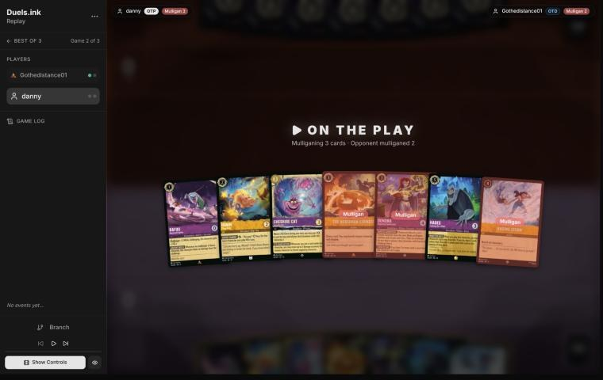
*The board before the decision: [step 0](https://duels.ink/replay/01a1a287-6860-7d36-8125-3cf2b2e86679?step=0) in the duels.ink replay viewer.*

**What you did:** chose to go first. From Rafiki, Hamm, Cheshire Cat, The Horseman Strikes!, Demona – Imperious,
Hades and Raging Storm, you sent back Horseman, Imperious and Raging Storm, and drew Horseman, Pepita and Mickey.

**Verdict:**
- **On the play: good play.** Game 1 was a race they won by game turn 15; going first gives you the tempo, and your
  answers (Scourge at 6, Storm at 8) come a turn sooner relative to their board. [ROLE-1](#cite-role-1), [RULE-7](#cite-rule-7).
- **The mulligan: close call.** `mulligan.py` (1,500 deals):

| Option | Ink spent, turns 1–4 | Turns with a play | Lore by turn 4 | Characters by turn 4 | Interaction |
|---|---|---|---|---|---|
| Keep all 7 | 9.59 / 10 | 3.99 / 4 | 6.1 | 4.0 | 100% |
| As played (keep 4) | 9.65 / 10 | 3.96 / 4 | 6.7 | 4.2 | 100% |
| Keep 6 (Storm back) | 9.75 / 10 | 4.00 / 4 | 6.3 | 4.3 | 100% |
| Full mulligan | 9.00 / 10 | 3.56 / 4 | 6.0 | 3.4 | 96% |

  - Raging Storm (8, uninkable) does nothing for the first seven turns; sending it back was clear.
  - **The coach would have kept Horseman and Imperious.** Against a list with about fifteen Evasive questers
    (Vixey's 2 lore among them), Horseman is the card that both draws and kills one, and Imperious killed three
    characters in game 1. The sim can't see that.
  - The deeper mulligan dug for cheaper bodies and early lore, and the sim scores it slightly higher on lore by turn 4
    (6.7 against 6.3). On the play, early pressure has value of its own.

  So it's close, and it turns on how much Horseman is worth against their fliers. [MULL-1](#cite-mull-1), [MULL-3](#cite-mull-3). Confidence: low.

### Turn 1: your turn 1

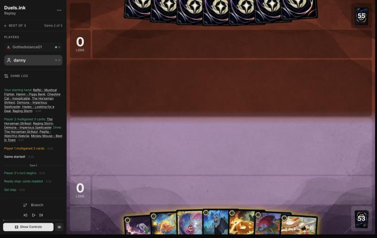
*The board before the decision: [step 2](https://duels.ink/replay/01a1a287-6860-7d36-8125-3cf2b2e86679?step=2) in the duels.ink replay viewer.*

**What you did:** inked Rafiki and played Mickey – Best in Town.

**Verdict:** **good play.** On the play, Mickey's 2 lore a turn is the fastest start in the hand, and his 4
willpower survives every 1- and 2-drop of theirs (Flash hits for 3). His ink drop goes to them too
([notes](#cite-kb-cards-mickey-mouse-best-in-town-what-it-means-in-play)), but a drop is worth less to a curve of 1- to
3-drops than 2 lore a turn is to you. The ink check: with Rafiki gone, turns 2 and 3 are still Hamm or Pepita, then
Cheshire or Horseman; Pepita does Rafiki's challenging job. [INK-2](#cite-ink-2).

### Turn 3: your turn 2

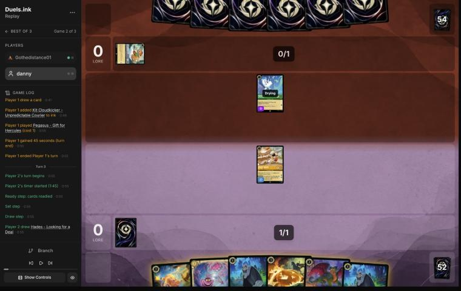
*The board before the decision: [step 8](https://duels.ink/replay/01a1a287-6860-7d36-8125-3cf2b2e86679?step=8) in the duels.ink replay viewer.*

**What you did:** drew a second Hades. Inked Pepita, played Hamm, and Mickey quested (2–0); each player got an ink
drop.

**Verdict:** **good play.** Nothing of theirs could challenge (Pegasus was their only character, with 1 {S}), so
Mickey's quest was free.
- **The ink, Pepita or the second Hades:** the coach's first instinct was the duplicate 5-drop. But next turn you
  have 3 ink plus Mickey's drop, and Hamm's LOOSE CHANGE takes 1 off a character, so Hades comes down on game turn 5.
  Against a board of cheap characters each Hades is a 3/4 that either sends one of theirs to the bottom of their deck
  or draws you 2. Pepita can't reach their fliers, and Hamm was the 2-drop the Hades plan needed. Ink check: without
  Pepita, next turn is Hades (via Hamm and the drop), then Cheshire or Horseman plus whatever you draw. [INK-2](#cite-ink-2).

### Turn 5: your turn 3

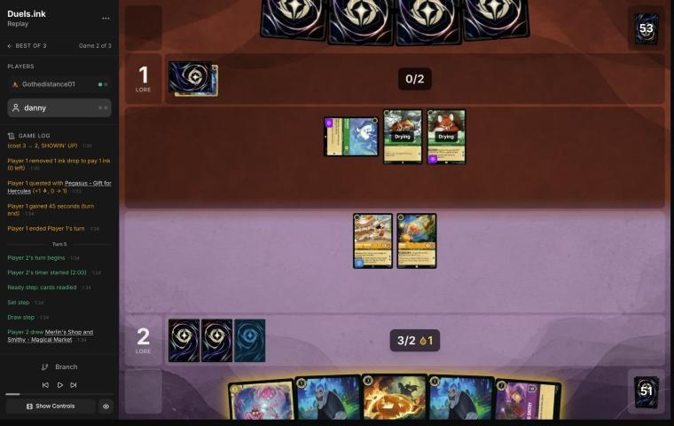
*The board before the decision: [step 17](https://duels.ink/replay/01a1a287-6860-7d36-8125-3cf2b2e86679?step=17) in the duels.ink replay viewer.*

**What you did:** drew a Shop and inked it. The Horseman Strikes! banished Vixey and drew Demona – Scourge. Mickey
quested (4–1), Hamm stayed home, and you kept your ink drop, so you had two after Mickey's.

**The setup:** they had used Mickey's drop to play Tod and Vixey (2 lore, Evasive) on their turn 2. You had 3 ink
plus a drop, and Hamm's LOOSE CHANGE.
- **Candidates:** Horseman on Vixey (certain removal plus a card); or Hamm's discount plus the drop for Hades on
  Vixey (a 3/4 body, and they choose between losing Vixey to the bottom of their deck and giving you 2 cards); or
  Cheshire.
- **Their next turn:** 3 ink, a drop, 4 cards. Strength of a Raging Fire 31% (2–3 damage with their board), Elinor
  31%.

**Verdict:** **good play.** Horseman took their best quester for sure and replaced itself. Hades would have added a
body, but they choose which half of his deal you get, so it might have been 2 cards while Vixey kept questing. Hamm
stayed ready and out of reach, so only Mickey (4 willpower; together their board deals 3 without Vixey) was exposed.
The unused ink wasn't lost: the drop carries over, so next turn has 6 (4 ink and 2 drops), enough for Scourge, or
Hades through Hamm with 2 to spare. [TEMPO-2](#cite-tempo-2), [RULE-1](#cite-rule-1).

### Turn 7: your turn 4

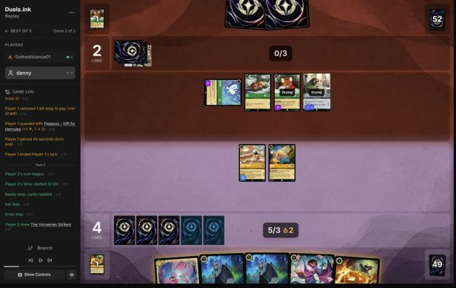
*The board before the decision: [step 27](https://duels.ink/replay/01a1a287-6860-7d36-8125-3cf2b2e86679?step=27) in the duels.ink replay viewer.*

**What you did:** drew a second Horseman and cast it first, banishing the second Vixey and drawing Hamm. Then you
inked that Hamm, exerted the first for LOOSE CHANGE, played Cheshire for 2, and Mickey quested (6–2). You kept one
drop, two after Mickey's.

**The setup:** their board was Pegasus, Tod, a fresh Vixey (2 lore) and Flash (2 lore, Resist 1): 6 lore a turn
against your 3. Their hand was 2 cards, 4 ink next turn; Strength or Elinor 21% each.
- **Candidates:** Horseman on Vixey plus Cheshire; both Horsemen (Vixey and Pegasus, two cards drawn); Hades on
  Vixey (their choice of outcome); Scourge, which exerts their board when only Hamm can challenge it.

**Verdict:** **good play.**
- **The order:** Horseman before the ink, so the ink choice came after seeing its draw. That's [SEQ-1](#cite-seq-1), and the card
  it drew (Hamm) was the one to ink.
- **The second Horseman held:** Pegasus is a 1-lore 1/1, and the list has about ten more fliers (Mushu, White
  Rabbit, two Vixeys). [QC-2](#cite-qc-2).
- **Cheshire** gives a ready 3/4 that kills Tod or Flash (3 − 1) whenever they quest.
- **The one cost:** LOOSE CHANGE left Hamm exerted, and Flash (3) kills him. Paying for Cheshire with the drop and
  keeping Hamm ready was the alternative; the saved drop gives 7 next turn rather than 6, which Scourge doesn't need.
  That's a small edge either way. [RULE-1](#cite-rule-1).

### Turn 9: your turn 5

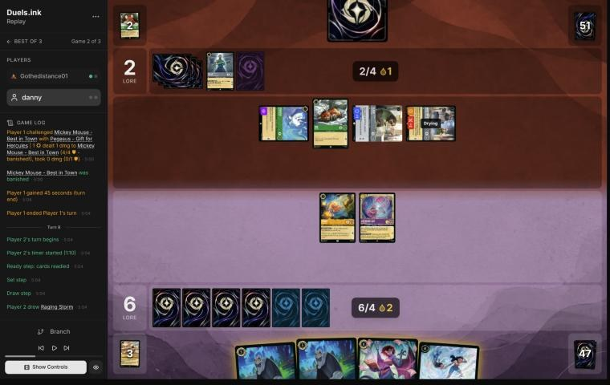
*The board before the decision: [step 40](https://duels.ink/replay/01a1a287-6860-7d36-8125-3cf2b2e86679?step=40) in the duels.ink replay viewer.*

**What you did:** drew Raging Storm. Hamm's LOOSE CHANGE made Hades cost 4. You chose Woolter & Jesse (entered
exerted as a Bodyguard again), and they let you draw 2: a third Hamm and a second Storm. Then you inked the other
Hades and played Hamm with 1 ink and a drop, leaving one drop. Nobody quested. Lore 6–2.

**The setup:**
- **Their board:** Pegasus, Tod, Flash and Woolter & Jesse, 5 lore a turn. On their turn 8 they spent Flash's and
  Pegasus's quests killing Mickey. Their hand was 1 card, 6 ink next turn.
- **Your ink:** 4 ink and 2 drops, 7 after an ink. Mickey was gone, so no more drops were coming.
- **Storm's timing:** with both drops saved, next turn has 6 ink + 2 drops = 8, a Raging Storm on game turn 11. Spend
  one, and it waits until game turn 13.

**The candidates:**
1. **As played:** Hades through Hamm (draw 2 or bottom a character), then the second Hades inked and a third Hamm.
   Four characters on board for a Scourge turn next turn (7 ink), Storm on 13.
2. **Hades for 5 from the inkwell, both drops kept, Cheshire and Hamm quest:** 8–2, and Storm next turn takes
   their whole board (four or more characters) along with your three. Their Woolter & Jesse can punish the
   questers, but every challenge costs them a quest, and the Storm cleans up either way.

**Verdict:** **close call.** Line 2 brings the reset a turn earlier, while they have one card in hand and you'd have
two Hades draws and Scourge to rebuild with. Line 1 bets on the board instead: four bodies, Cheshire ready to punish
a quest, and Scourge plus challengers next turn, with the Storms kept for a bigger board. Both are sound plans. The
coach can't call either clearly better, because it turns on how fast they rebuild after a Storm. The order was good:
the ink came after Hades's draw ([SEQ-1](#cite-seq-1)). [SEQ-4](#cite-seq-4). Confidence: low.

### Turn 11: your turn 6

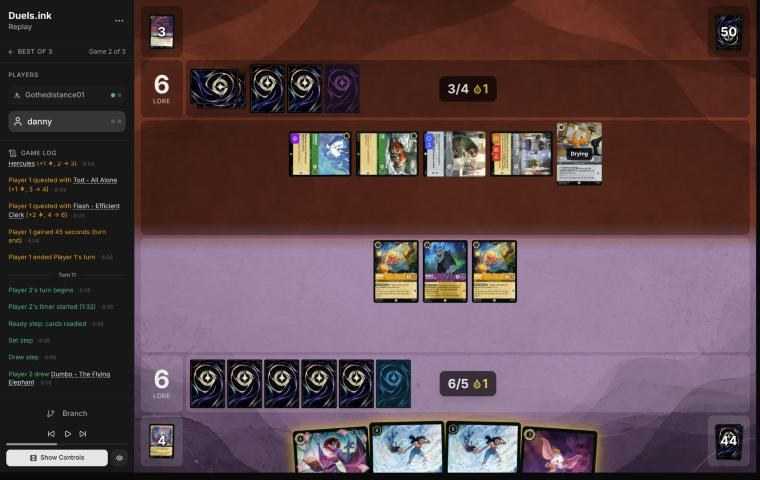
*The board before the decision: [step 54](https://duels.ink/replay/01a1a287-6860-7d36-8125-3cf2b2e86679?step=54) in the duels.ink replay viewer.*

**What you did:** drew Dumbo. Hades and then a Hamm challenged Woolter & Jesse (exerted from singing Strength): it
died, and so did both of yours. The other Hamm killed Tod and survived on 1 willpower. You inked Scourge and played
Dumbo, whose AERIAL DUO gave that Hamm Evasive. Lore 6–6.

**The setup:**
- **Their turn 10:** Toulouse (no actions for you this turn), then Woolter & Jesse sang Strength of a Raging Fire for
  5 onto Cheshire, and three quests took them to 6.
- **Their board:** Pegasus, Tod, Flash and Woolter & Jesse, all exerted, plus a drying Toulouse: 6 lore a turn. Their
  hand was empty.
- **The Bodyguard took the first challenge,** and it needs 4 damage: any two of Hades (3) and the Hamms (2 each).
- **Next turn:** one more ink and your drop make 8, Raging Storm (two in hand), unless they top-deck another Toulouse.

**Verdict:** **inaccuracy.**
- Challenging Woolter & Jesse with **Hades and a Hamm**, then Tod with the second Hamm, is suboptimal: a Hamm's 2 {S}
  can't get through Flash's Resist (2 − 1 = 1), so Tod (1 lore) was the only target left.
- Sending **both Hamms into Woolter & Jesse, then Hades into Flash**, is better: Hades's 3 {S} kills Flash (3 − 1 = 2)
  and he survives on 1 willpower. You lose the same two characters, and their board quests for 3 instead of 4 and
  loses Flash's 3 {S}, the one body of theirs that kills a 3-willpower character alone.
- **What it exposes:** Hades exerted on 1 willpower, just like your Hamm was. Dumbo's Evasive can go on him the same
  way, leaving only Pegasus able to reach him.

The rest was sound. With their hand empty, trading your cheap characters for their two best bodies kept their clock
slow, and the Storms stay in hand. [TRADE-1](#cite-trade-1), [SEQ-3](#cite-seq-3). Confidence: medium. The challenge maths is certain; a lore a turn
matters less if a Storm comes next turn.

### Turn 13: your turn 7

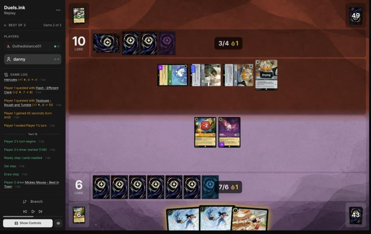
*The board before the decision: [step 66](https://duels.ink/replay/01a1a287-6860-7d36-8125-3cf2b2e86679?step=66) in the duels.ink replay viewer.*

**What you did:** drew Mickey and played him rather than inking him. Dumbo killed Pegasus and survived; the damaged
Hamm traded with the exerted Toulouse. No ink this turn. Lore 6–10.

**The setup:**
- **Their turn 12:** a second Toulouse, so no actions for you this turn: no Storm, whatever the ink. (The brief
  listed Storm as castable after an ink; it doesn't know about Toulouse's lock.)
- **Their board:** Pegasus, Flash and a Toulouse exerted, the second Toulouse drying: 5 lore a turn, 20 on game turn
  16. Their hand was empty.
- **What reaches what:** Dumbo (Evasive) kills Pegasus or a Toulouse and survives. Hamm, on 1 willpower, trades with
  a Toulouse. Nothing of yours gets through Flash's Resist.
- **Mickey:** ink him for 7 ink plus the drop next turn, which guarantees a Storm on game turn 15. Or play him: 2
  lore a turn from next turn, with Storm needing next turn's draw to be inkable (about 4 in 5).

**Verdict:** **good play.** The two challenges took 2 lore a turn off their board for one damaged Hamm. That leaves
Flash and a Toulouse, 3 a turn from 10. A Storm into a board of two or three cheap characters isn't worth 8 ink and
your own board, so the ink that guarantees it mattered less than Mickey's 2 lore a turn. Mickey's 4 willpower takes
both their characters together to kill. [INK-3](#cite-ink-3), [QC-5](#cite-qc-5).

### Turn 15: your turn 8

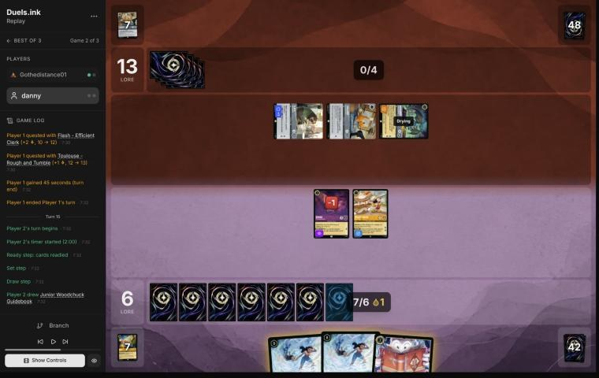
*The board before the decision: [step 75](https://duels.ink/replay/01a1a287-6860-7d36-8125-3cf2b2e86679?step=75) in the duels.ink replay viewer.*

**What you did:** drew a Junior Woodchuck Guidebook and inked it for 8. Dumbo and Mickey quested (9–13), then Raging
Storm banished Flash, Toulouse and Broadway (entered exerted as a Bodyguard), and your two.

**The setup:**
- **The race:** they were at 13 and quested for 5 (Broadway and Flash 2 each, Toulouse 1), so 18 next turn and 20
  on game turn 18.
- **Hands:** theirs was empty. Yours was two Storms and the Guidebook. The Toulouse lock had ended, since no new
  Toulouse came on turn 14.
- **Candidates:**
  1. Ink the Guidebook and Storm now, questing first.
  2. Crack the Guidebook for 2 cards and Storm next turn with Mickey's drop. They'd sit on 18 needing 2 from
     whatever they top-deck.

**Verdict:** **good play.** Questing before the Storm banked 3 lore from characters it was about to banish. Storming
now leaves them needing 7 from an empty board and an empty hand. Line 2 keeps two cards but lets them reach 18, where
any two top-decked characters win in two turns. From behind, take the line that stops their clock ([POS-2](#cite-pos-2), [QC-5](#cite-qc-5)).
After it you're top-decking too, but with 8 ink to their 5 and a second Storm in hand.

### Turn 17: your turn 9

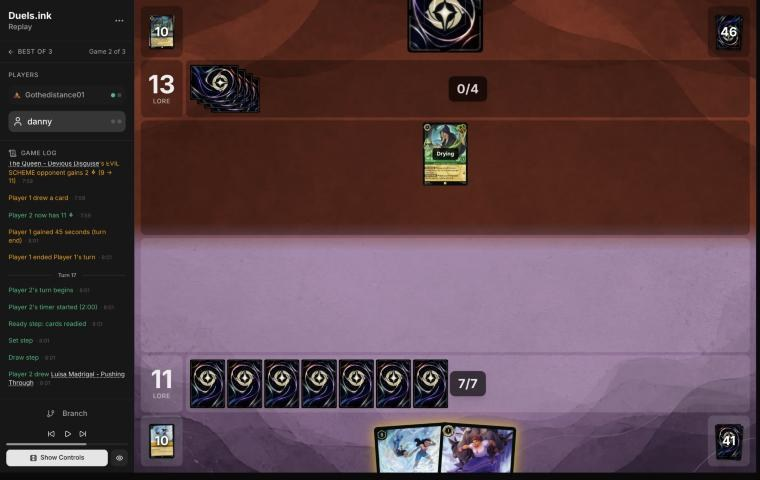
*The board before the decision: [step 85](https://duels.ink/replay/01a1a287-6860-7d36-8125-3cf2b2e86679?step=85) in the duels.ink replay viewer.*

**What you did:** drew Luisa Madrigal and played her, holding the second Storm. Lore 11–13 (their Queen's EVIL SCHEME
gave you 2 when she drew them a card).

**The setup:** both boards had been swept. Theirs was The Queen (drying; 1 lore, or 3 once you lead) with a card
in hand. Yours was empty, with Storm and Luisa in hand and 7 ink.

**Verdict:** **good play.** A Storm into one character is an 8-ink one-for-one. Held, it answers the board they
rebuild from top-decks. Luisa adds a quester and a Challenger 2. The ink check: Luisa played rather than inked
means Storm next turn needs an inkable draw (about 4 in 5). Storm is better saved for a bigger board in any case.
[WIN-2](#cite-win-2), [THREAT-4](#cite-threat-4).

### Turn 19: your turn 10

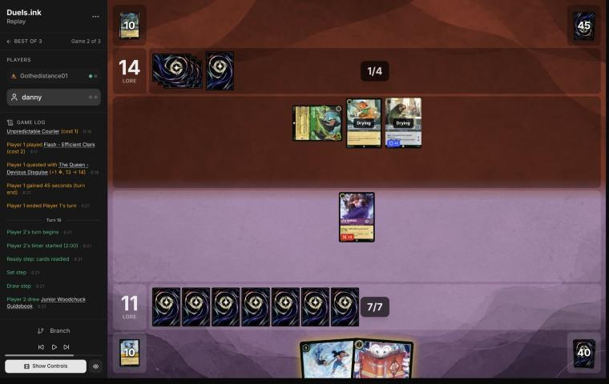
*The board before the decision: [step 91](https://duels.ink/replay/01a1a287-6860-7d36-8125-3cf2b2e86679?step=91) in the duels.ink replay viewer.*

**What you did:** drew a second Guidebook and inked it. Luisa quested (12–14), then the second Raging Storm banished
The Queen, Kit Cloudkicker and Flash, and Luisa.

**The setup:** they had rebuilt from top-decks: The Queen, Kit and Flash, 4 lore a turn from 14, so 18 next turn and
20 on game turn 22. Their hand was empty again.
- **Candidates:**
  1. Storm now, after Luisa's quest.
  2. Crack the Guidebook for 2 cards and Storm next turn.

**Verdict:** **good play,** for the same reason as turn 15. Line 2 lets them reach 18, and from there two top-decked
characters win. After the Storm they need 6 with no board and no hand, and you have 8 ink to their 5. The Guidebook
was the only inkable card, and the Storm needed it. [POS-2](#cite-pos-2).

### Turn 21: your turn 11

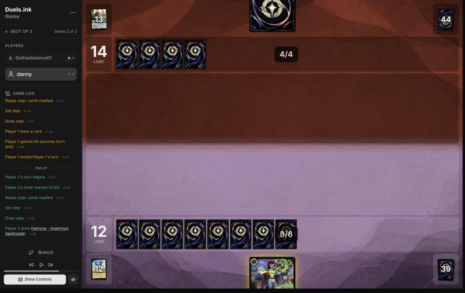
*The board before the decision: [step 96](https://duels.ink/replay/01a1a287-6860-7d36-8125-3cf2b2e86679?step=96) in the duels.ink replay viewer.*

**What you did:** drew Demona – Imperious Spellcaster and played her. Lore 12–14, both boards empty. On their turn 20
they had drawn and played nothing, holding one card.

**Verdict:** **good play,** and the only one: the one card you had, on an empty board. Inking her would buy a ninth
ink that nothing in hand needed. [INK-3](#cite-ink-3).

### Turn 23: your turn 12

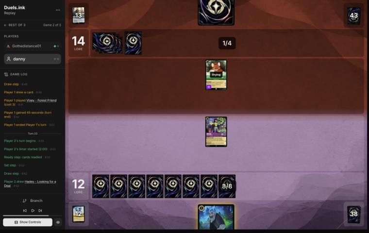
*The board before the decision: [step 100](https://duels.ink/replay/01a1a287-6860-7d36-8125-3cf2b2e86679?step=100) in the duels.ink replay viewer.*

**What you did:** drew Hades and played him on Vixey. They let you draw 2 (another Hades and another Imperious), so
you played the Imperious with the last 3 ink and quested with the first one. Lore 13–14.

**Verdict:** **good play.** All 8 ink went into the board. Hades either removed their only quester or drew two
cards (they chose the cards). Imperious's quest was safe: Vixey's 1 {S} can't kill her. The board is now Hades and
two Imperious against one Vixey, and their hand is a single card. [QC-3](#cite-qc-3).

### Turn 25: your turn 13

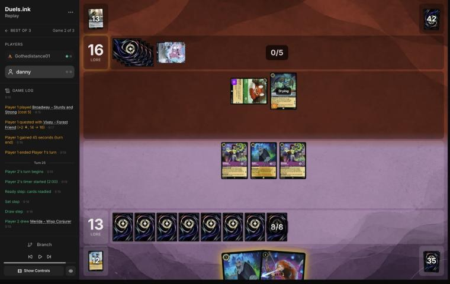
*The board before the decision: [step 111](https://duels.ink/replay/01a1a287-6860-7d36-8125-3cf2b2e86679?step=111) in the duels.ink replay viewer.*

**What you did:** drew Merida. Hades went first, on Broadway; they let you draw 2 (Imperious and Pepita). You inked
Pepita, played Merida exerted for a card (Remember Me), and discarded the new Imperious to give one on board Rush and
Evasive. She killed Vixey. The other Imperious and the first Hades quested. Lore 15–16.

**The setup:**
- **They needed 4:** Vixey (exerted, Evasive, 2 lore) and a fresh Broadway (entered *ready*, 2 lore) were exactly 20
  next turn. Broadway couldn't be challenged, so Vixey had to die. Only an Evasive challenger could reach her.
- **The tool:** Imperious's IMPETUS IMPROVISUS, for a discard. With Flash gone, the Rush part works too.

**The coach's plan** was to discard Merida to IMPETUS, kill Vixey, Hades on Broadway, and quest two: 15–16, 3 ink
unused.

**Verdict:** **good play, better than the coach's plan.** Hades first meant his two cards came before choosing the
discard ([SEQ-1](#cite-seq-1)). One of them (the third Imperious) paid for IMPETUS. Merida then came down as a fifth body and drew
Remember Me, and Pepita made the ninth ink that paid for her. Same kill, same lore, but two more cards seen and a
bigger board for the next turn.
- **What it exposes:** Imperious on 2 willpower (Evasive until your turn, so Broadway can't reach her), the questing
  Imperious and Hades, and Merida. Broadway (4 {S}) kills any of the last three, but a challenge costs his quest and
  keeps them on 16.

## Lessons
1. **Toulouse locks your Storm.** It came twice (game turns 10 and 12), each time on the turn before the 8 ink was
   ready. Against this list, count the Toulouses seen (3 here) before planning a Storm turn.
2. **The Horseman Strikes! is the premium answer here.** Their 2-lore questers are Evasive (Vixey ×3 this game),
   and Horseman both kills one and replaces itself ([5](#turn-5), [7](#turn-7)).
3. **Storm into an empty hand.** Both Storms landed when they had no cards, so each one left them top-decking
   against your bigger ink ([15](#turn-15), [19](#turn-19)).
4. **Order challenges through a Bodyguard for the best second target.** The Bodyguard dies to any 4 damage; choose
   which of yours spend it so the survivor can still kill what matters, here Flash through Resist
   ([turn 11](#turn-11)).
5. **Draw before you discard.** IMPETUS IMPROVISUS needs a discard. Hades first gave it a spare card
   ([turn 25](#turn-25)).

## Proposed knowledge-base updates
- **Meta** (Emerald/Steel notes, applied with the match): Gothedistance01's game 2. Toulouse ×3 (two played to lock
  actions on the turns before your Storm), Broadway ×2 (once entered ready), Benja, Angel, Kit ×2, a Strength sung by
  Woolter & Jesse.
- **Tools:** the brief's options listed Raging Storm as castable on turn 13 while Toulouse's UNBECOMING BEHAVIOR was
  in force. A "your actions are locked this turn" line would stop a plan being built on it. Not a coach error this
  time, but the same trap as the brief's other missing rules text.

## Hindsight
Doesn't change the verdicts above.
- On [turn 9](#turn-9), the line that saved both drops for a turn-11 Storm wouldn't have got one: they played
  Toulouse on turn 10, which locked actions through your turn 11. Line 1's board was the one that met it.
- Their deck gave them three Vixeys, three Toulouses and two Broadways; your Horsemen and Storms all came in the
  first 15 game turns.

## The coach's errors
Filled in during discussion.

| When | Error | How it was caught | How it won't happen again |
|---|---|---|---|

## Open questions
- **Pre-game:** what was the deeper mulligan (Horseman and Imperious back) looking for?
- **Turn 9:** was keeping the board (rather than saving both drops for an early Storm) a plan for the Storm turn, or
  for Scourge?
- **Turn 11:** did you consider both Hamms into Woolter & Jesse so Hades could take Flash?

## Citations
Copies of the coach's knowledge base cited above, as they stood when they were cited (the private repository's commit and date are given with each). They don't change when the knowledge base does.

**ROLE-1**: strategy principle, `kb/strategy/principles.md` at `76b037b` (2026-11-03), working tree

> - **ROLE-1. The matchup decides your role, not your deck.** In nearly every game one player wants it short (aggressor) and one wants it long (defender). The same list can play either role. *Ask: "Which deck benefits if this game goes long?"* `[MCL ch.8]` · baseline

**RULE-7**: strategy principle, `kb/strategy/principles.md` at `76b037b` (2026-11-03), working tree

> - **RULE-7. Play vs draw.** The starting player skips the first draw `[CR 3.2.3.1]`, so on the draw you start a card up. The previous game's loser chooses `[CR 2.1.3.2]`. · baseline

**MULL-1**: strategy principle, `kb/strategy/principles.md` at `76b037b` (2026-11-03), working tree

> - **MULL-1. Keep a plan, not the strongest cards.** *Ask: "Which hand gives me the best chance to execute my game plan in this matchup?"* `[MCL ch.12]` · baseline

**MULL-3**: strategy principle, `kb/strategy/principles.md` at `76b037b` (2026-11-03), working tree

> - **MULL-3. The right keep depends on the matchup.** Early interaction against aggro; pressure, draw and engines against slow decks. The mulligan is the first expression of your role. In the Set 14 era the opponent's inks are known before the mulligan (RULE-8), so this applies from game 1 of a match. `[MCL ch.12]` · baseline

**INK-2**: strategy principle, `kb/strategy/principles.md` at `76b037b` (2026-11-03), working tree

> - **INK-2. Don't automatically ink the most expensive card.** It may be the late-game win condition or the key answer for this matchup. The answer depends on matchup, hand and board. `[MCL ch.4]` · baseline

**TEMPO-2**: strategy principle, `kb/strategy/principles.md` at `76b037b` (2026-11-03), working tree

> - **TEMPO-2. Answering an expensive threat with a cheap card is a tempo swing**, and more so if the answer was sung for no ink. Other examples: playing Shift threats before the opponent can answer them, and ramping into several threats in one turn. `[MCL ch.1, ch.7]` · baseline

**RULE-1**: strategy principle, `kb/strategy/principles.md` at `76b037b` (2026-11-03), working tree

> - **RULE-1. Only exerted characters can be challenged** `[CR 4.6.4.2]`. Questing, singing, or {E} for an ability exposes the character. Staying ready protects it. Every quest is also a decision about what the opponent can challenge next turn. · baseline
>   - *Card text overrides this* (CR 1.2.1). Shere Khan – Khan Industries CEO's NEW INCENTIVE lets one character
>     challenge ready characters that turn. Alert (e.g. from Judy Hopps – Lead Detective, to every Detective on their
>     turn) ignores Evasive. Against Ducktectives, name both in the setup. 01a14574, turns 16 and 18. `[coach, 2026-10-26]`

**SEQ-1**: strategy principle, `kb/strategy/principles.md` at `76b037b` (2026-11-03), working tree

> - **SEQ-1. Gather information before irreversible decisions.** Draw, look and scry before choosing what to ink. Quest with draw triggers before committing other plays when the order doesn't otherwise matter. `[MCL ch.5]` · baseline

**QC-2**: strategy principle, `kb/strategy/principles.md` at `76b037b` (2026-11-03), working tree

> - **QC-2. Challenge the threat, not the character.** Engines, synergy pieces and big questers are worth fighting over. A 1-lore character doing nothing usually isn't. *Ask: "Does this character actually need to be removed?"* `[MCL ch.6, ch.9]` · baseline

**SEQ-4**: strategy principle, `kb/strategy/principles.md` at `76b037b` (2026-11-03), working tree

> - **SEQ-4. Sequence across turns.** A slightly weaker play now can set up a much stronger next turn: keep a shift target alive, keep a singer ready, hold removal for a bigger threat. `[MCL ch.5]` · baseline

**TRADE-1**: strategy principle, `kb/strategy/principles.md` at `76b037b` (2026-11-03), working tree

> - **TRADE-1. Judge a trade by ink invested, tempo, value already generated, and the board afterwards**, not by card count. A 2-cost for a 5-cost is a big win even if it's one-for-one. *Ask: "What does the board look like after this challenge?"* `[MCL ch.7]` · baseline

**SEQ-3**: strategy principle, `kb/strategy/principles.md` at `76b037b` (2026-11-03), working tree

> - **SEQ-3. Order challenges so earlier ones inform later ones.** Lead with the challenge that might make the next unnecessary, or that preserves both characters. `[MCL ch.5]` · baseline

**INK-3**: strategy principle, `kb/strategy/principles.md` at `76b037b` (2026-11-03), working tree

> - **INK-3. Usually ink every turn, but not automatically.** Keeping one more playable card can beat one more ink. Missing ink with an expensive hand can leave you permanently behind. `[MCL ch.4]` · baseline

**QC-5**: strategy principle, `kb/strategy/principles.md` at `76b037b` (2026-11-03), working tree

> - **QC-5. The race changes everything.** At 18–12 up, take the last 2 lore. At 8–16 down, stopping their close-out matters more than your quests. `[MCL ch.6]` · baseline

**POS-2**: strategy principle, `kb/strategy/principles.md` at `76b037b` (2026-11-03), working tree

> - **POS-2. From behind, play to your outs and accept calculated risk.** Safe efficient play from a losing position loses slowly. A line with a 30% chance beats a line with 0%. *Ask: "What has to happen for me to win, and which play makes it most likely?"* `[MCL ch.10]` · baseline

**WIN-2**: strategy principle, `kb/strategy/principles.md` at `76b037b` (2026-11-03), working tree

> - **WIN-2. Don't chase small advantages that don't move the win condition.** An extra card, an extra lore or a favourable trade can still be the wrong play if it doesn't serve the path to victory. `[MCL ch.11]` · baseline

**THREAT-4**: strategy principle, `kb/strategy/principles.md` at `76b037b` (2026-11-03), working tree

> - **THREAT-4. Don't spend premium removal on what combat can handle next turn.** Answer the most important problem, not the first one you see. `[MCL ch.9]` · baseline

**QC-3**: strategy principle, `kb/strategy/principles.md` at `76b037b` (2026-11-03), working tree

> - **QC-3. Questing is favoured when:**
>   - you control the board
>   - your exerted characters can't be punished
>   - the race favours you
>   - removing their characters gains little
>
>   **Challenging is favoured when:**
>   - they have an engine or repeated-value piece
>   - the trade is efficient
>   - you need to slow the game
>   - your deck is stronger late
>
>   `[MCL ch.6]` · baseline

**amber-amethyst.md, Remember Merida: danny's list**: knowledge base, `kb/meta/archetypes/amber-amethyst.md` at `76b037b` (2026-11-03), working tree

> ### Remember Merida: danny's list `[coach, meta study of danny's 28 Oct – 2 Nov 2026 games (tools/scan.py), full games, not blind, 49 games]`
> All 49 games from `01a18285-3511` to `01a19d4c-6771` (only `01a18275-7c33` of that run was blind-reviewed).
> - **The list (31 games from 29 Oct):** Mickey – Best in Town ×4, Rafiki ×3, Luisa – Pushing Through ×2, Hamm ×4,
>   Pepita ×4, Junior Woodchuck Guidebook ×4, Merlin's Shop and Smithy ×3, Cheshire Cat – Inexplicable ×4, Demona –
>   Imperious Spellcaster ×4, Dumbo – The Flying Elephant ×2, The Horseman Strikes! ×4, Merida – Wisp Conjurer ×4,
>   Merlin – Profoundly Curious ×4, Hades – Looking for a Deal ×4, Demona – Scourge ×4, Remember Me ×3, Raging Storm ×3.
>   On 28 Oct (13 games) it ran Mowgli ×3, a 4th Shop and a 3rd Luisa instead of Hamm and the 3rd Rafiki; five games of
>   28–29 Oct ran Tigger – Bouncing All the Way ×2 instead of Dumbo. Unlike duels.ink's average Remember Merida (above):
>   no Elsa or Gaston, but the full Demona pair (4 + 4) and four Cheshires.
> - **Raging Storm is the reset:** cast in at least 19 of the 49 games (28 casts that removed 3+ of their characters), from game
>   turn 9 (`01a18d5a-0080`, the turn after their wipe), usually turns 11–15. Mickey's ink drops bring it a turn early.
> - **Then Remember Me rebuilds:** sung by two characters (Sing Together 6), it replays 4–7 characters from the discard
>   (`01a182f9-576e` turn 19, `01a18391-038f` 22, `01a18442-9f20` 23, `01a188d0-21d2` 18, `01a18956-64ba` 23,
>   `01a18971-a6ee` 24, `01a18c4b-b91b` 22).
> - **The rebuild is a Storm target:** twice the opponent's Raging Storm swept it the next turn (`01a182f9-576e` turn 20,
>   Kyla's Detectives, 5 characters; `01a18c4b-b91b` turn 25, the mirror, 9). Against a list with Storm and 8 ink in
>   reach, count what the rebuild must do this turn against what a Storm would cost. A pattern to watch, not a rule.
> - **Demona – Scourge, often with Imperious Spellcaster:** Scourge exerts their board for your challengers, and
>   Imperious's IMPETUS IMPROVISUS (discard a card) gives a Gargoyle Rush and Evasive to challenge at once: 2–4 kills a turn (`01a18382-dabd` turn 17,
>   `01a18433-41ba` 18, `01a188e0-8396` 7, `01a18d68-3b5a` 16, `01a19d4c-6771` 15 and 25). Hamm's LOOSE CHANGE makes
>   Imperious cost 2.
> - **Cheap challengers clear small boards:** Cheshire plus Luisa or Pepita killed two characters a turn against Rockstar
>   Aggro (`01a18bd1-43a6` turn 13, `01a18be9-bd5b` turn 10) and Big Ramp (`01a18d6f-7150` turn 11).
> - **Shop moves close games:** two Shops and two moves for the last 2 lore (`01a18456-be9a` turn 29), a Shop played
>   and moved to on the Storm turn (`01a18c4b-b91b` turn 28).
> - **What swept danny's board,** with the earliest game turn seen (their removal is in each pair file's notes):
>   Spooky Sight (Amber/Sapphire Control, turn 7: five characters of cost 3 or less into the inkwell); Don Karnage –
>   Debonair Pirate's LASTING IMPRESSION plus To Wither a Flower or Malicious, Mean, and Scary (Retro Device, Circle of
>   Life, an Emerald/Ruby list: turn 7); Strength of a Raging Fire sung twice (Emerald/Steel Midrange, Lilo & Stitch
>   Songs: turn 8); Merida – Formidable Archer with Three Arrows or Windstorm (Big Ramp: turn 10); The Leviathan played
>   free through Retro Evolution Device (Emerald/Ruby Unnamed #1: turn 9); Raging Storm (Control, the mirror, one
>   Detectives list: turn 8); Judy – Always Vigilant's GOT YOU NOW one character at a time (Detectives). Most of the
>   list costs 3 or less, so the cheap sweeps take most of the board.

**emerald-steel.md, Midrange: how it plays**: knowledge base, `kb/meta/archetypes/emerald-steel.md` at `76b037b` (2026-11-03), working tree

> ### Midrange: how it plays `[coach, meta study of the user's 27 Oct 2026 games (tools/scan.py), full games, not blind, 3 games]`
> Games: 01a17ddb, 01a17ead, 01a17f0e.
> - **Cheap Evasive questers:** White Rabbit (2), Vixey (3, or 2 with a Tod in play; 2 lore), and Mushu – Stealthy Dragon
>   (3; draws when you hold more cards).
> - **2-lore bodies:** Flash – Efficient Clerk (Resist 1; all characters lose Rush and can't gain it) and Broadway.
> - **The Queen – Devious Disguise:** +2 {L} while you lead, so she quests for 3. Her draw on play gives you 2 lore.
> - **Locks:**
>   - Toulouse – Rough and Tumble: when played, **you can't play actions (songs included) until their next turn**
>   - Ursula – Deceiver: you discard a song of their choice
> - **Fighting:** Angela – Night Warrior gives a character Challenger +2 and Resist +2. Strength of a Raging Fire deals
>   damage equal to their character count (4 in 01a17f0e turn 13).
> - **Big turns:** steady +6 quest turns (01a17ead turn 12: The Queen for 3 plus three 1s; 01a17f0e turn 13 after
>   Strength of a Raging Fire).
> - **They also used the ink drops your Mickey – Best in Town gives each player:** four on turn 6 of 01a17ddb
>   (`kb/cards/mickey-mouse-best-in-town.md`).

**mickey-mouse-best-in-town.md, What it means in play**: knowledge base, `kb/cards/mickey-mouse-best-in-town.md` at `76b037b` (2026-11-03), working tree

> ## What it means in play `[coach, from the 27 Oct 2026 meta study]`
> - **The ramp is symmetric:** every turn he quests, the opponent also gets an ink drop. That's worth more to decks with
>   ink-drop payoffs:
>   - **Jousting Match** (Steel action, 3): 2 damage, or **5 if paid with an ink drop**. Mickey supplied an Amethyst/Steel
>     opponent's drops (01a17e37).
>   - Ink-drop decks also run Ink Explosion, Merlin – Profoundly Curious and Marie – Caught in the Act; Shere Khan –
>     Khan Industries CEO makes drops of his own.
>   - An Emerald/Steel opponent spent four of these drops on turn 6 of 01a17ddb.
> - **Adventurous forces him to quest,** so he ends every turn exerted and can be challenged. 0 strength means he trades
>   for nothing; he's often the first challenge target (01a17e9c turn 14, 01a17ddb turn 6).
> - **Against a Steel opponent,** count the drops you're giving them, and what they could pay for with them, before
>   questing with him.
> - **Drops bring Raging Storm early** `[coach, meta study of Savitar's games, 2 Nov 2026]`: Candle Control (Amber/Ruby)
>   cast it on game turn 9, their 5th turn, with 5 ink and 3 drops from both sides' Mickeys (01a19bdb-d8e4). Against an
>   Amber deck, add your Mickey's drops to their ink when you count down to Storm (8).
