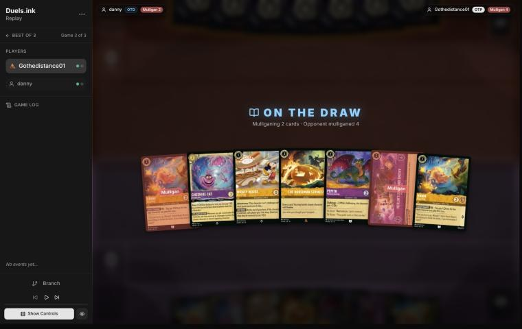
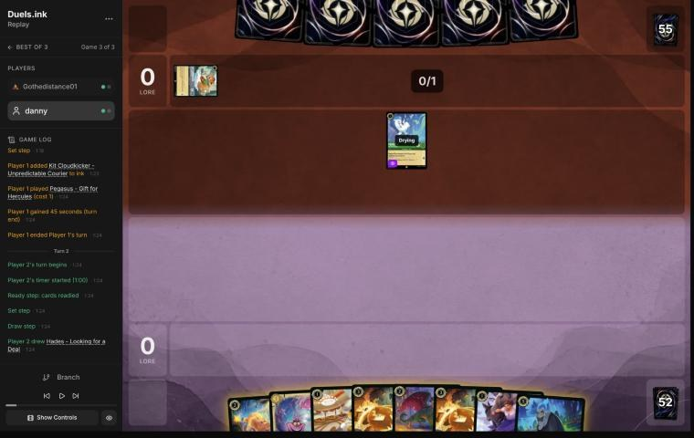
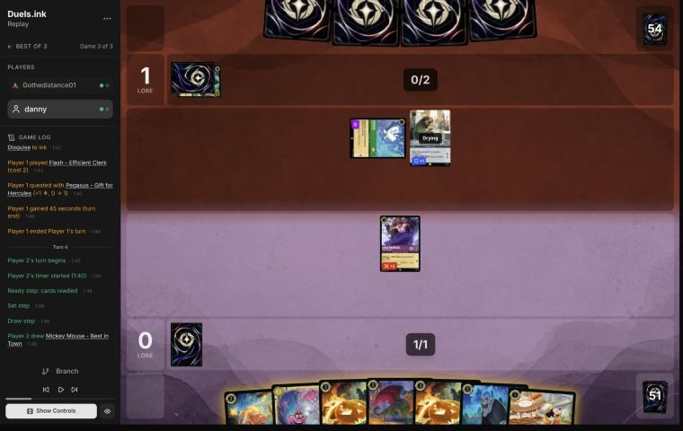
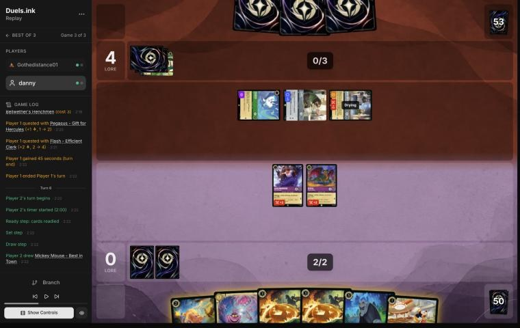
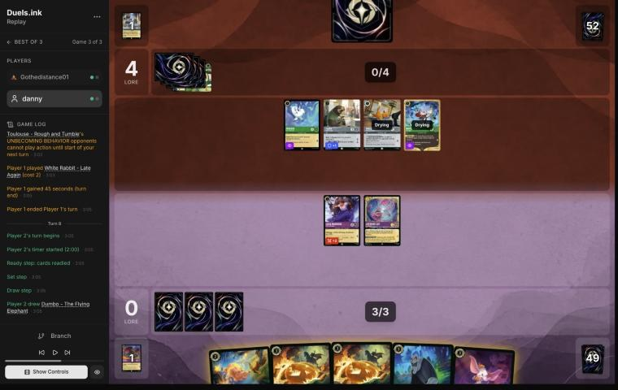
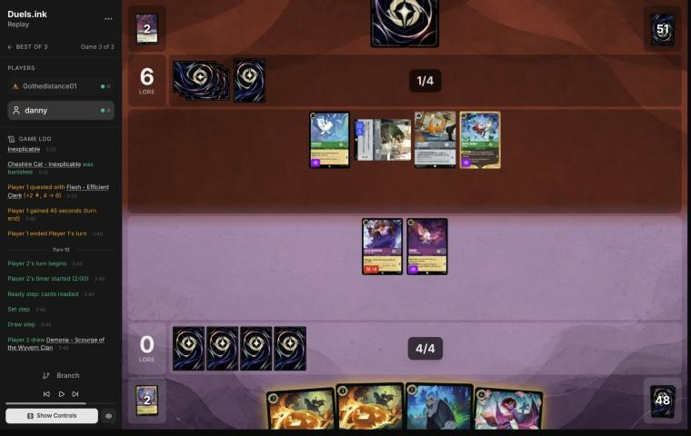
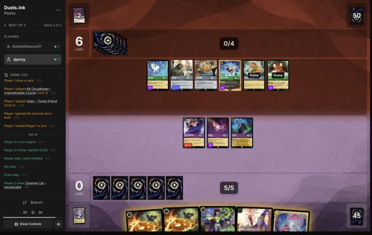

# Review: danny vs Gothedistance01, game 3, 3 Nov 2026

| | |
|---|---|
| **Status** | draft (blind pass done, not yet discussed) |
| **Replay** | `01a1a291-a225` (`python3 tools/brief.py 01a1a291-a225 --turn N`) · [duels.ink viewer](https://duels.ink/replay/01a1a291-a226-79f4-b963-542b778601ba?step=0) |
| **Format** | Core Constructed (from game 1 of the match), best-of-three, game 3. Set 14 era: inks revealed before the coin toss |
| **Decks** | You: Amber/Amethyst Remember Merida ([your list](#cite-kb-meta-archetypes-amber-amethyst-remember-merida-danny-s-list)), as in games 1 and 2. Them: Emerald/Steel ([the coach's notes on this pair](#cite-kb-meta-archetypes-emerald-steel-midrange-how-it-plays)); archetype as it became clear: Midrange #1 (99.8% from game 2), with Kit Cloudkicker from outside the listed lists |
| **Play/draw** | You went second (they chose, having lost game 2) |
| **Result** | **Win** (and the match, 2–1). Gothedistance01 conceded on game turn 12 at 0–6, as your second Horseman resolved |
| **Meta data** | snapshot of 26 Oct 2026 (fresh until 9 Nov) |
| **Chosen how** | Sent by you: the match zip held three games. The coach knew games 1 and 2 were split, but not this game's result |

## Summary
Links go to the turn sections below.
- **Inaccuracy:** [turn 8](#turn-8): Dumbo gave Cheshire Evasive, then Cheshire didn't quest. That was a free lore.
- **Close calls:** [turn 2](#turn-2) (Mickey inked rather than Hades) and [turn 10](#turn-10) (Scourge inked).
- **Good plays:** the [mulligan](#turn-0) and turns [4](#turn-4), [6](#turn-6) and [12](#turn-12).
- **How it went:** Luisa, Pepita and Cheshire on board kept them from questing on two turns (7 and 11). Strength took
  Cheshire. Hades refilled your hand, and two Horsemen on game turn 12 took their board from 8 lore a turn to 5. They
  conceded with an empty hand.

**What decided it:** card flow. They spent their hand on a wide board, while Hades and the Horsemen kept yours full
of answers.

## The game, turn by turn
Verdicts judge each decision on what you could know at the time, **including archetype knowledge an experienced
player has**. Hindsight is kept to its own section. Severity scale: good play / close call /
inaccuracy / mistake / blunder. Principle IDs and hypotheses (H-n) link to copies
in the Citations section at the end, as they stood when they were cited.

**What you knew before the game:** their inks, Emerald/Steel, and two games of their list: Midrange #1 (99.8%), with
Kit Cloudkicker and Benja from outside duels.ink's lists. Seen so far:
- **Evasive questers:** Vixey ×3, Pegasus, Mushu, White Rabbit ×2.
- **Ground bodies:** Tod ×2, Flash ×2, Woolter & Jesse ×2, Broadway ×2, The Queen, Kit ×2.
- **Removal:** Strength of a Raging Fire (sung by Woolter & Jesse for 5 in game 2) and Angel.
- **Locks:** Toulouse ×3, two played on the turns before your Storm.

Their key cards, with the earliest game turn each can come (you're on the draw, so their turn k is game turn
2k − 1):
- **Vixey** (2 lore, Evasive; 2 ink with Tod, so game turn 3) and the other fliers. Your answers: Horseman (two in hand
  after the mulligan), Dumbo, Imperious's Evasive.
- **Woolter & Jesse** (game turn 5) and **Broadway** (game turn 9): Bodyguards that enter exerted.
- **Flash** (game turn 3): turns off Imperious's Rush.
- **Toulouse** (game turn 3): no actions for you until their next turn. That locks Horseman and Storm, so play actions
  on the turn you draw them when you can.
- **Strength of a Raging Fire** (game turn 5, or sung by any dry cost-3+ character), **Elinor** (game turn 7),
  **Angel**.

### Pre-game

*The board before the decision: [step 0](https://duels.ink/replay/01a1a291-a226-79f4-b963-542b778601ba?step=0) in the duels.ink replay viewer.*

**What you did:** on the draw. From Hamm ×2, Cheshire, Mickey, Horseman, Pepita and the Shop, you sent back the Shop
and a Hamm, and drew a second Horseman and Luisa. They mulliganed four.

**Verdict:** **good play.** `mulligan.py` (1,500 deals):

| Option | Ink spent, turns 1–4 | Turns with a play | Lore by turn 4 | Characters by turn 4 | Interaction |
|---|---|---|---|---|---|
| Keep all 7 | 9.87 / 10 | 4.00 / 4 | 9.4 | 4.6 | 100% |
| Keep 6 (Hamm back) | 9.89 / 10 | 4.00 / 4 | 9.5 | 4.4 | 100% |
| As played (keep 5) | 9.87 / 10 | 4.00 / 4 | 9.8 | 4.6 | 100% |
| Full mulligan | 9.40 / 10 | 3.68 / 4 | 6.2 | 3.7 | 95% |

The seven already curved: Mickey, Hamm or Pepita, Cheshire or Horseman. The Shop is a late-game engine, and the
second Hamm duplicated the first. Sending both back scores best on early lore and keeps every early piece and the
Horseman. [MULL-1](#cite-mull-1), [MULL-2](#cite-mull-2). Confidence: medium.

### Turn 2: your turn 1

*The board before the decision: [step 5](https://duels.ink/replay/01a1a291-a226-79f4-b963-542b778601ba?step=5) in the duels.ink replay viewer.*

**What you did:** drew Hades. Inked Mickey and played Luisa. They had inked Kit and played Pegasus.

**Verdict:** **close call.**
- **Luisa first is right on the draw.** She's a 0/3 that challenges for 2, enough for Kit, Tod or Toulouse whenever
  one quests, and early interaction matters more than early lore when they curve first (section 7 of the method).
- **The ink: Mickey or Hades.** In game 2 they spent each of Mickey's drops at once: Tod and Vixey on their turn 2,
  Flash and Vixey on their turn 3. That's the case for inking him. The case against: his drop is worth most to them
  now, while they still have cheap cards to cast. Played on turn 6 or 8, when their hand is spent, the drops mostly
  help you reach Scourge (6) and Storm (8) a turn early, and the 2 lore a turn is yours either way. Hades drew you 6
  cards in game 2, but he's also the card you'd cast last.
- **Ink check (Mickey inked):** turn 4 is Hamm or Pepita, turn 6 Cheshire or Horseman, as with Hades inked. The
  difference is only which card comes later.

The coach leans towards inking Hades and holding Mickey, but it turns on how much a late Mickey is worth, which
neither game settles. [INK-2](#cite-ink-2), [MULL-3](#cite-mull-3). Confidence: low.

### Turn 4: your turn 2

*The board before the decision: [step 12](https://duels.ink/replay/01a1a291-a226-79f4-b963-542b778601ba?step=12) in the duels.ink replay viewer.*

**What you did:** drew the second Mickey and inked him too, then played Pepita. Luisa stayed home. They had inked The
Queen, played Flash and quested with Pegasus (0–1).

**Verdict:** **good play.** Pepita (Challenger 2, so 4 {S} on the attack) kills Flash through Resist whenever he
quests, and Luisa covers a Kit or Tod. Luisa's quest would have been a free kill for Flash. Inking the second Mickey
follows the same plan as turn 2 (no drops for their curve), and the same trade-off applies. With both Mickeys gone,
the hand still curves: Horseman or Cheshire next turn, then Hamm with Pepita or a Horseman. [RULE-1](#cite-rule-1), [INK-2](#cite-ink-2).

### Turn 6: your turn 3

*The board before the decision: [step 21](https://duels.ink/replay/01a1a291-a226-79f4-b963-542b778601ba?step=21) in the duels.ink replay viewer.*

**What you did:** drew a third Mickey and inked it. Played Cheshire, then Pepita (4 {S} challenging) traded with the
exerted Woolter & Jesse, the Bodyguard again. Lore 0–4.

**The setup:**
- **Their board:** Pegasus and Flash exerted, Woolter & Jesse exerted as a Bodyguard: 4 lore a turn, 20 on game turn
  13.
- **Options:** Pepita kills the Bodyguard exactly (and dies). With 3 ink: Horseman on Pegasus (a card and 1 lore a
  turn off), or Cheshire (a 3/4 that kills Flash, 3 − 1, whenever he quests).

**Verdict:** **good play.** The trade was the same as game 1, turn 6: a 2-drop for their uninkable 3-drop, on the one
turn the Bodyguard could be challenged. Between Horseman and Cheshire, the coach leaned slightly towards Horseman on
Pegasus for the card and the tempo. Keeping both Horsemen for a 2-lore Vixey (three seen in game 2) is worth as
much, and Cheshire made Flash's quest a trade. [TRADE-1](#cite-trade-1), [QC-2](#cite-qc-2).

### Turn 8: your turn 4

*The board before the decision: [step 29](https://duels.ink/replay/01a1a291-a226-79f4-b963-542b778601ba?step=29) in the duels.ink replay viewer.*

**What you did:** drew Dumbo and played him, giving Cheshire Evasive with AERIAL DUO, and inked Hamm. Nobody quested.
Lore 0–4.

**The setup:**
- **Their turn 7:** Toulouse (no actions for you this turn, so no Horseman) and White Rabbit. They didn't quest into
  Cheshire.
- **Their board:** Pegasus and Flash ready, Toulouse and White Rabbit drying. Nothing to challenge.
- **What could reach a questing Cheshire:** with Evasive until your next turn, only Pegasus (1) and White Rabbit (2),
  3 damage against his 4 willpower. Each would die to his 3 {S} on the way. Luisa questing would die to Flash.

**Verdict:** **inaccuracy.**
- **Not questing with Cheshire is suboptimal:** AERIAL DUO had made his quest safe, and a character exerted on your
  turn is ready again on your next, so questing costs nothing there. Without the quest, the Evasive did nothing.
- **Cheshire questing is better:** a free lore (1–4). Their only answer is Strength of a Raging Fire (15% after their
  draw), which hits him ready or exerted alike.
- **What it exposes:** Cheshire exerted with Evasive. Pegasus and White Rabbit together deal 3, short of his 4, and
  both die doing it.

The rest was right: Dumbo is the Evasive body their fliers have to respect, and Hamm was the spare card to ink with
both Horsemen locked this turn. [RULE-1](#cite-rule-1), [QC-3](#cite-qc-3). Confidence: medium-high.

### Turn 10: your turn 5

*The board before the decision: [step 37](https://duels.ink/replay/01a1a291-a226-79f4-b963-542b778601ba?step=37) in the duels.ink replay viewer.*

**What you did:** drew Demona – Scourge and inked her. Hades went on Flash, and they let you draw 2 (Imperious and
Merlin – Profoundly Curious). No quests. Lore 0–6.

**The setup:**
- **Their turn 9:** Strength of a Raging Fire killed Cheshire (4 damage) and Flash quested.
- **Their board:** Pegasus, White Rabbit (both Evasive), Toulouse, and an exerted Flash: 5 lore a turn, 20 on game
  turn 15. Their hand was 1 card.
- **Your challengers couldn't reach Flash:** Luisa and Dumbo each deal 1 through his Resist, and both would die
  doing it.
- **Candidates:**
  1. **As played:** Hades on Flash, Scourge inked.
  2. **Horseman on White Rabbit, then Dumbo quests:** with White Rabbit gone, only Pegasus (1 {S}) can reach him.
     That's 1 lore, a card, and 1 lore a turn off theirs, keeping Hades and Scourge.
  3. **Ink a Horseman instead and keep Scourge for next turn (6 ink):** she exerts all five of theirs, then Hades
     takes Flash (3 − 1), Dumbo a flier and Luisa Toulouse. Her refill gives them 2 cards.

**Verdict:** **close call.**
- **For inking Scourge:** her refill is theirs too ([notes](#cite-kb-cards-demona-scourge-of-the-wyvern-clan-facing-her)),
  and their near-empty hand was what won game 2. You kept both Horsemen for their fliers.
- **For keeping her:** line 3's turn is three kills and a 5/6 for 2 cards, the board swing this deck's notes say
  answered this archetype before.
- **Hades** gave you 2 cards and a 3/4 body. Line 2's Horseman would have taken a quester instead. The fliers make
  only 1 lore each, so the extra cards were worth as much.

[INK-2](#cite-ink-2), [H-1](#cite-h-1). Confidence: low.

### Turn 12: your turn 6

*The board before the decision: [step 45](https://duels.ink/replay/01a1a291-a226-79f4-b963-542b778601ba?step=45) in the duels.ink replay viewer.*

**What you did:** drew a second Cheshire. The first Horseman banished Vixey and drew a Junior Woodchuck Guidebook.
Then you inked the Cheshire and cast the second Horseman. Gothedistance01 conceded as it resolved. Lore 0–6.

**The setup:**
- **Their board:** Pegasus, Flash, Toulouse and White Rabbit, plus a drying Kit and Vixey: 8 lore a turn from 6, so
  20 on game turn 15. Their hand was empty and nothing was exerted.
- **Your hand:** two Horsemen, Imperious, Merlin and Cheshire, with 6 ink after an ink.
- **Candidates:**
  1. Both Horsemen on fliers (Vixey, then White Rabbit or Pegasus): 3 lore a turn off and two cards.
  2. Horseman on Vixey plus a 3-drop.

**Verdict:** **good play.** Both Horsemen took their board from 8 lore a turn to 5 and replaced themselves. Casting
the first before inking meant its draw was seen before the ink choice ([SEQ-1](#cite-seq-1)). The next turn would have had Hades,
Luisa and Dumbo ready to punish whatever quested, with Merlin and Cheshire to come. [TEMPO-2](#cite-tempo-2), [QC-5](#cite-qc-5).

## Lessons
1. **Two Horsemen against a board of fliers is a full turn of removal that costs no cards.** Vixey's 2 lore made her
   the first target ([turn 12](#turn-12)).
2. **A ready board stops their quests.** On game turns 7 and 11 they quested with nothing, rather than walk into
   Cheshire, Hades, Luisa and Dumbo.
3. **Quest with the character you've just protected.** AERIAL DUO's Evasive only matters if the character exerts
   ([turn 8](#turn-8)).

## Proposed knowledge-base updates
- **Meta** (Emerald/Steel notes, applied with the match): their game 3 cards and how the match went.
- **Strategy:** a candidate hypothesis from the match, for the summary: *against Emerald/Steel Midrange, Mickey –
  Best in Town's drops speed up their curve more than yours early.* You inked all three Mickeys in game 3, after they
  spent each game 2 drop at once. One match, so not yet a hypothesis.

## Hindsight
Doesn't change the verdicts above.
- They conceded while ahead 6–0 on lore with a wider board. They had no cards in hand, and yours still held
  Imperious, Merlin and the Guidebook.

## The coach's errors
Filled in during discussion.

| When | Error | How it was caught | How it won't happen again |
|---|---|---|---|

## Open questions
- **Turns 2 and 4:** was inking all three Mickeys about their drops, as game 2 suggested?
- **Turn 8:** was not questing with the Evasive Cheshire deliberate?
- **Turn 10:** was inking Scourge about not refilling their hand?

## Citations
Copies of the coach's knowledge base cited above, as they stood when they were cited (the private repository's commit and date are given with each). They don't change when the knowledge base does.

**MULL-1**: strategy principle, `kb/strategy/principles.md` at `66cfcce` (2026-11-03), working tree

> - **MULL-1. Keep a plan, not the strongest cards.** *Ask: "Which hand gives me the best chance to execute my game plan in this matchup?"* `[MCL ch.12]` · baseline

**MULL-2**: strategy principle, `kb/strategy/principles.md` at `66cfcce` (2026-11-03), working tree

> - **MULL-2. A smooth curve beats a few powerful cards.** Check that you can spend ink well on turns 1–4, have enough inkable cards, and know what turn 4 looks like. `[MCL ch.12]` · baseline
>   - **Ink spent isn't the goal by itself.** Judge a keep by a nice curve (a play each turn), early lore pressure, and
>     interaction that sets the opponent back, as well as by ink, then weigh card quality and the matchup
>     (user, 2026-11-01). `tools/mulligan.py` reports all of these.

**INK-2**: strategy principle, `kb/strategy/principles.md` at `66cfcce` (2026-11-03), working tree

> - **INK-2. Don't automatically ink the most expensive card.** It may be the late-game win condition or the key answer for this matchup. The answer depends on matchup, hand and board. `[MCL ch.4]` · baseline

**MULL-3**: strategy principle, `kb/strategy/principles.md` at `66cfcce` (2026-11-03), working tree

> - **MULL-3. The right keep depends on the matchup.** Early interaction against aggro; pressure, draw and engines against slow decks. The mulligan is the first expression of your role. In the Set 14 era the opponent's inks are known before the mulligan (RULE-8), so this applies from game 1 of a match. `[MCL ch.12]` · baseline

**RULE-1**: strategy principle, `kb/strategy/principles.md` at `66cfcce` (2026-11-03), working tree

> - **RULE-1. Only exerted characters can be challenged** `[CR 4.6.4.2]`. Questing, singing, or {E} for an ability exposes the character. Staying ready protects it. Every quest is also a decision about what the opponent can challenge next turn. · baseline
>   - *Card text overrides this* (CR 1.2.1). Shere Khan – Khan Industries CEO's NEW INCENTIVE lets one character
>     challenge ready characters that turn. Alert (e.g. from Judy Hopps – Lead Detective, to every Detective on their
>     turn) ignores Evasive. Against Ducktectives, name both in the setup. 01a14574, turns 16 and 18. `[coach, 2026-10-26]`

**TRADE-1**: strategy principle, `kb/strategy/principles.md` at `66cfcce` (2026-11-03), working tree

> - **TRADE-1. Judge a trade by ink invested, tempo, value already generated, and the board afterwards**, not by card count. A 2-cost for a 5-cost is a big win even if it's one-for-one. *Ask: "What does the board look like after this challenge?"* `[MCL ch.7]` · baseline

**QC-2**: strategy principle, `kb/strategy/principles.md` at `66cfcce` (2026-11-03), working tree

> - **QC-2. Challenge the threat, not the character.** Engines, synergy pieces and big questers are worth fighting over. A 1-lore character doing nothing usually isn't. *Ask: "Does this character actually need to be removed?"* `[MCL ch.6, ch.9]` · baseline

**QC-3**: strategy principle, `kb/strategy/principles.md` at `66cfcce` (2026-11-03), working tree

> - **QC-3. Questing is favoured when:**
>   - you control the board
>   - your exerted characters can't be punished
>   - the race favours you
>   - removing their characters gains little
>
>   **Challenging is favoured when:**
>   - they have an engine or repeated-value piece
>   - the trade is efficient
>   - you need to slow the game
>   - your deck is stronger late
>
>   `[MCL ch.6]` · baseline

**SEQ-1**: strategy principle, `kb/strategy/principles.md` at `66cfcce` (2026-11-03), working tree

> - **SEQ-1. Gather information before irreversible decisions.** Draw, look and scry before choosing what to ink. Quest with draw triggers before committing other plays when the order doesn't otherwise matter. `[MCL ch.5]` · baseline

**TEMPO-2**: strategy principle, `kb/strategy/principles.md` at `66cfcce` (2026-11-03), working tree

> - **TEMPO-2. Answering an expensive threat with a cheap card is a tempo swing**, and more so if the answer was sung for no ink. Other examples: playing Shift threats before the opponent can answer them, and ramping into several threats in one turn. `[MCL ch.1, ch.7]` · baseline

**QC-5**: strategy principle, `kb/strategy/principles.md` at `66cfcce` (2026-11-03), working tree

> - **QC-5. The race changes everything.** At 18–12 up, take the last 2 lore. At 8–16 down, stopping their close-out matters more than your quests. `[MCL ch.6]` · baseline

**H-1**: hypothesis, `kb/strategy/hypotheses.md` at `66cfcce` (2026-11-03), working tree

> ### H-1. Time hand-refill effects for when your hand naturally runs out
> - **Claim:** "Draw until you have N" effects (e.g. Demona – Scourge of the Wyvern Clan, refill to 3) are worth
>   most on the turn your hand empties. Playing one card per turn on the play, a 7-card hand empties around
>   turn 6, which is exactly when a 6-cost refill lands. So an inkable refill card is cheap to keep through a
>   mulligan: if the game goes differently, ink it.
> - **Why:**
>   - **Hand count when playing on curve, going first:** 7 cards; ink 1 and play 1 each turn, drawing from turn 2,
>     leaves 1 card after inking on turn 6.
>   - **Cost of keeping it, by simulation:** keeping Demona costs about 0.1 ink spent over turns 1–4, compared with
>     also mulliganing her.
> - **Caveats:**
>   - "Each player" refills, so the opponent also draws if below N. On the draw they hold one more card. The other
>     side of this, for the player facing her, is in `kb/cards/demona-scourge-of-the-wyvern-clan.md`.
>   - Demona's STONE BY DAY means she can't ready while you hold 3+ cards. After refilling to 3, you must be at ≤2
>     by your next Ready step, or she stays exerted (and challengeable) once she has quested or challenged.
>   - She's drying on the turn she's played, so her own exert-all opens the opponent's board to your *other* dry
>     characters only.
>   - Ink drops (Hyperia City) don't expire, so saved drops can bring the refill earlier than the bare count suggests.
>   - **The cap absorbs earlier card draw.** "Draw until 3" always ends at 3, so cards drawn beforehand (e.g. Junior
>     Woodchuck Guidebook) are borrowed from the refill rather than added to it. Pre-drawing buys timing, not
>     cards:
>     - earlier information
>     - a better ink choice
>     - being sure of an inkable card for the refill turn
>
>     Weigh that against what the same ink would otherwise buy, e.g. an earlier body. (User's correction,
>     2026-10-24: the coach had called this a cost of the draw without counting those gains.)
>   - The opponent's refill depends on *their* hand size when you cast it, not on your earlier choices. Check it
>     when deciding whether to cast now.
>   - **It needs your ink to reach 6 on time.** Hands with uninkable cards are short of ink, not cards, so a held
>     6-drop is rarely castable on turn 6.
>     - **01a139ad, pre-game:** an opening seven with two uninkables. Keeping Demona left her castable on turn 6
>       only ~16% of the time in simulation. Mulliganing her for a random card raised "turn 4 uses all ink" from
>       80% to 91%. In ink-short hands, the refill card is the one to send back.
>     - *This caveat is the coach's, from simulation; not yet discussed with the user.*
>   - **Against Amber/Sapphire**, Demona's 5 {S} makes her a target for Gaston – Superior Archer, Judy Hopps –
>     Always Vigilant and World's Greatest Criminal Mind (`kb/meta/archetypes/amber-sapphire.md`).
> - **Evidence for:**
>   - replay 01a14bf9 (vs Goop), 2026-10-24, pre-game: the user's mulligan reasoning.
>   - same game, turn 5: the user kept Cheshire as the bridge play on the way to Demona instead of playing an
>     extra 1-drop.
>   - same game, turn 9: Guidebook played and used before inking, which locked in an inkable card for Demona
>     on turn 11. The alternative, Cheshire plus Boost, had about a 16% chance (8 uninkables in 49 cards) of an
>     uninkable turn-11 draw blocking her.
>   - same game, turn 11 (agreed with the user): a second Cheshire instead of Boost would have developed the
>     board, used the ink better, and **emptied the hand to just Demona**. Her next-turn refill would then draw 3
>     instead of 1. The user's own summary of the lesson: develop the board and spend resources so the
>     refill draws as many cards as possible.
>   - same game, turn 13: with Demona due next turn, the user inked their spare Cheshire though that ink wasn't
>     needed. **Corollary:** when a refill is imminent, spare cards in hand are effectively free ink. The cap
>     replaces them, so inking them costs no cards and leaves Demona as the only card in hand.
>   - **Limit on that corollary** (same game, turn 15, agreed with the user): it's free in card *count* only. The cap
>     replaces the inked card with a *random* card. So it holds for cards no better than a random draw, but not
>     for engines or must-answer threats. Inking Dumbo – Ninth Wonder of the Universe (a draw-and-lore engine the
>     opponent has to answer, TEMPO-1) to top up Demona's refill from 2 to 3 was probably wrong. Better was to
>     cast Demona without inking, keep Dumbo for next turn, and accept 1 ink and 1 refill card less.
> - **Evidence against:** none yet.
> - **Status:** open.

**amber-amethyst.md, Remember Merida: danny's list**: knowledge base, `kb/meta/archetypes/amber-amethyst.md` at `66cfcce` (2026-11-03), working tree

> ### Remember Merida: danny's list `[coach, meta study of danny's 28 Oct – 2 Nov 2026 games (tools/scan.py), full games, not blind, 49 games]`
> All 49 games from `01a18285-3511` to `01a19d4c-6771` (only `01a18275-7c33` of that run was blind-reviewed).
> - **The list (31 games from 29 Oct):** Mickey – Best in Town ×4, Rafiki ×3, Luisa – Pushing Through ×2, Hamm ×4,
>   Pepita ×4, Junior Woodchuck Guidebook ×4, Merlin's Shop and Smithy ×3, Cheshire Cat – Inexplicable ×4, Demona –
>   Imperious Spellcaster ×4, Dumbo – The Flying Elephant ×2, The Horseman Strikes! ×4, Merida – Wisp Conjurer ×4,
>   Merlin – Profoundly Curious ×4, Hades – Looking for a Deal ×4, Demona – Scourge ×4, Remember Me ×3, Raging Storm ×3.
>   On 28 Oct (13 games) it ran Mowgli ×3, a 4th Shop and a 3rd Luisa instead of Hamm and the 3rd Rafiki; five games of
>   28–29 Oct ran Tigger – Bouncing All the Way ×2 instead of Dumbo. Unlike duels.ink's average Remember Merida (above):
>   no Elsa or Gaston, but the full Demona pair (4 + 4) and four Cheshires.
> - **Raging Storm is the reset:** cast in at least 19 of the 49 games (28 casts that removed 3+ of their characters), from game
>   turn 9 (`01a18d5a-0080`, the turn after their wipe), usually turns 11–15. Mickey's ink drops bring it a turn early.
> - **Then Remember Me rebuilds:** sung by two characters (Sing Together 6), it replays 4–7 characters from the discard
>   (`01a182f9-576e` turn 19, `01a18391-038f` 22, `01a18442-9f20` 23, `01a188d0-21d2` 18, `01a18956-64ba` 23,
>   `01a18971-a6ee` 24, `01a18c4b-b91b` 22).
> - **The rebuild is a Storm target:** twice the opponent's Raging Storm swept it the next turn (`01a182f9-576e` turn 20,
>   Kyla's Detectives, 5 characters; `01a18c4b-b91b` turn 25, the mirror, 9). Against a list with Storm and 8 ink in
>   reach, count what the rebuild must do this turn against what a Storm would cost. A pattern to watch, not a rule.
> - **Demona – Scourge, often with Imperious Spellcaster:** Scourge exerts their board for your challengers, and
>   Imperious's IMPETUS IMPROVISUS (discard a card) gives a Gargoyle Rush and Evasive to challenge at once: 2–4 kills a turn (`01a18382-dabd` turn 17,
>   `01a18433-41ba` 18, `01a188e0-8396` 7, `01a18d68-3b5a` 16, `01a19d4c-6771` 15 and 25). Hamm's LOOSE CHANGE makes
>   Imperious cost 2.
> - **Cheap challengers clear small boards:** Cheshire plus Luisa or Pepita killed two characters a turn against Rockstar
>   Aggro (`01a18bd1-43a6` turn 13, `01a18be9-bd5b` turn 10) and Big Ramp (`01a18d6f-7150` turn 11).
> - **Shop moves close games:** two Shops and two moves for the last 2 lore (`01a18456-be9a` turn 29), a Shop played
>   and moved to on the Storm turn (`01a18c4b-b91b` turn 28).
> - **What swept danny's board,** with the earliest game turn seen (their removal is in each pair file's notes):
>   Spooky Sight (Amber/Sapphire Control, turn 7: five characters of cost 3 or less into the inkwell); Don Karnage –
>   Debonair Pirate's LASTING IMPRESSION plus To Wither a Flower or Malicious, Mean, and Scary (Retro Device, Circle of
>   Life, an Emerald/Ruby list: turn 7); Strength of a Raging Fire sung twice (Emerald/Steel Midrange, Lilo & Stitch
>   Songs: turn 8); Merida – Formidable Archer with Three Arrows or Windstorm (Big Ramp: turn 10); The Leviathan played
>   free through Retro Evolution Device (Emerald/Ruby Unnamed #1: turn 9); Raging Storm (Control, the mirror, one
>   Detectives list: turn 8); Judy – Always Vigilant's GOT YOU NOW one character at a time (Detectives). Most of the
>   list costs 3 or less, so the cheap sweeps take most of the board.

**emerald-steel.md, Midrange: how it plays**: knowledge base, `kb/meta/archetypes/emerald-steel.md` at `66cfcce` (2026-11-03), working tree

> ### Midrange: how it plays `[coach, meta study of the user's 27 Oct 2026 games (tools/scan.py), full games, not blind, 3 games]`
> Games: 01a17ddb, 01a17ead, 01a17f0e.
> - **Cheap Evasive questers:** White Rabbit (2), Vixey (3, or 2 with a Tod in play; 2 lore), and Mushu – Stealthy Dragon
>   (3; draws when you hold more cards).
> - **2-lore bodies:** Flash – Efficient Clerk (Resist 1; all characters lose Rush and can't gain it) and Broadway.
> - **The Queen – Devious Disguise:** +2 {L} while you lead, so she quests for 3. Her draw on play gives you 2 lore.
> - **Locks:**
>   - Toulouse – Rough and Tumble: when played, **you can't play actions (songs included) until their next turn**
>   - Ursula – Deceiver: you discard a song of their choice
> - **Fighting:** Angela – Night Warrior gives a character Challenger +2 and Resist +2. Strength of a Raging Fire deals
>   damage equal to their character count (4 in 01a17f0e turn 13).
> - **Big turns:** steady +6 quest turns (01a17ead turn 12: The Queen for 3 plus three 1s; 01a17f0e turn 13 after
>   Strength of a Raging Fire).
> - **They also used the ink drops your Mickey – Best in Town gives each player:** four on turn 6 of 01a17ddb
>   (`kb/cards/mickey-mouse-best-in-town.md`).

**demona-scourge-of-the-wyvern-clan.md, Facing her**: knowledge base, `kb/cards/demona-scourge-of-the-wyvern-clan.md` at `66cfcce` (2026-11-03), working tree

> ## Facing her `[coach + user, 2026-11-02; the hand-size point is the user's]`
> - **She makes "stay ready" worthless for a turn.** The exert-all doesn't choose, so Ward doesn't stop it (CR 8.15.2).
>   Their challengers then hit any of your characters. In 01a19c00 turn 11 a waiting board of five small characters
>   was exerted, and Wasabi – Called into Battle (TWIN BLADES), Luisa, Pepita and Cheshire Cat killed all five.
> - **Her refill is yours too.** If you hold 2 or fewer cards when she lands, you draw up to 3. So before their 6-ink
>   turn, getting your hand down is worth something:
>   - **Ink spare cards** rather than play them: the refill replaces them, and a wider board is exactly what her
>     exert-all punishes.
>   - **Only cards no better than a random draw.** The refill gives random cards (H-1's limit), so keep engines,
>     removal and must-play threats.
>   - **Weigh it against how likely she is.** Count her copies in their hand and next draw (`tools/odds.py hold`) and
>     whether their ink reaches 6. The caster can also wait until your hand is full.
>   - In 01a19c00 turn 11 the player held 1 card and drew 2 from her refill.
> - **She's a target for strength removal.** Her 5 {S} puts her in range of Gaston – Superior Archer, Judy Hopps –
>   Always Vigilant and World's Greatest Criminal Mind (`kb/meta/archetypes/amber-sapphire.md`, Removal profile).
>   01a19c00 turn 16: Always Vigilant banished her.
> - **STONE BY DAY after the refill:** they often hold 3 cards right after it, so once she has quested or challenged
>   she may stay exerted, and challengeable, into your next turn.
