# Review: MK_TurtleBauer vs Mega Kangaroo, 4 Nov 2026

| | |
|---|---|
| **Status** | draft (blind pass done, not yet discussed) |
| **Replay** | `01a1a59f-4c28` (`python3 tools/brief.py 01a1a59f-4c28 --turn N`) · [duels.ink viewer](https://duels.ink/replay/01a1a59f-4c2c-7ce3-ae99-427f27f0e192?step=0) |
| **Format** | Core Constructed (stated in the replay), a single game. Set 14 era: inks revealed before the coin toss |
| **Decks** | You: Amethyst/Ruby, cheap challengers and exert effects (Liquidator, Luisa, Isis, Peter Pan's Shadow, Demona – Scourge, Wasabi) with card flow (Dumbo, Hades, Merlin's Shop). Them: Amber/Emerald ([the coach's notes on this pair](#cite-kb-meta-archetypes-amber-emerald-a-toy-story-list-unlisted-c1m4x)); archetype as it became clear: an unlisted Toy Story list from their first card (Woody – Waiting for a Friend, with Best Buddies inked; 83% unlisted on turn 2, 96–100% from turn 6). No Circle of Life card was seen all game |
| **Play/draw** | They went first; you were on the draw |
| **Result** | **Win.** Mega Kangaroo conceded on game turn 18 at 10–12, with no cards in hand and two characters against your eight |
| **Meta data** | snapshot of 26 Oct 2026 (fresh until 9 Nov) |
| **Chosen how** | Sent by danny, the coach's user, as a duels.ink replay link: a game of MK_TurtleBauer's, reviewed for them. The coach didn't know the result before the blind pass |

## Summary
Links go to the turn sections below.
- **Mistake:** [turn 12](#turn-12). Mulan – Martial Arts Master and Wasabi into Pete killed five and lost three, with
  their two ready characters out of reach. Demona – Scourge's exert-all made six kills for one loss.
- **Inaccuracies:**
  - [Turn 6](#turn-6): both Luisas into Mike, a kill Liquidator's Reckless made for free, cost 2 lore.
  - [Turn 10](#turn-10): no IMPETUS IMPROVISUS, so Imperious stayed stuck under STONE BY DAY and missed the swing turn.
- **Close calls:** the [pre-game](#turn-0) (the top end put back) and turns [4](#turn-4) (the ink), [8](#turn-8)
  (IMPETUS for a safe quest, against Mulan and two Luisa quests) and [16](#turn-16) (IMPETUS on Scourge).
- **Good plays:**
  - turns [2](#turn-2), [4](#turn-4) and [16](#turn-16)
  - two that beat the coach's plan:
    - [turn 14](#turn-14): IMPETUS gave the freshly played Scourge Rush, a third kill for nothing lost
    - [turn 18](#turn-18): Hades before Peter Pan's Shadow, so the exert went where Hades left it
- **How it went:**
  - They kept everything ready for most of the game, so your challengers had little to hit, and both sides were
    on 1 lore after turn 10.
  - On turn 11 Dale's SPIKE SUIT and a 10-lore board put you 1–7 down. Your turn-12 counter cleared most of it at a
    high price.
  - Turn 14's Scourge and IMPETUS left them one Mickey. Turn 18's Dale-first sequence left them two characters
    and no cards, and they conceded.

**What decided it:** Demona – Scourge with IMPETUS IMPROVISUS on turn 14, against an opponent whose cheap characters
had all just been played and couldn't be challenged.

## The game, turn by turn
Verdicts judge each decision on what you could know at the time, **including archetype knowledge an experienced
player has**. Hindsight is kept to its own section. Severity scale: good play / close call /
inaccuracy / mistake / blunder. Principle IDs and hypotheses (H-n) link to copies
in the Citations section at the end, as they stood when they were cited.

**What you knew before the game:** their inks, Amber/Emerald. duels.ink's lists put that at Circle of Life 60%,
Princess Aggro 24% and an unlisted list 16%. They're on the play, so their turn k is game turn 2k−1. Their key
cards, with the earliest game turn each can come:
- **Circle of Life's wipe:**
  - **Malicious, Mean, and Scary** (3, song): 1 damage on each of your characters. Hard-cast from game turn 5, or
    sung there by Angel – Siren Singer (Singer 3) played on game turn 3; any 3-cost character can sing it a turn
    after it lands.
  - **To Wither a Flower** (4, song, uninkable): 2 damage to each of your *damaged* characters. Ursula – Vanessa
    (Singer 4) sings it free, so Ursula on game turn 3 plus a hard-cast Malicious makes 3 damage to every character
    of yours on game turn 5. That kills everything you run with 3 willpower or less: Liquidator, Luisa, Mulan –
    Martial Arts Master, Peter Pan's Shadow, Dumbo, Jebidiah, Imperious Spellcaster.
  - **Don Karnage – Debonair Pirate** (6, Shift 4 onto Khan's Courier): 1 damage to each of yours on play, through
    Resist. Game turn 7 by Shift, 11 hard-cast.
  - **Prince Phillip – Vanquisher of Foes** (9, Evasive 6/6/3): banishes all your damaged characters. Hard-cast from
    game turn 17 (13 after Akood et Emuti); much earlier through **Circle of Life** (8, Sing Together 8: play a
    character from the discard free) once Tod, Max Goof – Karaoke Star or Strike a Good Match has discarded him. Two
    Ursula – Vanessa make 8 alone, so from game turn 7 at the earliest.
- **Their removal:** Chernabog – Unnatural Force (5: shuffles one of yours into your deck; game turn 9, or 5 after
  Akood) and Milo Thatch – Getting His Hands Dirty (7, Ward 5/5/3: bounces one of yours; game turn 13, or 9 after
  Akood).
- **Max Goof – Karaoke Star** (3, 1/3/1): quests for 4 once 5 songs are in their discard. Kill him first.
- **Their habit:** little questing until the wipe sets up, with characters kept ready (the pair file's notes).
- **If it's Princess Aggro instead:** Dale – Ready for His Shot (4; SPIKE SUIT: their characters deal damage with
  their {W} in challenges; game turn 7, or 5 after a Pluto or Grandmother Willow discount), Elinor – Renowned
  Diplomat (4; 1 damage, a lore and a draw at the end of a turn they have 3 exerted), and Pocahontas – Peacekeeper
  (Shift 3 onto Guiding the Tribe, from game turn 5: no challenges until their next turn).

They mulliganed 5, so they kept two of their seven.

Your own deck's plan, from [the notes on this list](#cite-kb-meta-archetypes-amethyst-ruby-unnamed-1-vh-ink-s-list-from-mk-ifoughtthelore-s-match) ("Unnamed #1" in the Amethyst/Ruby file): cheap challengers and
exert effects punish questers, and Demona – Scourge at 6 exerts their whole board for the challengers. Against
Circle of Life that plan meets a deck that keeps its characters ready and wants your board wide and damaged.

### Pre-game

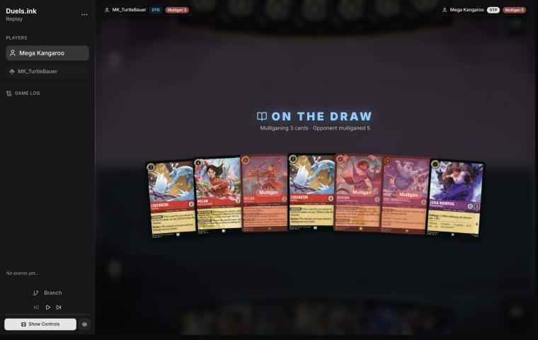
*The board before the decision: [step 0](https://duels.ink/replay/01a1a59f-4c2c-7ce3-ae99-427f27f0e192?step=0) in the duels.ink replay viewer.*

**What you did:** on the draw, opening seven of Liquidator – Iced Over ×2, Luisa Madrigal – Pushing Through, Mulan –
Martial Arts Master, Isis Vanderchill, Mulan – Elite Archer and Demona – Scourge of the Wyvern Clan. You put back
Isis, Elite Archer and Demona – Scourge, keeping the four cheap cards.

**Verdict: close call.** The seven already had a curve: Liquidator for 1 on turn 1 (UNDERDOG), the second
Liquidator on turn 2, Mulan or Isis on turn 4, Elite Archer Shifted onto Mulan on turn 5 (5 {S} that turn, and
TRIPLE SHOT puts the same damage on two more characters), then Demona – Scourge at 6. Six of the seven were inkable.
`tools/mulligan.py` (1,000 deals each) rates the options close on turns 1–4:

| Option | Ink spent T1–4 | Play turns | Lore by T4 | Characters T4 |
|---|---|---|---|---|
| Keep all 7 | 9.6 | 4.0 | 3.7 | 4.5 |
| As played (keep the four cheap cards) | 9.7 | 4.0 | 4.3 | 4.8 |
| Mulligan all 7 | 9.3 | 3.6 | 3.4 | 3.8 |

- **For your mulligan:** a little more early lore and board (two Liquidators quest for 0, so the gain comes from
  what's drawn), and against Princess Aggro (24%) early bodies are what matters ([MULL-3](#cite-mull-3)).
- **For the keep:** the sim can't see card quality, and against Circle of Life (60%) quality and the late game
  matter more than more 2-willpower bodies ([MULL-3](#cite-mull-3)). Elite Archer's TRIPLE SHOT kills three of their small singers in
  one turn, and Demona – Scourge exerts a board that stays ready, which is how your challengers reach it. A wide
  board of cheap characters is what their Malicious and To Wither a Flower punish.
- With the opponent's deck most likely Circle of Life, the coach leans slightly to keeping, but the numbers don't
  separate the two, and the mulligan kept the hand's curve ([MULL-1](#cite-mull-1), [MULL-2](#cite-mull-2)). Confidence: low.

### Turn 2: your turn 1

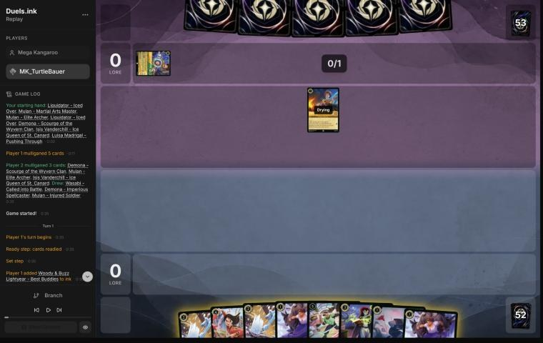
*The board before the decision: [step 6](https://duels.ink/replay/01a1a59f-4c2c-7ce3-ae99-427f27f0e192?step=6) in the duels.ink replay viewer.*

**What you did:** inked a Luisa Madrigal (you held two) and played Liquidator – Iced Over for 1 with UNDERDOG.

**Verdict: good play.** Their first card was Woody – Waiting for a Friend, with Woody & Buzz Lightyear – Best Buddies
inked: a Toy Story list, which none of duels.ink's Amber/Emerald lists is (83% unlisted). [The pair file's notes on a
Toy Story list](#cite-kb-meta-archetypes-amber-emerald-a-toy-story-list-unlisted-c1m4x) (C1m4x's) say its engine is Woody – Jungle Guide Shifted onto Waiting for a Friend, so this Woody is
the Shift base to kill.
- **Liquidator now** is the only turn UNDERDOG saves an ink, and his 4 {S} kills Woody the moment Woody quests.
  Reckless forces the challenge, which here is the one you want.
- **Luisa instead** would trade better with Woody (Challenger +2 kills him and survives on 3 willpower), but she can
  be played any turn for 1, while Liquidator costs 2 from next turn.
- **The ink:** a second Luisa or Mulan – Injured Soldier (a 2/3 that enters with 2 damage) were the spare cards;
  either is fine. Mulan – Martial Arts Master is still in hand as a Shift base for Elite Archer.

### Turn 4: your turn 2

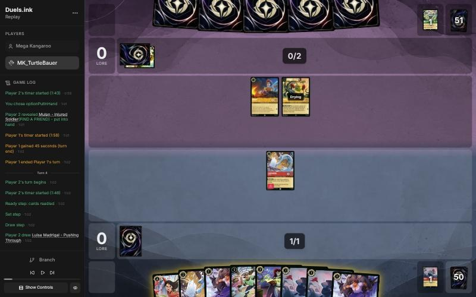
*The board before the decision: [step 14](https://duels.ink/replay/01a1a59f-4c2c-7ce3-ae99-427f27f0e192?step=14) in the duels.ink replay viewer.*

**What you did:** inked the second Liquidator and played both Luisas.

**Verdict: good play** (the coach's plan), with the ink a close call.
- **The situation:** their Woody (2/2) and Mike Wazowski – Heroic Climber (0/4) were ready, so nothing could be
  challenged and Liquidator wasn't forced to attack. Buzz Lightyear – Space Ranger (2, 3/3) was known in their hand
  from Mike's FIND A FRIEND, and Dale – Ready for His Shot was inked, so it's in their list. Dale costs 4; they'd have
  3 ink next turn.
- **Two Luisas** start your lore (2 a turn) while Liquidator stays home to punish a quest. Next turn only Woody's 2
  {S} could challenge an exerted Luisa, and she has 3 willpower. Mike has 0 {S} until Dale lands.
- **The second Liquidator instead** would add a punisher but no lore, and their characters were staying ready.
- **The ink, close call:** you kept two Mulan – Injured Soldiers (2/3s that enter with 2 damage) and inked a
  Liquidator. A spare Injured Soldier was the weaker card, but once Dale is in play Reckless can force Liquidator into
  a challenge where SPIKE SUIT makes the defender deal its {W}, so the difference is small ([INK-2](#cite-ink-2)).

### Turn 6: your turn 3

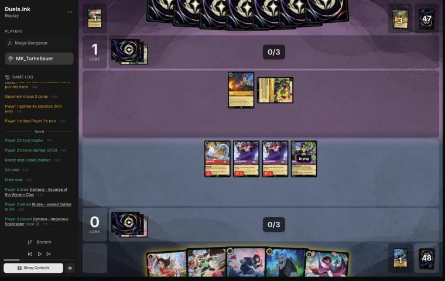
*The board before the decision: [step 28](https://duels.ink/replay/01a1a59f-4c2c-7ce3-ae99-427f27f0e192?step=28) in the duels.ink replay viewer.*

**What you did:** inked a Mulan – Injured Soldier, played Demona – Imperious Spellcaster, and killed the exerted
Mike Wazowski with both Luisas (2 + 2). Liquidator stayed ready, and you quested for nothing.

**Verdict: inaccuracy.** Mike had quested, so Liquidator's Reckless obliged him to challenge, and his 4 {S} killed
the 0/4 Mike alone for no damage.
- **Challenging with both Luisas is suboptimal because** it spends two quests, 2 lore, on a kill Liquidator makes for
  free. Its only gain is that Liquidator stays ready, out of reach of Woody's 2 {S}.
- **Liquidator into Mike and both Luisas questing is better because** it's 2 lore up with the same kill. What it
  exposes:
  - **Liquidator, exerted on 2 willpower.** Woody – Waiting for a Friend (2/2) is the only character of theirs that
    could challenge next turn: Jessie, Bullseye and Woody – Helping a Friend, known in their hand, would all be drying,
    and their 4 ink gives Dale at most, which doesn't change a Woody challenge (he deals 2 either way). Woody kills
    Liquidator but dies to his 4 {S}: your 0-lore 2-drop for their 1-drop and the Woody they Shift Jungle Guide and
    Best Buddies onto. If they decline, you've lost nothing.
  - **Both Luisas, exerted on 3 willpower,** as in your line. Woody can't kill either.
- Every character has a job: Liquidator's is to challenge, and the Luisas can quest ([QC-4](#cite-qc-4), [TRADE-4](#cite-trade-4), [QC-1](#cite-qc-1)).
  Confidence: medium. It assumes no Rush in their list, and none had been seen.
- **Imperious Spellcaster** used the ink well. There was no reason to discard for IMPETUS.

### Turn 8: your turn 4

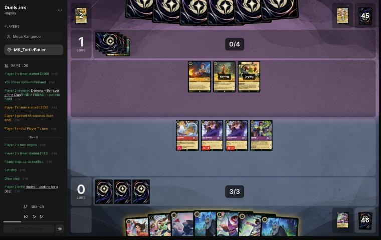
*The board before the decision: [step 37](https://duels.ink/replay/01a1a59f-4c2c-7ce3-ae99-427f27f0e192?step=37) in the duels.ink replay viewer.*

**What you did:** inked the other Injured Soldier and played Demona – Betrayer of the Clan. You discarded one of your
two Hades for Imperious Spellcaster's IMPETUS IMPROVISUS, giving herself Rush and Evasive until your next turn, and
quested with her (1–1). The Luisas, Liquidator and Betrayer stayed ready.

**Verdict: close call** against the coach's plan, Mulan – Martial Arts Master with both Luisas questing.
- **The situation:** all three of their characters were ready, so nothing could be challenged. Next turn Bullseye –
  Loyal Horse (4/3) would be dry, and his 4 {S} kills any of your 3-willpower characters that exerts; Woody's 2 {S}
  kills an exerted Liquidator. Woody – Helping a Friend and Mickey Mouse – Best in Town were known in their hand, and
  5 ink makes Woody & Buzz Lightyear – Best Buddies castable by Shift onto Woody.
- **The coach's plan: 2 lore and Mulan,** who quests for 2 from next turn and can give Wasabi Rush. Its cost: an
  exerted Luisa is a free kill for Bullseye (she deals 0 when challenged). Bullseye is then exerted on your turn for
  Liquidator, Imperious or Betrayer to kill.
- **Your line: 1 lore and nothing exposed.** Evasive kept the questing Imperious out of reach, since nothing of
  theirs has Evasive. It cost a card, but the second Hades was the spare one: your hand held three 5-cost cards and a
  6 with 4 ink. Betrayer's 6 willpower survives Bullseye and Woody together, and her Challenger +2 hits for 6.
- **The catch in both lines is STONE BY DAY.** With 3 or more cards in hand, Imperious and Betrayer can't ready, so
  each is a single quest or challenge until your hand runs down, and Imperious stays exerted, and challengeable,
  once Evasive ends.
- The coach's plan scores a lore more and develops a 2-lore quester; yours keeps every character and a card's worth
  of tempo. Neither is clearly better ([TRADE-4](#cite-trade-4), [RULE-1](#cite-rule-1)). Confidence: low.

### Turn 10: your turn 5

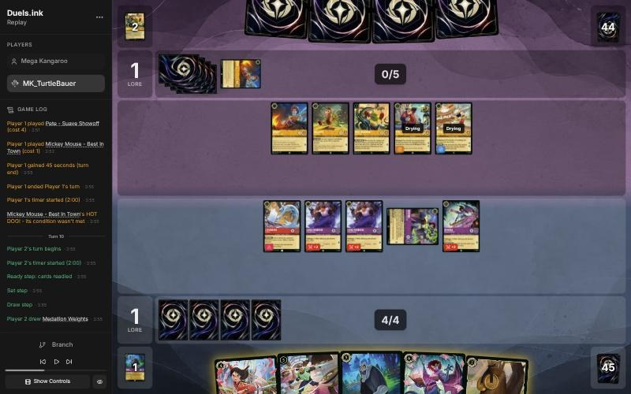
*The board before the decision: [step 49](https://duels.ink/replay/01a1a59f-4c2c-7ce3-ae99-427f27f0e192?step=49) in the duels.ink replay viewer.*

**What you did:** inked Medallion Weights and played Wasabi – Called into Battle. Nothing quested, and Imperious
Spellcaster stayed exerted with your hand at 3 (Mulan – Martial Arts Master, Hades, Demona – Scourge).

**Verdict: inaccuracy.** Wasabi was the right play: he's dry for next turn, when Demona – Scourge at 6 ink exerts
their whole board. The miss was not using IMPETUS IMPROVISUS again.
- **The setup for next turn:** all five of their characters were ready, and Pete – Suave Showoff (1/6/2, Bodyguard)
  will be exerted by Scourge, so every challenge must go into him first. Betrayer's Challenger +2 makes exactly 6 for
  him. Then Wasabi (4, plus TWIN BLADES' 4 to another character), Liquidator (4) and the Luisas (2 each) have Bullseye,
  Woody, Mike, Mickey and whatever they add. Every extra challenger is another kill.
- **Ending the turn with 3 cards is suboptimal because** STONE BY DAY then stops Imperious readying at the start of your
  turn. She stays exerted, out of the swing turn, and with Evasive gone she's exposed now: Bullseye trades with her,
  and with Dale in play Mike's 4 {W} would kill her.
- **Discarding Hades (or Mulan) for IMPETUS on Imperious is better because:**
  - Evasive keeps her safe through their turn. Nothing of theirs has Evasive.
  - Your hand drops to 2, so she readies next turn for a fourth 4-{S} challenge.
  - The card comes back. [Scourge refills a hand below 3](#cite-kb-cards-demona-scourge-of-the-wyvern-clan-casting-her): with 2 cards you'd hold 1 after inking and casting her and
    draw 2, against 1 in your line. Both lines end the turn with 3 cards, so the cost is Hades swapped for a random card.
  - Mike Wazowski's FIND A FRIEND on their turn is a "may", so you can decline a character it reveals and keep your
    hand at 2.
- It leaves the same characters exposed as your line apart from Imperious: Luisas, Liquidator and Betrayer ready,
  Wasabi drying. Principles: [SEQ-4](#cite-seq-4) (a cheap move now sets up next turn), [RULE-1](#cite-rule-1). Confidence: medium. It assumes
  Scourge next turn, and Hades and a random draw are worth about the same here.

### Turn 11: their turn

**What happened:** they played Dale – Ready for His Shot and Alien – True Believer, then quested with Mickey, Mike,
Bullseye and Pete for 6 (7–1). Mike's FIND A FRIEND gave them a second Dale; your revealed card was a location, so it
went to the bottom. Mickey's HOT DOG! gave each player an ink drop. Their board now quests for 10 a turn: on this
rate they reach 20 on game turn 15.

### Turn 12: your turn 6

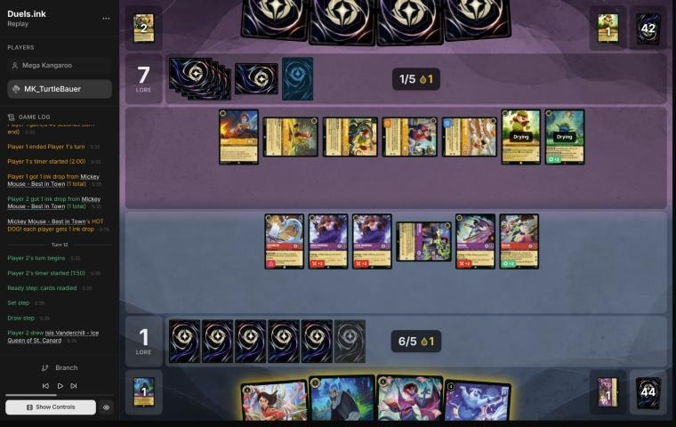
*The board before the decision: [step 60](https://duels.ink/replay/01a1a59f-4c2c-7ce3-ae99-427f27f0e192?step=60) in the duels.ink replay viewer.*

**What you did:** inked Hades and played Mulan – Martial Arts Master, paying 1 with your ink drop, so Wasabi lost
BRING THE HEAT's +2 and got Mulan's +2 instead. Wasabi challenged Pete: both died, Mulan's gift drew a card, and TWIN
BLADES' 6 killed Dale. Liquidator killed Mickey, Betrayer killed Mike, and both Luisas died killing Bullseye. Their
Woody and Alien were left; you kept Demona – Scourge and Isis in hand.

**Verdict: mistake.**
- **The situation:** you were 1–7 down against a board questing for 10, so most of it had to go this turn ([QC-5](#cite-qc-5)).
  Four of their characters were exerted; Woody, Alien and Dale were ready. Pete – Suave Showoff, exerted with
  Bodyguard, had to be the first target, and with Dale in play SPIKE SUIT made every one of their characters deal
  damage with its {W}. Pete hits back for 6, Mike and Mickey for 4.
- **Your line was suboptimal because:**
  - Pete's 6 killed Wasabi, your best character.
  - Woody and Alien, ready, were out of reach. Woody is the base their Woody – Jungle Guide and Best Buddies Shift onto,
    and Woody – Helping a Friend (known in their hand) plays and returns their cheap characters.
  - Both Luisas died for one Bullseye once Dale was gone (his 4 {S} against their 3 willpower). Questing them would
    have scored 2.
  - It killed five and lost three (Wasabi and both Luisas), and you ended with four characters, two of them stuck
    exerted under STONE BY DAY.
- **Inking Hades and casting Demona – Scourge (6, keeping the ink drop) is better because** AD SAXUM COMMUTATE exerts
  all seven of theirs, so every one can be challenged:
  1. **Betrayer into Pete,** for the Bodyguard. Her Challenger +2 makes 6, and Pete's 6 kills her too. She was a single
     challenge anyway: STONE BY DAY wouldn't let her ready with your hand at 3.
  2. **Wasabi (6 with the drop) into Bullseye,** who deals back only his 3 {W}. Wasabi survives on 2, and TWIN BLADES'
     6 kills Dale, which ends SPIKE SUIT.
  3. **Liquidator into Mickey** (0 {S}): free.
  4. **A Luisa into Woody** (2/2), taking 2 of her 3.
  5. **The other Luisa into Alien,** who has 1 {S} once Woody and Bullseye are gone.

  That's six kills for Betrayer alone, leaving them Mike (0/4/1). It adds Scourge's 5/6/2 body, and her refill draws
  you 1 (2 cards after the ink and Scourge; their 4 cards get nothing).
- **What it exposes:** Wasabi (2 willpower left), both Luisas (damaged), Liquidator and Imperious, all exerted;
  Scourge is ready. Their known Dale – Ready for His Shot makes Mike's 4 {W} a killer again, so expect to lose one of
  them. Woody – Helping a Friend brings back a cheap character and plays one free, but they'd start again from Mike
  alone, against your board of six.
- Principles: [TRADE-2](#cite-trade-2) (the best trade removes theirs and keeps yours), [TRADE-1](#cite-trade-1), [SEQ-2](#cite-seq-2), [QC-5](#cite-qc-5). Confidence: high on
  the comparison; the exact sequence comes from the brief's challenge figures with SPIKE SUIT included.

### Turn 13: their turn

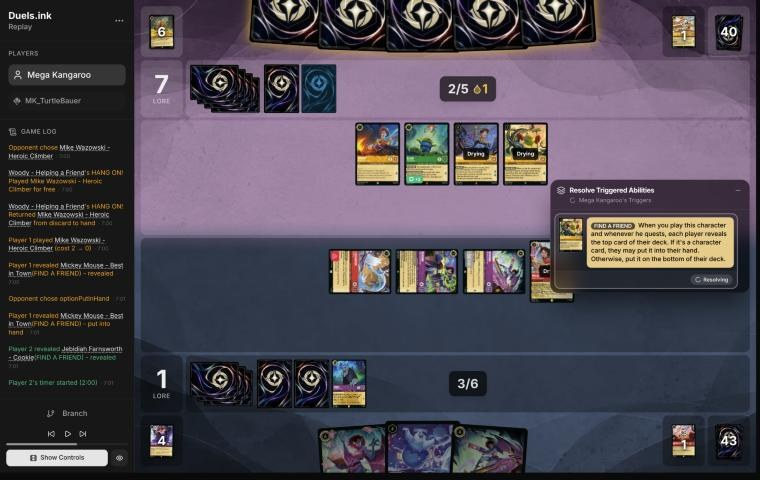
*The board before the decision: [step 74](https://duels.ink/replay/01a1a59f-4c2c-7ce3-ae99-427f27f0e192?step=74) in the duels.ink replay viewer.*

**What happened:** Woody – Helping a Friend played Mike free and returned the other Mike to their hand; Mike's FIND A
FRIEND gave them a Mickey and you Jebidiah Farnsworth – Cookie. You took Jebidiah, which was right: Imperious was
stuck under STONE BY DAY with or without the extra card. They played Mickey and a second Alien. The first Alien (4
{S}) and Woody – Waiting for a Friend each challenged the exerted Betrayer; she died, and so did both of them.

### Turn 14: your turn 7

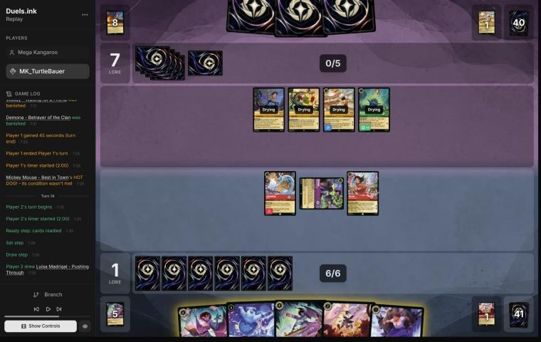
*The board before the decision: [step 80](https://duels.ink/replay/01a1a59f-4c2c-7ce3-ae99-427f27f0e192?step=80) in the duels.ink replay viewer.*

**What you did:** inked Jebidiah and played Luisa, then Demona – Scourge of the Wyvern Clan. She exerted all four of
theirs, and her refill drew you Mulan – Martial Arts Master. You discarded Isis for IMPETUS IMPROVISUS on Scourge
herself, a Gargoyle, so she had Rush and Evasive. Liquidator killed Mike, Scourge killed Woody – Helping a Friend
(taking 2), and Mulan quested (3–7) to give Luisa Rush, and Luisa killed Alien. Only Mickey was left.

**Verdict: good play, better than the coach's plan.**
- **The situation:** all four of their characters had just been played, so they were ready and out of reach. They
  were 7–1 up with a board questing for 6, and Dale was known in their hand: next turn Mike and Woody would hit with
  their 4 {W}.
- **The coach's plan** was Scourge, Luisa, Mulan's quest to give Luisa Rush for Alien, and Liquidator into Woody –
  Helping a Friend: two kills, with Liquidator dying to Woody's 2 {S}, and Mike and Mickey left.
- **Your line found a third kill and lost nothing.** IMPETUS gives a Gargoyle Rush, and Scourge is one, so she could
  challenge the turn she landed. Liquidator then had Mike for free. The cost was Isis, an uninkable 4-drop with no
  target left worth exerting. Evasive also keeps Scourge safe through their turn.
- **It also sets up next turn:** discarding Isis put your hand at 2, below STONE BY DAY's 3, so your Demonas can ready.
- What's left exposed: Mulan and Luisa (on 2 willpower) and Liquidator, all exerted. Their board is one Mickey, who
  can't challenge, plus whatever their 6 ink brings, all of it drying. Principles: [TRADE-2](#cite-trade-2), [SEQ-2](#cite-seq-2).

### Turn 15: their turn

**What happened:** they inked a second Woody & Buzz Lightyear – Best Buddies, played another Woody – Helping a Friend
(returning Mickey to their hand) and Bullseye for 2, and quested with Mickey (9–3). Mickey's HOT DOG! gave each
player an ink drop.

### Turn 16: your turn 8

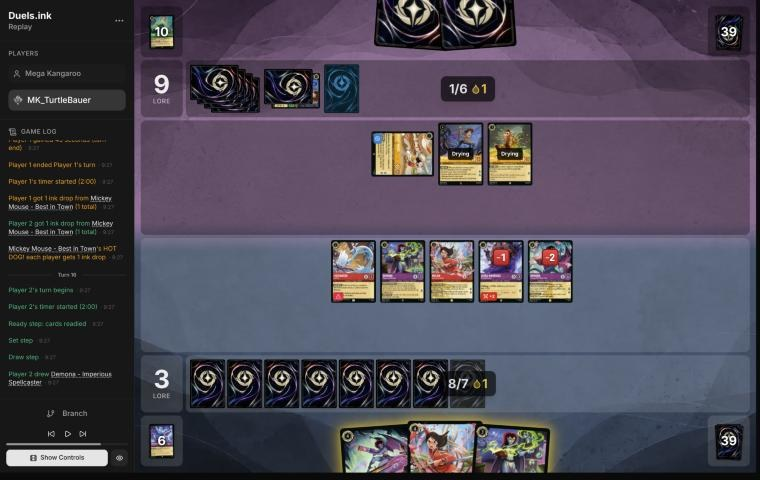
*The board before the decision: [step 99](https://duels.ink/replay/01a1a59f-4c2c-7ce3-ae99-427f27f0e192?step=99) in the duels.ink replay viewer.*

**What you did:** played the second Mulan – Martial Arts Master, giving Luisa +2 and her draw; Luisa killed the
exerted Mickey and drew Hades. You played Betrayer (paying 1 with the ink drop), inked the second Imperious
Spellcaster, and quested with Imperious, Mulan and Scourge (8–9). Liquidator stayed ready; you ended with Hades in
hand.

**Verdict: good play.**
- **The situation:** 3–9 down, so lore mattered ([POS-2](#cite-pos-2)). Mickey was their only exerted character; Woody – Helping a
  Friend and Bullseye were drying. Next turn they'd have 8 ink with a drop: Best Buddies Shifted onto Woody (it
  inherits his dryness, so it can quest or challenge at once) and Dale, known in their hand.
- **The coach's plan** gave Mulan's draw to Liquidator, who was forced to challenge Mickey anyway, so Luisa could
  quest too: 1 lore more. But it leaves Liquidator exerted on 2 willpower, where Woody's 2 {S} or Bullseye kills him
  (both die doing it). Your line keeps him ready for next turn. The two are about even.
- **Your hand ends at 1,** under STONE BY DAY's 3, so all three Demonas ready next turn, and Hades is castable with 8.
- **Close call: IMPETUS on Scourge.** Scourge quested with 2 damage, so Bullseye's 4 {S} or Best Buddies kills her.
  Discarding Hades for IMPETUS would have made her Evasive. But they have only two challengers either way, so it moves
  their kill onto Mulan or Imperious rather than saving a character, and it costs next turn's Hades. Keeping Hades is
  reasonable ([RULE-1](#cite-rule-1), [CARD-1](#cite-card-1)).

### Turn 17: their turn

**What happened:** they played Dale, Buzz Lightyear – Space Ranger and Mickey (one ink from a drop), and quested with
Woody – Helping a Friend and Bullseye (12–8). They challenged nothing and ended with no cards in hand.

### Turn 18: your turn 9

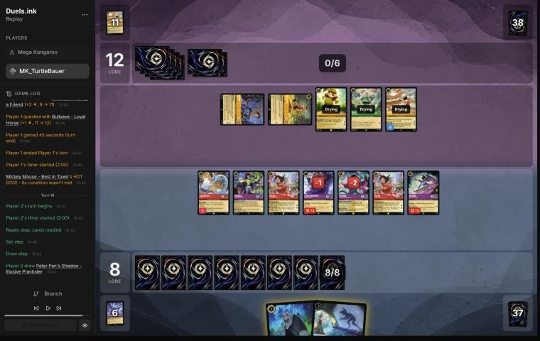
*The board before the decision: [step 115](https://duels.ink/replay/01a1a59f-4c2c-7ce3-ae99-427f27f0e192?step=115) in the duels.ink replay viewer.*

**What you did:** played Hades on Dale; they let you draw 2 (Mulan – Elite Archer and a second Peter Pan's Shadow).
Peter Pan's Shadow then exerted Dale, Betrayer killed him (taking 4), Liquidator and Bullseye traded, and Imperious
killed Woody – Helping a Friend once SPIKE SUIT was gone, taking 2. Mulan quested (10–12) and they conceded.

**Verdict: good play** (the coach's plan, with a better order).
- **What had to happen:** 12–8 down, and their board quested for exactly 8, so they'd win next turn unless some of it
  died. Your board quested for 9, so 20 was out of reach this turn. Woody and Bullseye were exerted; Dale, Buzz and
  Mickey were drying. Dale had to go first: with SPIKE SUIT every challenge into a 4-willpower character cost 4.
- **The coach's plan** was Peter Pan's Shadow on Dale, Betrayer into Dale, Scourge into Woody, Liquidator into
  Bullseye, then Hades on Mickey: three kills, leaving them 3 lore a turn from 12.
- **Casting Hades first was the better order** ([SEQ-1](#cite-seq-1)). Had they bottomed Dale, Shadow's exert would have been free
  for another character. They let you draw instead, and Shadow then exerted Dale. Imperious into Woody (2 {S} once
  Dale was gone) kept Scourge ready and undamaged.
- With their hand empty and two characters left against your eight, they conceded.

## Lessons
1. **Imperious Spellcaster's IMPETUS IMPROVISUS does three jobs** ([8](#turn-8), [10](#turn-10), [14](#turn-14)):
   - Evasive keeps a quester safe through their turn.
   - Rush lets a Demona played this turn challenge, including Scourge straight after her exert-all.
   - The discard can take your hand under STONE BY DAY's 3, so your Demonas ready next turn.

   Count it as an option every turn she's in play.
2. **Under Dale's SPIKE SUIT, a high-willpower Bodyguard is a wall that hits back** ([12](#turn-12)). Pete – Suave
   Showoff (1/6) dealt 6 to whatever challenged him first. Spend a character you'd lose anyway on him, and kill Dale
   without challenging him: TWIN BLADES or TRIPLE SHOT damage, or an exert plus a 6-willpower challenger.
3. **Far behind against a wide board, the exert-all is the turn** ([12](#turn-12)). The ready characters you can't
   otherwise reach are what Scourge is for.
4. **Let the Reckless character make the free kill** ([6](#turn-6)). Liquidator has to challenge anyway, so the
   others can quest.

## Knowledge-base updates
Applied with this review (knowledge-base changes are committed straight away, and changed after discussion if needed):
- **[A card note for Demona – Imperious Spellcaster](#cite-kb-cards-demona-imperious-spellcaster):** IMPETUS
  IMPROVISUS's three uses (lesson 1).
- **Amber/Amethyst notes:** the existing line on Scourge with Imperious now uses her full name, so the brief finds it
  (see The coach's errors).
- **[Dale – Ready for His Shot's card note](#cite-kb-cards-dale-ready-for-his-shot-what-it-means-in-play):** a
  Bodyguard under SPIKE SUIT, and killing Dale without challenging him (lesson 2).
- **Amber/Emerald notes:** Mega Kangaroo's Toy Story list and how it played.
- **Amethyst/Ruby notes:** MK_TurtleBauer's list.
- **Opponents index:** a row for this game.

## Hindsight
Doesn't change the verdicts above.
- **No sweeper turned up.** They were a Toy Story list, not Circle of Life, so the mulligan's worry about Malicious,
  Mean, and Scary and To Wither a Flower didn't apply.
- **Turn 10:** they didn't challenge on turn 11, so the exposed Imperious cost nothing then. But she couldn't ready
  on turn 12, and one more 4-{S} challenger there would have reached Alien or Woody.
- **Turn 13:** their only challenges of the game went into the exerted Betrayer and traded Alien and Woody for her.
- **Turns 16 and 17:** they quested rather than challenge the exerted Scourge, so turn 16's IMPETUS question didn't
  matter.
- **Turn 18:** they let you draw 2 from Hades rather than bottom Dale.

## The coach's errors
Filled in during discussion; the first was found after the blind pass.

| When | Error | How it was caught | How it won't happen again |
|---|---|---|---|
| Blind pass, turns 8 and 14 | The coach's plans left out IMPETUS IMPROVISUS: as Evasive for a quester (turn 8) and as Rush for Scourge the turn she lands (turn 14). The player found both. The Scourge-and-Imperious combo was already in [the Amber/Amethyst notes](#cite-kb-meta-archetypes-amber-amethyst-remember-merida-danny-s-list) ("Remember Merida: danny's list") | The player's lines in the blind pass, then the knowledge-base search after it | The note called her "Imperious", which the brief's card-note matcher misses: it looks for a card's full name or its "– Subtitle". **Applied:** the note uses her full name, and a new card note for Demona – Imperious Spellcaster lists IMPETUS's uses, so every brief with her in view points to both. **Done (4 Nov 2026):** the brief also matches notes by a card's ability names, such as IMPETUS IMPROVISUS, with a regression test |

## Open questions
- **Turn 12:** was Demona – Scourge held back on purpose? With 6 ink she was castable, and their 4 cards meant her
  refill would only help you.
- **Turn 6:** did the Luisas take Mike to keep Liquidator out of reach of a Woody trade? The coach reads that trade
  as one you'd want.
- **Turn 10:** was IMPETUS on Imperious considered, to protect her and get your hand under 3?

## Citations
Copies of the coach's knowledge base cited above, as they stood when they were cited (the private repository's commit and date are given with each). They don't change when the knowledge base does.

**MULL-3**: strategy principle, `kb/strategy/principles.md` at `c10ae72` (2026-11-04), working tree

> - **MULL-3. The right keep depends on the matchup.** Early interaction against aggro; pressure, draw and engines against slow decks. The mulligan is the first expression of your role. In the Set 14 era the opponent's inks are known before the mulligan (RULE-8), so this applies from game 1 of a match. `[MCL ch.12]` · baseline

**MULL-1**: strategy principle, `kb/strategy/principles.md` at `c10ae72` (2026-11-04), working tree

> - **MULL-1. Keep a plan, not the strongest cards.** *Ask: "Which hand gives me the best chance to execute my game plan in this matchup?"* `[MCL ch.12]` · baseline

**MULL-2**: strategy principle, `kb/strategy/principles.md` at `c10ae72` (2026-11-04), working tree

> - **MULL-2. A smooth curve beats a few powerful cards.** Check that you can spend ink well on turns 1–4, have enough inkable cards, and know what turn 4 looks like. `[MCL ch.12]` · baseline
>   - **Ink spent isn't the goal by itself.** Judge a keep by a nice curve (a play each turn), early lore pressure, and
>     interaction that sets the opponent back, as well as by ink, then weigh card quality and the matchup
>     (user, 2026-11-01). `tools/mulligan.py` reports all of these.

**INK-2**: strategy principle, `kb/strategy/principles.md` at `c10ae72` (2026-11-04), working tree

> - **INK-2. Don't automatically ink the most expensive card.** It may be the late-game win condition or the key answer for this matchup. The answer depends on matchup, hand and board. `[MCL ch.4]` · baseline

**QC-4**: strategy principle, `kb/strategy/principles.md` at `c10ae72` (2026-11-04), working tree

> - **QC-4. Every character has a job.** A character in the deck to challenge wastes its strength questing. An efficient quester wastes its value in unnecessary combat. *Ask: "Why is this card in my deck?"* `[MCL ch.6]` · baseline

**TRADE-4**: strategy principle, `kb/strategy/principles.md` at `c10ae72` (2026-11-04), working tree

> - **TRADE-4. Every challenge has an opportunity cost.** It's a lost quest, and the challenger may be exposed while exerted. Declining a trade is often as strong as taking it. *Ask: "Would simply questing be stronger?"* `[MCL ch.7]` · baseline

**QC-1**: strategy principle, `kb/strategy/principles.md` at `c10ae72` (2026-11-04), working tree

> - **QC-1. Lore is the only win condition.** Board control is only worth what it does to the lore race. `[MCL ch.6]` · baseline

**RULE-1**: strategy principle, `kb/strategy/principles.md` at `c10ae72` (2026-11-04), working tree

> - **RULE-1. Only exerted characters can be challenged** `[CR 4.6.4.2]`. Questing, singing, or {E} for an ability exposes the character. Staying ready protects it. Every quest is also a decision about what the opponent can challenge next turn. · baseline
>   - *Card text overrides this* (CR 1.2.1). Shere Khan – Khan Industries CEO's NEW INCENTIVE lets one character
>     challenge ready characters that turn. Alert (e.g. from Judy Hopps – Lead Detective, to every Detective on their
>     turn) ignores Evasive. Against Ducktectives, name both in the setup. 01a14574, turns 16 and 18. `[coach, 2026-10-26]`

**SEQ-4**: strategy principle, `kb/strategy/principles.md` at `c10ae72` (2026-11-04), working tree

> - **SEQ-4. Sequence across turns.** A slightly weaker play now can set up a much stronger next turn: keep a shift target alive, keep a singer ready, hold removal for a bigger threat. `[MCL ch.5]` · baseline

**QC-5**: strategy principle, `kb/strategy/principles.md` at `c10ae72` (2026-11-04), working tree

> - **QC-5. The race changes everything.** At 18–12 up, take the last 2 lore. At 8–16 down, stopping their close-out matters more than your quests. `[MCL ch.6]` · baseline

**TRADE-2**: strategy principle, `kb/strategy/principles.md` at `c10ae72` (2026-11-04), working tree

> - **TRADE-2. The best trade removes theirs and keeps yours.** A survivor keeps generating value and demands more answers. `[MCL ch.7]` · baseline

**TRADE-1**: strategy principle, `kb/strategy/principles.md` at `c10ae72` (2026-11-04), working tree

> - **TRADE-1. Judge a trade by ink invested, tempo, value already generated, and the board afterwards**, not by card count. A 2-cost for a 5-cost is a big win even if it's one-for-one. *Ask: "What does the board look like after this challenge?"* `[MCL ch.7]` · baseline

**SEQ-2**: strategy principle, `kb/strategy/principles.md` at `c10ae72` (2026-11-04), working tree

> - **SEQ-2. Plan the whole turn before the first action.**
>   - Who quests? Who challenges?
>   - What if a challenge fails?
>   - What gets inked? What ink is left?
>   - What does this leave the opponent?
>
>   `[MCL ch.5]` · baseline

**POS-2**: strategy principle, `kb/strategy/principles.md` at `c10ae72` (2026-11-04), working tree

> - **POS-2. From behind, play to your outs and accept calculated risk.** Safe efficient play from a losing position loses slowly. A line with a 30% chance beats a line with 0%. *Ask: "What has to happen for me to win, and which play makes it most likely?"* `[MCL ch.10]` · baseline

**CARD-1**: strategy principle, `kb/strategy/principles.md` at `c10ae72` (2026-11-04), working tree

> - **CARD-1. Card advantage is having more meaningful options than the opponent.** Ways to get it:
>   - 2-for-1 trades, and removal that hits two targets
>   - characters that survive several challenges
>   - recursion
>   - cards that replace themselves
>   - discard
>
>   *Ask after each exchange: "Who has more useful resources left?"* `[MCL ch.2]` · baseline

**SEQ-1**: strategy principle, `kb/strategy/principles.md` at `c10ae72` (2026-11-04), working tree

> - **SEQ-1. Gather information before irreversible decisions.** Draw, look and scry before choosing what to ink. Quest with draw triggers before committing other plays when the order doesn't otherwise matter. `[MCL ch.5]` · baseline

**amber-emerald.md, A Toy Story list (unlisted): C1m4x**: knowledge base, `kb/meta/archetypes/amber-emerald.md` at `c10ae72` (2026-11-04), working tree

> ### A Toy Story list (unlisted): C1m4x `[coach, blind review of 01a19bf9-b9ff (Savitar vs C1m4x, game 1, 2 Nov 2026)]`
> - **The engine:** Woody – Waiting for a Friend (1, 2/2/1), then **Woody – Jungle Guide** Shifted onto him for 3: each
>   quest draws a card and plays a character costing 2 or less free, and their other Toys get +1 {W}. Mickey's ink drop
>   let them Shift on their 2nd turn. He has 1 strength and 5 willpower and is exerted after each quest.
> - **The Toys:** Buzz Lightyear – Space Ranger ×3 (2, 3/3, 3/4 with Woody), Jessie – Lively Cowgirl (3; draws when she
>   quests with two other Toys; each card they pay 2 or less for gives one of yours −1 {S}), Alien – True Believer (1;
>   +1 {S} for each other Toy: 5 or 6 on a full board).
> - **Also:** Above the Crowd (5, song: a character with 3 {S} or less to the bottom of its deck; Woody sings it), The
>   Horseman Strikes! ×3, Aladdin – Doing His Part (banish an item), Tod, Lenny – Toy Binoculars (you reveal your hand
>   and discard an action of their choice).
> - **Against Rockstar Aggro:** five characters with 15 strength by their 3rd turn kill a 2-willpower board fast. Mr.
>   Big's ICE OUT on Alien and a Buzz, and bodies played on your turn (ready, so unchallengeable), carried game 1.
> - **Game 2** (01a19bfe-7db6): also RC – Remote-Controlled Car (1, 3/2/2 Toy; pays 1 ink to quest or challenge),
>   Ancestral Guitar, Bullseye – Loyal Horse (4/3; 1 cheaper with Woody or Jessie). Once Dale – Ready for His Shot was in
>   play they stopped challenging altogether: SPIKE SUIT made every challenge into a 3- or 4-willpower character a trade
>   they lost.

**amethyst-ruby.md, Unnamed #1: VH INK's list, from MK_ifoughtthelore's match**: knowledge base, `kb/meta/archetypes/amethyst-ruby.md` at `c10ae72` (2026-11-04), working tree

> ### Unnamed #1: VH INK's list, from MK_ifoughtthelore's match `[coach, one match of three games, 2026-11-02; applied at the user's request]`
> Games 01a19c00 (lost by the Detectives player), 01a19c08-7f38 and 01a19c0c (won); reviews in
> `output/reviews/2026-11-02_01a19c00_vs-vh-ink-g1.md` and the g2 and g3 files beside it. Card text verified from the
> replays.
> - **The plan:** cheap challengers plus exert effects, so your characters can be challenged whether or not they quest,
>   with card flow behind them.
>   - **Exert effects:** Peter Pan's Shadow – Elusive Prankster (3, Evasive; exerts one of yours on play), Isis
>     Vanderchill – Ice Queen of St. Canard (4; exerts one), Demona – Scourge of the Wyvern Clan (6; exerts **all** of
>     yours, then each player draws up to 3). Ward (Darkwing Duck – Drake Mallard) blanks the first two; Demona's
>     doesn't choose, so Ward doesn't stop it.
>   - **Challengers:** Luisa Madrigal – Pushing Through and Pepita – Watchful Alebrije (Challenger +2), Tinker Bell –
>     Fancy Footwork (3/1), Jebidiah Farnsworth – Cookie (Evasive, Reckless), Goliath – Transformed Warrior (4, 5/5;
>     discards a card to move 2 of his damage onto your character), Mulan – Martial Arts Master (+2 {S} on play; her
>     quest gives a character played that turn Rush).
>   - **Wasabi – Called into Battle** (5, 4/5/2): any challenge on their turn also deals 4 to another chosen character,
>     ready or not, so one exert plus Wasabi is two kills. TWIN BLADES isn't optional (`kb/rules/rulings.md`).
>   - **Card flow:** Dumbo – Ninth Wonder of the Universe (Evasive characters draw and gain a lore for 1 ink), Cheshire
>     Cat – Inexplicable (Boost moves 2 damage onto your character), Ursula – Whisper of Vanessa (Boost: Evasive and +1
>     {L}), Hades – Looking for a Deal; Red Alert (banish a character with 3 {S} or less).
>   - Not in duels.ink's average list: Goliath, Peter Pan & Tinker Bell – Fast Friends (Shift 4; their characters gain
>     Evasive), Ursula – Whisper of Vanessa, Red Alert.
> - **Swing turn: Demona – Scourge at 6 ink.** In 01a19c00 turn 11 she exerted a waiting board of five small
>   characters, and their challengers plus TWIN BLADES killed all five.
> - **Habits:** they kept their questers home while a ready board could punish a quest (0 lore until turn 13 of game 1;
>   5 lore from turn 15 to turn 19 of game 3), and raced only when it was safe (game 3, turn 21: 6 to 10).
> - **What beat it** (games 2 and 3):
>   - Darkwing's Ward
>   - Gaston – Superior Archer and Judy Hopps – Always Vigilant on their 5-strength cards (Goliath, Demona, Peter Pan
>     & Tinker Bell), with Support lifting others into range (Mulan in 01a19c08-7f38 turn 9, Wasabi in 01a19c0c turn 26)
>   - The Horseman Strikes! on Dumbo or Jebidiah
>   - Judy Hopps – Lead Detective's Alert against their Evasive questers (01a19c0c turn 22)
>   - two Nick Wilde – Toy Drive Officers drawing cards through the standoff (`kb/strategy/hypotheses.md`, H-6)
> - **Their cards across the match** (most copies seen in one game): Goliath ×3, Tinker Bell ×3, Wasabi ×3, Cheshire ×2,
>   Demona – Scourge ×2, Dumbo – Ninth Wonder ×2, Hades ×2, Mulan – Martial Arts Master ×2, Peter Pan's Shadow ×2,
>   Ursula – Whisper of Vanessa ×2, and one each of Dumbo – The Flying Elephant, Isis, Jebidiah, Luisa, Medallion
>   Weights, Pepita, Peter Pan & Tinker Bell – Fast Friends and Red Alert.

**amber-amethyst.md, Remember Merida: danny's list**: knowledge base, `kb/meta/archetypes/amber-amethyst.md` at `c10ae72` (2026-11-04), working tree

> ### Remember Merida: danny's list `[coach, meta study of danny's 28 Oct – 2 Nov 2026 games (tools/scan.py), full games, not blind, 49 games]`
> All 49 games from `01a18285-3511` to `01a19d4c-6771` (only `01a18275-7c33` of that run was blind-reviewed).
> - **The list (31 games from 29 Oct):** Mickey – Best in Town ×4, Rafiki ×3, Luisa – Pushing Through ×2, Hamm ×4,
>   Pepita ×4, Junior Woodchuck Guidebook ×4, Merlin's Shop and Smithy ×3, Cheshire Cat – Inexplicable ×4, Demona –
>   Imperious Spellcaster ×4, Dumbo – The Flying Elephant ×2, The Horseman Strikes! ×4, Merida – Wisp Conjurer ×4,
>   Merlin – Profoundly Curious ×4, Hades – Looking for a Deal ×4, Demona – Scourge ×4, Remember Me ×3, Raging Storm ×3.
>   On 28 Oct (13 games) it ran Mowgli ×3, a 4th Shop and a 3rd Luisa instead of Hamm and the 3rd Rafiki; five games of
>   28–29 Oct ran Tigger – Bouncing All the Way ×2 instead of Dumbo. Unlike duels.ink's average Remember Merida (above):
>   no Elsa or Gaston, but the full Demona pair (4 + 4) and four Cheshires.
> - **Raging Storm is the reset:** cast in at least 19 of the 49 games (28 casts that removed 3+ of their characters), from game
>   turn 9 (`01a18d5a-0080`, the turn after their wipe), usually turns 11–15. Mickey's ink drops bring it a turn early.
> - **Then Remember Me rebuilds:** sung by two characters (Sing Together 6), it replays 4–7 characters from the discard
>   (`01a182f9-576e` turn 19, `01a18391-038f` 22, `01a18442-9f20` 23, `01a188d0-21d2` 18, `01a18956-64ba` 23,
>   `01a18971-a6ee` 24, `01a18c4b-b91b` 22).
> - **The rebuild is a Storm target:** twice the opponent's Raging Storm swept it the next turn (`01a182f9-576e` turn 20,
>   Kyla's Detectives, 5 characters; `01a18c4b-b91b` turn 25, the mirror, 9). Against a list with Storm and 8 ink in
>   reach, count what the rebuild must do this turn against what a Storm would cost. A pattern to watch, not a rule.
> - **Demona – Scourge, often with Imperious Spellcaster:** Scourge exerts their board for your challengers, and
>   Demona – Imperious Spellcaster's IMPETUS IMPROVISUS (discard a card) gives a Gargoyle Rush and Evasive to challenge at once: 2–4 kills a turn (`01a18382-dabd` turn 17,
>   `01a18433-41ba` 18, `01a188e0-8396` 7, `01a18d68-3b5a` 16, `01a19d4c-6771` 15 and 25). Hamm's LOOSE CHANGE makes
>   Imperious cost 2.
> - **Cheap challengers clear small boards:** Cheshire plus Luisa or Pepita killed two characters a turn against Rockstar
>   Aggro (`01a18bd1-43a6` turn 13, `01a18be9-bd5b` turn 10) and Big Ramp (`01a18d6f-7150` turn 11).
> - **Shop moves close games:** two Shops and two moves for the last 2 lore (`01a18456-be9a` turn 29), a Shop played
>   and moved to on the Storm turn (`01a18c4b-b91b` turn 28).
> - **What swept danny's board,** with the earliest game turn seen (their removal is in each pair file's notes):
>   Spooky Sight (Amber/Sapphire Control, turn 7: five characters of cost 3 or less into the inkwell); Don Karnage –
>   Debonair Pirate's LASTING IMPRESSION plus To Wither a Flower or Malicious, Mean, and Scary (Retro Device, Circle of
>   Life, an Emerald/Ruby list: turn 7); Strength of a Raging Fire sung twice (Emerald/Steel Midrange, Lilo & Stitch
>   Songs: turn 8); Merida – Formidable Archer with Three Arrows or Windstorm (Big Ramp: turn 10); The Leviathan played
>   free through Retro Evolution Device (Emerald/Ruby Unnamed #1: turn 9); Raging Storm (Control, the mirror, one
>   Detectives list: turn 8); Judy – Always Vigilant's GOT YOU NOW one character at a time (Detectives). Most of the
>   list costs 3 or less, so the cheap sweeps take most of the board.

**demona-imperious-spellcaster.md**: knowledge base, `kb/cards/demona-imperious-spellcaster.md` at `c10ae72` (2026-11-04), working tree

> # Demona – Imperious Spellcaster
>
> Amethyst character, 3 cost, 4/3/1, inkable, Gargoyle. Text verified from replay 01a1a59f-4c28:
> - **IMPETUS IMPROVISUS** Choose and discard a card — Chosen Gargoyle character gains Rush and Evasive until the start
>   of your next turn.
> - **STONE BY DAY** If you have 3 or more cards in your hand, this character can't ready.
>
> In Amethyst/Ruby and Amber/Amethyst lists with the other Demonas: Betrayer of the Clan (4, Challenger +2) and Scourge
> of the Wyvern Clan (6), all three Gargoyles with STONE BY DAY.
>
> ## Using IMPETUS `[coach + MK_TurtleBauer's play, 01a1a59f-4c28; danny's Remember Merida games]`
> Its cost is a discard, with no {E}, so she can use it while exerted and on the turn she's played (CR 6.3.1.1), and
> more than once a turn (CR 4.1.1). Three jobs:
> - **Rush for a Demona played this turn.** After Demona – Scourge's AD SAXUM COMMUTATE exerts their board, IMPETUS on
>   Scourge herself lets her challenge at once. In 01a1a59f-4c28 turn 14 that was a third kill, for Isis discarded.
>   danny's games did the same for 2–4 kills a turn (`kb/meta/archetypes/amber-amethyst.md`, "Remember Merida: danny's
>   list").
> - **Evasive for a quester.** A Gargoyle that quests under IMPETUS can't be challenged by their non-Evasive characters
>   until your next turn (01a1a59f-4c28 turn 8).
> - **Getting your hand under STONE BY DAY's 3.** The discard can put you at 2 cards for your next Ready step, so your
>   exerted Demonas ready. Before a Scourge turn the card often comes back: her refill draws you up to 3 (01a1a59f-4c28
>   turn 10, where it was missed).
>
> ## Limits
> - **It costs a card.** Discard the spare card, not a threat you'll cast next turn.
> - **Flash – Efficient Clerk turns off the Rush, but Evasive still applies** (`kb/meta/archetypes/emerald-steel.md`).
> - **Evasive and Alert attackers can still reach the chosen Gargoyle.**
> - **STONE BY DAY applies to Imperious too.** Once she quests or challenges with 3+ cards in hand, she stays exerted
>   and can be challenged.

**dale-ready-for-his-shot.md, What it means in play**: knowledge base, `kb/cards/dale-ready-for-his-shot.md` at `c10ae72` (2026-11-04), working tree

> ## What it means in play `[coach + user, one match: 01a19bb9 and 01a19bbd-79c2]`
> - **It turns their weakest-looking characters into killers.** These aggro lists run 0- and 1-strength characters with
>   high willpower: Mike Wazowski – Heroic Climber (0/4), Thomas – Wide-Eyed Recruit (0/4), David – Protective
>   Snowboarder (1/4). With Dale in play, each deals 4 in a challenge, enough to kill most cheap characters.
> - **It works both ways.** "During challenges" covers your challenges too, so challenging their Mike costs your
>   attacker 4 damage. The brief's challenge figures include SPIKE SUIT whenever it's in play.
> - **Their Challenger and strength pumps stop mattering while it's in play,** since damage comes from {W}.
> - **He can come a turn early.** Cost reducers make him castable with 3 ink: Pluto – Friendly Pooch's GOOD DOG ({E}: next
>   character 1 cheaper) in 01a19bbd-79c2 turn 5. The brief's "COST REDUCERS" line shows this.
> - **Judge exposure before he's in play.** From the turn they could cast him, every character you exert with 4 or
>   less willpower is exposed to their 0-strength characters. In 01a19bbd-79c2 turn 4 the coach called a 0-strength board
>   harmless; the user caught it.
> - **Removing him:** he has 0 {S} and 4 {W}, and deals 4 back if challenged. A Detectives deck can push his strength to
>   5 with Support (Support may target an opposing character, `kb/rules/rulings.md`) and banish him with Gaston –
>   Superior Archer's WATCH THIS or Judy Hopps – Always Vigilant's GOT YOU NOW (01a19bbd-79c2 turn 8). Remove him before
>   making other challenges.
> - **A Bodyguard under SPIKE SUIT hits back hard** `[coach, 01a1a59f-4c28 turn 12]`. Pete – Suave Showoff (4, 1/6/2,
>   Bodyguard) exerted must be challenged first, and deals 6 to whatever challenges him. Send a character you'd lose
>   anyway, such as a Demona that STONE BY DAY won't let ready, or Challenger +2 on 6 willpower.
> - **Killing Dale without challenging him:** damage that isn't a challenge's doesn't care about SPIKE SUIT. Wasabi –
>   Called into Battle's TWIN BLADES (01a1a59f-4c28 turn 12: 6 to Dale after a challenge elsewhere) or Mulan – Elite
>   Archer's TRIPLE SHOT. Or exert him (Peter Pan's Shadow, Isis) and challenge with 5+ willpower, so his 4 back doesn't
>   kill (turn 18: Demona – Betrayer, 6 willpower).

**demona-scourge-of-the-wyvern-clan.md, Casting her**: knowledge base, `kb/cards/demona-scourge-of-the-wyvern-clan.md` at `c10ae72` (2026-11-04), working tree

> ## Casting her `[coach + user]`
> H-1 in `kb/strategy/hypotheses.md` has the caster's side: time her for the turn your hand runs out, so the refill draws
> the most cards; when she's due, spare cards no better than a random draw are free ink. She's drying on the turn she's
> played, so her exert-all opens their board to your *other* dry characters only. STONE BY DAY keeps her exerted after
> she quests or challenges while you hold 3 or more cards.
