# Review: MK_TurtleBauer vs DiamondSamurai, 4 November 2026

| | |
|---|---|
| **Status** | draft (blind pass done, not yet discussed) |
| **Replay** | `01a1a67f-5b3b-749b-9744-ae5a8f5a99a4` (`python3 tools/brief.py 01a1a67f-5b3b --turn N`) · [duels.ink viewer](https://duels.ink/replay/01a1a67f-5b41-78bb-966e-d3a1fda2a78d?step=0) |
| **Format** | Core Constructed (stated in the replay). Set 14 era: inks revealed before the coin toss |
| **Decks** | You: Amethyst/Ruby challengers with the three Demonas (a variant of [the list from your game against Mega Kangaroo](#cite-kb-meta-archetypes-amethyst-ruby-unnamed-1-mk-turtlebauer-s-list), with Pepita and Cheshire Cat). Them: Amber/Sapphire; archetype as it became clear: Control, 99% from turn 2 (Aurora), with Minnie Mouse – Urban Visionary ×3 and other off-list Ward characters |
| **Play/draw** | You went first |
| **Result** | Win: DiamondSamurai conceded on game turn 36 at 17–18, with your four questers due to make 21 |
| **Meta data** | snapshot of 26 Oct 2026 (9 days old; stale from 9 Nov) |
| **Chosen how** | Sent by the user with another of your games, without comment on either result |

## Summary
Links go to the turn sections below.
- **Good plays:** [1](#turn-1), [3](#turn-3), [9](#turn-9), [13](#turn-13), [15](#turn-15), [17](#turn-17),
  [21](#turn-21), [23](#turn-23), [25](#turn-25), [27](#turn-27), [29](#turn-29), [35](#turn-35). Three of them beat
  the coach's plan: [9](#turn-9) (Wasabi rather than the Archer Shift), [15](#turn-15) (Imperious rather than Isis as
  the Minnie killer) and [23](#turn-23) (Scourge into empty boards while their hand was small).
- **Close calls:** the [pre-game](#turn-0), [11](#turn-11), [19](#turn-19), [33](#turn-33), and holding Martial Arts
  Master and Wasabi back on [21](#turn-21) and [27](#turn-27).
- **Mistake:** [turn 7](#turn-7). Martial Arts Master killed Aurora where Isis could have opened Cinderella – Dream Come
  True, their ramp engine and the Icon's Shift base, for a free kill. The Icon landed on her next turn.
- **Inaccuracies:** [turn 5](#turn-5) (Medallion Weights inked with 3 ink unspent) and [turn 31](#turn-31) (the Shop's
  draw before Scourge's refill, a card lost to the cap).
- **Unwinnable from:** never.

**What decided it:** against three Raging Storms, you always had a threat in hand to rebuild with (Wasabi through
turns 19–23, four 1-drops on turn 35), and you killed their engines as they landed: the Icon on 9, Minnie on 17,
Belle and Dream Come True on 27, Stitch on 29.

## The game, turn by turn
Verdicts judge each decision on what you could know at the time, **including archetype knowledge an experienced
player has**. Hindsight is kept to its own section. Severity scale: good play / close call /
inaccuracy / mistake / blunder. Principle IDs and hypotheses (H-n) link to copies
in the Citations section at the end, as they stood when they were cited.

**What you knew before the game:** they're on Amber/Sapphire: Control 51%, Detectives 39%, an unlisted list 11%. You're
on the play, so their turn k comes with k ink (game turn 2k) unless they ramp. Their key cards, with the earliest game
turn each can come:
- **Raging Storm** (8, uninkable): banish all characters. Game turn 16 on curve; Control's ramp (Mickey – Best in
  Town's ink drops, Cinderella – Dream Come True, Unintentional Icon) brought it on game turn 9 in earlier games.
- **Spooky Sight** (6, uninkable): every character costing 3 or less into its owner's inkwell. Game turn 12, or 7 with
  ramp. Most of your deck costs 3 or less.
- **Hades – Infernal Schemer** (7): one of your characters into your inkwell. Game turn 14.
- **Gaston – Superior Archer** (5) and **World's Greatest Criminal Mind** (3, a song): banish a character with 5 {S}
  or more. Game turn 10 for Gaston. Your only natural targets are Demona – Scourge (5) and Wasabi with an ink drop;
  Demona – Betrayer has 6 only while she challenges. Detectives' Support can lift others into range.
- **Judy Hopps – Always Vigilant** (4, Shift 2 onto any Judy): the same banish, if they played another character that
  turn. Game turn 6 at the earliest (a 1-drop and the Shift onto a Judy already in play).
- **The Horseman Strikes!** (3): draw, and banish a character with Evasive. Game turn 6. It hits Jebidiah, Dumbo, Peter
  Pan's Shadow and any Gargoyle given Evasive by IMPETUS.
- **Let It Go** (5, a song): one character into its owner's inkwell.
- **Cinderella – Unintentional Icon** (7, Shift 5 onto Dream Come True from game turn 8 or 10): Control's ramp engine,
  4/6/3. Their engines are worth trading cheap characters for ([H-8](#cite-h-8)).
- **Judy Hopps – Lead Detective** (6, Shift 4): Detectives gain Alert and Resist +2 on their turn, so Evasive stops
  protecting you.
- **Elisa Maza** (4): with another Detective in play, you reveal your hand and they discard a non-character card.

Your own deck's notes: [your list](#cite-kb-meta-archetypes-amethyst-ruby-unnamed-1-mk-turtlebauer-s-list) and
[Demona – Imperious Spellcaster's IMPETUS IMPROVISUS](#cite-kb-cards-demona-imperious-spellcaster-using-impetus), which also gets your hand under STONE BY
DAY's 3 cards.

<!-- One section per turn with a decision, in game order. -->

### Pre-game

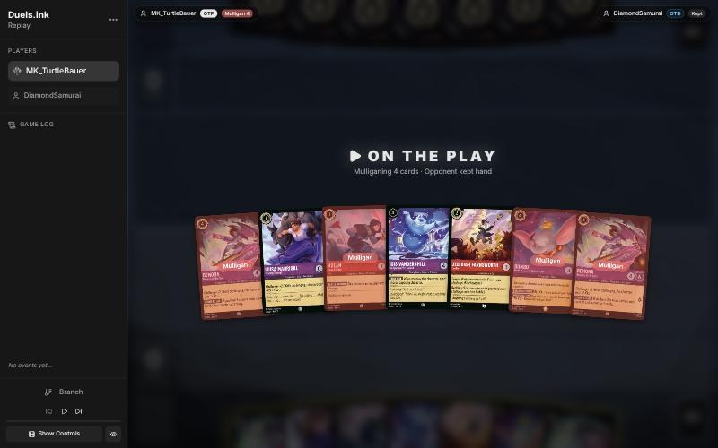
*The board before the decision: [step 0](https://duels.ink/replay/01a1a67f-5b41-78bb-966e-d3a1fda2a78d?step=0) in the duels.ink replay viewer.*

**What you did:** on the play. Kept Luisa Madrigal – Pushing Through, Jebidiah Farnsworth – Cookie and Isis
Vanderchill; sent back both Demona – Betrayer of the Clan, Mulan – Injured Soldier and Dumbo – Ninth Wonder of the
Universe.

**Verdict:** close call. The seven had a 1-drop, a second 1-drop, a 2-drop and four 4-drops, one of them uninkable
(Isis), and two copies of the same STONE BY DAY 4-drop. `tools/mulligan.py` (1,500 deals):

| Option | Ink T1–4 | Play turns | Lore by T4 | Characters by T4 |
|---|---|---|---|---|
| Keep 7 | 9.50 | 3.99 | 4.5 | 4.5 |
| Send back one Betrayer (keep 6) | 9.61 | 3.97 | 4.9 | 4.6 |
| Send back one Betrayer and Isis (keep 5) | 9.30 | 3.95 | 5.3 | 4.8 |
| As played (keep Luisa, Jebidiah, Isis) | 9.57 | 3.94 | 4.5 | 4.2 |
| Full mulligan | 9.10 | 3.55 | 3.8 | 3.6 |

On the sim's measures the options are level, apart from the full mulligan. What the sim can't see is card quality.
The second Betrayer was the clunkiest card, so sending it back is clearly fine. Dumbo is the hand's engine against
Control ([MULL-3](#cite-mull-3)), but The Horseman Strikes! and Detectives' Alert reach him. Mulan – Injured Soldier is a weak 1-drop.
Keeping Isis over Dumbo keeps an uninkable card in a hand that sent back four inkable ones. I'd have kept Dumbo and one
Betrayer as well (the 6-card keep), but against a deck that sees your Evasive cards as targets, the deeper redraw for
Shadow, Imperious and Scourge is reasonable. Confidence: low; the sim can't weigh Dumbo.

### Turn 1: your turn 1

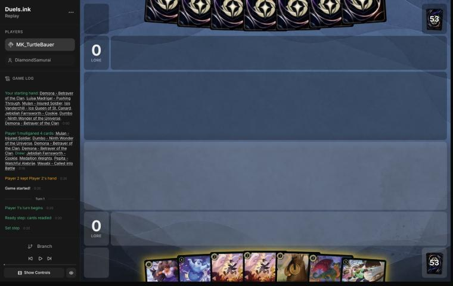
*The board before the decision: [step 3](https://duels.ink/replay/01a1a67f-5b41-78bb-966e-d3a1fda2a78d?step=3) in the duels.ink replay viewer.*

**What you did:** inked a Jebidiah and played Luisa.

**Verdict:** good play. The hand had two uninkables (Isis, Wasabi), so the inkable cards also had to supply the curve.
The spare Jebidiah was the cheapest loss: you still had one, and Pepita, for turn 2.

### Turn 3: your turn 2

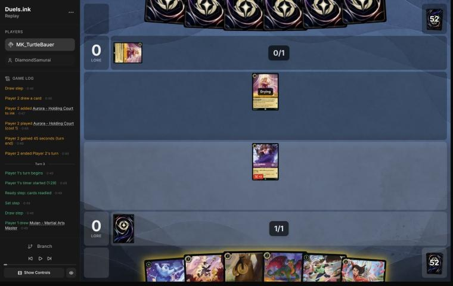
*The board before the decision: [step 9](https://duels.ink/replay/01a1a67f-5b41-78bb-966e-d3a1fda2a78d?step=9) in the duels.ink replay viewer.*

**What you did:** inked the second Jebidiah, played Pepita and quested with Luisa (1–0).

**Verdict:** good play. Aurora (inked and played on their turn 1) made it Control at 99%, a deck that wants the game
long, so you're the aggressor ([ROLE-1](#cite-role-1)). Pepita quests for 1 where Jebidiah never can, and Jebidiah is the card The
Horseman Strikes! is aimed at. Keeping Medallion Weights over the Jebidiah keeps a draw engine for a long game. Luisa's
quest exposed her only to Aurora's 1 {S}.

### Turn 5: your turn 3

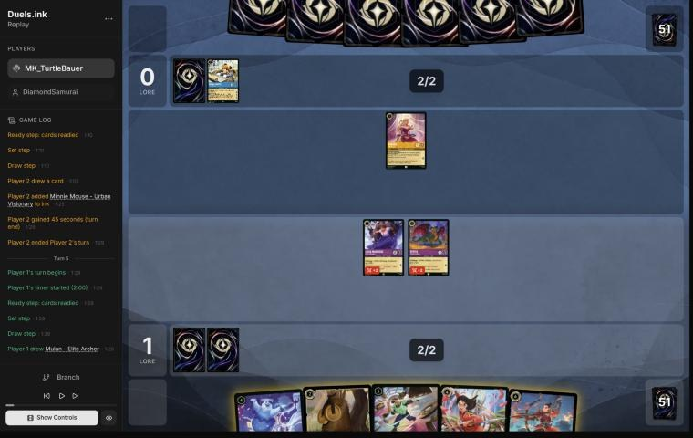
*The board before the decision: [step 15](https://duels.ink/replay/01a1a67f-5b41-78bb-966e-d3a1fda2a78d?step=15) in the duels.ink replay viewer.*

**What you did:** inked Medallion Weights and quested with Luisa and Pepita (3–0). The 3 ink went unused.

**Verdict:** inaccuracy. Inking **Medallion Weights** and playing nothing is suboptimal because it leaves 3 ink unspent
on a turn where Weights was the only card you could cast, and it gives up the one card in your deck a Control list
can't sweep: Raging Storm and Spooky Sight take characters, and Hades – Infernal Schemer chooses a character. Inking
**Mulan – Elite Archer** and playing **Weights** is better because the same 3 ink then puts a permanent card engine in
play ({E}, 2 {I}: +2 {S} and a draw whenever the character challenges), which pays most in a long game against the deck
that wants one ([CARD-1](#cite-card-1), [ROLE-1](#cite-role-1)). Elite Archer was the least useful card in hand: a 6-drop whose TRIPLE SHOT wants a
wide board, which Control doesn't make.

Ink check: either way you keep one inkable card (Martial Arts Master) beside the two uninkables, so the next two turns
are the same: ink Martial Arts Master or the draw on turn 7 and play Isis or Mulan, then Wasabi on turn 9 if the draws
bring a fifth ink. What the suggested line exposes: nothing more; Weights is an item, and the quests were the same.
Confidence: medium. The edge is small: Weights costs 2 ink each time it's used, and the Archer Shift onto Martial Arts
Master is a real line.

### Turn 7: your turn 4

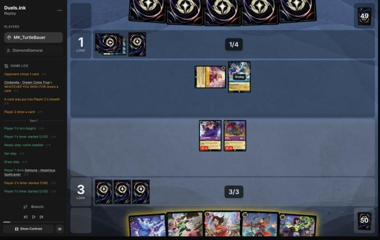
*The board before the decision: [step 24](https://duels.ink/replay/01a1a67f-5b41-78bb-966e-d3a1fda2a78d?step=24) in the duels.ink replay viewer.*

**What you did:** inked the Demona – Imperious Spellcaster you'd just drawn, played Mulan – Martial Arts Master (+2 {S}
and a draw for Luisa), Luisa challenged and killed the exerted Aurora (drawing a card), and Pepita quested (4–1).
Cinderella – Dream Come True stayed in play.

**Verdict:** mistake. Their board was Aurora (exerted) and Cinderella – Dream Come True, drying but ready, so out of
reach of a plain challenge. Dream Come True is Control's ramp engine (ink a card and draw at the end of each turn they
play a Princess) and the base for Cinderella – Unintentional Icon's Shift 5, which their 5 ink next turn could pay
(held 33% now, 38% after their draw). This was the cheap turn to kill her: next turn she may be a 4/6 Icon.

Playing **Martial Arts Master** into Aurora is suboptimal because it kills only the 1-drop and leaves the engine and
the Shift base. Playing **Isis** is better: CHILL OUT exerts Dream Come True, Pepita (4 {S} challenging) kills her and
takes 2, and Luisa (2 {S} challenging) kills Aurora and takes 1. Their board is empty for nothing lost, a tempo swing
([TEMPO-2](#cite-tempo-2)) aimed at the threat that matters ([QC-2](#cite-qc-2), [THREAT-3](#cite-threat-3)). It also spends Isis, an uninkable card, when she has her best
target. That line inks Mulan – Elite Archer and keeps Imperious and Martial Arts Master for the next turns, with Wasabi
at 5 ink.

What it gives up: the quest (3–1 instead of 4–1), the card from WAY OF THE HERO, and Martial Arts Master's 2 lore a
turn from next turn. What it exposes: Luisa and Pepita exerted with 2 and 1 willpower left, against an empty board.
Whatever they play next turn can't challenge, and Isis (4 {S}) is under Gaston's 5. Your line left Luisa on 2
willpower in front of Dream Come True (2 {S}), and both small characters open to an Icon Shifted on this turn.

The Icon trade is [H-8](#cite-h-8) (a hypothesis from one game); the case here doesn't need it, since Dream Come True alone ramps
them toward Raging Storm. Confidence: medium. Your line drew a card and developed a 2-lore character, which counts for
something against a deck that will sweep later.

### Turn 9: your turn 5

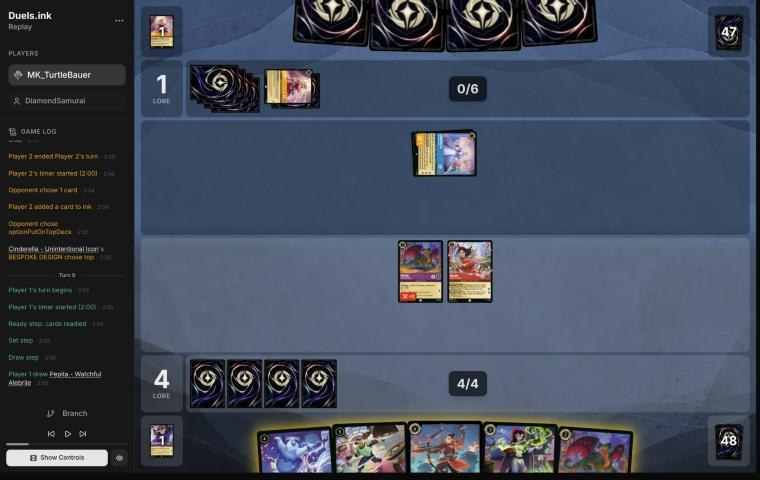
*The board before the decision: [step 37](https://duels.ink/replay/01a1a67f-5b41-78bb-966e-d3a1fda2a78d?step=37) in the duels.ink replay viewer.*

**What you did:** inked the Pepita you drew and played Wasabi. Pepita challenged the exerted Unintentional Icon (4
damage) and died. You then began a second line, which the game undid: Martial Arts Master quested to give Wasabi Rush,
Wasabi killed the Icon, and TWIN BLADES had to hit Martial Arts Master, the only other character in play. In its place
Martial Arts Master challenged the Icon herself: both died. 4–1, and their board is empty.

**Verdict:** good play. The Icon (4/6/3, a card into their inkwell every turn) had to die while she was exerted ([H-8](#cite-h-8)),
and nothing of yours could do it alone. The lines that kill her:
- **Yours:** Pepita and Martial Arts Master, for Wasabi on the board, undamaged.
- **Shift Mulan – Elite Archer onto Martial Arts Master** (dry, so the Archer can challenge, with 5 {S} from STRAIGHT
  SHOOTER). Pepita and the Archer kill the Icon, and only Pepita dies. But the Archer is left with 4 damage, and Wasabi,
  an uninkable card, stays in hand.
- **The line the game undid:** +2 lore from the quest, but TWIN BLADES isn't optional
  ([the ruling](#cite-kb-rules-rulings-wasabi-s-twin-blades-isn-t-optional)), so with no other opposing character it kills Martial Arts Master, and
  Wasabi is left on 1 willpower.

The card count after yours and the Archer line is the same: one character in play and three cards in hand. Yours keeps
the healthier body and leaves an inkable card (the Archer) in hand rather than an uninkable one, so it's at least as
good. What it exposes: nothing. Wasabi is ready, and their board is empty. Their 7 ink next turn brings Hades – Infernal
Schemer (35% after their draw) for Wasabi; any line loses its one character to him. Confidence: medium.

### Turn 11: your turn 6

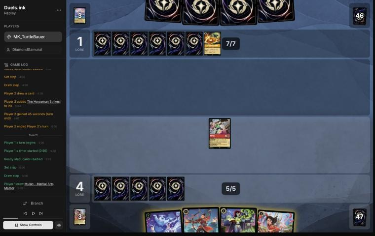
*The board before the decision: [step 50](https://duels.ink/replay/01a1a67f-5b41-78bb-966e-d3a1fda2a78d?step=50) in the duels.ink replay viewer.*

**What you did:** Wasabi quested (6–1), you played Demona – Imperious Spellcaster and inked Mulan – Elite Archer, with
3 ink left. You kept Isis and Martial Arts Master.

**Verdict:** close call. Their board was empty. They had passed their last turn with 7 ink and 4 cards, though Hades
– Infernal Schemer or Stitch would have been an obvious play into Wasabi. So their hand leaned towards cards they
couldn't use yet: Raging Storm at 8 ink next turn (29% on the list's counts before that pass, more after it), Minnie,
or answers with no target. Ahead 6–1 against a sweeper deck, the rule is not to overcommit ([POS-1](#cite-pos-1), [Amber's
staples](#cite-kb-meta-inks-raging-storm-amber-action-8-uninkable)). One cheap character and two threats held back for after a Storm is that.
Martial Arts Master instead of Imperious would quest for 2, not 1, and isn't a Spooky Sight target (cost 4). But it
puts more into a Storm, and it uses up the second Mulan you could Shift onto later. Either is fine. Inking the Archer, a
6-drop with no wide board to shoot at, kept both cheaper threats. Exposed: nothing; Wasabi's quest leaves him exerted
against an empty board.

### Turn 13: your turn 7

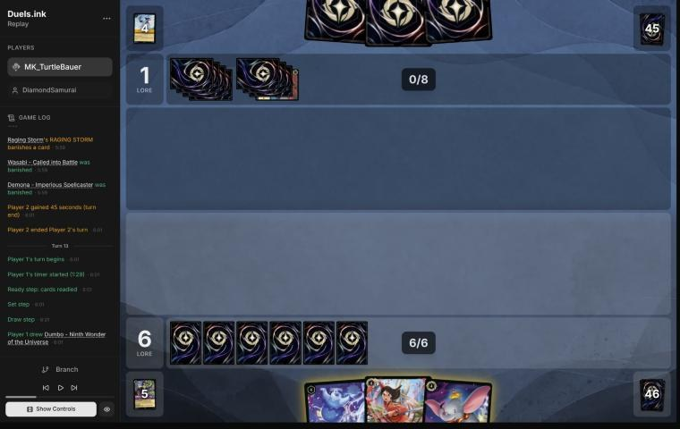
*The board before the decision: [step 57](https://duels.ink/replay/01a1a67f-5b41-78bb-966e-d3a1fda2a78d?step=57) in the duels.ink replay viewer.*

**What you did:** after the Raging Storm took Wasabi and Imperious, you played the Dumbo you drew, didn't ink, and kept
Martial Arts Master and Isis.

**Verdict:** good play. Both boards were empty at 6–1, and every card in hand cost 4, so only one could come down
whatever you inked. Dumbo is the engine against a deck that answers threats one at a time: from next turn he draws a
card and gains a lore for 1 ink each turn (BREAKING RECORDS). Next turn's 6 ink already covers a 4-drop plus his
ability, so holding Martial Arts Master as a threat beat inking it ([INK-3](#cite-ink-3)). Holding a threat back after a Storm also
fits [POS-1](#cite-pos-1). Dumbo's risks are The Horseman Strikes! (one of their copies is in their inkwell; held 16% after their
draw) and Hades (30%), and any character you played would face Hades.

### Turn 15: your turn 8

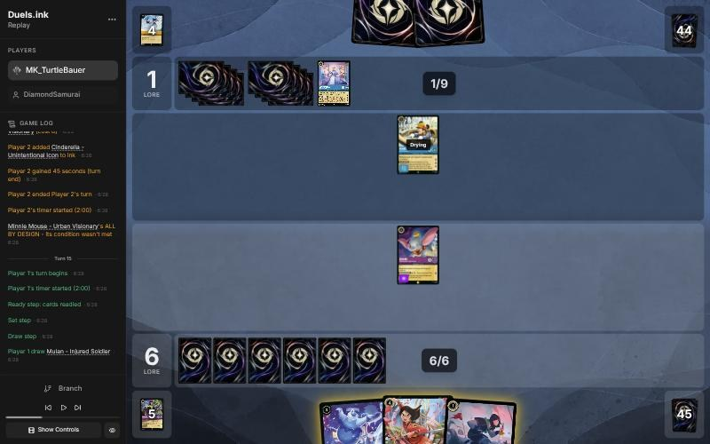
*The board before the decision: [step 64](https://duels.ink/replay/01a1a67f-5b41-78bb-966e-d3a1fda2a78d?step=64) in the duels.ink replay viewer.*

**What you did:** used Dumbo's BREAKING RECORDS first (7–1, and drew Demona – Imperious Spellcaster), then played
Imperious and inked Mulan – Injured Soldier, keeping Isis and Martial Arts Master.

**Verdict:** good play. They had Minnie Mouse – Urban Visionary (6/6/3, Ward) in play, drying. Ward means Isis's
CHILL OUT can't exert her, so the only way to kill her is to challenge her once she quests, and with 6 {S} she kills
whatever challenges. The cheapest kill is one 6-{S} challenger. I had planned Isis now, so that next turn Martial Arts
Master's WAY OF THE HERO (+2 {S}) could make her a 6-{S} challenger. Your Imperious does the same job (4 {S} plus 2),
costs 1 less, and keeps the uninkable Isis for a turn when CHILL OUT has a target. Drawing before choosing the play is
[SEQ-1](#cite-seq-1). Committing one cheap character into a possible second Storm (19% after their draw) or Hades (24%) is [POS-1](#cite-pos-1).
Exposed: Dumbo, exerted by his ability, but he's Evasive and Minnie isn't. Minnie's ALL BY DESIGN can return a card
from their inkwell, The Horseman Strikes! included, so Dumbo isn't fully safe.

### Turn 17: your turn 9

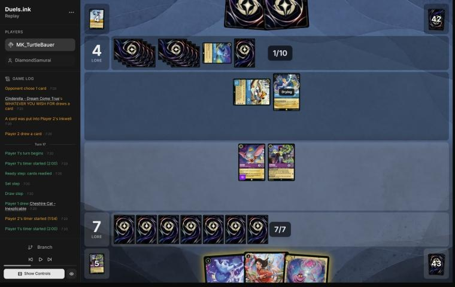
*The board before the decision: [step 75](https://duels.ink/replay/01a1a67f-5b41-78bb-966e-d3a1fda2a78d?step=75) in the duels.ink replay viewer.*

**What you did:** Martial Arts Master gave Imperious +2 {S}, and Imperious challenged the exerted Minnie: both died,
and you drew a card. You then inked Cheshire Cat, Isis exerted Cinderella – Dream Come True, and Dumbo killed her,
taking 2. Their board is empty again, at 7–4.

**Verdict:** good play: the line the coach had planned. Minnie (3 lore a turn, and ALL BY DESIGN returning a card from
their inkwell each turn) was the threat that decided the race ([THREAT-1](#cite-threat-1)), and one 6-{S} challenger was the cheapest
kill. Dream Come True was again the base for an Icon Shift with their 11 ink next turn. The Icon is one of the cards
ALL BY DESIGN could have just returned to their hand. Inking after the WAY OF THE HERO draw kept the ink choice open
([SEQ-1](#cite-seq-1)). Isis was spent on her best target. Exposed: Dumbo, exerted on 1 willpower, but only their Evasive characters
or The Horseman Strikes! (perhaps the returned card) reach him. Martial Arts Master and Isis are drying, so they can't
be challenged. A second Raging Storm (20% after their draw) would take three characters, but the kills couldn't wait.

### Turn 19: your turn 10

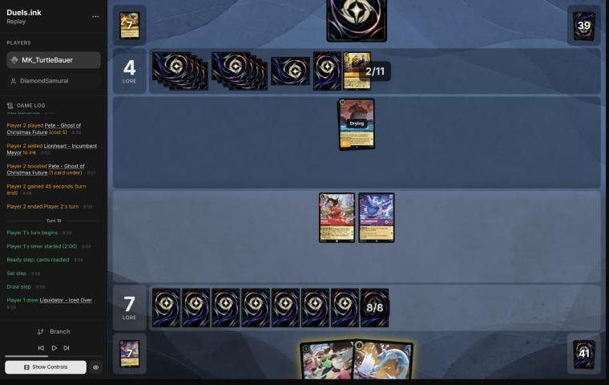
*The board before the decision: [step 89](https://duels.ink/replay/01a1a67f-5b41-78bb-966e-d3a1fda2a78d?step=89) in the duels.ink replay viewer.*

**What you did:** played Liquidator and quested with Isis only (8–4). Martial Arts Master stayed home, and Wasabi stayed
in hand, with 6 of your 8 ink unused.

**Verdict:** close call. Their only character was Pete – Ghost of Christmas Future (5/5/1), ready. With 5 {S} he kills
anything you have, in either direction, so he's an attacker against your questers and a bad target for your
challengers. They had 1 card in hand and 12 ink next turn: Hades (19% after their draw) and a second Raging Storm (15%).
- **Your line** risks one 1-lore quester (Isis) and keeps Wasabi as the rebuild after a Storm ([POS-1](#cite-pos-1), [Amber's
  staples](#cite-kb-meta-inks-raging-storm-amber-action-8-uninkable)).
- **Quest both and play Wasabi too** (10–4): +2 lore now and Wasabi's 2 a turn from next turn, but four characters into
  a Storm, an empty hand behind them, and Pete still kills one exerted quester.

Ahead 8–4 against a 1-lore board, the safe line is a fair choice. One cost of yours: **Liquidator's Reckless.** If
Pete quests next turn, you can't end your turn while Liquidator is ready and able to challenge ([CR 8.7.3](#cite-cr-8-7-3)), so he must hit
a 5-willpower Pete and die without killing him, unless another challenger damages Pete first. Inking Liquidator and
holding Wasabi would have kept that choice yours. Confidence: low; it turns on how likely the Storm is, against 2 lore
a turn.

### Turn 21: your turn 11

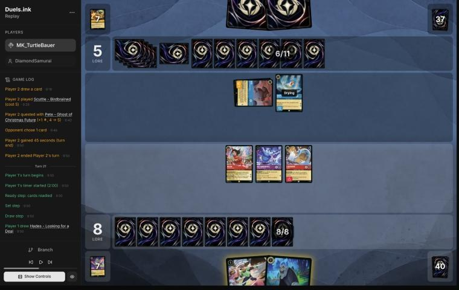
*The board before the decision: [step 96](https://duels.ink/replay/01a1a67f-5b41-78bb-966e-d3a1fda2a78d?step=96) in the duels.ink replay viewer.*

**What you did:** played Hades – Looking for a Deal on the exerted Pete. They put Pete on the bottom of their deck
rather than let you draw 2. Then Isis quested (9–5). Martial Arts Master stayed home again, and Wasabi stayed in hand.

**Verdict:** good play. Pete was exerted, so Liquidator's Reckless would have forced a challenge he couldn't win (4 {S}
into 5 willpower, taking 5). Every challenger into Pete dies, since he has 5 {S}. Hades first gave them the choice
before any challenge: bottoming Pete freed Liquidator, and keeping him would have drawn you 2 ([SEQ-3](#cite-seq-3): lead with the
play that can make the next unnecessary). Scuttle has Ward, so Hades couldn't choose him.

Keeping Martial Arts Master home is the same close call as on [turn 19](#turn-19). Scuttle (5 {S}) can kill any one
exerted quester next turn. Questing her too would add 2 lore but give him the 2-lore target. Isis alone offers the 1-lore
one, and Scuttle comes off a challenge exerted for Liquidator. 3 ink went unused, since Wasabi costs 5.

### Turn 23: your turn 12

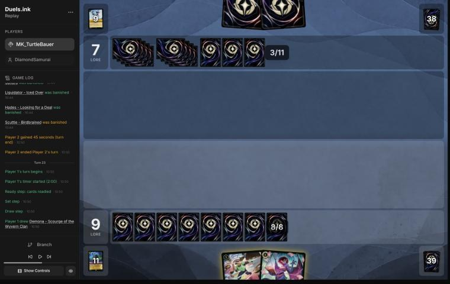
*The board before the decision: [step 107](https://duels.ink/replay/01a1a67f-5b41-78bb-966e-d3a1fda2a78d?step=107) in the duels.ink replay viewer.*

**What you did:** after their second Raging Storm (they quested Scuttle first, then wiped four of yours), you played the
Demona – Scourge you'd drawn into empty boards. Her refill drew you Liquidator and Martial Arts Master and them one
card. You then played Liquidator, using all 8 ink. You kept Wasabi and Martial Arts Master.

**Verdict:** good play. Holding Wasabi through the last two turns paid off: you rebuilt at once ([POS-1](#cite-pos-1)). I'd planned to
play Wasabi now and keep Scourge for next turn, when her exert-all would open whatever they rebuild to Wasabi's
challenge and TWIN BLADES. Your order is better for two reasons:
- **The refill was cheapest for them now.** They held 2 cards and drew 1. After a rebuild turn they'd likely hold 0–1
  and draw 2–3 ([H-1](#cite-h-1); [facing her](#cite-kb-cards-demona-scourge-of-the-wyvern-clan-facing-her)).
- **It used all 8 ink,** for two bodies and two cards, where Wasabi alone left 3 unspent.

With 2 cards in hand, Scourge will ready under STONE BY DAY. Her 5 {S} puts her in range of Gaston (21% after their
draw), and Hades (28%) can take anything. Exposed: nothing; both are drying, so they're ready.

### Turn 25: your turn 13

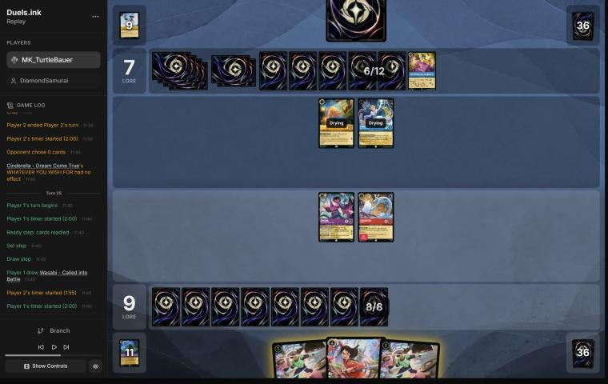
*The board before the decision: [step 115](https://duels.ink/replay/01a1a67f-5b41-78bb-966e-d3a1fda2a78d?step=115) in the duels.ink replay viewer.*

**What you did:** played Wasabi and quested with Scourge (11–7), keeping the second Wasabi and Martial Arts Master.

**Verdict:** good play. Their Hamm and Dream Come True were ready, so there was nothing to challenge. Wasabi and Martial
Arts Master together cost 9 and you had 8, with Martial Arts Master the only inkable card. So one of them, and the
uninkable Wasabi first keeps the inkable card for later. Playing a card also took your hand to 2, so Scourge readies
under STONE BY DAY. Her quest exposed her to Hamm and Dream Come True (4 {S} together, against 6 willpower). Only an Icon
Shifted onto Dream Come True (11% after their draw) adds enough to kill her.

### Turn 27: your turn 14

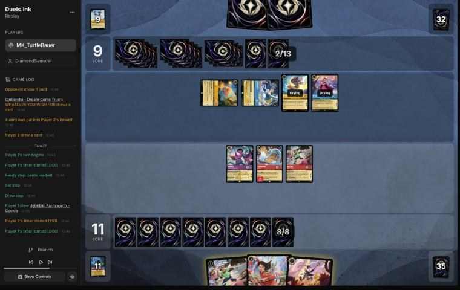
*The board before the decision: [step 125](https://duels.ink/replay/01a1a67f-5b41-78bb-966e-d3a1fda2a78d?step=125) in the duels.ink replay viewer.*

**What you did:** Martial Arts Master gave Wasabi +2 {S} and a draw. Wasabi (6 {S}) killed the exerted Dream Come True,
drawing a card, and TWIN BLADES' 6 damage killed the ready Belle. You inked Jebidiah, Scourge quested (13–9), and
Liquidator killed Hamm and died. The second Wasabi stayed in hand, with 5 ink unused.

**Verdict:** good play. At 11–9, their board quested for 6 a turn (Stitch 2, Belle 2, Hamm 1, Dream Come True 1) and
would reach 20 on game turn 30, a turn before yours. So three of their four questers had to go. Hamm and Dream Come
True were exerted; Belle was ready, out of reach of a challenge but not of TWIN BLADES, which deals damage to "another
chosen character", ready or not. The WAY OF THE HERO pump made it 6 and drew a card. Liquidator's forced challenge took
the third. This left them one 2-lore quester (Stitch) against your three.

The second Wasabi was affordable. Played, it wins on game turn 29 only if the damaged Wasabi (3 willpower left) survives
their turn, and Stitch (4 {S}) can kill him. Otherwise both lines reach 20 on game turn 31. Holding him as the rebuild
after a third Storm (17% after their draw) costs that one chance, so it's a close call within a good turn. Exposed:
Scourge (6 willpower against Stitch's 4) and the damaged Wasabi.

### Turn 29: your turn 15

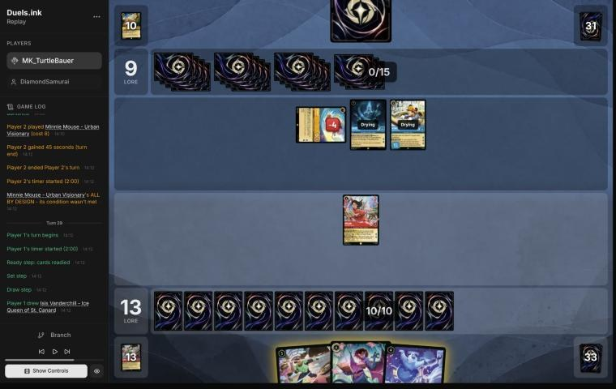
*The board before the decision: [step 141](https://duels.ink/replay/01a1a67f-5b41-78bb-966e-d3a1fda2a78d?step=141) in the duels.ink replay viewer.*

**What you did:** after Hades – Infernal Schemer put Scourge into your inkwell, Stitch killed the damaged Wasabi and a
third Minnie landed, you played Isis (exerting Hades) and the second Wasabi. Martial Arts Master quested (15–9) and gave
Wasabi Rush. Wasabi challenged Hades (4 damage), and TWIN BLADES finished Stitch. Scourge stayed in hand.

**Verdict:** good play. Their board quested for 7 a turn (Minnie 3, Hades 2, Stitch 2) and would reach 20 on game turn
32, so Stitch, already on 4 damage, had to die. The two lines that kill him:
- **Scourge, then Rush from Martial Arts Master's quest for Scourge herself.** She kills Stitch. But her refill draws
  them 2 cards (they held 1), and her exert-all is spent while Minnie can't be killed this turn anyway.
- **Yours:** Wasabi with Rush kills Stitch and leaves Hades on 2 willpower, with no refill for them. Scourge stays in
  hand for a turn when her exert-all can open Minnie.

Challenging Hades and finishing Stitch with TWIN BLADES, rather than the reverse, left Wasabi on 2 willpower, not 1.
Isis on the board adds a lore for a possible 20 on game turn 31 (15 + Martial Arts Master 2 + Wasabi 2 + Isis 1), so
they have to spend their turn defending. Exposed: Martial Arts Master and Wasabi, both exerted, against Minnie (6 {S})
and the damaged Hades (3 {S}, dying to any counter-damage of 2).

### Turn 31: your turn 16

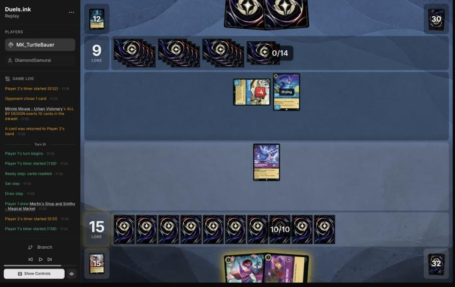
*The board before the decision: [step 159](https://duels.ink/replay/01a1a67f-5b41-78bb-966e-d3a1fda2a78d?step=159) in the duels.ink replay viewer.*

**What you did:** they had killed Wasabi with Minnie and Martial Arts Master with Hades (who died too), and played
Merryweather. You played Merlin's Shop and Smithy and moved Isis there (a draw, Isis, and a lore: 16–9). Then you
played Scourge, whose refill drew you 2 (a second Scourge and Peter Pan's Shadow) and them 1. Isis killed the
exerted, damaged Minnie and died.

**Verdict:** inaccuracy. The plan was right: Minnie, on 2 willpower and exerted, was worth Isis, and the Shop and Scourge
fit the 10 ink. The order cost a card. Moving **Isis** to the Shop before Scourge is suboptimal because the Shop's draw
came before the refill, and "draw until you have 3" absorbs cards drawn first ([H-1](#cite-h-1)'s caveat): you went into the refill
holding 1 card and drew 2. Playing **the Shop, then Scourge, then moving Scourge to the Shop** is better. The refill
comes with an empty hand and draws 3, and the Shop's draw and lore come after it: 4 cards instead of 3, the same 16 lore,
the same 10 ink. Scourge can move while drying, since moving needs neither exert nor dry ([CR 4.7.3](#cite-cr-4-7-3)), and Isis still
challenges. Nothing more is exposed; Scourge is ready either way. With 3 or more cards in hand, Scourge won't ready
under STONE BY DAY once she quests, in either line. Confidence: high; the edge is one card.

### Turn 33: your turn 17

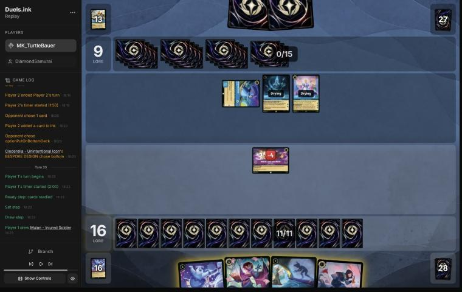
*The board before the decision: [step 173](https://duels.ink/replay/01a1a67f-5b41-78bb-966e-d3a1fda2a78d?step=173) in the duels.ink replay viewer.*

**What you did:** after a second Hades – Infernal Schemer took Scourge and they replayed an Icon, you had no characters
left. You inked Mulan – Injured Soldier, played Isis and the second Scourge (her refill drew you Pepita and Medallion
Weights, and them 1), and moved Isis to the Shop (a card, Luisa, and 17–9).

**Verdict:** close call. Their board (Icon 3, Hades 2, Merryweather 1) reaches 15 next turn and 21 the turn after, so
you have to make 20 on game turn 35. Characters played now are ready on their turn, so only removal reaches them: Hades
(20% after their draw), Gaston (29%, needs 5 {S}), The Horseman Strikes! (20%, Evasive), Spooky Sight (10%, cost 3 or
less) and Raging Storm (20%). The Shop, on 2 willpower, will probably be challenged down. Two ways to 3 lore next turn:
- **Yours: Scourge (2) and Isis (1).** It fails if either is removed, and Scourge is the one Gaston can take. The
  refill also gave them a card.
- **Isis, Shadow and Injured Soldier (1 each), with the Shop move now and Scourge held.** It needs all three unless
  the Shop survives for another move. It gives Gaston no target and them no card, but Shadow is open to The Horseman
  Strikes! and Spooky Sight.

Neither line is clearly safer. Yours also put three cards in your hand, cheap characters to move into the Shop next
turn if it survives. Confidence: low.

### Turn 35: your turn 18

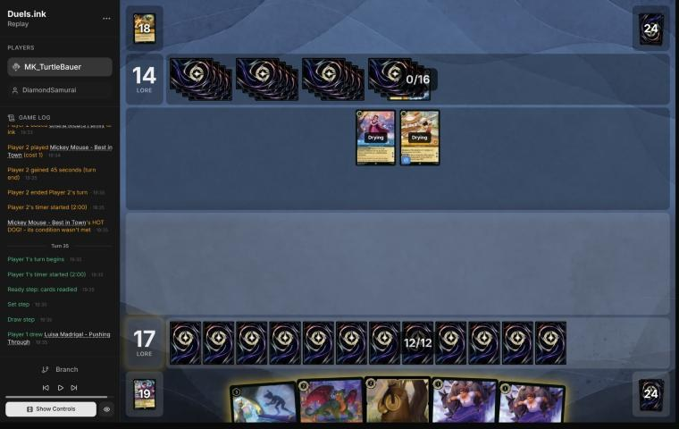
*The board before the decision: [step 188](https://duels.ink/replay/01a1a67f-5b41-78bb-966e-d3a1fda2a78d?step=188) in the duels.ink replay viewer.*

**What you did:** after the Shop fell and a third Raging Storm took Isis and Scourge (they quested Hades and the Icon
first: 17–14), you played Peter Pan's Shadow, both Luisas, Pepita and Medallion Weights: four 1-lore characters.

**Verdict:** good play. Their Belle and Mickey quest for 4 a turn: 18 next turn, 22 the turn after. So you had to make
20 on game turn 37, and nothing you played could quest this turn. Four 1-lore characters, all ready on their turn (so
no challenge reaches them), make 21 with one to spare: a single removal still leaves 20. Their hand was empty, so their
answers were one draw: Gaston 12%, Hades 8%, a fourth Storm or The Horseman Strikes! 4% each.

## Lessons
1. **Against Amber/Sapphire Control, kill Cinderella – Dream Come True while she's cheap.** She ramps them every turn
   they play a Princess and is the Icon's Shift base. Isis plus a challenger kills her for nothing on the turn after
   she lands ([turn 7](#turn-7); added to [H-8](#cite-h-8) as evidence).
2. **Keep a threat in hand once Amber reaches 8 ink.** Each Storm here came after they quested their own board, and
   each time you rebuilt at once ([13](#turn-13), [23](#turn-23), [35](#turn-35)): [POS-1](#cite-pos-1).
3. **With a refill to cast, cast it before drawing.** "Draw until you have 3" absorbs the cards you draw first, so the
   Shop's draw belongs after Scourge ([turn 31](#turn-31), [H-1](#cite-h-1)'s caveat).
4. **Ward blanks your exerts.** Minnie, Scuttle and Merryweather couldn't be exerted by Isis or Shadow, so the only way
   to them was a big enough challenger after they quested ([15](#turn-15), [17](#turn-17)).

## Knowledge-base updates (applied, commit e5b7a63)
- **Strategy:** [H-8](#cite-h-8) has new evidence from [turn 7](#turn-7): Dream Come True as the step before the Icon.
- **Meta:** a DiamondSamurai section in the Amber/Sapphire notes (the list, the turn-8 Icon, three Storms after
  questing, Ward everywhere); MK_TurtleBauer's second list in the Amethyst/Ruby notes, with Liquidator's Reckless
  against 5 willpower ([turn 19](#turn-19)) and the Shop-move order; a row in the meta index.
- **Rules:** none.

## Hindsight
Doesn't change the verdicts above.
- **Turn 7:** the Icon came as feared, Shifted onto Dream Come True on turn 8, and killed Luisa. Turn 9 cost Pepita and
  Martial Arts Master to remove her.
- **They ran at least three Raging Storms and three Minnies,** and conceded at 18 lore, two short of 20, with an empty
  hand against your four ready 1-drops.

## The coach's errors
Filled in during discussion.

| When | Error | How it was caught | How it won't happen again |
|---|---|---|---|

## Open questions
- **Turn 7:** did you see Isis on Dream Come True, or was the card from WAY OF THE HERO the point?
- **Turns 19 and 21:** was Martial Arts Master kept home to protect her, or for her Rush later?
- **Turn 5:** was Medallion Weights inked to keep both Mulans for the Elite Archer Shift?

## Citations
Copies of the coach's knowledge base cited above, as they stood when they were cited (the private repository's commit and date are given with each). They don't change when the knowledge base does.

<!-- Filled in by `python3 tools/cite.py <this file>`: every principle ID, H-n, "principle N" and CR rule above
becomes a link to an entry here. Add a file or one of its sections with `--file PATH --section TEXT`, and link to
the anchor it prints. Never link into the private repository. -->

**MULL-3**: strategy principle, `kb/strategy/principles.md` at `e5b7a63` (2026-11-04), working tree

> - **MULL-3. The right keep depends on the matchup.** Early interaction against aggro; pressure, draw and engines against slow decks. The mulligan is the first expression of your role. In the Set 14 era the opponent's inks are known before the mulligan (RULE-8), so this applies from game 1 of a match. `[MCL ch.12]` · baseline

**ROLE-1**: strategy principle, `kb/strategy/principles.md` at `e5b7a63` (2026-11-04), working tree

> - **ROLE-1. The matchup decides your role, not your deck.** In nearly every game one player wants it short (aggressor) and one wants it long (defender). The same list can play either role. *Ask: "Which deck benefits if this game goes long?"* `[MCL ch.8]` · baseline

**CARD-1**: strategy principle, `kb/strategy/principles.md` at `e5b7a63` (2026-11-04), working tree

> - **CARD-1. Card advantage is having more meaningful options than the opponent.** Ways to get it:
>   - 2-for-1 trades, and removal that hits two targets
>   - characters that survive several challenges
>   - recursion
>   - cards that replace themselves
>   - discard
>
>   *Ask after each exchange: "Who has more useful resources left?"* `[MCL ch.2]` · baseline

**TEMPO-2**: strategy principle, `kb/strategy/principles.md` at `e5b7a63` (2026-11-04), working tree

> - **TEMPO-2. Answering an expensive threat with a cheap card is a tempo swing**, and more so if the answer was sung for no ink. Other examples: playing Shift threats before the opponent can answer them, and ramping into several threats in one turn. `[MCL ch.1, ch.7]` · baseline

**QC-2**: strategy principle, `kb/strategy/principles.md` at `e5b7a63` (2026-11-04), working tree

> - **QC-2. Challenge the threat, not the character.** Engines, synergy pieces and big questers are worth fighting over. A 1-lore character doing nothing usually isn't. *Ask: "Does this character actually need to be removed?"* `[MCL ch.6, ch.9]` · baseline

**THREAT-3**: strategy principle, `kb/strategy/principles.md` at `e5b7a63` (2026-11-04), working tree

> - **THREAT-3. The biggest threat may not be on the board yet.** Consider:
>   - the opponent's ink next turn
>   - shift targets already in play
>   - support pieces that enable their next turn
>
>   `[MCL ch.9]` · baseline

**POS-1**: strategy principle, `kb/strategy/principles.md` at `e5b7a63` (2026-11-04), working tree

> - **POS-1. From ahead, take the safest path to victory.** Don't overextend into sweepers, don't make unnecessary trades, and make the opponent take the risks. Winning by 1 lore counts the same as winning by 10. `[MCL ch.10]` · baseline

**INK-3**: strategy principle, `kb/strategy/principles.md` at `e5b7a63` (2026-11-04), working tree

> - **INK-3. Usually ink every turn, but not automatically.** Keeping one more playable card can beat one more ink. Missing ink with an expensive hand can leave you permanently behind. `[MCL ch.4]` · baseline

**SEQ-1**: strategy principle, `kb/strategy/principles.md` at `e5b7a63` (2026-11-04), working tree

> - **SEQ-1. Gather information before irreversible decisions.** Draw, look and scry before choosing what to ink. Quest with draw triggers before committing other plays when the order doesn't otherwise matter. `[MCL ch.5]` · baseline

**THREAT-1**: strategy principle, `kb/strategy/principles.md` at `e5b7a63` (2026-11-04), working tree

> - **THREAT-1. Not every threat needs an answer.** *Ask: "What happens if I don't answer this?"* "Very little" means spend resources elsewhere. "I probably lose" means it's the priority. `[MCL ch.9]` · baseline

**SEQ-3**: strategy principle, `kb/strategy/principles.md` at `e5b7a63` (2026-11-04), working tree

> - **SEQ-3. Order challenges so earlier ones inform later ones.** Lead with the challenge that might make the next unnecessary, or that preserves both characters. `[MCL ch.5]` · baseline

**H-8**: hypothesis, `kb/strategy/hypotheses.md` at `e5b7a63` (2026-11-04), working tree

> ### H-8. Trade cheap characters for the opponent's ramp engine at the first chance
> - **Claim:** against a ramp-control deck, kill their ramp engine (Cinderella – Unintentional Icon) as soon as it's
>   exposed, even at the cost of several cheap characters: those characters are what their sweepers take anyway, and
>   the engine is their lore and their ink.
> - **Evidence for:** 01a19d83 (danny vs daman, game 2), turns 8 and 10. Marie and two Launchpads could kill an exerted
>   Icon (6 willpower) both turns; left alive, she took them from 4 to 11 and ramped them into Raging Storm on turn 13.
>   danny agreed in discussion (2026-11-02): "I should've banished it while I had the chance."
> - **Evidence for, the step before:** 01a1a67f-5b3b (MK_TurtleBauer vs DiamondSamurai), turn 7. Isis could exert
>   Cinderella – Dream Come True (the Icon's Shift base and their ramp) for Pepita to kill at no loss; the play killed
>   only Aurora, and the Icon was Shifted onto her next turn. Graded a mistake in the blind review, not yet discussed.
> - **Related:** stonks 📈's rule from the other side (H-6, 01a16039): keep your own Icon ready rather than offer that
>   trade.
> - **Status:** open (one game).

**H-1**: hypothesis, `kb/strategy/hypotheses.md` at `e5b7a63` (2026-11-04), working tree

> ### H-1. Time hand-refill effects for when your hand naturally runs out
> - **Claim:** "Draw until you have N" effects (e.g. Demona – Scourge of the Wyvern Clan, refill to 3) are worth
>   most on the turn your hand empties. Playing one card per turn on the play, a 7-card hand empties around
>   turn 6, which is exactly when a 6-cost refill lands. So an inkable refill card is cheap to keep through a
>   mulligan: if the game goes differently, ink it.
> - **Why:**
>   - **Hand count when playing on curve, going first:** 7 cards; ink 1 and play 1 each turn, drawing from turn 2,
>     leaves 1 card after inking on turn 6.
>   - **Cost of keeping it, by simulation:** keeping Demona costs about 0.1 ink spent over turns 1–4, compared with
>     also mulliganing her.
> - **Caveats:**
>   - "Each player" refills, so the opponent also draws if below N. On the draw they hold one more card. The other
>     side of this, for the player facing her, is in `kb/cards/demona-scourge-of-the-wyvern-clan.md`.
>   - Demona's STONE BY DAY means she can't ready while you hold 3+ cards. After refilling to 3, you must be at ≤2
>     by your next Ready step, or she stays exerted (and challengeable) once she has quested or challenged.
>   - She's drying on the turn she's played, so her own exert-all opens the opponent's board to your *other* dry
>     characters only.
>   - Ink drops (Hyperia City) don't expire, so saved drops can bring the refill earlier than the bare count suggests.
>   - **The cap absorbs earlier card draw.** "Draw until 3" always ends at 3, so cards drawn beforehand (e.g. Junior
>     Woodchuck Guidebook) are borrowed from the refill rather than added to it. Pre-drawing buys timing, not
>     cards:
>     - earlier information
>     - a better ink choice
>     - being sure of an inkable card for the refill turn
>
>     Weigh that against what the same ink would otherwise buy, e.g. an earlier body. (User's correction,
>     2026-10-24: the coach had called this a cost of the draw without counting those gains.)
>   - The opponent's refill depends on *their* hand size when you cast it, not on your earlier choices. Check it
>     when deciding whether to cast now.
>   - **It needs your ink to reach 6 on time.** Hands with uninkable cards are short of ink, not cards, so a held
>     6-drop is rarely castable on turn 6.
>     - **01a139ad, pre-game:** an opening seven with two uninkables. Keeping Demona left her castable on turn 6
>       only ~16% of the time in simulation. Mulliganing her for a random card raised "turn 4 uses all ink" from
>       80% to 91%. In ink-short hands, the refill card is the one to send back.
>     - *This caveat is the coach's, from simulation; not yet discussed with the user.*
>   - **Against Amber/Sapphire**, Demona's 5 {S} makes her a target for Gaston – Superior Archer, Judy Hopps –
>     Always Vigilant and World's Greatest Criminal Mind (`kb/meta/archetypes/amber-sapphire.md`).
> - **Evidence for:**
>   - replay 01a14bf9 (vs Goop), 2026-10-24, pre-game: the user's mulligan reasoning.
>   - same game, turn 5: the user kept Cheshire as the bridge play on the way to Demona instead of playing an
>     extra 1-drop.
>   - same game, turn 9: Guidebook played and used before inking, which locked in an inkable card for Demona
>     on turn 11. The alternative, Cheshire plus Boost, had about a 16% chance (8 uninkables in 49 cards) of an
>     uninkable turn-11 draw blocking her.
>   - same game, turn 11 (agreed with the user): a second Cheshire instead of Boost would have developed the
>     board, used the ink better, and **emptied the hand to just Demona**. Her next-turn refill would then draw 3
>     instead of 1. The user's own summary of the lesson: develop the board and spend resources so the
>     refill draws as many cards as possible.
>   - same game, turn 13: with Demona due next turn, the user inked their spare Cheshire though that ink wasn't
>     needed. **Corollary:** when a refill is imminent, spare cards in hand are effectively free ink. The cap
>     replaces them, so inking them costs no cards and leaves Demona as the only card in hand.
>   - **Limit on that corollary** (same game, turn 15, agreed with the user): it's free in card *count* only. The cap
>     replaces the inked card with a *random* card. So it holds for cards no better than a random draw, but not
>     for engines or must-answer threats. Inking Dumbo – Ninth Wonder of the Universe (a draw-and-lore engine the
>     opponent has to answer, TEMPO-1) to top up Demona's refill from 2 to 3 was probably wrong. Better was to
>     cast Demona without inking, keep Dumbo for next turn, and accept 1 ink and 1 refill card less.
> - **Evidence against:** none yet.
> - **Status:** open.

**amethyst-ruby.md, Unnamed #1: MK_TurtleBauer's list**: knowledge base, `kb/meta/archetypes/amethyst-ruby.md` at `e5b7a63` (2026-11-04), working tree

> ### Unnamed #1: MK_TurtleBauer's list `[coach, blind review of 01a1a59f-4c28 (MK_TurtleBauer vs Mega Kangaroo, 4 Nov 2026)]`
> Review: `output/reviews/2026-11-04_01a1a59f-4c28_vs-mega-kangaroo.md`. The list (60): Luisa Madrigal – Pushing Through
> ×4, Mulan – Injured Soldier ×4, Liquidator – Iced Over ×4, Jebidiah Farnsworth – Cookie ×4, Merlin's Shop and Smithy
> ×4, Medallion Weights ×2, Peter Pan's Shadow – Elusive Prankster ×4, Demona – Imperious Spellcaster ×4, Demona –
> Betrayer of the Clan ×3, Isis Vanderchill ×4, Mulan – Martial Arts Master ×4, Dumbo – Ninth Wonder of the Universe ×4,
> Hades – Looking for a Deal ×4, Wasabi – Called into Battle ×4, Demona – Scourge of the Wyvern Clan ×4, Mulan – Elite
> Archer ×3.
> - **Three Demonas with STONE BY DAY:** hand size decides whether they ready. Demona – Imperious Spellcaster's IMPETUS
>   is the tool for it (`kb/cards/demona-imperious-spellcaster.md`).
> - **Liquidator's UNDERDOG** (1 ink on your first turn on the draw) and Reckless: it makes the free kills, so the rest
>   can quest.
> - **Mulan – Martial Arts Master** gives +2 {S} and a draw to a challenger on play, and Rush to a character played that
>   turn when she quests.

**demona-imperious-spellcaster.md, Using IMPETUS**: knowledge base, `kb/cards/demona-imperious-spellcaster.md` at `e5b7a63` (2026-11-04), working tree

> ## Using IMPETUS `[coach + MK_TurtleBauer's play, 01a1a59f-4c28; danny's Remember Merida games]`
> Its cost is a discard, with no {E}, so she can use it while exerted and on the turn she's played (CR 6.3.1.1), and
> more than once a turn (CR 4.1.1). Three jobs:
> - **Rush for a Demona played this turn.** After Demona – Scourge's AD SAXUM COMMUTATE exerts their board, IMPETUS on
>   Scourge herself lets her challenge at once. In 01a1a59f-4c28 turn 14 that was a third kill, for Isis discarded.
>   danny's games did the same for 2–4 kills a turn (`kb/meta/archetypes/amber-amethyst.md`, "Remember Merida: danny's
>   list").
> - **Evasive for a quester.** A Gargoyle that quests under IMPETUS can't be challenged by their non-Evasive characters
>   until your next turn (01a1a59f-4c28 turn 8).
> - **Getting your hand under STONE BY DAY's 3.** The discard can put you at 2 cards for your next Ready step, so your
>   exerted Demonas ready. Before a Scourge turn the card often comes back: her refill draws you up to 3 (01a1a59f-4c28
>   turn 10, where it was missed).

**rulings.md, Wasabi's TWIN BLADES isn't optional**: knowledge base, `kb/rules/rulings.md` at `e5b7a63` (2026-11-04), working tree

> ### Wasabi's TWIN BLADES isn't optional, and Ward can turn it onto its own side
> - **Situation:** Wasabi – Called into Battle deals damage in a challenge on its controller's turn, and the other
>   player's only other characters have Ward.
> - **Ruling:** TWIN BLADES ("deal damage equal to this character's {S} to another chosen character") has no "may", so
>   it must be done when there's a legal choice. "Another chosen character" isn't limited to opposing characters, and
>   Ward stops the opponent choosing yours, so with only Ward characters on your side the damage must go to one of
>   their own.
> - **Basis:** CR 6.1.4 (only "may" makes an effect optional), CR 8.15.1 (Ward: opponents can't choose it), CR 6.1.3.1
>   (an effect meets its requirements as it resolves).
> - **Confidence:** derived from CR and matches duels.ink's engine: in 01a19c00 turn 21, Wasabi challenged Judy Hopps
>   – Always Vigilant, and with only Darkwing Duck – Drake Mallard (Ward) left on that side, TWIN BLADES hit their own
>   Tinker Bell – Fancy Footwork. Not an official ruling.
> - **Added:** 2026-11-02, from the review of 01a19c00 (MK_ifoughtthelore vs VH INK).

**inks.md, Raging Storm (Amber action, 8, uninkable)**: knowledge base, `kb/meta/inks.md` at `e5b7a63` (2026-11-04), working tree

> ### Raging Storm (Amber action, 8, uninkable)
> **Text:** "Banish all characters." (verified, replay 01a14bf9)
>
> **How common:** lots of Amber decks run 1–3 copies (user, 2026-10-25, Set 14 era).
>
> **Hard to play around.** The practical response is not to overcommit once an Amber opponent reaches 8 ink:
> - Keep a threat or a refill in hand.
> - Prefer lines that remove their cards without adding many of yours (POS-1).
>
> **Chance they've seen at least one copy** in a 60-card deck:
>
> | Cards seen | 1 copy | 2 copies | 3 copies |
> |---|---|---|---|
> | 12 | 20% | 36% | 49% |
> | 16 | 27% | 47% | 61% |
> | 20 | 33% | 56% | 71% |
> | 24 | 40% | 64% | 79% |
> | 28 | 47% | 72% | 86% |
>
> Count opening hand, mulligan redraws, draws, and extra cards looked at or drawn. Subtract any copies already
> seen. Around turn 14, a typical opponent has seen about 20 cards.
>
> **After one copy has been cast**, a second is much less likely in any given turn:
> - **Example (01a14bf9, turn 17):** about 8% if they run 2, 15% if 3, assuming the 3 cards available to them
>   next turn (2 in hand + 1 draw) are random among 39 unseen.
> - **It did come, on turn 18.** Low-probability events happen, so judge the commitment by the odds, not the result.
>
> **Pattern seen:** the caster quests with their own characters *first* to bank their lore, then wipes
> (01a14bf9, turn 18: +4 lore, then Raging Storm). Expect the wipe after their quests, not before.

**demona-scourge-of-the-wyvern-clan.md, Facing her**: knowledge base, `kb/cards/demona-scourge-of-the-wyvern-clan.md` at `e5b7a63` (2026-11-04), working tree

> ## Facing her `[coach + user, 2026-11-02; the hand-size point is the user's]`
> - **She makes "stay ready" worthless for a turn.** The exert-all doesn't choose, so Ward doesn't stop it (CR 8.15.2).
>   Their challengers then hit any of your characters. In 01a19c00 turn 11 a waiting board of five small characters
>   was exerted, and Wasabi – Called into Battle (TWIN BLADES), Luisa, Pepita and Cheshire Cat killed all five.
> - **Her refill is yours too.** If you hold 2 or fewer cards when she lands, you draw up to 3. So before their 6-ink
>   turn, getting your hand down is worth something:
>   - **Ink spare cards** rather than play them: the refill replaces them, and a wider board is exactly what her
>     exert-all punishes.
>   - **Only cards no better than a random draw.** The refill gives random cards (H-1's limit), so keep engines,
>     removal and must-play threats.
>   - **Weigh it against how likely she is.** Count her copies in their hand and next draw (`tools/odds.py hold`) and
>     whether their ink reaches 6. The caster can also wait until your hand is full.
>   - In 01a19c00 turn 11 the player held 1 card and drew 2 from her refill.
> - **She's a target for strength removal.** Her 5 {S} puts her in range of Gaston – Superior Archer, Judy Hopps –
>   Always Vigilant and World's Greatest Criminal Mind (`kb/meta/archetypes/amber-sapphire.md`, Removal profile).
>   01a19c00 turn 16: Always Vigilant banished her.
> - **STONE BY DAY after the refill:** they often hold 3 cards right after it, so once she has quested or challenged
>   she may stay exerted, and challengeable, into your next turn.
> - **In the mirror, her refill locks the other side's Demonas too** `[coach, blind review of 01a1a692-eb30]`. Their
>   Scourge exerted MK_TurtleBauer's board and drew them up to 3 cards (turn 15), so Betrayer and Imperious couldn't
>   ready at the next Ready step and spent the turn exerted. On turn 17 his own Scourge's refill did the same to theirs.
>   Before their 6-ink turn, a hand of 0–2 cards with exerted Gargoyles in play becomes 3 on the refill: IMPETUS
>   (a discard) on your turn is the way back under 3 (`kb/cards/demona-imperious-spellcaster.md`).

**CR 8.7.3**: Comprehensive Rules, `kb/rules/cr/08-keywords.md` at `e5b7a63` (2026-11-04), working tree

> **8.7.3.** The second ability means “You can’t declare the end of your turn if this character is ready and can challenge an opposing character or location.”

**CR 4.7.3**: Comprehensive Rules, `kb/rules/cr/04-turn-actions.md` at `e5b7a63` (2026-11-04), working tree

> **4.7.3.** To move a character to a location, the active player follows the process listed below in order.
