# Review: MK_TurtleBauer vs GreGherta, 4 November 2026

| | |
|---|---|
| **Status** | draft (blind pass done, not yet discussed) |
| **Replay** | `01a1a692-eb30-7e05-b1c7-b42c1e29ce34` (`python3 tools/brief.py 01a1a692-eb30 --turn N`) · [duels.ink viewer](https://duels.ink/replay/01a1a692-eb3c-7405-abb6-6ff18b883ba8?step=0) |
| **Format** | Core Constructed (stated in the replay). Set 14 era: inks revealed before the coin toss |
| **Decks** | You: Amethyst/Ruby challengers with the three Demonas, the same 60 as [your game against DiamondSamurai](https://5uperdan.github.io/lorcana-coach-output/reviews/2026-11-04_01a1a67f-5b3b_vs-diamondsamurai.html) ([your list's notes](#cite-kb-meta-archetypes-amethyst-ruby-unnamed-1-mk-turtlebauer-s-list)). Them: Amethyst/Ruby, the mirror; archetype as it became clear: Unnamed #2 (Elsa – Snow Queen, Medallion Weights, Wasabi), 79% from turn 3 and 100% by turn 16, with Goliath off-list |
| **Play/draw** | They went first; you were on the draw |
| **Result** | Win: GreGherta conceded on game turn 23 at 18–4 |
| **Meta data** | snapshot of 26 Oct 2026 (9 days old; stale from 9 Nov) |
| **Chosen how** | Sent by the user with another of your games, without comment on either result |

## Summary
Links go to the turn sections below.
- **Good plays:** every turn: the [pre-game](#turn-0), [2](#turn-2), [4](#turn-4), [6](#turn-6), [8](#turn-8),
  [10](#turn-10), [12](#turn-12), [14](#turn-14), [16](#turn-16), [18](#turn-18), [19](#turn-19), [20](#turn-20),
  [22](#turn-22). Two beat the coach's plan: [18](#turn-18) (the Shop move first found Martial Arts Master, and Goliath
  died) and [22](#turn-22) (their board cleared on the way to 18).
- **Close calls:** none worth flagging. Two small ink notes: Imperious inked on [6](#turn-6), Liquidator on [10](#turn-10).
- **Inaccuracies / mistakes / blunders:** none.
- **Unwinnable from:** never.

**What decided it:** three turns. On [12](#turn-12) you traded into Wasabi before Elsa could combine with him. On
[16](#turn-16), Scourge with IMPETUS Rush from an exerted Imperious killed Isis and Elsa. On [18](#turn-18), the Shop
move found the Martial Arts Master that let Betrayer kill their Scourge.

## The game, turn by turn
Verdicts judge each decision on what you could know at the time, **including archetype knowledge an experienced
player has**. Hindsight is kept to its own section. Severity scale: good play / close call /
inaccuracy / mistake / blunder. Principle IDs and hypotheses (H-n) link to copies
in the Citations section at the end, as they stood when they were cited.

**What you knew before the game:** they're on Amethyst/Ruby, your own pair: 48% a list duels.ink doesn't group, 25%
Unnamed #1 (the list closest to yours), then Unnamed #2 (11%), Incredibles Tempo (8%) and two smaller lists. You're
on the draw, so their turn k comes with k ink, a turn ahead of yours. Every list runs the same core, which is the
[exert-and-challenge plan you know from your own deck](#cite-kb-meta-archetypes-amethyst-ruby-unnamed-1-vh-ink-s-list):
- **Demona – Scourge of the Wyvern Clan** (6, all five lists ×4): exerts all your characters, then each player draws
  up to 3. Game turn 11 on curve (their 6th turn). With it, their challengers reach everything you have.
- **Isis Vanderchill** (4) and **Peter Pan's Shadow** (3): each exerts one of yours. From game turn 5 and 7.
- **Mulan – Martial Arts Master** (4): +2 {S} and a draw for a challenger; her quest gives Rush.
- **Wasabi – Called into Battle** (5): any challenge on their turn also deals 4 to another character, ready or not.
- **Hades – Looking for a Deal** (5): bottom your character or they draw 2.
- **Cheap challengers:** Rafiki – Mystical Fighter (1, Challenger +3, in Unnamed #1 ×4), Luisa, Pepita, Jebidiah.
- **Red Alert** (4, Incredibles Tempo): banish a character with 3 {S} or less.
- **Elsa – Snow Queen** (3, Unnamed #2): {E} to exert one of yours, every turn.

In the mirror both sides want to be the one with a ready board when the other exerts. A ready character can't be
challenged unless one of these exerts it first. Your own deck's notes: [IMPETUS IMPROVISUS](#cite-kb-cards-demona-imperious-spellcaster-using-impetus).

<!-- One section per turn with a decision, in game order. -->

### Pre-game

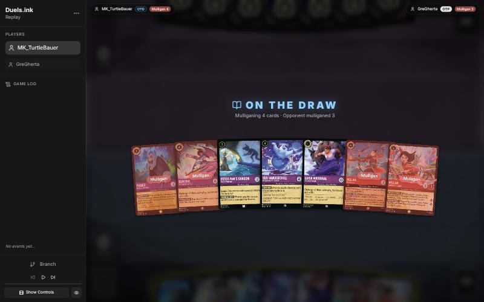
*The board before the decision: [step 0](https://duels.ink/replay/01a1a692-eb3c-7405-abb6-6ff18b883ba8?step=0) in the duels.ink replay viewer.*

**What you did:** on the draw. Kept Luisa Madrigal – Pushing Through, Peter Pan's Shadow and Isis; sent back Hades,
Demona – Betrayer of the Clan, Mulan – Elite Archer and Mulan – Martial Arts Master.

**Verdict:** good play. The seven had no 2-drop, two uninkables (Shadow, Isis), a 5-drop and a 6-drop.
`tools/mulligan.py` (1,500 deals):

| Option | Ink T1–4 | Play turns | Lore by T4 | Characters by T4 |
|---|---|---|---|---|
| Keep 7 | 9.14 | 3.65 | 4.6 | 3.7 |
| Send back Hades and the Archer (keep 5) | 9.65 | 3.88 | 5.0 | 4.1 |
| Keep Luisa, Shadow, Martial Arts Master, Betrayer | 9.69 | 3.94 | 5.1 | 4.3 |
| As played (keep Luisa, Shadow, Isis) | 9.79 | 3.95 | 5.2 | 4.2 |
| Full mulligan | 9.44 | 3.69 | 4.2 | 4.0 |

Your keep leads on ink and lore and ties on curve. The cost is Martial Arts Master, the mirror's best 4-drop, which the
sim can't value, against keeping both uninkables. Isis is the one exert you can play into their turn-4 board.
Confidence: medium.

### Turn 2: your turn 1

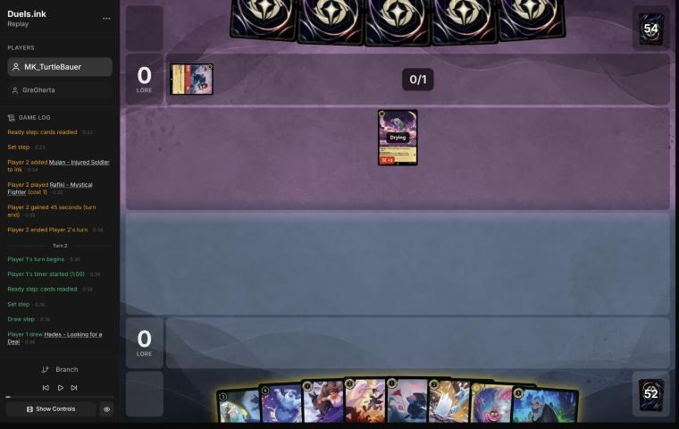
*The board before the decision: [step 6](https://duels.ink/replay/01a1a692-eb3c-7405-abb6-6ff18b883ba8?step=6) in the duels.ink replay viewer.*

**What you did:** they opened with Rafiki – Mystical Fighter (0/2, Challenger +3). You inked Mulan – Injured Soldier and
played Liquidator for 1 (UNDERDOG).

**Verdict:** good play. Liquidator costs 1 only on this turn, and the mirror opener [your list's notes](#cite-kb-meta-archetypes-amethyst-ruby-unnamed-1-mk-turtlebauer-s-list)
describe is exactly this: a 4-{S} Reckless body that kills whatever quests into it. If Rafiki quests, Liquidator must
challenge him ([CR 8.7.3](#cite-cr-8-7-3)), and a challenged Rafiki deals 0 (Challenger counts only while he challenges), so it's a free
kill. Injured Soldier, a 1-drop that enters on 1 willpower, was the cheapest card to ink.

### Turn 4: your turn 2

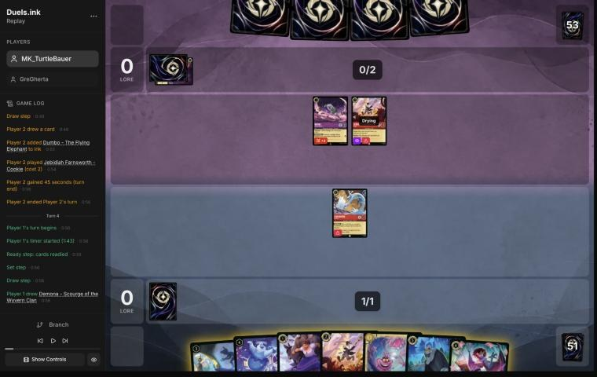
*The board before the decision: [step 12](https://duels.ink/replay/01a1a692-eb3c-7405-abb6-6ff18b883ba8?step=12) in the duels.ink replay viewer.*

**What you did:** inked Luisa and played Jebidiah, with nothing quested.

**Verdict:** good play. Their Rafiki and Jebidiah were both ready, so there was nothing to challenge, and Liquidator,
with no exerted target, wasn't forced to. Jebidiah is the best 2-ink play: a 3/3 Evasive that only their own Jebidiah
can reach. Luisa and Jebidiah together would cost 3. With two uninkables (Shadow, Isis) in hand, every inkable card
will be needed as ink over the next turns, so the 1-drop was the right one to give up. Nothing was exposed: everything
of yours is ready.

### Turn 6: your turn 3

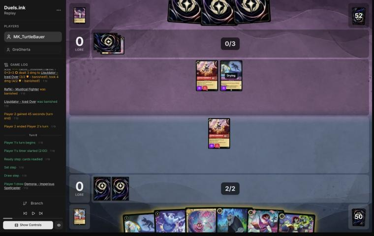
*The board before the decision: [step 21](https://duels.ink/replay/01a1a692-eb3c-7405-abb6-6ff18b883ba8?step=21) in the duels.ink replay viewer.*

**What you did:** after their Shadow exerted Liquidator and Rafiki traded with him, you inked Demona – Imperious
Spellcaster, played your Shadow to exert theirs, and Jebidiah killed it, taking 2.

**Verdict:** good play. Your Shadow could exert either of their characters for Jebidiah to challenge:
- **Their Jebidiah** is an even trade: 3 into 3 willpower both ways.
- **Their Shadow** (2/2) dies, and yours survives on 1 willpower.

Your choice is better, and it leaves their Jebidiah no good option. Reckless forces him to challenge next turn if he
can, and your exerted Jebidiah is his only legal target: both die. That's two of theirs for one of yours. Inking
Imperious gives up the Scourge-with-Rush turn ([her note](#cite-kb-cards-demona-imperious-spellcaster-using-impetus)). Hades or Cheshire were the spare
cards here. It's a small point while you have more Imperious in the deck, since you'll need every inkable card as ink
over the next three turns.

### Turn 8: your turn 4

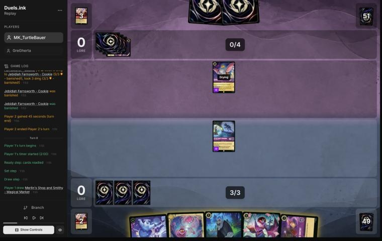
*The board before the decision: [step 31](https://duels.ink/replay/01a1a692-eb3c-7405-abb6-6ff18b883ba8?step=31) in the duels.ink replay viewer.*

**What you did:** their Jebidiah had traded with yours (Reckless, as expected), and they played Dumbo – Ninth Wonder of
the Universe. You inked Cheshire Cat, played Merlin's Shop and Smithy and moved Shadow there (a card, Liquidator, and
1–0). Shadow stayed ready.

**Verdict:** good play. Dumbo is their engine (a card and a lore for 1 ink a turn), but he's Evasive, so only your
Evasive characters can challenge him. Shadow (2 {S}) would die doing it. Isis's exert would only have set up that bad
challenge. The Shop gives a card and a lore now and again every turn you have 2 ink to move someone in, and moving
doesn't exert ([CR 4.7.3](#cite-cr-4-7-3)), so Shadow wasn't exposed to Dumbo. Hades, your answer to Dumbo next turn (bottom him or draw 2),
stayed in hand, and the Cheshire you inked was the spare 3-drop.

### Turn 10: your turn 5

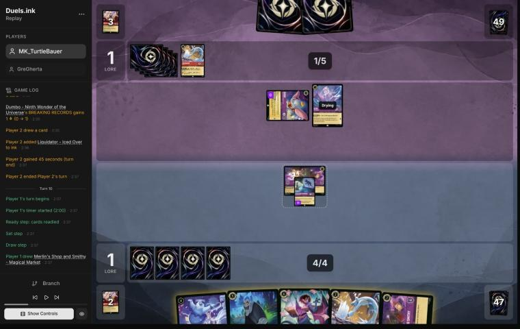
*The board before the decision: [step 39](https://duels.ink/replay/01a1a692-eb3c-7405-abb6-6ff18b883ba8?step=39) in the duels.ink replay viewer.*

**What you did:** inked Liquidator and played Hades on the exerted Dumbo. They kept Dumbo and let you draw 2
(Demona – Betrayer of the Clan and Jebidiah). Shadow didn't quest.

**Verdict:** good play. Dumbo, the engine that drew them a card last turn, can only be challenged by your Evasive
characters, and Shadow would die doing it. So Hades was the answer: either Dumbo goes to the bottom or you're two cards
up. Keeping Shadow home after they chose to keep Dumbo was right too: an exerted Shadow is exactly what Dumbo (3 {S},
Evasive) can kill. One small point on the ink: Liquidator was your only cheap answer to Elsa – Snow Queen. Her FREEZE
leaves her exerted on your turn, where a 4-{S} challenger kills her, so the second Shop was the spare card.

### Turn 12: your turn 6

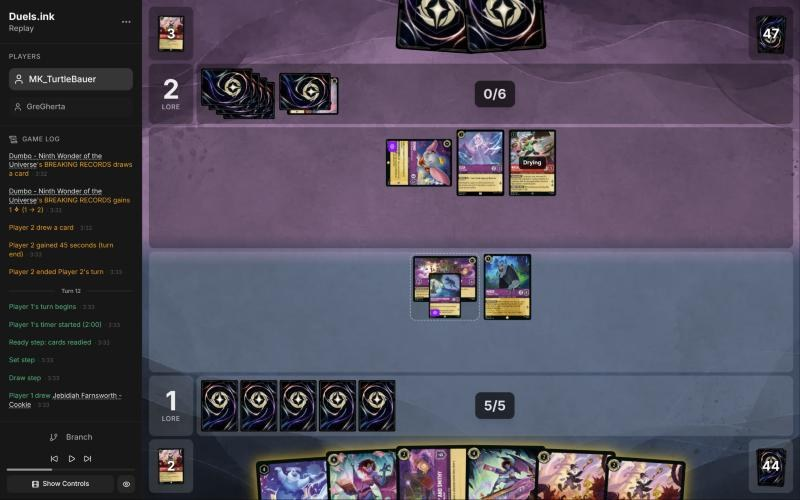
*The board before the decision: [step 48](https://duels.ink/replay/01a1a692-eb3c-7405-abb6-6ff18b883ba8?step=48) in the duels.ink replay viewer.*

**What you did:** they had played Wasabi and drawn again with Dumbo. You inked the second Shop, played Isis to exert
Wasabi, and Hades and Shadow challenged him: all three died. You also played Jebidiah, keeping Scourge, Betrayer and a
Jebidiah.

**Verdict:** good play. Their board was Dumbo (exerted), Elsa – Snow Queen and Wasabi (both ready). Elsa and Wasabi
together are two kills a turn even against a ready board: FREEZE exerts one of yours, Wasabi challenges it, and TWIN
BLADES deals 4 to another, ready or not. One of them had to go:
- **Elsa** (Isis exerts her, Hades kills her and survives on 2) leaves Hades exerted for Wasabi next turn. Wasabi kills
  him and TWIN BLADES takes a second character. That's two lost, and Wasabi stays.
- **Scourge** exerts all three, but her refill draws you nothing (you'd still hold 4) and them 1. Her exert opens their
  board only to Hades and Shadow, the same two challengers. She'd stay exerted under STONE BY DAY, too.
- **Yours:** Hades (already two cards up) and Shadow for the Wasabi. What's left of their turn is Elsa's FREEZE and
  Dumbo's 3 {S}, which can't kill Isis.

Yours trades into the threat that decides the next turns ([THREAT-1](#cite-threat-1)) and keeps Scourge for a turn when your hand is
low. Exposed: nothing; Isis and Jebidiah are drying. FREEZE can exert one of them for Dumbo, but only Jebidiah (Evasive,
3 willpower) dies to him.

### Turn 14: your turn 7

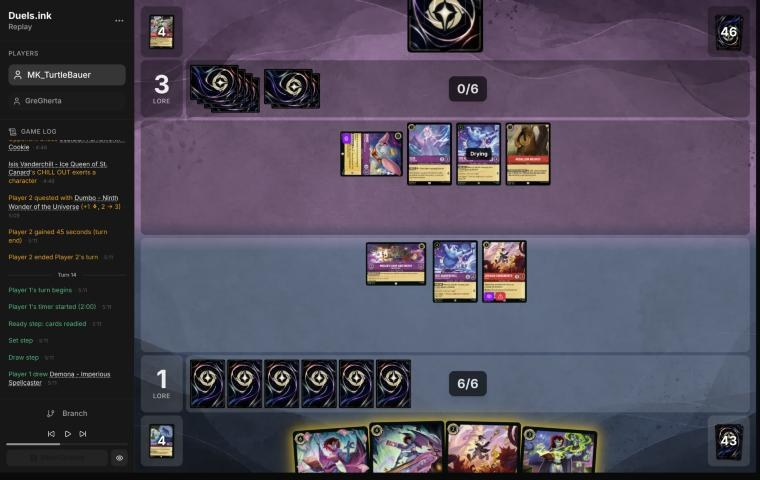
*The board before the decision: [step 60](https://duels.ink/replay/01a1a692-eb3c-7405-abb6-6ff18b883ba8?step=60) in the duels.ink replay viewer.*

**What you did:** their Isis had exerted Jebidiah (no challenge followed) and Dumbo quested (1–3). You inked the second
Jebidiah, played Demona – Betrayer of the Clan, let Jebidiah trade with the exerted Dumbo (Reckless forced it), and
played Imperious. Isis stayed home, and Scourge stayed in hand.

**Verdict:** good play. The other line was Scourge now: her exert-all lets Isis kill Elsa and Jebidiah kill Dumbo. But
her refill would have drawn them 2 (they held 1) against your 1, and she'd have used all your ink. Yours sets up the
combo in [Imperious's note](#cite-kb-cards-demona-imperious-spellcaster-using-impetus) for next turn's 8 ink:
- Scourge exerts their board, and her refill tops your one-card hand up to 3.
- IMPETUS (discarding one of those) gives Scourge herself Rush.
- Betrayer (6 {S} while challenging), Isis, Imperious and Scourge all challenge.

The discard also takes your hand back to 2, so the Demonas ready under STONE BY DAY. Dumbo, their card engine, died
either way. Exposed: nothing is exerted. Elsa's FREEZE can exert one of yours for their Isis (4 {S}), which kills
Imperious or Isis. Their own Scourge (16% after their draw) would open everything.

### Turn 16: your turn 8

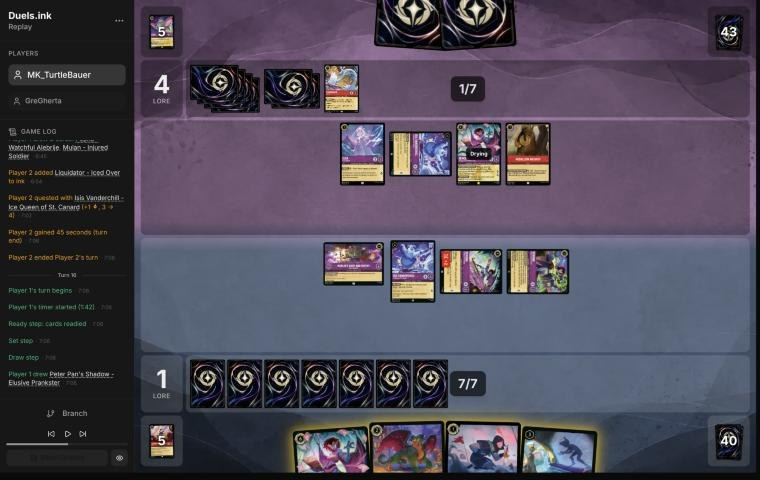
*The board before the decision: [step 69](https://duels.ink/replay/01a1a692-eb3c-7405-abb6-6ff18b883ba8?step=69) in the duels.ink replay viewer.*

**What you did:** their own Scourge had exerted your board, and her refill drew you 2 (Pepita and Mulan – Injured
Soldier), so at 3 cards Betrayer and Imperious stayed exerted under STONE BY DAY. They quested only Isis (1–4). You
inked Injured Soldier, played Pepita and then your Scourge: her exert-all opened Elsa and their Scourge, and her refill
drew you a Pepita and a Shadow. Imperious, still exerted, used IMPETUS (discarding Pepita) to give Scourge Rush.
Scourge killed their Isis and your Isis killed Elsa.

**Verdict:** good play: the combo [Imperious's note](#cite-kb-cards-demona-imperious-spellcaster-using-impetus) describes, including IMPETUS from an exerted
Imperious, since its cost is a discard and not {E}. The choice was which two to kill:
- **Their Scourge** (5/6/2) needs both your challengers (9 damage), and your Isis dies.
- **Isis and Elsa:** two characters, two lore a turn, and FREEZE gone. Both your challengers survive (Scourge on 2
  willpower, Isis on 2).

Yours took the second, and playing Pepita before Scourge emptied your hand for a bigger refill ([H-1](#cite-h-1)). Their Scourge can
make one challenge next turn, and IMPETUS left yours Evasive, out of its reach. So it kills Imperious or the damaged Isis,
whichever you'd protected. A second IMPETUS for Imperious would only move the hit to Isis, for a card. You go to their
turn holding 2 cards, so the Demonas ready.

### Turn 18: your turn 9

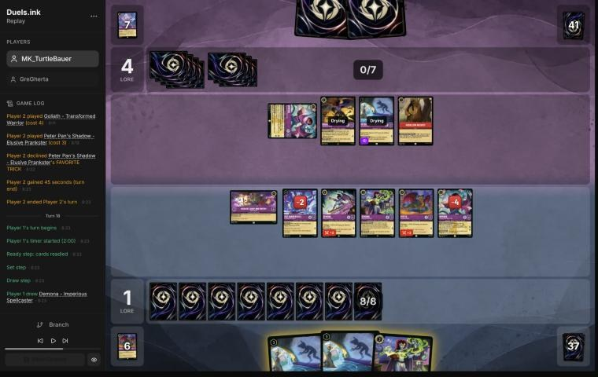
*The board before the decision: [step 82](https://duels.ink/replay/01a1a692-eb3c-7405-abb6-6ff18b883ba8?step=82) in the duels.ink replay viewer.*

**What you did:** they played Goliath – Transformed Warrior and a Shadow, while their Scourge stayed exerted under
their own STONE BY DAY. You moved Scourge to the Shop first (a card, Martial Arts Master, and 2–4). Martial Arts Master
gave Betrayer +2 and a draw, and Betrayer (8 {S}) killed their Scourge, drawing Mulan – Elite Archer. You inked the
second Imperious. Shadow exerted Goliath, and Pepita and the damaged Isis killed him, both dying. Imperious and Scourge
quested (5–4).

**Verdict:** good play, and better than the coach's plan. I had planned Betrayer (6 {S} with Challenger) on their
Scourge, then Shadow exerting their Shadow for an IMPETUS-Evasive Imperious to kill. That leaves Goliath (5/5), their
best attacker. Yours did more:
- **The Shop move came first,** so the draw (Martial Arts Master) was in hand before the plan was set ([SEQ-1](#cite-seq-1)). It
  turned Betrayer's kill into a card as well.
- **Goliath died** for Pepita and an Isis already on 2 willpower.
- **+4 lore,** leaving their board one 2/2 Shadow.

Exposed: Betrayer (1 willpower left), Scourge (2) and Imperious are exerted. Their Shadow (2 {S}, Evasive) can kill
Betrayer or Scourge, and whatever they add can't challenge this turn without Rush. Your hand is 2, so the Demonas ready.

### Turn 19: their turn

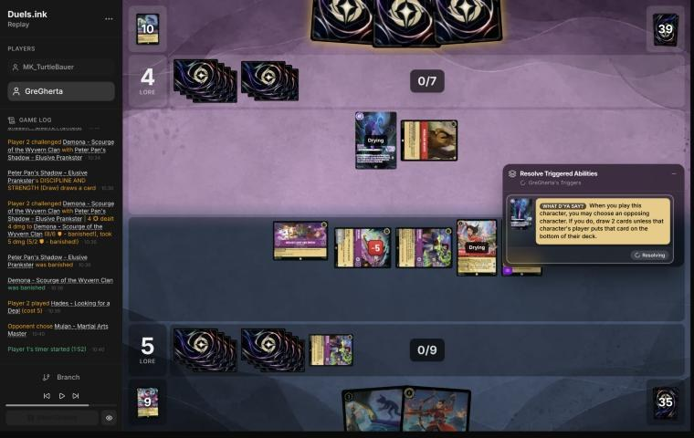
*The board before the decision: [step 101](https://duels.ink/replay/01a1a692-eb3c-7405-abb6-6ff18b883ba8?step=101) in the duels.ink replay viewer.*

**What happened:** their Shadow, with Medallion Weights' +2, killed your Scourge and died. Then their Hades chose
Martial Arts Master, and you let them draw 2 rather than bottom her.

**Verdict:** good play. At 5–4 Martial Arts Master was 2 of your 5 lore a turn (20 on game turn 24 with her, about
turn 28 without), and her WARRIOR SPIRIT Rush was your way to use a freshly played Isis or Shadow at once. Two cards for
a player low on cards is a real cost ([H-2](#cite-h-2)'s converse), but their board after this turn was one Hades, so the race
mattered more.

### Turn 20: your turn 10

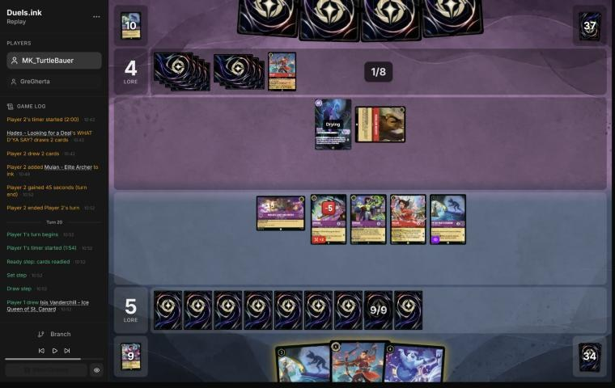
*The board before the decision: [step 104](https://duels.ink/replay/01a1a692-eb3c-7405-abb6-6ff18b883ba8?step=104) in the duels.ink replay viewer.*

**What you did:** moved Betrayer to the Shop first (a card, Luisa, and 6–4). Isis exerted the drying Hades, and Martial
Arts Master quested (8) and gave Isis Rush. Isis killed Hades and survived on 1 willpower. You inked Luisa, quested
with Betrayer, Imperious and Shadow (11–4), and kept the second Shadow and Mulan – Elite Archer.

**Verdict:** good play, the line the coach had planned. Hades (3 {S}) was their only character and would kill one of
your 3-willpower questers next turn. The other way to kill him was Elite Archer Shifted onto Martial Arts Master (5 {S}
that turn). That costs the Martial Arts Master quest and 3 lore. Yours empties their board and gains 6. Holding the
second Shadow keeps FAVORITE TRICK for a turn when they have something to exert, at the cost of 1 lore next turn. You
hold 2 cards, so the Demonas ready. Exposed: everything that quested, against an empty board, which can only hit back
with new characters given Rush or with their Scourge's exert-all followed by challengers they don't have.

### Turn 22: your turn 11

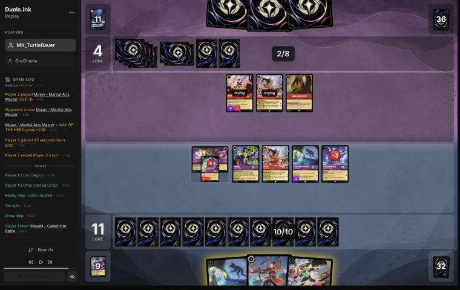
*The board before the decision: [step 119](https://duels.ink/replay/01a1a692-eb3c-7405-abb6-6ff18b883ba8?step=119) in the duels.ink replay viewer.*

**What you did:** they played Jebidiah and their own Martial Arts Master. You played the second Shadow to exert their
Martial Arts Master, played Wasabi, and quested your Martial Arts Master (13) to give Wasabi Rush. Wasabi killed their
Martial Arts Master, and TWIN BLADES killed their ready Jebidiah. Then Shadow moved to the Shop (a card and 14), and
Betrayer, Imperious, Shadow and Isis quested: 18–4.

**Verdict:** good play, and better than the coach's plan. At 11–4 your board quested for 6 and the Shop added 1: 18, so
no line won this turn. I had planned to quest everything and add bodies for next turn. Yours does that and clears their
board as well, for no loss:
- FAVORITE TRICK exerts their Martial Arts Master.
- Wasabi gets Rush from your own Martial Arts Master's quest.
- TWIN BLADES reaches the ready Jebidiah.

Next turn needs 2 lore from any survivor or a Shop move, and they have nothing on board to challenge with. Only new
characters with Rush, or their Scourge with a challenger behind her, can reach your questers.

## Lessons
1. **In the mirror, the refill is a lock as well as a draw.** Their Scourge drew you up to 3 cards, so your exerted
   Betrayer and Imperious couldn't ready under STONE BY DAY ([16](#turn-16)). Yours did the same to their Scourge on
   turn 17. IMPETUS's discard is the way back under 3.
2. **Elsa – Snow Queen plus Wasabi is two kills a turn against a ready board.** Kill one before they combine
   ([12](#turn-12)).
3. **Move into the Shop first, then plan the turn.** Its draw found the Martial Arts Master that made turn 18 ([SEQ-1](#cite-seq-1)).
4. **Scourge plus IMPETUS is the mirror's swing turn,** and IMPETUS works from an exerted Imperious
   ([16](#turn-16)).

## Knowledge-base updates (applied, commit e5b7a63)
- **Cards:** Demona – Scourge's note now says, under "Facing her", that her refill locks the other side's Demonas in
  the mirror (turns 15–17).
- **Meta:** a GreGherta section in the Amethyst/Ruby notes (Unnamed #2, Elsa with Wasabi, the Scourge lock);
  MK_TurtleBauer's second list; a row in the meta index.
- **Strategy and rules:** none.

## Hindsight
Doesn't change the verdicts above.
- **Their Scourge came on turn 15,** the 16% the turn-14 brief gave. It exerted everything and locked your Demonas,
  but they had no challengers left to use it with, so they quested one Isis.
- **They conceded with Scourge, Wasabi, Goliath and Hades all used,** facing 18 lore and five questers.

## The coach's errors
Filled in during discussion.

| When | Error | How it was caught | How it won't happen again |
|---|---|---|---|
| Turn 14 | The exposure line counted their Scourge's exert-all but not its refill, which put you at 3 cards and kept your Demonas exerted under STONE BY DAY. The knowledge base had the caster's side of STONE BY DAY, not this one | The coach, at turn 16 | Added to Scourge's card note ("Facing her"), which the brief lists whenever she or a Demona is in view |

## Open questions
- **Turn 12:** did you weigh killing Elsa instead of Wasabi?
- **Turn 19:** keeping Martial Arts Master over denying them 2 cards: was the race the reason?

## Citations
Copies of the coach's knowledge base cited above, as they stood when they were cited (the private repository's commit and date are given with each). They don't change when the knowledge base does.

<!-- Filled in by `python3 tools/cite.py <this file>`: every principle ID, H-n, "principle N" and CR rule above
becomes a link to an entry here. Add a file or one of its sections with `--file PATH --section TEXT`, and link to
the anchor it prints. Never link into the private repository. -->

**THREAT-1**: strategy principle, `kb/strategy/principles.md` at `e5b7a63` (2026-11-04), working tree

> - **THREAT-1. Not every threat needs an answer.** *Ask: "What happens if I don't answer this?"* "Very little" means spend resources elsewhere. "I probably lose" means it's the priority. `[MCL ch.9]` · baseline

**SEQ-1**: strategy principle, `kb/strategy/principles.md` at `e5b7a63` (2026-11-04), working tree

> - **SEQ-1. Gather information before irreversible decisions.** Draw, look and scry before choosing what to ink. Quest with draw triggers before committing other plays when the order doesn't otherwise matter. `[MCL ch.5]` · baseline

**H-1**: hypothesis, `kb/strategy/hypotheses.md` at `e5b7a63` (2026-11-04), working tree

> ### H-1. Time hand-refill effects for when your hand naturally runs out
> - **Claim:** "Draw until you have N" effects (e.g. Demona – Scourge of the Wyvern Clan, refill to 3) are worth
>   most on the turn your hand empties. Playing one card per turn on the play, a 7-card hand empties around
>   turn 6, which is exactly when a 6-cost refill lands. So an inkable refill card is cheap to keep through a
>   mulligan: if the game goes differently, ink it.
> - **Why:**
>   - **Hand count when playing on curve, going first:** 7 cards; ink 1 and play 1 each turn, drawing from turn 2,
>     leaves 1 card after inking on turn 6.
>   - **Cost of keeping it, by simulation:** keeping Demona costs about 0.1 ink spent over turns 1–4, compared with
>     also mulliganing her.
> - **Caveats:**
>   - "Each player" refills, so the opponent also draws if below N. On the draw they hold one more card. The other
>     side of this, for the player facing her, is in `kb/cards/demona-scourge-of-the-wyvern-clan.md`.
>   - Demona's STONE BY DAY means she can't ready while you hold 3+ cards. After refilling to 3, you must be at ≤2
>     by your next Ready step, or she stays exerted (and challengeable) once she has quested or challenged.
>   - She's drying on the turn she's played, so her own exert-all opens the opponent's board to your *other* dry
>     characters only.
>   - Ink drops (Hyperia City) don't expire, so saved drops can bring the refill earlier than the bare count suggests.
>   - **The cap absorbs earlier card draw.** "Draw until 3" always ends at 3, so cards drawn beforehand (e.g. Junior
>     Woodchuck Guidebook) are borrowed from the refill rather than added to it. Pre-drawing buys timing, not
>     cards:
>     - earlier information
>     - a better ink choice
>     - being sure of an inkable card for the refill turn
>
>     Weigh that against what the same ink would otherwise buy, e.g. an earlier body. (User's correction,
>     2026-10-24: the coach had called this a cost of the draw without counting those gains.)
>   - The opponent's refill depends on *their* hand size when you cast it, not on your earlier choices. Check it
>     when deciding whether to cast now.
>   - **It needs your ink to reach 6 on time.** Hands with uninkable cards are short of ink, not cards, so a held
>     6-drop is rarely castable on turn 6.
>     - **01a139ad, pre-game:** an opening seven with two uninkables. Keeping Demona left her castable on turn 6
>       only ~16% of the time in simulation. Mulliganing her for a random card raised "turn 4 uses all ink" from
>       80% to 91%. In ink-short hands, the refill card is the one to send back.
>     - *This caveat is the coach's, from simulation; not yet discussed with the user.*
>   - **Against Amber/Sapphire**, Demona's 5 {S} makes her a target for Gaston – Superior Archer, Judy Hopps –
>     Always Vigilant and World's Greatest Criminal Mind (`kb/meta/archetypes/amber-sapphire.md`).
> - **Evidence for:**
>   - replay 01a14bf9 (vs Goop), 2026-10-24, pre-game: the user's mulligan reasoning.
>   - same game, turn 5: the user kept Cheshire as the bridge play on the way to Demona instead of playing an
>     extra 1-drop.
>   - same game, turn 9: Guidebook played and used before inking, which locked in an inkable card for Demona
>     on turn 11. The alternative, Cheshire plus Boost, had about a 16% chance (8 uninkables in 49 cards) of an
>     uninkable turn-11 draw blocking her.
>   - same game, turn 11 (agreed with the user): a second Cheshire instead of Boost would have developed the
>     board, used the ink better, and **emptied the hand to just Demona**. Her next-turn refill would then draw 3
>     instead of 1. The user's own summary of the lesson: develop the board and spend resources so the
>     refill draws as many cards as possible.
>   - same game, turn 13: with Demona due next turn, the user inked their spare Cheshire though that ink wasn't
>     needed. **Corollary:** when a refill is imminent, spare cards in hand are effectively free ink. The cap
>     replaces them, so inking them costs no cards and leaves Demona as the only card in hand.
>   - **Limit on that corollary** (same game, turn 15, agreed with the user): it's free in card *count* only. The cap
>     replaces the inked card with a *random* card. So it holds for cards no better than a random draw, but not
>     for engines or must-answer threats. Inking Dumbo – Ninth Wonder of the Universe (a draw-and-lore engine the
>     opponent has to answer, TEMPO-1) to top up Demona's refill from 2 to 3 was probably wrong. Better was to
>     cast Demona without inking, keep Dumbo for next turn, and accept 1 ink and 1 refill card less.
> - **Evidence against:** none yet.
> - **Status:** open.

**H-2**: hypothesis, `kb/strategy/hypotheses.md` at `e5b7a63` (2026-11-04), working tree

> ### H-2. Spare ink isn't automatically wasted when later turns will be short of cards
> - **Claim:** Ink grows by one every turn, but cards don't. Once later turns are likely to have more ink than
>   good cards to spend it on, cards are the scarcer resource. Then playing a low-impact card just to use spare
>   ink (giving up a better card to the inkwell instead) is usually worse than leaving the ink unspent.
> - **Applies when:** you're ahead on board (POS-1) and the extra play has little impact (WIN-2). Also when the
>   backup value of the extra card is low, e.g. a second Shift target when the opponent's removal can't hit the first.
> - **Doesn't apply when:** you're behind and need board presence now, or the cheap card has real impact.
> - **The converse, for the opponent:** extra cards are worth less to an opponent who already has a full hand and is
>   short of ink. When an effect offers "they draw 2 or you lose a body" (Hades – Looking for a Deal), keeping
>   the body is more attractive the more cards they already hold. Discard-payoff decks still get some fuel from
>   extra cards. Evidence: 01a139ad, turn 14. The opponent had 5 cards and 7 ink, and the user kept Isis
>   rather than bottoming her. Discussed 2026-10-26 and judged a close call.
> - **Evidence for:** replay 01a14bf9 (vs Goop), turn 5. The user left 1 ink unspent rather than ink Cheshire to
>   play a second Mulan – Injured Soldier. Coach first called it a close call, then agreed after the user's argument.
> - **Evidence against:** none yet.
> - **Status:** open.

**amethyst-ruby.md, Unnamed #1: MK_TurtleBauer's list**: knowledge base, `kb/meta/archetypes/amethyst-ruby.md` at `e5b7a63` (2026-11-04), working tree

> ### Unnamed #1: MK_TurtleBauer's list `[coach, blind review of 01a1a59f-4c28 (MK_TurtleBauer vs Mega Kangaroo, 4 Nov 2026)]`
> Review: `output/reviews/2026-11-04_01a1a59f-4c28_vs-mega-kangaroo.md`. The list (60): Luisa Madrigal – Pushing Through
> ×4, Mulan – Injured Soldier ×4, Liquidator – Iced Over ×4, Jebidiah Farnsworth – Cookie ×4, Merlin's Shop and Smithy
> ×4, Medallion Weights ×2, Peter Pan's Shadow – Elusive Prankster ×4, Demona – Imperious Spellcaster ×4, Demona –
> Betrayer of the Clan ×3, Isis Vanderchill ×4, Mulan – Martial Arts Master ×4, Dumbo – Ninth Wonder of the Universe ×4,
> Hades – Looking for a Deal ×4, Wasabi – Called into Battle ×4, Demona – Scourge of the Wyvern Clan ×4, Mulan – Elite
> Archer ×3.
> - **Three Demonas with STONE BY DAY:** hand size decides whether they ready. Demona – Imperious Spellcaster's IMPETUS
>   is the tool for it (`kb/cards/demona-imperious-spellcaster.md`).
> - **Liquidator's UNDERDOG** (1 ink on your first turn on the draw) and Reckless: it makes the free kills, so the rest
>   can quest.
> - **Mulan – Martial Arts Master** gives +2 {S} and a draw to a challenger on play, and Rush to a character played that
>   turn when she quests.

**demona-imperious-spellcaster.md, Using IMPETUS**: knowledge base, `kb/cards/demona-imperious-spellcaster.md` at `e5b7a63` (2026-11-04), working tree

> ## Using IMPETUS `[coach + MK_TurtleBauer's play, 01a1a59f-4c28; danny's Remember Merida games]`
> Its cost is a discard, with no {E}, so she can use it while exerted and on the turn she's played (CR 6.3.1.1), and
> more than once a turn (CR 4.1.1). Three jobs:
> - **Rush for a Demona played this turn.** After Demona – Scourge's AD SAXUM COMMUTATE exerts their board, IMPETUS on
>   Scourge herself lets her challenge at once. In 01a1a59f-4c28 turn 14 that was a third kill, for Isis discarded.
>   danny's games did the same for 2–4 kills a turn (`kb/meta/archetypes/amber-amethyst.md`, "Remember Merida: danny's
>   list").
> - **Evasive for a quester.** A Gargoyle that quests under IMPETUS can't be challenged by their non-Evasive characters
>   until your next turn (01a1a59f-4c28 turn 8).
> - **Getting your hand under STONE BY DAY's 3.** The discard can put you at 2 cards for your next Ready step, so your
>   exerted Demonas ready. Before a Scourge turn the card often comes back: her refill draws you up to 3 (01a1a59f-4c28
>   turn 10, where it was missed).

**amethyst-ruby.md, Unnamed #1: VH INK's list**: knowledge base, `kb/meta/archetypes/amethyst-ruby.md` at `e5b7a63` (2026-11-04), working tree

> ### Unnamed #1: VH INK's list, from MK_ifoughtthelore's match `[coach, one match of three games, 2026-11-02; applied at the user's request]`
> Games 01a19c00 (lost by the Detectives player), 01a19c08-7f38 and 01a19c0c (won); reviews in
> `output/reviews/2026-11-02_01a19c00_vs-vh-ink-g1.md` and the g2 and g3 files beside it. Card text verified from the
> replays.
> - **The plan:** cheap challengers plus exert effects, so your characters can be challenged whether or not they quest,
>   with card flow behind them.
>   - **Exert effects:** Peter Pan's Shadow – Elusive Prankster (3, Evasive; exerts one of yours on play), Isis
>     Vanderchill – Ice Queen of St. Canard (4; exerts one), Demona – Scourge of the Wyvern Clan (6; exerts **all** of
>     yours, then each player draws up to 3). Ward (Darkwing Duck – Drake Mallard) blanks the first two; Demona's
>     doesn't choose, so Ward doesn't stop it.
>   - **Challengers:** Luisa Madrigal – Pushing Through and Pepita – Watchful Alebrije (Challenger +2), Tinker Bell –
>     Fancy Footwork (3/1), Jebidiah Farnsworth – Cookie (Evasive, Reckless), Goliath – Transformed Warrior (4, 5/5;
>     discards a card to move 2 of his damage onto your character), Mulan – Martial Arts Master (+2 {S} on play; her
>     quest gives a character played that turn Rush).
>   - **Wasabi – Called into Battle** (5, 4/5/2): any challenge on their turn also deals 4 to another chosen character,
>     ready or not, so one exert plus Wasabi is two kills. TWIN BLADES isn't optional (`kb/rules/rulings.md`).
>   - **Card flow:** Dumbo – Ninth Wonder of the Universe (Evasive characters draw and gain a lore for 1 ink), Cheshire
>     Cat – Inexplicable (Boost moves 2 damage onto your character), Ursula – Whisper of Vanessa (Boost: Evasive and +1
>     {L}), Hades – Looking for a Deal; Red Alert (banish a character with 3 {S} or less).
>   - Not in duels.ink's average list: Goliath, Peter Pan & Tinker Bell – Fast Friends (Shift 4; their characters gain
>     Evasive), Ursula – Whisper of Vanessa, Red Alert.
> - **Swing turn: Demona – Scourge at 6 ink.** In 01a19c00 turn 11 she exerted a waiting board of five small
>   characters, and their challengers plus TWIN BLADES killed all five.
> - **Habits:** they kept their questers home while a ready board could punish a quest (0 lore until turn 13 of game 1;
>   5 lore from turn 15 to turn 19 of game 3), and raced only when it was safe (game 3, turn 21: 6 to 10).
> - **What beat it** (games 2 and 3):
>   - Darkwing's Ward
>   - Gaston – Superior Archer and Judy Hopps – Always Vigilant on their 5-strength cards (Goliath, Demona, Peter Pan
>     & Tinker Bell), with Support lifting others into range (Mulan in 01a19c08-7f38 turn 9, Wasabi in 01a19c0c turn 26)
>   - The Horseman Strikes! on Dumbo or Jebidiah
>   - Judy Hopps – Lead Detective's Alert against their Evasive questers (01a19c0c turn 22)
>   - two Nick Wilde – Toy Drive Officers drawing cards through the standoff (`kb/strategy/hypotheses.md`, H-6)
> - **Their cards across the match** (most copies seen in one game): Goliath ×3, Tinker Bell ×3, Wasabi ×3, Cheshire ×2,
>   Demona – Scourge ×2, Dumbo – Ninth Wonder ×2, Hades ×2, Mulan – Martial Arts Master ×2, Peter Pan's Shadow ×2,
>   Ursula – Whisper of Vanessa ×2, and one each of Dumbo – The Flying Elephant, Isis, Jebidiah, Luisa, Medallion
>   Weights, Pepita, Peter Pan & Tinker Bell – Fast Friends and Red Alert.

**CR 8.7.3**: Comprehensive Rules, `kb/rules/cr/08-keywords.md` at `e5b7a63` (2026-11-04), working tree

> **8.7.3.** The second ability means “You can’t declare the end of your turn if this character is ready and can challenge an opposing character or location.”

**CR 4.7.3**: Comprehensive Rules, `kb/rules/cr/04-turn-actions.md` at `e5b7a63` (2026-11-04), working tree

> **4.7.3.** To move a character to a location, the active player follows the process listed below in order.
