# Review: danny vs Jigglypuff, 4 November 2026

| | |
|---|---|
| **Status** | draft (blind pass done, not yet discussed) |
| **Replay** | `01a1a79c-95c1-78e6-9934-2f55d7144a94` (`python3 tools/brief.py 01a1a79c-95c1 --turn N`) · [duels.ink viewer](https://duels.ink/replay/01a1a79c-95c7-7eea-ad5e-92d0f39a9f49?step=0) |
| **Format** | Core Constructed (stated in the replay). Set 14 era: inks revealed before the coin toss |
| **Decks** | You: Sapphire/Steel Big Ramp with the Darkwing package ([the list's notes](#cite-kb-meta-archetypes-sapphire-steel-big-ramp-with-the-darkwing-package-how-to-play-it)), with Priscilla ×4, Drake Mallard ×3, Thunderbolt ×1 and one Tiana – Restauranteur. Them: Amber/Amethyst ([the coach's notes on this pair](#cite-kb-meta-archetypes-amber-amethyst-from-reviewed-games-and-discussion)); archetype as it became clear: Midrange, 82% from turn 2 (Besties, Assemble! revealing Scourge) and 100% by turn 14, running at least three Scourges and Lionheart – Incumbent Mayor |
| **Play/draw** | You went first |
| **Result** | Loss: they reached 20 on game turn 24, at 15–20 |
| **Meta data** | snapshot of 26 Oct 2026 (9 days old; stale from 9 Nov) |
| **Chosen how** | Sent by you, without comment on the result; the coach didn't know it until after the blind pass |

## Summary
Links go to the turn sections below.
- **Good plays:** [1](#turn-1), [3](#turn-3), [5](#turn-5) (Three Arrows into the discard for Merida to return),
  [7](#turn-7) (Marie into Hamm, which put the known Scourge back from turn 8 to 10), [9](#turn-9), [11](#turn-11)
  and [15](#turn-15) (inking through Cinderella's trigger, which draws a card; [11](#turn-11) beat the coach's plan),
  [13](#turn-13) (Windstorm on Ursula), [17](#turn-17) (Minnie first).
- **Close calls:** the [pre-game](#turn-0) (a 4-card mulligan, all options within a few tenths), the ink on
  [13](#turn-13), and [19](#turn-19) (Cinderella and Crime Fighter with Party Hostess held; Minnie on the Shop was good).
- **Inaccuracies / mistakes / blunders:** one mistake, [21](#turn-21), low confidence. Moving Minnie to Khan Industries
  protected her, but capped turn 23 at 19 lore against a board that made 20 on turn 24 just by questing. Drake instead
  would have threatened 20 on turn 23 and forced them to answer.
- **Unwinnable from:** [23](#turn-23). Their board quested for 13 a turn from 14 lore, and Lionheart's Bodyguard kept
  your challengers off it.

**What decided it:** three Scourges in four turns (game turns 16, 18 and 20; the second was about 19% to be there and
the third about 11%) plus a Raging Storm (about 7%) took six of your characters. That left a wide board of 1- and
2-lore questers that outran Minnie. Turn 21 was the last turn the race could be turned, and the [Hindsight](#hindsight)
section shows their hand would probably have won either way.

## The game, turn by turn
Verdicts judge each decision on what you could know at the time, **including archetype knowledge an experienced
player has**. Hindsight is kept to its own section. Severity scale: good play / close call /
inaccuracy / mistake / blunder. Principle IDs and hypotheses (H-n) link to copies
in the Citations section at the end, as they stood when they were cited.

**What you knew before the game:** they're on Amber/Amethyst: Midrange 38%, Remember Merida 26%, an unlisted list
23%, Aggro 14%. You're on the play, so their turn k is game turn 2k, with k ink. The key cards, with the earliest
game turn each can come on curve (Hamm – Piggy Bank's LOOSE CHANGE makes a character 1 cheaper, Merlin – Profoundly
Curious gives an ink drop, Mickey – Best in Town gives drops too):
- **Demona – Scourge of the Wyvern Clan** (6, Midrange ×4, Remember Merida ×1): exerts all your characters (no
  choosing, so Ward doesn't stop it), then each player draws up to 3. Game turn 12, or 10 with Hamm.
- **Raging Storm** (8, Remember Merida ×4, Midrange ×1): banishes all characters. Game turn 16, earlier with drops.
- **Gaston – Superior Archer** (5): banishes a chosen character with 5 {S} or more. In your list that's Goliath (6) and
  Minnie (6) and Finest (5), but Minnie and Finest have Ward, so only Goliath. Game turn 10.
- **Hades – Looking for a Deal** (5): you bottom a chosen character or they draw 2. Ward blanks it. Game turn 10.
- **Isis Vanderchill** (4, Midrange ×3): exerts a chosen character of yours. Ward blanks it. Game turn 8 (6 with Hamm).
- **Tigger – Bouncing All the Way** (4, Midrange ×3): returns a chosen card costing 2 or less to hand: Marie,
  Crime Fighter, Launchpad, Tiana – Restauranteur, Terror. Drake Mallard has Ward. Game turn 8.
- **Cheap challengers:** Rafiki – Mystical Fighter (1, 0/2, Challenger +3), Pepita (2, Challenger 2), Cheshire Cat –
  Inexplicable (3, 3/4, Boost 2 moves 2 damage onto one of yours), Luisa.
- **Demona – Imperious Spellcaster** (3): discard a card to give a Gargoyle Rush and Evasive, so a Scourge can
  challenge the turn she lands. She's a Gargoyle herself, so she can also challenge the turn she's played.
- **Dale – Ready for His Shot** (4, Aggro ×4): their characters deal damage with {W} in challenges.
- **The Horseman Strikes!** (3): draws a card and banishes an Evasive character; you run none, so it's only a draw.

So their removal is challenges, set up by exerting your board, plus Gaston and Hades. Your Ward pieces (Drake
Mallard, Finest, Minnie) dodge Gaston, Hades, Isis and Tigger; only Scourge and Storm reach them, and challenges once
they're exerted.

### Pre-game

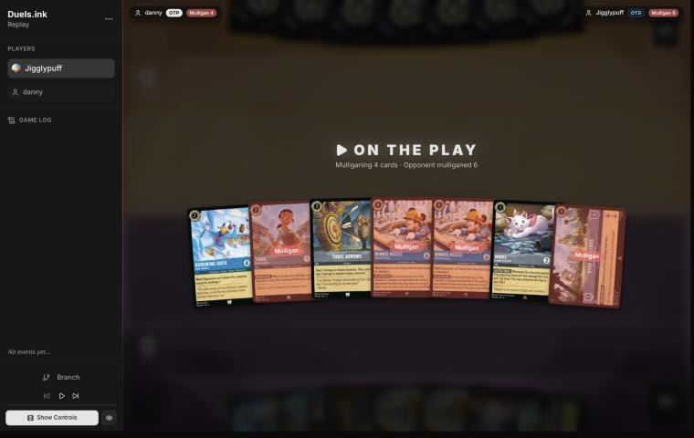
*The board before the decision: [step 0](https://duels.ink/replay/01a1a79c-95c7-7eea-ad5e-92d0f39a9f49?step=0) in the duels.ink replay viewer.*

**What you did:** on the play. Kept Marie – Caught in the Act, Darkwing Duck – Drake Mallard and Three Arrows; sent
back Tiana – Restauranteur, Khan Industries and both Minnies.

**Verdict:** close call. The seven had a play every turn (Marie, Drake or Tiana, Three Arrows) and every card was
inkable, but no ramp piece (Priscilla, Dream Come True) and two 8-drops. `tools/mulligan.py` (1,500 deals):

| Option | Ink T1–4 | Play turns | Lore by T4 | Characters by T4 |
|---|---|---|---|---|
| Keep 7 | 9.63 | 4.00 | 5.7 | 3.6 |
| Send back one Minnie (keep 6) | 9.65 | 3.99 | 6.0 | 3.8 |
| Send back both Minnies (keep 5) | 9.57 | 3.98 | 6.3 | 4.1 |
| **As played** (keep Marie, Drake, Three Arrows) | 9.37 | 3.95 | 6.4 | 3.9 |
| Full mulligan | 8.66 | 3.45 | 4.7 | 3.0 |

Every option but the full mulligan is within a few tenths. The real trade is in card quality the sim can't see. Your
mulligan digs for Priscilla and Dream Come True (8 copies) and sends back Khan Industries, which against the 26%
Remember Merida is lore their Storms can't reach, though against Midrange it's a closer that comes later ([the
list's notes](#cite-kb-meta-archetypes-sapphire-steel-big-ramp-with-the-darkwing-package-how-to-play-it)). Keeping
Khan or one Minnie would have been as good; nothing here is a mistake. Principles: [MULL-1](#cite-mull-1), [MULL-2](#cite-mull-2). Confidence: medium.

### Turn 1: your turn 1

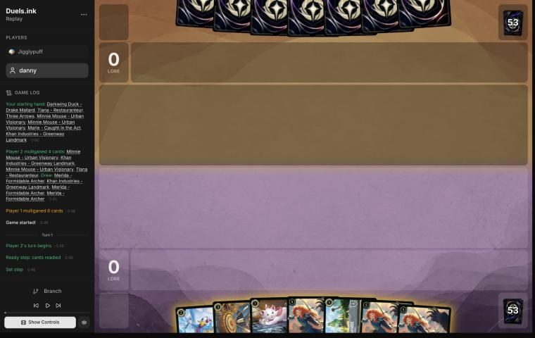
*The board before the decision: [step 3](https://duels.ink/replay/01a1a79c-95c7-7eea-ad5e-92d0f39a9f49?step=3) in the duels.ink replay viewer.*

**What you did:** the redraw brought three Merida – Formidable Archers (uninkable) and a Khan Industries. Inked Khan
Industries, played Marie.

**Verdict:** good play. With three uninkable Meridas, ink is the hand's constraint: only Drake, Three Arrows, Marie
and Khan can be inked, and Merida needs 5. Khan is the card the hand needs least for the next four turns, and Marie
and Drake are the curve.

### Turn 2: their turn

**What happened:** they had mulliganed 6 cards. They inked one Besties, Assemble! and cast another, which looked at their top 4 and **revealed
Demona – Scourge of the Wyvern Clan into their hand**. From here she's a known card: her exert-all comes at 6 ink
(game turn 12 on curve, a turn earlier with Hamm's LOOSE CHANGE or an ink drop). Besties is in duels.ink's Midrange
list.

### Turn 3: your turn 2

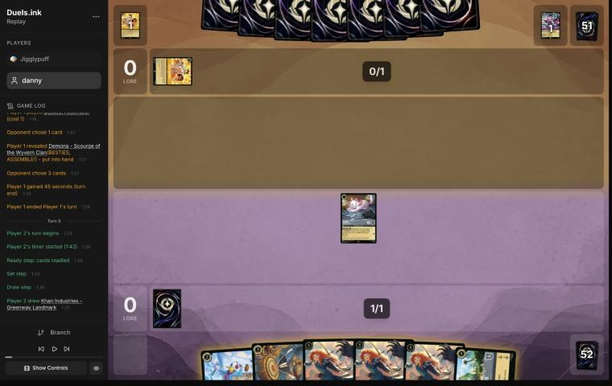
*The board before the decision: [step 11](https://duels.ink/replay/01a1a79c-95c7-7eea-ad5e-92d0f39a9f49?step=11) in the duels.ink replay viewer.*

**What you did:** drew a second Khan Industries. Quested Marie (1), inked Khan Industries, played Drake Mallard.

**Verdict:** good play. Their board was empty, so Marie's quest exposed nothing. The second Khan is again the card
the next turns need least, and Drake (4 {S}, Ward) is the body their chosen removal can't touch.

### Turn 5: your turn 3

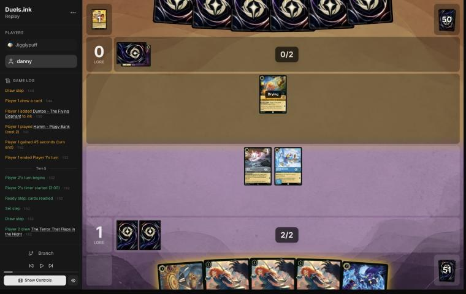
*The board before the decision: [step 18](https://duels.ink/replay/01a1a79c-95c7-7eea-ad5e-92d0f39a9f49?step=18) in the duels.ink replay viewer.*

**What you did:** drew The Terror That Flaps in the Night. Inked it, cast Three Arrows on Hamm – Piggy Bank (2
damage, 1 willpower left, nothing for the second arrow), quested Marie (an ink drop) and Drake.

**Setup:** they had played Hamm on turn 4. His LOOSE CHANGE ({E}: the next character costs 1 less) brings their 4-drops
(Isis, Tigger, Merlin) to next turn's 3 ink, and the **known Scourge to game turn 10** instead of 12. Your hand was
Three Arrows, Terror and three uninkable Meridas, so whichever spell you kept was inked. The candidates:
- **A. Ink Three Arrows, Terror on Hamm** (3 damage with a Darkwing in play): Hamm dies, Scourge back to turn 12.
  Terror goes to the discard, where nothing returns it, and Three Arrows is gone for good.
- **B. Ink Terror, Three Arrows on Hamm (played):** Hamm survives on 1 willpower, but Arrows sits in the discard for
  each Merida's FULL QUIVER to return, and with a Merida in play it deals 4 and 3 (STEADY AIM).

Both quest Marie after the damage for a drop, so a fourth ink next turn makes 5 and Merida comes on turn 7.

**Verdict:** good play. B keeps a removal spell you can replay with each of three Meridas, which [your list's
notes](#cite-kb-meta-archetypes-sapphire-steel-big-ramp-with-the-darkwing-package-how-to-play-it) recommend when the
Arrows' damage already does its job; here it doesn't quite, and that's the cost. Hamm lives a turn, so a 4-drop at 3
ink is possible next turn, and Scourge on 10 if he survives. But Hamm on 1 willpower dies to the next ping, and B
turns three Meridas into three more removal spells ([CARD-1](#cite-card-1)). Questing both exposed Marie and Drake to a Hamm trade
(2 {S} kills either, and Hamm dies to the damage back) and to Demona – Imperious Spellcaster's Rush (about 11%). Even
trades with a cost reducer you want dead anyway. Principles: [CARD-1](#cite-card-1), [SEQ-4](#cite-seq-4), [THREAT-3](#cite-threat-3). Confidence: medium.

### Turn 7: your turn 4

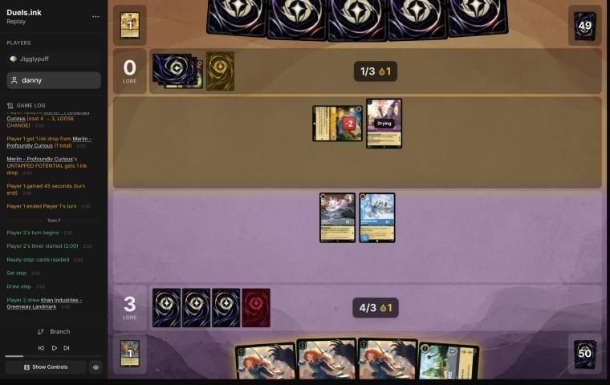
*The board before the decision: [step 29](https://duels.ink/replay/01a1a79c-95c7-7eea-ad5e-92d0f39a9f49?step=29) in the duels.ink replay viewer.*

**What you did:** drew a third Khan Industries. Inked it, played Merida (4 ink and the drop), which returned Three
Arrows, challenged the exerted Hamm with Marie (both died), quested Drake.

**Setup:** on turn 6 they used LOOSE CHANGE for Merlin – Profoundly Curious, whose UNTAPPED POTENTIAL gave them an ink
drop. So next turn they have 4 ink and a drop, and **with Hamm alive the known Scourge costs exactly that** (the
brief's cost-reducer line). She'd exert your board for Merlin to kill one of Marie and Drake. Hamm was exerted on 1
willpower, and only a challenge could reach him this turn: the Arrows were in the discard until Merida returned them,
with no ink left to cast them.

**Verdict:** good play. Trading Marie for Hamm costs a 1-drop either way (Scourge plus Merlin would have taken one),
but it also kills their cost reducer and moves Scourge from turn 8 to turn 10, a turn in which Merida can cast the
Arrows for 4 and 3. Marie was the right one to trade: Drake keeps Ward against Isis, Tigger and Hades, and keeps
Terror at 3. Drake's quest leaves him open to Merlin (Merlin dies to his 4 back, a trade you'd take for a draw engine)
and to a Rush from Sven – Leaping Reindeer (about 22%). Principles: [THREAT-3](#cite-threat-3), [TRADE-3](#cite-trade-3), [SEQ-4](#cite-seq-4). Confidence: high.

### Turn 8: their turn

**What happened:** Mowgli – Man Cub saw your hand and made you discard a non-character card: Three Arrows was the only
one, so there was no choice. It's back in the discard, where your next Merida returns it. Merlin quested (0–4 → 2–4)
and drew, and they inked Ohana Means Family. Without Hamm, the 6-cost Scourge didn't come.

### Turn 9: your turn 5

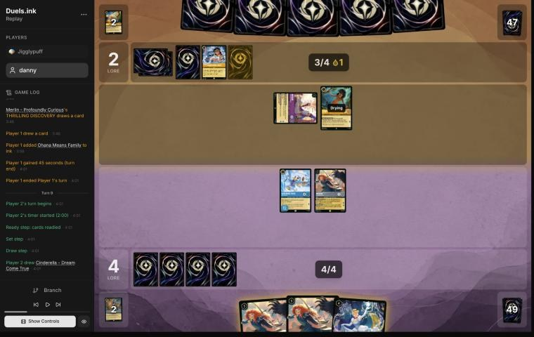
*The board before the decision: [step 41](https://duels.ink/replay/01a1a79c-95c7-7eea-ad5e-92d0f39a9f49?step=41) in the duels.ink replay viewer.*

**What you did:** drew Cinderella – Dream Come True, which left a hand of three uninkables (Merida ×2, Cinderella)
and no ink this turn. Played Cinderella, challenged the exerted Merlin with Merida (Merlin died, Merida took 2),
quested Drake. At the end of the turn Cinderella's WHATEVER YOU WISH FOR put a Merida into the inkwell and drew
Marie.

**Setup:** next turn they have 5 ink and a drop, exactly the known Scourge's 6. She exerts your whole board (Ward
doesn't stop it), and then their dry characters challenge. Merlin was their draw engine and 2-lore quester, and
exerted.

**Verdict:** good play. Merida kills Merlin for free ([TRADE-2](#cite-trade-2)), which also takes the 2 {S} challenger away from the
Scourge turn, leaving Mowgli's 1 {S}: it can kill Drake but not the damaged Merida (3 willpower left) or Cinderella.
Since Scourge exerts everything anyway, Drake's quest costs nothing extra. Cinderella's trigger counts herself as
the Princess played, and turns an uninkable Merida into the fifth ink ([the Dream Come True ruling](#cite-kb-rules-rulings-cinderella-dream-come-true-can-ink-an-uninkable-card)),
keeping one Merida to return the Arrows next turn. Principles: [TRADE-2](#cite-trade-2), [QC-2](#cite-qc-2). Confidence: high.

*Revisited after turn 10, from turn 9's information only:* the setup above missed one challenger. Demona – Imperious
Spellcaster (3, held about 12% after their draw) can discard a card to give herself Rush, and her 4 {S} kills a
Merida left on 3 willpower; an undamaged Merida (5) survives her. So the challenge on Merlin carried about a 12% risk
of losing Merida. The verdict stands: a free kill of a 2-lore draw engine is worth that, and the alternatives
(Drake trading into Merlin, or no kill) gave up more for certain. Logged in [the coach's errors](#the-coachs-errors).

### Turn 10: their turn

**What happened:** they inked Tigger and didn't cast Scourge. Instead Demona – Imperious Spellcaster discarded Luisa
– Confident Climber to give herself Rush and Evasive and challenged the damaged Merida (both died), and Mowgli traded
with Drake. They still hold Scourge, now with 6 ink and a drop next turn.

### Turn 11: your turn 6

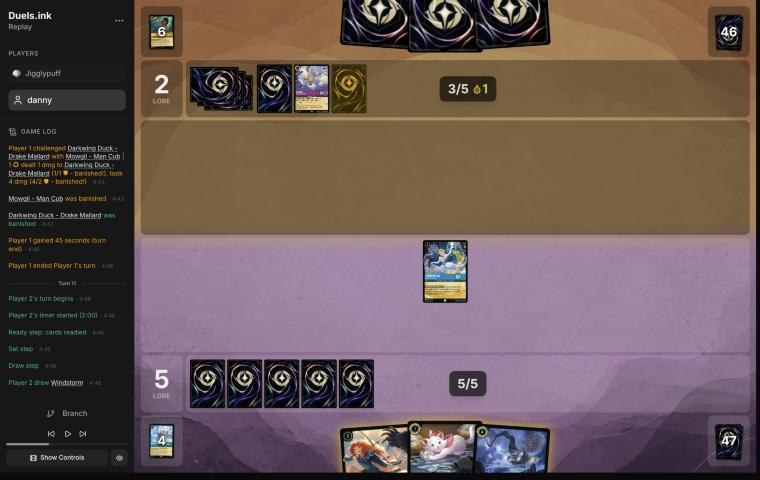
*The board before the decision: [step 54](https://duels.ink/replay/01a1a79c-95c7-7eea-ad5e-92d0f39a9f49?step=54) in the duels.ink replay viewer.*

**What you did:** drew Windstorm. Played Merida, which returned Three Arrows, and quested Cinderella. You made no ink
this turn; at the end of it Cinderella (a Princess was played) put Marie into the inkwell and drew Minnie.

**Setup:** their board was empty, and they held 3 cards, one of them the known Scourge, with 7 next turn (6 ink and the
drop). Scourge exerts your board, but nothing of theirs could challenge it that turn: they have no characters in
play, and with 6 spent on her only 1 ink is left, too little for Sven's Rush. On your next turn she'll be ready, so
only actions reach her: with Merida in play, Three Arrows deals 4 and Windstorm 3, which together kill her (6
willpower) for 7 ink. So Merida had to land and both spells had to stay in hand. The coach's plan was to ink Marie
with the turn's ink and leave 1 ink unspent.

**Verdict:** good play, and better than the coach's plan. Both lines end with 6 ink and both spells in hand, but
yours spends Marie through Cinderella's trigger instead of the ink action, so it also draws a card (Minnie). The
1 ink the coach's line kept had no use. You go into their Scourge turn holding 3 cards, so her refill gives you none,
but the card came now and doesn't depend on her being cast. Cinderella's quest exposed her to nothing that could
kill her. Principles: [SEQ-4](#cite-seq-4), [CARD-1](#cite-card-1). Confidence: high.

### Turn 12: their turn

**What happened:** still no Scourge. They played Ursula – Whisper of Vanessa (5, 4/5/2) and Boosted her, so with a card
under her she quests for 3 and has Evasive. They inked Hamm.

### Turn 13: your turn 7

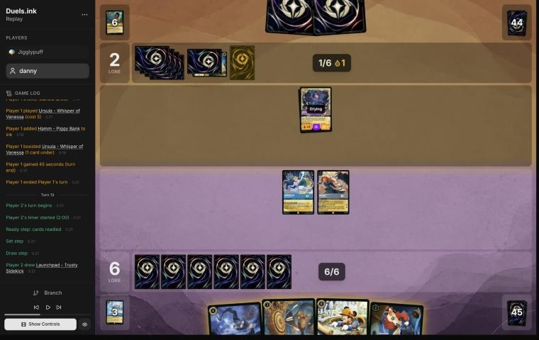
*The board before the decision: [step 64](https://duels.ink/replay/01a1a79c-95c7-7eea-ad5e-92d0f39a9f49?step=64) in the duels.ink replay viewer.*

**What you did:** drew Launchpad (uninkable). Cast Windstorm, which with STEADY AIM killed Ursula (Grandmother Willow
was under her), played Launchpad, quested Cinderella and Merida (6–2 → 9–2). No ink this turn, so you stayed on 6
with Three Arrows and Minnie in hand.

**Setup:** Ursula with a card under her quests for 3 and is Evasive, and you had nothing Evasive or Alert to
challenge her, so only actions reach her. Windstorm with Merida deals her 7 (1 and 2, plus 2 for each), past her 5;
Three Arrows deals 4. Their next turn has 8 with the drop: the known Scourge plus 2. With Ursula gone they'd have no
character to challenge whatever she exerts, and Sven's Rush (9%) is 2 {S}, which kills nothing of yours. So the quests
were free.

**Verdict:** good play on the turn, and a close call on the ink.
- **Windstorm on Ursula** was the only way to stop a 3-lore Evasive quester ([THREAT-1](#cite-threat-1)), and kept Arrows.
- **The ink:** inking Three Arrows would have made 7 now and, with almost any inkable draw, 8 next turn for Minnie
  (Ward, 3 lore). Keeping it means 7 next turn and Minnie on turn 17. With Scourge about to land, her refill makes an
  inked card cheap: you'd hold 1 card and draw 2 instead of 1 ([Facing her](#cite-kb-cards-demona-scourge-of-the-wyvern-clan-facing-her)).
  But that only holds for cards no better than a random draw ([H-1](#cite-h-1)), and Three Arrows with Merida in play (4 and 3) is
  better than that. The 7-ink turn still has strong plays (an Icon Shifted onto Cinderella, Finest, Tiana – Party
  Hostess), so neither line is clearly ahead. Principles: [INK-1](#cite-ink-1), [INK-3](#cite-ink-3), [H-1](#cite-h-1). Confidence: medium.

### Turn 14: their turn

**What happened:** Raging Storm (8, with the drop) banished Cinderella, Merida and Launchpad. Duels.ink's Midrange
list runs one copy: it was about 7% to be in their hand after the draw. They still hold Scourge and one other card.
At 9–2, both boards are empty.

### Turn 15: your turn 8

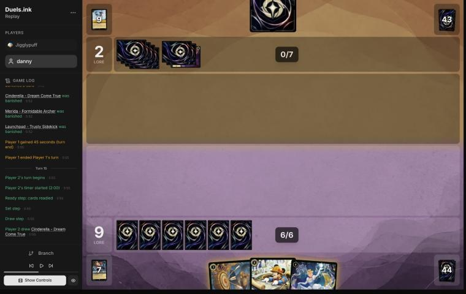
*The board before the decision: [step 72](https://duels.ink/replay/01a1a79c-95c7-7eea-ad5e-92d0f39a9f49?step=72) in the duels.ink replay viewer.*

**What you did:** drew a second Cinderella – Dream Come True. Played her, made no ink, and at the end of the turn her
trigger put Three Arrows into the inkwell and drew Tiana – Restauranteur.

**Setup:** their only card in hand was the known Scourge, with 8 ink next turn. Your Meridas were gone, so Three
Arrows was back to 2 and 1 damage: no answer to a 6-willpower Scourge. Minnie needs 8 ink, two turns away whatever you
did.

**Verdict:** good play, the same trick as on [turn 11](#turn-11). Inking Three Arrows with the turn's ink and leaving
the trigger unused ends on the same 7 ink; inking it through the trigger also draws a card. The only other card for
the trigger was Minnie, your 3-lore Ward finisher, and keeping her was right. Cinderella alone on the board risks
little: Scourge would exert her, but they have no characters to challenge with. Principles: [CARD-1](#cite-card-1), [INK-2](#cite-ink-2). Confidence:
high.

### Turn 16: their turn

**What happened:** Scourge at last. She exerted Cinderella, and her refill drew them 2 and you 1 (Tiana – Party
Hostess). They inked Hades and played Merlin's Shop and Smithy (a character moving there draws a card and gains 1
lore, once a turn). They hold 1 card, so STONE BY DAY won't stop Scourge readying.

### Turn 17: your turn 9

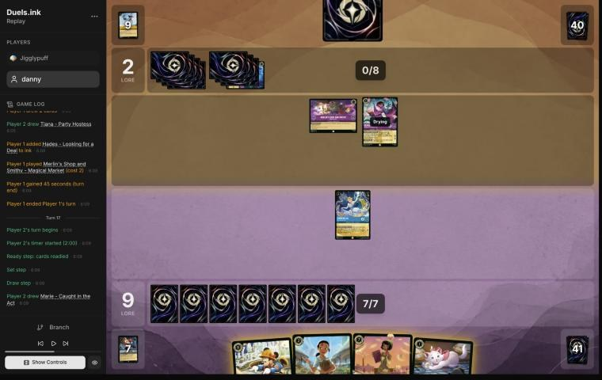
*The board before the decision: [step 79](https://duels.ink/replay/01a1a79c-95c7-7eea-ad5e-92d0f39a9f49?step=79) in the duels.ink replay viewer.*

**What you did:** drew Marie. Inked her and played Minnie (8). Cinderella stayed ready.

**Setup:** Scourge (5/6/2) was drying, so nothing could challenge her this turn, and you had no damage action. On
their turn she can challenge anything you leave exerted: her 5 kills Cinderella (3), Tiana – Restauranteur (4) or a
Tiana – Party Hostess (5), but not Minnie (6), whose 6 back would kill her. Their hand was 1 card plus the draw (Gaston
about 27%, a second Scourge 14%). Gaston and Hades need a chosen target, so they can't touch Minnie (Ward), and
Gaston's 5-{S} line misses Tiana (4). The candidates:
- **A. Ink Marie, Minnie (played).** Next turn: both Tianas (Restauranteur, then Party Hostess Shifted onto her for
  5), which also fires Cinderella's trigger.
- **B. Ink Marie, Tiana – Restauranteur, then Party Hostess Shifted onto her** (7 of 8 ink): 3 cards drawn and 2
  discarded, a free Khan Industries if one is drawn, and Cinderella's trigger tonight. Minnie the turn after.

**Verdict:** good play. Both lines make the same plays over two turns, but A puts down first the one card that beats
Scourge. From turn 19 Minnie can quest without fear of her (a challenge would cost them Scourge), and she can kill
Scourge if Scourge exerts to quest. In B, Party Hostess can't quest while Scourge lives, and Minnie arrives too late
to challenge on 19. B's earlier cards are the price, and a small one at 9–2 with their hand nearly empty ([POS-1](#cite-pos-1)).
Keeping Cinderella ready was right: a quest would have handed Scourge a free kill of your ramp engine. Principles:
[POS-1](#cite-pos-1), [THREAT-1](#cite-threat-1), [RULE-1](#cite-rule-1). Confidence: medium.

### Turn 18: their turn

**What happened:** a second Scourge (about 19% after their draws) exerted Minnie and Cinderella. Her refill drew
them 2 and you 1 (a third Cinderella – Dream Come True). The first Scourge moved to the Shop (a card and 1 lore, 3–9),
then challenged and killed Cinderella, taking 2. They inked Hamm and played Luisa Madrigal – Pushing Through (0/3,
Challenger 2). Minnie, on 6 willpower, was left alone: Scourge's 5 wouldn't kill her.

### Turn 19: your turn 10

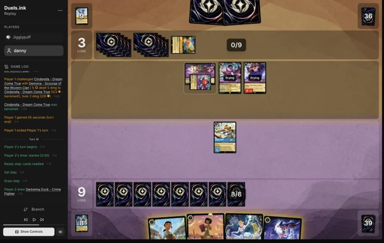
*The board before the decision: [step 90](https://duels.ink/replay/01a1a79c-95c7-7eea-ad5e-92d0f39a9f49?step=90) in the duels.ink replay viewer.*

**What you did:** drew Darkwing Duck – Crime Fighter. Minnie challenged Merlin's Shop and Smithy and banished it
(locations deal no damage back). You played Cinderella and Crime Fighter and made no ink with the turn action
(you inked Tiana – Restauranteur, then undid it). At the end of the turn, Minnie's ALL BY DESIGN returned Khan
Industries from the inkwell to your hand, and Cinderella's trigger inked Tiana – Restauranteur and drew Drake Mallard.

**Setup:** at 9–3 they had both Scourges (one exerted at the Shop with 2 damage, 4 willpower left) and Luisa –
Pushing Through (Challenger 2), and 10 ink next turn. Whatever Minnie did, she'd end the turn exerted, but her 6 back
kills anything that challenges her, so killing her costs them two characters (only a Shifted Luisa – Confident
Climber, about 11%, does it alone, and dies doing it). Your new characters would all be drying and ready, out of
reach. Minnie's choices:
- **Quest:** 3 lore.
- **The Shop:** no damage taken; removes their card and lore each turn (2 ink a move).
- **The damaged Scourge:** kills a 2-lore quester, but leaves Minnie on 1 willpower for Luisa to finish.

For the rest of the turn, the coach's plan was Tiana – Restauranteur, then Tiana – Party Hostess Shifted onto her (3
cards seen, 2 discarded), then Crime Fighter, with the turn's ink after the draws ([SEQ-1](#cite-seq-1)): 8 of 9 ink spent, and
Party Hostess on the board.

**Verdict:** close call, with the Shop a good choice.
- **Minnie on the Shop** keeps her undamaged, so the deterrent stays, and a card and a lore each turn for the rest
  of the game is worth more than 3 lore once ([THREAT-2](#cite-threat-2)). Killing the damaged Scourge would have cost Minnie.
- **Cinderella and Crime Fighter instead of the two Tianas** spends 5 of 8 ink and keeps Party Hostess in hand, which
  holds a 7-drop back from a third Scourge (they'd kill whatever it exerts) and keeps your hand at 3. ALL BY DESIGN
  then gives you Khan Industries for next turn, where Minnie can't be challenged. The coach's line has 2 more lore a
  turn on the board from turn 21 and sees more cards. From 9–3 the safer line is defensible ([POS-1](#cite-pos-1), [H-2](#cite-h-2)), so neither
  is clearly better. Using Cinderella's trigger rather than the ink action for Tiana – Restauranteur drew a card, as on
  [turn 11](#turn-11). Principles: [THREAT-2](#cite-threat-2), [POS-1](#cite-pos-1), [SEQ-1](#cite-seq-1), [H-2](#cite-h-2). Confidence: low.

### Turn 20: their turn

**What happened:** a second Shop, then a **third** Scourge (about 11%), which exerted Cinderella and Crime Fighter and
drew them 3. Luisa killed Crime Fighter, the damaged Scourge killed Cinderella (now 4 damage on her), and another
Scourge quested (5–9). They added Rafiki – Mystical Fighter (Challenger 3) and a second Luisa. Nothing challenged
Minnie.

### Turn 21: your turn 11

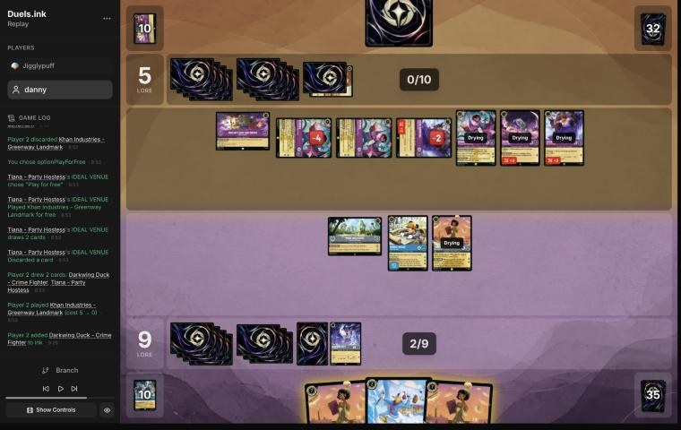
*The board before the decision: [step 115](https://duels.ink/replay/01a1a79c-95c7-7eea-ad5e-92d0f39a9f49?step=115) in the duels.ink replay viewer.*

**What you did:** drew a second Tiana – Party Hostess. Hard-cast Party Hostess (7): IDEAL VENUE drew Crime Fighter and
a third Party Hostess, and you discarded Khan Industries to play it free. Then you inked Crime Fighter, moved Minnie to
Khan Industries (2) and quested with her (9–5 → 12–5). Drake stayed in hand. At the end of the turn, ALL BY DESIGN
returned a second Khan Industries from the inkwell.

**Setup:** the race had turned. Their board was three Scourges (one on 2 willpower left), two Luisas (one on 1 left)
and Rafiki, all dry by their turn: 9 lore a turn, 10 with a Shop move. From 5 that's 20 on turn 24, two turns of
questing (`tools/odds.py clock 5 10`). Their hand was 1 card, and 3 after the draw and the Shop's. You were at 12 with
8 ink and Party Hostess ×2, Khan Industries and Drake in hand. So **you had to make 20 on turn 23**, or cut their board
hard enough on turn 23 to stop them on turn 24. Party Hostess discarding Khan for free is the engine of every line,
since Khan's 2 comes at your Set step on turn 23. The candidates, all with Party Hostess and Khan:
- **A. Move Minnie to Khan and quest (played).** Minnie can't be challenged at Khan, and to reach her they must first
  destroy Khan (8 willpower, two Scourges). But turn 23 makes at most 19: Khan 2, Minnie 3, Party Hostess 2. If they
  just quest on turn 22 they reach 15, and need 5 on turn 24. On turn 23 Minnie and Party Hostess can kill two
  characters at most (two Scourges, −4), leaving them 6 even before any new character. They win without having to
  answer anything.
- **B. Drake instead of the move, Minnie quests where she is.** Turn 23 then makes exactly 20: Khan 2, Minnie 3,
  Party Hostess 2, Drake 1 (`tools/odds.py clock 12 8`). They must spend turn 22 stopping it:
  - two of their characters to kill Minnie (her 6 back kills each)
  - or two Scourges to destroy Khan
  - or Isis (26%) to exert Party Hostess for a Scourge
  
  Each costs them quests. They still win on turn 24 only if they also add new lore (a character played on turn 22),
  or you fail to cut their board on turn 23.
- **C. Minnie kills the undamaged Scourge, then moves to Khan** (moving needs no ready character). Their board drops
  to 8 a turn, and Minnie (1 willpower left) is out of reach at Khan.

**ALL BY DESIGN:** the second Khan Industries pays 2 at your turn-25 Set step, after the turn-24 finish this race is
about. Three Arrows was in the inkwell too, and it kills both of their damaged characters next turn (the Scourge on 2
left and Luisa on 1), 3 lore a turn off their board.

**Verdict:** mistake. Moving Minnie to Khan Industries is suboptimal because it caps turn 23 at 19 lore, so a plain
race from their existing board wins them the game on turn 24 whatever you do on turn 23. Drake instead of the move
is better because it threatens 20 on turn 23, so they must spend characters or a Scourge pair answering it, and then
need more lore from new cards to finish on turn 24. B leaves Minnie exerted and in reach of two challengers, and
Party Hostess and Drake ready (Ward keeps Drake safe from their chosen removal; only a fourth Scourge, about 9%,
reaches him). A protects your best character but doesn't win the race. Taking back Three Arrows rather than Khan
with ALL BY DESIGN would have helped every line. The coach can't be sure B wins either: it depends on what their 3 cards
add. Principles: [QC-5](#cite-qc-5), [WIN-1](#cite-win-1), [POS-2](#cite-pos-2). Confidence: low (a long race, and their hand decides it).

### Turn 22: their turn

**What happened:** they found more than their board. Merlin – Profoundly Curious (an ink drop) and a Shop move (6), then
Lionheart – Incumbent Mayor (6, Bodyguard, entered exerted), whose APPROVAL RATING gave two Scourges +1 lore: they quested
for 3 each (12). The damaged Scourge and Rafiki destroyed Khan Industries (5 + 3 = 8), and both Luisas quested: 14–12.

### Turn 23: your turn 12

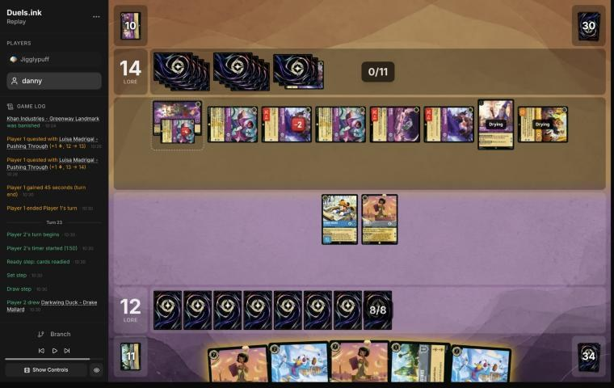
*The board before the decision: [step 133](https://duels.ink/replay/01a1a79c-95c7-7eea-ad5e-92d0f39a9f49?step=133) in the duels.ink replay viewer.*

**What you did:** drew a second Drake. Hard-cast the second Party Hostess, discarded Khan Industries to play it free,
and drew Priscilla and He Hurled His Thunderbolt. Inked Drake, played the other Drake, sang Thunderbolt with the
first Party Hostess to kill Merlin, and quested Minnie (15–14). ALL BY DESIGN returned a Khan Industries.

**Verdict:** unwinnable from here ([principle 2](#cite-principle-2)). At 14 they needed 6, and their board quested for 13 plus a Shop
move: three Scourges, Lionheart (2 each), Merlin (2), two Luisas and Rafiki. Your best turn made 17 (Minnie and Party
Hostess). Lionheart's Bodyguard, exerted, meant every challenge had to go into her first, and nothing you had could
kill her 7 willpower. No line kept them under 20.

### Turn 24: their turn

**What happened:** a Shop move (15), Grandmother Willow, The Horseman Strikes! and Gaston (nothing to banish), then two
Scourges and a Luisa quested: 20–15.

## Lessons
1. **Count the race before you protect** ([turn 21](#turn-21)). When their board makes 20 in two turns, a line that
   caps your next turn below 20 also has to stop their board, and one turn of challenges can't stop a wide one.
   Threatening 20 makes them spend their turn on an answer instead ([QC-5](#cite-qc-5), [POS-2](#cite-pos-2)).
2. **Cinderella – Dream Come True's trigger is a free draw on the ink you'd make anyway** ([11](#turn-11),
   [15](#turn-15), [19](#turn-19)). On a turn you play a Princess (she counts herself), skip the ink action and ink
   through her trigger: the same card goes in, and you draw.
3. **Kill the cost reducer that brings a known threat early** ([turn 7](#turn-7)). Marie for Hamm moved the known
   Scourge from turn 8 to turn 10, a turn when Merida could deal with what came.
4. **What Minnie's ALL BY DESIGN returns depends on how long the game has left** ([turn 21](#turn-21)). A second Khan
   Industries pays at a Set step two turns away; Three Arrows killed two damaged questers the next turn.

## Knowledge-base updates (applied, commit 649c00e)
- **Meta:** a Jigglypuff section in the Amber/Amethyst notes: their Midrange list as seen, three Scourges in four
  turns, Lionheart's APPROVAL RATING making two Scourges 3-lore questers on turn 22, and Khan Industries destroyed by a
  Scourge and Rafiki (5 + 3 = 8). A row in the meta index.
- **Your list's notes** (Big Ramp, coaching points):
  - ink through Cinderella – Dream Come True's trigger rather than the ink action on a turn it fires (lesson 2)
  - Khan Industries protects its characters only while it stands: 8 willpower, and its characters stay in play when
    it goes ([CR 5.6.6](#cite-cr-5-6-6)). Moving costs only ink, so a character can quest or challenge and then move there ([CR 4.7.3](#cite-cr-4-7-3)).
- **Rules:** the Dream Come True ruling now says she counts herself as the Princess played. Her "if" is checked when
  the trigger resolves ([CR 6.2.4](#cite-cr-6-2-4)), and it fired on turns 9 and 15 with her the only Princess.
- **Strategy:** none new; turn 21 is one more case for [QC-5](#cite-qc-5).

## Hindsight
Doesn't change the verdicts above.
- **Their draws:** the redraw brought you three uninkable Meridas, and they found three Scourges, a Raging Storm,
  Lionheart and two Shops. Scourge's refills drew them 7 cards in all.
- **Turn 21, with their actual hand** (Merlin, a Luisa and Lionheart came on turn 22): the coach's line B would
  probably have lost too. They could kill Minnie with the damaged Scourge and Rafiki (5 + 3; both die to her 6 back),
  then quest two Scourges at 3 each with Lionheart, both Luisas and a Shop move to reach 14. You'd make 17 on turn 23,
  and their board would quest for 9 or more on turn 24. So by turn 21 the game was probably lost to this hand, though
  not from what you could know.
- **Turn 9:** Imperious came on turn 10 and killed the damaged Merida, the 12% risk the revisited verdict describes.

## The coach's errors
Filled in during discussion.

| When | Error | How it was caught | How it won't happen again |
|---|---|---|---|
| [Turn 9](#turn-9) | The setup said only Mowgli could reach your board next turn, and that the damaged Merida (3 willpower left) was safe. Demona – Imperious Spellcaster (12%) can give herself Rush and Evasive with IMPETUS, since she's a Gargoyle, and her 4 {S} kills that Merida. The brief listed her as a "combat" card but left her out of "Challenges the turn it lands" | Turn 10's brief: she did exactly that | **Done (5 Nov 2026):** the brief's "Challenges the turn it lands" now counts a card whose own ability can choose it to gain Rush ("Chosen Gargoyle character gains Rush" on a Gargoyle), naming the ability's cost (here a discard) and the Evasive that comes with it. It leaves out abilities that exert the card or trigger on its quest or challenge, which it can't make the turn it's played. This turn's brief now lists Imperious with 4 {S}, and a regression test reproduces it |

## Open questions
- **Turn 21:** did you weigh Drake (exactly 20 on turn 23) against moving Minnie to Khan? What did you expect them to
  do on turn 22?
- **Turn 21:** why the second Khan Industries over Three Arrows with ALL BY DESIGN?
- **Turn 19:** was holding Party Hostess about a third Scourge, or something else?
- **Turn 13:** was skipping the ink about keeping both Three Arrows and Minnie?

## Citations
Copies of the coach's knowledge base cited above, as they stood when they were cited (the private repository's commit and date are given with each). They don't change when the knowledge base does.

**MULL-1**: strategy principle, `kb/strategy/principles.md` at `649c00e` (2026-11-04), working tree

> - **MULL-1. Keep a plan, not the strongest cards.** *Ask: "Which hand gives me the best chance to execute my game plan in this matchup?"* `[MCL ch.12]` · baseline

**MULL-2**: strategy principle, `kb/strategy/principles.md` at `649c00e` (2026-11-04), working tree

> - **MULL-2. A smooth curve beats a few powerful cards.** Check that you can spend ink well on turns 1–4, have enough inkable cards, and know what turn 4 looks like. `[MCL ch.12]` · baseline
>   - **Ink spent isn't the goal by itself.** Judge a keep by a nice curve (a play each turn), early lore pressure, and
>     interaction that sets the opponent back, as well as by ink, then weigh card quality and the matchup
>     (user, 2026-11-01). `tools/mulligan.py` reports all of these.

**CARD-1**: strategy principle, `kb/strategy/principles.md` at `649c00e` (2026-11-04), working tree

> - **CARD-1. Card advantage is having more meaningful options than the opponent.** Ways to get it:
>   - 2-for-1 trades, and removal that hits two targets
>   - characters that survive several challenges
>   - recursion
>   - cards that replace themselves
>   - discard
>
>   *Ask after each exchange: "Who has more useful resources left?"* `[MCL ch.2]` · baseline

**SEQ-4**: strategy principle, `kb/strategy/principles.md` at `649c00e` (2026-11-04), working tree

> - **SEQ-4. Sequence across turns.** A slightly weaker play now can set up a much stronger next turn: keep a shift target alive, keep a singer ready, hold removal for a bigger threat. `[MCL ch.5]` · baseline

**THREAT-3**: strategy principle, `kb/strategy/principles.md` at `649c00e` (2026-11-04), working tree

> - **THREAT-3. The biggest threat may not be on the board yet.** Consider:
>   - the opponent's ink next turn
>   - shift targets already in play
>   - support pieces that enable their next turn
>
>   `[MCL ch.9]` · baseline

**TRADE-3**: strategy principle, `kb/strategy/principles.md` at `649c00e` (2026-11-04), working tree

> - **TRADE-3. Losing a character can be right** if it removes something more important. Characters are resources. `[MCL ch.7]` · baseline

**TRADE-2**: strategy principle, `kb/strategy/principles.md` at `649c00e` (2026-11-04), working tree

> - **TRADE-2. The best trade removes theirs and keeps yours.** A survivor keeps generating value and demands more answers. `[MCL ch.7]` · baseline

**QC-2**: strategy principle, `kb/strategy/principles.md` at `649c00e` (2026-11-04), working tree

> - **QC-2. Challenge the threat, not the character.** Engines, synergy pieces and big questers are worth fighting over. A 1-lore character doing nothing usually isn't. *Ask: "Does this character actually need to be removed?"* `[MCL ch.6, ch.9]` · baseline

**THREAT-1**: strategy principle, `kb/strategy/principles.md` at `649c00e` (2026-11-04), working tree

> - **THREAT-1. Not every threat needs an answer.** *Ask: "What happens if I don't answer this?"* "Very little" means spend resources elsewhere. "I probably lose" means it's the priority. `[MCL ch.9]` · baseline

**INK-1**: strategy principle, `kb/strategy/principles.md` at `649c00e` (2026-11-04), working tree

> - **INK-1. Inking is permanent.** Every inked card is one line of play removed for the rest of the game. *Ask: "Will I regret losing access to this card?"* `[MCL ch.4]` · baseline

**INK-3**: strategy principle, `kb/strategy/principles.md` at `649c00e` (2026-11-04), working tree

> - **INK-3. Usually ink every turn, but not automatically.** Keeping one more playable card can beat one more ink. Missing ink with an expensive hand can leave you permanently behind. `[MCL ch.4]` · baseline

**INK-2**: strategy principle, `kb/strategy/principles.md` at `649c00e` (2026-11-04), working tree

> - **INK-2. Don't automatically ink the most expensive card.** It may be the late-game win condition or the key answer for this matchup. The answer depends on matchup, hand and board. `[MCL ch.4]` · baseline

**POS-1**: strategy principle, `kb/strategy/principles.md` at `649c00e` (2026-11-04), working tree

> - **POS-1. From ahead, take the safest path to victory.** Don't overextend into sweepers, don't make unnecessary trades, and make the opponent take the risks. Winning by 1 lore counts the same as winning by 10. `[MCL ch.10]` · baseline

**RULE-1**: strategy principle, `kb/strategy/principles.md` at `649c00e` (2026-11-04), working tree

> - **RULE-1. Only exerted characters can be challenged** `[CR 4.6.4.2]`. Questing, singing, or {E} for an ability exposes the character. Staying ready protects it. Every quest is also a decision about what the opponent can challenge next turn. · baseline
>   - *Card text overrides this* (CR 1.2.1). Shere Khan – Khan Industries CEO's NEW INCENTIVE lets one character
>     challenge ready characters that turn. Alert (e.g. from Judy Hopps – Lead Detective, to every Detective on their
>     turn) ignores Evasive. Against Ducktectives, name both in the setup. 01a14574, turns 16 and 18. `[coach, 2026-10-26]`

**SEQ-1**: strategy principle, `kb/strategy/principles.md` at `649c00e` (2026-11-04), working tree

> - **SEQ-1. Gather information before irreversible decisions.** Draw, look and scry before choosing what to ink. Quest with draw triggers before committing other plays when the order doesn't otherwise matter. `[MCL ch.5]` · baseline

**THREAT-2**: strategy principle, `kb/strategy/principles.md` at `649c00e` (2026-11-04), working tree

> - **THREAT-2. Distinguish immediate threats (big lore next turn) from slow engines (card advantage over turns).** Role decides which matters more: the aggressor can often ignore engines, but the defender usually can't. `[MCL ch.9]` · baseline

**QC-5**: strategy principle, `kb/strategy/principles.md` at `649c00e` (2026-11-04), working tree

> - **QC-5. The race changes everything.** At 18–12 up, take the last 2 lore. At 8–16 down, stopping their close-out matters more than your quests. `[MCL ch.6]` · baseline

**WIN-1**: strategy principle, `kb/strategy/principles.md` at `649c00e` (2026-11-04), working tree

> - **WIN-1. Know your current win condition and the opponent's.** Plans change with draws and board. The question is "how do I win from here?", not "what was my deck supposed to do?". Preventing the opponent's win condition is often easier than recovering from it. `[MCL ch.11]` · baseline

**POS-2**: strategy principle, `kb/strategy/principles.md` at `649c00e` (2026-11-04), working tree

> - **POS-2. From behind, play to your outs and accept calculated risk.** Safe efficient play from a losing position loses slowly. A line with a 30% chance beats a line with 0%. *Ask: "What has to happen for me to win, and which play makes it most likely?"* `[MCL ch.10]` · baseline

**H-1**: hypothesis, `kb/strategy/hypotheses.md` at `649c00e` (2026-11-04), working tree

> ### H-1. Time hand-refill effects for when your hand naturally runs out
> - **Claim:** "Draw until you have N" effects (e.g. Demona – Scourge of the Wyvern Clan, refill to 3) are worth
>   most on the turn your hand empties. Playing one card per turn on the play, a 7-card hand empties around
>   turn 6, which is exactly when a 6-cost refill lands. So an inkable refill card is cheap to keep through a
>   mulligan: if the game goes differently, ink it.
> - **Why:**
>   - **Hand count when playing on curve, going first:** 7 cards; ink 1 and play 1 each turn, drawing from turn 2,
>     leaves 1 card after inking on turn 6.
>   - **Cost of keeping it, by simulation:** keeping Demona costs about 0.1 ink spent over turns 1–4, compared with
>     also mulliganing her.
> - **Caveats:**
>   - "Each player" refills, so the opponent also draws if below N. On the draw they hold one more card. The other
>     side of this, for the player facing her, is in `kb/cards/demona-scourge-of-the-wyvern-clan.md`.
>   - Demona's STONE BY DAY means she can't ready while you hold 3+ cards. After refilling to 3, you must be at ≤2
>     by your next Ready step, or she stays exerted (and challengeable) once she has quested or challenged.
>   - She's drying on the turn she's played, so her own exert-all opens the opponent's board to your *other* dry
>     characters only.
>   - Ink drops (Hyperia City) don't expire, so saved drops can bring the refill earlier than the bare count suggests.
>   - **The cap absorbs earlier card draw.** "Draw until 3" always ends at 3, so cards drawn beforehand (e.g. Junior
>     Woodchuck Guidebook) are borrowed from the refill rather than added to it. Pre-drawing buys timing, not
>     cards:
>     - earlier information
>     - a better ink choice
>     - being sure of an inkable card for the refill turn
>
>     Weigh that against what the same ink would otherwise buy, e.g. an earlier body. (User's correction,
>     2026-10-24: the coach had called this a cost of the draw without counting those gains.)
>   - The opponent's refill depends on *their* hand size when you cast it, not on your earlier choices. Check it
>     when deciding whether to cast now.
>   - **It needs your ink to reach 6 on time.** Hands with uninkable cards are short of ink, not cards, so a held
>     6-drop is rarely castable on turn 6.
>     - **01a139ad, pre-game:** an opening seven with two uninkables. Keeping Demona left her castable on turn 6
>       only ~16% of the time in simulation. Mulliganing her for a random card raised "turn 4 uses all ink" from
>       80% to 91%. In ink-short hands, the refill card is the one to send back.
>     - *This caveat is the coach's, from simulation; not yet discussed with the user.*
>   - **Against Amber/Sapphire**, Demona's 5 {S} makes her a target for Gaston – Superior Archer, Judy Hopps –
>     Always Vigilant and World's Greatest Criminal Mind (`kb/meta/archetypes/amber-sapphire.md`).
> - **Evidence for:**
>   - replay 01a14bf9 (vs Goop), 2026-10-24, pre-game: the user's mulligan reasoning.
>   - same game, turn 5: the user kept Cheshire as the bridge play on the way to Demona instead of playing an
>     extra 1-drop.
>   - same game, turn 9: Guidebook played and used before inking, which locked in an inkable card for Demona
>     on turn 11. The alternative, Cheshire plus Boost, had about a 16% chance (8 uninkables in 49 cards) of an
>     uninkable turn-11 draw blocking her.
>   - same game, turn 11 (agreed with the user): a second Cheshire instead of Boost would have developed the
>     board, used the ink better, and **emptied the hand to just Demona**. Her next-turn refill would then draw 3
>     instead of 1. The user's own summary of the lesson: develop the board and spend resources so the
>     refill draws as many cards as possible.
>   - same game, turn 13: with Demona due next turn, the user inked their spare Cheshire though that ink wasn't
>     needed. **Corollary:** when a refill is imminent, spare cards in hand are effectively free ink. The cap
>     replaces them, so inking them costs no cards and leaves Demona as the only card in hand.
>   - **Limit on that corollary** (same game, turn 15, agreed with the user): it's free in card *count* only. The cap
>     replaces the inked card with a *random* card. So it holds for cards no better than a random draw, but not
>     for engines or must-answer threats. Inking Dumbo – Ninth Wonder of the Universe (a draw-and-lore engine the
>     opponent has to answer, TEMPO-1) to top up Demona's refill from 2 to 3 was probably wrong. Better was to
>     cast Demona without inking, keep Dumbo for next turn, and accept 1 ink and 1 refill card less.
> - **Evidence against:** none yet.
> - **Status:** open.

**H-2**: hypothesis, `kb/strategy/hypotheses.md` at `649c00e` (2026-11-04), working tree

> ### H-2. Spare ink isn't automatically wasted when later turns will be short of cards
> - **Claim:** Ink grows by one every turn, but cards don't. Once later turns are likely to have more ink than
>   good cards to spend it on, cards are the scarcer resource. Then playing a low-impact card just to use spare
>   ink (giving up a better card to the inkwell instead) is usually worse than leaving the ink unspent.
> - **Applies when:** you're ahead on board (POS-1) and the extra play has little impact (WIN-2). Also when the
>   backup value of the extra card is low, e.g. a second Shift target when the opponent's removal can't hit the first.
> - **Doesn't apply when:** you're behind and need board presence now, or the cheap card has real impact.
> - **The converse, for the opponent:** extra cards are worth less to an opponent who already has a full hand and is
>   short of ink. When an effect offers "they draw 2 or you lose a body" (Hades – Looking for a Deal), keeping
>   the body is more attractive the more cards they already hold. Discard-payoff decks still get some fuel from
>   extra cards. Evidence: 01a139ad, turn 14. The opponent had 5 cards and 7 ink, and the user kept Isis
>   rather than bottoming her. Discussed 2026-10-26 and judged a close call.
> - **Evidence for:** replay 01a14bf9 (vs Goop), turn 5. The user left 1 ink unspent rather than ink Cheshire to
>   play a second Mulan – Injured Soldier. Coach first called it a close call, then agreed after the user's argument.
> - **Evidence against:** none yet.
> - **Status:** open.

**principle 2**: coaching principle, `CLAUDE.md` at `649c00e` (2026-11-04), working tree

> 2. **Some games are unwinnable.** Draws and matchups can make a game lost whatever the player does. Say so
>    when it's true, rather than inventing mistakes to explain a loss.

**CR 5.6.6**: Comprehensive Rules, `kb/rules/cr/05-cards-and-card-types.md` at `649c00e` (2026-11-04), working tree

> **5.6.6.** If there are characters at a location and that location leaves play, the characters remain in play and are no longer at a location.

**CR 4.7.3**: Comprehensive Rules, `kb/rules/cr/04-turn-actions.md` at `649c00e` (2026-11-04), working tree

> **4.7.3.** To move a character to a location, the active player follows the process listed below in order.

**CR 6.2.4**: Comprehensive Rules, `kb/rules/cr/06-abilities-effects-resolving.md` at `649c00e` (2026-11-04), working tree

> **6.2.4.** Some triggered abilities are written as “[Trigger Condition], if [Secondary Condition], [Effect].” Such an ability checks whether the secondary condition is true only when the effect resolves. If the condition is false, the ability resolves with no effect. If an ability has multiple “if [Secondary Conditions],” all of them are checked as the effect resolves.

**sapphire-steel.md, Big Ramp with the Darkwing package: how to play it**: knowledge base, `kb/meta/archetypes/sapphire-steel.md` at `649c00e` (2026-11-04), working tree

> ### Big Ramp with the Darkwing package: how to play it `[coach, study of stonks 📈's 22 games of 21 Oct 2026 (sent by the user), full games, not blind]`
> The user calls this list Sapphire/Steel Detectives, or Big Ramp. It matches duels.ink's "Big Ramp #1" (Windstorm,
> Minnie) with the Darkwing Detectives added. Games: `01a15f98` to `01a1602c` (22; see `kb/meta/index.md`). Card text
> verified with `tools/cards.py`. Also `01a15f8e` (vs MFork, game 2) and `01a16978` (vs AkatsukiCap, game 1).
> - **The list (60):**
>   - **1-drops:** Darkwing Duck – Crime Fighter ×4, Marie – Caught in the Act ×4
>   - **2-drops:** Darkwing Duck – Drake Mallard ×4 (Ward), Launchpad – Trusty Sidekick ×4, The Terror That Flaps in
>     the Night ×4
>   - **3–4:** Three Arrows ×4, Priscilla – Efficient Clerk ×3, Cinderella – Dream Come True ×4, He Hurled His
>     Thunderbolt ×2, Windstorm ×3
>   - **5–6:** Merida – Formidable Archer ×4, Khan Industries – Greenway Landmark ×4, Goliath – Clan Leader ×3
>   - **7–8:** Darkwing Duck & Launchpad – St. Canard's Finest ×4, Cinderella – Unintentional Icon ×2, Tiana – Party
>     Hostess ×4, Minnie Mouse – Urban Visionary ×3
> - **The plan:**
>   1. **Early removal** keeps their board small: Terror (3 damage while a Darkwing is in play), Three Arrows (2, then 1).
>      A Darkwing in play also makes Launchpad's draw free of the discard.
>   2. **Ramp:** Priscilla (enters exerted; each quest puts one of the top 2 into hand and the other into the inkwell,
>      2 lore), Cinderella – Dream Come True (at the end of a turn you played a Princess, ink a card from hand to draw),
>      Cinderella – Unintentional Icon (Shift 5 onto her; ramps one a turn, 3 lore), Marie (an ink drop when she quests
>      after an opposing character took damage). Ink at the start of its 5th turn was usually 5–6, and 8–9 by its 6th in the fastest games.
>   3. **The sweep: Merida, then Windstorm.** STEADY AIM adds 2 damage to every instance of action damage to an
>      opposing character, so Windstorm deals 3 to each (5 to an Evasive one): a 4- to 6-character wipe (01a1601c
>      turn 11: six Princess Aggro characters). Merida's FULL QUIVER also returns Three Arrows (then 4 and 3).
>   4. **Lore:** Khan Industries (2 a turn at their Set step; characters there can't be challenged, so Merida and
>      Priscilla move in), Merida 2, Priscilla 2, Cinderella – Unintentional Icon 3, Minnie 3, St. Canard's Finest 2
>      plus VICTORY POSE (+2 per banish in a challenge on its turn).
>   5. **Tiana – Party Hostess** (7): draw 2 and discard one; a discarded Khan Industries is played free (01a15fee,
>      01a15ff6, 01a1602c). **Minnie** (8, Ward) returns a card from the inkwell to hand when she ends a turn exerted.
>      **Goliath – Clan Leader** puts both hands to 2 at the end of each turn: strictly for pressing an advantage when
>      ahead, or for keeping a control deck's hand small; otherwise rarely played (user, 2026-11-02).
> - **Results by matchup** (13–9): Emerald/Steel Midrange 8–4, all four game 1s lost and every game 2 and 3 won;
>   Amber/Emerald Circle of Life 2–4; Princess Aggro 2–1; Amethyst/Steel Midrange 1–0.
> - **What won:** the Merida and Windstorm sweep, Finest's VICTORY POSE, Khan Industries with protected questers. Early
>   Priscilla matters: in the Emerald/Steel wins she was down by its 4th turn in five of eight, and in the four losses never
>   (a correlation from few games).
> - **It can race from behind once the questers are gone:** in 01a16978, at 5–17 against Emerald/Steel, Three Arrows
>   with STEADY AIM killed Vixey and The Queen, a second Merida returned the Arrows, and wide quests (two Meridas at 2
>   each, Darkwings, Cinderella) won 20–19.
> - **What beat it:**
>   - **Resist:** Flash – Efficient Clerk (2, 3/2/2, Resist 1) takes nothing from Windstorm's 1 and less from every
>     ping; it quested for 8 to 10 in two lost game 1s.
>   - **Ward plus recursion:** Circle of Life replayed Milo Thatch – Getting His Hands Dirty (7, Ward, bounces a
>     character on play), which bounced Merida; conceded at 3–0 (01a15f9d turn 14). Only Windstorm reaches a Ward
>     character.
>   - **Fast wide quests:** Princess Aggro's +5 and +6 turns came before the sweep (01a16020, lost 14–21); a song-and-
>     Evasive Amber/Emerald list quested +7 and +8 (01a15fdb).
> - **Coaching points:**
>   - Merida before any damage action; with their board at 2–3 willpower, hold Windstorm for her. The exception: cast
>     Three Arrows before Merida when its 2 and 1 already kill what matters, so FULL QUIVER returns it for 4 and 3 later
>     (01a19d89 turn 11).
>   - **Ink through Cinderella – Dream Come True's trigger, not the ink action,** on a turn a Princess is played (she
>     counts herself): the same card goes into the inkwell, and you draw a card. danny did it on turns 11, 15 and 19 of
>     01a1a79c-95c1; it beat the coach's plan on turn 11.
>   - **Khan Industries protects its characters only while it stands.** It has 8 willpower: two 5-{S} characters, or a
>     Scourge and Rafiki's Challenger 3, destroy it, and the characters there stay in play, exposed (CR 5.6.6). Moving
>     costs only ink, so a character can quest or challenge and then move there (CR 4.7.3). In 01a1a79c-95c1 turn 21
>     the move capped the next turn one lore short of 20 in a race; check the race before spending the ink on it.
>   - Keep a Darkwing in play for Terror's 3 and Launchpad's free draw. Quest Marie after removal for the ink drop.
>   - Move questers to Khan Industries; plan Tiana for the turn a Khan is in hand. Whether to ink a Khan is too
>     situational for a rule (user, 2026-11-02): judge it from the hand. stonks 📈 (2026-11-02): Khan Industries isn't
>     a proactive play; it's a closer in a game you already lead, or a free play from Tiana. Inking it early is fine.
>     **The matchup decides** (danny, 2026-11-02): stonks's rule comes from midrange matchups. Against sweeper Control
>     (Candle Control's Raging Storms, Amber/Sapphire Control's Storm and targeted removal), Khan Industries is lore
>     they can't reach, so don't ink it early there (01a19d66 turn 4, 01a19d7a turn 2).
>   - Name the answer to Resist and Ward early (Thunderbolt's 4, challenges, Finest): the pings don't do it.
>   - **Mulligan from the hand you have, not to a fixed plan** (user, 2026-11-02). The play pattern varies widely with
>     the opening seven, and no one line suits a given matchup: see what the hand already does, keep what bridges
>     turn 1 to the late game, and send back the rest, avoiding a full mulligan where possible. The deep mulligans
>     (3 to 7 cards) in these games came partly from the player's first games on the deck, so they aren't a guide.
>     *Superseded in part (stonks 📈, 2026-11-02):* the deep mulligans on the draw were deliberate, for the reasons in
>     the player's rules below.
>   - **Judge the plan from the hand, then the matchup:** a coached line should say how this hand gets from its early
>     turns to Merida, the sweep and the 3-lore finishers, rather than follow a stock sequence.

**amber-amethyst.md, From reviewed games and discussion**: knowledge base, `kb/meta/archetypes/amber-amethyst.md` at `649c00e` (2026-11-04), working tree

> ## From reviewed games and discussion
>
> ### Remember Merida against Rockstar Aggro: GoldenBeast `[coach, meta study of Savitar's 2 Nov 2026 games (tools/scan.py), full games, not blind, 2 games]`
> 01a19bbd-6ae7 (game 1) and 01a19bc4-57f1 (game 3; game 2 wasn't sent). Savitar won both by concession, at 15–1 and
> 17–0.
> - **Seen:** Merida – Wisp Conjurer ×2 (enters exerted to draw; draws when another character enters exerted), Elsa –
>   Exploring the Unknown ×2, Mowgli – Man Cub ×2 (you reveal your hand and discard a non-character card of your choice),
>   Luisa Madrigal – Pushing Through ×2 and Confident Climber, Demona – Imperious Spellcaster (discard a card: a Gargoyle
>   gains Rush and Evasive), Demona – Scourge of the Wyvern Clan, Hades – Looking for a Deal, Pepita, Lionheart – Incumbent
>   Mayor, Merlin – Profoundly Curious, Merlin's Shop and Smithy, Junior Woodchuck Guidebook, Mickey Mouse – Best in Town,
>   Raging Storm ×3, Remember Me.
> - **Demona – Scourge plus Imperious Spellcaster:** exert your whole board, then give Scourge Rush to challenge at once;
>   three kills on turn 11 of game 1, too late at 15–1.
> - **A slow start against aggro:** no lore until late in both games; four characters on game turn 1 (Lilo and three
>   free Pudges) were never answered.
>
> ### Remember Merida: danny's list `[coach, meta study of danny's 28 Oct – 2 Nov 2026 games (tools/scan.py), full games, not blind, 49 games]`
> All 49 games from `01a18285-3511` to `01a19d4c-6771` (only `01a18275-7c33` of that run was blind-reviewed).
> - **The list (31 games from 29 Oct):** Mickey – Best in Town ×4, Rafiki ×3, Luisa – Pushing Through ×2, Hamm ×4,
>   Pepita ×4, Junior Woodchuck Guidebook ×4, Merlin's Shop and Smithy ×3, Cheshire Cat – Inexplicable ×4, Demona –
>   Imperious Spellcaster ×4, Dumbo – The Flying Elephant ×2, The Horseman Strikes! ×4, Merida – Wisp Conjurer ×4,
>   Merlin – Profoundly Curious ×4, Hades – Looking for a Deal ×4, Demona – Scourge ×4, Remember Me ×3, Raging Storm ×3.
>   On 28 Oct (13 games) it ran Mowgli ×3, a 4th Shop and a 3rd Luisa instead of Hamm and the 3rd Rafiki; five games of
>   28–29 Oct ran Tigger – Bouncing All the Way ×2 instead of Dumbo. Unlike duels.ink's average Remember Merida (above):
>   no Elsa or Gaston, but the full Demona pair (4 + 4) and four Cheshires.
> - **Raging Storm is the reset:** cast in at least 19 of the 49 games (28 casts that removed 3+ of their characters), from game
>   turn 9 (`01a18d5a-0080`, the turn after their wipe), usually turns 11–15. Mickey's ink drops bring it a turn early.
> - **Then Remember Me rebuilds:** sung by two characters (Sing Together 6), it replays 4–7 characters from the discard
>   (`01a182f9-576e` turn 19, `01a18391-038f` 22, `01a18442-9f20` 23, `01a188d0-21d2` 18, `01a18956-64ba` 23,
>   `01a18971-a6ee` 24, `01a18c4b-b91b` 22).
> - **The rebuild is a Storm target:** twice the opponent's Raging Storm swept it the next turn (`01a182f9-576e` turn 20,
>   Kyla's Detectives, 5 characters; `01a18c4b-b91b` turn 25, the mirror, 9). Against a list with Storm and 8 ink in
>   reach, count what the rebuild must do this turn against what a Storm would cost. A pattern to watch, not a rule.
> - **Demona – Scourge, often with Imperious Spellcaster:** Scourge exerts their board for your challengers, and
>   Demona – Imperious Spellcaster's IMPETUS IMPROVISUS (discard a card) gives a Gargoyle Rush and Evasive to challenge at once: 2–4 kills a turn (`01a18382-dabd` turn 17,
>   `01a18433-41ba` 18, `01a188e0-8396` 7, `01a18d68-3b5a` 16, `01a19d4c-6771` 15 and 25). Hamm's LOOSE CHANGE makes
>   Imperious cost 2.
> - **Cheap challengers clear small boards:** Cheshire plus Luisa or Pepita killed two characters a turn against Rockstar
>   Aggro (`01a18bd1-43a6` turn 13, `01a18be9-bd5b` turn 10) and Big Ramp (`01a18d6f-7150` turn 11).
> - **Shop moves close games:** two Shops and two moves for the last 2 lore (`01a18456-be9a` turn 29), a Shop played
>   and moved to on the Storm turn (`01a18c4b-b91b` turn 28).
> - **What swept danny's board,** with the earliest game turn seen (their removal is in each pair file's notes):
>   Spooky Sight (Amber/Sapphire Control, turn 7: five characters of cost 3 or less into the inkwell); Don Karnage –
>   Debonair Pirate's LASTING IMPRESSION plus To Wither a Flower or Malicious, Mean, and Scary (Retro Device, Circle of
>   Life, an Emerald/Ruby list: turn 7); Strength of a Raging Fire sung twice (Emerald/Steel Midrange, Lilo & Stitch
>   Songs: turn 8); Merida – Formidable Archer with Three Arrows or Windstorm (Big Ramp: turn 10); The Leviathan played
>   free through Retro Evolution Device (Emerald/Ruby Unnamed #1: turn 9); Raging Storm (Control, the mirror, one
>   Detectives list: turn 8); Judy – Always Vigilant's GOT YOU NOW one character at a time (Detectives). Most of the
>   list costs 3 or less, so the cheap sweeps take most of the board.
>
> ### Remember Merida (the mirror): Remzy and MitchB `[coach, meta study of danny's 28 Oct – 2 Nov 2026 games (tools/scan.py), full games, not blind, 2 games]`
> - **Remzy** (`01a18c4b-b91b`): Archimedes – Messenger Owl ×4, Elsa ×3, Gaston ×2, Lionheart, Mowgli ×2, Rafiki ×2,
>   Remember Me ×3, Raging Storm ×2. Storms on game turns 13 and 25; the second took 9 characters after danny's
>   Remember Me rebuild (turn 22) and more characters on turn 24.
> - **MitchB** (`01a18dd1-1cc8`): Dumbo – Ninth Wonder of the Universe ×4, Sven – Leaping Reindeer ×2, Peter Pan's Shadow
>   ×2 (FAVORITE TRICK exerts one of yours), Luisa – Confident Climber ×2, Creative Inspiration, Demona ×5, Raging Storm
>   ×3. Storm on game turn 8 (their 4th turn), 16 and 30; danny Stormed on 23, 27 and 33. Six Storms in 36 turns:
>   the late lore came from Shop moves on both sides (19–20 at the end).
>
> ### Midrange against danny's Big Ramp: Jigglypuff `[coach, blind review of 01a1a79c-95c1 (danny vs Jigglypuff), 4 Nov 2026]`
> Won 20–15 on game turn 24, on the draw. Midrange from turn 2 (82%; 100% by turn 14).
> - **Seen:** Demona – Scourge of the Wyvern Clan ×3, Demona – Imperious Spellcaster, Besties, Assemble! ×2 (one revealed
>   Scourge into their hand on turn 2), Hamm ×3, Merlin – Profoundly Curious ×2, Merlin's Shop and Smithy ×2, Luisa
>   Madrigal – Pushing Through ×3, Luisa – Confident Climber, Rafiki – Mystical Fighter, Ursula – Whisper of Vanessa,
>   Lionheart – Incumbent Mayor, Gaston, Hades, Tigger, Agustin, Mowgli, Grandmother Willow ×2, Dumbo – The Flying
>   Elephant ×2, Ohana Means Family, The Horseman Strikes! ×2, Raging Storm. They mulliganed 6.
> - **Three Scourges in four turns** (game turns 16, 18, 20): each exerted the board for a Scourge already in play to
>   challenge, and the refills drew them 7 cards in all. Imperious Spellcaster gave herself Rush to kill a damaged Merida
>   on turn 10.
> - **Lionheart's APPROVAL RATING** (+1 lore on two characters that turn) made two Scourges 3-lore questers on turn 22.
>   Entering exerted as a Bodyguard (4/7), she then took every challenge first.
> - **They destroyed Khan Industries** (8 willpower) with a Scourge and Rafiki's Challenger 3 (5 + 3) to reach the Minnie
>   it protected (turn 22).
> - **The lore came wide:** three Scourges, two Luisas, Rafiki, Merlin and a Shop move made 10–13 a turn from turn 20.

**rulings.md, Cinderella – Dream Come True can ink an uninkable card**: knowledge base, `kb/rules/rulings.md` at `649c00e` (2026-11-04), working tree

> ### Cinderella – Dream Come True can ink an uninkable card
> - **Situation:** WHATEVER YOU WISH FOR ("put a card from your hand into your inkwell facedown to draw a card") with an
>   uninkable card in hand.
> - **Ruling:** any card can go in. Putting a card into the inkwell by an effect isn't the ink action, so neither its
>   inkability nor the once-a-turn limit applies.
> - **Basis:** CR 4.2.3.2 (an effect putting a card directly into the inkwell isn't counted toward the turn action and
>   doesn't reveal the card).
> - **Confidence:** derived from CR and seen in duels.ink: a Launchpad was inked this way in 01a15f93 turn 12. Not an
>   official ruling.
> - **Added:** 2026-11-02, from the review of 01a15f93 (stonks 📈 vs MFork, game 3).
> - **She counts herself.** "If you played a Princess character this turn" is checked when the trigger resolves, at the
>   end of the turn (CR 6.2.4), and Cinderella is a Princess: playing her alone fires it. Seen in duels.ink in
>   01a1a79c-95c1 turns 9 and 15 (added 2026-11-04).

**demona-scourge-of-the-wyvern-clan.md, Facing her**: knowledge base, `kb/cards/demona-scourge-of-the-wyvern-clan.md` at `649c00e` (2026-11-04), working tree

> ## Facing her `[coach + user, 2026-11-02; the hand-size point is the user's]`
> - **She makes "stay ready" worthless for a turn.** The exert-all doesn't choose, so Ward doesn't stop it (CR 8.15.2).
>   Their challengers then hit any of your characters. In 01a19c00 turn 11 a waiting board of five small characters
>   was exerted, and Wasabi – Called into Battle (TWIN BLADES), Luisa, Pepita and Cheshire Cat killed all five.
> - **Her refill is yours too.** If you hold 2 or fewer cards when she lands, you draw up to 3. So before their 6-ink
>   turn, getting your hand down is worth something:
>   - **Ink spare cards** rather than play them: the refill replaces them, and a wider board is exactly what her
>     exert-all punishes.
>   - **Only cards no better than a random draw.** The refill gives random cards (H-1's limit), so keep engines,
>     removal and must-play threats.
>   - **Weigh it against how likely she is.** Count her copies in their hand and next draw (`tools/odds.py hold`) and
>     whether their ink reaches 6. The caster can also wait until your hand is full.
>   - In 01a19c00 turn 11 the player held 1 card and drew 2 from her refill.
> - **She's a target for strength removal.** Her 5 {S} puts her in range of Gaston – Superior Archer, Judy Hopps –
>   Always Vigilant and World's Greatest Criminal Mind (`kb/meta/archetypes/amber-sapphire.md`, Removal profile).
>   01a19c00 turn 16: Always Vigilant banished her.
> - **STONE BY DAY after the refill:** they often hold 3 cards right after it, so once she has quested or challenged
>   she may stay exerted, and challengeable, into your next turn.
> - **In the mirror, her refill locks the other side's Demonas too** `[coach, blind review of 01a1a692-eb30]`. Their
>   Scourge exerted MK_TurtleBauer's board and drew them up to 3 cards (turn 15), so Betrayer and Imperious couldn't
>   ready at the next Ready step and spent the turn exerted. On turn 17 his own Scourge's refill did the same to theirs.
>   Before their 6-ink turn, a hand of 0–2 cards with exerted Gargoyles in play becomes 3 on the refill: IMPETUS
>   (a discard) on your turn is the way back under 3 (`kb/cards/demona-imperious-spellcaster.md`).
