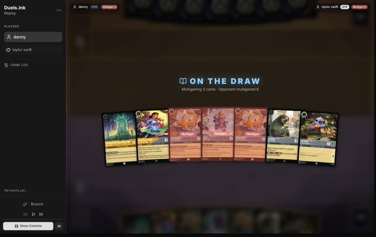
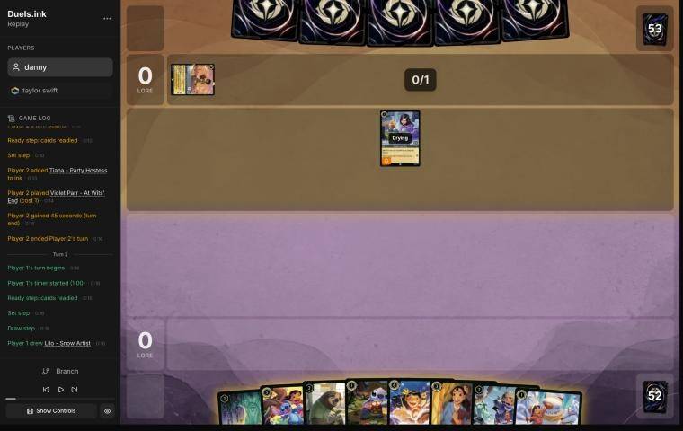
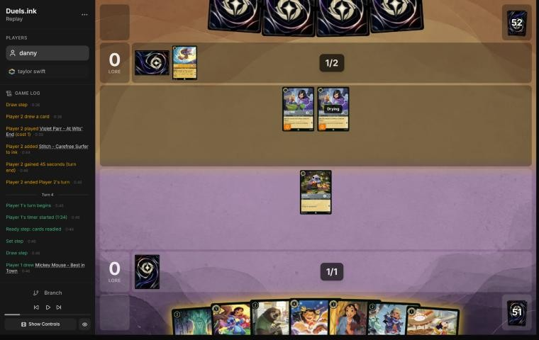
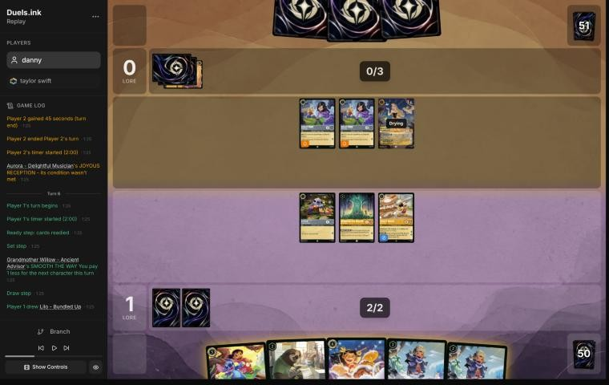
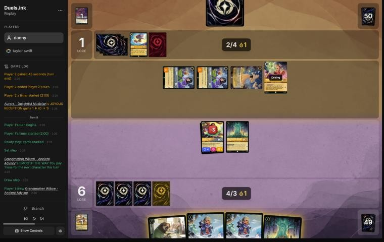
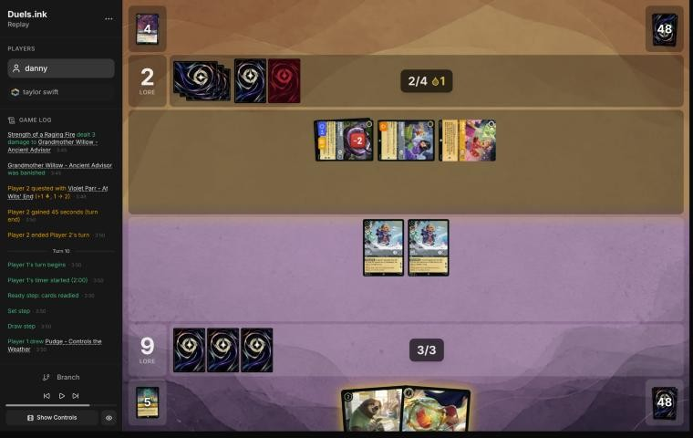
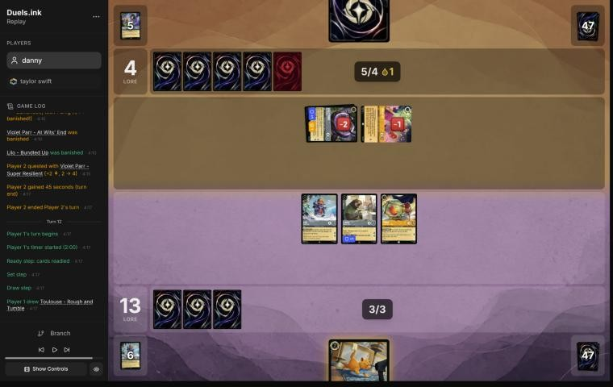

# Review: danny vs taylor swift, 6 Nov 2026

| | |
|---|---|
| **Status** | draft (blind pass done, not yet discussed) |
| **Replay** | `01a1b135-3789-759c-b8a8-f6af493ee3c3` (`python3 tools/brief.py 01a1b135-3789 --turn N`) · [duels.ink viewer](https://duels.ink/replay/01a1b135-378e-7152-a649-9e11ab960b86?step=0) |
| **Format** | Core Constructed, best of one, ranked. duels.ink's rules engine v2.2; judged by the Comprehensive Rules v2.3.0, and none of their changes matters here. Set 14 era: inks revealed before the coin toss |
| **Decks** | You: Amber/Steel Rockstar Aggro, the same 60 as Savitar's Lilo list. Them: Amber/Steel; archetype as it became clear: an unlisted Heroes list (Violet Parr, Aurora, Meilin Lee, Circle of Life, 7-drops), unlisted from game turn 1 (88%, then 91–99%) |
| **Play/draw** | They chose to go first; you were on the draw |
| **Result** | Win: they conceded on game turn 13, at 18–4 |
| **Meta data** | snapshot of 26 Oct 2026 (fresh: stale from 9 Nov) |
| **Chosen how** | By you: you sent the replay link. The result wasn't known to the coach |

## Summary
- **Good plays:** [4](#turn-4), [6](#turn-6), [8](#turn-8), [10](#turn-10), [12](#turn-12). Turn 8 beat the coach's
  plan: three bodies for 4 ink with both Willows' discounts, then Lilo & Stitch's Support onto the first Willow to
  kill Aurora, their free singer. Turn 12's Toulouse shut off every song they could have used to stop your last 2
  lore.
- **Close calls:** the [pre-game](#turn-0) mulligan (both Toulouses back, against a field that's 46% Songs), inking
  Lilo – Rock Star on [6](#turn-6), and two Bundled Ups rather than Bundled Up and Flash on [8](#turn-8).
- **Inaccuracies:** [2](#turn-2), inking Lilo – Snow Artist rather than Nani, which cost a body and Willow's discount
  on your turn 2.
- **Unwinnable from:** never: they conceded at 18–4, facing your 20 next turn.

**What decided it:** their slow start (a 6-card mulligan, three 7- and 8-drops inked, no quest until game turn 9)
against your curve. Lilo & Stitch quested for 3 on game turn 6, and their removal took her, Mickey and a Willow but
used up their characters' turns: they had 4 lore when they conceded.

## The game, turn by turn
Verdicts judge each decision on what you could know at the time, **including archetype knowledge an experienced
player has**. Hindsight is kept to its own section. Severity scale: good play / close call /
inaccuracy / mistake / blunder. Principle IDs and hypotheses (H-n) link to copies
in the Citations section at the end, as they stood when they were cited.

**What you knew before the game:**
- **Their inks, Amber/Steel, the same as yours.** From the 26 Oct meta snapshot: Lilo & Stitch Songs 46%, Rockstar
  Aggro (a mirror) 31%, an unlisted list 23%. The two lists share Stitch – Protector of Frogs, Angel – Siren Singer,
  Lilo & Stitch, Dale and Strength of a Raging Fire, so an early Stitch or Lilo & Stitch tells you little.
- **Their key cards, read before the game:**
  - **Strength of a Raging Fire** (song, 3; both lists run 4): damage to one character equal to the number of
    characters they have in play. Sung for free by any character of cost 3 or more, by Angel – Siren Singer (Singer 3)
    or by Ursula – Vanessa (Singer 4), so it can come on their turn 2 or 3 for no ink.
  - **He Hurled His Thunderbolt** (song, 4, uninkable; Songs ×4): 4 damage to a chosen character. Ursula sings it
    from their turn 2.
  - **World's Greatest Criminal Mind** (song, 3; Songs ×3): banishes a character with 5 {S} or more. Your deck has
    none, so it's dead against you.
  - **Angel – Experiment 624** (4; Songs ×3): GOOD AIM, once a turn, discards a card to deal 2 damage. Most of your
    characters have 2 or 3 willpower. From their turn 4.
  - **Dale – Ready for His Shot** (4; Songs ×2, Rockstar ×4): in challenges their characters deal damage with their
    {W}. Ursula (4 {W}), Stitch (3), Pleakley (4), Lilo & Stitch (5) then kill most of your board. From their turn 4,
    or turn 3 with a Grandmother Willow or a Mickey drop in the mirror.
  - **Berlioz – Tiny Rascal** (1; Rockstar ×4): 1 damage on play.
  - **Mickey Mouse – Expedition Leader** (4; Rockstar ×2): while exerted, each of their quests gives one of your
    characters −2 {S}.
  - **Stitch – Carefree Snowboarder** (5; Songs ×4) and **Stitch – Rock Star** (Shift 4; Rockstar ×2): card draw.
  - **Akood et Emuti** (song, 3; Songs ×4): 2 less for their next character, and a draw. **This Growing Pressure**
    (song, 3; Songs ×2): one of your characters can't challenge and must quest next turn.
  - **Gazelle – Pop Diva** (Songs ×2): no card data in any source, so this read is incomplete for her.
- **Their main plan:** the Songs list builds a board of cheap singers (Angel, Ursula, Miguel Rivera) and sings removal
  for free: two Strengths on one turn killed three characters in FraviYT's game ([the coach's notes on Amber/Steel against danny's Remember Merida](#cite-kb-meta-archetypes-amber-steel-rockstar-aggro-and-two-other-amber-steel-lists-against-danny-s-remember-merida)). Rockstar
  Aggro is your own plan: wide 1- and 2-drops and +5 to +10 quest turns.
- **They mulliganed 6 cards** on the play, before your mulligan, so they were likely starting slowly.
- **Your own deck's notes** ([the Rockstar Aggro notes on Savitar's list](#cite-kb-meta-archetypes-amber-steel-rockstar-aggro-savitar-s-lilo-list)): Shift Lilo & Stitch onto a dry Lilo or
  Stitch at once, Willow's discount works on the turn she lands and on the Shift, and Toulouse stops a song turn.

### Pre-game

*The board before the decision: [step 0](https://duels.ink/replay/01a1b135-378e-7152-a649-9e11ab960b86?step=0) in the duels.ink replay viewer.* The three marked Mulligan are the cards you sent back.

**What you did:** on the draw, you sent back Lilo – Bundled Up and both Toulouses, and kept Grandmother Willow, Lilo
& Stitch, Flash and Stitch – Protector of Frogs. You drew Lilo – Rock Star, Nani and a second Lilo – Bundled Up.

**Verdict:** close call, the line played is fine. The seven had a plan already: Stitch on your turn 1, Willow on your
turn 2, and Lilo & Stitch Shifted onto the dry Stitch for 2 on your turn 3, so she quests for 3 that turn, with 1
ink left for a 1-drop. The question was which of Bundled Up and the two Toulouses to keep.
- **For your mulligan:** `tools/mulligan.py` (1,500 deals) gives the four you kept 8.1 lore by turn 4 and a 35%
  chance of Strength of a Raging Fire by then, against 7.4 and 14% for keeping all seven. Both options keep Lilo &
  Stitch, so the sim ignoring Shift doesn't bias the comparison. Two Toulouses are two 1-lore bodies.
- **Against it:** the sim also ignores Toulouse's lock and Bundled Up's EXTRA LAYERS. Against a list that's 46%
  Songs, one Toulouse played the turn before their singers can reach Strength (their turn 2 or 3) is worth more than
  its lore ([MULL-3](#cite-mull-3)). Keeping one Toulouse, with only two inkable cards kept, was also more ink.
- Two inkable cards out of four kept is thin, but the deck is 45 of 60 inkable, so missing an ink by turn 3 was
  unlikely.

Confidence: medium. The sim prices lore and Strength, not the lock.

### Turn 2: your turn 1

*The board before the decision: [step 6](https://duels.ink/replay/01a1b135-378e-7152-a649-9e11ab960b86?step=6) in the duels.ink replay viewer.*

**Before it:** they inked Tiana – Party Hostess (7, Shift 5) and played Violet Parr – At Wits' End (1, 2/1/1, Alert).
Neither card is in either listed Amber/Steel list, so the brief moved to an unlisted list (88%). From here the
Songs and Rockstar lists are only a guide to what they might run.

**What you did:** drew Lilo – Snow Artist, inked her, and played Stitch – Protector of Frogs.

**Verdict:** an **inaccuracy**. Inking **Lilo – Snow Artist** is suboptimal because she was the cheapest way to use
Grandmother Willow's discount next turn, and inking **Nani** (or Lilo – Rock Star) is better because neither is
needed before your turn 4.
- **Ink check, Snow Artist inked:** your turn 2 has 2 ink and no 1-drop left, so it's one 2-drop (Willow, Flash or
  Bundled Up). Turn 3: Lilo & Stitch Shifted onto Stitch, or Willow plus a 2-drop.
- **Ink check, Nani inked:** turn 2 is Willow then Snow Artist for 1 (SMOOTH THE WAY works the turn Willow lands), two
  bodies for 2 ink. Turn 3 is Lilo & Stitch Shifted onto Stitch for 2, and Snow Artist quests for 2 with a Stitch in
  play (Lilo & Stitch is named Stitch too). That's one more body and about 2 more lore a turn from turn 3, for the
  same ink.
- **What Nani gives up:** a 3-cost body that finds a 2-cost character. With three 2-drops, Lilo & Stitch and Rock
  Star already in hand, the dig matters least of anything here. Lilo – Rock Star is the alternative ink, but she's
  your best card against removal (each quest replays a 2-drop from the discard), so Nani is the one to lose ([INK-1](#cite-ink-1),
  [INK-2](#cite-ink-2)).
- **Exposure is the same either way:** whatever you played this turn stays ready, so nothing could be challenged.
  Next turn Violet's 2 {S} kills an exerted Snow Artist (2 {W}) in a trade, but not Stitch (3 {W}), so Stitch quests
  first in both lines.

Confidence: medium. It turns on Snow Artist's tempo against Nani's card later.

### Turn 4: your turn 2

*The board before the decision: [step 12](https://duels.ink/replay/01a1b135-378e-7152-a649-9e11ab960b86?step=12) in the duels.ink replay viewer.*

**Before it:** they played a second Violet Parr and inked Stitch – Carefree Surfer (7, 4/8/2; draws 2 on play with two
other characters). They didn't quest with the first Violet. Their two inked 7-drops and the 6-card mulligan pointed
to a slow, top-heavy hand. Unlisted list: 97%.

**What you did:** drew Mickey Mouse – Best in Town, quested with Stitch (1 lore), inked Nani, and played Grandmother
Willow, then Mickey for 0 with SMOOTH THE WAY.

**Verdict:** good play, the coach's line too. Two bodies for 2 ink, Nani inked (the card you need least), and
Willow's discount ready for Lilo & Stitch's Shift next turn.
- **Stitch's quest was worth it:** each Violet that challenges him dies to his 1 back, so killing him costs them both
  Violets (the brief: "the kill costs them 2"), and one Violet leaves him on 1 willpower. Lilo – Bundled Up is a
  second base for the Shift if they do.
- **Mickey's drops:** from next turn his forced quest gives each player an ink drop. Their inked 7-drops say they're
  waiting for ink, so each drop helps them too ([the coach's Mickey notes](#cite-kb-cards-mickey-mouse-best-in-town)).

### Turn 6: your turn 3

*The board before the decision: [step 20](https://duels.ink/replay/01a1b135-378e-7152-a649-9e11ab960b86?step=20) in the duels.ink replay viewer.*

**Before it:** they inked **Circle of Life** (Sing Together 8: play a character from their discard for free) and
played Aurora – Delightful Musician (3, 2/3/1; she returns a song played that turn, and gains 1 lore at the end of
a turn they played a song). Again they quested with nothing. Three of their four inked cards cost 7 or 8, and their
board's Sing Together total was 5. Their discard was empty, so Circle of Life had nothing to replay yet.

**What you did:** drew a second Lilo – Bundled Up. Quested with Mickey (2), inked Lilo – Rock Star, Shifted Lilo &
Stitch onto the dry Stitch for 2 with SMOOTH THE WAY, and quested with her (3). Willow stayed ready. 6–0, and
Mickey's HOT DOG gave each player an ink drop.

**Verdict:** good play.
- **Lilo & Stitch at once** is the deck's best tempo play here ([the Rockstar notes](#cite-kb-meta-archetypes-amber-steel-rockstar-aggro-savitar-s-lilo-list)): 3 lore this turn and every turn,
  and with 5 {W} and Resist 1 none of their three 2-{S} characters can kill her, even together (each deals 1).
- **Willow stayed ready,** so she can't be challenged: questing her for 1 would have let Aurora kill her for free
  (2 damage on 2 {W}, 1 back on 3 {W}). Her discount is worth more than her lore ([the coach's method on engines](#cite-docs-decision-method-4-evaluate-each-line)).
- **Inking Rock Star is a close call,** and the right side of it. Your hand was Flash and two Bundled Ups, all
  uninkable, so Rock Star or Lilo & Stitch was the only ink this turn. Ink check: with Rock Star inked, next turn has
  3 ink, the drop and an inkable draw (about 3 in 4), enough for Bundled Up (1 with Willow), Flash and the other
  Bundled Up. Held, next turn has 4 and one of them waits a turn, and Rock Star's Shift (4) only comes on turn 5 at
  the earliest. Against a slow, top-heavy hand, the bodies now matter more ([INK-3](#cite-ink-3), [ROLE-1](#cite-role-1)).
- **Exposure:** Mickey (4 {W}) can be killed by two of their characters for nothing back; Lilo & Stitch can't be.

### Turn 8: your turn 4

*The board before the decision: [step 34](https://duels.ink/replay/01a1b135-378e-7152-a649-9e11ab960b86?step=34) in the duels.ink replay viewer.*

**Before it:** they played Meilin Lee – Losing Control (3, 2/3/1; her look at 4 found nothing), sang Strength of a
Raging Fire with Aurora for 4 into Lilo & Stitch (3 after Resist: 2 willpower left), inked a second Stitch – Carefree
Surfer, and killed Mickey with both Violets (2 + 2 on 4 {W}, nothing back). Aurora's JOYOUS RECEPTION gave them their
first lore: 6–1. Their hand was down to 1 card.

**What you did:** drew a second Grandmother Willow. Played her for 1 (the first Willow's discount), then Lilo –
Bundled Up for 1 (the new Willow's discount) and the other Bundled Up for 2, using Mickey's drop. Quested with Lilo &
Stitch (+3, 9–1), gave her Support (+3 {S}) to the first Willow, and challenged Aurora: both were banished.

**Verdict:** good play, and better than the coach's plan, which quested both Lilo & Stitch and Willow and kept the
trade for later.
- **Three bodies for 4 ink:** the two Willows' discounts stack, one each, so the whole hand but Flash came down. All
  three entered ready, so none can be challenged on their turn.
- **Willow for Aurora is the right trade** ([QC-2](#cite-qc-2), [TRADE-1](#cite-trade-1)). With one card left in your hand, a second Willow's
  discount is worth little, and the new Willow keeps it going. Aurora was the threat: she sings Strength of a Raging
  Fire for free, gains them a lore on every song turn, and her 3 made up their Sing Together total of 8 for Circle of
  Life. Without her it's 5, so Circle of Life (which could now replay her from the discard) can't be sung next turn,
  and Strength would count 3 characters, not 4.
- **Two Bundled Ups rather than Bundled Up and Flash:** close call, both 2-lore. EXTRA LAYERS stops the first damage
  each takes on their turn, which blunts their 2-{S} challengers and Strength alike, and Flash stays in hand for a
  turn when 3 {S} can challenge.
- **What Lilo & Stitch exposes:** 2 willpower left with Resist 1, so each of their 2-{S} challengers deals 1. It takes
  two challenges to kill her, and each challenger takes 3 back and dies (Violet 1 {W}, Meilin 3). Killing her costs
  them two of their three characters. *The brief said "one challenge kills it" here: it doesn't subtract your
  character's Resist (see [The coach's errors](#the-coachs-errors)).*

**Revisited after turn 9,** from turn 8's information only: the exposure above is incomplete. Their two Violet Parrs
were Shift bases, and **Violet Parr – Super Resilient** (Steel, Shift 3, 4/4/2, Resist 1) is a Core-legal card that
their 4 ink and a drop paid for. Shifted onto a dry Violet, she challenges at once and deals 3 through Resist, enough
to kill Lilo & Stitch by herself. She's no surprise in a Violet deck: the coach's notes already list her in the
Violet package of an Amethyst/Steel list ([the Merlin and Shop variant](#cite-kb-meta-archetypes-amethyst-steel-a-merlin-and-shop-variant-unlisted)), and duels.ink's Ruby/Steel
Incredibles and Sapphire/Steel Ariel Songs lists run 4 and 3. **The verdict stands:** on 2 willpower, Lilo & Stitch also
died to any Strength of a Raging Fire whether she quested or not, and her quest bought 3 lore and, through Support,
Aurora. What changes is the risk: she was likelier to die than the coach wrote.

### Turn 10: your turn 5

*The board before the decision: [step 50](https://duels.ink/replay/01a1b135-378e-7152-a649-9e11ab960b86?step=50) in the duels.ink replay viewer.*

**Before it:** they Shifted **Violet Parr – Super Resilient** (Shift 3; 4/4/2, Resist 1; HEROIC SYNERGY draws then
discards whenever they play a Hero) onto the dry Violet, discarded Angel – Experiment 624 to it, and challenged
Lilo & Stitch at once: 3 after Resist killed her, and Violet took 2. Meilin then sang a second Strength of a Raging
Fire (3 characters, so 3 damage) into the new Willow. 9–2, and their hand was empty.

**What you did:** drew Pudge – Controls the Weather. Played Flash (2) and Pudge for free (GOOD FRIEND, with a Lilo in
play), and quested with both Bundled Ups: 13–2.

**Verdict:** good play, the coach's line too.
- **No challenge was worth it:** Bundled Up's 1 {S} does nothing to Violet – Super Resilient (Resist 1) and dies
  trading with the 1-lore Violet; Flash and Pudge were drying.
- **Questing both Bundled Ups is safe enough:** each one's EXTRA LAYERS absorbs the first damage on their turn, so
  their three challengers (4, 2 and 2 {S}) can kill at most one of them, using two challenges, and a Violet that
  challenges dies to the 1 back. Flash and Pudge stay ready, so they can't be challenged.
- **The race:** 13 lore and a board that quests for 7 (Bundled Ups 4, Flash 2, Pudge 1) means 20 next turn if both
  Bundled Ups live, and 18 if one dies. They had no cards in hand: their next turn was one draw, with 5 ink and a drop.
  The outs from that draw were a third Strength (two of a likely four seen), Circle of Life (their Sing Together total
  was 9: it could replay Angel or Aurora), or a Hero to Shift onto with HEROIC SYNERGY's dig.

### Turn 12: your turn 6

*The board before the decision: [step 59](https://duels.ink/replay/01a1b135-378e-7152-a649-9e11ab960b86?step=59) in the duels.ink replay viewer.*

**Before it:** Meilin's challenge used up one Bundled Up's EXTRA LAYERS, and Violet – At Wits' End's challenge then killed her
(Violet died to the 1 back). Violet – Super Resilient quested: 13–4. They drew and kept their card with 5 ink
available, so it was likely something they couldn't cast yet, or chose to hold.

**What you did:** drew Toulouse and played him (no actions for them until your next turn), then quested with Bundled
Up, Flash and Pudge: 18–4.

**Verdict:** good play, the coach's line too.
- **What must happen:** 2 more lore next turn. Your four characters quest for 6, so they had to remove nearly all of
  them in one turn to stop it.
- **Toulouse shuts off their removal:** Strength of a Raging Fire, He Hurled His Thunderbolt and Circle of Life are
  all songs, which are actions, and their Sing Together total was 8 (Violet 5, Meilin 3). That leaves only
  challenges, and Toulouse himself stays ready, so he can't be challenged.
- **What the quests expose:** Violet – Super Resilient (4 {S}) kills Flash or Pudge, or breaks Bundled Up's shield.
  Meilin (2 {S}) alone kills nothing: 1 to Flash through Resist, 2 to a 3-{W} Pudge, nothing through the shield. At
  most one of your questers dies, and any two of the other three reach 20.
- **The alternative,** Flash challenging Violet – Super Resilient (2 through Resist kills her; Flash dies), reaches
  only 16 and needs all three remaining questers next turn.

### Turn 13: their turn

**What happened:** they drew and conceded, at 18–4.

## Lessons
1. **Two Grandmother Willows stack.** Each SMOOTH THE WAY is its own once-a-turn ability ([CR 6.1.13.2](#cite-cr-6-1-13-2)), so with one
   Willow in play the second costs 1 and the next character after her costs 1 too: three 2-drops for 4 ink on
   [turn 8](#turn-8).
2. **Lilo & Stitch's Support onto a Willow you no longer need kills a 3-willpower singer.** Your deck's notes already
   say it ([Support makes a 0-strength character a challenger](#cite-kb-meta-archetypes-amber-steel-rockstar-aggro-savitar-s-lilo-list)); here the target was Aurora, who
   sang their Strength of a Raging Fire and made up their Circle of Life total.
3. **On the turn before you win, Toulouse leaves them only challenges.** Every card they had that could stop you was
   a song ([turn 12](#turn-12)); [your notes](#cite-kb-meta-archetypes-amber-steel-rockstar-aggro-savitar-s-lilo-list) say it for sweeper songs, and it holds for any removal song.
4. **Against an unlisted list, look up the Shift versions of what's in play.** Violet Parr – At Wits' End is a base
   for Violet Parr – Super Resilient, who challenges the turn she lands ([turn 8](#turn-8), revisited).
5. **Early on, ink the card you need last.** A 1-drop that uses Willow's discount next turn is worth more than a
   3-drop's dig ([turn 2](#turn-2)).

## Proposed knowledge-base updates (applied after discussion)
- **Meta** (Amber/Steel notes, below the end marker): taylor swift's unlisted Heroes list, from this game: Violet
  Parr – At Wits' End ×2 and Super Resilient (HEROIC SYNERGY: draw and discard on each Hero played), Aurora –
  Delightful Musician, Meilin Lee – Losing Control, Angel – Experiment 624, Strength of a Raging Fire ×2, and Circle of
  Life, Tiana – Party Hostess and Stitch – Carefree Surfer ×2 inked. The classifier put it at 88–99% unlisted, with
  Lilo & Stitch Songs the closest listed list. Swing turn: Super Resilient Shifted onto a dry Violet, challenging at
  once with 4 {S}.
- **Playing Rockstar Aggro** (the same notes): two Willows stack, one discount each ([turn 8](#turn-8)).
- **Rules** (the coach's rulings file): two Grandmother Willows each give their discount once a turn, since abilities with the
  same name check their "once" independently ([CR 6.1.13.2](#cite-cr-6-1-13-2)).
- **Strategy:** nothing new. Turn 8 confirms the existing Support note, and turn 12 the Toulouse note.

## Hindsight
Doesn't change the verdicts above.
- **They were short of plays all game:** their first quest came on game turn 9, they held a card with ink to spare
  on turn 11, and they conceded straight after their draw on turn 13. Strength of a Raging Fire twice, the Violets'
  challenges and Violet – Super Resilient's took Mickey, Lilo & Stitch and a Willow, but each cost them their
  characters' quests.
- **Turn 2's inaccuracy cost little here:** Mickey, drawn on turn 4, used Willow's discount in Snow Artist's place.

## The coach's errors
All three were found by the coach during the review; the discussion may add more.

| When | Error | How it was caught | How it won't happen again |
|---|---|---|---|
| Turns 8 and 12 | The brief's "what can challenge your characters" lines ignore your character's Resist: it said one challenge kills Lilo & Stitch (2 willpower left, Resist 1) and that Meilin (2 {S}) kills Flash (2 {W}, Resist 1). Each takes 1 from a 2-{S} challenger | The coach, from the card text, during the blind pass | **Done** (commit 1142bd5, 8 Nov 2026): that section subtracts your character's Resist from each challenger's damage (one challenge, together, and the cheapest group), with a test on this game's turns 8 and 12 |
| Turn 8 | The exposure missed Violet Parr – Super Resilient Shifting onto a dry Violet and challenging at once. The brief's same-turn challengers come only from the listed archetypes' cards and cards seen, and they were 91% unlisted; the Violet package was already in the knowledge base | Turn 9's brief; revisited from turn 8's information | **Done** (commit 1142bd5, 8 Nov 2026): the brief's "Challenges the turn it lands" also checks every Core-legal card in their inks that can Shift onto a character of theirs in play, marked "outside their likely lists", with a test on turn 8 |
| Turn 8 | The coach's plan quested Willow and kept the Support kill on Aurora for later. The brief printed the kill and the notes describe it; the coach weighed it and chose wrong | Comparing your line with the plan | **Done** (commit 1142bd5, 8 Nov 2026): the brief lists each opposing character that can sing a removal song in their lists next turn for free, and tags the challenges that kill it, with a test on turn 8 |

## Open questions
- **Turn 2:** why ink Lilo – Snow Artist rather than Nani or Lilo – Rock Star? Was there a plan for her that the coach
  missed?
- **Pre-game:** you sent back both Toulouses. Against a field that's 46% Lilo & Stitch Songs, was one worth keeping
  for its lock, or are they too weak a body to keep in your list?

## Citations
Copies of the coach's knowledge base cited above, as they stood when they were cited (the private repository's commit and date are given with each). They don't change when the knowledge base does.

**amber-steel.md, Rockstar Aggro: Savitar's Lilo list**: knowledge base, `kb/meta/archetypes/amber-steel.md` at `a7e6b75` (2026-11-06), working tree

> ### Rockstar Aggro: Savitar's Lilo list `[coach, meta study of 15 of Savitar's games, 2 Nov 2026 (tools/scan.py), full games, not blind]`
> Studied: 01a19bbd-6ae7 and 01a19bc4-57f1 (GoldenBeast), 01a19bd8-ada2 and 01a19bdb-d8e4 (iKnowZer0), 01a19c02-ae0e,
> 01a19c06-3be1, 01a19cc1-7b0e and 01a19cc5-5243 (Kariminal), 01a19c08-a45f, 01a19c0e-1e9e and 01a19c11-9fbf
> (ligerien), 01a19cbb-e8f7 and 01a19cbe-8319 (Pandagheist), 01a19da0-735c and 01a19dad-a6c9 (DJJAZZYJIMMY). The same
> 60 in every game:
> - **1-drops:** Lilo – Snow Artist ×4 (1/2/1; +1 {L} with a Stitch in play), Stitch – Protector of Frogs ×4 (1/3/1),
>   Mickey Mouse – Best in Town ×4 (0/4/2, Adventurous; HOT DOG gives each player an ink drop).
> - **2-drops:** Grandmother Willow ×4 (uninkable; SMOOTH THE WAY: next character 1 less each turn), Lilo – Bundled Up
>   ×4 (uninkable, 1/2/2; EXTRA LAYERS: the first damage on each opponent's turn is prevented), Pudge – Controls the
>   Weather ×4 (1/3/1; **free with a Lilo in play**), David – Protective Snowboarder ×4 (1/4/1, Bodyguard), Mike Wazowski
>   – Heroic Climber ×4 (uninkable, 0/4/1; FIND A FRIEND on play and each quest: **each player** may keep a character off
>   the top), Flash – Efficient Clerk ×3 (uninkable, 3/2/2, Resist 1; no character can have Rush), Toulouse – Rough and
>   Tumble ×4 (opponents can't play actions, songs included, until your next turn), Mr. Big – Distribution Magnate ×3
>   (0/2/1; ICE OUT: if all your ink is exerted at the end of your turn, a chosen opposing character can't challenge
>   until your next turn).
> - **Higher:** Nani – Stage Manager ×4 (3; finds a 2-cost-or-less character in the top 4), Strength of a Raging Fire ×4
>   (3; damage equal to your character count), Dale – Ready for His Shot ×4 (4, 0/4/2; SPIKE SUIT: in challenges your
>   characters deal damage with their {W}), Lilo & Stitch – Fun-Loving Friends ×4 (Shift 3 onto a Lilo or Stitch;
>   3/5/3, Resist 1, Support), Lilo – Rock Star ×2 (Shift 4 onto a Lilo; each quest replays a 2-cost-or-less character
>   from the discard).
> - **Not in duels.ink's average list:** David, Flash, Mr. Big and Lilo – Rock Star; no Angel, Berlioz or Stitch – Rock
>   Star.
>
> **How it wins:**
> - **A wide board on turn 1:** Lilo – Snow Artist then three free Pudges made four characters on game turn 1 of
>   01a19bc4-57f1. Grandmother Willow's discount and Mickey's drops keep two plays a turn coming.
> - **Quest turns of +5 to +10** once five to seven 1-lore characters are out (01a19bdb-d8e4 turn 8: +10, with Lilo &
>   Stitch Shifted on for 2).
> - **Dale turns high-willpower bodies into removal:** Stitch (3 {W}) and Mike Wazowski (4 {W}) killed three of
>   ligerien's characters in one turn (01a19c08-a45f turn 8).
> - **Locks:** Mr. Big's ICE OUT on their best challenger each turn (two Mr. Bigs, two targets), Toulouse against a
>   song deck on the turn it matters, Flash against Rush.
>
> **What beat it in the study:**
> - **Board damage:** most of the deck has 2 or 3 willpower. Circle of Life's Malicious, Mean, and Scary plus To Wither
>   a Flower killed five characters on turn 7 of 01a19cc5-5243; Don Karnage – Debonair Pirate's 1 damage plus Malicious
>   killed both Mr. Bigs (01a19c02-ae0e turn 6). Emerald/Steel's Don Karnage and Elinor pings did the same slowly.
> - **Raging Storm,** from game turn 9 with ink drops: Mickeys on both sides gave iKnowZer0 three drops for it
>   (01a19bdb-d8e4 turn 9, seven of Savitar's characters at 17–7).
> - **The Headless Horseman – Terror of Sleepy Hollow** (Amber/Ruby singers): banishes a character with 2 {S} or less
>   on play, which is almost every character in this deck.
> - **Savitar conceded early** when a sweeper deck's engine was online: game turn 6 against Chernabog (01a19cc1-7b0e),
>   turn 11 against Milo Thatch (01a19c06-3be1).
>
> **Playing it:**
> - **Grandmother Willow's SMOOTH THE WAY works on the turn she lands:** Willow then a 1-drop costs 2 in all, a 2-drop
>   3 `[coach, from the blind review of 01a19bca-cf89 turn 4, where the coach's plan missed it]`.
> - **Lilo – Rock Star's I'LL COUNT YOU IN plays the character ready,** and ready characters can't be challenged: a
>   replayed Mr. Big or Pudge is lore next turn that only an action can stop `[coach, from the blind review of
>   01a19bf9-b9ff turn 9, where the player's line beat the coach's]`.
> - **David – Protective Snowboarder enters exerted to shield Dale:** as a Bodyguard he must be challenged first, and
>   under SPIKE SUIT he deals 4 back, so their challengers trade into him before they can reach Dale `[coach, from the
>   blind review of 01a19bfe-7db6 turn 8, where the player's line beat the coach's]`.
> - **Lilo & Stitch – Fun-Loving Friends is named Stitch,** so every Lilo – Snow Artist quests for 2 while it's in
>   play, and spare Stitches become ink `[coach, 01a19bca-cf89 turn 6]`.
> - Against Malicious decks (Amber/Emerald Circle of Life, Emerald/Steel Don Karnage), more bodies don't mean more lore
>   once a 1-damage effect is live: count how many survive 1 damage (Stitch, Pudge, David, Mike, Mickey, Dale, Lilo &
>   Stitch) and how many survive 3 (Malicious + To Wither a Flower).
> - Mickey's and Mike's symmetric effects feed the opponent too: count their drops toward Raging Storm (8) and the
>   characters Mike's reveal gives them (`kb/cards/mickey-mouse-best-in-town.md`).
> - **Lilo & Stitch's Support makes a 0-strength character a challenger:** quest her first, give +3 {S} to a ready Mr.
>   Big, Mike or Dale (with Dale's SPIKE SUIT a character deals its {W} instead), and challenge an exerted 2- or
>   3-willpower character: their ramp pieces (Aurora, Hamm, Dream Come True) or a singer `[coach, from the blind review
>   of 01a19c3f-185a turn 5, where the player's line beat the coach's]`.
> - **Keep Toulouse in hand against Storm decks,** even as the only inkable card: against Candle Control, Mickey's
>   drops brought Raging Storm on game turn 11 while both Toulouses Savitar had drawn were in the inkwell
>   `[coach, 01a19ccd-3f04 turns 2, 8 and 11]`.
> - **Dale's SPIKE SUIT works whichever side challenges:** with Dale in play, Mike, Mickey and David (4 willpower) deal 4
>   to any challenger, which kills Reckless Liquidator, Jebidiah or Roller Bob `[coach, 01a19ccd-3f04 turn 6]`.
> - **Shift Lilo & Stitch in as soon as a dry Lilo or Stitch is there:** she quests for 3 at once, and Willow's
>   discount applies to the Shift (2 ink). Held in hand she does nothing `[coach, 01a19ccd-3f04 turn 6 and 01a19d99-ea68
>   turns 5 and 7, where she was inked or held]`.
> - **Mulligans in Savitar's reviewed games** (12 games, 2 Nov 2026): six keeps were flagged, five of them keeping Mr.
>   Big, David or Willow and sending back Flash, Bundled Up, Toulouse or Strength. `tools/mulligan.py` preferred the
>   2-lore cards and the cheap answers each time, by 0.7 to 1.8 lore by turn 4.
> - **After a Storm, rebuild with characters that stay ready through their turn** (Lilo then Lilo – Rock Star Shifted
>   on, Mr. Big, Lilo & Stitch): no challenge can reach them before they quest, so only an action or Hades – Infernal
>   Schemer stops them. Against Amber/Sapphire Control, count Hades (4 in the average list) with Storm and Let It Go
>   `[coach, 01a19c3b-62c9 turns 12–17: both rebuilt characters were taken by Hades]`.
> - Toulouse is the only way to stop a song turn before it happens: play him the turn before their singers can reach a
>   sweeper song.

**amber-steel.md, Rockstar Aggro and two other Amber/Steel lists against danny's Remember Merida**: knowledge base, `kb/meta/archetypes/amber-steel.md` at `a7e6b75` (2026-11-06), working tree

> ### Rockstar Aggro and two other Amber/Steel lists against danny's Remember Merida `[coach, meta study of danny's 28 Oct – 2 Nov 2026 games (tools/scan.py), full games, not blind, 8 games]`
> - **Koda DeLaSoda** (`01a18379-da67`, `01a1837c-db42`): Pete – Suave Showoff ×2, Pocahontas – Guiding the Tribe,
>   Nani – No Worries, Thomas, Mickey – Amber Champion ×2, Lionheart and David (off-list) with Lilo & Stitch ×3 and Dale
>   ×2. +5 lore on game turn 7.
> - **WG_Winson** (`01a18bd1-43a6`): +7 on game turn 6 (Pudge free with GOOD FRIEND, Lilo & Stitch Shifted onto Stitch
>   for 3), 13 lore by turn 13. Toulouse ×2, Mr. Big, Mickey – Expedition Leader ×2.
> - **-Bella-** (`01a18be9-bd5b`): Lilo – Best Explorer Ever ×2 and Fire the Cannons! (off-list), Lilo – Bundled Up ×2;
>   14 lore by game turn 9.
> - **BlondeUnicorn** (`01a19d38-cf11`, `01a19d44-585e`, `01a19d4c-6771`), an unlisted Toy Story list (the classifier:
>   unlisted 58–86%, Rockstar Aggro second): Woody – Jungle Guide ×4, Woody – Waiting for a Friend, Bullseye – Loyal Horse
>   ×3, Rex – Protective Dinosaur ×3, Bambi – Ethereal Fawn ×4, Toulouse ×4, Shere Khan – Khan Industries CEO, Angel –
>   Experiment 624 ×3, Strength of a Raging Fire ×3, Broadway, Willow, Mowgli. Angel's GOOD AIM (discard a card: 2
>   damage) plus challenges took three of danny's characters on game turn 16 (game 3), Demona – Scourge among
>   them.
> - **Lilo & Stitch Songs, FraviYT** (`01a18c40-fce0`): Strength of a Raging Fire sung twice on game turn 8 (Miguel Rivera
>   and Ursula – Vanessa singing) killed three; Akood et Emuti ×3, He Hurled His Thunderbolt ×3, This Growing Pressure
>   ×2, World's Greatest Criminal Mind.

**mickey-mouse-best-in-town.md**: knowledge base, `kb/cards/mickey-mouse-best-in-town.md` at `a7e6b75` (2026-11-06), working tree

> # Mickey Mouse – Best in Town
>
> Amber character, 1 cost, 0/4/2, Adventurous. In the user's Amber/Amethyst list (27 Oct 2026). Text verified with
> `tools/cards.py get "Mickey Mouse - Best in Town"`:
> - **Adventurous:** can't challenge, and you can't end your turn while he's ready and able to quest.
> - **HOT DOG!** At the end of your turn, if this character is exerted, **each player** gets 1 ink drop.
>
> ## What it means in play `[coach, from the 27 Oct 2026 meta study]`
> - **The ramp is symmetric:** every turn he quests, the opponent also gets an ink drop. That's worth more to decks with
>   ink-drop payoffs:
>   - **Jousting Match** (Steel action, 3): 2 damage, or **5 if paid with an ink drop**. Mickey supplied an Amethyst/Steel
>     opponent's drops (01a17e37).
>   - Ink-drop decks also run Ink Explosion, Merlin – Profoundly Curious and Marie – Caught in the Act; Shere Khan –
>     Khan Industries CEO makes drops of his own.
>   - An Emerald/Steel opponent spent four of these drops on turn 6 of 01a17ddb.
> - **Adventurous forces him to quest,** so he ends every turn exerted and can be challenged. 0 strength means he trades
>   for nothing; he's often the first challenge target (01a17e9c turn 14, 01a17ddb turn 6).
> - **Against a Steel opponent,** count the drops you're giving them, and what they could pay for with them, before
>   questing with him.
> - **Drops bring Raging Storm early** `[coach, meta study of Savitar's games, 2 Nov 2026]`: Candle Control (Amber/Ruby)
>   cast it on game turn 9, their 5th turn, with 5 ink and 3 drops from both sides' Mickeys (01a19bdb-d8e4). Against an
>   Amber deck, add your Mickey's drops to their ink when you count down to Storm (8).

**decision-method.md, 4. Evaluate each line**: knowledge base, `docs/decision-method.md` at `a7e6b75` (2026-11-06), working tree

> ## 4. Evaluate each line
> For each line, work out:
> 1. **Immediate result:** lore gained, characters killed and lost (challenge maths from the brief, plus card text),
>    cards drawn, ink used.
> 2. **Their best reply.** Assume they make their best play with what they're likely to hold. If your line makes
>    them draw (Demona – Scourge's refill, Hades – Looking for a Deal), their hold odds go up: recompute with
>    `odds.py` for their new hand size.
> 3. **When an unknown card would change the answer, branch.** List the scenarios (they have it / they don't), give each a
>    probability from `tools/odds.py`, describe the position after each line in each scenario, then compare.
>    - Use coarse values: lore lead, board, cards, turns to 20 for each side.
>    - The comparison usually turns on a threshold ("better if the chance is under about 1 in 4"). Say so.
>    - **Check what the alternative loses in the same branch.** A "safe" line often loses something too.
>      *Example:* 01a14574 turn 15. The cautious line still lost Ursula to Lead Detective and let two characters quest
>      instead of trading, so the risky line was better than it first looked.
> 4. **The race after the line.** Turns to 20 for both sides (QC-5). From ahead, take the safest path (POS-1). From
>    behind, play to your outs (POS-2).
> 5. **When their next turn is known, plan two turns** (SEQ-4). A known card in hand, a combo already on board, or a
>    near-certain threat. Judge each line by what survives their turn and what answers it on the turn after, not just
>    by this turn's gains. A line that sets up the answer can beat one that gains a card or a lore now.
>    *Example:* 01a13b88 turn 18. Phillip was coming back next turn, and playing Wasabi set up TWIN BLADES (+2 from
>    Martial Arts Master) to kill him on the following turn.
> 6. **Count exposure the same way for every line.** Any character you exert can be challenged and damaged before
>    their sweeper resolves, including a 1-strength poke that sets up a "banish damaged" wipe. Apply that to each
>    character in each line, not just the one you're criticising. **Damage that doesn't kill changes their turn too:** a
>    damaged character of theirs may die if it challenges, so count what your damage deters as well as what it kills
>    (danny, 2026-11-02, on 01a19d89 turn 17: Three Arrows left Hades on 2 willpower, so he couldn't challenge Merida
>    without dying).
> 7. **Value an engine by its future turns, not only its lore.** When a line exposes an engine (Unintentional Icon's
>    BESPOKE DESIGN, Priscilla's FILING SYSTEM), two cheap characters traded for it is a deal the opponent wants, even
>    if both challengers die. Early, with neither side near 20, a few lore matter less than another turn of the engine
>    (stonks 📈, 2026-11-02, on 01a16039 turns 9, 11 and 17).

**amethyst-steel.md, A Merlin and Shop variant (unlisted)**: knowledge base, `kb/meta/archetypes/amethyst-steel.md` at `a7e6b75` (2026-11-06), working tree

> ### A Merlin and Shop variant (unlisted) `[coach + user, 01a18275 vs InkModeOn, 2026-10-28, blind review]`
> `output/reviews/2026-10-28_01a18275_vs-inkmodeon-g2.md`. The classifier swung between Midrange and "unlisted" all game:
> Midrange's core plus cards no listed list runs.
> - **Card and lore engines:**
>   - Merlin – Profoundly Curious, three seen: an ink drop on play, a draw on each quest
>   - Merlin's Shop and Smithy ×2 (1 lore and a card each time a character moves there; `kb/cards/merlins-shop-and-smithy-magical-market.md`)
>   - Arthur – Merlin's Assistant (3, 3/3/1): moves to a location for free on play and gets an ink drop
> - **Heroes:** the Violet Parrs (At Wits' End, 1-cost 2/1 with Alert; Force Field Practice, 2-cost 3/2 Resist 1;
>   Super Resilient, 4/4/2 Resist 1, Shift 3), Tinker Bell – Curious Fairy → Giant Fairy (Shift 4).
> - **Others:** Cheshire Cat (moves damage; `kb/cards/cheshire-cat-inexplicable.md`), Dr. Hamsterviel – Evil Observer
>   (3/4/1, Alert), Pepita, Strength of a Raging Fire, Angel – Experiment 624 and Demona – Scourge (both inked).
> - **How it played:** removal by Cheshire's damage moves, Strength and challenges (including your Shop, twice);
>   steady lore from Merlins and Shop moves. Shop moves gave 6 of their 20 lore, including the winning point.
> - **Alert on Violet Parr and Hamsterviel** gets past Evasive, so Dumbo – The Flying Elephant's AERIAL DUO protects
>   less while either is in play.

**MULL-3**: strategy principle, `kb/strategy/principles.md` at `a7e6b75` (2026-11-06), working tree

> - **MULL-3. The right keep depends on the matchup.** Early interaction against aggro; pressure, draw and engines against slow decks. The mulligan is the first expression of your role. In the Set 14 era the opponent's inks are known before the mulligan (RULE-8), so this applies from game 1 of a match. `[MCL ch.12]` · baseline

**INK-1**: strategy principle, `kb/strategy/principles.md` at `a7e6b75` (2026-11-06), working tree

> - **INK-1. Inking is permanent.** Every inked card is one line of play removed for the rest of the game. *Ask: "Will I regret losing access to this card?"* `[MCL ch.4]` · baseline

**INK-2**: strategy principle, `kb/strategy/principles.md` at `a7e6b75` (2026-11-06), working tree

> - **INK-2. Don't automatically ink the most expensive card.** It may be the late-game win condition or the key answer for this matchup. The answer depends on matchup, hand and board. `[MCL ch.4]` · baseline

**INK-3**: strategy principle, `kb/strategy/principles.md` at `a7e6b75` (2026-11-06), working tree

> - **INK-3. Usually ink every turn, but not automatically.** Keeping one more playable card can beat one more ink. Missing ink with an expensive hand can leave you permanently behind. `[MCL ch.4]` · baseline

**ROLE-1**: strategy principle, `kb/strategy/principles.md` at `a7e6b75` (2026-11-06), working tree

> - **ROLE-1. The matchup decides your role, not your deck.** In nearly every game one player wants it short (aggressor) and one wants it long (defender). The same list can play either role. *Ask: "Which deck benefits if this game goes long?"* `[MCL ch.8]` · baseline

**QC-2**: strategy principle, `kb/strategy/principles.md` at `a7e6b75` (2026-11-06), working tree

> - **QC-2. Challenge the threat, not the character.** Engines, synergy pieces and big questers are worth fighting over. A 1-lore character doing nothing usually isn't. *Ask: "Does this character actually need to be removed?"* `[MCL ch.6, ch.9]` · baseline

**TRADE-1**: strategy principle, `kb/strategy/principles.md` at `a7e6b75` (2026-11-06), working tree

> - **TRADE-1. Judge a trade by ink invested, tempo, value already generated, and the board afterwards**, not by card count. A 2-cost for a 5-cost is a big win even if it's one-for-one. *Ask: "What does the board look like after this challenge?"* `[MCL ch.7]` · baseline

**CR 6.1.13.2**: Comprehensive Rules, `kb/rules/cr/06-abilities-effects-resolving.md` at `a7e6b75` (2026-11-06), working tree

> **6.1.13.2.** Once – An ability with this duration can happen only a single time within the specified period listed after the word “once.” The ability checks to see if it has fully resolved previously. If it has, it resolves with no effect. If a player has two or more abilities with the same name, each ability checks independently.
