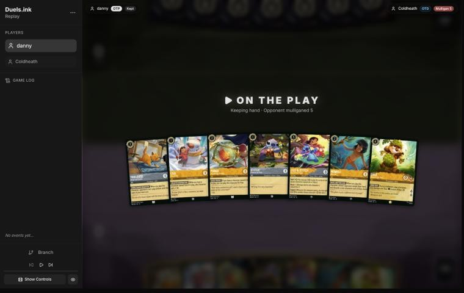
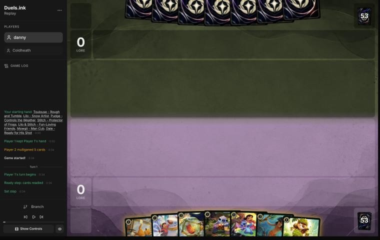
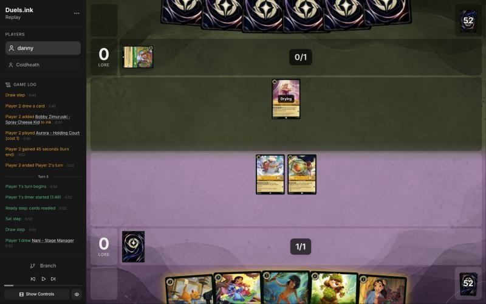
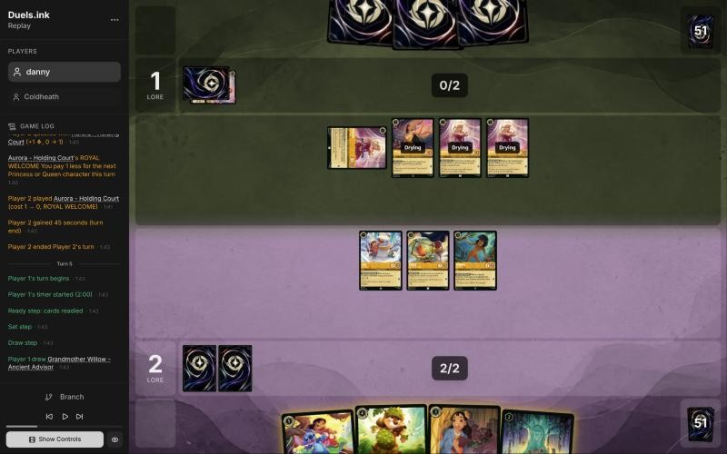
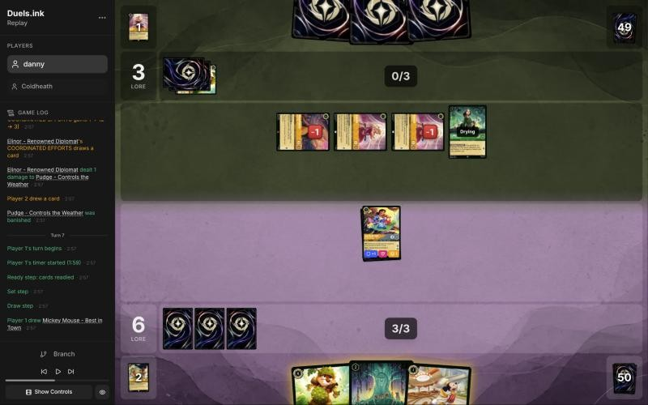
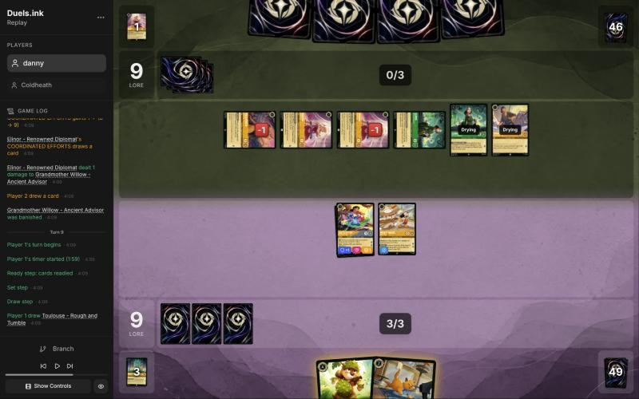
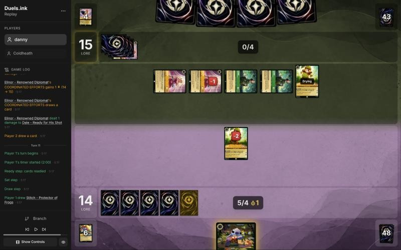

# Review: danny vs Coldheath, 2026-11-08

| | |
|---|---|
| **Status** | draft (blind pass done, not yet discussed) |
| **Replay** | `01a1bcd1-2969-771e-84b4-aaf69dc52745` (`python3 tools/brief.py 01a1bcd1-2969 --turn N`) · [duels.ink viewer](https://duels.ink/replay/01a1bcd1-296d-7f68-b386-e15c2126153d?step=0) |
| **Format** | Core Constructed best of one, ranked; duels.ink engine v2.2, judged by the Comprehensive Rules v2.3.0. Set 14 era: inks revealed before the coin toss |
| **Decks** | You: Amber/Steel Rockstar Aggro, a Lilo list (Lilo – Snow Artist, free Pudges, Grandmother Willow, Lilo & Stitch, Dale, Toulouse, Mowgli; no Strength of a Raging Fire). Them: Amber/Emerald ([the coach's notes on this pair](#cite-kb-meta-archetypes-amber-emerald-princess-aggro-dale-discounts-and-the-peacekeeper-base)); Princess Aggro from turn 3 |
| **Play/draw** | You chose to go first |
| **Result** | Loss: they quested to 21 on game turn 12, against your 16 |
| **Meta data** | snapshot of 26 Oct 2026 (fresh: stale from 9 Nov) |
| **Chosen how** | By the user: the most recent game in a zip of games, the others to be studied after this review |

## Summary
- **Good plays:** [pre-game](#turn-0), [3](#turn-3), [5](#turn-5), [7](#turn-7) (holding the ink) and [9](#turn-9).
- **Close calls:** [1](#turn-1) (inking Stitch rather than Dale) and [5](#turn-5) (Mowgli rather than Pudge to
  take the challenge).
- **Inaccuracies / mistakes / blunders:** none.
- **Unwinnable from:** [turn 11](#turn-11). Their turn 10 took both your questers, and then their board quested for 6
  with two Elinors adding 2, against the 5 they needed.

**What decided it:** two Elinors from game turn 8 made them an 8-lore-a-turn deck, so you had to race. On turn 10
they held both cards that beat the race: their own Dale (Thomas killed Mickey) and Pocahontas – Peacekeeper (she
killed Lilo & Stitch). At turn 9 that was about an even chance, which the coach's blind pass first missed.

## The game, turn by turn
Verdicts judge each decision on what you could know at the time, **including archetype knowledge an experienced
player has**. Hindsight is kept to its own section. Severity scale: good play / close call /
inaccuracy / mistake / blunder. Principle IDs and hypotheses (H-n) link to copies
in the Citations section at the end, as they stood when they were cited.

**What you knew before the game:** they're Amber/Emerald. By duels.ink's 26 Oct meta that's Circle of Life 60%,
Princess Aggro 24%, and 16% lists it doesn't group. They mulliganed 5 cards, so they were looking for something
specific. You're on the play, so their turns are the even game turns, with 1 ink on game turn 2, 2 on turn 4, 3 on
turn 6, and so on. Your Mickeys would add a drop for them each time one ends your turn exerted.

The key cards, and the earliest each can come:
- **Malicious, Mean, and Scary** (3, song): 1 damage counter on each of your characters. Earliest **game turn 4**:
  Angel – Siren Singer (Singer 3) costs 1 on their first turn on the draw, then sings it on their 2nd. Otherwise game
  turn 6 (hard-cast with 3 ink, or sung by a 3-drop played on turn 6 from turn 8).
- **To Wither a Flower** (4, song, uninkable): 2 damage to each damaged opposing character. Ursula – Vanessa
  (Singer 4) sings it. With Malicious first, it kills every character of yours with 3 willpower or less. Earliest
  **game turn 6**: Angel sings Malicious, Ursula (played on turn 4) sings Wither.
- **Don Karnage – Debonair Pirate** (6, Shift 4 onto Don Karnage – Khan's Courier): on play, 1 damage to each of your
  characters, through Resist. Earliest game turn 8 by Shift, earlier with Akood et Emuti's discount.
- **Prince Phillip – Vanquisher of Foes** (9): on play, banish all your damaged characters. Replayed free from their
  discard with **Circle of Life** (8, Sing Together 8: their characters' costs, Singer counting), once Tod, Max Goof
  or Strike a Good Match has discarded him; or hard-cast for 7 after Akood. A mid-game threat, not an early one.
- **Akood et Emuti** (3, song): draw 1, next character 2 cheaper, so a 5 comes at 3 and Milo at 5.
- **Chernabog – Unnatural Force** (5; 3 after Akood): shuffles one of your characters into your deck, and you may play
  a character from your discard free.
- **Milo Thatch – Getting His Hands Dirty** (7, Ward): on play, discards a card to return your character to your hand.
- **Max Goof – Karaoke Star** (3): draws 2 for a discarded song; quests for 4 once 5 songs are in their discard.
- **Princess Aggro instead:** Dale – Ready for His Shot (their characters deal damage with {W} in challenges, so
  their 0/4s kill your 2-willpower characters), Elinor – Renowned Diplomat (4: a ping, lore and a draw at the end of a
  turn with 3 exerted), Rapunzel – Tower Defender (4: bounce), Pocahontas – Peacekeeper (Shift 3: no challenges).

What that means for your deck: most of it has 2 or 3 willpower, so Malicious alone kills the 2-willpower half
(Lilo – Snow Artist, Bundled Up, Willow, Mowgli, Toulouse, Flash) and Malicious with Wither kills everything but the
4-willpower bodies and Lilo & Stitch. **Nearly all their board damage is songs,** so **Toulouse** ("opponents can't
play actions until the start of your next turn") stops a whole sweep turn, and **Mowgli** takes a song out of their
hand ([the coach's notes on Circle of Life](#cite-kb-meta-archetypes-amber-emerald-circle-of-life-more-routes-to-the-wipe),
[on your deck](#cite-kb-meta-archetypes-amber-steel-rockstar-aggro-savitar-s-lilo-list)).

### Pre-game

*The board before the decision: [step 0](https://duels.ink/replay/01a1bcd1-296d-7f68-b386-e15c2126153d?step=0) in the duels.ink replay viewer.*

**What you did:** chose to go first, then kept all seven: Toulouse, Lilo – Snow Artist, Pudge, Stitch – Protector of Frogs, Lilo & Stitch,
Mowgli and Dale. They mulliganed 5.

**Verdict: good play.** The hand has a play every turn and a plan: Lilo on turn 1 makes Pudge free (GOOD FRIEND), so
turn 1 is two bodies; Stitch and a 2-drop on your 2nd turn; Lilo & Stitch Shifted onto Lilo or Stitch for 3 on your
3rd, questing for 3 at once; Dale on your 4th. And it holds both of the deck's answers to a song deck, Toulouse and
Mowgli, against a pair that's 60% Circle of Life ([MULL-1](#cite-mull-1), [MULL-3](#cite-mull-3)).

`tools/mulligan.py` (1,500 deals) put the keep ahead on ink (9.53 of 10 on turns 1–4, against 9.24 for sending back
Dale and 9.02 for a full mulligan), with a play on all four turns. It gave the full mulligan more lore by turn 4 (8.7
against 7.4), but the sim ignores Shift, so it counts Lilo & Stitch as a 5-drop that never quests by turn 4, and it
rates Toulouse and Mowgli as no interaction. Sending back Dale (7.9 lore) is the only option worth a look, since a
0-strength 4-drop does little against Circle of Life; against Princess Aggro, a quarter of the field, he's what
makes your 0/4s and 1/4s kill. Keeping him is fine. Confidence: high.

**Going first: good play.** Your deck is the aggressor against both likely archetypes ([ROLE-1](#cite-role-1)), and on the play your
two-body turn 1 comes before their first character; the card you give up by skipping the first draw ([RULE-7](#cite-rule-7)) matters
less to a deck of 1- and 2-drops.

### Turn 1: your turn 1

*The board before the decision: [step 3](https://duels.ink/replay/01a1bcd1-296d-7f68-b386-e15c2126153d?step=3) in the duels.ink replay viewer.*

**What you did:** inked Stitch – Protector of Frogs, played Lilo – Snow Artist, then Pudge free with GOOD FRIEND.

**Verdict: close call** on the ink; Lilo then a free Pudge is the obvious play. The choice was between Stitch and Dale
(the rest of the hand is the curve, the Shift, and the two answers to songs: [INK-1](#cite-ink-1), [INK-2](#cite-ink-2)).
- **Inking Stitch** keeps Dale, a 2-lore body with 4 willpower, one of the few in your deck that lives through
  Malicious, Mean, and Scary *and* To Wither a Flower (1 + 2 damage). The cost: Lilo & Stitch must Shift onto Lilo
  on your 3rd turn, so Lilo goes under her and you're a body down, unless you draw a Stitch (three left).
  Next turns: Toulouse or Mowgli on your 2nd, the Shift on your 3rd, Dale on your 4th: all ink used.
- **Inking Dale** keeps Stitch, the better Shift base: Lilo & Stitch onto Stitch leaves Lilo in play, questing for 2
  (Lilo & Stitch is named Stitch). Next turns: Stitch and a spare ink, or a 2-drop, on your 2nd; the Shift on your
  3rd; Stitch or a 2-drop and whatever you draw on your 4th, perhaps a point of ink short.

Each costs about one body, and Dale's resistance to the double sweep is worth as much as Stitch's Shift. Confidence:
medium.

### Turn 3: your turn 2

*The board before the decision: [step 10](https://duels.ink/replay/01a1bcd1-296d-7f68-b386-e15c2126153d?step=10) in the duels.ink replay viewer.*

**What you did:** drew Nani – Stage Manager, inked Toulouse, played Mowgli, and quested with Lilo and Pudge (2–0).

**Verdict: good play.** Aurora – Holding Court and an inked Bobby Zimuruski, both Princess Aggro tells, moved the odds
to 94% Princess Aggro, whose average list runs no songs or actions. That made Toulouse the card to ink: his lock does
nothing against it ([INK-2](#cite-ink-2)). Mowgli's discard is small against an all-character deck too, but his reveal shows all six
cards in their hand, which tells you whether Dale, Elinor or Pocahontas – Peacekeeper is coming ([SEQ-1](#cite-seq-1)). Both quests
were safe: Aurora's 1 strength can't kill Lilo or Pudge, and nothing at their 2 ink adds a challenger (Dale costs 4,
and Aurora's discount only helps a Princess or Queen). Confidence: high.

### Turn 5: your turn 3

*The board before the decision: [step 22](https://duels.ink/replay/01a1bcd1-296d-7f68-b386-e15c2126153d?step=22) in the duels.ink replay viewer.*

**What you did:** drew Grandmother Willow, played her and undid it, then inked Nani, Shifted Lilo & Stitch onto Lilo
for 3, quested with her (+3) and gave Mowgli her Support (+3 {S}). Mowgli challenged the exerted Aurora – Holding
Court and banished her, taking 1. Pudge quested: 6–1.

**Verdict: good play,** with a close call on which character took the challenge.

Mowgli's reveal on turn 3 showed their whole hand, so their next turn was nearly known: Elinor ×2 and Dale, plus one
draw, with 3 ink. Dale (4) wasn't castable, but each Aurora quest takes 1 off a Princess or Queen, so Elinor would come
for 1 or 2, and with three of theirs exerted at the end of their turn her COORDINATED EFFORTS deals 1 damage to a
character of yours. The Shift was the turn's best play: Lilo was dry, so Lilo & Stitch quested for 3 at once
([your deck's notes](#cite-kb-meta-archetypes-amber-steel-rockstar-aggro-savitar-s-lilo-list)), and her Support put
the exerted Aurora in reach of a 1-strength character. Killing Aurora for nothing was worth the 1 lore the challenger
didn't quest for: she's a lore a turn and one of the discounts that bring Elinor and Pocahontas – Peacekeeper early
([QC-2](#cite-qc-2), [TRADE-2](#cite-trade-2)). Inking Nani rather than Dale kept the 4-drop that matters most in this matchup: Dale makes your
3- and 4-willpower bodies deal that much back to any challenger ([INK-2](#cite-ink-2)).

**Mowgli or Pudge to challenge: close call.** Aurora hits back for 1, so the challenger is left on 1 (Mowgli) or 2
(Pudge) willpower. With Mowgli on 1, Elinor's ping kills him for nothing; with Pudge on 2 and Mowgli on 2, the ping
alone kills neither, and each kill needs a challenge from a character that would otherwise quest (Pocahontas alone
kills either). To kill both, they need two challengers either way. So Pudge challenging costs them a quest for their
first kill, about a lore; Mowgli challenging kept the sturdier Pudge undamaged. Lilo & Stitch is safe either way: 5
willpower and Resist 1 against their 1- and 2-strength characters. Confidence: medium.

### Turn 7: your turn 4

*The board before the decision: [step 39](https://duels.ink/replay/01a1bcd1-296d-7f68-b386-e15c2126153d?step=39) in the duels.ink replay viewer.*

**What you did:** drew Mickey Mouse – Best in Town, didn't ink, played Grandmother Willow and then Mickey for free
with SMOOTH THE WAY, and quested with Lilo & Stitch (9–3).

**Verdict: good play, and a non-obvious one: holding the ink.** Your inkable cards were Dale and Mickey, both plays
you wanted, with Willow uninkable. The lines:
- **Ink Mickey and play Dale** (4): one body now; Willow next turn with a 3-drop at most.
- **Ink Dale, play Willow and Mickey:** two ink wasted, and the matchup's best 4-drop gone.
- **No ink, Willow then Mickey free** (the line played): two bodies now, 1 ink spare, and Dale next turn for 3 with
  Willow's discount, keeping every card. With three cards in hand, cards were scarcer than ink ([INK-3](#cite-ink-3)).

Questing with Lilo & Stitch was right too. Killing their Pocahontas – Guiding the Tribe (the Peacekeeper base, 17% to
be in hand after their draw) or an Aurora would cost 3 lore to remove a 1-lore character ([TRADE-4](#cite-trade-4)), and nothing of
theirs could punish the quest: their characters' damage after her Resist adds up to 3 against her 5 willpower. Willow
and Mickey were played this turn, so they stay ready and can't be challenged; only Elinor's pings reach them, and it
takes two (a second Elinor, known in their hand) to kill Willow. Confidence: high.

### Turn 9: your turn 5

*The board before the decision: [step 54](https://duels.ink/replay/01a1bcd1-296d-7f68-b386-e15c2126153d?step=54) in the duels.ink replay viewer.*

**What you did:** drew a second Toulouse, inked it, played Dale, and quested with Lilo & Stitch and Mickey (14–9).
Mickey's HOT DOG gave each player an ink drop.

**Verdict: good play.** Their two Elinors had turned the game into a race you were losing by default: their board of
six quests for 6, and each Elinor adds a lore, a card and a ping at the end of every turn they exert three
characters, so 8 a turn: 17 after their next turn and 20 on game turn 12 (`tools/odds.py clock`). Your Lilo & Stitch
and Mickey quest for 5. The lines:
- **Dale, quest with both** (the line played): 14 now, and 7 a turn with Dale, so 20 on game turn 11 unless they take
  2 lore off you first. Dale enters ready, so only their pings reach him (2 damage, not enough). And SPIKE SUIT makes
  your characters deal their willpower back in every challenge, whichever side challenges
  ([the Dale note](#cite-kb-cards-dale-ready-for-his-shot-what-it-means-in-play)): Lilo & Stitch deals 5, Mickey 4,
  so every challenger of theirs dies. Their cheapest way to stop you is both Auroras into Mickey (both die) and both
  pings on him, which leaves you on 19 after game turn 11 against their 15.
- **Toulouse instead of Dale** (no ink): Toulouse's lore would replace Dale's, but without SPIKE SUIT, Aurora and Elinor
  kill Mickey for nothing, and two pings kill Toulouse's 2 willpower. You'd get to 17.
- **Lilo & Stitch challenging** an exerted Elinor (5 damage with Dale out) or an Aurora rather than questing: 3 lore
  given up to slow them by 1 or 2 a turn. That still loses the race, 18 against their 21 on game turn 12.

Inking Toulouse was free: Princess Aggro plays no actions for his lock to stop, and Dale was the card that had to come
down ([INK-2](#cite-ink-2)). Confidence: medium. The race turns on whether they find the two-Aurora kill on Mickey.

**Revisited after turn 10,** from turn 9's information only: the exposure above is incomplete. The brief listed two
cards that change it, and the coach left both out:
- **Their own Dale – Ready for His Shot** (combat, 28% to be in hand after their draw). SPIKE SUIT works for whoever
  controls a Dale, so with both in play their characters deal their willpower too. Thomas (0/4) kills Mickey alone, and
  Elinor and Pocahontas (4 and 3 willpower, less Resist) kill Lilo & Stitch together.
- **Pocahontas – Peacekeeper** (28%), Shifted onto the dry Guiding the Tribe for 1 after two Aurora quests, challenges
  at once.

At least one of the two was in hand about half the time (49%, `tools/odds.py hold`, 6 copies in 5 cards from 50).
**The verdict stands:** every alternative already lost the race when they held neither, and holding Lilo & Stitch
back gives up the 3 lore that the race needs. What changes is the risk: it was about even, not the narrow two-Aurora
line written above.

### Turn 10: their turn

**What happened:** they played their Dale (4, with Mickey's drop). Thomas challenged Mickey: both dealt 4 and both
died. Two Aurora quests made Pocahontas – Peacekeeper cost 1 to Shift onto Guiding the Tribe, and she challenged Lilo &
Stitch: 6 through Resist for 5, and 5 back. Both died. Both Elinors quested and pinged your Dale twice (2 damage). They
were on 15 and you on 14, with your board down to a damaged Dale.

### Turn 11: your turn 6

*The board before the decision: [step 73](https://duels.ink/replay/01a1bcd1-296d-7f68-b386-e15c2126153d?step=73) in the duels.ink replay viewer.*

**What you did:** drew Stitch – Protector of Frogs, played him, and quested with Dale (16–15).

**Verdict: unwinnable from here** ([principle 2](#cite-principle-2)). Their board quests for 6 (both Auroras, both Elinors, and their Dale
for 2), and both Elinors add a lore at the end of their turn: 8 against the 5 they needed. Your hand was one Stitch,
and the most one challenge from Dale could take off was an Elinor's 2 (her quest and her trigger), costing Dale too,
since Elinor's 4 willpower hits back under their SPIKE SUIT. Questing was as good as anything.

## Lessons
1. **Against an all-character deck, Mowgli's reveal is worth more than his discard.** It found nothing to discard, but
   it showed Elinor ×2 and Dale, so turns 5 to 9 were planned against a known hand ([turn 3](#turn-3)).
2. **When both inkable cards are plays you want, holding the ink can be right.** On [turn 7](#turn-7) that meant
   Willow and a free Mickey now, and Dale for 3 next turn.
3. **Two Elinors make Princess Aggro an 8-lore-a-turn deck.** Each adds a lore, a card and a ping at the end of every
   turn with three of theirs exerted. Once both land, you're racing ([turn 9](#turn-9)).
4. **Their Dale mirrors yours.** SPIKE SUIT applies to each player's own characters, so with a Dale on each side
   every challenge is willpower against willpower. Their 0/4 Thomas traded with your 0/4 Mickey, and a Shifted
   Peacekeeper (6 willpower) killed Lilo & Stitch through Resist ([turn 10](#turn-10)).
5. **Count every card the brief tags before calling a quest safe** (the coach's miss on [turn 9](#turn-9)). Their Dale
   and Peacekeeper were each 28%, and together about even.

## Proposed knowledge-base updates (applied after discussion)
- **Cards** (the Dale note): with a Dale on each side, both players' characters deal their {W} in challenges. Their
  0/4s trade with yours, and a 6-willpower Pocahontas – Peacekeeper kills a 5-willpower Lilo & Stitch through Resist
  (turn 10).
- **Meta** (Amber/Emerald notes): **Coldheath's Princess Aggro.**
  - Seen: Aurora – Holding Court ×3, Pocahontas – Guiding the Tribe, Pocahontas – Peacekeeper ×3 (two inked),
    Elinor ×2, Dale ×2 (one inked), Thomas and Bobby Zimuruski.
  - Two Elinors from game turn 8 gave +2 lore, 2 pings and 2 cards a turn.
  - Two Aurora quests cut Peacekeeper's Shift from 3 to 1. They used her as a 6-willpower challenger under Dale, not
    for her lock.
- **Strategy and rules:** nothing new.

## Hindsight
Doesn't change the verdicts above.
- **They held both outs on turn 10:** their Dale and Peacekeeper. With neither, Lilo & Stitch, Mickey and Dale quest
  for 7 on turn 11, and you win on 21 before their turn 12.
- **Turn 5's choice of challenger made no difference.** They killed Mowgli with an Aurora's challenge, and Pudge with
  Pocahontas and an Elinor ping. The other way round, the same two challengers and the ping do the same.

## The coach's errors
Found by the coach during the review; the discussion may add more.

| When | Error | How it was caught | How it won't happen again |
|---|---|---|---|
| Turn 9 | The exposure left out two cards the brief printed: their Dale (combat, 28%) and Pocahontas – Peacekeeper (challenges the turn it lands, 28%). It said every challenger of theirs would die to your SPIKE SUIT. With their own Dale, both sides deal willpower, so Thomas kills Mickey, and Elinor with Pocahontas kills Lilo & Stitch | Turn 10's brief; revisited from turn 9's information (the verdict stands, the risk was about even) | **Done** (commit f310532, 8 Nov 2026): the brief's "what can challenge your characters" counts SPIKE SUIT. When their Dale is castable next turn, it lists what their characters deal with it, and each of your characters' lines says what it then kills ("If they play Dale – Ready for His Shot first: one challenge kills it: Elinor, Elinor, Thomas"). A Dale of yours in play, or in your hand, is counted in your damage back |
| Turn 11 | That brief section ignored SPIKE SUIT with their Dale already in play. It listed their Auroras at 1 and said only an Elinor kills your Dale on 2 willpower; under SPIKE SUIT the Auroras deal 2 | Reading the turn-11 brief against the board | **Done** (the same commit): it uses their characters' {W} while their Dale is in play, with a test on this game's turns 9 and 11 |

## Open questions
- **Turn 1:** why ink Stitch rather than Dale?
- **Turn 5:** why Mowgli rather than Pudge to take the challenge?
- **Turn 9:** did you weigh their Dale or Peacekeeper? Was there a line you considered against them?

## Citations
Copies of the coach's knowledge base cited above, as they stood when they were cited (the private repository's commit and date are given with each). They don't change when the knowledge base does.

**amber-emerald.md, Circle of Life: more routes to the wipe**: knowledge base, `kb/meta/archetypes/amber-emerald.md` at `f46db4d` (2026-11-06), working tree

> ### Circle of Life: more routes to the wipe `[coach, meta study of the user's 27 Oct 2026 games (tools/scan.py), full games, not blind, 4 games]`
> Games: 01a17df1, 01a17e1c, 01a17ebf, 01a17f17.
> - **Other damage sources before Phillip:**
>   - Don Karnage – Debonair Pirate (6, Shift 4; 1 damage to each opposing character, which Resist can't reduce)
>   - challenges that finish off pinged characters (01a17e1c turn 10: Malicious, Mean, and Scary sung by Tod, then Angel
>     and Ursula – Vanessa challenged the damaged ones)
> - **Two ways to Phillip:**
>   - **Replayed with Circle of Life.** 01a17df1 turn 10, their 5th turn: Akood et Emuti made Don Karnage cost 4 instead
>     of 6; Ancestral Guitar (FROM THE HEART: a character gains Singer and +2 cost to sing) let Ursula – Vanessa and
>     Angel reach Sing Together 8. Three characters banished.
>   - **Hard-cast for 7** after Akood et Emuti's discount: 01a17ebf turn 14, after Malicious, Mean, and Scary. Five
>     banished.
> - **Enablers:**
>   - Akood et Emuti (song 3: draw a card, next character costs 2 less)
>   - Strike a Good Match (draw 2, discard 1; how Phillip reaches the discard)
>   - Max Goof – Rebellious Teen (pay 1 to return a song of cost 3 or less from the discard)
>   - Meilin Lee (searches a song)
>   - Chernabog (shuffles one of your characters into your deck)
>   - Lenny (you discard an action)
> - **Tempo:** they quested very little before the wipe. They had 0 lore on turn 10 in 01a17df1 and 01a17e1c, and 0 on
>   turn 14 in 01a17ebf while you had 14. A big lore lead before the wipe, plus a rebuild in hand, is how those games
>   went your way.

**amber-emerald.md, Princess Aggro: Dale, discounts and the Peacekeeper base**: knowledge base, `kb/meta/archetypes/amber-emerald.md` at `f46db4d` (2026-11-06), working tree

> ### Princess Aggro: Dale, discounts and the Peacekeeper base `[coach + user, one match: 01a19bb9 and 01a19bbd-79c2, 2026-11-02]`
> MK_ifoughtthelore (Amber/Sapphire Detectives) vs xBWx, won 2–0; sent by the user, reviews in
> `output/reviews/2026-11-02_01a19bb9_vs-xbwx-g1.md` and `…01a19bbd_vs-xbwx-g2.md`. Card text verified from the replays.
> - **Dale – Ready for His Shot is the key piece** (4, 0/4/2; `kb/cards/dale-ready-for-his-shot.md`). SPIKE SUIT: in
>   challenges their characters deal damage with their {W}, so Mike Wazowski – Heroic Climber (0/4), Thomas – Wide-Eyed
>   Recruit (0/4) and David – Protective Snowboarder (1/4) deal 4. Before he's in play, a quest that exerts a cheap
>   character can still be exposed: judge it from their next turn. Once he lands, remove him first (01a19bbd-79c2 turn 8:
>   two Supports made him 5 {S} for Gaston – Superior Archer's WATCH THIS).
> - **Discounts bring cards a turn early.** Pluto – Friendly Pooch's GOOD DOG ({E}: next character 1 cheaper) made Dale
>   castable with 3 ink (01a19bbd-79c2 turn 5). They stack: two GOOD DOGs and Aurora – Holding Court's ROYAL WELCOME (next
>   Princess or Queen 1 cheaper) put Elinor – Renowned Diplomat (a Queen) into play for 1 on turn 9.
> - **Pocahontas – Guiding the Tribe** (2, 2/3/1) plays a cost-1 character for free, and **she's the Shift base for
>   Pocahontas – Peacekeeper's challenge lock**. Remove her early (01a19bb9 turn 7). When Peacekeeper is known in
>   their hand and a Guiding the Tribe is in play, fight this turn: the next one may allow no challenges (01a19bbd-79c2
>   turn 14, then their turn 15).
> - **Elinor's COORDINATED EFFORTS** needs 3 exerted characters at the end of their turn; with their wide board it
>   usually has them. Its 1 damage killed a 1-willpower Eilonwy (01a19bbd-79c2 turn 9).
> - **Mike Wazowski – Heroic Climber's FIND A FRIEND is symmetrical** (on play and on each quest, each player reveals
>   their top card and takes it if it's a character). Against a character-heavy deck such as Detectives it feeds you
>   about as often as them (01a19bb9).
> - **Hand attack:** Mowgli – Man Cub (you discard a non-character card of your choice) and Ursula – Deceiver (you
>   discard a song of their choice). Small against an all-character deck.
> - **Removal is light:** Elinor's ping and Rapunzel – Tower Defender (4; they discard a card to return your character
>   to your hand).
> - **Their cards across the match** (most copies seen in one game): David ×4, Mike ×3, Pocahontas – Guiding the
>   Tribe ×3, Bobby Zimuruski ×2, Mowgli ×2, Mushu – Stealthy Dragon ×2, Pluto ×2, and one each of Aurora – Holding
>   Court, Dale, Elinor, Nani – Stage Manager, Pocahontas – Peacekeeper, Rapunzel – Tower Defender, The Queen – Regal
>   Monarch, Thomas and Ursula – Deceiver. Mowgli and Mushu aren't in duels.ink's average list.

**amber-steel.md, Rockstar Aggro: Savitar's Lilo list**: knowledge base, `kb/meta/archetypes/amber-steel.md` at `f46db4d` (2026-11-06), working tree

> ### Rockstar Aggro: Savitar's Lilo list `[coach, meta study of 15 of Savitar's games, 2 Nov 2026 (tools/scan.py), full games, not blind]`
> Studied: 01a19bbd-6ae7 and 01a19bc4-57f1 (GoldenBeast), 01a19bd8-ada2 and 01a19bdb-d8e4 (iKnowZer0), 01a19c02-ae0e,
> 01a19c06-3be1, 01a19cc1-7b0e and 01a19cc5-5243 (Kariminal), 01a19c08-a45f, 01a19c0e-1e9e and 01a19c11-9fbf
> (ligerien), 01a19cbb-e8f7 and 01a19cbe-8319 (Pandagheist), 01a19da0-735c and 01a19dad-a6c9 (DJJAZZYJIMMY). The same
> 60 in every game:
> - **1-drops:** Lilo – Snow Artist ×4 (1/2/1; +1 {L} with a Stitch in play), Stitch – Protector of Frogs ×4 (1/3/1),
>   Mickey Mouse – Best in Town ×4 (0/4/2, Adventurous; HOT DOG gives each player an ink drop).
> - **2-drops:** Grandmother Willow ×4 (uninkable; SMOOTH THE WAY: next character 1 less each turn), Lilo – Bundled Up
>   ×4 (uninkable, 1/2/2; EXTRA LAYERS: the first damage on each opponent's turn is prevented), Pudge – Controls the
>   Weather ×4 (1/3/1; **free with a Lilo in play**), David – Protective Snowboarder ×4 (1/4/1, Bodyguard), Mike Wazowski
>   – Heroic Climber ×4 (uninkable, 0/4/1; FIND A FRIEND on play and each quest: **each player** may keep a character off
>   the top), Flash – Efficient Clerk ×3 (uninkable, 3/2/2, Resist 1; no character can have Rush), Toulouse – Rough and
>   Tumble ×4 (opponents can't play actions, songs included, until your next turn), Mr. Big – Distribution Magnate ×3
>   (0/2/1; ICE OUT: if all your ink is exerted at the end of your turn, a chosen opposing character can't challenge
>   until your next turn).
> - **Higher:** Nani – Stage Manager ×4 (3; finds a 2-cost-or-less character in the top 4), Strength of a Raging Fire ×4
>   (3; damage equal to your character count), Dale – Ready for His Shot ×4 (4, 0/4/2; SPIKE SUIT: in challenges your
>   characters deal damage with their {W}), Lilo & Stitch – Fun-Loving Friends ×4 (Shift 3 onto a Lilo or Stitch;
>   3/5/3, Resist 1, Support), Lilo – Rock Star ×2 (Shift 4 onto a Lilo; each quest replays a 2-cost-or-less character
>   from the discard).
> - **Not in duels.ink's average list:** David, Flash, Mr. Big and Lilo – Rock Star; no Angel, Berlioz or Stitch – Rock
>   Star.
>
> **How it wins:**
> - **A wide board on turn 1:** Lilo – Snow Artist then three free Pudges made four characters on game turn 1 of
>   01a19bc4-57f1. Grandmother Willow's discount and Mickey's drops keep two plays a turn coming.
> - **Quest turns of +5 to +10** once five to seven 1-lore characters are out (01a19bdb-d8e4 turn 8: +10, with Lilo &
>   Stitch Shifted on for 2).
> - **Dale turns high-willpower bodies into removal:** Stitch (3 {W}) and Mike Wazowski (4 {W}) killed three of
>   ligerien's characters in one turn (01a19c08-a45f turn 8).
> - **Locks:** Mr. Big's ICE OUT on their best challenger each turn (two Mr. Bigs, two targets), Toulouse against a
>   song deck on the turn it matters, Flash against Rush.
>
> **What beat it in the study:**
> - **Board damage:** most of the deck has 2 or 3 willpower. Circle of Life's Malicious, Mean, and Scary plus To Wither
>   a Flower killed five characters on turn 7 of 01a19cc5-5243; Don Karnage – Debonair Pirate's 1 damage plus Malicious
>   killed both Mr. Bigs (01a19c02-ae0e turn 6). Emerald/Steel's Don Karnage and Elinor pings did the same slowly.
> - **Raging Storm,** from game turn 9 with ink drops: Mickeys on both sides gave iKnowZer0 three drops for it
>   (01a19bdb-d8e4 turn 9, seven of Savitar's characters at 17–7).
> - **The Headless Horseman – Terror of Sleepy Hollow** (Amber/Ruby singers): banishes a character with 2 {S} or less
>   on play, which is almost every character in this deck.
> - **Savitar conceded early** when a sweeper deck's engine was online: game turn 6 against Chernabog (01a19cc1-7b0e),
>   turn 11 against Milo Thatch (01a19c06-3be1).
>
> **Playing it:**
> - **Grandmother Willow's SMOOTH THE WAY works on the turn she lands:** Willow then a 1-drop costs 2 in all, a 2-drop
>   3 `[coach, from the blind review of 01a19bca-cf89 turn 4, where the coach's plan missed it]`.
> - **Lilo – Rock Star's I'LL COUNT YOU IN plays the character ready,** and ready characters can't be challenged: a
>   replayed Mr. Big or Pudge is lore next turn that only an action can stop `[coach, from the blind review of
>   01a19bf9-b9ff turn 9, where the player's line beat the coach's]`.
> - **David – Protective Snowboarder enters exerted to shield Dale:** as a Bodyguard he must be challenged first, and
>   under SPIKE SUIT he deals 4 back, so their challengers trade into him before they can reach Dale `[coach, from the
>   blind review of 01a19bfe-7db6 turn 8, where the player's line beat the coach's]`.
> - **Lilo & Stitch – Fun-Loving Friends is named Stitch,** so every Lilo – Snow Artist quests for 2 while it's in
>   play, and spare Stitches become ink `[coach, 01a19bca-cf89 turn 6]`.
> - Against Malicious decks (Amber/Emerald Circle of Life, Emerald/Steel Don Karnage), more bodies don't mean more lore
>   once a 1-damage effect is live: count how many survive 1 damage (Stitch, Pudge, David, Mike, Mickey, Dale, Lilo &
>   Stitch) and how many survive 3 (Malicious + To Wither a Flower).
> - Mickey's and Mike's symmetric effects feed the opponent too: count their drops toward Raging Storm (8) and the
>   characters Mike's reveal gives them (`kb/cards/mickey-mouse-best-in-town.md`).
> - **Lilo & Stitch's Support makes a 0-strength character a challenger:** quest her first, give +3 {S} to a ready Mr.
>   Big, Mike or Dale (with Dale's SPIKE SUIT a character deals its {W} instead), and challenge an exerted 2- or
>   3-willpower character: their ramp pieces (Aurora, Hamm, Dream Come True) or a singer `[coach, from the blind review
>   of 01a19c3f-185a turn 5, where the player's line beat the coach's]`.
> - **Keep Toulouse in hand against Storm decks,** even as the only inkable card: against Candle Control, Mickey's
>   drops brought Raging Storm on game turn 11 while both Toulouses Savitar had drawn were in the inkwell
>   `[coach, 01a19ccd-3f04 turns 2, 8 and 11]`.
> - **Dale's SPIKE SUIT works whichever side challenges:** with Dale in play, Mike, Mickey and David (4 willpower) deal 4
>   to any challenger, which kills Reckless Liquidator, Jebidiah or Roller Bob `[coach, 01a19ccd-3f04 turn 6]`.
> - **Shift Lilo & Stitch in as soon as a dry Lilo or Stitch is there:** she quests for 3 at once, and Willow's
>   discount applies to the Shift (2 ink). Held in hand she does nothing `[coach, 01a19ccd-3f04 turn 6 and 01a19d99-ea68
>   turns 5 and 7, where she was inked or held]`.
> - **Mulligans in Savitar's reviewed games** (12 games, 2 Nov 2026): six keeps were flagged, five of them keeping Mr.
>   Big, David or Willow and sending back Flash, Bundled Up, Toulouse or Strength. `tools/mulligan.py` preferred the
>   2-lore cards and the cheap answers each time, by 0.7 to 1.8 lore by turn 4.
> - **After a Storm, rebuild with characters that stay ready through their turn** (Lilo then Lilo – Rock Star Shifted
>   on, Mr. Big, Lilo & Stitch): no challenge can reach them before they quest, so only an action or Hades – Infernal
>   Schemer stops them. Against Amber/Sapphire Control, count Hades (4 in the average list) with Storm and Let It Go
>   `[coach, 01a19c3b-62c9 turns 12–17: both rebuilt characters were taken by Hades]`.
> - Toulouse is the only way to stop a song turn before it happens: play him the turn before their singers can reach a
>   sweeper song.

**dale-ready-for-his-shot.md, What it means in play**: knowledge base, `kb/cards/dale-ready-for-his-shot.md` at `f46db4d` (2026-11-06), working tree

> ## What it means in play `[coach + user, one match: 01a19bb9 and 01a19bbd-79c2]`
> - **It turns their weakest-looking characters into killers.** These aggro lists run 0- and 1-strength characters with
>   high willpower: Mike Wazowski – Heroic Climber (0/4), Thomas – Wide-Eyed Recruit (0/4), David – Protective
>   Snowboarder (1/4). With Dale in play, each deals 4 in a challenge, enough to kill most cheap characters.
> - **It works both ways.** "During challenges" covers your challenges too, so challenging their Mike costs your
>   attacker 4 damage. The brief's challenge figures include SPIKE SUIT whenever it's in play.
> - **Their Challenger and strength pumps stop mattering while it's in play,** since damage comes from {W}.
> - **He can come a turn early.** Cost reducers make him castable with 3 ink: Pluto – Friendly Pooch's GOOD DOG ({E}: next
>   character 1 cheaper) in 01a19bbd-79c2 turn 5. The brief's "COST REDUCERS" line shows this.
> - **Judge exposure before he's in play.** From the turn they could cast him, every character you exert with 4 or
>   less willpower is exposed to their 0-strength characters. In 01a19bbd-79c2 turn 4 the coach called a 0-strength board
>   harmless; the user caught it.
> - **Removing him:** he has 0 {S} and 4 {W}, and deals 4 back if challenged. A Detectives deck can push his strength to
>   5 with Support (Support may target an opposing character, `kb/rules/rulings.md`) and banish him with Gaston –
>   Superior Archer's WATCH THIS or Judy Hopps – Always Vigilant's GOT YOU NOW (01a19bbd-79c2 turn 8). Remove him before
>   making other challenges.
> - **A Bodyguard under SPIKE SUIT hits back hard** `[coach, 01a1a59f-4c28 turn 12]`. Pete – Suave Showoff (4, 1/6/2,
>   Bodyguard) exerted must be challenged first, and deals 6 to whatever challenges him. Send a character you'd lose
>   anyway, such as a Demona that STONE BY DAY won't let ready, or Challenger +2 on 6 willpower.
> - **Killing Dale without challenging him:** damage that isn't a challenge's doesn't care about SPIKE SUIT. Wasabi –
>   Called into Battle's TWIN BLADES (01a1a59f-4c28 turn 12: 6 to Dale after a challenge elsewhere) or Mulan – Elite
>   Archer's TRIPLE SHOT. Or exert him (Peter Pan's Shadow, Isis) and challenge with 5+ willpower, so his 4 back doesn't
>   kill (turn 18: Demona – Betrayer, 6 willpower).

**MULL-1**: strategy principle, `kb/strategy/principles.md` at `f46db4d` (2026-11-06), working tree

> - **MULL-1. Keep a plan, not the strongest cards.** *Ask: "Which hand gives me the best chance to execute my game plan in this matchup?"* `[MCL ch.12]` · baseline

**MULL-3**: strategy principle, `kb/strategy/principles.md` at `f46db4d` (2026-11-06), working tree

> - **MULL-3. The right keep depends on the matchup.** Early interaction against aggro; pressure, draw and engines against slow decks. The mulligan is the first expression of your role. In the Set 14 era the opponent's inks are known before the mulligan (RULE-8), so this applies from game 1 of a match. `[MCL ch.12]` · baseline

**ROLE-1**: strategy principle, `kb/strategy/principles.md` at `f46db4d` (2026-11-06), working tree

> - **ROLE-1. The matchup decides your role, not your deck.** In nearly every game one player wants it short (aggressor) and one wants it long (defender). The same list can play either role. *Ask: "Which deck benefits if this game goes long?"* `[MCL ch.8]` · baseline

**RULE-7**: strategy principle, `kb/strategy/principles.md` at `f46db4d` (2026-11-06), working tree

> - **RULE-7. Play vs draw.** The starting player skips the first draw `[CR 3.2.3.1]`, so on the draw you start a card up. The previous game's loser chooses `[CR 2.1.3.2]`. · baseline

**INK-1**: strategy principle, `kb/strategy/principles.md` at `f46db4d` (2026-11-06), working tree

> - **INK-1. Inking is permanent.** Every inked card is one line of play removed for the rest of the game. *Ask: "Will I regret losing access to this card?"* `[MCL ch.4]` · baseline

**INK-2**: strategy principle, `kb/strategy/principles.md` at `f46db4d` (2026-11-06), working tree

> - **INK-2. Don't automatically ink the most expensive card.** It may be the late-game win condition or the key answer for this matchup. The answer depends on matchup, hand and board. `[MCL ch.4]` · baseline

**SEQ-1**: strategy principle, `kb/strategy/principles.md` at `f46db4d` (2026-11-06), working tree

> - **SEQ-1. Gather information before irreversible decisions.** Draw, look and scry before choosing what to ink. Quest with draw triggers before committing other plays when the order doesn't otherwise matter. `[MCL ch.5]` · baseline

**QC-2**: strategy principle, `kb/strategy/principles.md` at `f46db4d` (2026-11-06), working tree

> - **QC-2. Challenge the threat, not the character.** Engines, synergy pieces and big questers are worth fighting over. A 1-lore character doing nothing usually isn't. *Ask: "Does this character actually need to be removed?"* `[MCL ch.6, ch.9]` · baseline

**TRADE-2**: strategy principle, `kb/strategy/principles.md` at `f46db4d` (2026-11-06), working tree

> - **TRADE-2. The best trade removes theirs and keeps yours.** A survivor keeps generating value and demands more answers. `[MCL ch.7]` · baseline

**INK-3**: strategy principle, `kb/strategy/principles.md` at `f46db4d` (2026-11-06), working tree

> - **INK-3. Usually ink every turn, but not automatically.** Keeping one more playable card can beat one more ink. Missing ink with an expensive hand can leave you permanently behind. `[MCL ch.4]` · baseline

**TRADE-4**: strategy principle, `kb/strategy/principles.md` at `f46db4d` (2026-11-06), working tree

> - **TRADE-4. Every challenge has an opportunity cost.** It's a lost quest, and the challenger may be exposed while exerted. Declining a trade is often as strong as taking it. *Ask: "Would simply questing be stronger?"* `[MCL ch.7]` · baseline

**principle 2**: coaching principle, `CLAUDE.md` at `f46db4d` (2026-11-06), working tree

> 2. **Some games are unwinnable.** Draws and matchups can make a game lost whatever the player does. Say so
>    when it's true, rather than inventing mistakes to explain a loss.
