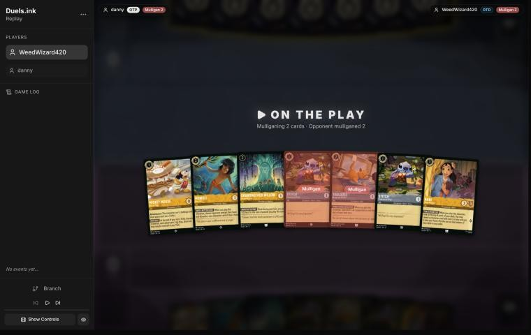
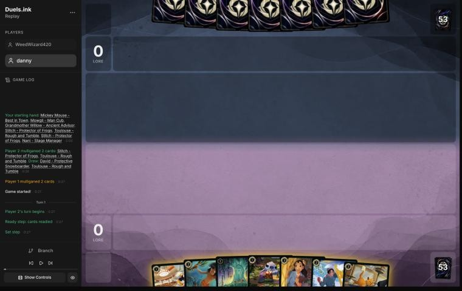
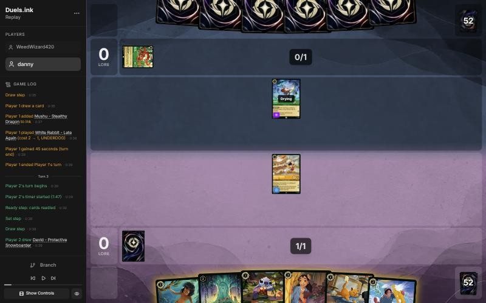
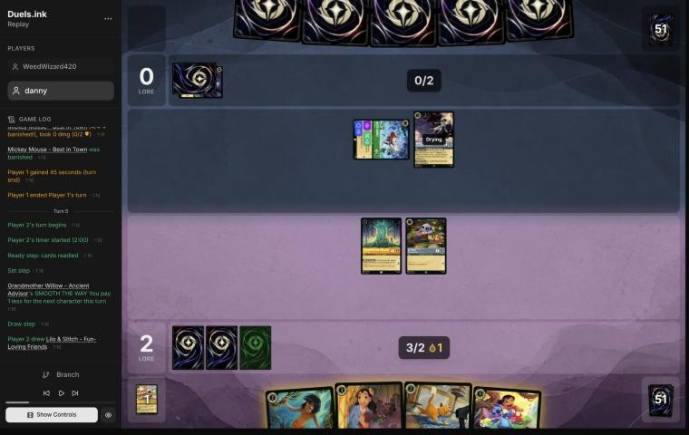
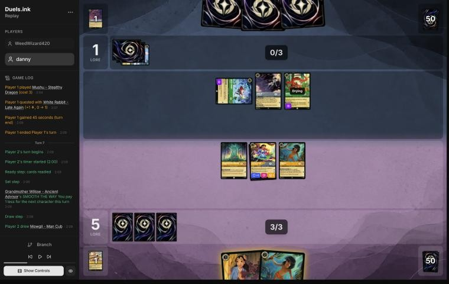
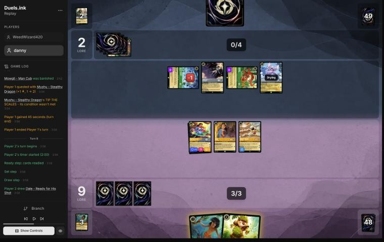
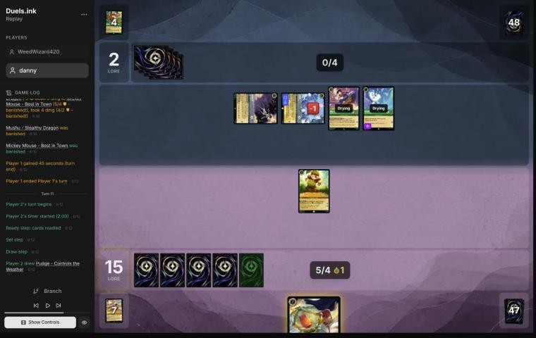
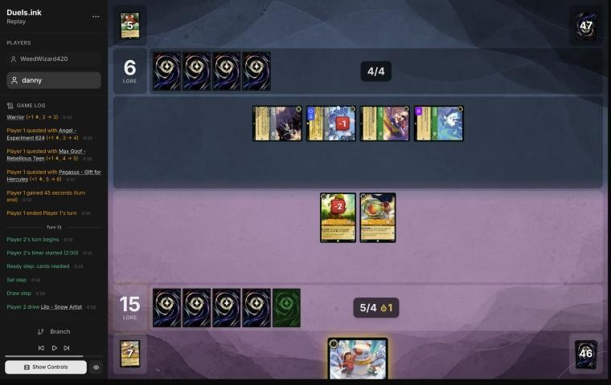
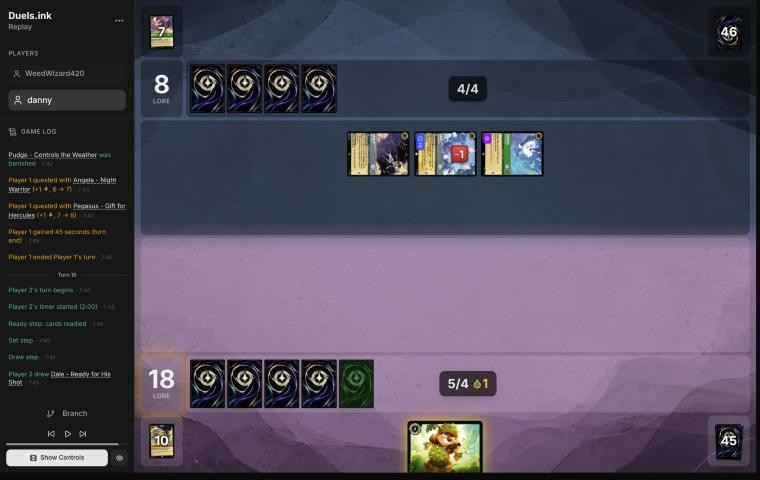

# Review: danny vs WeedWizard420, 8 Nov 2026

| | |
|---|---|
| **Status** | draft (blind pass done, not yet discussed) |
| **Replay** | `01a1bd40-04ec-773b-b015-f5af6086b7fb` (`python3 tools/brief.py 01a1bd40-04ec --turn N`) · [duels.ink viewer](https://duels.ink/replay/01a1bd40-04ef-77f1-8496-40f7d49cc760?step=0) |
| **Format** | Core Constructed, best of one. Set 14 era: inks revealed before the coin toss |
| **Decks** | You: Amber/Steel Rockstar Aggro, your Lilo list in its fourth version (Mowgli ×4, Thomas ×2, You Broke My Smolder ×2, Mike Wazowski – Well-Rounded Entertainer; no Strength of a Raging Fire, no Mr. Big). Them: Emerald/Steel ([the coach's notes on this pair](#cite-kb-meta-archetypes-emerald-steel-midrange-how-it-plays)); archetype as it became clear: Midrange #1, from turn 3 (93%) |
| **Play/draw** | You went first |
| **Result** | Won: they conceded on game turn 16, at 18–8, with your Dale ready to quest for the win |
| **Meta data** | snapshot of 26 Oct 2026 (13 days old: fresh, stale from 9 Nov) |
| **Chosen how** | By the user: the game they linked, the day it was played. Nothing about the result was known to the coach |

## Summary
Links go to the turn sections below.
- **Good plays:** turns [1](#turn-1), [3](#turn-3), [7](#turn-7) (questing Lilo & Stitch into a known Max Goof and
  Strength line), [9](#turn-9) (Dale), [13](#turn-13) and [15](#turn-15).
- **Close calls:** the [mulligan](#turn-0) (the second Stitch and Toulouse sent back), Willow kept ready and no ink on
  [7](#turn-7), and Dale kept ready on [11](#turn-11).
- **Inaccuracy:** [turn 5](#turn-5): Mowgli came after the Shift and the ink. First, he'd have cost the same and shown
  their hand before you chose what to ink.
- **Unwinnable from:** no point; you won.

**What decided it:** Mowgli's reveal on turn 5 took the only action in their hand, Strength of a Raging Fire, so their
removal had to wait for Max Goof to bring it back on turn 10. By then Lilo & Stitch had quested twice and you were on
15. Dale's SPIKE SUIT made each of their kills cost them a character, and when they'd cleared your board at 8 lore a
second Dale was ready to win.

## The game, turn by turn
Verdicts judge each decision on what you could know at the time, **including archetype knowledge an experienced
player has**. Hindsight is kept to its own section. Severity scale: good play / close call /
inaccuracy / mistake / blunder. Principle IDs and hypotheses (H-n) link to copies
in the Citations section at the end, as they stood when they were cited.

**What you knew before the game:** their inks, Emerald/Steel. duels.ink's lists give Midrange #1 83%, an unlisted
Emerald/Steel list 12.5% and Midrange #2 5%. You're on the play, so their k-th turn has k ink, plus one ink drop for
each turn your Mickey – Best in Town ends exerted (HOT DOG! gives each player one; [the Mickey note](#cite-kb-cards-mickey-mouse-best-in-town-what-it-means-in-play)).
Their key cards, read in full:
- **Strength of a Raging Fire** (3, song, ×4): damage to a chosen character equal to the number of characters they have
  in play. Hard-cast on game turn 6 (game turn 4 with one of your Mickey's drops), and sung for free by any of their
  cost-3-or-more characters a turn after it lands.
- **Max Goof – Rebellious Teen** (3): on play, pay 1 to take a song of cost 3 or less (Strength) back from their
  discard. Game turn 8 to cast and pay (4 ink).
- **Angel – Experiment 624** (4): GOOD AIM, once a turn, discard a card to deal 2 damage to a chosen character; Resist
  +2 with an empty hand. Game turn 8, or 6 with two drops.
- **Elinor – Renowned Diplomat** (4, uninkable, ×4): at the end of their turn, with 3 or more of their characters
  exerted, 1 damage to a chosen character of yours, 1 lore and a card. Game turn 8.
- **Angela – Night Warrior** (3): on play, a chosen character gets Challenger +2 and Resist +2 until their next turn.
  Game turn 6.
- **Woolter & Jesse** (3, uninkable, 4/4, Bodyguard, Challenger +2): game turn 6.
- **Broadway – Sturdy and Strong** (5, 4/6/2, Bodyguard; can't ready while they hold 3+ cards): game turn 10.
- **The Terror That Flaps in the Night** (2, ×1): 2 damage to a chosen character, 3 with a Darkwing Duck in play.
- **Toulouse – Rough and Tumble** stops your actions (You Broke My Smolder) for a turn; **Ursula – Deceiver** discards
  a song from your hand, and this list runs none.
- **Evasive questers your deck can't challenge** (you run no Evasive or Alert): White Rabbit – Late Again (2, 1 less on
  their first turn, so game turn 2), Pegasus (1), Vixey – Forest Friend (3, 2 lore; 1 less with Tod – All Alone in
  play), Mushu – Stealthy Dragon (3; draws when they hold fewer cards than you).

The pair's notes say this deck has no sweeper. It wears a board of 2- and 3-willpower characters down one at a time
with Strength, GOOD AIM, Elinor's pings and challengers that survive (Angela's Resist +2, Woolter & Jesse), and it beat
your Rockstar list in three of four studied games ([the notes](#cite-kb-meta-archetypes-emerald-steel-midrange-1-against-danny-s-rockstar-aggro-four-games)). Your plan is the race: a
wide board of cheap questers before their tools come online, and Dale – Ready for His Shot's SPIKE SUIT to make your
0-strength, 4-willpower characters (Mickey, Thomas, Mike – Heroic Climber, David) dangerous in challenges both ways
([the Dale note](#cite-kb-cards-dale-ready-for-his-shot-what-it-means-in-play)).

### Pre-game

*The board before the decision: [step 0](https://duels.ink/replay/01a1bd40-04ef-77f1-8496-40f7d49cc760?step=0) in the duels.ink replay viewer.*

**What you did:** kept Mickey, Mowgli, Grandmother Willow, one Stitch and Nani; sent back the second Stitch and
Toulouse. Drew David – Protective Snowboarder and another Toulouse.

**Verdict: close call.** The seven had a play every turn and the most early lore. `tools/mulligan.py` (1,500 deals for
the coach's options, 300 for yours):

| Option | Ink spent, turns 1–4 | Play turns | Lore by turn 4 | Characters by turn 4 |
|---|---|---|---|---|
| Keep all 7 | 8.6 of 10 | 4.0 of 4 | 11.5 | 5.9 |
| Keep 5 (as played) | 9.0 | 4.0 | 11.0 | 5.8 |
| Keep 6 (without Toulouse, or without Mowgli) | 8.4 | 4.0 | 11.6 | 5.8 |
| Full mulligan | 9.1 | 3.9 | 8.3 | 5.3 |

Your mulligan traded half a lore by turn 4 for more ink spent. The second Stitch is the weakest card here as a body
(1/3, no ability), though it's a second base for Lilo & Stitch's Shift. Toulouse has a real job in this matchup: it
stops Strength of a Raging Fire, their main removal, for a turn. Both options keep the plan ([MULL-1](#cite-mull-1), [MULL-2](#cite-mull-2)), and the
sim can't weigh Toulouse against Strength, so neither is clearly better. Keeping all seven was what the coach would
have done; it isn't a meaningful edge.

### Turn 1: your turn 1

*The board before the decision: [step 3](https://duels.ink/replay/01a1bd40-04ef-77f1-8496-40f7d49cc760?step=3) in the duels.ink replay viewer.*

**What you did:** inked David – Protective Snowboarder and played Mickey Mouse – Best in Town.

**Verdict: good play.** As the aggressor ([ROLE-1](#cite-role-1)), Mickey is the 1-drop with the most lore: 2 a turn from turn 3. His
ink drops help them too (Strength a turn early), but that's the price of the deck's plan. Stitch was the other 1-drop,
and he's better kept as a base for Lilo & Stitch. **Ink check:** without David, turn 3 still has Mowgli, Willow or
Toulouse for 2, and turn 5 Nani, or Willow plus a discounted 1-drop. David was as spare as any of them.

### Turn 3: your turn 2

*The board before the decision: [step 9](https://duels.ink/replay/01a1bd40-04ef-77f1-8496-40f7d49cc760?step=9) in the duels.ink replay viewer.*

**What you did:** quested with Mickey (2–0), inked the second David, and played Grandmother Willow, then Stitch for 0
with her SMOOTH THE WAY.

**Verdict: good play.** Two bodies for 2 ink is the most board this hand could make, and Willow keeps discounting every
turn. Mowgli was the other line: he'd show their hand and take a song or action, but for one body. With 3 ink on their
turn (2 and your Mickey's drop), Strength of a Raging Fire would deal only 1 or 2 with their one or two characters, so
Mowgli's discard could wait a turn. Willow and Stitch enter play ready, so White Rabbit (2 {S}) can challenge only
Mickey, and his 4 willpower survives it. **Ink check:** the spare David; the next two turns keep Mowgli, Nani and
Toulouse.

**Revisited after turn 4,** from turn 3's information only: "his 4 willpower survives" was wrong. The brief listed
Angela – Night Warrior (combat, held 36% after their draw), castable with their 2 ink and your Mickey's drop, and her
SHADOW POWER gives a character Challenger +2: White Rabbit then challenges for 4. The brief's "what can challenge your
characters" section didn't count it, and the coach didn't either (see [The coach's errors](#the-coachs-errors)).
**The verdict stands:** Mickey is Adventurous, so his quest wasn't a choice, and nothing else you could play was
exposed.

### Turn 4: their turn

**What happened:** they inked Ursula – Deceiver and played Angela – Night Warrior with your Mickey's drop, giving White
Rabbit Challenger +2 and Resist +2. White Rabbit challenged Mickey for 4 and banished him.

### Turn 5: your turn 3

*The board before the decision: [step 20](https://duels.ink/replay/01a1bd40-04ef-77f1-8496-40f7d49cc760?step=20) in the duels.ink replay viewer.*

**What you did:** Shifted Lilo & Stitch onto Stitch for 2 (Willow's discount), inked Toulouse, then played Mowgli
with your last ink and the drop. Their reveal cost them Strength of a Raging Fire. Lilo & Stitch quested (5–0);
Willow stayed ready.

**Verdict: good line, one inaccuracy in its order.**
- **The line was right.** Lilo & Stitch from a dry Stitch quests for 3 at once, and Mowgli took their main removal,
  the Strength that Angela (cost 3, dry next turn) could sing for free. Keeping Willow ready kept her discount, since
  White Rabbit and Angela each kill her for free if she's exerted ([RULE-1](#cite-rule-1)). The other lines were weaker: Nani and
  Mowgli made two bodies but no 3-lore quest, and Toulouse with Lilo & Stitch only locked Strength for one turn,
  where Mowgli's discard is permanent unless Max Goof returns it.
- **Inaccuracy: Mowgli should have come first.** Playing **Lilo & Stitch, then inking, then Mowgli** is suboptimal
  because you inked Toulouse before seeing their hand, and **Mowgli first** (1 ink with Willow's discount, then ink,
  then the Shift for 3) is better because it costs the same 4 and shows their hand before the ink ([SEQ-1](#cite-seq-1)). Whether
  to keep Toulouse (an action lock) or Nani (a dig for a 2-drop) depends on how many actions they hold. Small edge;
  confidence medium.
- **What it exposes:** Lilo & Stitch (5 willpower, Resist 1) is the only exerted character. White Rabbit's Challenger
  +2 ends at the start of their turn, so each of their two characters deals 1 through Resist. To kill her they need
  a second Angela on White Rabbit (3 through Resist) plus a free Strength, which Mowgli just took.

### Turn 6: their turn

**What happened:** Mowgli's reveal had shown their hand: Mushu, Angel – Experiment 624, Flash, Max Goof – Rebellious
Teen (and the Strength they discarded). They inked Angel, played Mushu and quested with White Rabbit (5–1). Known in
their hand now: Flash and Max Goof, and one card drawn since.

### Turn 7: your turn 4

*The board before the decision: [step 31](https://duels.ink/replay/01a1bd40-04ef-77f1-8496-40f7d49cc760?step=31) in the duels.ink replay viewer.*

**What you did:** played Nani for 2 (Willow's discount), found Mickey with her THAT'S YOUR CUE and played him for 1.
Lilo & Stitch and Mowgli quested (9–1); Willow stayed ready. You didn't ink, keeping the second Mowgli.

**The setup:** their next turn has 4 ink if they ink. **Max Goof is known in their hand and Strength is in their
discard,** so for all 4 ink they can play Max Goof, take Strength back, and sing it for free with Angela or Mushu (both
cost 3, the brief's free singers). With four characters it deals 4, so 3 through Lilo & Stitch's Resist, and one more
challenge from Mushu (2 through Resist) kills her if she's exerted. Their characters each kill a 2-willpower character
of yours that's exerted, and Mushu (3) kills Nani. The brief's "what can challenge your characters" said nothing kills
Lilo & Stitch: it doesn't add their song to the challenges, so the coach had to.

**Verdict: good play.**
- **Questing Lilo & Stitch was right** though she could die to that line. At 5–1 her 3 lore are your clock, and killing
  her costs them their whole turn: Max Goof, all their ink, the Strength, a singer exerted, and Mushu, who dies to her 3
  back. Kept ready, she still takes 3 from that Strength and is exposed on 2 willpower next turn, so holding her back
  only delays the same trade and gives up 3 lore ([POS-1](#cite-pos-1) isn't served by questing less here: their Evasive questers
  can't be blocked, so the race is your only plan, [ROLE-1](#cite-role-1)).
- **Mowgli's quest, Willow kept ready:** Mowgli's ability is spent, so he's a 1-lore body worth trading for a quest of
  theirs. Willow's discount is worth less now that your hand is nearly empty, but it just paid for Nani and keeps
  paying, so keeping her ready is a fair choice. A close call either way.
- **Not inking:** the ink check. Inking the second Mowgli would have left 1 ink unused this turn (Nani for 2 and Mickey
  for 1 used all 3), and next turn you'd have 5 ink for a hand of one draw. Keeping him gives next turn a 2-drop and
  another look at their hand ([SEQ-1](#cite-seq-1)), and 4 ink there still pays for Dale with Willow's discount. A close call; [INK-3](#cite-ink-3)
  allows it.

### Turn 8: their turn

**What happened:** they inked Bobby Zimuruski and played a second Angel – Experiment 624 (the card they'd drawn on turn
6). GOOD AIM, discarding Flash, killed Willow; White Rabbit challenged Mowgli and killed him; Mushu quested (9–2). Max
Goof stayed in their hand.

### Turn 9: your turn 5

*The board before the decision: [step 47](https://duels.ink/replay/01a1bd40-04ef-77f1-8496-40f7d49cc760?step=47) in the duels.ink replay viewer.*

**What you did:** inked the second Mowgli and played Dale – Ready for His Shot. Lilo & Stitch, Nani and Mickey quested
(15–2).

**The setup:** at 15 you need 5 more on turn 11, and your board can make 8 with Dale. They're at 2, so their turn is
about stopping yours. Their hand is Max Goof (known) and their draw; they have 5 ink and your Mickey's drop. Max Goof
returns Strength for 4 of it, and Angela, Mushu or Angel can sing it for 5 (one per character of theirs: White Rabbit,
Angela, Mushu, Angel, Max Goof). Angel's GOOD AIM adds 2 for a discard. Ready or not, Lilo & Stitch dies to Strength
plus GOOD AIM (4 + 1 through Resist), so keeping her home saves nothing.

**Verdict: good play.**
- **Dale over Mowgli** (the only two plays): Dale is 2 lore on turn 11 and has 4 willpower, so GOOD AIM alone can't
  kill him. SPIKE SUIT makes every challenge into your exerted characters cost them the challenger, since your
  characters deal their {W} back: Lilo & Stitch 5, Mickey 4, Nani 3, against their 2- and 3-willpower board. Mowgli
  would reveal a hand you already know and die to anything.
- **Questing everything:** there were no challenges to make (White Rabbit and Mushu are Evasive, Angela and Angel
  ready), and each quest brings 20 closer. Their best answer, worked out from the board: Strength on Lilo & Stitch
  and a challenge to finish her, Mushu into Nani, Angel and GOOD AIM into Mickey. That kills three of yours for three
  of theirs and leaves Dale, so you'd be on 17 rather than winning on turn 11. No line of yours avoids that: every
  quester is reachable by Strength or GOOD AIM, and an unexerted board gains nothing.
- **Ink check:** Mowgli was the spare card; Dale needed all 4.

**Revisited after turn 10,** from turn 9's information only: the trade count above is one too generous. Angel's
UNTOUCHABLE gives him Resist +2 while their hand is empty, and after Max Goof, the returned Strength and one more card
their hand would be empty, so he survives a challenge into a 3- or 4-willpower character of yours. The verdict stands:
it changes what they lose, not what you could do.

### Turn 10: their turn

**What happened:** Max Goof returned Strength of a Raging Fire, they played Pegasus with the drop from your Mickey, and
Angela sang Strength for 6 (six characters), killing Lilo & Stitch. Angel (Resist 2 with their hand empty) killed
Nani; White Rabbit and Mushu both challenged Mickey and died to his 4 back, the second one killing him. You're left
with Dale against Angela, Angel, Max Goof and Pegasus, at 15–2.

### Turn 11: your turn 6

*The board before the decision: [step 65](https://duels.ink/replay/01a1bd40-04ef-77f1-8496-40f7d49cc760?step=65) in the duels.ink replay viewer.*

**What you did:** played Pudge – Controls the Weather (drawn this turn) and kept Dale ready: no quest, no ink.

**The setup:** 15–2. You need 5 lore with Dale (2) and Pudge (1, dry on turn 13). Their hand is empty, so their turn
has one draw, 5 ink, and Angela, Angel (Resist 2 while their hand is empty, GOOD AIM if they have a card to discard),
Max Goof and Pegasus. Strength is back in their discard, and nothing they have left returns it. Dale's challenges
would kill Angela or Angel, but leave him exerted on 1 or 2 willpower for a free kill, for no lore.

**Verdict: close call.** The candidates were questing Dale (17) or keeping him ready (yours):
- **Questing:** 17, and Dale plus Pudge make exactly 20 on turn 13, so they must kill Dale. He's exerted with 4
  willpower, and every challenger dies to his 4 back: two challengers, or GOOD AIM (their only card) plus one. They can
  do it, and losing Max Goof (ability spent) for Dale is a good trade for them.
- **Keeping him ready:** nothing of yours can be challenged, and GOOD AIM alone doesn't kill Dale or Pudge. They get a
  free turn to quest (to 6) and develop. On turn 13 Dale and Pudge both quest to 18, and they face the same fight on
  turn 14 with one more draw.
- **Counted out with them killing everything they can reach,** both lines reach 18 on turn 13 and 20 around turn 17:
  Dale quests once either way, just a turn apart. Questing makes them pay for Dale now, while they hold one card;
  keeping him ready keeps SPIKE SUIT's deterrent for a turn and denies them a target. Neither is clearly better ([ROLE-2](#cite-role-2):
  at 15–2 you're the one with time).

### Turn 12: their turn

**What happened:** they drew Vixey and discarded her to GOOD AIM, 2 damage to Dale (2 willpower left), then quested
with all four (15–6). Their whole board is exerted.

### Turn 13: your turn 7

*The board before the decision: [step 75](https://duels.ink/replay/01a1bd40-04ef-77f1-8496-40f7d49cc760?step=75) in the duels.ink replay viewer.*

**What you did:** played Lilo – Snow Artist (drawn this turn), then quested with Dale and Pudge (18–6).

**The setup:** their four characters are all exerted, so this turn you could challenge. Under SPIKE SUIT, Pudge deals
3 and kills Angela or Max Goof and survives on 1 willpower; Dale deals 4 and kills any of them, but dies to the
damage back on 2 willpower. Their hand is empty, so their turn has one draw: GOOD AIM if they keep it to discard, and
Strength only if they draw one (6%), with no way back for the one in their discard.

**Verdict: good play.** The three candidates:
- **Quest both (yours), 18:** next turn any 2 lore wins: Dale alone, or Pudge and Lilo. To stop that they must kill
  Dale (a challenge, which costs them the challenger) and one of Pudge (exerted: Angel, or two challengers) or Lilo
  (ready: only GOOD AIM, which costs them their draw).
- **Pudge challenges, Dale quests, 17:** one fewer attacker for them, but then they need only Dale dead to stop the 3
  you'd need, and Pudge is left on 1 willpower for anything to finish.
- **Both challenge, 15:** two of theirs die for Dale and no lore; your clock goes back two turns while theirs (6, 4 a
  turn) is far off anyway.

Questing both asks the most of their turn: two kills, one of them only with a card they don't hold yet. They're at 6,
so the race is yours if any two lore survive ([QC-5](#cite-qc-5)).

### Turn 14: their turn

**What happened:** they found the two kills: GOOD AIM, discarding the Bobby Zimuruski they drew, killed Lilo; Max Goof
challenged Dale and both died; Angel (Resist 2, their hand empty again) killed Pudge and took nothing. Angela and
Pegasus quested (18–8). Your board is empty.

### Turn 15: your turn 8

*The board before the decision: [step 87](https://duels.ink/replay/01a1bd40-04ef-77f1-8496-40f7d49cc760?step=87) in the duels.ink replay viewer.*

**What you did:** drew the second Dale and played him.

**Verdict: good play (the only one).** At 18, Dale's quest on turn 17 wins. He enters play ready, so nothing can
challenge him on their turn. GOOD AIM (if they keep their draw to discard) deals 2 of his 4, and only a drawn Strength
(7%) or Terror (2%) adds enough to kill him, which needs both their draw and a card to discard. Not inking: Dale was
your only card.

## Lessons
1. **Reveal before you ink** ([SEQ-1](#cite-seq-1)). With Willow's discount, Mowgli first cost the same as Mowgli last, and his reveal
   decides which card is spare: an action lock (Toulouse) is worth keeping only if they hold actions ([turn 5](#turn-5)).
2. **Their removal is a chain of public pieces.** Max Goof – Rebellious Teen returns Strength of a Raging Fire from
   their discard, and any of their characters with cost 3 or more sings it for free. With Max Goof known in their hand
   and Strength in their discard, count the song (one damage per character of theirs, Max Goof included) before the
   challenges into your best quester ([turn 7](#turn-7), [turn 10](#turn-10)).
3. **Angela – Night Warrior turns any character of theirs into a 4-damage challenger the turn she lands,** and your
   Mickey's ink drop can be the ink that pays for her ([turn 3](#turn-3), [turn 4](#turn-4)).
4. **Angel – Experiment 624 gets Resist +2 whenever their hand is empty,** which GOOD AIM's discards bring about. Under
   SPIKE SUIT your 3- and 4-willpower characters then deal it only 1 or 2 ([turn 10](#turn-10), [turn 14](#turn-14)).
5. **With a lead, make every kill cost them a character.** SPIKE SUIT did that: White Rabbit and Mushu died to Mickey's 4
   back, Max Goof to Dale's. They spent their characters stopping your last 5 lore, not questing ([turns 9 to
   14](#turn-9)).

## Proposed knowledge-base updates (applied after discussion)
- **Meta** (the Emerald/Steel pair file's notes): *Midrange #1 against danny's Rockstar Aggro: WeedWizard420
  (01a1bd40-04ec, blind review).* White Rabbit on game turn 2 (UNDERDOG); Angela on turn 4, paid with your Mickey's
  drop, giving White Rabbit Challenger +2 to kill Mickey. Mowgli's reveal on turn 5 showed Mushu, Angel, Flash, Max
  Goof and Strength. Two Angels; GOOD AIM killed Willow, Dale (with a challenge) and Lilo. Max Goof returned Strength on
  turn 10, sung by Angela for 6 to kill Lilo & Stitch. Angel's UNTOUCHABLE kept him alive through two challenges.
  They conceded at 8–18 on turn 16.
- **Card note** (new, on Angel – Experiment 624; **applied**, with the brief fix for turn 9): UNTOUCHABLE and GOOD AIM work together. Each GOOD AIM
  discards a card, and with their hand empty Angel has Resist +2, so count their hand after their plays before you
  count your damage back. Under SPIKE SUIT this cuts a 3- or 4-willpower character's damage to 1 or 2.
- **Strategy:** nothing new; turn 5 is [SEQ-1](#cite-seq-1).

## Hindsight
Doesn't change the verdicts above.
- **Turn 5:** their hand held no other action, so seeing it before inking Toulouse would have changed nothing this time.
- **Turn 11:** they drew Vixey and discarded her to GOOD AIM onto Dale. Had Dale quested to 17, the same GOOD AIM and a
  Max Goof challenge would have killed him, and the game would have reached the same 18 by turn 13.
- **The race:** they never quested more than 4 a turn. Your board's 2-willpower characters died one at a time, as the
  notes on this matchup describe, but Mowgli's discard and Dale's trades kept them a turn behind.

## The coach's errors
Found by the coach during the review; the discussion may add more.

| When | Error | How it was caught | How it won't happen again |
|---|---|---|---|
| Turn 3 | Said White Rabbit (2 {S}) couldn't kill Mickey (4 willpower) next turn. Angela – Night Warrior (combat, 36% after their draw) was castable with their 2 ink and your Mickey's drop, and her SHADOW POWER gives a character Challenger +2. The brief's "what can challenge your characters" section doesn't count on-play pumps to their characters in play | Turn 4's brief; revisited from turn 3's information (Mickey's quest was forced, so the verdict stands) | **Done** (commit d48160b, 9 Nov 2026): the brief's "what can challenge your characters" lists a pump they can play first, with its held chance, and each of your characters' lines says what it changes ("If they play Angela – Night Warrior first (+2 to one): one challenge kills it: White Rabbit – Late Again"). Their ink next turn counts the drops your board gives them, so Mickey's HOT DOG! makes Angela castable here. A test on this game's turn 3 |
| Turn 5 | The same section counted White Rabbit's Challenger +2 on their next turn ("White Rabbit 4", "one challenge kills Stitch"), though SHADOW POWER lasts only until the start of their turn. The coach corrected it in the write-up | Reading the brief against Angela's text | **Done** (the same commit): that section leaves out effects that end at the start of their turn, so White Rabbit deals 2 and it takes White Rabbit and Angela together to kill Stitch. A test on turn 5 |
| Turn 7 | The same section said nothing kills Lilo & Stitch. With Max Goof known in their hand and Strength in their discard, Strength sung for 4 (3 through Resist) and one challenge did. The coach found it from the free-singers line and the known hand | The coach, during the blind pass | **Done** (the same commit): a "DAMAGE BEFORE THE CHALLENGES" line for damage removal known in their hand, or in their discard with a card that returns it (Max Goof – Rebellious Teen, known or likely), with the ink for both and a free singer, who then can't challenge. Each line then says what it changes ("If they first deal 4 with Strength of a Raging Fire (3 through Resist): one challenge kills it: Mushu – Stealthy Dragon"). A test on turn 7 |
| Turn 9 | The trade count left out Angel's UNTOUCHABLE (Resist +2 while their hand is empty), which their own plays would turn on | Turn 10's brief; revisited (the verdict stands) | **Done** (the same commit, and the card note in daccea6): a "CONDITIONAL RESIST" line with their hand size now and after their draw, and the damage back counts it as on, so Angel survives Lilo & Stitch's 3. A test on turn 9 |

## Open questions
- **Pre-game:** why send back the second Stitch and Toulouse? Toulouse stops Strength for a turn, and the notes on this
  matchup call Strength their main tool.
- **Turn 5:** did you think of Mowgli before the Shift, to see their hand before inking Toulouse?
- **Turn 11:** why keep Dale ready rather than quest to 17?

## Citations
Copies of the coach's knowledge base cited above, as they stood when they were cited (the private repository's commit and date are given with each). They don't change when the knowledge base does.

**emerald-steel.md, Midrange: how it plays**: knowledge base, `kb/meta/archetypes/emerald-steel.md` at `8f493a4` (2026-11-08), working tree

> ### Midrange: how it plays `[coach, meta study of the user's 27 Oct 2026 games (tools/scan.py), full games, not blind, 3 games]`
> Games: 01a17ddb, 01a17ead, 01a17f0e.
> - **Cheap Evasive questers:** White Rabbit (2), Vixey (3, or 2 with a Tod in play; 2 lore), and Mushu – Stealthy Dragon
>   (3; draws when you hold more cards).
> - **2-lore bodies:** Flash – Efficient Clerk (Resist 1; all characters lose Rush and can't gain it) and Broadway.
> - **The Queen – Devious Disguise:** +2 {L} while you lead, so she quests for 3. Her draw on play gives you 2 lore.
> - **Locks:**
>   - Toulouse – Rough and Tumble: when played, **you can't play actions (songs included) until their next turn**
>   - Ursula – Deceiver: you discard a song of their choice
> - **Fighting:** Angela – Night Warrior gives a character Challenger +2 and Resist +2. Strength of a Raging Fire deals
>   damage equal to their character count (4 in 01a17f0e turn 13).
> - **Big turns:** steady +6 quest turns (01a17ead turn 12: The Queen for 3 plus three 1s; 01a17f0e turn 13 after
>   Strength of a Raging Fire).
> - **They also used the ink drops your Mickey – Best in Town gives each player:** four on turn 6 of 01a17ddb
>   (`kb/cards/mickey-mouse-best-in-town.md`).

**emerald-steel.md, Midrange #1 against danny's Rockstar Aggro: four games**: knowledge base, `kb/meta/archetypes/emerald-steel.md` at `8f493a4` (2026-11-08), working tree

> ### Midrange #1 against danny's Rockstar Aggro: four games `[coach, meta study of danny's 6–8 Nov 2026 games (tools/scan.py), full games, not blind, 4 games]`
> `01a1b27a-28b2` (Seboelmo: danny conceded at 12–13 on game turn 14), `01a1b309-0bb7` (Starshine unicorn 69: conceded
> at 8–6 on turn 13), `01a1b57c-b6fd` and `01a1b57f-4c32` (LOR - mat0990, games 2–3: won 17–2, then lost 6–20).
> - **The 2- and 3-willpower board dies to their tools one by one, not to a sweeper:**
>   - Strength of a Raging Fire for 4 to 9 (sung by Angel – Experiment 624, Francine or Elinor), and Max Goof – Rebellious
>     Teen returning it from the discard.
>   - Angel's GOOD AIM (discard a card: 2 damage).
>   - Two Elinors' pings.
>   - Challengers that survive: Angela – Night Warrior (3; on play, Challenger +2 and Resist +2 to a character until
>     their next turn) on Darkwing; Woolter & Jesse (Challenger +2, Bodyguard); Francine – Eyeing the Evidence (off-list;
>     4/3, Resist 1).
> - **Big turns:** 3 kills on turn 7 and 4 on turn 11 (`01a1b27a-28b2`); 3 on turn 9 and 5 on turn 11 with two Elinors
>   (`01a1b309-0bb7`).
> - **Their own race:** 3–17 by turn 11 in `01a1b57f-4c32`, with Vixey, Flash, Pegasus and Mushu.
> - **Off-list:** Francine; Flynn Rider – Spectral Scoundrel (1, Boost 2: +2 {S} and +1 {L} with a card under him);
>   Gaetan Moliere – Clever Burrower.

**mickey-mouse-best-in-town.md, What it means in play**: knowledge base, `kb/cards/mickey-mouse-best-in-town.md` at `8f493a4` (2026-11-08), working tree

> ## What it means in play `[coach, from the 27 Oct 2026 meta study]`
> - **The ramp is symmetric:** every turn he quests, the opponent also gets an ink drop. That's worth more to decks with
>   ink-drop payoffs:
>   - **Jousting Match** (Steel action, 3): 2 damage, or **5 if paid with an ink drop**. Mickey supplied an Amethyst/Steel
>     opponent's drops (01a17e37).
>   - Ink-drop decks also run Ink Explosion, Merlin – Profoundly Curious and Marie – Caught in the Act; Shere Khan –
>     Khan Industries CEO makes drops of his own.
>   - An Emerald/Steel opponent spent four of these drops on turn 6 of 01a17ddb.
> - **Adventurous forces him to quest,** so he ends every turn exerted and can be challenged. 0 strength means he trades
>   for nothing; he's often the first challenge target (01a17e9c turn 14, 01a17ddb turn 6).
> - **Against a Steel opponent,** count the drops you're giving them, and what they could pay for with them, before
>   questing with him.
> - **Drops bring Raging Storm early** `[coach, meta study of Savitar's games, 2 Nov 2026]`: Candle Control (Amber/Ruby)
>   cast it on game turn 9, their 5th turn, with 5 ink and 3 drops from both sides' Mickeys (01a19bdb-d8e4). Against an
>   Amber deck, add your Mickey's drops to their ink when you count down to Storm (8).

**dale-ready-for-his-shot.md, What it means in play**: knowledge base, `kb/cards/dale-ready-for-his-shot.md` at `8f493a4` (2026-11-08), working tree

> ## What it means in play `[coach + user, one match: 01a19bb9 and 01a19bbd-79c2]`
> - **It turns their weakest-looking characters into killers.** These aggro lists run 0- and 1-strength characters with
>   high willpower: Mike Wazowski – Heroic Climber (0/4), Thomas – Wide-Eyed Recruit (0/4), David – Protective
>   Snowboarder (1/4). With Dale in play, each deals 4 in a challenge, enough to kill most cheap characters.
> - **It works both ways.** "During challenges" covers your challenges too, so challenging their Mike costs your
>   attacker 4 damage. The brief's challenge figures include SPIKE SUIT whenever it's in play.
> - **Their Challenger and strength pumps stop mattering while it's in play,** since damage comes from {W}.
> - **He can come a turn early.** Cost reducers make him castable with 3 ink: Pluto – Friendly Pooch's GOOD DOG ({E}: next
>   character 1 cheaper) in 01a19bbd-79c2 turn 5. The brief's "COST REDUCERS" line shows this.
> - **Judge exposure before he's in play.** From the turn they could cast him, every character you exert with 4 or
>   less willpower is exposed to their 0-strength characters. In 01a19bbd-79c2 turn 4 the coach called a 0-strength board
>   harmless; the user caught it.
> - **Removing him:** he has 0 {S} and 4 {W}, and deals 4 back if challenged. A Detectives deck can push his strength to
>   5 with Support (Support may target an opposing character, `kb/rules/rulings.md`) and banish him with Gaston –
>   Superior Archer's WATCH THIS or Judy Hopps – Always Vigilant's GOT YOU NOW (01a19bbd-79c2 turn 8). Remove him before
>   making other challenges.
> - **A Bodyguard under SPIKE SUIT hits back hard** `[coach, 01a1a59f-4c28 turn 12]`. Pete – Suave Showoff (4, 1/6/2,
>   Bodyguard) exerted must be challenged first, and deals 6 to whatever challenges him. Send a character you'd lose
>   anyway, such as a Demona that STONE BY DAY won't let ready, or Challenger +2 on 6 willpower.
> - **Killing Dale without challenging him:** damage that isn't a challenge's doesn't care about SPIKE SUIT. Wasabi –
>   Called into Battle's TWIN BLADES (01a1a59f-4c28 turn 12: 6 to Dale after a challenge elsewhere) or Mulan – Elite
>   Archer's TRIPLE SHOT. Or exert him (Peter Pan's Shadow, Isis) and challenge with 5+ willpower, so his 4 back doesn't
>   kill (turn 18: Demona – Betrayer, 6 willpower).

**MULL-1**: strategy principle, `kb/strategy/principles.md` at `8f493a4` (2026-11-08), working tree

> - **MULL-1. Keep a plan, not the strongest cards.** *Ask: "Which hand gives me the best chance to execute my game plan in this matchup?"* `[MCL ch.12]` · baseline

**MULL-2**: strategy principle, `kb/strategy/principles.md` at `8f493a4` (2026-11-08), working tree

> - **MULL-2. A smooth curve beats a few powerful cards.** Check that you can spend ink well on turns 1–4, have enough inkable cards, and know what turn 4 looks like. `[MCL ch.12]` · baseline
>   - **Ink spent isn't the goal by itself.** Judge a keep by a nice curve (a play each turn), early lore pressure, and
>     interaction that sets the opponent back, as well as by ink, then weigh card quality and the matchup
>     (user, 2026-11-01). `tools/mulligan.py` reports all of these.

**ROLE-1**: strategy principle, `kb/strategy/principles.md` at `8f493a4` (2026-11-08), working tree

> - **ROLE-1. The matchup decides your role, not your deck.** In nearly every game one player wants it short (aggressor) and one wants it long (defender). The same list can play either role. *Ask: "Which deck benefits if this game goes long?"* `[MCL ch.8]` · baseline

**RULE-1**: strategy principle, `kb/strategy/principles.md` at `8f493a4` (2026-11-08), working tree

> - **RULE-1. Only exerted characters can be challenged** `[CR 4.6.4.2]`. Questing, singing, or {E} for an ability exposes the character. Staying ready protects it. Every quest is also a decision about what the opponent can challenge next turn. · baseline
>   - *Card text overrides this* (CR 1.2.1). Shere Khan – Khan Industries CEO's NEW INCENTIVE lets one character
>     challenge ready characters that turn. Alert (e.g. from Judy Hopps – Lead Detective, to every Detective on their
>     turn) ignores Evasive. Against Ducktectives, name both in the setup. 01a14574, turns 16 and 18. `[coach, 2026-10-26]`

**SEQ-1**: strategy principle, `kb/strategy/principles.md` at `8f493a4` (2026-11-08), working tree

> - **SEQ-1. Gather information before irreversible decisions.** Draw, look and scry before choosing what to ink. Quest with draw triggers before committing other plays when the order doesn't otherwise matter. `[MCL ch.5]` · baseline

**POS-1**: strategy principle, `kb/strategy/principles.md` at `8f493a4` (2026-11-08), working tree

> - **POS-1. From ahead, take the safest path to victory.** Don't overextend into sweepers, don't make unnecessary trades, and make the opponent take the risks. Winning by 1 lore counts the same as winning by 10. `[MCL ch.10]` · baseline

**INK-3**: strategy principle, `kb/strategy/principles.md` at `8f493a4` (2026-11-08), working tree

> - **INK-3. Usually ink every turn, but not automatically.** Keeping one more playable card can beat one more ink. Missing ink with an expensive hand can leave you permanently behind. `[MCL ch.4]` · baseline

**ROLE-2**: strategy principle, `kb/strategy/principles.md` at `8f493a4` (2026-11-08), working tree

> - **ROLE-2. Roles change mid-game. Re-check every turn.** An early lead with 4 lore left turns the aggressor into "protect the lead". A stabilised defender can become the aggressor. *Ask: "Has my role changed? If nothing changes, who wins?"* `[MCL ch.8, ch.10, ch.11]` · baseline

**QC-5**: strategy principle, `kb/strategy/principles.md` at `8f493a4` (2026-11-08), working tree

> - **QC-5. The race changes everything.** At 18–12 up, take the last 2 lore. At 8–16 down, stopping their close-out matters more than your quests. `[MCL ch.6]` · baseline
