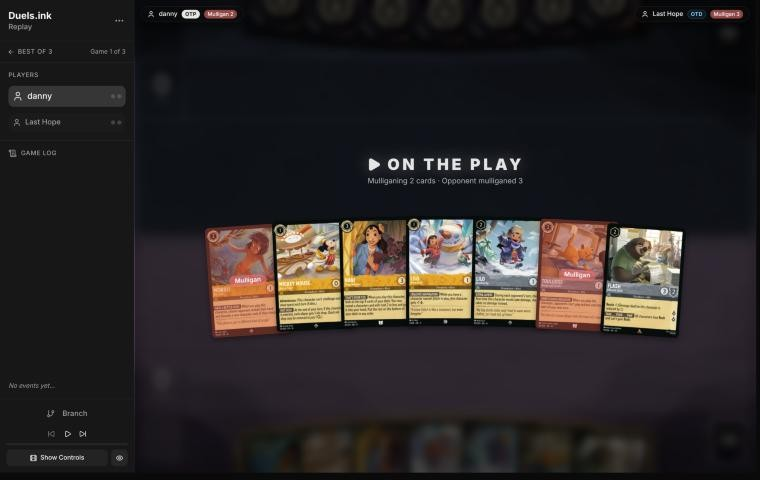
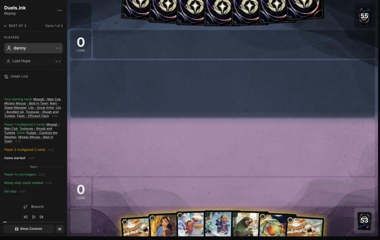
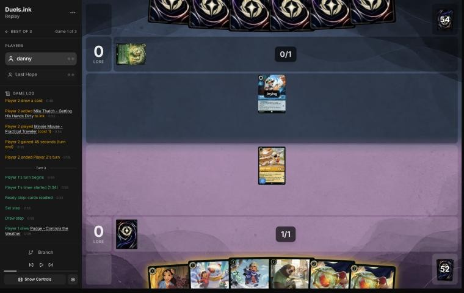
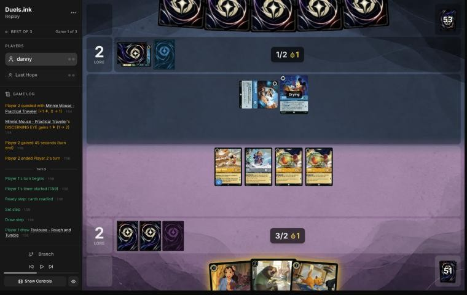
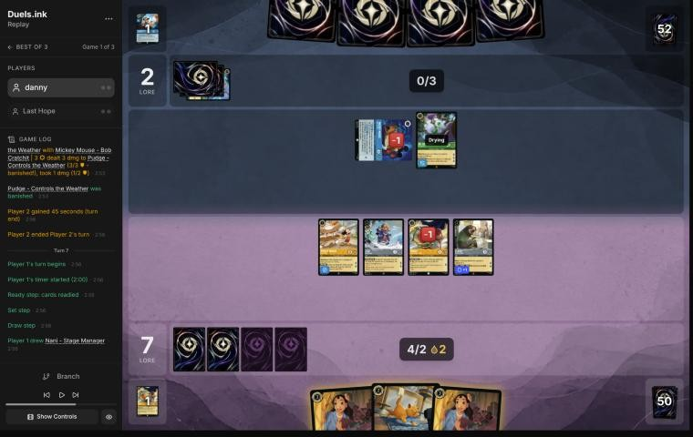
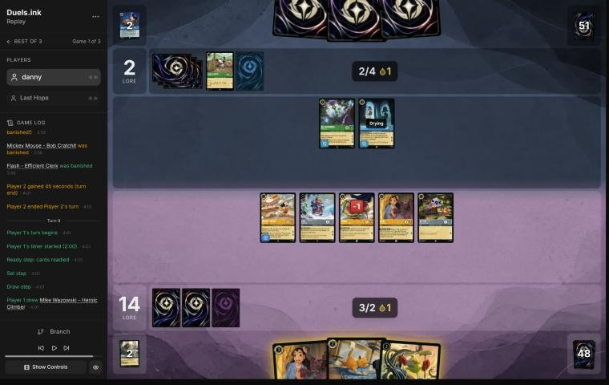

# Review: danny vs Last Hope, 11 Nov 2026 (game 1)

| | |
|---|---|
| **Status** | draft (blind pass done, not yet discussed) |
| **Replay** | `01a1c9e8-e5f5` (`python3 tools/brief.py 01a1c9e8-e5f5 --turn N`) · [duels.ink viewer](https://duels.ink/replay/01a1c9e8-e60a-76c0-a4c9-c1c66e49a60b?step=0) |
| **Format** | Core Constructed. Set 14 era: inks revealed before the coin toss |
| **Decks** | You: Amber/Steel Rockstar Aggro, the third version of your Lilo list (Mowgli ×4, Thomas ×2, You Broke My Smolder ×2, Mike – Well-Rounded Entertainer; no Mr. Big, Strength or Lilo – Rock Star). Them: Emerald/Sapphire ([the coach's notes on this pair](#cite-kb-meta-archetypes-emerald-sapphire-mouse-house-against-danny-s-rockstar-aggro-last-hope)); archetype as it became clear: Mouse House, 96% from turn 3 (Minnie – Practical Traveler and an inked Milo), with Fergus McDuck – Scrooge's Father and Mickey – Steamboat Pilot off the lists |
| **Play/draw** | You went first |
| **Result** | Won on lore, 20–2, on game turn 9 (your 5th turn) |
| **Meta data** | snapshot of 12 Nov 2026 (fresh) |
| **Chosen how** | By the user: every game of 11–12 Nov in the export, reviewed blind. Only game 1 of this match is in the export, so the coach doesn't know how the match went |

## Summary
- **Good plays:** [1](#turn-1), [3](#turn-3), [5](#turn-5), [7](#turn-7), [9](#turn-9).
  - **Turn 5:** you killed their exerted Minnie – Practical Traveler with a Pudge, one of the two bases an Adventuring
    Duo needed to land and quest for 5 the next turn.
  - **Turn 7:** you kept Toulouse in hand for the turn their characters could first sing Under the Sea together.
- **Close calls:** the mulligan (Mowgli and Toulouse sent back) and not inking on turn 5.
- **Inaccuracies / mistakes / blunders:** none.

**What decided it:** a fast curve (three characters for 2 ink on turn 3) against a Mouse House start that never put a
Mickey and a Minnie together for the Duo. They were at 2 lore when you reached 20.

## The game, turn by turn
Verdicts judge each decision on what you could know at the time, **including archetype knowledge an experienced
player has**. Hindsight is kept to its own section. Severity scale: good play / close call /
inaccuracy / mistake / blunder. Principle IDs and hypotheses (H-n) link to copies
in the Citations section at the end, as they stood when they were cited.

**What you knew before the game:**
- **Their inks:** Emerald/Sapphire. duels.ink lists one archetype, Mouse House (67% of the pair); the rest is unlisted.
- **You had played Last Hope before:** two games on 6–8 Nov, both Mouse House. In one, Adventuring Duo quested for 5 on
  game turns 6 and 8; in the other, Mickey – Steamboat Pilot and Aladdin – Doing His Part (both off the lists)
  challenged.
- **Their key cards, and the earliest each can come:**
  - **Mickey Mouse & Minnie Mouse – Adventuring Duo** (7, 5/5/5): Duo Shift 0 onto one Mickey and one Minnie, so it costs
    no ink once both are down: on their turn 2 (game turn 4) at the earliest, questing for 5 from their turn 3. When it
    would be banished it goes into their inkwell instead (THINKING OF YOU). The bases: Minnie – Curious Adventurer (1,
    2/2), Minnie – Practical Traveler (1, +1 lore when she quests if they played another character), Mickey – Bob
    Cratchit (2, 3/2), Mickey – Detective (3; GET A CLUE ramps them by one ink).
  - **Ward bodies** that only challenges reach: Dr. Bushroot (5, 4/3/3; you discard when it's challenged), Scuttle (5,
    5/5/2), Hades – Meticulous Schemer (6, 5/5/3), Winifred (6, 6/6).
  - **Their removal:** Chernabog (5; shuffles a character of yours into your deck), Hades – Infernal Schemer (7; one of
    yours into your inkwell), Milo Thatch (7; returns one to your hand). Each is a single target, from their 5th–7th
    ink. Your Mickeys' HOT DOG! drops bring all of them, and the Duo's ramp, a turn closer.
  - **Sweepers:** Under the Sea (one copy; Sing Together 8: every character of yours with 2 {S} or less to the bottom of
    your deck) once their characters' costs total 8, and Prince Phillip (one copy, 9 or Shift 6) after damage. Under
    the Sea reaches almost your whole deck; it wiped a Rockstar board twice in your 6–8 Nov games (against Circle of
    Life).
- **The race:** Mouse House is slower than you until the Duo lands; then 5 a turn. Your plan is to be near 20 before
  it can quest twice.

### Pre-game

*The board before the decision: [step 0](https://duels.ink/replay/01a1c9e8-e60a-76c0-a4c9-c1c66e49a60b?step=0) in the duels.ink replay viewer.*

**What you did:** you were on the play. You sent back Mowgli and Toulouse, keeping Mickey, Nani, Lilo – Snow Artist,
Lilo – Bundled Up and Flash, and drew Pudge and a second Mickey.

**Verdict: close call.** Before looking, the coach's candidates were keeping all seven, or sending back Toulouse alone,
or Toulouse and Mowgli. The simulator (`tools/mulligan.py`, 1,500 deals each) has them within the noise:

| Option | Ink spent T1–4 | Lore by T4 |
|---|---|---|
| Keep all 7 | 9.4 | 12.3 |
| Send back Toulouse | 9.0 | 12.1 |
| Send back Toulouse and Mowgli (your choice) | 8.9 | 12.6 |
| Send back all 7 | 9.1 | 8.3 |

Against Mouse House, Toulouse's action lock and Mowgli's discard of a non-character card hit little (their list has
four actions and songs at most: Strike a Good Match, Develop Your Brain, Under the Sea), so digging for Stitch, Pudge
and Willow is reasonable. Keeping them was as good on the numbers. Mowgli's reveal would also have told you whether
they held Under the Sea ([MULL-3](#cite-mull-3)).

### Turn 1: your turn 1

*The board before the decision: [step 3](https://duels.ink/replay/01a1c9e8-e60a-76c0-a4c9-c1c66e49a60b?step=3) in the duels.ink replay viewer.*

**What you did:** inked the second Mickey and played the first.

**Verdict: good play.** The alternative was Lilo – Snow Artist, so that Pudge comes free on turn 2 with a 2-drop beside
him. Both lines reach about the same lore by turn 3 (Mickey: 2 on turn 2, then Mickey, Lilo and Pudge for 4; Lilo
first: 1, then Lilo, Pudge and Flash for 4). Mickey's ink drops go to both players, and Mouse House has few early uses
for them. Inking the second Mickey over Nani keeps the better card: a second Mickey would hand them another drop each
turn ([INK-2](#cite-ink-2)).

### Turn 3: your turn 2

*The board before the decision: [step 9](https://duels.ink/replay/01a1c9e8-e60a-76c0-a4c9-c1c66e49a60b?step=9) in the duels.ink replay viewer.*

**What you did:** quested with Mickey (2–0), inked Lilo – Snow Artist, and played Lilo – Bundled Up, which made both
Pudges free (GOOD FRIEND needs any character named Lilo).

**Verdict: good play.** This is the most the hand could do with 2 ink: three characters and 4 lore of board for 2 ink.
Lilo – Snow Artist first would have left 1 ink with nothing to spend it on. Inking her rather than Nani keeps the
3-drop that digs for more 2-drops ([INK-2](#cite-ink-2)). Nothing of theirs could punish Mickey's quest: their only
character, Minnie – Practical Traveler, has 1 {S}.

### Turn 5: your turn 3

*The board before the decision: [step 23](https://duels.ink/replay/01a1c9e8-e60a-76c0-a4c9-c1c66e49a60b?step=23) in the duels.ink replay viewer.*

**What you did:** played Flash, challenged their exerted Minnie – Practical Traveler with a Pudge (Minnie died, Pudge
took 1), quested with Mickey, Lilo – Bundled Up and the other Pudge (7–2), and didn't ink. You banked a second ink drop.

**Verdict: good play.** The turn's job was the Adventuring Duo. With Minnie and Mickey – Bob Cratchit both dry next
turn, a Duo in their hand (four in the list) would Shift onto them for 0 and quest for 5 at once. Minnie was the only
one of the two you could reach (Bob was drying, so ready), and killing her costs the Duo a base: they'd need another
Minnie, played that turn and still drying ([THREAT-3](#cite-threat-3)). It cost a Pudge's 1 lore.
- **Flash over Nani:** 2 lore a turn and Resist 1, against a board whose only attacker is Bob (3 {S}).
- **No ink: close call.** Inking Toulouse bought nothing this turn (Flash for 2 left 2, and Nani costs 3), and next
  turn you'd have 4 ink from the inkwell and two drops anyway. Holding Toulouse keeps his lock for the turn they could
  sing Under the Sea (Sing Together 8, still far off with one character in play). The cost is one ink later in the
  game, and Mickey's drops cover that ([INK-3](#cite-ink-3)).
- **What it exposed:** Bob Cratchit (3) can kill a Pudge (the damaged one has 2 left) or, with the Duo's help, more.
  Mickey must quest. Acceptable for an aggro board that is 3 turns from 20.

### Turn 7: your turn 4

*The board before the decision: [step 33](https://duels.ink/replay/01a1c9e8-e60a-76c0-a4c9-c1c66e49a60b?step=33) in the duels.ink replay viewer.*

**What you did:** played Nani with 3 of your 4 ink (two from drops), took Stitch – Protector of Frogs with her dig and
played him with the last drop, then quested with all four ready characters (14–2). You held Toulouse and the second
Nani and didn't ink.

**Verdict: good play.** You were 6 lore from winning, they were at 2, and their next turn could bring 5 ink (one of
them your Mickey's drop): no Hades or Milo (7) yet, Chernabog (5) at 9%.
- **The alternative was trading a Pudge for Bob Cratchit** (1 willpower left, exerted), which kills a Duo base and an
  attacker for 1 lore. The coach's first plan took it. Both lines leave you at 19 in the worst case next turn:
  - **Your line (14):** Bushroot kills Mickey for free and Bob kills Flash, dying to Flash's 3 back. Lilo, Pudge, Nani
    and Stitch then quest for 5.
  - **The trade (13):** only Bushroot can challenge. It kills Mickey, and Lilo, Flash, Nani and Stitch quest for 6.
  - **The difference:** Bob dies to the damage back from anything he challenges except Mickey, whom his 3 can't kill.
    So keeping Pudge and the extra lore costs nothing, and any challenge Bob makes is a trade you'd have taken anyway.
- **Holding Toulouse is right.** Their Sing Together total next turn is 7 (Bob 2, Bushroot 5), one short of Under the
  Sea. Once they add a character, the turn after (game turn 10) is when it becomes possible. Toulouse played on your
  turn 9 stops all their actions and songs until your turn 11 ([SEQ-4](#cite-seq-4)).
- **Order:** Nani first, so her dig could add a play before the quests ([SEQ-1](#cite-seq-1)).

### Turn 9: your turn 5

*The board before the decision: [step 47](https://duels.ink/replay/01a1c9e8-e60a-76c0-a4c9-c1c66e49a60b?step=47) in the duels.ink replay viewer.*

**What you did:** quested with Mickey, Lilo – Bundled Up, Pudge and Nani for 20.

**Verdict: good play.** The board quested for 7 against 6 needed, and nothing they could do on your turn mattered.
Their turn 8 had traded Bob Cratchit for Flash and played Fergus McDuck – Scrooge's Father (off the lists), leaving
you one quester to spare.

## Lessons
1. **Against Mouse House, kill a Duo base the turn before it can land.** Once a Mickey and a Minnie are both dry, a Duo
   in their hand Shifts onto them for 0 and quests for 5 at once. An exerted Minnie or Mickey is worth a 1-lore
   challenger ([turn 5](#turn-5); [THREAT-3](#cite-threat-3)).
2. **Count their Sing Together total each turn and hold Toulouse for the turn it first reaches 8.** Under the Sea is
   the card that beats a Rockstar board, and Toulouse's lock covers exactly one of their turns ([turn 7](#turn-7)).
3. **A damaged attacker of theirs that dies to any damage back isn't worth a quest to kill.** Bob Cratchit on 1
   willpower could only trade, so keeping Pudge questing gave up nothing ([turn 7](#turn-7)).

## Proposed knowledge-base updates (applied after discussion)
- **Meta** (the Emerald/Sapphire pair file's notes, Last Hope): a third game, 01a1c9e8-e5f5. No Duo by game turn 8:
  Minnie – Practical Traveler died to a Pudge on turn 5, before Bob Cratchit was dry. Dr. Bushroot came on turn 6 with
  two ink drops from danny's Mickey. Fergus McDuck – Scrooge's Father (off-list; TOUGHEN UP gives one of their
  characters Ward) and Mickey – Steamboat Pilot (inked) seen. They inked Milo Thatch on turn 2 and Winifred on turn 4.
- **Strategy:** lesson 1 as a pair note rather than a hypothesis: it follows from the Duo's Shift rule, not from a
  judgement that needs more games.

## Hindsight
Doesn't change the verdicts above.
- They never played a Minnie after turn 2 and finished with three cards in hand, so whether they held a Duo isn't
  known. They inked Milo, Winifred, Minnie – Spinning Skater and Steamboat Pilot.

## The coach's errors
Found by the coach during the review; the discussion may add more.

| When | Error | How it was caught | How it won't happen again |
|---|---|---|---|
| — | None found in the blind pass | | |

## Open questions
- **Turn 5:** you didn't ink with Nani and Toulouse in hand. Was that to keep Toulouse for Under the Sea, or Nani for
  the next turn?
- **Turn 7:** did you weigh trading a Pudge for Bob Cratchit, the Duo base?

## Citations
Copies of the coach's knowledge base cited above, as they stood when they were cited (the private repository's commit and date are given with each). They don't change when the knowledge base does.

**emerald-sapphire.md, Mouse House against danny's Rockstar Aggro: Last Hope**: knowledge base, `kb/meta/archetypes/emerald-sapphire.md` at `2615367` (2026-11-12), working tree

> ### Mouse House against danny's Rockstar Aggro: Last Hope `[coach, meta study of danny's 6–8 Nov 2026 games (tools/scan.py), full games, not blind, 2 games]`
> `01a1b587-d82a` (game 1) and `01a1b593-7846` (game 3), both won on lore, 20–12 on game turn 9 and 20–2 on turn 11.
> - **Game 1:** Adventuring Duo quested for 5 on turns 6 and 8 (12–12), and the wide board still got there first.
> - **Game 3:** no Duo. Mickey Mouse – Steamboat Pilot (off-list) and Aladdin – Doing His Part took two characters by
>   challenges on turn 8.
> - **Also off-list:** The Huntsman – On the Queen's Orders.

**MULL-3**: strategy principle, `kb/strategy/principles.md` at `2615367` (2026-11-12), working tree

> - **MULL-3. The right keep depends on the matchup.** Early interaction against aggro; pressure, draw and engines against slow decks. The mulligan is the first expression of your role. In the Set 14 era the opponent's inks are known before the mulligan (RULE-8), so this applies from game 1 of a match. `[MCL ch.12]` · baseline

**INK-2**: strategy principle, `kb/strategy/principles.md` at `2615367` (2026-11-12), working tree

> - **INK-2. Don't automatically ink the most expensive card.** It may be the late-game win condition or the key answer for this matchup. The answer depends on matchup, hand and board. `[MCL ch.4]` · baseline

**THREAT-3**: strategy principle, `kb/strategy/principles.md` at `2615367` (2026-11-12), working tree

> - **THREAT-3. The biggest threat may not be on the board yet.** Consider:
>   - the opponent's ink next turn
>   - shift targets already in play
>   - support pieces that enable their next turn
>
>   `[MCL ch.9]` · baseline

**INK-3**: strategy principle, `kb/strategy/principles.md` at `2615367` (2026-11-12), working tree

> - **INK-3. Usually ink every turn, but not automatically.** Keeping one more playable card can beat one more ink. Missing ink with an expensive hand can leave you permanently behind. `[MCL ch.4]` · baseline

**SEQ-4**: strategy principle, `kb/strategy/principles.md` at `2615367` (2026-11-12), working tree

> - **SEQ-4. Sequence across turns.** A slightly weaker play now can set up a much stronger next turn: keep a shift target alive, keep a singer ready, hold removal for a bigger threat. `[MCL ch.5]` · baseline

**SEQ-1**: strategy principle, `kb/strategy/principles.md` at `2615367` (2026-11-12), working tree

> - **SEQ-1. Gather information before irreversible decisions.** Draw, look and scry before choosing what to ink. Quest with draw triggers before committing other plays when the order doesn't otherwise matter. `[MCL ch.5]` · baseline
