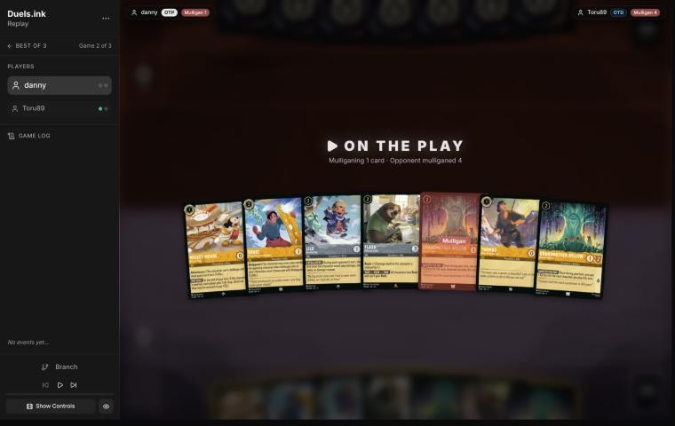
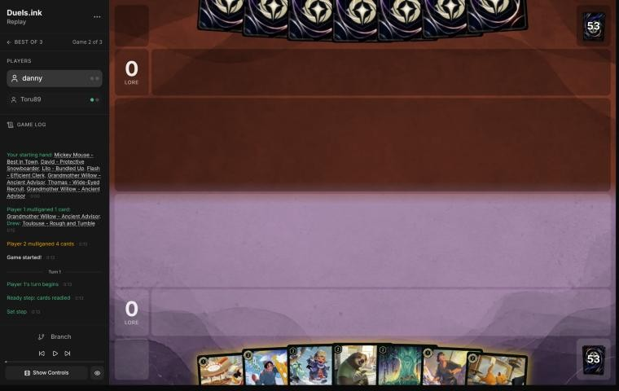
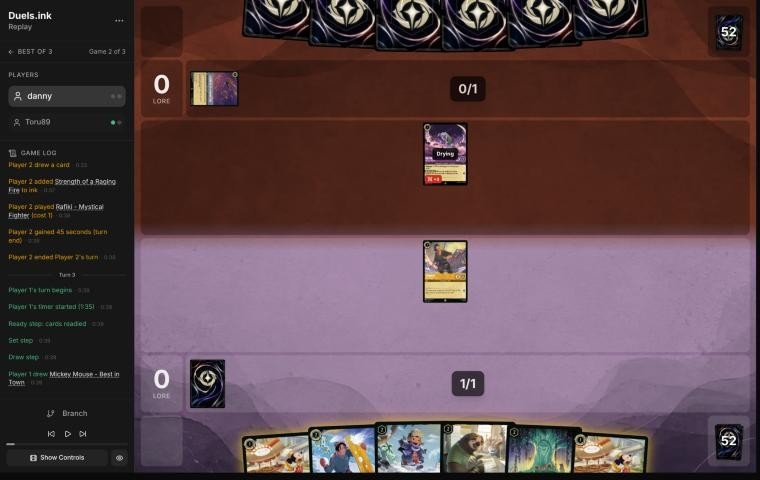
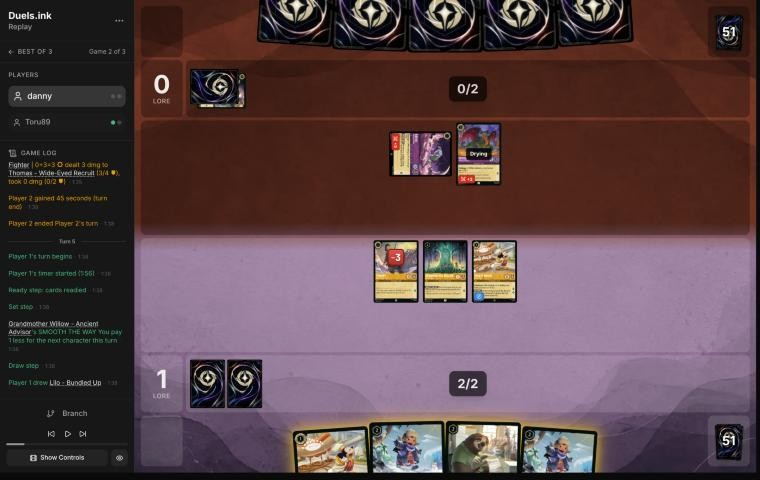
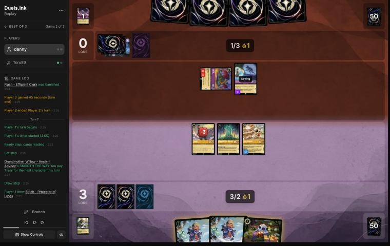
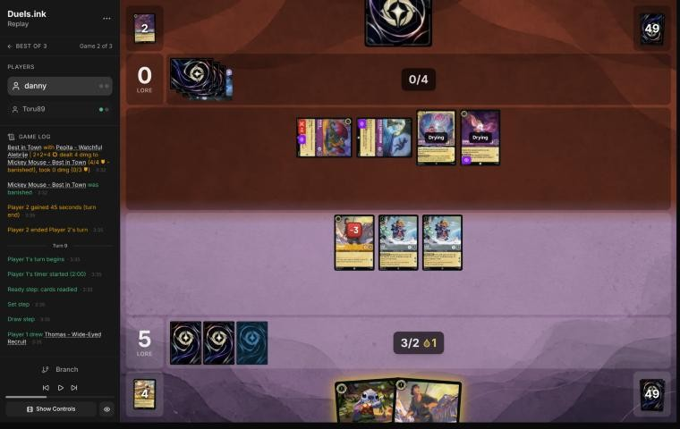
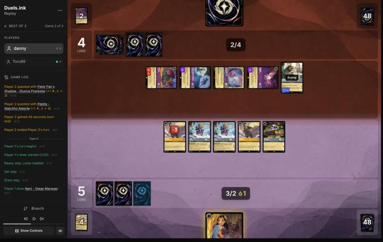
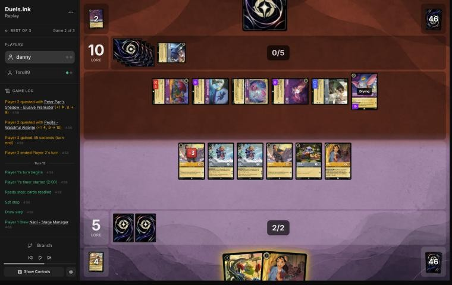
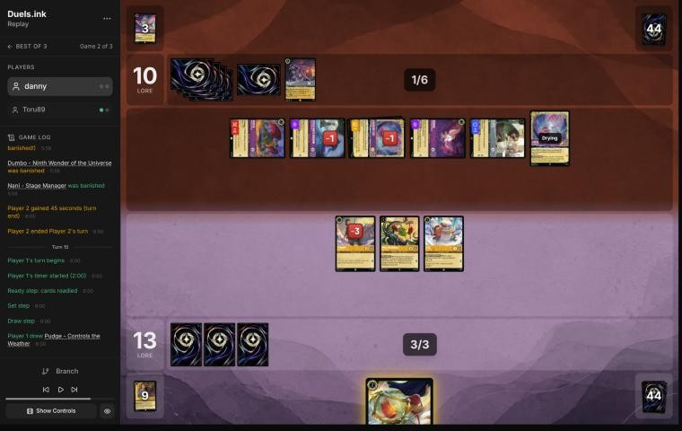

# Review: danny vs Toru89, 11 Nov 2026 (game 2)

| | |
|---|---|
| **Status** | draft (blind pass done, not yet discussed) |
| **Replay** | `01a1cb74-e730` (`python3 tools/brief.py 01a1cb74-e730 --turn N`) · [duels.ink viewer](https://duels.ink/replay/01a1cb74-e731-7bf0-ac56-aa0ce4541f67?step=0) |
| **Format** | Core Constructed (ranked queue; not stated in the replay). Set 14 era: inks revealed before the coin toss |
| **Decks** | You: Amber/Steel Rockstar Aggro, the third version of your Lilo list (Mowgli, Thomas, You Broke My Smolder). Them: Amethyst/Steel; archetype as it became clear: Midrange, 87% from turn 3 (Rafiki, Strength inked) and 99% by turn 7; off-list Francine – Eyeing the Evidence, Dumbo – The Flying Elephant and Goliath – Clan Leader |
| **Play/draw** | You went first |
| **Result** | Lost by concession on game turn 18, at 16–13 to them with their board questing for 8 |
| **Meta data** | snapshot of 12 Nov 2026 (fresh) |
| **Chosen how** | By the user: every game of 11–12 Nov in the export, reviewed blind. Game 1 of this match isn't in the export, so the coach doesn't know what Toru89 showed in it; you did |

## Summary
- **Good plays:** [pre-game](#turn-0), [3](#turn-3) (Willow's discount on her own turn: Mickey for 0), [5](#turn-5),
  [7](#turn-7), [13](#turn-13), [15](#turn-15).
- **Close calls:** [1](#turn-1) (inking Toulouse against four Strengths; Thomas over Mickey).
- **Inaccuracies / mistakes / blunders:**
  - **Inaccuracy, [turn 9](#turn-9):** you held the whole board back at 5–0, when questing with both Lilo – Bundled
    Ups would have cost them four challenges to stop.
  - **Mistake, [turn 11](#turn-11):** you held back again at 5–4, while their board quested for 6. That gave up about
    7 lore and handed them the race.
- **Unwinnable from:** turn 17, after their turn-16 sweep of challenges, Cheshire Cat's moved damage and Strength.

**What decided it:** two turns with no quests (9 and 11) while their board grew and quested. When you raced again on
turn 13 you were behind 5–10, and their seven characters could kill everything you exerted.

## The game, turn by turn
Verdicts judge each decision on what you could know at the time, **including archetype knowledge an experienced
player has**. Hindsight is kept to its own section. Severity scale: good play / close call /
inaccuracy / mistake / blunder. Principle IDs and hypotheses (H-n) link to copies
in the Citations section at the end, as they stood when they were cited.

**What you knew before the game:**
- **Their inks:** Amethyst/Steel. duels.ink lists Midrange (49% of the pair) and PS Inkbonk (3%); the rest is unlisted.
  You had also seen their deck in game 1, which the coach can't see.
- **Their key cards, and the earliest each can come:**
  - **Angela – Night Warrior** (3): Challenger +2 and Resist +2 on one character until their next turn. From their 3rd
    ink, a 2-strength character of theirs kills your 4-willpower ones.
  - **Peter Pan's Shadow** (3, Evasive): exerts one of your characters on play, so it can be challenged.
  - **Strength of a Raging Fire** (3, song): damage equal to their characters in play; sung free by any character of
    cost 3+.
  - **Angel – Experiment 624** (4): GOOD AIM (discard a card: 2 damage to a character, ready or not) once a turn;
    Resist +2 while their hand is empty. It picks off 2-willpower characters: Willow, Lilo, Flash.
  - **Shere Khan – Khan Industries CEO** (4): one character can challenge ready characters that turn.
  - **Hades – Looking for a Deal** (5): you bottom a character or they draw 2.
  - **Demona – Scourge of the Wyvern Clan** (6): exerts your whole board, then refills both hands to 3.
  - **Tinker Bell – Giant Fairy** (6, Shift 4): 1 damage to each of your characters.
  - Your Mickeys' ink drops bring each of these a turn closer.
- **The race:** their plan is to pick off your small characters one a turn with Angel, Strength and challengers while
  their board grows. Yours is to be at 20 before Demona and Tinker Bell arrive.

### Pre-game

*The board before the decision: [step 0](https://duels.ink/replay/01a1cb74-e731-7bf0-ac56-aa0ce4541f67?step=0) in the duels.ink replay viewer.*

**What you did:** on the play, you sent back one of two Grandmother Willows and drew Toulouse.

**Verdict: good play.** The coach's candidates were keeping all seven or sending back one Willow: the hand had four
uninkable cards (two Willows, Lilo – Bundled Up, Flash) and only three inkable ones. The simulator (`tools/mulligan.py`,
1,500 deals each) has them level, 12.6 and 12.5 lore by turn 4. A second Willow adds little once the first is down, and
one more inkable card makes the curve safer ([MULL-2](#cite-mull-2)).

### Turn 1: your turn 1

*The board before the decision: [step 2](https://duels.ink/replay/01a1cb74-e731-7bf0-ac56-aa0ce4541f67?step=2) in the duels.ink replay viewer.*

**What you did:** inked Toulouse and played Thomas – Wide-Eyed Recruit.

**Verdict: close call.**
- **Thomas over Mickey** gives up a lore a turn but no ink drops. Against Amethyst/Steel, drops bring Demona – Scourge
  (6) and Tinker Bell (6) a turn early, and some lists pay for removal with them
  ([the Mickey card note](#cite-kb-cards-mickey-mouse-best-in-town-what-it-means-in-play)). Both are reasonable.
- **Inking Toulouse** costs the one card that stops Strength of a Raging Fire for a turn (four in their list, sung for
  free from their 3rd turn). The hand had only four inkable cards (Mickey, David, Thomas, Toulouse) and three
  uninkable 2-drops, so one of them had to go. Inking Thomas and playing Mickey keeps Toulouse and David. That's what
  the coach would have done, but the edge is small: Toulouse's lock covers one turn of theirs, not the game
  ([INK-2](#cite-ink-2)).

### Turn 3: your turn 2

*The board before the decision: [step 8](https://duels.ink/replay/01a1cb74-e731-7bf0-ac56-aa0ce4541f67?step=8) in the duels.ink replay viewer.*

**What you did:** inked David, played Grandmother Willow, used her SMOOTH THE WAY to play Mickey for 0, and quested with
Thomas (1–0).

**Verdict: good play.** Willow's discount applies to the next character the same turn, so 2 ink bought two characters,
one more than any other line (the coach had planned Willow alone and the discount for next turn). Thomas's 4 willpower
is out of reach of Rafiki's 3 while challenging, so his quest was free. Inking David over the second Mickey keeps the
cheaper play. David's Bodyguard would have been welcome against a deck of challengers, but Mickey costs 1, and the
hand had to keep its curve.

### Turn 5: your turn 3

*The board before the decision: [step 17](https://duels.ink/replay/01a1cb74-e731-7bf0-ac56-aa0ce4541f67?step=17) in the duels.ink replay viewer.*

**What you did:** quested with Mickey (3–0), played Flash for 1 with Willow's discount and the second Mickey for 1, and
didn't ink. Thomas (1 willpower left) and Willow stayed ready.

**Verdict: good play.** The only inkable card was the second Mickey, and the rest of the hand was two uninkable Lilo –
Bundled Ups. The coach's plan inked Mickey for Bundled Up and Flash. Your line put Mickey on the board instead (2 lore a
turn), and two Mickeys' drops keep paying for the Bundled Ups: next turn you have 2 ink, a drop and Willow's discount,
exactly the 3 that both Lilos cost.
- **Thomas stayed home:** exerted on 1 willpower, he was a free kill for Rafiki (3 while challenging). Ready, only
  removal reaches him, and their challengers have only Mickey to hit.
- **What it exposed:** Mickey had to quest, and Pepita (4 while challenging) kills him. Willow, Flash and the new Mickey
  were ready or drying.

### Turn 7: your turn 4

*The board before the decision: [step 29](https://duels.ink/replay/01a1cb74-e731-7bf0-ac56-aa0ce4541f67?step=29) in the duels.ink replay viewer.*

**What you did:** played both Lilo – Bundled Ups (one for 1 with Willow's discount, the other with your ink drop),
quested with Mickey (5–0), kept Stitch in hand and didn't ink. Thomas and Willow stayed home.

**Verdict: good play.** Two 2-lore characters for 3 ink was the turn's full use, and no challenge was worth making
(their only exerted character, Pepita, has 3 willpower; Thomas and Willow would have died hitting it).
- **Keeping Thomas and Willow ready** again denied Pepita (4) and Peter Pan's Shadow (2) free kills; only Mickey was
  exposed.
- **Not inking Stitch: close call.** A third ink buys little for a hand of 1- and 2-drops that Mickey's drops already
  pay for, and Stitch is a body for next turn. Inking him was as good ([INK-3](#cite-ink-3)).
- **Their next turn:** 6 ink with your drop, so Demona – Scourge (27%, 33% after their draw) could exert your whole
  board for Pepita and the Shadow. A Rockstar board can't play around that and still race. The Bundled Ups each
  absorb the first damage.

### Turn 9: your turn 5

*The board before the decision: [step 43](https://duels.ink/replay/01a1cb74-e731-7bf0-ac56-aa0ce4541f67?step=43) in the duels.ink replay viewer.*

**What you did:** played the second Thomas and Stitch, and quested with nobody (5–0). Both Lilo – Bundled Ups and the
damaged Thomas stayed ready.

**Verdict: inaccuracy (confidence: medium-low).** Holding everything back is suboptimal because it gives up 4 lore and
the tempo it would have cost them to stop it. Questing with both Bundled Ups (Thomas home) is better because of EXTRA
LAYERS: each needs two challenges to kill, and they had exactly four challengers (Pepita 4, Cheshire Cat 3, Peter Pan's
Shadow 2, Dumbo 2).
- **If they kill both Lilos,** you're 9–0. Their whole turn goes into it with no quests, and all four of theirs end
  damaged (each takes 1 back per challenge). You keep two Thomases and Stitch.
- **If they quest instead,** you're 9–4 with your whole board, strictly better than 5–4.
- **What holding back bought:** it protected you only from challenges. Their other answers reach ready characters:
  Strength of a Raging Fire (4 damage now, any of three free singers), Demona – Scourge's exert-all and Cheshire Cat's
  moved damage. The same choice comes back next turn against a bigger board.
- **What the quest line exposes:** both Lilos, as above. The damaged characters it leaves them give Cheshire Cat's
  boost damage to move onto yours, which narrows the gap in the first branch. Holding back is defensible against that
  ([POS-1](#cite-pos-1), [ROLE-2](#cite-role-2), [TRADE-4](#cite-trade-4)).
- **Inking:** you used 2 of 3 ink and played your last two cards, so there was nothing left to ink.

### Turn 11: your turn 6

*The board before the decision: [step 52](https://duels.ink/replay/01a1cb74-e731-7bf0-ac56-aa0ce4541f67?step=52) in the duels.ink replay viewer.*

**What you did:** played Nani with all 3 ink (one a drop), took Mike Wazowski – Heroic Climber with her dig, and again
quested with nobody (5–4).

**Verdict: mistake (confidence: medium).** Holding the board back a second time is suboptimal because the race had
turned: they quested for 4 last turn and their board now quests for 6 (Flash added), while yours quested for 0.
Questing with all five (Thomas, both Lilos, the other Thomas, Stitch) is better because it puts you at 12, with 8 more
next turn counting Nani:
- **They must challenge or lose.** If they quest everything (10), you reach 20 next turn. To stop that they have to
  spend challenges, and each challenge is a quest they don't make: a Lilo – Bundled Up costs them two.
- **Their best reply:** they kill the damaged Thomas (1 challenge), a Lilo (2) and Stitch (1), and quest with one. That
  leaves you about 16 to their 6, with Lilo, Thomas, Nani and Mike to come. That's far ahead of 5–10.
- **No challenge was worth making:** their exerted Pepita (3 willpower) and Cheshire Cat (4) were out of reach of your
  0–1 strength characters, and Dumbo and the Shadow are Evasive.
- **What the quest line exposes:** all five, to Pepita (4), Cheshire Cat (3), Flash (3), Dumbo (2) and the Shadow (2).
  Holding back avoided that, but their real answers reach ready characters anyway: Strength (5 damage now), Demona's
  exert-all, Cheshire's moved damage. Meanwhile the clock ran for them
  ([QC-5](#cite-qc-5), [POS-1](#cite-pos-1), [ROLE-2](#cite-role-2)).
- **Nani** was the right play with the ink: a body that digs ([SEQ-1](#cite-seq-1)).

### Turn 13: your turn 7

*The board before the decision: [step 64](https://duels.ink/replay/01a1cb74-e731-7bf0-ac56-aa0ce4541f67?step=64) in the duels.ink replay viewer.*

**What you did:** played Mike Wazowski – Heroic Climber (his reveal found Lilo – Snow Artist for you), then inked the
second Nani, played Lilo – Snow Artist and quested with all six dry characters (13–10).

**Verdict: good play.** You were 5–10 against a board questing for 7. Quests were the only way back, and this time you
took them.
- **Order:** Mike first, so his reveal came before you chose what to ink ([SEQ-1](#cite-seq-1)).
- **Next turn's threat to them:** your board quests for 11 (Lilo – Snow Artist gets +1 with Stitch in play). To keep
  you under 20 they had to remove 5 lore of it. The cheapest way was both Bundled Ups (two challenges each) and the
  damaged Thomas: five of their six characters, leaving them about 11–12. Even then you'd quest for 6 to 19 and win
  the turn after. Mike and Lilo were drying, so out of their challengers' reach.
- **The alternative** was Nani challenging Flash (2 lore, 2 willpower with Resist 1; both die), cutting their quests
  to 5 for a lore of yours. It's close, but your line sets a two-turn clock they can't beat with challenges alone.
- **Their outs:** Strength of a Raging Fire (6 damage with six characters; two seen, two left), Demona's exert-all
  (16% after their draw) and Cheshire Cat's moved damage. All are single answers against a wide board
  ([QC-5](#cite-qc-5), [POS-2](#cite-pos-2)).

### Turn 15: your turn 8

*The board before the decision: [step 89](https://duels.ink/replay/01a1cb74-e731-7bf0-ac56-aa0ce4541f67?step=89) in the duels.ink replay viewer.*

**What you did:** quested with Mike first (his reveal gave you Mowgli, and them Rafiki), played Mowgli (their hand: only
that Rafiki), played Pudge free with Lilo in play, and quested with Thomas and Lilo – Snow Artist (16–10).

**Verdict: good play.** Mike's quest before the plays found Mowgli, and Mowgli's reveal confirmed they held no removal
([SEQ-1](#cite-seq-1)). Questing with everything was forced: you needed 7 over two turns, and their board quests for 7
from 10. The position was hard by now. To stop you next turn they had to kill two of Thomas, Lilo and Mike, and could
still quest with the rest to about 15. Mowgli and Pudge were drying, so out of their reach.

### Turn 16: their turn

**What happened:** they cleared your board at 13–16. Cheshire Cat killed Lilo – Snow Artist, then boosted to move 2 of
its damage onto Mowgli (banished). Pepita killed Mike, the Shadow killed Thomas, and Dumbo sang a freshly drawn
Strength of a Raging Fire for 6 on Pudge. Cheshire and Flash quested (13).

### Turn 17: your turn 9

**What you did:** drew Lilo & Stitch – Fun-Loving Friends (5, no Shift base, 3 ink) and passed.

**Verdict: unwinnable from here.** You had no board and no castable card at 16–13, and their seven characters quested
for 8.

## Lessons
1. **Against a board of challengers, Lilo – Bundled Up wants to quest.** EXTRA LAYERS makes her cost two challenges,
   and each challenge is a quest they don't make. Keeping her home protects her only from the one thing she's built to
   absorb ([turn 9](#turn-9)).
2. **Holding back is only worth it if it changes the race.** Against a deck that quests every turn and has removal for
   ready characters (Strength, Cheshire Cat's moved damage, Demona), a turn without quests is a turn the race goes
   their way. Check the lore clock before deciding to wait ([turn 11](#turn-11); [QC-5](#cite-qc-5)).
3. **Willow's SMOOTH THE WAY works on the turn she's played:** Willow then a 1-drop costs 2 ([turn 3](#turn-3)).

## Proposed knowledge-base updates (applied after discussion)
- **Meta** (the Amethyst/Steel pair file's notes): *Midrange against danny's Rockstar Aggro: Toru89 (01a1cb74-e730,
  game 2, blind review).* A challenger build: Rafiki (Challenger +3), Pepita (+2), Peter Pan's Shadow, Cheshire Cat ×2,
  Dumbo – The Flying Elephant and Dumbo – Ninth Wonder, Flash, with Strength of a Raging Fire ×3 seen. Francine ×2,
  Dumbo – The Flying Elephant and Goliath – Clan Leader were off-list. The game turned on their turn 16, when they used
  every challenger, Cheshire Cat's boost (moved damage onto a drying Mowgli) and Strength sung for 6 to clear five
  characters.
- **Strategy:** a hypothesis for H-n, "Against challenger midrange, a Rockstar board should keep questing with
  multi-hit characters (Lilo – Bundled Up) rather than hold back", from turns 9 and 11. It needs more games: this is one.

## Hindsight
Doesn't change the verdicts above.
- They quested with everything on turns 10 and 12 and challenged nothing, so quests on your turns 9 and 11 would have
  stood. That's about 11 more lore by turn 13 (both Lilos, Thomas and Stitch, twice), which would have had you at 20
  on turn 13.
- Their hand was nearly empty from turn 9 (one card). Their turn-16 sweep used a Strength drawn that turn.

## The coach's errors
Found by the coach during the review; the discussion may add more.

| When | Error | How it was caught | How it won't happen again |
|---|---|---|---|
| — | None found in the blind pass | | |

## Open questions
- **Turns 9 and 11:** what were you playing around by keeping the board home? Shere Khan (a challenge into ready
  characters) and Demona were both possible but not likely (under 20%).
- **Turn 1:** you inked Toulouse ahead of Thomas and Mickey. Was that to keep the 1-drops for curve?

## Citations
Copies of the coach's knowledge base cited above, as they stood when they were cited (the private repository's commit and date are given with each). They don't change when the knowledge base does.

**MULL-2**: strategy principle, `kb/strategy/principles.md` at `a29c3e9` (2026-11-12), working tree

> - **MULL-2. A smooth curve beats a few powerful cards.** Check that you can spend ink well on turns 1–4, have enough inkable cards, and know what turn 4 looks like. `[MCL ch.12]` · baseline
>   - **Ink spent isn't the goal by itself.** Judge a keep by a nice curve (a play each turn), early lore pressure, and
>     interaction that sets the opponent back, as well as by ink, then weigh card quality and the matchup
>     (user, 2026-11-01). `tools/mulligan.py` reports all of these.

**INK-2**: strategy principle, `kb/strategy/principles.md` at `a29c3e9` (2026-11-12), working tree

> - **INK-2. Don't automatically ink the most expensive card.** It may be the late-game win condition or the key answer for this matchup. The answer depends on matchup, hand and board. `[MCL ch.4]` · baseline

**INK-3**: strategy principle, `kb/strategy/principles.md` at `a29c3e9` (2026-11-12), working tree

> - **INK-3. Usually ink every turn, but not automatically.** Keeping one more playable card can beat one more ink. Missing ink with an expensive hand can leave you permanently behind. `[MCL ch.4]` · baseline

**POS-1**: strategy principle, `kb/strategy/principles.md` at `a29c3e9` (2026-11-12), working tree

> - **POS-1. From ahead, take the safest path to victory.** Don't overextend into sweepers, don't make unnecessary trades, and make the opponent take the risks. Winning by 1 lore counts the same as winning by 10. `[MCL ch.10]` · baseline

**ROLE-2**: strategy principle, `kb/strategy/principles.md` at `a29c3e9` (2026-11-12), working tree

> - **ROLE-2. Roles change mid-game. Re-check every turn.** An early lead with 4 lore left turns the aggressor into "protect the lead". A stabilised defender can become the aggressor. *Ask: "Has my role changed? If nothing changes, who wins?"* `[MCL ch.8, ch.10, ch.11]` · baseline

**TRADE-4**: strategy principle, `kb/strategy/principles.md` at `a29c3e9` (2026-11-12), working tree

> - **TRADE-4. Every challenge has an opportunity cost.** It's a lost quest, and the challenger may be exposed while exerted. Declining a trade is often as strong as taking it. *Ask: "Would simply questing be stronger?"* `[MCL ch.7]` · baseline

**QC-5**: strategy principle, `kb/strategy/principles.md` at `a29c3e9` (2026-11-12), working tree

> - **QC-5. The race changes everything.** At 18–12 up, take the last 2 lore. At 8–16 down, stopping their close-out matters more than your quests. `[MCL ch.6]` · baseline

**SEQ-1**: strategy principle, `kb/strategy/principles.md` at `a29c3e9` (2026-11-12), working tree

> - **SEQ-1. Gather information before irreversible decisions.** Draw, look and scry before choosing what to ink. Quest with draw triggers before committing other plays when the order doesn't otherwise matter. `[MCL ch.5]` · baseline

**POS-2**: strategy principle, `kb/strategy/principles.md` at `a29c3e9` (2026-11-12), working tree

> - **POS-2. From behind, play to your outs and accept calculated risk.** Safe efficient play from a losing position loses slowly. A line with a 30% chance beats a line with 0%. *Ask: "What has to happen for me to win, and which play makes it most likely?"* `[MCL ch.10]` · baseline

**mickey-mouse-best-in-town.md, What it means in play**: knowledge base, `kb/cards/mickey-mouse-best-in-town.md` at `a29c3e9` (2026-11-12), working tree

> ## What it means in play `[coach, from the 27 Oct 2026 meta study]`
> - **The ramp is symmetric:** every turn he quests, the opponent also gets an ink drop. That's worth more to decks with
>   ink-drop payoffs:
>   - **Jousting Match** (Steel action, 3): 2 damage, or **5 if paid with an ink drop**. Mickey supplied an Amethyst/Steel
>     opponent's drops (01a17e37).
>   - Ink-drop decks also run Ink Explosion, Merlin – Profoundly Curious and Marie – Caught in the Act; Shere Khan –
>     Khan Industries CEO makes drops of his own.
>   - An Emerald/Steel opponent spent four of these drops on turn 6 of 01a17ddb.
> - **Adventurous forces him to quest,** so he ends every turn exerted and can be challenged. 0 strength means he trades
>   for nothing; he's often the first challenge target (01a17e9c turn 14, 01a17ddb turn 6).
> - **Against a Steel opponent,** count the drops you're giving them, and what they could pay for with them, before
>   questing with him.
> - **Drops bring Raging Storm early** `[coach, meta study of Savitar's games, 2 Nov 2026]`: Candle Control (Amber/Ruby)
>   cast it on game turn 9, their 5th turn, with 5 ink and 3 drops from both sides' Mickeys (01a19bdb-d8e4). Against an
>   Amber deck, add your Mickey's drops to their ink when you count down to Storm (8).
