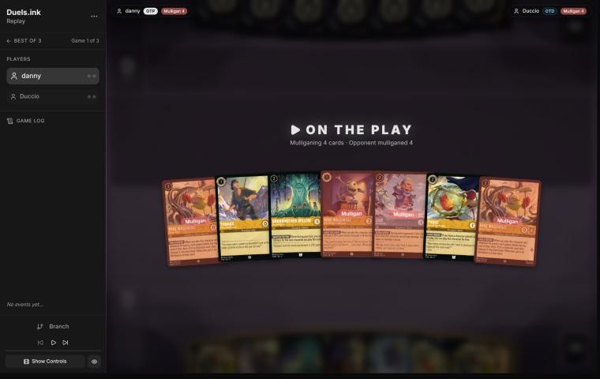
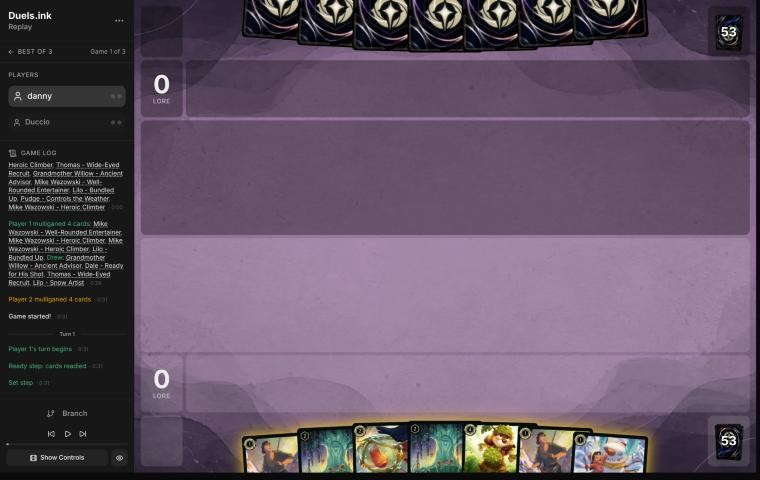
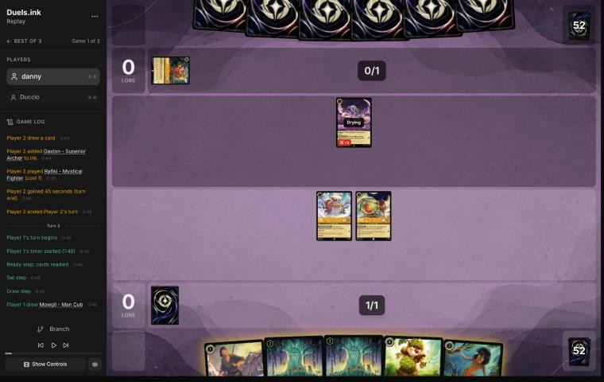
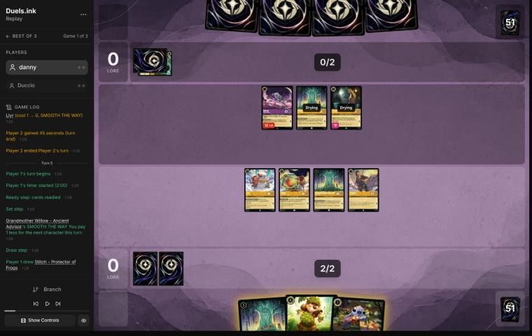
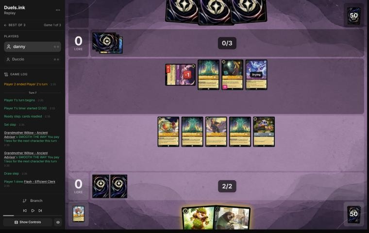
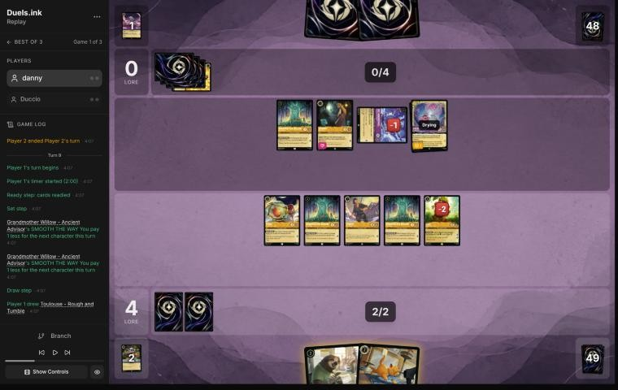
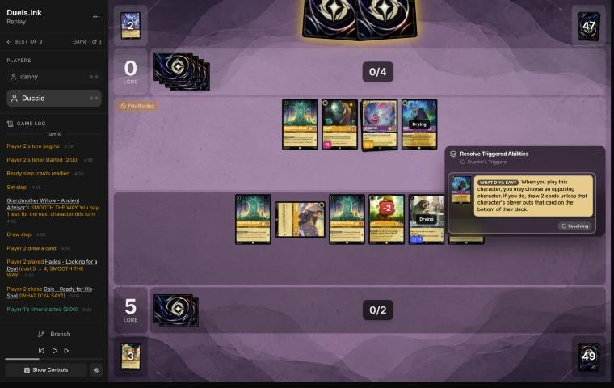
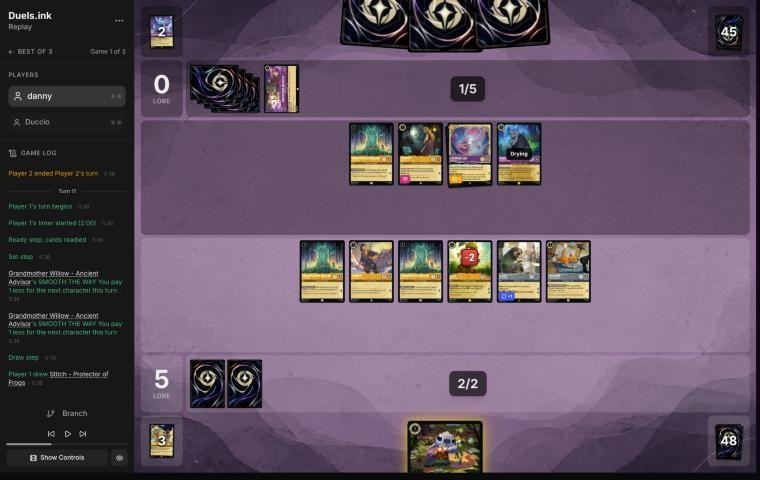
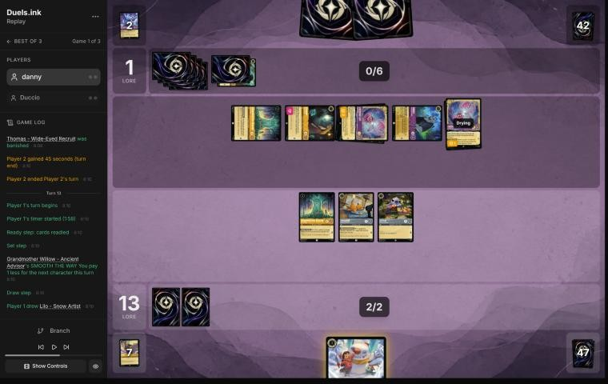
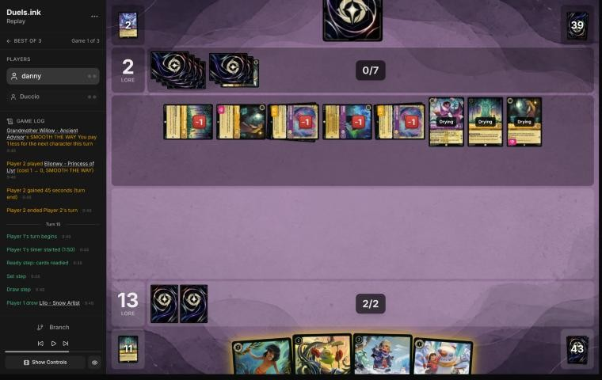

# Review: danny vs Duccio, 11 Nov 2026 (game 1)

| | |
|---|---|
| **Status** | draft (blind pass done, not yet discussed) |
| **Replay** | `01a1cbbb-ca0c` (`python3 tools/brief.py 01a1cbbb-ca0c --turn N`) · [duels.ink viewer](https://duels.ink/replay/01a1cbbb-ca23-713a-a340-c9a21270a31b?step=0) |
| **Format** | Core Constructed. Set 14 era: inks revealed before the coin toss |
| **Decks** | You: Amber/Steel Rockstar Aggro, the third version of your Lilo list. Them: Amber/Amethyst ([the coach's notes on this pair](#cite-kb-meta-archetypes-amber-amethyst-remember-merida-and-midrange-chee-hoo-and-durkules)); archetype as it became clear: Midrange, 95% from turn 3 (Rafiki, Gaston inked) and 100% by turn 11; off-list Eilonwy – Princess of Llyr and Grandmother Willow |
| **Play/draw** | You went first |
| **Result** | Lost by concession on game turn 18; you were at 13, they reached about 20 |
| **Meta data** | snapshot of 12 Nov 2026 (fresh) |
| **Chosen how** | By the user: every game of 11–12 Nov in the export, reviewed blind. The export holds a game 3 of this match, so the coach knows games 1 and 2 were split, not which way |

## Summary
- **Good plays:** [1](#turn-1) (Lilo then Pudge free on turn 1), [7](#turn-7) (Dale for 2 with both Willows, Pudge
  killing Rafiki under SPIKE SUIT), [9](#turn-9) (Pudge for Isis), [11](#turn-11).
- **Close calls:** [pre-game](#turn-0), [3](#turn-3), [10](#turn-10) (letting Hades draw them 2 to keep Dale).
- **Inaccuracies / mistakes / blunders:**
  - **Inaccuracy, [turn 5](#turn-5):** Willow and Stitch with no quests, when Dale for 3 made four quests safe.
  - **Inaccuracy, [turn 13](#turn-13):** no quests at 13–1, which gave them a free quest turn.
- **Unwinnable from:** turn 15, after Demona – Scourge's exert-all cleared your board on turn 14.

**What decided it:** you held back on turns 3, 5 and 13, and quested on 7 and 11. You reached 13 with them at 0, but two
Cheshire Cats' moved damage (turn 12) and Demona's exert-all (turn 14) cleared everything, and their eight characters
then quested for 9.

## The game, turn by turn
Verdicts judge each decision on what you could know at the time, **including archetype knowledge an experienced
player has**. Hindsight is kept to its own section. Severity scale: good play / close call /
inaccuracy / mistake / blunder. Principle IDs and hypotheses (H-n) link to copies
in the Citations section at the end, as they stood when they were cited.

**What you knew before the game:**
- **Their inks:** Amber/Amethyst. duels.ink lists Remember Merida (36% of the pair), Midrange (33%) and Aggro (14%).
- **Their key cards, and the earliest each can come:**
  - **Remember Merida:** Raging Storm (8; banishes every character), often a turn or two early with Mickey's and
    Merlin's ink drops. Remember Me (Sing Together 6) then rebuilds them. Merida – Wisp Conjurer and Merlin –
    Profoundly Curious draw cards.
  - **Midrange:** challengers (Rafiki, Challenger +3; Pepita, +2), Isis Vanderchill (4; exerts one of yours), Cheshire
    Cat (moves damage), Gaston – Superior Archer (5; banishes a character with 5 {S}+).
  - **Both:** Demona – Imperious Spellcaster (3; Rush and Evasive to a Gargoyle), Demona – Scourge (6; exerts your
    whole board), Hades – Looking for a Deal (5), The Horseman Strikes! (3; banishes an Evasive character), Tigger (4;
    bounces a character of cost 2 or less).
  - **Aggro:** Dale – Ready for His Shot, Pocahontas – Following the Wind and Peacekeeper.
- **The race:** against Remember Merida you want to be close to 20 before Storm (their 8th ink, sooner with drops). Your
  Mickeys' drops help them get there.

### Pre-game

*The board before the decision: [step 0](https://duels.ink/replay/01a1cbbb-ca23-713a-a340-c9a21270a31b?step=0) in the duels.ink replay viewer.*

**What you did:** on the play, you sent back four cards (Mike – Well-Rounded Entertainer, both Mike – Heroic Climbers
and Lilo – Bundled Up), kept Thomas, Willow and Pudge, and drew Willow, Dale, Thomas and Lilo – Snow Artist.

**Verdict: close call.** Before looking, the coach's candidates were keeping all seven, sending back one Heroic Climber,
or sending back both (keeping Thomas, Willow, Well-Rounded Entertainer, Bundled Up and Pudge). The simulator
(`tools/mulligan.py`, 1,500 deals each):

| Option | Ink spent T1–4 | Lore by T4 |
|---|---|---|
| Keep all 7 | 9.1 | 6.7 |
| Send back both Heroic Climbers | 8.9 | 8.4 |
| Your four | 9.1 | 8.0 |
| Send back all 7 | 9.1 | 8.7 |

The two 0/4/1 Heroic Climbers slow the hand, so sending them back was right ([MULL-2](#cite-mull-2)). Bundled Up is the
list's best 2-drop (2 lore, and her first damage on their turn is ignored), and her name makes Pudge free. Keeping her
was slightly better on the numbers, but the gap is inside the simulator's noise.

### Turn 1: your turn 1

*The board before the decision: [step 3](https://duels.ink/replay/01a1cbbb-ca23-713a-a340-c9a21270a31b?step=3) in the duels.ink replay viewer.*

**What you did:** inked a Thomas, played Lilo – Snow Artist and then Pudge for free.

**Verdict: good play.** Two characters on turn 1. The coach had planned Lilo alone and Pudge on turn 2, but GOOD FRIEND
works at once. Inking the second Thomas (0/4/1) kept the better cards.

### Turn 3: your turn 2

*The board before the decision: [step 10](https://duels.ink/replay/01a1cbbb-ca23-713a-a340-c9a21270a31b?step=10) in the duels.ink replay viewer.*

**What you did:** inked Mowgli, played Willow and Thomas (free with her discount), and didn't quest with Lilo or Pudge.

**Verdict: close call.** Two more bodies for 2 ink is right, and inking Mowgli keeps Dale for next turn: against a
Midrange list (95% by now) his discard of a non-character card hits little. Keeping Lilo and Pudge home cost 2 lore.
Their Rafiki (3 while challenging, 2 willpower) would have killed one of them for free.
- **For questing:** 2 lore now for one 1-lore body, and Rafiki's challenge costs them his quest.
- **For waiting:** next turn Dale's SPIKE SUIT makes your characters deal their {W} back. Pudge's 3 then kills Rafiki,
  and every quest after that is safer. Waiting one turn for that is a reasonable plan ([SEQ-4](#cite-seq-4)).

### Turn 5: your turn 3

*The board before the decision: [step 18](https://duels.ink/replay/01a1cbbb-ca23-713a-a340-c9a21270a31b?step=18) in the duels.ink replay viewer.*

**What you did:** played the second Willow for 1 (the first Willow's discount) and Stitch for 0 (the second's), didn't
ink, left 1 ink unused, and again quested with nobody (0–0).

**Verdict: inaccuracy (confidence: medium-low).** Playing Willow and Stitch and holding the board back is suboptimal
because it spends a third turn without lore. Inking Stitch and playing Dale for 3 (Willow's discount) is better: SPIKE
SUIT makes your characters deal their {W} back, so you can quest with Lilo, Pudge, Willow and Thomas for 4.
- **What the Dale line exposes:** four questers to Rafiki (3 while challenging, 2 willpower), Eilonwy (2, 1
  willpower) and their Willow (1). Under SPIKE SUIT every one of them dies to the damage back (Pudge 3, Thomas 4, Lilo
  and Willow 2), so any trade is even or better for you.
- **What your line gains:** two more bodies (Lilo – Snow Artist goes to 2 lore with Stitch), and Dale for 2 next turn
  with both Willows' discounts. By the end of next turn the two lines are about 3 lore apart (about 10 against 7).
  Yours has more characters, which makes this close. Isis (4, castable with 3 thanks to their Willow) can still exert
  a character of yours for Rafiki, so holding back protects less than it seems ([QC-3](#cite-qc-3), [TEMPO-1](#cite-tempo-1)).

### Turn 7: your turn 4

*The board before the decision: [step 26](https://duels.ink/replay/01a1cbbb-ca23-713a-a340-c9a21270a31b?step=26) in the duels.ink replay viewer.*

**What you did:** played Dale for 2 (both Willows' discounts), had Pudge challenge their exerted Rafiki (SPIKE SUIT: 3
damage, Rafiki banished, Pudge unhurt), and quested with Thomas, Stitch and both Willows (4–0).

**Verdict: good play.** This is the line the coach would have played: the two discounts make Dale cost 2, and the
challenge removes their only Challenger. Under SPIKE SUIT the four questers deal 2–4 back. Isis (4/4) dies
challenging Thomas, and Eilonwy (1 willpower) dies challenging anything, so their attacks next turn are trades at
best. Flash waits for next turn (uninkable, no ink left).

### Turn 9: your turn 5

*The board before the decision: [step 42](https://duels.ink/replay/01a1cbbb-ca23-713a-a340-c9a21270a31b?step=42) in the duels.ink replay viewer.*

**What you did:** had Pudge challenge their exerted Isis (SPIKE SUIT: Pudge's 3 killed her; Pudge died to her 4),
quested with Thomas (5–0), played Flash for 0 (both Willows' discounts) and Toulouse for 2. The Willows and Dale stayed
home. You didn't ink.

**Verdict: good play, with a close call on the quests.**
- **The trade:** Pudge (2, 1 lore) for Isis (4, the card that exerts your characters for their challengers) is a good
  one ([TRADE-1](#cite-trade-1)).
- **Toulouse:** stops their actions until your next turn (The Horseman Strikes!, Besties).
- **Keeping Dale home** protects your SPIKE SUIT engine: on 2 willpower after Cheshire's moved damage, Eilonwy (2)
  could kill him.
- **Keeping the Willows home: close call.** Questing them was 2 lore. They have 2 willpower, but under SPIKE SUIT
  they deal 2 back, so Eilonwy or their Willow would die killing one. Cheshire (3/4) would survive. Their discounts
  are worth protecting in a deck of 1- and 2-drops. Demona – Scourge (castable next turn with their Willow, 23%) exerts
  everything anyway.

### Turn 10: their turn

*The board before the decision: [step 49](https://duels.ink/replay/01a1cbbb-ca23-713a-a340-c9a21270a31b?step=49) in the duels.ink replay viewer.*

**What happened:** they played Hades – Looking for a Deal for 4 (Willow's discount) and named Dale. You let them draw 2
rather than put Dale on the bottom of your deck. They inked Merlin's Shop.

**Verdict on your choice: close call.** Dale (2 lore, 2 willpower left) is what makes every challenge into your board
a trade: under SPIKE SUIT your 2–4 willpower characters hit back for that much. Two cards for a Midrange deck with a
2-card hand is a real price. They're the cards that find removal (Gaston, Tigger, Demona). Against a board of
challengers (Cheshire 3/4, Hades 3/4, Eilonwy, Willow), keeping the engine is a fair choice
([CARD-1](#cite-card-1), [THREAT-1](#cite-threat-1)).

### Turn 11: your turn 6

*The board before the decision: [step 52](https://duels.ink/replay/01a1cbbb-ca23-713a-a340-c9a21270a31b?step=52) in the duels.ink replay viewer.*

**What you did:** played Stitch for 0 and quested with all six others (13–0).

**Verdict: good play.** At 5–0 with a board questing for 8, the race was yours to lose. They needed to remove 3 lore of
board to stop you at 20 next turn. Under SPIKE SUIT every challenge they made would cost them: Eilonwy and their
Willow die to 2 back, and Cheshire and Hades die to Thomas's 4. Demona – Scourge (30% after their draw) would exert
everything whether you quested or not ([QC-3](#cite-qc-3), [POS-1](#cite-pos-1)).

### Turn 12: their turn

**What happened:** they took four of your characters. Hades killed Flash and Cheshire Cat killed a Willow. Cheshire's
boost moved 2 damage from Hades onto Dale (banished). A second Cheshire moved 2 onto Thomas, and their Willow,
given Eilonwy's +2 Support, finished him (no SPIKE SUIT by then, so he dealt 0 back). Eilonwy quested (1).

### Turn 13: your turn 7

*The board before the decision: [step 79](https://duels.ink/replay/01a1cbbb-ca23-713a-a340-c9a21270a31b?step=79) in the duels.ink replay viewer.*

**What you did:** played Lilo – Snow Artist for 0 and quested with nobody (13–1).

**Verdict: inaccuracy (confidence: medium-low).** Holding Willow, Toulouse and Stitch back is suboptimal because it
hands them a free quest turn. Questing with all three (16) is better because it makes them spend attackers rather than
quest:
- **If you quest,** they kill the three exerted characters with three of their five and quest with two: about 16–3,
  with Lilo – Snow Artist still ready.
- **If you hold,** nothing of yours is exposed, so all five of theirs quest: 13–6. Next turn you face the same choice
  with four exposed characters against a bigger board.
- **The extra option:** Stitch could challenge their exerted Eilonwy (1 willpower; Stitch survives on 1), removing the
  Support that let their Willow kill Thomas.
- **Neither line wins quickly.** You need 7 more against a board that kills two or three of yours a turn. Every quest
  that lands now is one you won't have to make into a bigger board ([QC-5](#cite-qc-5), [TEMPO-1](#cite-tempo-1)).

### Turn 14: their turn

**What happened:** Demona – Scourge (5 with Willow's discount) exerted your whole board and refilled your hand to 3
(Mowgli, Mike – Heroic Climber, Lilo – Bundled Up). Two Cheshire Cats and Hades killed Lilo – Snow Artist, Stitch and
Toulouse, and their Willow, with Eilonwy's Support, killed yours. They replayed Willow and Eilonwy (2 lore).

### Turn 15: your turn 8

*The board before the decision: [step 93](https://duels.ink/replay/01a1cbbb-ca23-713a-a340-c9a21270a31b?step=93) in the duels.ink replay viewer.*

**What you did:** played Mike – Heroic Climber (his reveal gave you Mickey, and them Demona – Imperious), inked Mowgli
and played Mickey.

**Verdict: unwinnable from here.** You were at 13 with an empty board. Their eight characters quest for 9 from 2, so
they reach 20 on game turn 18. That left you one quest turn, and the most your hand could put down this turn quests
for about 5.

## Lessons
1. **Holding back doesn't protect against an exert-and-challenge deck.** Isis and Demona – Scourge exert the
   characters you kept home, and Cheshire Cat moves damage onto ready ones. Against Amber/Amethyst Midrange the lore
   you don't take is the main thing holding back loses ([turns 5](#turn-5) and [13](#turn-13); this is the reverse of
   [H-6](#cite-h-6), which is about a deck that keeps drawing).
2. **Two Willows discount the same character twice:** Dale for 2, Flash for 0 ([turns 7](#turn-7), [9](#turn-9)).
3. **Cheshire Cat's boost kills Dale without a challenge,** by moving 2 damage counters, so SPIKE SUIT doesn't help him.
   Count Cheshire's moved damage against your 2-willpower pieces ([turn 12](#turn-12)).

## Proposed knowledge-base updates (applied after discussion)
- **Meta** (the Amber/Amethyst pair file's notes): *Midrange against danny's Rockstar Aggro: Duccio (01a1cbbb-ca0c,
  game 1).* Rafiki, Eilonwy – Princess of Llyr (off-list Support) and Grandmother Willow (off-list) early; Isis on
  turn 6 exerted Lilo for Rafiki; two Cheshire Cats moved damage to kill Dale and Thomas on turn 12; Demona – Scourge
  (5 with Willow) exerted a board of four on turn 14, with two Gastons inked.
- **Strategy:** evidence against holding back for [H-6](#cite-h-6)'s opposite case. If the next reviews show the same thing, a
  hypothesis: "Against an exert-and-challenge deck, a Rockstar board should quest every turn; ready characters aren't
  safe from Isis, Demona or moved damage."

## Hindsight
Doesn't change the verdicts above.
- Demona – Scourge came on turn 14 and exerted everything, so the characters kept home on turn 13 died anyway.
  Questing them would have put you at 16 instead of 13.

## The coach's errors
Found by the coach during the review; the discussion may add more.

| When | Error | How it was caught | How it won't happen again |
|---|---|---|---|
| Turn 1 | The coach planned Lilo alone and Pudge on turn 2, missing that GOOD FRIEND makes Pudge free the turn Lilo is played | Your line | None needed: the brief lists Pudge as free once Lilo is in play. The plan simply didn't sequence it |

## Open questions
- **Turns 3, 5 and 13:** what were you playing around by not questing? Their answers to ready characters (Isis,
  Demona, Cheshire) were all in the list.
- **Turn 10:** was keeping Dale worth Hades' 2 cards to you?

## Citations
Copies of the coach's knowledge base cited above, as they stood when they were cited (the private repository's commit and date are given with each). They don't change when the knowledge base does.

**MULL-2**: strategy principle, `kb/strategy/principles.md` at `f860b8a` (2026-11-12), working tree

> - **MULL-2. A smooth curve beats a few powerful cards.** Check that you can spend ink well on turns 1–4, have enough inkable cards, and know what turn 4 looks like. `[MCL ch.12]` · baseline
>   - **Ink spent isn't the goal by itself.** Judge a keep by a nice curve (a play each turn), early lore pressure, and
>     interaction that sets the opponent back, as well as by ink, then weigh card quality and the matchup
>     (user, 2026-11-01). `tools/mulligan.py` reports all of these.

**SEQ-4**: strategy principle, `kb/strategy/principles.md` at `f860b8a` (2026-11-12), working tree

> - **SEQ-4. Sequence across turns.** A slightly weaker play now can set up a much stronger next turn: keep a shift target alive, keep a singer ready, hold removal for a bigger threat. `[MCL ch.5]` · baseline

**QC-3**: strategy principle, `kb/strategy/principles.md` at `f860b8a` (2026-11-12), working tree

> - **QC-3. Questing is favoured when:**
>   - you control the board
>   - your exerted characters can't be punished
>   - the race favours you
>   - removing their characters gains little
>
>   **Challenging is favoured when:**
>   - they have an engine or repeated-value piece
>   - the trade is efficient
>   - you need to slow the game
>   - your deck is stronger late
>
>   `[MCL ch.6]` · baseline

**TEMPO-1**: strategy principle, `kb/strategy/principles.md` at `f860b8a` (2026-11-12), working tree

> - **TEMPO-1. Tempo is how much freedom you leave the opponent, not how fast you play.** A play that forces the opponent to spend their turn answering it has stolen part of their turn. *Ask: "If I play this, what does my opponent have to do next?"* `[MCL ch.1]` · baseline

**TRADE-1**: strategy principle, `kb/strategy/principles.md` at `f860b8a` (2026-11-12), working tree

> - **TRADE-1. Judge a trade by ink invested, tempo, value already generated, and the board afterwards**, not by card count. A 2-cost for a 5-cost is a big win even if it's one-for-one. *Ask: "What does the board look like after this challenge?"* `[MCL ch.7]` · baseline

**CARD-1**: strategy principle, `kb/strategy/principles.md` at `f860b8a` (2026-11-12), working tree

> - **CARD-1. Card advantage is having more meaningful options than the opponent.** Ways to get it:
>   - 2-for-1 trades, and removal that hits two targets
>   - characters that survive several challenges
>   - recursion
>   - cards that replace themselves
>   - discard
>
>   *Ask after each exchange: "Who has more useful resources left?"* `[MCL ch.2]` · baseline

**THREAT-1**: strategy principle, `kb/strategy/principles.md` at `f860b8a` (2026-11-12), working tree

> - **THREAT-1. Not every threat needs an answer.** *Ask: "What happens if I don't answer this?"* "Very little" means spend resources elsewhere. "I probably lose" means it's the priority. `[MCL ch.9]` · baseline

**POS-1**: strategy principle, `kb/strategy/principles.md` at `f860b8a` (2026-11-12), working tree

> - **POS-1. From ahead, take the safest path to victory.** Don't overextend into sweepers, don't make unnecessary trades, and make the opponent take the risks. Winning by 1 lore counts the same as winning by 10. `[MCL ch.10]` · baseline

**QC-5**: strategy principle, `kb/strategy/principles.md` at `f860b8a` (2026-11-12), working tree

> - **QC-5. The race changes everything.** At 18–12 up, take the last 2 lore. At 8–16 down, stopping their close-out matters more than your quests. `[MCL ch.6]` · baseline

**H-6**: hypothesis, `kb/strategy/hypotheses.md` at `f860b8a` (2026-11-12), working tree

> ### H-6. Against an exert-and-challenge deck, a ready board that keeps drawing can outlast it
> - **Claim:** against decks whose removal is challenges set up by exert effects (Amethyst/Ruby tempo-midrange: Peter
>   Pan's Shadow, Isis, Wasabi's TWIN BLADES), keeping a wide board ready and drawing cards can beat questing into
>   their challengers, until a turn with a decisive attack (Judy Hopps – Lead Detective's Alert and Resist) or removal.
>   The risk is an exert-all (Demona – Scourge of the Wyvern Clan), which turns the waiting board into free kills.
> - **Why:** with nothing exerted, their challengers have no targets, so they must quest into your ready challengers or
>   wait too. Each waiting turn is a card for you (Nick Wilde – Toy Drive Officer's COMMUNITY OUTREACH) rather than
>   lore for them.
> - **Evidence for:** 01a19c0c (MK_ifoughtthelore vs VH INK, game 3; 2026-11-02). From turn 14 to turn 20 they mostly
>   didn't quest, and the waiting board found eight extra cards (six from COMMUNITY OUTREACH, one from Uncovering
>   Clues, one returned by Fangmeyer). On turn 22, Lead Detective's
>   Alert removed both Evasive questers and the board scored 8 (1 to 9 against 10). Won.
> - **Evidence against:** 01a19c00 (game 1). A ready board of five small characters waited, correctly at about 15% for
>   Demona that turn, and Demona – Scourge exerted it all on turn 11; every character died. A waiting board of 1- and
>   2-willpower characters loses everything to an exert-all.
> - **Evidence for, from the player:** 01a16039 (stonks 📈 vs roycelikerolls, game 3; relayed by danny, 2026-11-02).
>   Unintentional Icon and Merida stayed ready on turns 9, 11 and 17 at 1–4 and 3–4. The blind review called it a
>   mistake, since every challenger into them would die. The player's reasons: two cheap characters for Icon is a trade
>   they want, Icon's BESPOKE DESIGN is worth another turn, and a ready board forced them to spend Peter Pan's Shadow and
>   Shere Khan to reach it while their own board didn't quest. Revisited to close calls; won 13–4.
> - **Evidence for, from the player, and a limit:** 01a1a1ee-148c (MK_ifoughtthelore vs George, game 1), turn 21;
>   MK_ifoughtthelore's reasons relayed by danny on 2026-11-04. At 4–12 against Emerald/Steel's ready wall, they kept
>   Nick Wilde – Toy Drive Officer home as the card engine. The coach agreed in discussion: Flash's Resist 1 meant two
>   of their characters could kill it for free. The limit: a Lead Detective, whose 6 back kills every challenger, was
>   still worth questing, since killing her cost them two characters while a second copy kept Alert. So keep ready the
>   characters whose damage back can't kill the attackers.
> - **Status:** open (three games for, one against). Applied at the user's request, 2026-11-02.

**amber-amethyst.md, Remember Merida and Midrange: Chee-Hoo and durkules**: knowledge base, `kb/meta/archetypes/amber-amethyst.md` at `f860b8a` (2026-11-12), working tree

> ### Remember Merida and Midrange: Chee-Hoo and durkules; three more of danny's Remember Merida games `[coach, meta study of danny's 5–10 Nov 2026 games not studied before (tools/scan.py), full games, not blind, 4 games]`
> - **danny's Remember Merida, the 5 Nov versions above:** the Cheshire Cat list beat Chee-Hoo 15–13 (`01a1aafd-6b9d`); the
>   Elsa – Snow Queen list (`01a1ad8b-7949`) and the Magica De Spell list (`01a1b076-c839`) lost to Circle of Life (Amber/Emerald
>   notes).
> - **Chee-Hoo, Remember Merida (the mirror):** Raging Storm on game turns 18 and 22, each clearing both boards (six of
>   danny's characters, then four); three Demona – Scourge, three Demona – Imperious, Merlin's Shop twice. danny won by
>   concession at 15–13.
> - **durkules, Midrange, against danny's Rockstar Aggro (`01a1b152-d00d`, danny won 19–6):** game turn 9, Besties, Assemble!
>   found Hades, then Isis Vanderchill (4 {S}) killed Nani, Luisa (Challenger +2) killed Lilo – Snow Artist and Demona –
>   Imperious traded with Pudge: three kills, the only swing turn. Four The Horseman Strikes! seen.
